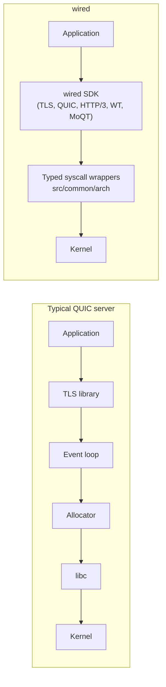
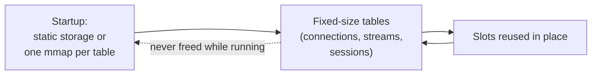
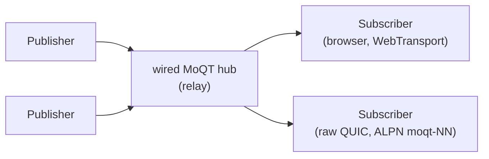
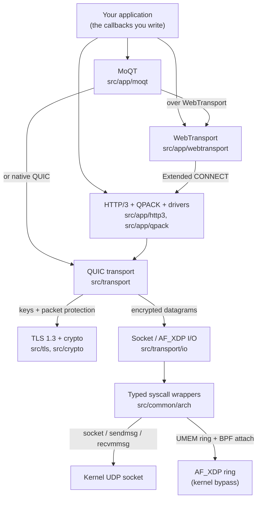

# wired

C で書いた QUIC・HTTP/3・WebTransport・Media over QUIC Transport(MoQT)のサーバー SDK。外部依存はない(OpenSSL、libevent、libc も使わない)。

[](https://github.com/Hakkadaikon/wired/actions/workflows/ci.yml)
[](https://github.com/Hakkadaikon/wired/actions/workflows/fuzz.yml)
[](https://github.com/Hakkadaikon/wired/actions/workflows/docs.yml)
[](https://codecov.io/gh/Hakkadaikon/wired)
[](LICENSE)

## 1. 概要

| 項目 | 内容 |
|---|---|
| 対応プロトコル | TLS 1.3 とその暗号、QUIC、HTTP/3 と QPACK、WebTransport、MoQT(draft-18/19/22/23) |
| 実装範囲 | 上記すべてをユーザー空間で自前実装 |
| 外部依存 | なし([2.1 依存関係](#21-依存関係)) |
| 成果物 | 静的なサーバーバイナリ 1 つ。ほかにインストールするものはない |
| 動作環境 | x86_64 Linux([10. 動作環境](#10-動作環境)) |
| ライセンス | MIT |


## 2. 設計上の特徴


### 2.1 依存関係

一般的な QUIC サーバーは TLS ライブラリ、イベントループ、アロケーター、libc を取り込む。wired はどれも取り込まない。



| 項目 | 状態 | 担保する仕組み |
|---|---|---|
| サードパーティのコード | なし | 同梱・ダウンロードしたライブラリはない。暗号、TLS、QUIC、HTTP/3、MoQT はすべてこのリポジトリで書いている |
| libc | 使わない | すべてのファイルを `-ffreestanding -nostdlib` でコンパイルする。libc の呼び出しが紛れ込むとリンクに失敗する |
| 動的ロード | なし | 静的バイナリ。差し替えやプリロードができる共有ライブラリはない |
| ツールチェーン | 固定 | コンパイラー、フォーマッター、リンターはロックファイル付きの Nix flake から取得し、CI と手元で同じバージョンを使う |
| カーネルとの境界 | `src/common/arch` の型付きシステムコールラッパーだけ | 一覧は [docs/syscalls.md](docs/syscalls.md) |
| ソースの対応関係 | 全層がこのリポジトリのプレーンな C | 各ファイルに実装している RFC の節を書いている |

汚染しうる上流パッケージも、乗っ取りうる推移的依存もない。サーバーが実行するバイトはすべてこのリポジトリで読める。


### 2.2 メモリ管理

`malloc` と `free` を使わない。use-after-free と double free は、C のネットワークコードでメモリ安全性の CVE を生むよくある原因で、その多くはこの 2 つから始まる。



| 項目 | 方式 |
|---|---|
| 確保 | 静的、または起動時に `mmap` で 1 回(ワーカーごとのテーブル、スレッドのスタック、AF_XDP のリング) |
| 解放 | 実行中はしない |
| 容量 | すべてコンパイル時の定数。大きさの根拠を定数の隣に書いている |
| ホットパス | メモリを確保しない |
| 受信データの読み書き | 範囲付きのビュー `wired_span` で読み、範囲付きの出力バッファー `wired_obuf` に書く。受信データから取り出した生の長さは使わない |

ヒープがないことで消える不具合と、残る不具合は次のとおりである。

| 不具合の種類 | 扱い | 確かめる仕組み |
|---|---|---|
| ヒープの use-after-free、double free、リーク、アロケーターのメタデータ破壊 | 起こらない | ヒープがない |
| ローカルバッファーを指す `wired_span` が関数から戻った後も使われる(use-after-return / use-after-scope) | 起こりうる | 長く生きるバッファーは呼び出し側のスコープで宣言する。固定した clang ではローカル変数の `wired_span_of` / `wired_mspan_of` を返すとコンパイルエラー(`lifetimebound`)。`just view-check` が長寿命の状態(env、設定、接続、TLS ドライバー、MoQT ハブ)に保存するビューに指す先を明記させる。CI の ASan が両方を検査する |
| 再利用されたスロットへの古い参照(WebTransport セッション) | `wired_wt_ref` は検出する | 世代をチェックし、スロットが再利用されると何も指さない。ライフサイクルを有界モデル検査で確かめる(`just cbmc`) |
| 再利用されたスロットへの古い参照(生の `wired_wt_session*`、接続・ストリームのスロットへのポインター) | 検出しない | なし |

ASan の下では SDK のスレッドが pthread として動くので、use-after-return の検査に必要なスレッドローカル領域を各スレッドが持つ。


### 2.3 MoQT リレー

同じスタックの上で MoQT リレーが動く。



| 項目 | 内容 |
|---|---|
| ドラフト | [draft-18](https://datatracker.ietf.org/doc/draft-ietf-moq-transport/18/)、[-19](https://datatracker.ietf.org/doc/draft-ietf-moq-transport/19/)、[-22](https://datatracker.ietf.org/doc/draft-ietf-moq-transport/22/)、[-23](https://datatracker.ietf.org/doc/draft-ietf-moq-transport/23/)。セッションごとにネゴシエーションする |
| トランスポート | WebTransport セッション(ブラウザーから参加できる)、生の QUIC 接続(ALPN `moqt-NN`) |
| リレーの機能 | PUBLISH / SUBSCRIBE、キャッシュ付きの FETCH、名前空間の探索、Track Properties、フィルター、優先度、複数パブリッシャーの重複排除による 1 Track への統合、届いた Object のバイト単位の即時転送、配送のタイムアウト、GOAWAY |
| 相互運用性テスト | [moq-interop-runner](https://github.com/englishm/moq-interop-runner) |
| デモ | [moqt_chat のライブデモ](https://hakkadaikon.github.io/wired/moqt_chat)(ブラウザーのチャットと音声通話のルーム) |

### 2.4 I/O ドライバー

イベントループは SDK が持つ。同じサーバーコードが 4 つの I/O ドライバーで動き、コマンドラインフラグで選ぶ。

| ドライバー | 方式 |
|---|---|
| poll | `poll` ループ |
| fork | fork したワーカー |
| threads | 生のスレッド |
| AF_XDP | カーネルの UDP スタックを通さず、NIC とサーバーの間でパケットを受け渡す。`--ifindex` で選ぶ |

フラグの一覧は [サーバーのフラグ](https://hakkadaikon.github.io/wired/guide/ja/quic/server-flags/) にある。


## 3. 品質保証

push のたびに次の検査を実行する。

| 分類 | 検査 | 検出する不具合 |
|---|---|---|
| メモリ | ASan + UBSan でのテスト実行と、trap サニタイザー付きの本番ビルド | 範囲外アクセス、スコープを抜けた後や関数から戻った後のスタックバッファーの使用、未定義動作 |
| コード | CERT C セキュアコーディング規則を有効にした clang-tidy(警告はエラー) | 危険なイディオム、整数変換、null ポインターの参照外し |
| コード | すべての関数で循環的複雑度 3 以下 | レビューできないほど込み入った関数 |
| 入力 | ファジング: 9 つのハーネス(QUIC のフレームとヘッダー、1-RTT パケット、TLS メッセージ、X.509、QPACK、カプセル、MoQT、MP4 フラグメント)。push のたびにスモークテスト、毎晩フル実行 | 悪意のある入力でのクラッシュとハング |
| 暗号 | すべての暗号プリミティブに RFC / FIPS のテストベクター、BoringSSL と Wycheproof のテストスイート | 誤った暗号 |
| 仕様 | [要件台帳](docs/features/README.md): 40 以上の仕様の規範的な記述をすべて挙げ、それぞれを出荷するサーバーの経路上のテストで裏付ける | 実装されていない仕様の規則 |
| 既知の脆弱性 | [脆弱性台帳](docs/security/vuln-ledger.md): ほかの QUIC/TLS/HTTP スタックの CVE とアドバイザリ 858 件を、このコードに対して確かめ直したもの。CI の到達性チェックで、挙げた防御が本番の経路上にあり続けることを確かめる | 他の実装の CVE の繰り返し |

脅威モデルとプロトコルごとの防御は [セキュリティ設計](docs/security/README.md) にある。


## 4. 性能

計測条件: 同じ 4 vCPU の VM、ループバック、小さな HTTP/3 レスポンス。2026-11-02 に `efd61452e` で、すべてのサーバーを同じ日に同じマシンで計測した。

| | wired | quiche 0.29.3 | quic-go v0.61.0 |
|---|---|---|---|
| 1 秒あたりのリクエスト数 | 23,825 | 22,175 | 12,042 |
| 負荷時のレイテンシ(p50) | 0.71 ms | 0.81 ms | 1.45 ms |
| 1 リクエストあたりのサーバー CPU 時間 | 35.4 µs | 37.2 µs | 79.6 µs |
| アイドル時のメモリ(RSS) | 512 KiB | 7,804 KiB | 8,424 KiB |
| 負荷時のピークメモリ | 1,932 KiB | 8,468 KiB | 15,340 KiB |

10 Mbps の模擬リンクでのグッドプットは次のとおりである。

| 計測した 5 サーバー(wired、quiche、quic-go、ngtcp2、picoquic)の範囲 | wired |
|---|---|
| 9,118〜9,535 kbps | 9,434 kbps |

機能の比較表、すべての計測レーン、再現方法は [実装の比較](docs/performance/comparison.md) にある。


## 5. 構成

各プロトコルは下の層の上に作られ、`src/` の下にそれぞれ専用のディレクトリがある。図は上から下へ読む。カーネルとやり取りするのは `src/common/arch` のシステムコールラッパーだけである。



アプリケーションは次の 3 つの層のどれにでもつなげる。

| つなぎ口 | 内容 |
|---|---|
| HTTP/3 | 素の HTTP/3 |
| WebTransport | HTTP/3 の *Extended CONNECT* リクエストで開く、ブラウザーから扱えるストリーム |
| MoQT | WebTransport 上、または QUIC 上で直接 |

各ボックスの元になる仕様は [実装している仕様](docs/design/specs.md)、各層の説明は [基本設計](docs/architecture/README.md) にある。


## 6. コードの例

アプリケーションが書くのはコールバック 1 つである。ポートのバインド、ハンドシェイク、暗号化、損失回復、HTTP/3 は SDK が処理し、リクエストがそろったらコールバックを呼ぶ。次は [examples/word_list](examples/word_list/wired_server.c) からの抜粋である。

```c
static int app_on_request(
    void*                       ctx,
    const wired_h3reqdrive_req* req,
    u64                         offset,
    wired_obuf*                 body_out,
    const char**                content_type,
    int*                        more,
    u64*                        total_size) {
  /* ... write the response into body_out ... */
  return 1;
}
```

| 引数 | 役割 |
|---|---|
| `req` | method、path、body |
| `body_out` | レスポンスの body を書く先 |
| `*content_type` | MIME タイプを指させる |
| `offset`、`more`、`total_size` | 1 回の呼び出しに収まらない大きな body 用([大きな body のストリーミング](https://hakkadaikon.github.io/wired/guide/ja/h3/streaming/)) |

戻り値は 1。

`main` を呼ぶ libc がないので、`wired_main` が代わりの入口になる。フラグを解析し、TLS のアイデンティティを用意して、コールバックをドライバーに渡す。

```c
int wired_main(int argc, char** argv) {
  /* ... */
  load_config(&cfg, argc, argv);
  server_identity(&id, &keys);
  /* ... */
  if (!wired_srvdriver_run(&id, h, obs, &cfg.driver))
    wired_die("listen failed\n");
  return 0;
}
```

動くサーバーまでの手順は [インタラクティブガイド](https://hakkadaikon.github.io/wired/guide/ja/) にある。


## 7. サンプル

| サンプル | 内容 |
|---|---|
| [word_list](examples/word_list/) | HTTP/3 のメッセージログ(POST/GET)または静的ファイルサーバー。4 つの I/O ドライバーすべてに対応。CA 証明書を置くだけで使える |
| [moqt_chat](examples/moqt_chat/)([ライブデモ](https://hakkadaikon.github.io/wired/moqt_chat)) | MoQT 上のブラウザーチャットと音声通話のルーム。PUBLISH/SUBSCRIBE による Track の中継、Opus の音声フレーム、固定のルーム 1 つ |
| [webtransport_interop](examples/webtransport_interop/) | [quic-interop-runner](https://github.com/quic-interop/quic-interop-runner) の WebTransport サーバーエンドポイント。実際のクライアント実装を相手に、ストリームと DATAGRAM でファイルを転送する |
| [moqt_interop](examples/moqt_interop/) | [moq-interop-runner](https://github.com/englishm/moq-interop-runner) のリレー。WebTransport 上の MoQT リレー(セッションごとに draft-18/19/22/23 をネゴシエーション)を、実際のクライアント実装を相手にテストする |


## 8. 相互運用性テストの結果

「wired の実行」は各ランナーに wired を追加してこのプロジェクトが実行した結果、「公式」は上流ランナーの公開結果である。

| プロトコル | wired の実行 | 公式 |
|---|---|---|
| QUIC | <https://quic-interop-runner-wired.vercel.app/quic> | <https://interop.seemann.io/quic> |
| WebTransport | <https://quic-interop-runner-wired.vercel.app/webtransport> | <https://interop.seemann.io/webtransport> |
| MoQT(リレー役) | <https://moq-interop-runner-wired.vercel.app> | <https://englishm.github.io/moq-interop-runner/> |


## 9. ドキュメント

| 文書 | 内容 |
|---|---|
| [docs/](docs/README.md) | すべてのドキュメントの一覧 |
| [ユビキタス言語](docs/ubiquitous/README.md) | ドキュメントで使う技術用語の表記 |
| [開発環境の準備](docs/standards/setup.md) | ツールチェーンの準備と最初のビルド |
| [基本設計](docs/architecture/README.md) | 各層の作り |
| [API リファレンス](https://hakkadaikon.github.io/wired/) | 公開インターフェースの全体 |
| [既知の制限](docs/security/limitations/README.md) | 意図的に仕様から外れている点と容量の制限 |


## 10. 動作環境

| 項目 | 条件 |
|---|---|
| OS と CPU | x86_64 Linux のみ |
| AF_XDP ドライバー(任意) | root 権限とカーネル 5.9 以降(XDP の `BPF_LINK_CREATE` のため) |
| NIC がネイティブの XDP に非対応 | `--skb-mode` で汎用 XDP モード(ネイティブより遅い)を使う |
| 一部の仮想 NIC(`virtio_net` など) | 汎用モードで AF_XDP の送信に失敗することがある。その場合は通常の UDP ドライバーを使う |

ドライバーのフラグは [サーバーのフラグ](https://hakkadaikon.github.io/wired/guide/ja/quic/server-flags/) にある。


## 11. ライセンス

MIT。[LICENSE](LICENSE) を参照。
