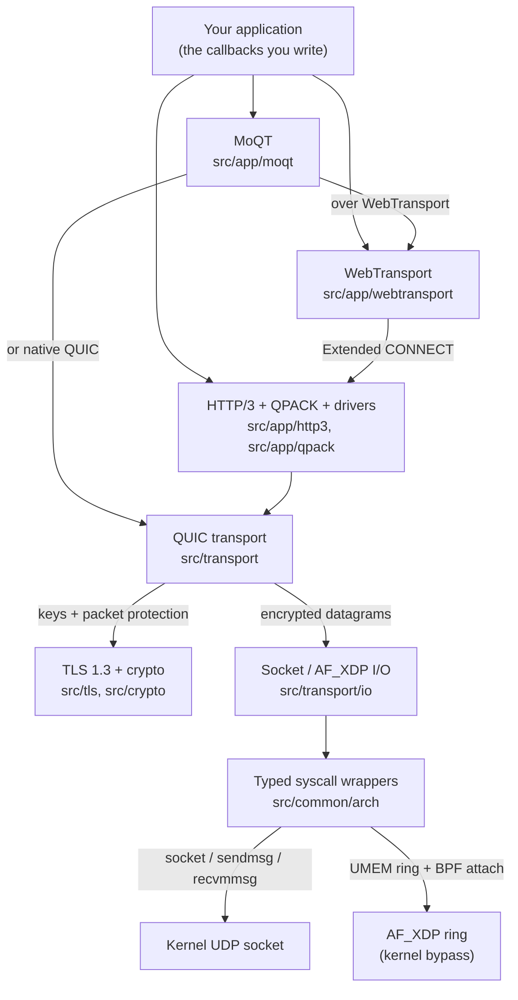

# wired

**An HTTP/3 + WebTransport server SDK in C that runs the entire protocol
stack in user space — with zero dependencies. No OpenSSL, no libevent, not
even libc.**

[](https://github.com/Hakkadaikon/wired/actions/workflows/ci.yml)
[](https://github.com/Hakkadaikon/wired/actions/workflows/fuzz.yml)
[](https://github.com/Hakkadaikon/wired/actions/workflows/docs.yml)
[](https://codecov.io/gh/Hakkadaikon/wired)
[](LICENSE)

This page tells you what wired is, why it is built the way it is, and where
to go next. It is written for someone who knows HTTP and TLS at a high level
but has not looked inside QUIC or freestanding C yet.

## Quick start

Two commands to a built SDK. You need `just` first: it is a command runner
(think `make` without the Makefile quirks), installed with
`apt install just` or as described in
[Getting Started](docs/getting-started.md#install-the-toolchain).

```sh
just setup           # one-time: installs Nix
just build           # fetches the pinned toolchain, then format + compile + lint
```

Next, follow the [interactive guide](https://hakkadaikon.github.io/wired/guide/en/)
from here to a running HTTP/3 server; [Getting Started](docs/getting-started.md)
is the same path as plain text. Once a server is up, test it from any
machine that can reach UDP port 4433 — the Docker image saves you from
needing an HTTP/3-capable curl locally:

```sh
docker run --rm ymuski/curl-http3 \
    curl --http3-only --insecure -v https://<host>:4433/
```

## What it is for

- **Embedding an HTTP/3 / WebTransport server** in a project where you don't
  want a dependency chain — the whole SDK is one static library.
- **Learning how QUIC actually works.** Every layer, from the TLS handshake
  to congestion control to the bytes on the wire, is readable C in this one
  repository, each file annotated with the RFC section it implements.
- **Running interop and network experiments** — four interchangeable I/O
  drivers (from a simple `poll` loop up to kernel-bypass AF_XDP) behind one
  command-line flag.

You don't need to be a protocol expert to start: the quick start above and
the [examples](examples/) run as-is. The internals documentation is there
for when (and if) you want to go deeper.

## Why wired

**Zero dependencies, zero libc.** A normal C program links against libc, the
C standard library that provides `printf`, `malloc`, and the thin wrappers
around system calls. wired does not use it. Every file compiles
*freestanding* (`-ffreestanding -nostdlib`): the compiler is told there is
no standard library at all, so if anything external leaked in, the build
would fail, so a clean build is itself the proof that nothing depends on
libc. For you this means the server is one
static binary with nothing to install next to it, and every byte it runs is
code you can read in this repository.

**The full stack in user space.** User space is where ordinary programs
run; the kernel is the operating system core that owns the network card.
With TCP-based HTTPS the kernel runs TCP for you. QUIC runs over UDP
instead, so the transport (reliability, ordering, congestion control) has
to live in the program. wired implements QUIC, TLS 1.3, HTTP/3, QPACK (the
HTTP/3 header compression format), and WebTransport itself. The kernel only
ever carries already-encrypted UDP bytes.
(Specs: [RFC 9000](https://www.rfc-editor.org/rfc/rfc9000) /
[9001](https://www.rfc-editor.org/rfc/rfc9001) /
[9002](https://www.rfc-editor.org/rfc/rfc9002) /
[8446](https://www.rfc-editor.org/rfc/rfc8446) /
[9114](https://www.rfc-editor.org/rfc/rfc9114) /
[9204](https://www.rfc-editor.org/rfc/rfc9204) /
[draft-ietf-webtrans-http3](https://datatracker.ietf.org/doc/draft-ietf-webtrans-http3/)
— the [full list](docs/arch/rfcs.md) covers 40+ specifications.)

**Four I/O drivers behind one flag.** The same callback runs under any of
four drivers: a single-process `poll` loop, forked worker processes, raw
threads, or AF_XDP. AF_XDP is a Linux feature
that hands packets from the network card straight to the program through a
shared memory ring, bypassing the kernel's own UDP/IP processing. Switching
drivers is a command-line flag, not a code change; the
[server flags](https://hakkadaikon.github.io/wired/guide/en/quic/server-flags/)
guide page shows how.

**Its own verified cryptography.** AES-GCM, ChaCha20-Poly1305, X25519,
Ed25519, ECDSA P-256/P-384, RSA, SHA-2, HKDF — each checked against the
official RFC/FIPS test vectors.

**Auditable by construction.** Every function has a cyclomatic complexity of
at most 3 (at most three independent paths, checked in CI), so each one can
be read and verified on its own. CI also runs clang-tidy with the CERT C
secure-coding checks on every push, fuzzing every night, and interop tests
against real QUIC clients.

## How the layers fit

Each protocol is built on the one below it, and each lives in its own
directory under `src/`. Your code can plug in at any of three levels: plain
HTTP/3; WebTransport (browser-friendly streams opened with an HTTP/3
*Extended CONNECT* request); or MoQT (Media over QUIC Transport, a
publish/subscribe media layer that runs over WebTransport or directly over
QUIC). Read the chart top to bottom: your code sits at the top, the kernel
at the bottom, and only the syscall-wrapper box (`src/common/arch`) just
above it talks to the kernel. The four drivers are chosen and run in
`src/app/http3/server`; `--ifindex` is the flag that selects AF_XDP.



[Architecture](docs/arch/overview.md) explains each layer in detail.

## What the code looks like

Your side of a server is **one callback**. The SDK owns the event loop: it
binds the port, waits for packets, runs the handshake, encryption, loss
recovery, and HTTP/3, and calls your function once a request is complete.
You never write the loop yourself.

The callback from [examples/word_list](examples/word_list/wired_server.c)
looks like this:

```c
static int app_on_request(
    void*                       ctx,
    const wired_h3reqdrive_req* req,
    u64                         offset,
    wired_obuf*                 body_out,
    const char**                content_type,
    int*                        more,
    u64*                        total_size) {
  /* ... write the response into body_out ... */
  return 1;
}
```

`ctx` is your own pointer, passed back unchanged. `req` holds the method,
path, and body; write the response body into `body_out`, point
`*content_type` at a MIME type, and return 1. The other parameters exist for
bodies too large for one call; see
[Streaming responses](https://hakkadaikon.github.io/wired/guide/en/h3/streaming/).

`wired_main` replaces `main` (there is no libc to call `main`). It loads the
server identity (the TLS certificate and its keys), parses the flags, and hands
the callback to the driver
(declarations and optional settings trimmed):

```c
int wired_main(int argc, char** argv) {
  /* ... */
  load_config(&cfg, argc, argv);
  server_identity(&id, &keys);
  /* ... */
  if (!wired_srvdriver_run(&id, h, obs, &cfg.driver))
    wired_die("listen failed\n");
  return 0;
}
```

`load_config` calls `wired_srvdriver_parse`, which reads the driver flags.
The guide walks through this step by step:
[Hello, wired](https://hakkadaikon.github.io/wired/guide/en/getting-started/hello/)
covers `wired_main` and the libc-free entry point, and
[Hello, HTTP/3](https://hakkadaikon.github.io/wired/guide/en/h3/hello/) covers
the request handler.

## Examples

| Example | What it shows |
|---|---|
| [word_list](examples/word_list/) | HTTP/3 message log (POST/GET) or static-file server; all four I/O drivers; CA-certificate drop-in |
| [moqt_chat](examples/moqt_chat/) ([live demo](https://hakkadaikon.github.io/wired/moqt_chat)) | Browser chat + voice call room over Media over QUIC Transport: PUBLISH/SUBSCRIBE track relay, Opus voice frames, single fixed room |
| [webtransport_interop](examples/webtransport_interop/) | The [quic-interop-runner](https://github.com/quic-interop/quic-interop-runner) WebTransport server endpoint: file transfer over streams and DATAGRAMs against real client implementations |
| [moqt_interop](examples/moqt_interop/) | The [moq-interop-runner](https://github.com/englishm/moq-interop-runner) relay: a MoQT relay over WebTransport (negotiates draft-18/19/22 per session) tested against real client implementations |

## Interop results

Interop matrices against other implementations. "wired runs" are this
project's own runs of each runner with wired added; "official" is the
upstream runner's public results.

| Protocol | wired runs | Official |
|---|---|---|
| QUIC | <https://quic-interop-runner-wired.vercel.app/quic> | <https://interop.seemann.io/quic> |
| WebTransport | <https://quic-interop-runner-wired.vercel.app/webtransport> | <https://interop.seemann.io/webtransport> |
| MoQT (relay role) | <https://moq-interop-runner-wired.vercel.app> | <https://englishm.github.io/moq-interop-runner/> |

## Documentation

Everything lives under [docs/](docs/README.md) — one index page ordering
every doc by task. Read [Getting Started](docs/getting-started.md) first,
then [Architecture](docs/arch/overview.md). The
[API reference](https://hakkadaikon.github.io/wired/) covers the full public
surface, and the
[moqt_chat live demo](https://hakkadaikon.github.io/wired/moqt_chat) shows
the SDK driven from a browser.

## Supported platform

x86_64-linux only. The optional AF_XDP driver also needs root and kernel 5.9
or later (for `BPF_LINK_CREATE` on XDP). If your network card (NIC) has no
native XDP support, `--skb-mode` selects the slower generic XDP mode. Some
virtual NICs (e.g. `virtio_net`) cannot send AF_XDP packets in generic mode,
so use the plain UDP driver there. The
[server flags](https://hakkadaikon.github.io/wired/guide/en/quic/server-flags/)
page lists the driver flags.

## License

MIT — see [LICENSE](LICENSE).
