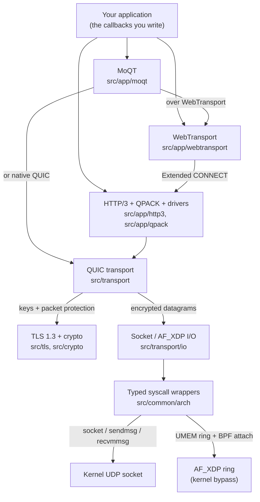

# wired

**A QUIC, HTTP/3, WebTransport and Media over QUIC server SDK in C, with no
dependencies at all — no OpenSSL, no libevent, not even libc.**

[](https://github.com/Hakkadaikon/wired/actions/workflows/ci.yml)
[](https://github.com/Hakkadaikon/wired/actions/workflows/fuzz.yml)
[](https://github.com/Hakkadaikon/wired/actions/workflows/docs.yml)
[](https://codecov.io/gh/Hakkadaikon/wired)
[](LICENSE)

wired implements the whole stack itself, in user space: TLS 1.3 and its
cryptography, QUIC, HTTP/3 and QPACK, WebTransport, and MoQT (Media over QUIC
Transport). The result is one static server binary of about 640 KB, with
nothing else to install next to it.

## Why wired

### Nothing to trust but this repository

A typical QUIC server pulls in a TLS library, an event loop, an allocator and
libc, and every one of them is code you inherit. wired pulls in none of them.

- **No third-party code.** The SDK contains no vendored or downloaded
  libraries. Cryptography, TLS, QUIC, HTTP/3 and MoQT are all written here.
- **No libc.** Every file compiles with `-ffreestanding -nostdlib`, so a
  stray libc call fails to link. The server talks to the kernel through a
  small set of typed system-call wrappers in `src/common/arch`, listed in
  [docs/syscalls.md](docs/syscalls.md).
- **No dynamic loading.** The server is a static binary. There is no shared
  library to swap or preload.
- **A pinned toolchain.** The compiler, formatter and linters come from a
  Nix flake with a lock file, so CI and your machine build with the same
  versions.

For a supply-chain attack, this leaves very little to aim at. There is no
upstream package to poison and no transitive dependency to hijack. Every byte
the server runs can be read and reviewed in this repository.

### No heap, so no use-after-free from the allocator

Use-after-free and double-free bugs are among the most common causes of
memory-safety CVEs in C network code, and nearly all of them start with
`malloc` and `free`. wired has neither.

- Memory is either static or reserved once at startup with `mmap`: the
  per-worker tables, thread stacks and the AF_XDP ring. None of it is
  released while the server runs.
- Connections, streams and sessions live in fixed-size tables whose slots
  are reused in place. Every capacity is a compile-time constant with its
  sizing rationale next to it.
- Parsers read peer bytes through bounded views (`wired_span`) and write
  through bounded output buffers (`wired_obuf`), never through raw lengths
  taken from the wire.

This rules out allocator-related use-after-free and double-free entirely. It
does not make the code memory-safe by itself: a slot reused too early is
still a bug, and the checks below exist to catch exactly that kind of
mistake.

### Hardened and checked on every push

| Check | What it catches |
|---|---|
| ASan + UBSan test run, plus a trap-sanitized production build | out-of-bounds access, use of freed or uninitialized memory, undefined behavior |
| clang-tidy with the CERT C secure-coding rules, as errors | unsafe idioms, integer conversions, null dereferences |
| Fuzzing: 9 harnesses (QUIC frames and headers, 1-RTT packets, TLS messages, X.509, QPACK, capsules, MoQT, MP4 fragments), smoke-tested on every push and run nightly | crashes and hangs on hostile input |
| RFC / FIPS test vectors for every primitive, plus the BoringSSL and Wycheproof suites | wrong cryptography |
| Cyclomatic complexity ≤ 3 for every function | functions too tangled to review |
| [Requirement ledgers](docs/features/README.md): every normative statement of 40+ specs, each backed by a test on the shipping server path | silently unimplemented spec rules |
| [Vulnerability ledger](docs/security/vuln-ledger.md): 856 known CVEs and advisories from other QUIC/TLS/HTTP stacks, each re-checked against this code; a reachability check in CI keeps the cited defenses on the production path | repeating someone else's CVE |

The [security overview](docs/security.md) describes the threat model and the
order in which each incoming packet is checked.

### Fast and small

The SDK owns the event loop, and no hot path allocates memory. The same
server code runs under four I/O drivers, selected with a
command-line flag: a `poll` loop, forked workers, raw threads, and AF_XDP,
which moves packets between the network card and the server without going
through the kernel's UDP stack.

Measured against quic-go and quiche on the same 4-vCPU VM, serving small
HTTP/3 responses over loopback:

| | wired | quiche 0.29.3 | quic-go v0.61.0 |
|---|---|---|---|
| Requests per second | **26,079** | 20,453 | 12,788 |
| Latency under load, p50 | **0.64 ms** | 0.90 ms | 1.35 ms |
| Memory when idle (RSS) | **380 KiB** | 7,712 KiB | 8,508 KiB |
| Peak memory under load | **1,928 KiB** | 8,484 KiB | 15,496 KiB |
| Server binary | **369 KB** (static) | 6.1 MB | 7.3 MB |

On a lossy simulated link, all five servers tested (with ngtcp2 and picoquic)
reach the same goodput within the spread of their runs.

These numbers are a dated snapshot. They were measured on 2026-08-16 at
commit `9d21db9` and have not been re-measured since. Later changes have
added work per packet and enlarged some buffers (for example, request
targets up to 8000 octets), and the current binary is about 640 KB. [Implementation
Comparison](docs/performance/comparison.md) has every lane, the full feature
matrix, the environment, and the scripts to reproduce the numbers.

### Media over QUIC, not only HTTP

wired ships a MoQT relay on the same stack, not a separate product.

- **Three draft versions, negotiated per session**:
  [draft-18](https://datatracker.ietf.org/doc/draft-ietf-moq-transport/18/),
  [-19](https://datatracker.ietf.org/doc/draft-ietf-moq-transport/19/) and
  [-22](https://datatracker.ietf.org/doc/draft-ietf-moq-transport/22/).
- **Two transports**: over a WebTransport session, so browsers can join, or
  directly on a raw QUIC connection (ALPN `moqt-NN`).
- **A full relay**, covering:
  - PUBLISH / SUBSCRIBE and FETCH with a cache;
  - namespace discovery, Track Properties, filters and priorities;
  - several publishers merged into one track, with deduplication;
  - Objects forwarded byte by byte as they arrive;
  - delivery timeouts and GOAWAY.
- **Tested against other implementations** in the
  [moq-interop-runner](https://github.com/englishm/moq-interop-runner). The
  [moqt_chat live demo](https://hakkadaikon.github.io/wired/moqt_chat) runs a
  browser chat and voice room on it.

### Readable down to the bytes

Every layer is plain C in this one repository, and each file names the RFC
section it implements. It is a working server, and also a place to learn how
QUIC, TLS 1.3 and HTTP/3 actually fit together.

## How the layers fit

Each protocol builds on the one below it and lives in its own directory
under `src/`. Your code plugs in at one of three levels:

- plain HTTP/3;
- WebTransport: browser-friendly streams opened with an HTTP/3 *Extended
  CONNECT* request;
- MoQT, over WebTransport or directly over QUIC.

Read the chart from top to bottom. Only the syscall wrappers in
`src/common/arch` talk to the kernel. `--ifindex` selects the AF_XDP driver.



The specifications behind each box are listed in [RFCs and
drafts](docs/arch/rfcs.md), and [Architecture](docs/arch/overview.md)
explains each layer in detail.

## What the code looks like

Your side of a server is one callback. The SDK binds the port, runs the
handshake, encryption, loss recovery and HTTP/3, and calls your function when
a request is complete. This one is from
[examples/word_list](examples/word_list/wired_server.c):

```c
static int app_on_request(
    void*                       ctx,
    const wired_h3reqdrive_req* req,
    u64                         offset,
    wired_obuf*                 body_out,
    const char**                content_type,
    int*                        more,
    u64*                        total_size) {
  /* ... write the response into body_out ... */
  return 1;
}
```

`req` holds the method, path and body. Write the body into `body_out`, point
`*content_type` at a MIME type, and return 1. The remaining parameters are
for bodies too large for one call
([Streaming responses](https://hakkadaikon.github.io/wired/guide/en/h3/streaming/)).

There is no libc to call `main`, so `wired_main` takes its place. It parses
the flags, sets up the TLS identity, and hands the callback to the driver:

```c
int wired_main(int argc, char** argv) {
  /* ... */
  load_config(&cfg, argc, argv);
  server_identity(&id, &keys);
  /* ... */
  if (!wired_srvdriver_run(&id, h, obs, &cfg.driver))
    wired_die("listen failed\n");
  return 0;
}
```

The [interactive guide](https://hakkadaikon.github.io/wired/guide/en/) goes
from here to a running server step by step.

## Examples

| Example | What it shows |
|---|---|
| [word_list](examples/word_list/) | HTTP/3 message log (POST/GET) or static-file server; all four I/O drivers; CA-certificate drop-in |
| [moqt_chat](examples/moqt_chat/) ([live demo](https://hakkadaikon.github.io/wired/moqt_chat)) | Browser chat + voice call room over Media over QUIC Transport: PUBLISH/SUBSCRIBE track relay, Opus voice frames, single fixed room |
| [webtransport_interop](examples/webtransport_interop/) | The [quic-interop-runner](https://github.com/quic-interop/quic-interop-runner) WebTransport server endpoint: file transfer over streams and DATAGRAMs against real client implementations |
| [moqt_interop](examples/moqt_interop/) | The [moq-interop-runner](https://github.com/englishm/moq-interop-runner) relay: a MoQT relay over WebTransport (negotiates draft-18/19/22 per session) tested against real client implementations |

## Interop results

Interop matrices against other implementations. "wired runs" are this
project's own runs of each runner with wired added; "official" is the
upstream runner's public results.

| Protocol | wired runs | Official |
|---|---|---|
| QUIC | <https://quic-interop-runner-wired.vercel.app/quic> | <https://interop.seemann.io/quic> |
| WebTransport | <https://quic-interop-runner-wired.vercel.app/webtransport> | <https://interop.seemann.io/webtransport> |
| MoQT (relay role) | <https://moq-interop-runner-wired.vercel.app> | <https://englishm.github.io/moq-interop-runner/> |

## Documentation

- [docs/](docs/README.md): every document, ordered by task.
- [Getting Started](docs/getting-started.md): toolchain setup and a first
  build.
- [Architecture](docs/arch/overview.md): how the layers are built.
- [API reference](https://hakkadaikon.github.io/wired/): the full public
  interface.
- [Known limitations](docs/features/known-limitations.md): every deliberate
  deviation and capacity limit.

## Supported platform

x86_64 Linux only. The optional AF_XDP driver also needs root and kernel 5.9
or later (for `BPF_LINK_CREATE` on XDP). If your network card (NIC) has no
native XDP support, `--skb-mode` selects the slower generic XDP mode. Some
virtual NICs (e.g. `virtio_net`) may fail to send AF_XDP packets in generic
mode; if that happens, use the plain UDP driver. The [server
flags](https://hakkadaikon.github.io/wired/guide/en/quic/server-flags/) page
lists the driver flags.

## License

MIT — see [LICENSE](LICENSE).
