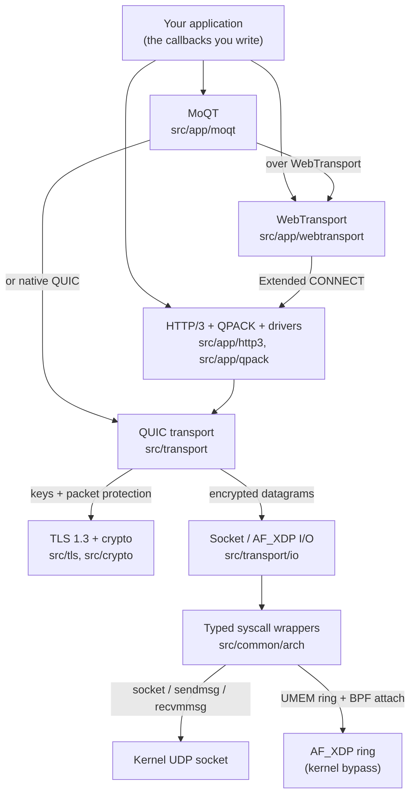

# wired

**C で書いた QUIC・HTTP/3・WebTransport・Media over QUIC のサーバー SDK です。
依存ライブラリは一切ありません。OpenSSL も libevent も、libc さえ使いません。**

[](https://github.com/Hakkadaikon/wired/actions/workflows/ci.yml)
[](https://github.com/Hakkadaikon/wired/actions/workflows/fuzz.yml)
[](https://github.com/Hakkadaikon/wired/actions/workflows/docs.yml)
[](https://codecov.io/gh/Hakkadaikon/wired)
[](LICENSE)

wired はスタック全体をユーザー空間で自前実装しています。TLS 1.3 とその暗号、QUIC、HTTP/3 と QPACK、WebTransport、MoQT(Media over QUIC Transport)です。
できあがるのは約 640 KB の静的なサーバーバイナリ 1 つで、ほかに何もインストールする必要はありません。

## wired の特長

### 信頼すべきものはこのリポジトリだけ

一般的な QUIC サーバーは TLS ライブラリ、イベントループ、アロケーター、libc を取り込みます。そのどれもが引き継ぐことになるコードです。
wired はどれも取り込みません。

- **サードパーティのコードがありません。** SDK には同梱したライブラリもダウンロードしたライブラリも含まれていません。
  暗号、TLS、QUIC、HTTP/3、MoQT はすべてこのリポジトリで書いています。
- **libc を使いません。** すべてのファイルを `-ffreestanding -nostdlib` でコンパイルするので、libc の呼び出しが紛れ込むとリンクに失敗します。
  サーバーは `src/common/arch` にある少数の型付きシステムコールラッパーを通してカーネルとやり取りします。一覧は [docs/syscalls.md](docs/syscalls.md) にあります。
- **動的ロードがありません。** サーバーは静的バイナリです。差し替えたりプリロードしたりできる共有ライブラリはありません。
- **ツールチェーンを固定しています。** コンパイラー、フォーマッター、リンターはロックファイル付きの Nix flake から取得するので、CI と手元のマシンは同じバージョンでビルドします。

そのため、サプライチェーン攻撃の標的になる部分はほとんど残りません。
汚染できる上流パッケージも、乗っ取れる推移的依存もありません。
サーバーが実行するバイトはすべて、このリポジトリで読んでレビューできます。

### ヒープを使わない

use-after-free と double free のバグは、C のネットワークコードでメモリ安全性の CVE を生むよくある原因の一つで、その多くは `malloc` と `free` から始まります。
wired はそのどちらも使わないので、扱いを誤ることもありません。

- メモリは静的に確保するか、起動時に `mmap` で一度だけ確保します。ワーカーごとのテーブル、スレッドのスタック、AF_XDP のリングがこれにあたります。
  どれもサーバーの実行中には解放しません。
- コネクション、ストリーム、セッションは固定サイズのテーブルに置き、スロットはその場で再利用します。
  容量はすべてコンパイル時の定数で、その大きさにした理由を定数の隣に書いています。
- パーサーはピアから受け取ったバイトを範囲付きのビュー(`wired_span`)で読み、範囲付きの出力バッファー(`wired_obuf`)に書きます。
  受信したバイト列から取り出した生の長さをそのまま使って読み書きすることはありません。

これで、ヒープに起因するバグの種類は丸ごとなくなります。ヒープメモリの use-after-free と double free、リーク、アロケーターのメタデータ破壊です。
ただし、これでコードがメモリ安全になるわけではありません。ダングリング参照は、次の 2 種類がまだ起こりえます。

- **指している先のスタックフレームより長く生きるビュー。** ローカルバッファーに対して取った `wired_span` は、関数から戻った時点で無効になります(use-after-return / use-after-scope)。
  そのため、ビューより長く生きる必要があるバッファーは呼び出し側のスコープで宣言しています。
  固定した clang ではローカル変数の `wired_span_of` / `wired_mspan_of` ビューを返すとコンパイルエラーになります(`lifetimebound`)。
  さらに CI のチェック(`just view-check`)が、SDK の長寿命な状態(env、設定、コネクション、TLS ドライバー、MoQT ハブ)に保存する各ビューについて、指している先がどこに置かれたメモリかを明記させます。
- **再利用されたスロットへの古い参照。** コネクションやストリームのスロットが解放されて新しいピアに割り当てられた後も、そのスロットへのポインターを持ち続けている場合です。
  アプリケーションはステップをまたいで保持する WebTransport セッションを、世代をチェックする `wired_wt_ref` として持ちます。これはスロットが再利用されると何も指さなくなります。このライフサイクルは有界モデル検査で確かめています(`just cbmc`)。
  一方、ステップをまたいで保持した生の `wired_wt_session*` や、コネクション・ストリームのスロットへのポインターはチェックされません。

下の表のチェックはまさにこれらを見つけるためにあります。
CI のサニタイザー実行は use-after-scope と use-after-return の両方を検査します。ASan の下では SDK のスレッドが pthread として動くので、ASan の use-after-return モードが必要とするスレッドローカル領域を各スレッドが持てます。

### 堅牢化と push ごとのチェック

| チェック | 見つけるもの |
|---|---|
| ASan + UBSan でのテスト実行と、trap サニタイザー付きの本番ビルド | 範囲外アクセス、スコープを抜けた後や関数から戻った後のスタックバッファーの使用、未定義動作 |
| CERT C セキュアコーディング規則を有効にした clang-tidy(エラー扱い) | 危険なイディオム、整数変換、null 参照 |
| ファジング: 9 つのハーネス(QUIC のフレームとヘッダー、1-RTT パケット、TLS メッセージ、X.509、QPACK、カプセル、MoQT、MP4 フラグメント)。push のたびにスモークテストし、毎晩フル実行 | 悪意のある入力でのクラッシュとハング |
| すべての暗号プリミティブに対する RFC / FIPS のテストベクターと、BoringSSL・Wycheproof のテストスイート | 誤った暗号 |
| すべての関数で循環的複雑度 3 以下 | レビューできないほど込み入った関数 |
| [要件台帳](docs/features/README.md): 40 以上の仕様のすべての規範的な記述を挙げ、それぞれを出荷するサーバーの経路上のテストで裏付ける | 気づかないうちに実装されていない仕様の規則 |
| [脆弱性台帳](docs/security/vuln-ledger.md): ほかの QUIC/TLS/HTTP スタックで知られている 856 件の CVE とアドバイザリを、それぞれこのコードに対して確かめ直したもの。CI の到達性チェックで、挙げた防御が本番の経路上にあり続けることを確かめる | 他人の CVE の繰り返し |

[セキュリティの概要](docs/security.md) で、脅威モデルと、受信した各パケットをどの順序でチェックするかを説明しています。

### 速くて小さい

イベントループは SDK が持ち、ホットパスではメモリを確保しません。
同じサーバーコードが 4 つの I/O ドライバーの上で動き、コマンドラインフラグで選べます。`poll` ループ、fork したワーカー、生のスレッド、そして AF_XDP です。
AF_XDP はカーネルの UDP スタックを通さずにネットワークカードとサーバーの間でパケットを受け渡します。

同じ 4 vCPU の VM 上で、ループバック経由の小さな HTTP/3 レスポンスを返すときの quic-go・quiche との比較です。

| | wired | quiche 0.29.3 | quic-go v0.61.0 |
|---|---|---|---|
| 1 秒あたりのリクエスト数 | **23,825** | 22,175 | 12,042 |
| 負荷時のレイテンシ(p50) | **0.71 ms** | 0.81 ms | 1.45 ms |
| 1 リクエストあたりのサーバー CPU 時間 | **35.4 µs** | 37.2 µs | 79.6 µs |
| アイドル時のメモリ(RSS) | **512 KiB** | 7,804 KiB | 8,424 KiB |
| 負荷時のピークメモリ | **1,932 KiB** | 8,468 KiB | 15,340 KiB |
| サーバーバイナリ | **525 KB**(静的) | 6.2 MB | 7.3 MB |

10 Mbps の模擬リンクでは、試した 5 つのサーバー(ngtcp2 と picoquic を含む)がほぼ同じグッドプットに達します(9,118〜9,535 kbps。wired は 9,434)。

2026-11-02 に `efd61452e` で計測しました。すべてのサーバーを同じ日に同じマシンで計測しています。
機能の比較表、すべての計測レーンとその再現方法は [実装の比較](docs/performance/comparison.md) にあります。

### HTTP だけでなく Media over QUIC も

wired は同じスタックの上に MoQT リレーを載せています。別の製品ではありません。

- **3 つのドラフトバージョン**
  ([draft-18](https://datatracker.ietf.org/doc/draft-ietf-moq-transport/18/)、
  [-19](https://datatracker.ietf.org/doc/draft-ietf-moq-transport/19/)、
  [-22](https://datatracker.ietf.org/doc/draft-ietf-moq-transport/22/))を、セッションごとにネゴシエーションします。
- **2 つのトランスポート**で動きます。ブラウザーから参加できる WebTransport セッションの上か、生の QUIC コネクションの上(ALPN `moqt-NN`)で直接動きます。
- **フル機能のリレー**で、次をカバーします。
  - PUBLISH / SUBSCRIBE と、キャッシュ付きの FETCH
  - 名前空間の探索、Track Properties、フィルター、優先度
  - 複数のパブリッシャーを重複排除しつつ 1 つの Track にまとめる
  - Object を届いたそばから 1 バイトずつ転送する
  - 配送のタイムアウトと GOAWAY
- [moq-interop-runner](https://github.com/englishm/moq-interop-runner) で**ほかの実装と相互接続テストをしています**。
  [moqt_chat のライブデモ](https://hakkadaikon.github.io/wired/moqt_chat) では、その上でブラウザーのチャットと音声通話のルームが動いています。

### バイト単位まで読める

どの層もこの 1 つのリポジトリにあるプレーンな C で、各ファイルには実装している RFC の節を書いています。
動くサーバーであると同時に、QUIC、TLS 1.3、HTTP/3 が実際にどう組み合わさっているかを学べる場所でもあります。

## 層の組み合わせ

各プロトコルはその下の層の上に作られていて、それぞれ `src/` の下の専用ディレクトリにあります。
あなたのコードは次の 3 つのどの層にでもつなげられます。

- 素の HTTP/3
- WebTransport: HTTP/3 の *Extended CONNECT* リクエストで開く、ブラウザーから扱いやすいストリーム
- MoQT: WebTransport 上でも、QUIC 上で直接でも動く

図は上から下へ読みます。
カーネルとやり取りするのは `src/common/arch` のシステムコールラッパーだけです。
`--ifindex` を指定すると AF_XDP ドライバーを使います。



各ボックスの元になっている仕様は [RFC とドラフト](docs/arch/rfcs.md) に、各層の詳しい説明は [アーキテクチャ](docs/arch/overview.md) にあります。

## コードの見た目

サーバーのうちあなたが書く部分は、コールバック 1 つです。
SDK がポートをバインドし、ハンドシェイク、暗号化、ロスリカバリー、HTTP/3 を処理して、リクエストがそろったらあなたの関数を呼びます。
次のコードは [examples/word_list](examples/word_list/wired_server.c) からの抜粋です。

```c
static int app_on_request(
    void*                       ctx,
    const wired_h3reqdrive_req* req,
    u64                         offset,
    wired_obuf*                 body_out,
    const char**                content_type,
    int*                        more,
    u64*                        total_size) {
  /* ... write the response into body_out ... */
  return 1;
}
```

`req` にはメソッド、パス、ボディが入っています。
ボディを `body_out` に書き、`*content_type` に MIME タイプを指させて、1 を返します。
残りの引数は 1 回の呼び出しに収まらない大きなボディのためのものです([レスポンスのストリーミング](https://hakkadaikon.github.io/wired/guide/ja/h3/streaming/))。

`main` を呼ぶ libc がないので、`wired_main` がその代わりになります。
フラグを解析し、TLS のアイデンティティを用意して、コールバックをドライバーに渡します。

```c
int wired_main(int argc, char** argv) {
  /* ... */
  load_config(&cfg, argc, argv);
  server_identity(&id, &keys);
  /* ... */
  if (!wired_srvdriver_run(&id, h, obs, &cfg.driver))
    wired_die("listen failed\n");
  return 0;
}
```

ここから動くサーバーまでは [インタラクティブガイド](https://hakkadaikon.github.io/wired/guide/ja/) で一歩ずつ進められます。

## サンプル

| サンプル | 内容 |
|---|---|
| [word_list](examples/word_list/) | HTTP/3 のメッセージログ(POST/GET)または静的ファイルサーバー。4 つの I/O ドライバーすべてに対応し、CA 証明書を置くだけで使える |
| [moqt_chat](examples/moqt_chat/)([ライブデモ](https://hakkadaikon.github.io/wired/moqt_chat)) | Media over QUIC Transport 上のブラウザーチャットと音声通話のルーム。PUBLISH/SUBSCRIBE による Track の中継、Opus の音声フレーム、固定のルーム 1 つ |
| [webtransport_interop](examples/webtransport_interop/) | [quic-interop-runner](https://github.com/quic-interop/quic-interop-runner) の WebTransport サーバーエンドポイント。実際のクライアント実装を相手に、ストリームと DATAGRAM でファイルを転送する |
| [moqt_interop](examples/moqt_interop/) | [moq-interop-runner](https://github.com/englishm/moq-interop-runner) のリレー。WebTransport 上の MoQT リレー(セッションごとに draft-18/19/22 をネゴシエーション)を、実際のクライアント実装を相手にテストする |

## 相互接続テストの結果

ほかの実装との相互接続テストの結果表です。
「wired の実行」は、各ランナーに wired を追加してこのプロジェクト自身が実行した結果で、「公式」は上流ランナーの公開結果です。

| プロトコル | wired の実行 | 公式 |
|---|---|---|
| QUIC | <https://quic-interop-runner-wired.vercel.app/quic> | <https://interop.seemann.io/quic> |
| WebTransport | <https://quic-interop-runner-wired.vercel.app/webtransport> | <https://interop.seemann.io/webtransport> |
| MoQT(リレー役) | <https://moq-interop-runner-wired.vercel.app> | <https://englishm.github.io/moq-interop-runner/> |

## ドキュメント

- [docs/](docs/README.md): すべてのドキュメントを作業の順に並べた一覧
- [はじめに](docs/getting-started.md): ツールチェーンの準備と最初のビルド
- [アーキテクチャ](docs/arch/overview.md): 各層の作り
- [API リファレンス](https://hakkadaikon.github.io/wired/): 公開インターフェースの全体
- [既知の制限](docs/features/known-limitations.md): 意図的に仕様から外れている点と容量の制限のすべて

## 対応プラットフォーム

x86_64 Linux のみです。
オプションの AF_XDP ドライバーは、さらに root 権限とカーネル 5.9 以降(XDP の `BPF_LINK_CREATE` のため)が必要です。
ネットワークカード(NIC)がネイティブの XDP に対応していない場合は、`--skb-mode` で遅い汎用 XDP モードを選べます。
一部の仮想 NIC(`virtio_net` など)では、汎用モードで AF_XDP のパケット送信に失敗することがあります。その場合は通常の UDP ドライバーを使ってください。
ドライバーのフラグは [サーバーのフラグ](https://hakkadaikon.github.io/wired/guide/ja/quic/server-flags/) のページにあります。

## ライセンス

MIT です。[LICENSE](LICENSE) を参照してください。
