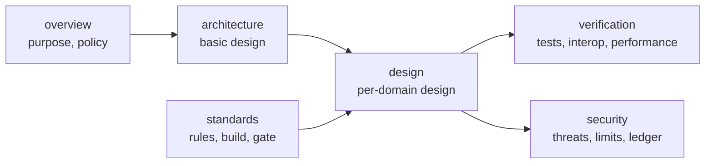

# ドキュメント

| 項目 | 内容 |
|---|---|
| 目的 | docs/ の文書体系と、各文書の置き場所を示す |
| 読む人 | コントリビューター |
| 前提文書 | [README](../README.md) |
| 関連文書 | [wired ガイド](https://hakkadaikon.github.io/wired/guide/ja/)(利用者向け)、[API リファレンス](https://hakkadaikon.github.io/wired/) |

## 1. 読む順

| 順 | 文書 | 内容 |
|---|---|---|
| 1 | [概要書](overview/README.md) | 目的、適用範囲、設計方針と理由 |
| 2 | [開発標準](standards/README.md) | 準備、規約、ビルド、コミットゲート、ドメインの追加、テスト、文書の書き方 |
| 3 | [基本設計](architecture/README.md) | 全体構成、データの流れ、I/O ドライバー、鍵、メモリ |
| 4 | [詳細設計](design/README.md) | ドメインごとの設計、実装している仕様 |

アプリケーションの作り方(API の使い方、フラグ、証明書の設定)は [wired ガイド](https://hakkadaikon.github.io/wired/guide/ja/) にある。

## 2. 文書体系

| ディレクトリ | 文書の種類 | 主な文書 |
|---|---|---|
| [overview/](overview/README.md) | 概要書 | 目的、適用範囲、設計方針 |
| [architecture/](architecture/README.md) | 基本設計書 | [データの流れ](architecture/dataflow.md)、[I/O ドライバー](architecture/io-drivers.md)、[鍵](architecture/keys.md)、[メモリ](architecture/memory.md) |
| [design/](design/README.md) | 詳細設計書 | [common](design/common.md)、[crypto](design/crypto.md)、[transport](design/transport.md)、[tls](design/tls.md)、[app](design/app.md)、[実装している仕様](design/specs.md) |
| [standards/](standards/README.md) | 開発標準 | [準備](standards/setup.md)、[コーディング規約](standards/coding.md)、[ビルド](standards/build.md)、[コミットゲート](standards/commit-gate.md)、[ドメインの追加](standards/add-domain.md)、[テスト](standards/testing.md)、[ドキュメント規約](standards/documentation.md) |
| [syscalls.md](syscalls.md) | 参照資料 | SDK が発行するシステムコール |
| [verification/](verification/README.md) | 試験と品質 | [テストの範囲](verification/coverage.md)、[相互運用性テスト](verification/interop.md)、[性能の比較](performance/comparison.md)、[計測の生データ](performance/comparison-runs.md)、[リソース監視](performance/monitoring.md)、[高速化の記録](performance/speedup.md) |
| [security/](security/README.md) | セキュリティ設計 | [脅威モデル](security/threat-model.md)、[暗号](security/crypto.md)、[PKI](security/pki.md)、[プロトコルの防御](security/protocols.md)、[既知の制限](security/limitations/README.md)、[脆弱性台帳](security/vuln-ledger.md) |
| [features/](features/README.md) | 要件台帳 | 仕様ごとの要件とテスト、[台帳の書式](features/FORMAT.md)、[MoQT の Track 切り替え](features/moqt-track-switching.md) |
| [ubiquitous/](ubiquitous/README.md) | 用語集 | 技術用語の表記 |

## 3. 生成物

`sdk/` は doxygen の出力で、git の管理外である([API リファレンス](https://hakkadaikon.github.io/wired/) として公開)。直すときは、生成された HTML ではなくヘッダーのドキュメントコメントを編集する。
