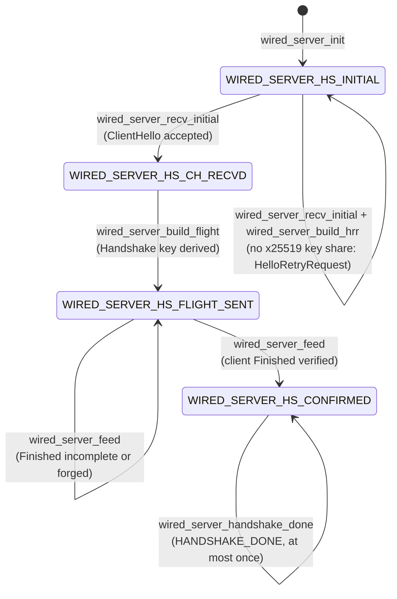
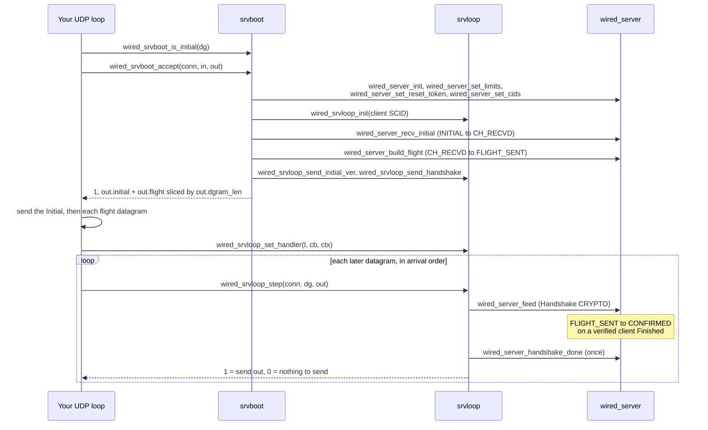

# API の安定性

[ドキュメント](README.md) › API の安定性

このページが答える問いは 1 つです。`wired.h` から呼べる関数のうち、どれを気軽に呼んでよく、どれに隠れた呼び出し順や寿命のルールがあるのか。どの関数の上にアプリケーションを作るか選ぶアプリケーションの作者と、変更をどこまで丁寧に告知すべきか判断するコントリビューターに向けたページです。使い方の解説ではなく地図なので、ライブラリの使い方は [はじめに](getting-started.md) と [wired ガイド](https://hakkadaikon.github.io/wired/guide/ja/) を見てください。

> **たいていのアプリケーションに要るのは 4 つです。** `wired_srvdriver_parse` と `wired_srvdriver_run`(コマンドラインのフラグを解析してからサーバーを動かす)、`wired_srvrun_handler`(リクエストのコールバック)、`wired_certreload_load_or_selfsigned`(本物の証明書を読み込む)です。
> WebTransport のアプリケーションは 5 つ目として `wired_server_broadcast_datagram` を足します。
> このページのほかの項目は、その先へ進むためのものです。ガイドの [サーバーのフラグ](https://hakkadaikon.github.io/wired/guide/ja/quic/server-flags/) のページが最初の 3 つを、[証明書のホットリロード](https://hakkadaikon.github.io/wired/guide/ja/ops/cert-reload/) が 4 つ目を扱います。

**目安:** 下の *Stable API* の表にある関数は気軽に呼んでかまいません。どれも 1 つの仕事を丸ごとこなすか、隠れた順序のルールを持たない純粋関数です。*Low-level / internal API* の表にあるものには呼び出し順か寿命の前提条件があるので、使う前にヘッダーのコメントを読んでください。

## 線引きが大事な理由

`src/wired.h` は、アプリケーション向けのヘッダーをすべて取り込む単一のインクルードです。下で括弧に入れたヘッダー名は宣言のある場所を示すだけで、自分でインクルードする必要はありません。唯一の例外は `run/moqtswitch.h` で、その行に注記してあります。

それらのヘッダーには、一度だけ呼ぶ最上位の入口を 1 つだけ公開するものもあれば、内部の状態機械の個々のステップを公開するものもあります。後者のステップは、呼び出し側が下にあるプロトコルを理解していないと、間違った順序で呼ばれたり、すでに解放されたバッファーとともに呼ばれたりしかねません。

名前の接頭辞は想定する利用者を表します。`wired_*` はアプリケーション向けで、モジュールトークンだけの名前(`sdrv_*`、`moqctl_*`、`bytes_*`)は SDK の内部向けです。ただし `wired_*` の中では、どれが仕事を丸ごとこなす入口で、どれが低レベルのステップかを接頭辞は示しません。それを示すのがこのページです。

下ではある型がいたるところに出てきます。`wired_span` は *ビュー* で、ほかの誰かが所有するメモリを指すポインターと長さの組です。何もコピーしないので、ビューを使う間はそのメモリが生きていなければなりません。

## Stable API(アプリケーション向け、互換性を壊す変更は避ける)

これらは下にある QUIC や TLS の状態機械を知らなくても呼べます。どれも最上位の単一の操作(run と driver の関数)か、複数の呼び出しにまたがるルールを持たない純粋関数(コーデック、ファイル I/O、ログ)です。

### サーバーを動かす

| Function | Role |
|---|---|
| `wired_srvdriver_parse`, `wired_srvdriver_run` | 推奨の入口。ドライバーのフラグを解析し、4 つのドライバーのどれかを動かす。 |
| `wired_server_run` | 完結した単一プロセスのサーバーを、kill されるまで動かす。 |
| `wired_server_run_opt` | `wired_server_run` に `wired_srvrun_opt` のオプトイン設定を加えたもの。 |
| `wired_server_run_id` | 呼び出したワーカーの run が使っている identity(起動時のコピー。証明書のリロードで更新される)。 |
| `wired_srvrun_handler` (struct) | 自分のコールバックとそのコンテキスト。run 系の関数に渡す。 |

- `wired_srvdriver_parse` はドライバーのフラグ(`--port`、`--workers`、`--ifindex`、`--cores`、`--pin-core` ほか数個。ヘッダーを参照)を読み、`--workers` と `--cores` の併用のような矛盾する組み合わせを拒否します。そのあと `wired_srvdriver_run` が 4 つのドライバーから 1 つを選びます。単一プロセス、fork したワーカー、AF_XDP(カーネルのネットワークスタックの大半を迂回する Linux の高速経路)、スレッドの 4 つです。ガイドの [サーバーのフラグ](https://hakkadaikon.github.io/wired/guide/ja/quic/server-flags/) のページがそれぞれを示しています。
- `wired_server_run_opt` はオプトインの設定を加えます。busy-polling、AF_XDP ドライバー、WebTransport のコールバック、ループのステップごとのコールバック `on_step` です。`wt_origin_check` は、WebTransport セッションを Origin で受け入れるかを決めます。リクエストに origin ヘッダーがないときは空の `origin` ビューを受け取ります。`wt_on_session_draining` は、ピアがセッションの CONNECT ストリームで WT_DRAIN_SESSION を送ったときに呼ばれます。`wt_on_stream_credit`(`wired_wt_on_stream_credit` 型。`wt_stream_credit_ctx` と組で使う)は、サーバーから開く `wired_server_wt_open_*` がクレジット不足で -1 を返したあと、同じ open が成功するようになった時点で一度だけ呼ばれます。`datagram_first` を 1 にすると、送信パスごとにキューに積んだ DATAGRAM をストリームのデータより先に送ります。デフォルトの 0 ではストリームのデータが先です(RFC 9221 §5.1)。`opt` は 0 であってはなりません。すべての設定がデフォルトなら、`wired_server_run` とまったく同じに動きます。
- `wired_srvrun_handler` の末尾には省略可能なメンバーが 3 つあり、0 のままにするとそれぞれ無効になります。`http` は `wired_http_handler` を受け取ります。このハンドラーは `wired_http_exchange` を埋めてステータスを選び、`WIRED_HTTP_MAX_FIELDS`(8)個までのレスポンスヘッダーを加えます。`on_body` は `wired_srvloop_on_body` を受け取り、レスポンダーが動く前に、届いた順にリクエストボディをチャンク単位で受け取ります。`on_body` が 0 なら、ボディ全体を先にバッファーに溜めます。`on_body_abort` は `wired_srvloop_on_body_abort` を受け取ります。これは `on_body` へストリーミング中だったボディが fin なしで終わったときに一度だけ呼ばれます。クライアントがストリームをリセットした、レスポンスが始まる前に止めた、コネクションが終わった、のいずれかの場合です。ストリーム ID とクライアントのエラーコード(コネクションが終わったときは `H3_REQUEST_CANCELLED`)を受け取ります。`on_body` に渡される `req` は、その呼び出しの間だけ有効です。
- `wired_http_field` は内部の `qpack_field`(`wired_span` 2 つ。名前、値の順)の typedef なので、レイアウトはその構造体に従います。

### コールバックの中から使う WebTransport

| Function | Role |
|---|---|
| `wired_server_broadcast_datagram` | 生きている全 WebTransport セッションへ QUIC DATAGRAM をキューに積む。 |
| `wired_server_wt_open_uni`, `wired_server_wt_open_bidi` | サーバーから WebTransport の uni / bidi ストリームを開く。 |
| `wired_server_wt_stream_reply` | クライアントが開いた bidi ストリームで返信する。 |
| `wired_server_wt_stream_inflight` | 送ったストリームのペイロードがまだ使われているか。 |
| `wired_server_wt_drain_session` | セッションを畳むようピアに頼む。 |
| `wired_server_wt_stream_priority` | 送ったストリームの urgency を設定する。 |
| `wired_server_wt_stream_schedule`, `wired_wt_sched` (struct) | 送ったストリームの送信クラスを全項目まとめて設定する。 |
| `wired_server_wt_occupancy`, `wired_wt_occupancy` (struct) | 開いているセッションとストリームのスナップショット。 |
| `wired_wt_ref` (struct), `wired_wt_ref_of`, `wired_wt_ref_get` | ステップをまたいでセッションを保持する。開いている間はそのセッションに解決し、古くなったら 0 になる。 |

これらはすべて 1 つのルールを共有します。サーバー自身のループの中、つまり自分のコールバックの中からだけ呼んでください。スレッドセーフでもシグナルセーフでもありません。使い方はガイドの [WebTransport のデータグラム](https://hakkadaikon.github.io/wired/guide/ja/wt/datagram/) と [サーバーが開いたストリームを閉じずに保つ](https://hakkadaikon.github.io/wired/guide/ja/wt/open-streams/) で扱っています。

- **古いセッション。** `wired_wt_session*` は、セッションのコールバックからクローズのコールバックまで有効です。クローズのあと、サーバーはその領域を後続のセッション(別のピアのものかもしれません)に再利用するので、それ以降も持ち続けたポインターは新しく来たセッションを指してしまいます。ステップをまたいでセッションを持つには、`wired_wt_ref_of(s)` を保持しておき、使うときに `wired_wt_ref_get` で解決してください。セッションが閉じると 0 を返し、新しいセッションがその領域を使っても 0 のままです。上の、セッションを受け取る呼び出しも、セッションがもう開いていないポインターには同じように振る舞います(受け付けません)。ただし、再利用されたセッションと本来意図したセッションを区別できるのは ref だけです。ステップをまたいで持つストリーム ID は、そのセッションの ref と組にしてください。先に ref を解決し、返ったセッションとともにだけストリーム ID を渡します(ストリーム ID はコネクションごとに振り直されます)。
- **ペイロードの寿命。** open と reply の呼び出しは、128 KiB(131072 バイト。送信スロットのステージングバッファー)までのペイロードをコピーするので、呼び出しが戻った時点でバッファーを解放してかまいません。それより大きいペイロードはこちらのメモリへのビューとして保持されます。`wired_server_wt_stream_inflight` が 0 を返すまで生かしておいてください。この関数は、ストリームの送信スロットが `stream_id` をまだ保持している間(未 ACK のバイトがある、またはストリームが追記のために開いている)は 1 を返し、スロットが解放されたか、`stream_id` がこのセッションでサーバーが送ったストリームを一度も指していなければ 0 を返します。
- **ストリームシグナル。** open の呼び出しに渡すペイロードは、WebTransport のストリームシグナルの接頭辞で始まっていなければなりません。これは、ストリームがどのセッションに属するかをブラウザーに伝えるものです。
- **Drain。** `wired_server_wt_drain_session` は、ループの次のステップでセッションの CONNECT ストリームに WT_DRAIN_SESSION を送ります。送るのはセッションごとに最大 1 回です。繰り返し呼ぶと、送り直さずに 1 を返します。セッションがもう生きていないとき、または drain を持たない raw QUIC のセッションのときは 0 を返します。
- **Urgency。** `wired_server_wt_stream_priority` は RFC 9218 の urgency を 0 から 7 で受け取ります(デフォルト 3)。値が小さいほど先に送られます。各送信パスは送信できるストリームのうち最も urgency の高いものだけを扱い、同じ urgency のストリームは交互に送ります。urgency が 7 を超えるとき、または開いている送信スロットのない ID には負の値を返します。
- **送信クラス。** `wired_server_wt_stream_schedule` は、3 つのキーを持つ `wired_wt_sched` を受け取ります。`urgency` は上と同じく階層を選びます。`fine` は同じ urgency の中でストリームを並べ、小さいほうが先です。`flow` は 0 以外のとき、同じ値を共有するストリームを決まった順序に並べます。その flow の送信可能なストリームのうち、(`order`, `tie`)が最小のものだけが送ります。flow 0 は順序を課しません。各送信パスでは、参加するストリームがそれぞれ 1 スライスずつ送ります。ただし 2 つのセッションがコネクションを共有するときは、各セッションがパスごとに同じ数のスライスを送り(draft-ietf-webtrans-http3-16 §8)、各セッションが持てる送信スロットは半分までです。エラーは `wired_server_wt_stream_priority` と同じです。
- **占有状況。** `wired_server_wt_occupancy` は、呼び出したループで開いているセッションとクライアントが開いたストリームを、コンパイル時の容量とともに報告します。これはある時点のスナップショットで、`wired_srvrun_env_wt_usage` の累計とは違います。

同じヘッダーには、まだどちらの層にも分類していない `wired_server_wt_*` の呼び出しがほかにもあります。`wired_server_wt_stream_reply_open`、`wired_server_wt_stream_send`、`wired_server_wt_stream_fin`、`wired_server_wt_stream_hold`、`wired_server_wt_stream_reset`、`wired_server_wt_stream_stop`、`wired_server_wt_send_datagram_to`、`wired_server_wt_close_session`、`wired_server_wt_est_kbps`、`wired_server_wt_exporter`、`wired_server_broadcast_datagram_ring`、`wired_server_wt_send_datagram_prio`、`wired_server_broadcast_datagram_prio` です。これらも同じくループの中だけというルールに従います。使う前にそれぞれのヘッダーのコメントを読んでください。2 つの `_prio` の呼び出しは、0(最も急ぐ)から 7 までの urgency を受け取ります(RFC 9221 §5.1)。キューに積んだデータグラムは urgency の高い順に、同じ urgency の中では呼び出し順に出ていきます。`_prio` の付かない呼び出しは 3 を使います。

### リクエストとレスポンス

| Function | Role |
|---|---|
| `wired_h3req_path` | リクエストの `:path` を 1 つの `wired_span` で返す。 |
| `wired_http_req_header` | 小文字の名前でリクエストヘッダーを探す。 |
| `wired_http_reply_text` (`srvrun/httpx.h`) | ステータス、`text/plain`、ボディのテキストを 1 回の呼び出しで設定する。 |
| `wired_http_add_field` (`srvrun/httpx.h`) | 2 つの C 文字列からレスポンスヘッダーを 1 つ追加する。 |

- `wired_http_req_header` は名前を完全一致で照合します。`cookie` は全部の断片を `"; "` でつないで返し、それ以外の繰り返されたヘッダーは最初の 1 つを返します。`cookie`、`origin`、`wt-available-protocols` を除き、通常のヘッダーは最初の `WIRED_H3REQDRIVE_MAX_HDRS`(32)個しか保持しないので、それより後ろのものは見つかりません。
- 1 つのバッファーより大きいレスポンスボディは *ラウンド* に分けて作られます。次のチャンクを埋めるためにレスポンダーがもう一度呼ばれます(ガイドの [大きなボディのストリーミング](https://hakkadaikon.github.io/wired/guide/ja/h3/streaming/) のページを参照)。2 回目以降のラウンドで見えるリクエストはコピーで、ビューとヘッダー用の余地は 512 バイトです。コピーに収まらなかったヘッダーは、そこでは見つかりません。
- 戻り値はリクエストの中を指すビューで、リクエストのほかのビューと同じ間だけ生きています。
- `wired_http_add_field` は、フィールドの表が満杯のとき 0 を返します。

### 証明書

| Function | Role |
|---|---|
| `wired_certreload_load` | PEM の証明書チェーンと P-256 の鍵を、自分が所有する領域へ読み込む。 |
| `wired_certreload_load_or_selfsigned` | 同上。パスが設定されていなければ既存の identity を保つ。 |
| `wired_pem_next` | PEM ブロックを 1 つデコードする。繰り返せば full-chain のファイルを順にたどれる。 |
| `wired_eckey_p256_priv` | DER(SEC1 または PKCS#8)から P-256 の秘密鍵を取り出す。 |

`wired_certreload_load` に渡す領域は、そこから作った identity より長く生きていなければなりません。`wired_certreload_load_or_selfsigned` は、パスが設定されて *いる* のに読み込めなかったとき、自己署名証明書へ黙って切り替えずに、診断メッセージを出して終了します。ガイドの [証明書の読み込み](https://hakkadaikon.github.io/wired/guide/ja/tls/certificates/) と [証明書のホットリロード](https://hakkadaikon.github.io/wired/guide/ja/ops/cert-reload/) のページを見てください。

### ソケット、ファイル、コーデック

| Function | Role |
|---|---|
| `wired_udp_socket`, `wired_udp_bind`, `wired_udp_send`, `wired_udp_recv`, `wired_udp_recvfrom`, `wired_udp_close`, `wired_udp_addr` | QUIC の状態を持たない、素の UDP ソケットの呼び出し。 |
| `wired_fio_read`, `wired_fio_append`, `wired_fio_write_new`, `wired_fio_mkdir` | ファイル全体の読み込み、追記、置き換え。ディレクトリの作成。 |
| `wired_fio_open`, `wired_fio_size`, `wired_fio_pread`, `wired_fio_close` | チャンク単位のファイルアクセス。open、サイズ取得、オフセット指定の読み込み、close。 |
| `wired_fio_read_span` | `wired_span` を返す `wired_fio_read`(エラー時は長さ 0)。 |
| `wired_header_parse`, `wired_header_build_long` | QUIC パケットヘッダーのうちバージョンに依存しない部分を解析・構築する。 |

UDP の呼び出しは、普通のソケットプログラムが使う順序ならどの順でも安全です。ファイルの呼び出しはシステムコールを直接呼び、プロトコルの状態を持ちません。examples は大きな静的ファイルを丸ごと読み込まずにストリーミングするためにチャンク単位のグループを使っています。

### テキスト、整形、ログ

| Function | Role |
|---|---|
| `wired_log_str`, `wired_log_ts`, `wired_fmt_u64`, `WIRED_LOG` | stderr への任意のトレース。どこで呼んでも安全。 |
| `wired_snprintf`, `wired_vsnprintf`, `wired_dprintf` | libc を必要としない printf 互換のフォーマッター。 |
| `wired_obuf_printf` | `wired_obuf` へ printf 形式で追記する。 |
| `wired_span_eq`, `wired_span_eq_cstr`, `wired_span_cstr`, `wired_span_to_cstr`, `WIRED_SPAN_ARG` | バイトのビューを比較、構築、コピーアウトする。 |
| `wired_span_find` | ビューの中で指定したバイトが最初に現れる位置。なければ -1。 |
| `wired_cstr_eq`, `wired_cstr_append`, `wired_span_strip_lead`, `wired_obuf_put` | C 文字列とバッファーの小さなヘルパー。 |
| `wired_hex_encode`, `wired_dump_hex`, `wired_dump_text` | ビューを 16 進にエンコードする。ビューを fd へ 16 進かテキストで書き出す。 |

- フォーマッターは `%d %i %u %x %X %p %s %c %% %f` をフラグ、幅、精度、長さ修飾子つきでサポートします。加えて wired 独自の拡張 `%H` があり、バイト列を小文字の 16 進で出力します。`"%.*H"` はバイト数とポインターを受け取ります(`WIRED_SPAN_ARG` が展開する組です)。`wired_dprintf` が呼ぶのは write(2) だけです。C99 との違いは `common/fmt/fmt.h` に列挙してあります。
- `wired_obuf_printf` は `len` の位置から追記し、最大 `cap - len - 1` バイトを書き、追記したバイト数を返します。
- span と C 文字列のヘルパーは `common/bytes/text/text.h` にあります。`wired_span_eq` は定数時間ではないので、秘密の値の比較には使わないでください。`wired_span_to_cstr` と `wired_cstr_append` は収まるように切り詰め、`wired_obuf_put` は `cap` で切ります。`WIRED_SPAN_ARG` は、`"%.*s"` の書式が必要とする 2 つの引数に展開されます。

### デモ用の identity

| Function | Role |
|---|---|
| `wired_srvboot_demo`, `wired_srvboot_demo_keys` (`srvboot/srvdemo.h`) | サンプルとテスト用の固定のデモ identity。本番では決して使わない。 |
| `wired_srvboot_cert_sha256`, `wired_srvboot_log_fingerprint` (`srvboot/srvdemo.h`) | リーフ証明書の SHA-256。生の値か、ログに出した値。 |

デモの identity は連番パターンの鍵と自己署名証明書を使うので、誰でも再現できます。証明書のハッシュは、ブラウザーが `serverCertificateHashes` に期待する値です。フィンガープリントはコロン区切りでログに出ます。`wired_srvboot_cert_sha256` と `wired_srvboot_log_fingerprint` はプロセス全体で 1 つの作業用サーバーを共有するので、再入可能ではありません。

### セッション再開と 0-RTT

| Name | Role |
|---|---|
| `wired_srvboot_id.ticket_key` | セッションチケットの鍵のシード。0 = 再開なし。 |
| `wired_srvboot_id.early_data` | 1 = 再開したコネクションで 0-RTT を受け入れる。0(デフォルト)= 1-RTT としてのみ再開する。 |

- **0-RTT はオプトイン。** 攻撃者は 0-RTT のデータをリプレイできるので、RFC 8446 Appendix E.5 は、アプリケーションが求めない限り 0-RTT を有効にすることを禁じています。`ticket_key` を設定するだけで有効になるのは再開であって、0-RTT ではありません。`early_data = 1` は、クライアントが早期に送りうるすべてのリクエストが、2 回処理されても安全な場合に限って設定してください。
- **それでも 0-RTT を断る場合。** `early_data = 1` でも、SDK は次の場合には 0-RTT を断ります。リプレイされたチケット、チケットの経過時間が古い場合、別の ALPN や暗号スイートで発行されたチケット、raw QUIC の ALPN、HelloRetryRequest のあとに続く ClientHello です。その場合コネクションは 1-RTT として再開します。チケットが early data を告知するのは、それが有効なときだけです。

### アドレス検証トークン

| Name | Role |
|---|---|
| `wired_srvkeys_set_token_key` (`srvkeys/srvkeys.h`) | Retry / NEW_TOKEN のトークンのシード。サーバーの起動前に呼ぶ。呼ばなければプロセスごとのランダムなシードになる。 |

### クライアント証明書(相互 TLS)

| Name | Role |
|---|---|
| `wired_srvboot_id.client_auth` | `WIRED_CLIENT_AUTH_OFF`(0、デフォルト)、`_OPTIONAL` または `_REQUIRED`。 |
| `wired_srvboot_id.client_ca` | クライアント証明書のチェーンがたどり着くべきトラストストア(`castore`)。 |
| `wired_http_exchange.peer_cert` | 検証済みのクライアントのリーフ証明書の DER。なければ空。 |
| `wired_castore_init`, `wired_castore_add` (`crypto/pki/trust/castore/castore.h`) | `client_ca` のストアを作る。自分の `castore_entry` 配列に結び付け、CA 証明書の DER を 1 つずつ追加する。 |

- **フェイルクローズ。** `client_auth` がオフ以外なのに `client_ca` がないと、すべてのコネクションの初期化が失敗します。チェーンはストアまで 1 段ずつつながり、現在の時刻で有効でなければなりません。また、リーフが鍵の用途を列挙しているなら `clientAuth` を許していなければなりません。必須モードでは、証明書を送らないクライアントを `certificate_required` で閉じます。
- **再開なし。** クライアント認証が有効だと、提示された PSK と 0-RTT は無視され、セッションチケットも発行しません。そのため、どのコネクションでもクライアントは鍵を毎回あらためて証明します。
- **寿命。** 何もコピーしません。`castore`、その `castore_entry` 配列、`wired_castore_add` に渡したすべての CA の DER バッファーは、サーバーがハンドシェイクのたびに読むビューです。3 つとも、サーバーが動いている間生きている場所(`main` の中か static)に定義してください。`wired_server_run` より前に戻ってしまうヘルパー関数の中に置いてはいけません。`peer_cert` はコネクションの中を指すビューで、ハンドラーの呼び出しの間だけ有効で、最初のラウンドでだけ設定されます。

### アイドルタイムアウト

| Name | Role |
|---|---|
| `wired_srvboot_id.idle_timeout_ms` | サーバーが告知する max_idle_timeout(ms)。0 = 30 秒。 |
| `wired_server_idle_timeout_ms` | コネクションでネゴシエートされたアイドルタイムアウト(ms)。 |

- コネクションは `idle_timeout_ms` とクライアントの max_idle_timeout のうち小さいほうでアイドルタイムアウトします(RFC 9000 10.1)。クライアントの値が 0 か値がない場合は制限を設けないので、サーバーの値だけが効きます。SDK が PTO 3 回分より短い時間でコネクションをアイドルタイムアウトさせることはありません。
- `wired_server_idle_timeout_ms` は、ClientHello を処理するまではサーバー自身の値を返します。

## Low-level / internal API(注意して使う)

これらの関数が公開ヘッダーから呼べるのは、アプリケーション向けの層がこれらで組み立てられているからであって、たいていのユーザーが呼ぶべきだからではありません。どれにも、破りやすい呼び出し順か寿命のルールがあります。`wired_server_run` とドライバーは、すでにこれらを正しく呼んでいます。

QUIC はコネクションの段階ごとに別々の鍵で暗号化します。この段階を *key level* と呼びます。Initial(公開された値から導出)、Handshake(TLS の鍵交換のあと)、1-RTT(ハンドシェイクのあと)です。間違った key level で暗号化したパケットは、ピアには読めません。

### サーバーのハンドシェイクのフェーズ

`wired_server` は TLS 1.3 のハンドシェイクのサーバー側です。その `phase` フィールドは 4 つの値を順に進みます。INITIAL(クライアントの ClientHello を待っている)、CH_RECVD(ClientHello を受け入れた)、FLIGHT_SENT(サーバーの応答を組み立てた)、CONFIRMED(クライアントが鍵を持っていることを証明した)です。図で使う用語は次のとおりです。

- **Flight**: まとめて送る、サーバーのハンドシェイクメッセージの一群。
- **Finished**: 双方の最後のハンドシェイクメッセージ。送信者がハンドシェイクの鍵を持っていることを証明する。
- **HelloRetryRequest**: サーバーが対応する鍵の種類(ここでは x25519)で ClientHello を送り直すようクライアントに求める。
- **HANDSHAKE_DONE**: ハンドシェイクの確定をクライアントに伝える QUIC のフレーム。

図は「どの呼び出しがフェーズを進めるか」として読んでください。

- フェーズを確認する呼び出し(`wired_server_recv_initial`、`wired_server_build_hrr`、`wired_server_build_flight`、`wired_server_feed`、`wired_server_handshake_done`)は、間違ったフェーズでは 0 を返し、フェーズを進めません。この 0 は処理すべき失敗として扱い、やみくもに再試行しないでください。`wired_server_feed` は、フェーズを確認する前にバイト列を再構成バッファーに追加します。
- ClientHello が x25519 の鍵共有を提示しない場合、フェーズは INITIAL のままです。`wired_server_build_hrr` が HelloRetryRequest を出し、クライアントの 2 回目の ClientHello はもう一度 `wired_server_recv_initial` を通ります。
- `wired_server_set_cids`、`wired_server_set_limits`、`wired_server_set_reset_token` はフェーズを確認しませんが、それらが設定するコネクション ID、制限値、トークンは flight に載ります。`wired_server_build_flight` より前に呼んでください。あとで呼ぶと、黙って手遅れになります。
- 偽造されたクライアントの Finished では何も昇格しません。フェーズが CONFIRMED に達するのは、Finished メッセージの検証が通ったあとだけです。

### 1 本のコネクションを手で動かす

`srvboot` はクライアントの最初のデータグラムからコネクションをコールドスタートし、`srvloop` はそれ以降のすべてのデータグラムを扱います。図は `wired_server_run` 自身がたどる順序を示します。ただし run のループは、アキュムレーター形式の `wired_srvboot_accept_acc` を使います(下の「分割された ClientHello」を参照)。accept の呼び出しが、ハンドシェイクの準備の呼び出しをすでに代わりに済ませている点が大事です。

- **ラベル。** SCID はクライアントが自分用に選んだコネクション ID で、srvloop は送り返すすべてのパケットにこれを付けます。CRYPTO は TLS のハンドシェイクのバイト列を運ぶ QUIC のフレームです。
- **出力の送信。** まず `out.initial` を送り、次に `out.flight` を `out.dgram_len` のサイズ(`out.dgram_count` 個)ごとにデータグラムへ切り分けて、1 つずつ送ります。
- **HelloRetryRequest。** `wired_srvboot_accept` と `wired_srvboot_accept_acc` はどちらも、flight の代わりに HelloRetryRequest を `out.initial` に暗号化して書き込んだときに `WIRED_SRVBOOT_HRR`(2)を返します。このとき `out.dgram_count` は 0 です。0 以外の戻り値をすべて「flight を暗号化した」と扱わないでください。
- **分割された ClientHello。** `wired_srvboot_accept` が扱うのは、1 つのデータグラムに収まる ClientHello です。run のループは代わりに、`wired_srvboot_acc_*` のアキュムレーターで複数のデータグラムに分かれた ClientHello を集め、`wired_srvboot_accept_acc` を呼びます。
- **受け入れる QUIC のバージョン。** `wired_srvboot_id.versions` は `WIRED_VERSIONS_V1` / `WIRED_VERSIONS_V2` のビットを持ちます。デフォルトの 0 は両方を受け入れます(RFC 9308 13)。この集合にないバージョンの Initial パケットには Version Negotiation を返し、互換バージョンネゴシエーション(RFC 9368)もこの集合からしか選びません。`wired_srvboot_vneg` も同じビットを受け取ります。
- **寿命と順序。** 渡す `wired_srvboot_id` のフィールドはビューなので、呼び出しの間は生かしておいてください。`wired_server_run` とその派生は、起動時に id、そのチェーンと `raw_alpns`、obs のパス、`wt_protocols` をコピーし、以後は二度と読まないので、これらは呼び出し側のスタックにあってもかまいません。唯一の例外は `client_ca` です。コピーするのはポインターだけなので、ストア、そのルートの配列、CA の DER は呼び出し側のメモリに残り、run より長く生きていなければなりません。構造体はゼロ初期化した状態(`= {0}` か `wired_srvboot_demo`)から始めてください。そうすれば末尾に追加されたメンバーはオフがデフォルトになります。`reset_seed` はステートレスリセットの秘密値です(0 なら `cert_seed` を使います。`wired_srvrun_serve_env` は、証明書のリロードで発行済みのトークンが変わらないよう、これを起動時の `cert_seed` のコピーに固定します)。最後のメンバーの `early_data` は 0-RTT のオプトインです(「セッション再開と 0-RTT」を参照)。`wired_srvloop_step` には到着順にデータグラムを渡さなければならず、それが `wired_srvloop` へデコードしたリクエストは次のステップまでしか有効ではありません。

### 低レベル関数の一覧

| Function | Why it needs care |
|---|---|
| `wired_srvboot_is_initial`, `wired_srvboot_accept`, `wired_srvboot_accept_acc`, `wired_srvboot_acc_*` | 1 本のコネクションをコールドスタートする。どのステップよりも前に実行する必要がある。 |
| `wired_srvloop_init`, `wired_srvloop_set_handler`, `wired_srvloop_step`, `wired_srvloop_wt_refuse` | 1 本のコネクションのデータグラムごとのループ。順序が厳密。 |
| `wired_srvloop_send_initial`, `wired_srvloop_send_initial_ver`, `wired_srvloop_send_handshake`, `wired_srvloop_send_onertt` | 1 種類のパケットを 1 つの key level で暗号化する。 |
| `wired_server_init`, `wired_server_set_cids`, `wired_server_set_limits`, `wired_server_set_reset_token`, `wired_server_recv_initial`, `wired_server_build_hrr`, `wired_server_build_flight`, `wired_server_feed`, `wired_server_handshake_done`, `wired_server_is_confirmed` | ハンドシェイクのフェーズのステップ。それぞれ一部のフェーズでだけ有効。 |
| `wired_server_peer_cert` | 手で動かす `wired_server` の検証済みクライアントのリーフ。確定後に使える。トランスクリプトの中を指すビュー。 |
| `wired_server_listen`, `wired_server_pump`, `wired_server_run_handshake`, `wired_server_close` | 同じ `wired_server` に対する、ソケットを所有するハンドシェイクのヘルパー。 |
| `wired_srvrun_env_size`, `wired_srvrun_env_init`, `wired_srvrun_serve_env` | 自分で確保する追加のループインスタンス。 |
| `wired_srvrun_shutdown_word` | プロセス全体で共有するグレースフルシャットダウンのフラグへのポインター。 |
| `wired_srvrun_broadcast_register`, `wired_srvrun_broadcast_unregister` | スレッド間のブロードキャストのメッシュに参加する、または抜ける。 |
| `wired_srvworkers_run` | ワーカープロセスを fork して監視する。 |
| `wired_srvthreads_run`, `wired_srvthreads_parse_cores` | 1 つの制御スレッドの下でワーカースレッドを動かす。 |
| `wired_srvxdp_open`, `wired_srvxdp_open_shared`, `wired_srvxdp_rx_burst`, `wired_srvxdp_send`, `wired_srvxdp_close`, `wired_srvxdp_print_stats` | AF_XDP ドライバーの 1 インスタンス。 |
| `wired_srvxdpbpf_open`, `wired_srvxdpbpf_register`, `wired_srvxdpbpf_close` | インターフェースごとに共有する BPF プログラムとマップ。 |
| `wired_wt_session_init`, `wired_wt_session_establish`, `wired_wt_session_drain`, `wired_wt_session_close`, `wired_wt_session_offer_stream`, `wired_wt_session_offer_datagram` | WebTransport セッションの状態機械。 |
| `wired_h3reqdrive_send_get`, `wired_h3reqdrive_send_method`, `wired_h3reqdrive_recv_get` | ビューを返す HTTP/3 のリクエストのコーデック。 |
| `wired_x25519`, `wired_x25519_base` | 生の Curve25519 のスカラー倍算。 |
| `bytes_put`, `bytes_take` | コーデック内部向けの、カーソルを使うバイトコピー。 |
| `bytes_memcpy`, `bytes_memset` | アプリケーションのコードからは一切使わない。 |

上の表の各行についての注記です(表の順)。

- **srvboot と srvloop。** [1 本のコネクションを手で動かす](#1-本のコネクションを手で動かす) を見てください。`wired_srvloop_init` は `wired_srvboot_accept` がすでに呼んでいます。自分で呼ぶのは、srvboot を使わずにループを組むときだけです。`wired_srvloop_wt_refuse` は、スロットの表が受け取れなかった WebTransport のストリームをキューに積み、run のループがそれを H3_REQUEST_REJECTED でリセットするようにします。
- **送信関数。** 現在のフェーズに合わないもの、たとえば Handshake の鍵がまだないうちの `wired_srvloop_send_handshake` を呼ぶと、失敗するか、ピアが読めないパケットができます。
- **ハンドシェイクのステップ。** [サーバーのハンドシェイクのフェーズ](#サーバーのハンドシェイクのフェーズ) を見てください。`wired_server_listen`、`wired_server_pump`、`wired_server_run_handshake` は自前の UDP ソケットを開いて読みます。`wired_server_close` はそれを閉じ、保持している秘密値を消去します。
- **追加のループインスタンス。** `wired_srvrun_env_size()` バイトを確保し、最初の `wired_srvrun_serve_env` の前に `wired_srvrun_env_init` を実行してください。SIGTERM と SIGHUP のハンドラーはプロセス全体で共有なので、1 つを除くすべてのインスタンスで `no_signal_handlers=1` を設定します。
- **シャットダウンのワード。** シャットダウンが始まるまでは 0 で、始まると 1 のままになります。プロセス内のすべてのループが同じワードをポーリングするので、これを設定するとすべてのループが止まります。
- **ブロードキャストのメッシュ。** 固定の 16 スロットを持ちます。渡す `inbox_row` と `env` は、`wired_srvrun_broadcast_unregister` まで生きていて、動かしてはいけません。`wired_srvrun_broadcast_unregister` はスレッドの終了前に実行する必要があります。
- **ワーカープロセス。** クラッシュしたワーカーは再起動します。ステータス 0 で終了したワーカーは再起動しません。SIGTERM はすべてのワーカーへ一度だけ転送します。この呼び出しはすべてのワーカーを回収し終えたら 0 を、最初の `fork` が失敗したら負の値を返します。
- **ワーカースレッド。** シグナルハンドラーと、XDP モードでの共有 BPF オブジェクトを所有するのは制御スレッドだけです。制御スレッドはそれらの共有資源を解放する前にすべてのワーカーを join します。`wired_srvthreads_parse_cores` は、ワーカー 0 個で動かす代わりに、空のリストや空のフィールドを拒否します。
- **AF_XDP。** カーネルはネットワークインターフェースごとに XDP プログラムのリンクを 1 つしか許さないので、マルチキューの構成では、2 つ目の `wired_srvxdp_open` ではなく、自分が所有する `wired_srvxdpbpf` に対して `wired_srvxdp_open_shared` を呼ぶ必要があります。`wired_srvxdp_send` は、受信したパケットからピアの MAC アドレスを学習するまではパケットを捨てます(0 を返し、QUIC の再送に任せます)。
- **共有 BPF オブジェクト。** インターフェースごとに一度だけ開き、各キューのソケットをそこへ登録し、登録したソケットのどれかが使われている間は開いたままにしてください。早く閉じると、それらのソケットが宙に浮きます。
- **WebTransport セッション。** 状態は unestablished、established、draining、closed で、closed は終端です。順序外の遷移は拒否され、何も起きません。`wired_wt_session_offer_stream` が 0 を返したら、そのストリームを WT_BUFFERED_STREAM_REJECTED(`WTERR_BUFFERED_STREAM_REJECTED`)でリセットする義務があります。`wired_wt_session_offer_datagram` の 0 は許された破棄で、何もする必要はありません。ガイドの [セッションのライフサイクル](https://hakkadaikon.github.io/wired/guide/ja/wt/session-lifecycle/) のページが、アプリケーション側から見た状態を示しています。
- **リクエストのコーデック。** `wired_h3reqdrive_recv_get` が取り出す擬似ヘッダーは、作業用バッファーとストリームのデータを指すビューです。解析したリクエストを使う間は、どちらも生かしておく必要があります。
- **X25519。** `wired_x25519` 自身が全ゼロの結果を検出して 0 を返します。この 0 は必ず失敗として扱ってください(RFC 7748 6.1)。無視すると、低位数の点による鍵交換、つまりピアが秘密を何も提供していない鍵交換を黙って受け入れてしまいます。
- **カーソルによるコピー。** `bytes_put` と `bytes_take` が正しく動くのは、呼び出し側がカーソル(`*off`)を呼び出しをまたいで一貫させているときだけです。境界の確認は渡された値に対してしか行いません。
- **メモリのヘルパー。** freestanding(`-nostdlib`)のバイナリには libc がないのに、コンパイラーは `memcpy` と `memset` の呼び出しを出力します。`WIRED_MAIN` を定義すると、`wired.h` はこの 2 つを、`bytes_memcpy` と `bytes_memset` へ転送するだけの薄い関数として定義します。これらは `src/` 全体で使っている SDK 自前のコピーと埋めのヘルパーです。アプリケーションはどちらも直接呼ぶべきではありません。

## バージョニングの方針

このプロジェクトにはまだリリースしたバージョン番号がないので、これは既存の運用の説明ではなく、提案中のデフォルトです。

- **Stable API**: 互換性を壊す変更(シグネチャの変更、削除、関数が要求または約束する内容の変更)は、メジャーバージョンの更新まで待ちます。追加の変更(新しい関数や、安全なデフォルトを持つ省略可能な新フィールド)は、マイナーバージョンの更新だけで済みます。
- **Low-level / internal API**: シグネチャ、呼び出し規約、前提条件がマイナーバージョンの更新で変わることがあります。これらの関数は `wired_server_run` と examples を組み立てるためにあり、外部の呼び出し側との契約ではありません。依存する前に、最新のヘッダーを読んでください。
- パッチバージョンはどちらの層でもバグ修正だけで、シグネチャは変えません。

バージョン番号ができるまでは、低レベル関数へのどのコミットも振る舞いを変えうるものとして扱い、Stable な関数へのどのコミットも変更履歴への記載が必要なものとして扱ってください。

## MoQT: `wired.h` から呼べる experimental の層

`src/app/moqt/` は MoQT(Media over QUIC Transport)を 14 のモジュールで実装しています。`cache`、`ctl`、`data`、`dgram`、`fetch`、`kvp`、`ns`、`qraw`、`run`、`sess`、`ssts`、`tstat`、`ver`、`vi` です。セッションは draft-ietf-moq-transport-18、-19、-22 のうち、ピアが WebTransport のサブプロトコル(`moqt-18`、`moqt-19`、`moqt-22`)として提示したものを話します。

`src/wired.h` は、アプリケーション向けの MoQT のヘッダー(`run/moqtrun.h`、`qraw/moqrawio.h`、`data/moqdata.h`、`dgram/moqdg.h`)に加えて、ライブメディア用に `media/mp4frag/mp4frag.h` と `platform/clock/mono.h` をインクルードします。そのため `wired_moqt_init` などに 2 つ目のインクルードは要りません。

MoQT の公開面は丸ごと **experimental** で、Stable ではありません。MoQ Transport はまだ IETF のドラフトで、名前、デフォルト、ワイヤー上の振る舞いはそれに従うので、非推奨期間なしにどのコミットでも変わりえます。そのため Stable と Low-level / internal のどちらの表にも載せていません。これらのヘッダーは Low-level の関数と同じように扱い、呼ぶ前にヘッダーを読んでください。

下で使う用語です(ガイドの [MoQT ハブ](https://hakkadaikon.github.io/wired/guide/ja/moqt/hub/) のページで使用例を示しています)。

- **ハブ**(`wired_moqt_hub`): パブリッシャーとサブスクライバーの間で Track を転送するリレー。
- **io テーブル**(`wired_moqt_io`): トランスポート上で送信、open、close するためにハブが呼ぶ関数ポインターの表。
- **Track** と **Full Track Name**: 名前の付いたメディアの Object の流れと、その名前(名前空間と Track 名)。
- **Setup Option**: MoQT セッションを開く SETUP メッセージの中のキーと値のフィールド。
- **New Session URI**: GOAWAY がピアに再接続先として伝えるアドレス。

### ハブと io テーブルの任意の設定(`run/moqtrun.h`)

どれも省略可能で、デフォルト(0 または未設定)の場合の動作は注記に書いてあります。

| Name | Role |
|---|---|
| `wired_moqt_cache_attach` | FETCH が使う Group 単位の Object キャッシュ用のアリーナをハブに渡す。 |
| `wired_moqt_goaway` | すべてのセッションに MoQT の GOAWAY を送り、タイムアウト後に閉じる。 |
| `wired_moqt_on_session_draining` | ピアがセッションを drain したら GOAWAY の手順を始める。 |
| `wired_moqt_on_stream_reset` | ピアがストリームの 1 つをリセットしたことをハブに伝える。 |
| `wired_moqt_hub.authorize_namespace`, `authorize_ns_ctx`, `wired_moqt_authorize_ns_fn` | 名前空間のリクエストに対する任意の認可関数。0 ならすべて許可。 |
| `wired_moqt_hub.authorize_publish`, `authorize_pub_ctx` | PUBLISH に対する任意の認可関数。0 ならすべて許可。 |
| `wired_moqt_hub.no_implementation` | 1 ならハブの SETUP から MOQT_IMPLEMENTATION オプションを省く。0 なら `wired/0` を送る。 |
| `wired_moqt_io.close_session`, `stream_reply_open`, `stream_priority`, `stream_stop` | `wired_moqt_io` の末尾に追加された操作。 |
| `wired_moqt_io.stream_sched` | Object のストリームの送信クラスを全項目まとめて設定する操作。 |
| `wired_moqt_io.est_kbps` | コネクションの配送レートの推定値を報告する操作。 |

- **キャッシュ。** アリーナは自分が所有します。これがないと、FETCH はすべての範囲を unknown として報告します。
- **GOAWAY。** 任意の New Session URI とタイムアウトを運びます。タイムアウトが過ぎると、ハブは PUBLISH_DONE を送り、GOAWAY_TIMEOUT でセッションを閉じます。
- **Drain。** `wired_moqt_on_session_draining` は `wired_srvrun_opt.wt_on_session_draining` と同じ形をしています。ピアの WT_DRAIN_SESSION が、そのセッションの GOAWAY の手順を始めます。
- **ストリームのリセット。** リセットは、そのストリームが運んでいたリクエストや FETCH を取り消します。
- **認可関数。** `authorize_namespace` は PUBLISH_NAMESPACE と SUBSCRIBE_NAMESPACE を対象にします。`authorize_publish` は `wired_moqt_authorize_fn` 型で、Full Track Name とトークンを受け取ります。リレーはこれを使って、パブリッシャーがほかの誰かになりすましていないかを確かめます。どのドラフトもこの確認を求めています。ガイドの [購読者の認可](https://hakkadaikon.github.io/wired/guide/ja/moqt/authorize/) のページが両方を示しています。
- **io テーブルの操作。** `close_session`、`stream_reply_open`、`stream_priority`、`stream_stop` は、それぞれ `wired_server_wt_close_session`、`wired_server_wt_stream_reply_open`、`wired_server_wt_stream_priority`、`wired_server_wt_stream_stop` と同じ形をしています。0 のままにすると、`close_session` は何も閉じず、`stream_reply_open` はリクエストごとのストリームを開かず、`stream_priority` はデフォルトの urgency を保ち、`stream_stop` は、ハブが振り分けられない受信側のデータストリームを読まずに流れるままにします。
- **`stream_sched`。** `wired_server_wt_stream_schedule` と同じ形をしています(`wired_moqraw_io` が設定します)。設定すると、Object のストリームについて `stream_priority` の代わりに使われます。0 のときハブは `stream_priority` を使います。
- **`est_kbps`。** `wired_server_wt_est_kbps` と同じ形をしていて、`wired_moqraw_io` はこれをその関数に設定します。0 のとき、SSTS の予算(下の Track 切り替えを参照)は上限値だけで決まります。

### ドラフトのバージョンを選ぶ

`wired_moqt_wt_protocols`(`ver/moqver.h`)は、サーバーが提示するサブプロトコルのリストを `wired_srvrun_opt.wt_protocols` 用に書き出します。

- `wt_protocols` を未設定にしたアプリケーション、または単一の文字列 `"moqt-19"` を設定したアプリケーションは、draft-19 だけをネゴシエートします。
- ピアが WebTransport のサブプロトコルを送らないセッションは、draft-19 の制御ストリームの振る舞いを使います。
- ガイドの MoQT のサンプルは `wt_protocols = "moqt-22"` を設定し、そのクライアントは `moqt-22` を提示します。
- `examples/moqt_chat` はリスト全体を提示します。`moqt-22` を提示できるブラウザー(WebTransport の `protocols` オプション)は draft-22 で動き、提示できないブラウザーは draft-19 に戻ります。

### raw QUIC 上の MoQT

MoQT は HTTP/3 や WebTransport を使わずに QUIC の上で直接動かすこともできます(draft-ietf-moq-transport-22 6.2.2、-18/-19 3.1.4-5)。この場合クライアントは ALPN(Application-Layer Protocol Negotiation)で MoQT を選びます。ALPN は TLS の拡張で、クライアントが `h3` のように話せるプロトコルを列挙し、サーバーがその中から 1 つを選びます。このようなコネクションには CONNECT リクエストがないので、SDK はコネクション全体を表す *暗黙のセッション* を 1 つ与えます。下の名前はすべてデフォルトが 0 か未設定で、その場合は WebTransport だけになります。

| Name | Role |
|---|---|
| `wired_srvboot_id.raw_alpns` | `h3`/`hq-interop` のほかにサーバーが選んでよい raw の ALPN。0 = オフ。 |
| `wired_srvrun_opt.raw_on_session`, `raw_session_ctx`, `wired_rawq_on_session` | raw の ALPN のコネクションごとに、ハンドシェイクの確定時に一度呼ばれる。 |
| `wired_server_session_is_raw` | raw QUIC のセッションなら 1、WebTransport のセッションなら 0。 |
| `wired_moqraw_io` (`qraw/moqrawio.h`) | `wired_server_wt_*` の上に作った、すぐ使える `wired_moqt_io`。 |
| `wired_moqt_on_session_raw` (`run/moqtrun.h`) | ハブの `raw_on_session` コールバック。 |
| `wired_moqt_hub.raw_policy` (a `moqraw_policy`) | raw セッションの PATH と AUTHORITY に対する任意の確認。 |
| `WIRED_MOQTRUN_CLOSE_MALFORMED_PATH`, `WIRED_MOQTRUN_CLOSE_MALFORMED_AUTHORITY` | セッションのクローズコード 0x9 と 0x1A。 |

- **`raw_alpns`。** `"moqt-22 moqt-19 moqt-18"` のような空白区切りのリストで、サーバーの優先順に並べ、h3 と hq-interop より先に置かれます(RFC 7301 3.2)。`alpn_client_order` を 1 にすると、代わりにクライアントの順序で選びます。
- **`raw_on_session`。** コネクションの暗黙のセッションとネゴシエートされた ALPN を、そのストリームのバイトより前に受け取ります。その後のセッションは WebTransport のセッションと同じ `wt_on_*` のコールバックを通ります。0 なら raw のセッションは報告されません。
- **raw と WebTransport の違い。** raw のセッションでは、`wired_server_wt_close_session` がそのコードで QUIC の CONNECTION_CLOSE(0x1d)を送り、ストリームのリセットは WebTransport の対応付けを経ずにコードを運び、データグラムは quarter-stream-id を持ちません。(WebTransport では、どのデータグラムも quarter-stream-id で始まります。これはセッションのストリーム ID を 4 で割った値で、データグラムがどのセッションに属するかを受信側に伝えます。)
- **`wired_moqraw_io`。** ストリームを開く操作に WebTransport のストリームシグナルを加えるのは、WebTransport のセッションの場合だけです。raw セッションのストリームには何も付きません。`send_uni2` は 0 なので、必要なアプリケーションは自分で設定します。
- **`wired_moqt_on_session_raw`。** `wired_rawq_on_session` と同じ形をしています。これを `raw_on_session` として渡し、ハブを `raw_session_ctx` にしてください。ALPN の `moqt-NN` がドラフトを決めます。制御ストリームは方向ごとに 1 本ずつの uni ストリームの組です。PATH と AUTHORITY の Setup Option は、正しい形式なら受け入れ、そうでなければ MALFORMED_PATH(0x9)か MALFORMED_AUTHORITY(0x1A)でセッションを閉じます。GOAWAY は空の New Session URI を運び、満杯のハブは INTERNAL_ERROR でセッションを閉じます。
- **`raw_policy`。** 正しい形式の値に対する、任意の `accept_path` と `accept_authority` のフックです。拒否すると INVALID_PATH(0x8)か INVALID_AUTHORITY(0x19)でセッションを閉じます。`wired_moqt_init` のデフォルトである 0 は、正しい形式の値をすべて受け入れます。

### Experimental: Track 切り替え(moqtail 互換、draft-22 のみ)

Track 切り替えは MoQT の中でもさらに experimental です。MoQT のほかの部分は IETF のドラフトに従いますが、この拡張は draft-ietf-moq-transport-22 にもほかのどのドラフトにもありません。そのため、バージョンの更新も非推奨期間もなしに、どのコミットでも丸ごと削除されることがあります。

この拡張により、サブスクライバーは購読し直さずに Track のバリエーション(たとえば高レートと低レートのエンコード)の間を移れます。別の MoQT 実装である moqtail のコードポイントを使い、検証はプロセス内だけで、第三者の実装との相互接続性はまだ確かめていません。

すべてデフォルトでオフです。これらのフィールドを設定しないハブは、この拡張が存在しないかのように振る舞います。パラメーター SWITCH_FROM(0x24)と SWITCHING_SET_ASSIGNMENT(0x41)は、引き続き PROTOCOL_VIOLATION でセッションを閉じます。概要は [MoQT の Track 切り替え](features/moqt-track-switching.md) にあります。

下には 2 つの仕組みが出てきます。SWITCH_FROM はある Track から別の Track へ移りたいというサブスクライバーの要求です。SSTS(送信側の Track 切り替え)では、サブスクライバーがバリエーションを 1 つの切り替えセットにまとめ、どれを転送するかの選択を、選択アルゴリズムを使うハブに任せます。

| Name | Role |
|---|---|
| `wired_moqt_hub.switch_track` (`run/moqtrun.h`) | 1 なら draft-22 のセッションで SWITCH_FROM を有効にする。 |
| `wired_moqt_hub.ssts_algs`, `ssts_alg_n` (`run/moqtrun.h`) | ハブが告知する SSTS のアルゴリズム ID。`ssts_alg_n` が 0 なら SSTS は無効。 |
| `wired_moqt_hub.ssts_cap_kbps` (`run/moqtrun.h`) | デフォルトのアルゴリズムの予算の上限(kbps)。0 = 上限なし。 |
| `WIRED_MOQTSW_SOFT_WAIT_MS` (`run/moqtswitch.h`, include it yourself) | ソフトな SWITCH_FROM をあきらめるまでの時間(4000 ms)。 |
| `WIRED_MOQTRUN_SSTS_SETS` (`run/moqtss.h`) | サブスクライバーのセッションごとの切り替えセットの数(8)。 |
| `WIRED_MOQTRUN_MAX_TRACKS_PER_PEER` (`run/moqtrun.h`) | 1 つのピアが同時に PUBLISH できる Track の数(5)。 |
| `MOQCTL_PARAM_SWITCH_FROM`, `MOQCTL_PARAM_SWITCHING_SET_ASSIGNMENT`, `MOQCTL_OPT_SSTS_ALGORITHMS`, `MOQCTL_SWITCH_HARD` / `_SOFT`, `MOQCTL_ERR_INVALID_SWITCH`, `MOQCTL_ERR_UNSUPPORTED_EXTENSION`, `MOQCTL_DONE_SWITCHED`, `MOQCTL_SSTS_ALG_DEFAULT` / `_BACKPRESSURE`, `MOQCTL_SSTS_MAX_ALGS`, `moqctl_switchfrom`, `moqctl_ssa` (`ctl/moqctl.h`) | コーデックの定数と値の構造体。 |
| `moqssts_*` / `MOQSSTS_*` (`ssts/moqssts.h`) | SSTS の純粋なアルゴリズム。SDK 内部向けで、安定性の約束はない。 |

- **`switch_track`。** `wired_moqt_init` のデフォルトである 0 のとき、ハブは SWITCH_FROM に対して引き続き PROTOCOL_VIOLATION でセッションを閉じます。
- **`ssts_algs`。** 自分が所有するリストで、ハブより長く生きていなければなりません。ハブはこれを draft-22 の SETUP で Setup Option 0x09 として送ります。エントリは最大 `MOQCTL_SSTS_MAX_ALGS`(4)個です。
- **`ssts_cap_kbps`。** デフォルトのアルゴリズム(0)の予算は、この上限とコネクションの配送レートの推定値(`wired_moqt_io.est_kbps`。`wired_moqraw_io` はこれを `wired_server_wt_est_kbps` に設定します)のうち小さいほうです。
- **`WIRED_MOQTSW_SOFT_WAIT_MS`。** これがある `run/moqtswitch.h` は `wired.h` がインクルードしないので、値が必要ならそのヘッダーをインクルードしてください。
- **`WIRED_MOQTRUN_SSTS_SETS`。** これを超える割り当ては INTERNAL_ERROR で拒否します。
- **`WIRED_MOQTRUN_MAX_TRACKS_PER_PEER`。** ピアがほかの Track と並べて低レートのバリエーションとカメラを PUBLISH できるよう 5 にしてあり、この値でピアの表の大きさが決まります。
- **コードポイント。** SWITCH_FROM はパラメーター 0x24、SWITCHING_SET_ASSIGNMENT は 0x41、SSTS_ALGORITHMS は Setup Option 0x09、INVALID_SWITCH はエラー 0x32、UNSUPPORTED_EXTENSION はエラー 0x33、SWITCHED は done コード 0x3 です。`moqctl_*` の名前は SDK 内部向けですが、独自のクライアントを作るアプリケーションにはコードポイントが必要なので載せています。
- **SSTS のアルゴリズム。** default は 0、backpressure は 0xff01 です。

## 命名のルール

この節はコントリビューター向けです。テストビルドはすべてのソースファイルを 1 つの単位としてコンパイルするので、SDK のすべての名前が 1 つの名前空間を共有します。そのため接頭辞は、想定する利用者と所有するモジュールの両方を表す必要があります。ルールの全文は [`.claude/rules/naming-and-unity-build.md`](../.claude/rules/naming-and-unity-build.md) にあります。

- **`wired_*` / `WIRED_*`**: Stable の表にあるものすべてと、同梱の examples が呼ぶ低レベルのヘルパー。互換性を壊す変更はバージョニングの方針に従う。
- **モジュールトークン(`sdrv_*`、`h3_*`、`bn_*`、`LEVEL_*`)**: モジュール間で共有する、SDK 内部の非 `static` な名前。安定性の約束はない。
- **`static` のヘルパー**: 1 つのファイルに閉じた名前。単一単位のビルドで一意に保てるだけ区別しやすく名付ける。

---

**次へ:** [API リファレンス](https://hakkadaikon.github.io/wired/)。上のすべてについて完全なシグネチャを載せています。([ドキュメント一覧](README.md))
