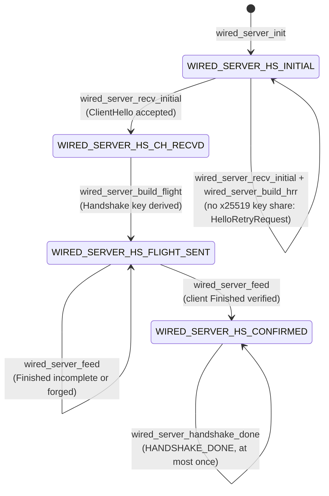
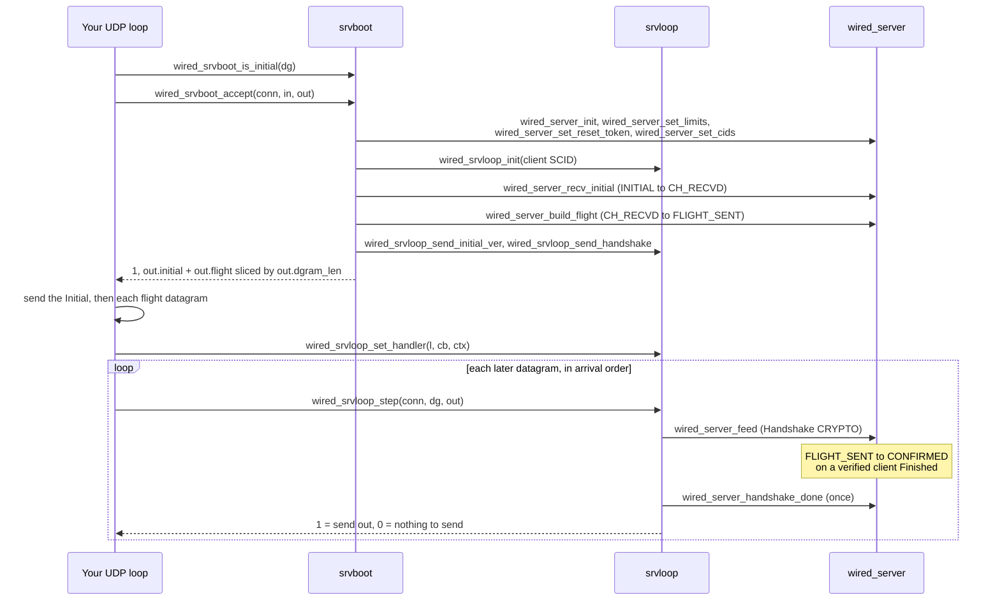

# API Stability

[Docs](README.md) › API Stability

This page answers one question: which functions reachable from `wired.h`
can you call freely, and which ones have hidden ordering or lifetime rules?
It is for application authors choosing what to build on, and for
contributors deciding how carefully a change must be announced. It is a map,
not a tutorial: for how to use the library, see
[Getting started](getting-started.md) and the
[guide](https://hakkadaikon.github.io/wired/guide/en/).

> **Most applications need four things:** `wired_srvdriver_parse` and
> `wired_srvdriver_run` (parse the command-line flags, then serve), a
> `wired_srvrun_handler` (your request callback), and
> `wired_certreload_load_or_selfsigned` (load real certificates).
> WebTransport apps add a fifth, `wired_server_broadcast_datagram`.
> Everything else on this page is for going further. The guide's
> [server flags](https://hakkadaikon.github.io/wired/guide/en/quic/server-flags/)
> page shows the first three, and
> [cert reload](https://hakkadaikon.github.io/wired/guide/en/ops/cert-reload/)
> adds the fourth.

**Rule of thumb:** if a function is in the *Stable API* tables below,
call it freely. It either does one whole job or is a pure function with
no hidden ordering rules. Anything in the *Low-level / internal API* table
has call-order or lifetime preconditions: read its header comment before
using it.

## Why the line matters

`src/wired.h` is a single include that pulls in every application-facing
header. A header named in parentheses below only shows where the
declaration lives; you do not include it yourself. The one exception is
`run/moqtswitch.h`, noted in its row.

Some of those headers expose one top-level entry point meant to be called
once. Others expose the individual steps of an internal state machine.
Those steps can be called in the wrong order, or with a buffer that has
already gone away, if the caller does not understand the protocol
underneath.

The name prefix tells you the audience: `wired_*` is application-facing,
and a bare module token (`sdrv_*`, `moqctl_*`, `bytes_*`) is SDK-internal.
But inside `wired_*` the prefix does not say which functions are whole-job
entry points and which are low-level steps. This page does.

One type appears everywhere below. A `wired_span` is a *view*: a pointer
plus a length into memory that someone else owns. Nothing is copied, so
the memory must stay alive while the view is used.

## Stable API (application-facing, breaking changes avoided)

You can call these without knowing the QUIC or TLS state machine
underneath. Each one is either a single top-level operation (the run and
driver functions) or a pure function with no rules that span several calls
(codecs, file I/O, logging).

### Running a server

| Function | Role |
|---|---|
| `wired_srvdriver_parse`, `wired_srvdriver_run` | Recommended entry point: parse driver flags, run one of four drivers. |
| `wired_server_run` | Run a complete single-process server until killed. |
| `wired_server_run_opt` | `wired_server_run` plus opt-in settings in `wired_srvrun_opt`. |
| `wired_srvrun_handler` (struct) | Your callback and its context, passed to the run functions. |

- `wired_srvdriver_parse` reads the driver flags (`--port`, `--workers`,
  `--ifindex`, `--cores`, `--pin-core` and a few more; see its header) and
  rejects conflicting combinations, such as `--workers` with `--cores`.
  `wired_srvdriver_run` then picks one of the four drivers: single process,
  forked workers, AF_XDP (a Linux fast path that bypasses most of the
  kernel network stack), or threads. The guide's
  [server flags](https://hakkadaikon.github.io/wired/guide/en/quic/server-flags/)
  page shows each one.
- `wired_server_run_opt` adds opt-in settings: busy-polling, the AF_XDP
  driver, the WebTransport callbacks, and the per-loop-step callback
  `on_step`. `wt_origin_check` decides whether to accept a WebTransport
  session by its Origin; it gets an empty `origin` view when the request
  has no origin header. `wt_on_session_draining` is called when the peer
  sends WT_DRAIN_SESSION on a session's CONNECT stream. `datagram_first`
  set to 1 sends queued DATAGRAMs before stream data in each send pass;
  the default 0 sends stream data first (RFC 9221 §5.1). `opt` must not be
  0. With every setting at its default it behaves exactly like
  `wired_server_run`.
- `wired_srvrun_handler` has three optional members at its end; leave any
  at 0 to disable it. `http` takes a `wired_http_handler`, which fills a
  `wired_http_exchange` to choose the status and add up to
  `WIRED_HTTP_MAX_FIELDS` (8) response headers. `on_body` takes a
  `wired_srvloop_on_body`, which receives the request body in chunks as it
  arrives, before your responder runs. With `on_body` at 0 the whole body
  is buffered first. `on_body_abort` takes a `wired_srvloop_on_body_abort`,
  called once when a body that was streaming to `on_body` ends without
  fin: the client reset the stream, stopped the response before it
  started, or the connection ended. It gets the stream id and the client's
  error code (`H3_REQUEST_CANCELLED` when the connection ended). The `req`
  passed to `on_body` is valid only during that call.
- `wired_http_field` is a typedef of the internal `qpack_field` (two
  `wired_span`s, name then value), so its layout follows that struct.

### WebTransport from inside a callback

| Function | Role |
|---|---|
| `wired_server_broadcast_datagram` | Queue a QUIC DATAGRAM to every live WebTransport session. |
| `wired_server_wt_open_uni`, `wired_server_wt_open_bidi` | Open a server-initiated WebTransport uni or bidi stream. |
| `wired_server_wt_stream_reply` | Reply on a bidi stream the client opened. |
| `wired_server_wt_stream_inflight` | Whether a sent stream's payload is still in use. |
| `wired_server_wt_drain_session` | Ask the peer to wind a session down. |
| `wired_server_wt_stream_priority` | Set a sent stream's urgency. |
| `wired_server_wt_stream_schedule`, `wired_wt_sched` (struct) | Set a sent stream's full send class. |
| `wired_server_wt_occupancy`, `wired_wt_occupancy` (struct) | Snapshot of open sessions and streams. |

All of these share one rule: call them only from inside the server's own
loop, that is, from one of your callbacks. They are neither thread-safe nor
signal-safe. The guide covers how to use them in
[WebTransport datagrams](https://hakkadaikon.github.io/wired/guide/en/wt/datagram/)
and
[server-opened streams](https://hakkadaikon.github.io/wired/guide/en/wt/open-streams/).

- **Payload lifetime.** The open and reply calls copy a payload of up to
  128 KiB (131072 bytes, the send slot's staging buffer), so your buffer is
  free as soon as the call returns. A larger payload is kept as a view into
  your memory. Keep it alive until `wired_server_wt_stream_inflight`
  returns 0: it returns 1 while the stream's send slot still holds
  `stream_id` (bytes unacknowledged, or the stream still open for appends),
  and 0 once the slot was freed or `stream_id` never named a server-sent
  stream on this session.
- **Stream signal.** A payload passed to the open calls must start with the
  WebTransport stream-signal prefix, which tells the browser which session
  the stream belongs to.
- **Drain.** `wired_server_wt_drain_session` sends WT_DRAIN_SESSION on the
  session's CONNECT stream on the loop's next step, at most once per
  session. A repeat call returns 1 without sending again. It returns 0 when
  the session is no longer live, or is a raw-QUIC session, which has no
  drain.
- **Urgency.** `wired_server_wt_stream_priority` takes an RFC 9218 urgency
  from 0 to 7 (default 3); lower values are sent first. Each send pass
  serves only the most urgent streams that can send; streams of equal
  urgency take turns. It returns a negative value for urgency above 7 or
  for an id with no open send slot.
- **Send class.** `wired_server_wt_stream_schedule` takes a
  `wired_wt_sched` with three keys. `urgency` picks the tier, as above.
  `fine` orders streams inside one urgency, lower first. `flow`, when
  nonzero, puts the streams that share it in a fixed sequence: only the
  stream with the lowest (`order`, `tie`) among that flow's ready streams
  sends. Flow 0 imposes no order. On each send pass, every stream that
  takes part gets one slice, except that when two sessions share the
  connection each session sends the same number of slices per pass
  (draft-ietf-webtrans-http3-16 §8), and each session may hold at most
  half of the send slots. Errors are the same as for
  `wired_server_wt_stream_priority`.
- **Occupancy.** `wired_server_wt_occupancy` reports the calling loop's
  open sessions and client-opened streams with their compile-time
  capacities. It is a point-in-time snapshot, unlike the running totals of
  `wired_srvrun_env_wt_usage`.

The same header has further `wired_server_wt_*` calls that are not yet
classified in either tier: `wired_server_wt_stream_reply_open`,
`wired_server_wt_stream_send`, `wired_server_wt_stream_fin`,
`wired_server_wt_stream_hold`, `wired_server_wt_stream_reset`,
`wired_server_wt_stream_stop`, `wired_server_wt_send_datagram_to`,
`wired_server_wt_close_session`, `wired_server_wt_est_kbps`,
`wired_server_wt_exporter`,
`wired_server_broadcast_datagram_ring`,
`wired_server_wt_send_datagram_prio` and
`wired_server_broadcast_datagram_prio`. They follow the same loop-only
rule; read each header comment before using one. The two `_prio` calls
take an urgency from 0 (most urgent) to 7 (RFC 9221 §5.1). Queued
datagrams go out most urgent first, in call order within one urgency;
the calls without `_prio` use 3.

### Requests and responses

| Function | Role |
|---|---|
| `wired_h3req_path` | The request's `:path` as one `wired_span`. |
| `wired_http_req_header` | Look up a request header by lowercase name. |
| `wired_http_reply_text` (`srvrun/httpx.h`) | Set status, `text/plain` and body text in one call. |
| `wired_http_add_field` (`srvrun/httpx.h`) | Append a response header from two C strings. |

- `wired_http_req_header` matches the name exactly. `cookie` returns all
  its pieces joined with `"; "`; for any other repeated header it returns
  the first. Apart from `cookie`, `origin` and `wt-available-protocols`,
  only the first `WIRED_H3REQDRIVE_MAX_HDRS` (32) regular headers are kept,
  so later ones are not found.
- A response body larger than one buffer is produced in *rounds*: your
  responder is called again to fill the next chunk (see the guide's
  [streaming](https://hakkadaikon.github.io/wired/guide/en/h3/streaming/)
  page). In those later rounds the request you see is a copy with 512
  bytes of room for its views and headers. Headers that did not fit in the
  copy are not found there.
- The returned value is a view into the request, and lives as long as the
  request's other views.
- `wired_http_add_field` returns 0 when the field table is full.

### Certificates

| Function | Role |
|---|---|
| `wired_certreload_load` | Load a PEM certificate chain and P-256 key into storage you own. |
| `wired_certreload_load_or_selfsigned` | Same, or keep the existing identity when no path is set. |
| `wired_pem_next` | Decode one PEM block; repeat to walk a full-chain file. |
| `wired_eckey_p256_priv` | Extract a P-256 private key from DER (SEC1 or PKCS#8). |

The storage you pass to `wired_certreload_load` must outlive the identity
built from it. `wired_certreload_load_or_selfsigned` exits with a
diagnostic when a path *is* set but fails to load, instead of silently
falling back to a self-signed certificate. See the guide's
[certificates](https://hakkadaikon.github.io/wired/guide/en/tls/certificates/)
and
[cert reload](https://hakkadaikon.github.io/wired/guide/en/ops/cert-reload/)
pages.

### Sockets, files and codecs

| Function | Role |
|---|---|
| `wired_udp_socket`, `wired_udp_bind`, `wired_udp_send`, `wired_udp_recv`, `wired_udp_recvfrom`, `wired_udp_close`, `wired_udp_addr` | Plain UDP socket calls, no QUIC state. |
| `wired_fio_read`, `wired_fio_append`, `wired_fio_write_new`, `wired_fio_mkdir` | Whole-file read, append, replace; create a directory. |
| `wired_fio_open`, `wired_fio_size`, `wired_fio_pread`, `wired_fio_close` | Chunked file access: open, size, read at an offset, close. |
| `wired_fio_read_span` | `wired_fio_read` returning a `wired_span` (length 0 on error). |
| `wired_header_parse`, `wired_header_build_long` | Parse or build the version-independent part of a QUIC packet header. |

The UDP calls are safe in any order a normal sockets program would use.
The file calls go straight to system calls and carry no protocol state; the
examples use the chunked group to stream a large static file without
loading it whole.

### Text, formatting and logging

| Function | Role |
|---|---|
| `wired_log_str`, `wired_log_ts`, `wired_fmt_u64`, `WIRED_LOG` | Optional tracing to stderr; safe anywhere. |
| `wired_snprintf`, `wired_vsnprintf`, `wired_dprintf` | printf-compatible formatter that needs no libc. |
| `wired_obuf_printf` | printf-append into a `wired_obuf`. |
| `wired_span_eq`, `wired_span_eq_cstr`, `wired_span_cstr`, `wired_span_to_cstr`, `WIRED_SPAN_ARG` | Compare, build and copy out byte views. |
| `wired_span_find` | Index of the first given byte in a view, -1 if absent. |
| `wired_cstr_eq`, `wired_cstr_append`, `wired_span_strip_lead`, `wired_obuf_put` | Small C-string and buffer helpers. |
| `wired_hex_encode`, `wired_dump_hex`, `wired_dump_text` | Hex-encode a view; write a view to an fd as hex or text. |

- The formatter supports `%d %i %u %x %X %p %s %c %% %f` with flags, width,
  precision and length modifiers, plus `%H`, a wired extension that prints
  bytes as lowercase hex: `"%.*H"` takes a byte count and a pointer (the
  pair `WIRED_SPAN_ARG` yields). `wired_dprintf` only calls write(2).
  Differences from C99 are listed in `common/fmt/fmt.h`.
- `wired_obuf_printf` appends at `len`, writes at most `cap - len - 1`
  bytes, and returns the bytes appended.
- The span and C-string helpers live in `common/bytes/text/text.h`.
  `wired_span_eq` is not constant-time, so do not use it to compare
  secrets. `wired_span_to_cstr` and `wired_cstr_append` truncate to fit;
  `wired_obuf_put` cuts at `cap`. `WIRED_SPAN_ARG` expands to the two
  arguments a `"%.*s"` format needs.

### Demo identity

| Function | Role |
|---|---|
| `wired_srvboot_demo`, `wired_srvboot_demo_keys` (`srvboot/srvdemo.h`) | Fixed demo identity for samples and tests. Never for production. |
| `wired_srvboot_cert_sha256`, `wired_srvboot_log_fingerprint` (`srvboot/srvdemo.h`) | SHA-256 of the leaf certificate, raw or logged. |

The demo identity uses counting-pattern keys and a self-signed
certificate, so anyone can reproduce it. The certificate hash is the value
a browser expects in `serverCertificateHashes`; the fingerprint is logged
colon-separated. `wired_srvboot_cert_sha256` and
`wired_srvboot_log_fingerprint` are not reentrant, because they share one
process-wide scratch server.

### Session resumption and 0-RTT

| Name | Role |
|---|---|
| `wired_srvboot_id.ticket_key` | Session-ticket key seed; 0 = no resumption. |
| `wired_srvboot_id.early_data` | 1 = accept 0-RTT on resumed connections; 0 (default) = resume as 1-RTT only. |

- **0-RTT is opt-in.** RFC 8446 Appendix E.5 forbids enabling 0-RTT
  unless the application asks for it, because an attacker can replay
  0-RTT data. Setting `ticket_key` alone turns on resumption, not 0-RTT.
  Set `early_data = 1` only when every request a client may send early is
  safe to process twice.
- **What still refuses 0-RTT.** With `early_data = 1`, the SDK still
  declines it for a replayed ticket, a stale ticket age, a ticket issued
  under another ALPN or cipher suite, a raw-QUIC ALPN, and a ClientHello
  that follows a HelloRetryRequest. The connection then resumes as 1-RTT.
  Tickets advertise early data only when it is enabled.

### Idle timeout

| Name | Role |
|---|---|
| `wired_srvboot_id.idle_timeout_ms` | The max_idle_timeout the server advertises, in ms; 0 = 30 s. |
| `wired_server_idle_timeout_ms` | A connection's negotiated idle timeout in ms. |

- A connection idles out after the smaller of `idle_timeout_ms` and the
  client's max_idle_timeout (RFC 9000 10.1). A client value of 0 or no
  value sets no limit, so only the server's value applies. The SDK never
  idles a connection out in less than three PTOs.
- `wired_server_idle_timeout_ms` returns the server's own value until the
  ClientHello has been processed.

## Low-level / internal API (use with care)

These functions are reachable from the public headers because the
application-facing layer is built out of them, not because most users
should call them. Each has a call-order or lifetime rule that is easy to
break. `wired_server_run` and the drivers already call them correctly for
you.

QUIC encrypts each stage of a connection with its own keys, called a *key
level*: Initial (derived from public values), Handshake (after the TLS key
exchange), and 1-RTT (after the handshake). A packet sealed under the
wrong key level is unreadable to the peer.

### The server handshake phases

`wired_server` is the server side of the TLS 1.3 handshake. Its `phase`
field walks four values in order: INITIAL (waiting for the client's
ClientHello), CH_RECVD (ClientHello accepted), FLIGHT_SENT (the server's
reply built), and CONFIRMED (the client proved it holds the keys). Terms
used in the diagram:

- **Flight**: the server's batch of handshake messages, sent together.
- **Finished**: the last handshake message from each side; it proves the
  sender holds the handshake keys.
- **HelloRetryRequest**: asks the client to resend its ClientHello with a
  key type the server supports (here, x25519).
- **HANDSHAKE_DONE**: the QUIC frame that tells the client the handshake
  is confirmed.

Read the diagram as "which call moves the phase forward".

- A phase-checked call (`wired_server_recv_initial`,
  `wired_server_build_hrr`, `wired_server_build_flight`,
  `wired_server_feed`, `wired_server_handshake_done`) returns 0 in the
  wrong phase without advancing it. Treat that 0 as a failure to handle,
  not as something to retry blindly. `wired_server_feed` still adds the
  bytes to its reassembly buffer before it checks the phase.
- If the ClientHello offers no x25519 key share, the phase stays INITIAL:
  `wired_server_build_hrr` emits a HelloRetryRequest, and the client's
  second ClientHello goes through `wired_server_recv_initial` again.
- `wired_server_set_cids`, `wired_server_set_limits` and
  `wired_server_set_reset_token` have no phase check, but the flight
  carries the connection ids, limits and token they set. Call them before
  `wired_server_build_flight`; called after it, they are silently too late.
- A forged client Finished promotes nothing: the phase only reaches
  CONFIRMED after the Finished message verifies.

### Driving one connection by hand

`srvboot` cold-starts a connection from the client's first datagram, and
`srvloop` handles every datagram after that. The diagram shows the order
`wired_server_run` itself follows, except that the run loop uses the
accumulator form `wired_srvboot_accept_acc` (see Split ClientHello below).
The important part is that the accept call already does the handshake
set-up calls for you.

- **Labels.** SCID is the connection ID the client picked for itself;
  srvloop puts it on every packet it sends back. CRYPTO is the QUIC frame
  that carries TLS handshake bytes.
- **Sending the output.** Send `out.initial` first, then cut `out.flight`
  into datagrams of the sizes in `out.dgram_len` (`out.dgram_count` of
  them) and send each one.
- **HelloRetryRequest.** Both `wired_srvboot_accept` and
  `wired_srvboot_accept_acc` return `WIRED_SRVBOOT_HRR` (2) when they
  sealed a HelloRetryRequest in `out.initial` instead of the flight; then
  `out.dgram_count` is 0. Do not treat every nonzero return as "flight
  sealed".
- **Split ClientHello.** `wired_srvboot_accept` handles a ClientHello that
  fits in one datagram. The run loop instead collects one split across
  several datagrams with the `wired_srvboot_acc_*` accumulator and calls
  `wired_srvboot_accept_acc`.
- **Accepted QUIC versions.** `wired_srvboot_id.versions` holds
  `WIRED_VERSIONS_V1` / `WIRED_VERSIONS_V2` bits; 0, the default, accepts
  both (RFC 9308 13). An Initial in a version outside the set gets Version
  Negotiation, and compatible version negotiation (RFC 9368) only picks
  from the set. `wired_srvboot_vneg` takes the same bits.
- **Lifetimes and order.** The fields of the `wired_srvboot_id` you pass
  are views; keep them alive for the call. Start from a zeroed struct
  (`= {0}` or `wired_srvboot_demo`), so members added at its end default
  to off: `reset_seed` is the stateless-reset secret (0 uses
  `cert_seed`; `wired_srvrun_serve_env` pins it to a copy of the start-time
  `cert_seed` so a certificate reload does not change tokens already
  given out), and the last one, `early_data`, is the 0-RTT opt-in (see
  Session resumption and 0-RTT). `wired_srvloop_step` must see
  datagrams in arrival order, and the request it decodes into
  `wired_srvloop` is valid only until the next step.

### Low-level functions at a glance

| Function | Why it needs care |
|---|---|
| `wired_srvboot_is_initial`, `wired_srvboot_accept`, `wired_srvboot_accept_acc`, `wired_srvboot_acc_*` | Cold-start one connection; must run before any step. |
| `wired_srvloop_init`, `wired_srvloop_set_handler`, `wired_srvloop_step`, `wired_srvloop_wt_refuse` | One connection's per-datagram loop; strict order. |
| `wired_srvloop_send_initial`, `wired_srvloop_send_initial_ver`, `wired_srvloop_send_handshake`, `wired_srvloop_send_onertt` | Seal one packet type under one key level. |
| `wired_server_init`, `wired_server_set_cids`, `wired_server_set_limits`, `wired_server_set_reset_token`, `wired_server_recv_initial`, `wired_server_build_hrr`, `wired_server_build_flight`, `wired_server_feed`, `wired_server_handshake_done`, `wired_server_is_confirmed` | Handshake phase steps; each valid only in some phases. |
| `wired_server_listen`, `wired_server_pump`, `wired_server_run_handshake`, `wired_server_close` | Socket-owning handshake helpers on the same `wired_server`. |
| `wired_srvrun_env_size`, `wired_srvrun_env_init`, `wired_srvrun_serve_env` | Extra loop instances you allocate yourself. |
| `wired_srvrun_shutdown_word` | Pointer to the process-wide graceful-shutdown flag. |
| `wired_srvrun_broadcast_register`, `wired_srvrun_broadcast_unregister` | Join or leave the broadcast mesh between threads. |
| `wired_srvworkers_run` | Fork worker processes and supervise them. |
| `wired_srvthreads_run`, `wired_srvthreads_parse_cores` | Run worker threads under one control thread. |
| `wired_srvxdp_open`, `wired_srvxdp_open_shared`, `wired_srvxdp_rx_burst`, `wired_srvxdp_send`, `wired_srvxdp_close`, `wired_srvxdp_print_stats` | One AF_XDP driver instance. |
| `wired_srvxdpbpf_open`, `wired_srvxdpbpf_register`, `wired_srvxdpbpf_close` | The shared per-interface BPF program and map. |
| `wired_wt_session_init`, `wired_wt_session_establish`, `wired_wt_session_drain`, `wired_wt_session_close`, `wired_wt_session_offer_stream`, `wired_wt_session_offer_datagram` | The WebTransport session state machine. |
| `wired_h3reqdrive_send_get`, `wired_h3reqdrive_send_method`, `wired_h3reqdrive_recv_get` | HTTP/3 request codecs that return views. |
| `wired_x25519`, `wired_x25519_base` | Raw Curve25519 scalar multiplication. |
| `bytes_put`, `bytes_take` | Cursor-based byte copy for codec internals. |
| `bytes_memcpy`, `bytes_memset` | Not for application code at all. |

Notes on the rows above, in table order:

- **Srvboot and srvloop.** See [Driving one connection by
  hand](#driving-one-connection-by-hand). `wired_srvloop_init` is already
  called by `wired_srvboot_accept`; call it yourself only when you build a
  loop without srvboot. `wired_srvloop_wt_refuse` queues a WebTransport
  stream the slot table could not take, so the run loop resets it with
  H3_REQUEST_REJECTED.
- **Send functions.** Calling the wrong one for the current phase, such as
  `wired_srvloop_send_handshake` before the Handshake key exists, fails or
  produces a packet the peer cannot read.
- **Handshake steps.** See [The server handshake
  phases](#the-server-handshake-phases). `wired_server_listen`,
  `wired_server_pump` and `wired_server_run_handshake` open and read their
  own UDP socket; `wired_server_close` closes it and wipes the retained
  secrets.
- **Extra loop instances.** Allocate `wired_srvrun_env_size()` bytes and
  run `wired_srvrun_env_init` before the first `wired_srvrun_serve_env`.
  Set `no_signal_handlers=1` on every instance but one, because the
  SIGTERM and SIGHUP handlers are process-wide.
- **Shutdown word.** It is 0 until shutdown starts, then stays 1. Every
  loop in the process polls the same word, so setting it stops them all.
- **Broadcast mesh.** It has 16 fixed slots. The `inbox_row` and `env` you
  pass must stay live and unmoved until `wired_srvrun_broadcast_unregister`,
  which must run before the thread exits.
- **Worker processes.** A crashed worker is restarted; a worker that exits
  with status 0 is not. SIGTERM is forwarded once to every worker. The call
  returns 0 once every worker has been reaped, or a negative value if the
  first `fork` fails.
- **Worker threads.** Only the control thread owns the signal handlers and,
  in XDP mode, the shared BPF object. It joins every worker before it
  releases those shared resources. `wired_srvthreads_parse_cores` rejects
  an empty list or an empty field instead of running zero workers.
- **AF_XDP.** The kernel allows one XDP program link per network
  interface, so a multi-queue setup must call `wired_srvxdp_open_shared`
  against a `wired_srvxdpbpf` you own, not a second `wired_srvxdp_open`.
  `wired_srvxdp_send` drops packets (returns 0 and relies on QUIC
  retransmission) until the peer's MAC address has been learned from a
  received packet.
- **Shared BPF object.** Open it once per interface, register each queue's
  socket into it, and keep it open while any registered socket is in use.
  Closing it early orphans those sockets.
- **WebTransport session.** The states are unestablished, established,
  draining and closed; closed is final. A transition out of order is
  rejected and does nothing. A 0 from `wired_wt_session_offer_stream`
  obliges you to reset that stream with WT_BUFFERED_STREAM_REJECTED
  (`WTERR_BUFFERED_STREAM_REJECTED`); a 0 from
  `wired_wt_session_offer_datagram` is an allowed drop that needs no action.
  The guide's
  [session lifecycle](https://hakkadaikon.github.io/wired/guide/en/wt/session-lifecycle/)
  page shows the states from the application side.
- **Request codecs.** The pseudo-headers `wired_h3reqdrive_recv_get`
  recovers are views into your scratch buffer and the stream data. Both
  must stay alive while you use the parsed request.
- **X25519.** `wired_x25519` itself detects an all-zero result and returns
  0. You MUST treat that 0 as failure (RFC 7748 6.1). Ignoring it silently
  accepts a key exchange with a low-order point, where the peer
  contributed nothing secret.
- **Cursor copies.** `bytes_put` and `bytes_take` are correct only when
  the caller keeps the cursor (`*off`) consistent across calls. They check
  bounds only against what you pass in.
- **Memory helpers.** A freestanding (`-nostdlib`) binary has no libc, yet
  the compiler still emits calls to `memcpy` and `memset`. When you define
  `WIRED_MAIN`, `wired.h` defines those two as thin forwards to
  `bytes_memcpy` and `bytes_memset`, the SDK's own copy and fill helpers
  used throughout `src/`. Applications should call neither directly.

## Versioning policy

The project has no released version number yet, so this is a proposed
default, not a description of existing practice.

- **Stable API**: breaking changes (a signature change, a removal, or a
  change to what a function requires or promises) wait for a major version
  bump. Additive changes (a new function, or a new optional field with a
  safe default) need only a minor version bump.
- **Low-level / internal API**: may change its signature, calling
  convention or preconditions in a minor version bump. These functions
  exist so that `wired_server_run` and the examples can be built at all;
  they are not a contract with external callers. Read the current header
  before depending on one.
- Patch versions are bug fixes only, in both layers, with no signature
  change.

Until a version number exists, treat every commit to a low-level function
as a possible behavior change, and every commit to a stable function as
needing a changelog note.

## MoQT: reachable from `wired.h`, experimental tier

`src/app/moqt/` implements MoQT (Media over QUIC Transport) in fourteen
modules: `cache`, `ctl`, `data`, `dgram`, `fetch`, `kvp`, `ns`, `qraw`,
`run`, `sess`, `ssts`, `tstat`, `ver` and `vi`. A session speaks whichever
of draft-ietf-moq-transport-18, -19 or -22 the peer offers as its
WebTransport subprotocol (`moqt-18`, `moqt-19`, `moqt-22`).

`src/wired.h` includes the application-facing MoQT headers
(`run/moqtrun.h`, `qraw/moqrawio.h`, `data/moqdata.h`, `dgram/moqdg.h`),
plus `media/mp4frag/mp4frag.h` and `platform/clock/mono.h` for live media.
So `wired_moqt_init` and friends need no second include.

The whole MoQT surface is **experimental**, not Stable. MoQ Transport is
still an IETF draft, and the names, defaults and wire behavior follow it,
so they may change in any commit without a deprecation period. That is why
none of it appears in the Stable or Low-level / internal tables. Treat
these headers like the Low-level functions: read the header before
calling.

Terms used below (the guide's
[MoQT hub](https://hakkadaikon.github.io/wired/guide/en/moqt/hub/) page
shows them in use):

- **Hub** (`wired_moqt_hub`): the relay that forwards Tracks between
  publishers and subscribers.
- **io table** (`wired_moqt_io`): the table of function pointers the hub
  calls to send, open and close things on the transport.
- **Track** and **Full Track Name**: a named stream of media Objects, and
  its name (namespace plus track name).
- **Setup Option**: a key-value field in the SETUP message that opens a
  MoQT session.
- **New Session URI**: the address a GOAWAY tells the peer to reconnect to.

### Optional hub and io-table settings (`run/moqtrun.h`)

Each of these is optional; the default (0 or unset) is given in the notes.

| Name | Role |
|---|---|
| `wired_moqt_cache_attach` | Give the hub an arena for its whole-group object cache, used by FETCH. |
| `wired_moqt_goaway` | Send MoQT GOAWAY on every session, then close them after a timeout. |
| `wired_moqt_on_session_draining` | Start the GOAWAY sequence when a peer drains its session. |
| `wired_moqt_on_stream_reset` | Tell the hub a peer reset one of its streams. |
| `wired_moqt_hub.authorize_namespace`, `authorize_ns_ctx`, `wired_moqt_authorize_ns_fn` | Optional authorizer for namespace requests; 0 grants all. |
| `wired_moqt_hub.authorize_publish`, `authorize_pub_ctx` | Optional authorizer for PUBLISH; 0 grants all. |
| `wired_moqt_io.close_session`, `stream_reply_open`, `stream_priority`, `stream_stop` | Ops appended to the end of `wired_moqt_io`. |
| `wired_moqt_io.stream_sched` | Op that sets a full send class for Object streams. |
| `wired_moqt_io.est_kbps` | Op that reports the connection's delivery-rate estimate. |

- **Cache.** The arena is yours. Without it, FETCH reports every range as
  unknown.
- **GOAWAY.** It carries an optional New Session URI and a timeout. When
  the timeout passes, the hub sends PUBLISH_DONE and closes the session
  with GOAWAY_TIMEOUT.
- **Draining.** `wired_moqt_on_session_draining` has the same shape as
  `wired_srvrun_opt.wt_on_session_draining`; a peer's WT_DRAIN_SESSION
  starts the GOAWAY sequence for that session.
- **Stream reset.** The reset cancels the request or FETCH that stream
  carried.
- **Authorizers.** `authorize_namespace` covers PUBLISH_NAMESPACE and
  SUBSCRIBE_NAMESPACE. `authorize_publish` is a `wired_moqt_authorize_fn`
  shown the Full Track Name and the token. A relay uses it to check that a
  publisher is not impersonating someone else, which every draft requires.
  The guide's
  [authorize](https://hakkadaikon.github.io/wired/guide/en/moqt/authorize/)
  page shows both.
- **io table ops.** `close_session`, `stream_reply_open`,
  `stream_priority` and `stream_stop` have the shapes of
  `wired_server_wt_close_session`, `wired_server_wt_stream_reply_open`,
  `wired_server_wt_stream_priority` and `wired_server_wt_stream_stop`. Left
  at 0, `close_session` closes nothing, `stream_reply_open` opens no
  per-request streams, `stream_priority` keeps the default urgency, and
  `stream_stop` leaves an inbound data stream the hub cannot route to drain
  unread.
- **`stream_sched`.** It has the shape of
  `wired_server_wt_stream_schedule` (`wired_moqraw_io` sets it). When set
  it replaces `stream_priority` for Object streams; at 0 the hub uses
  `stream_priority`.
- **`est_kbps`.** It has the shape of `wired_server_wt_est_kbps`, and
  `wired_moqraw_io` sets it to that function. At 0, the SSTS budget (see
  track switching below) comes from the cap alone.

### Choosing the draft version

`wired_moqt_wt_protocols` (`ver/moqver.h`) writes the server's offered
subprotocol list for `wired_srvrun_opt.wt_protocols`.

- An application that leaves `wt_protocols` unset, or sets it to the
  single string `"moqt-19"`, negotiates draft-19 only.
- A session whose peer sends no WebTransport subprotocol uses the draft-19
  control-stream behavior.
- The guide's MoQT samples set `wt_protocols = "moqt-22"`, and their
  clients offer `moqt-22`.
- `examples/moqt_chat` offers the full list. A browser that can offer
  `moqt-22` (the WebTransport `protocols` option) runs draft-22; one that
  cannot falls back to draft-19.

### MoQT over raw QUIC

MoQT can also run directly on QUIC, without HTTP/3 or WebTransport
(draft-ietf-moq-transport-22 6.2.2, -18/-19 3.1.4-5). The client then picks
MoQT through ALPN (Application-Layer Protocol Negotiation), the TLS
extension in which the client lists the protocols it speaks, such as `h3`,
and the server selects one. Such a connection has no CONNECT request, so
the SDK gives it one *implicit session* that stands for the whole
connection. All the names below default to zero or unset, which means
WebTransport only.

| Name | Role |
|---|---|
| `wired_srvboot_id.raw_alpns` | Raw ALPNs the server may select beside `h3`/`hq-interop`; 0 = off. |
| `wired_srvrun_opt.raw_on_session`, `raw_session_ctx`, `wired_rawq_on_session` | Called once per raw-ALPN connection when the handshake is confirmed. |
| `wired_server_session_is_raw` | 1 for a raw-QUIC session, 0 for a WebTransport session. |
| `wired_moqraw_io` (`qraw/moqrawio.h`) | A ready-made `wired_moqt_io` over `wired_server_wt_*`. |
| `wired_moqt_on_session_raw` (`run/moqtrun.h`) | The hub's `raw_on_session` callback. |
| `wired_moqt_hub.raw_policy` (a `moqraw_policy`) | Optional checks on a raw session's PATH and AUTHORITY. |
| `WIRED_MOQTRUN_CLOSE_MALFORMED_PATH`, `WIRED_MOQTRUN_CLOSE_MALFORMED_AUTHORITY` | Session close codes 0x9 and 0x1A. |

- **`raw_alpns`.** A space-separated list such as
  `"moqt-22 moqt-19 moqt-18"` in the server's preference order, ahead of
  h3 and hq-interop (RFC 7301 3.2). `alpn_client_order` 1 picks in the
  client's order instead.
- **`raw_on_session`.** It receives the connection's implicit session and
  the negotiated ALPN before any of its stream bytes. After that the
  session flows through the same `wt_on_*` callbacks as a WebTransport
  session. At 0, no raw sessions are reported.
- **Raw vs WebTransport.** On a raw session,
  `wired_server_wt_close_session` sends a QUIC CONNECTION_CLOSE (0x1d) with
  the code, stream resets carry the code without the WebTransport mapping,
  and datagrams carry no quarter-stream-id. (On WebTransport, every
  datagram starts with a quarter-stream-id, the session's stream id divided
  by 4, which tells the receiver which session it belongs to.)
- **`wired_moqraw_io`.** It adds the WebTransport stream signal to the
  stream-opening ops on WebTransport sessions only; a raw session's streams
  carry none. `send_uni2` is 0; an application that needs it sets its own.
- **`wired_moqt_on_session_raw`.** It has the shape of
  `wired_rawq_on_session`: pass it as `raw_on_session` with the hub as
  `raw_session_ctx`. The ALPN `moqt-NN` picks the draft. The control
  streams are a pair of uni streams, one in each direction. PATH and
  AUTHORITY Setup Options are accepted when well-formed; otherwise the
  session is closed with MALFORMED_PATH (0x9) or MALFORMED_AUTHORITY
  (0x1A). A GOAWAY carries an empty New Session URI, and a full hub closes
  the session with INTERNAL_ERROR.
- **`raw_policy`.** Optional `accept_path` and `accept_authority` hooks
  for well-formed values. A refusal closes the session with INVALID_PATH
  (0x8) or INVALID_AUTHORITY (0x19). Zero, the `wired_moqt_init` default,
  accepts every well-formed value.

### Experimental: track switching (moqtail-compatible, draft-22 only)

Track switching is experimental even within MoQT. The rest of MoQT follows
an IETF draft; this extension is not in draft-ietf-moq-transport-22 or any
other draft, so it may be removed outright in any commit, without a
version bump or a deprecation period.

It lets a subscriber move between variants of a Track (for example, a
high-rate and a low-rate encoding) without re-subscribing. It uses the
code points of moqtail, another MoQT implementation, and has been verified
in-process only, with no third-party interop yet.

Everything defaults to off. A hub that does not set these fields behaves
as if the extension did not exist: the parameters SWITCH_FROM (0x24) and
SWITCHING_SET_ASSIGNMENT (0x41) still close a session with
PROTOCOL_VIOLATION. Overview:
[MoQT track switching](features/moqt-track-switching.md).

Two mechanisms appear below. SWITCH_FROM is a subscriber's request to move
from one Track to another. SSTS (sender-side track switching) lets the
subscriber put the variants in one switching set and leaves the hub to
choose which one to forward, using a selection algorithm.

| Name | Role |
|---|---|
| `wired_moqt_hub.switch_track` (`run/moqtrun.h`) | 1 enables SWITCH_FROM on draft-22 sessions. |
| `wired_moqt_hub.ssts_algs`, `ssts_alg_n` (`run/moqtrun.h`) | SSTS algorithm IDs the hub advertises; `ssts_alg_n` 0 disables SSTS. |
| `wired_moqt_hub.ssts_cap_kbps` (`run/moqtrun.h`) | Cap on the default algorithm's budget in kbps; 0 = no cap. |
| `WIRED_MOQTSW_SOFT_WAIT_MS` (`run/moqtswitch.h`, include it yourself) | Give-up time for a soft SWITCH_FROM (4000 ms). |
| `WIRED_MOQTRUN_SSTS_SETS` (`run/moqtss.h`) | Switching sets per subscriber session (8). |
| `WIRED_MOQTRUN_MAX_TRACKS_PER_PEER` (`run/moqtrun.h`) | Tracks one peer can PUBLISH at once (4). |
| `MOQCTL_PARAM_SWITCH_FROM`, `MOQCTL_PARAM_SWITCHING_SET_ASSIGNMENT`, `MOQCTL_OPT_SSTS_ALGORITHMS`, `MOQCTL_SWITCH_HARD` / `_SOFT`, `MOQCTL_ERR_INVALID_SWITCH`, `MOQCTL_ERR_UNSUPPORTED_EXTENSION`, `MOQCTL_DONE_SWITCHED`, `MOQCTL_SSTS_ALG_DEFAULT` / `_BACKPRESSURE`, `MOQCTL_SSTS_MAX_ALGS`, `moqctl_switchfrom`, `moqctl_ssa` (`ctl/moqctl.h`) | Codec constants and value structs. |
| `moqssts_*` / `MOQSSTS_*` (`ssts/moqssts.h`) | Pure SSTS algorithms. SDK-internal, no stability promise. |

- **`switch_track`.** At 0, the `wired_moqt_init` default, the hub keeps
  closing the session with PROTOCOL_VIOLATION on SWITCH_FROM.
- **`ssts_algs`.** A list you own; it must outlive the hub. The hub sends
  it in its draft-22 SETUP as Setup Option 0x09, at most
  `MOQCTL_SSTS_MAX_ALGS` (4) entries.
- **`ssts_cap_kbps`.** The default algorithm's (0) budget is the lower of
  this cap and the connection's delivery-rate estimate
  (`wired_moqt_io.est_kbps`, which `wired_moqraw_io` sets to
  `wired_server_wt_est_kbps`).
- **`WIRED_MOQTSW_SOFT_WAIT_MS`.** It lives in `run/moqtswitch.h`, which
  `wired.h` does not include; include that header if you need the value.
- **`WIRED_MOQTRUN_SSTS_SETS`.** An assignment beyond it is refused with
  INTERNAL_ERROR.
- **`WIRED_MOQTRUN_MAX_TRACKS_PER_PEER`.** It is 4 so that a peer can
  publish a low-rate variant beside its other Tracks; it sizes the peer
  table.
- **Code points.** SWITCH_FROM is parameter 0x24, SWITCHING_SET_ASSIGNMENT
  0x41, SSTS_ALGORITHMS Setup Option 0x09, INVALID_SWITCH error 0x32,
  UNSUPPORTED_EXTENSION error 0x33, and SWITCHED done code 0x3. The
  `moqctl_*` names are SDK-internal but listed because an application that
  builds its own client needs the code points.
- **SSTS algorithms.** Default is 0 and backpressure is 0xff01.

## The naming rule

This section is for contributors. The test build compiles every source
file as one unit, so every name in the SDK shares one namespace, and the
prefix has to carry both the audience and the owning module. The full rule
is in
[`.claude/rules/naming-and-unity-build.md`](../.claude/rules/naming-and-unity-build.md):

- **`wired_*` / `WIRED_*`**: everything in the Stable tables, plus the
  low-level helpers the bundled examples call. Breaking changes follow the
  versioning policy.
- **A module token (`sdrv_*`, `h3_*`, `bn_*`, `LEVEL_*`)**: SDK-internal,
  non-`static` names shared between modules. No stability promise.
- **`static` helpers**: private to one file, named distinctly enough to
  stay unique in the single-unit build.

---

**Next:** [API reference](https://hakkadaikon.github.io/wired/) — full
signatures for everything above. ([all docs](README.md))
