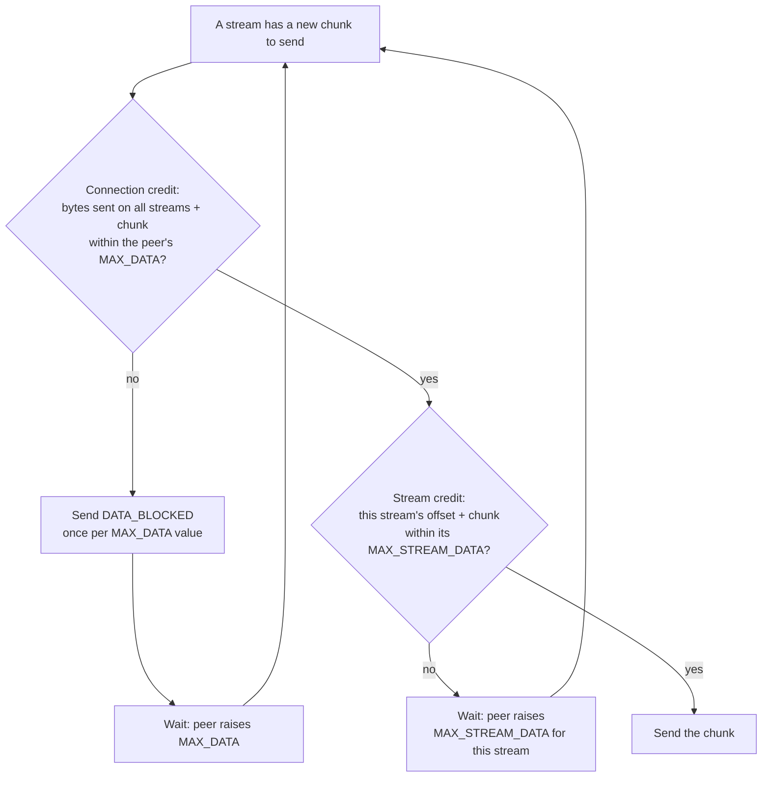
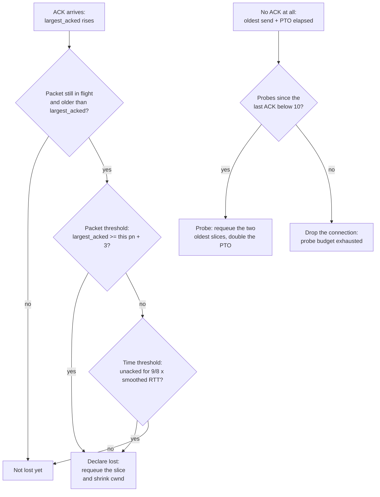
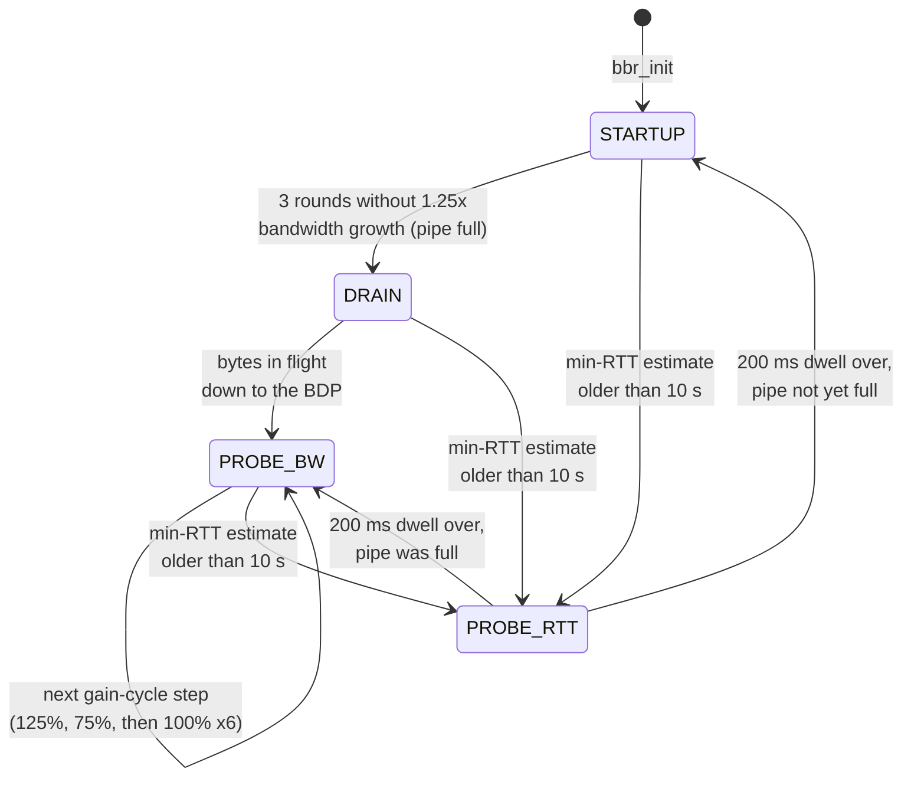
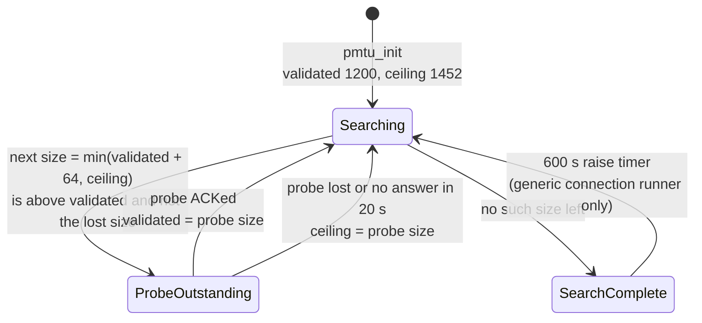
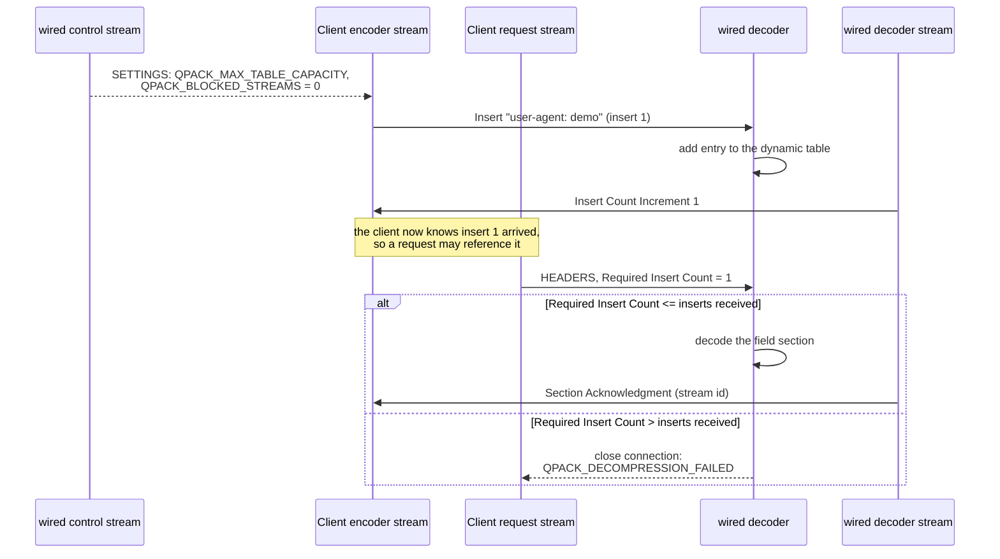

# レイヤー構成

[ドキュメント](../README.md) › アーキテクチャ › レイヤー構成

> **TL;DR**: 下から順に 5 つのレイヤーがあります。**common**(バイト単位の基本部品)→ **crypto**(純粋な暗号関数)→ **transport**(QUIC 本体)と **tls**(鍵と認証)→ **app**(HTTP/3、WebTransport、MoQT)です。以下の各節はそれぞれ単独で読めるので、関心のあるレイヤーだけを読んでください。

このページでは、`src/` の下にある 5 つのレイヤーがそれぞれ何をするのか、なぜ存在するのかを、そのレイヤーが解決する問題に沿って説明します。レイヤーの中のコードを変更・レビューしたい読者や、プロトコルのある仕組みがどこにあるかを知りたい読者に向けた文書です。依存関係の全体図は [概要](overview.md#5-つのレイヤー) にあります。依存はおおむね下向きですが、例外が 3 つあります。主な例外は、transport と tls が互いに include し合っていることです。

SDK の内部を読むのではなく*使う*なら、[ガイド](https://hakkadaikon.github.io/wired/guide/ja/)から始めてください。

## common: バイト単位の基本部品を共有する

common には、ほかのすべてのレイヤーが必要とする小さな部品を置いています。common は下位のどのレイヤーにも依存しません。

### 可変長整数(varint)

QUIC はワイヤー上のほぼすべての数値を varint で書きます。パケット番号、フレーム型、ストリーム ID、長さがそうです。varint の長さは 1、2、4、8 バイトのいずれかです。先頭バイトの上位 2 ビットが長さを示し、残りのビットに値をビッグエンディアンで入れます(RFC 9000 §16)。

| 上位 2 ビット | 長さ     | 最大値                         |
|---------------|----------|--------------------------------|
| `00`          | 1 バイト | 63                             |
| `01`          | 2 バイト | 16383                          |
| `10`          | 4 バイト | 1073741823                     |
| `11`          | 8 バイト | 4611686018427387903 (2^62 − 1) |

RFC 9000 Appendix A.1 の例を 2 つ、手で計算してみます。

- **37** は 6 ビットに収まるので 1 バイトになります。プレフィックス `00` と値 `100101` で `0x25` です。
- **15293** は `0x3BBD` で、63 より大きく 16383 以下なので 2 バイトになります。プレフィックス `01` で上位ビットを立てると `0x4000 | 0x3BBD = 0x7BBD` となり、`7b bd` として送ります。

小さな値は 1 バイトで済み、大きな値も表せます。varint はすべてのレイヤーが読み書きするので、共有の実装(`varint_encode`、`varint_decode`、`varint_put`、`varint_take`)を 1 つだけここに置いています。レイヤーごとに別々のコピーを持つと、コピー間のわずかな違いがそのまま相互接続性のバグになります。

### バイトカーソルと共有ヘルパー

バイトカーソルはバイト列と読み書きの位置を組にしたものです。どのレイヤーのパーサーとビルダーも、これを使って off-by-one エラーなしにパケットをたどります。

テストはすべてのソースファイルを 1 つの翻訳単位にまとめてコンパイルします。そのため、別々のファイルにある同名の `static` ヘルパーは衝突します。そこで、バイトのコピー、ビッグエンディアンの load/store、定数時間比較のような小さなヘルパーは、各所で書き直さずに `common/bytes/util/` に `inline` 関数として 1 度だけ置いています。

### カーネルとの境界

システムコールのラッパー、乱数源(`getrandom`)、エラーコードも common にあります。すべてのシステムコールが `common/arch/` を通る理由は [概要](overview.md) で説明しています。

## crypto: パケットの保護と相手の証明

crypto の関心事は暗号の 1 つだけです。QUIC は最初の Initial パケットも含めてすべてのパケットを暗号化するので、パケット保護はコネクションのどの段階でも必要です。証明書の検査には署名検証が、鍵スケジュールには鍵導出が必要です。

### 独立したレイヤーにしている理由

ここにあるプリミティブは純粋で、QUIC のことを何も知りません。AES-GCM、ChaCha20-Poly1305、SHA-256、Ed25519 は、QUIC の状態も TLS のメッセージも読まずに、入力バイトを毎回同じように出力バイトへ写します。そうした依存がないので、それぞれを単独で公式のテストベクターと照合してテストできます。

プリミティブが依存するのは common だけです。その周りのいくつかのファイルは tls の型を再利用しています。`crypto/kdf/keys/` の鍵セットは tls の Initial 鍵の型を使い、証明書署名のコード(`cvecdsa`、`certreq`)は TLS ハンドシェイクと署名アルゴリズムの定数を使います。そのため、プリミティブそのものは tls のヘッダーを include しませんが、crypto の一部のファイルは include しています。

crypto は transport にパケット保護のための AEAD(認証付き暗号。暗号化に加えて、改ざんを検出するタグを付ける)を、tls に鍵スケジュールのための HKDF(ハッシュベースの鍵導出関数)を提供します。

### crypto と tls の接点

接点は `HKDF-Expand-Label`(`hkdf_expand_label`)です。TLS 1.3 の鍵スケジュールはすべてのシークレットをこのラベル付き HKDF 展開で導出し、QUIC もパケット保護の鍵を同じ関数で導出します。この共通の 1 ステップがあるので、`crypto/kdf/keys/` の鍵セットは tls の Initial 鍵(最初のハンドシェイクパケット用の鍵。公開値から導出する。RFC 9001 §5.2)と同じ型を使っています。ここで導出した鍵セットは、変換なしでそのまま transport に渡してパケット保護に使えます。

### crypto のドメイン

- AEAD: AES-GCM と ChaCha20-Poly1305
- ハッシュ: SHA-256、SHA-384、SHA-512、HMAC
- 署名: Ed25519、ECDSA P-256 / P-384 / P-521、RSA-PSS、RSA PKCS#1 v1.5
- 鍵導出: HKDF
- 証明書: X.509 の解析と検証

X25519 鍵交換はここにはありません。それを使うハンドシェイクの隣、tls にあります。アプリケーションからハッシュを呼ぶ方法は、ガイドの [SHA-256](https://hakkadaikon.github.io/wired/guide/ja/tls/sha256/) のページを見てください。

## transport: UDP の上に信頼性のある多重化ストリームを敷く

transport は UDP に欠けているもの、つまり信頼性があり順序どおりで多重化されたストリームをすべて追加します。下位では crypto(パケット保護)と common に依存します。tls も多くの箇所で include しています。パケット保護は tls の鍵の型を使い、イベントループと鍵更新のコードはハンドシェイクを呼び出します([QUIC が TLS を運ぶ仕組み](#quic-が-tls-を運ぶ仕組み)を参照)。app には QUIC ストリームごとに信頼性のあるバイトストリームを 1 本ずつ提供します。

### なぜ TCP でなく UDP なのか

TCP はヘッダーを平文で送ります。経路上のルーターやファイアウォールはそのヘッダーを読み、見えるはずの内容を前提に動きます。そのため TCP に変更を加えると、どこかで動かなくなります。これが長年 TCP の進化を妨げてきました。

QUIC は 3 つの方法でこれを避けます。

- パケットのほぼ全体を暗号化するので、経路上の機器はその中身に依存できません。
- 1 つのコネクションの中で複数のストリームを動かすので、パケットを 1 つ失っても止まるのはそのパケットが属するストリームだけです(後述)。
- 損失回復と輻輳制御をカーネルではなくアプリケーションで行うので、カーネルを更新せずに変更できます。

3 つとも、それ自体では何も付け加えない土台を必要とし、UDP がその土台です。代償として、UDP は失ったパケットを再送しません。そのため transport が損失検出、輻輳制御、ACK 処理を自前で持ちます。`io` はカーネルとの境界で、IPv4 と UDP のヘッダーを組み立て、ソケットを動かします。

### ヘッドオブラインブロッキング

TCP は順序付きのバイトストリームを 1 本だけ届けます。パケットを 1 つ失うと、その後ろのバイトはすべて再送が届くまで待たされます。無関係な HTTP リクエストのバイトであっても同じです。これがヘッドオブラインブロッキング(head-of-line blocking)です。

QUIC はバイトにストリームごとの番号を振ります。失ったパケットが止めるのは、そのパケットがデータを運んでいたストリームだけで、ほかのストリームは配送を続けます。ストリームと順序のないデータグラムのトレードオフは、ガイドの [ストリームとデータグラム](https://hakkadaikon.github.io/wired/guide/ja/concepts/streams-vs-datagrams/) にあります。

### 2 段階のフロー制御

フロー制御は、受信側がバッファーできる量を超えて送信側が送るのを防ぎます。受信側は「バイト N まで送ってよい」というクレジットを与えます。QUIC はクレジットを同時に 2 つの段階で与えます(RFC 9000 §4.1)。

- **コネクションのクレジット**(`MAX_DATA`)は全ストリームを合わせたバイト数を制限します。
- **ストリームのクレジット**(`MAX_STREAM_DATA`)は 1 本のストリームのバイト数を制限します。

両方が必要です。コネクションの上限だけだと、忙しい 1 本のストリームがバッファー全体を使い切り、ほかのストリームが送れなくなるおそれがあります。ストリームの上限だけだと、多数のストリームの合計がコネクションの持つメモリを超えるおそれがあります。

図はストリームデータの新しいチャンクごとに送信側で行う検査(`srvrun_can_send_new`)を示しています。2 つの判定に注目してください。チャンクが送られるのは、両方のクレジットに余裕があるときだけです。

クレジットは増えるだけです。クレジットを下げることになる `MAX_DATA` や `MAX_STREAM_DATA` フレームは無視します。`DATA_BLOCKED` は、サーバーを止めたのが*コネクション*の上限であることを相手に伝えるもので、相手はそれを受けて `MAX_DATA` を早めに上げられます。送るのは、ブロックの原因になった `MAX_DATA` の値ごとに 1 回で、ブロックされたチャンクごとではありません。

受信側はこれと対になっています。アプリケーションがバイトを消費するにつれて、サーバーは自分の上限を前へずらし、新しい `MAX_DATA` と `MAX_STREAM_DATA` フレームを送ります。与えられたクレジットを超えて送ってきた相手とは、`FLOW_CONTROL_ERROR` でコネクションを閉じます(`srvrun_close_on_flow_violation`)。RFC レベルの構成要素は `transport/stream/flow/flow/` にある `flow_credit_*`、`stream_flow_*`、`dual_flow_ok` です。3 つ目の上限 `MAX_STREAMS` は、相手が開けるストリームの数を制限します(`stream_credit_*`、`STREAM_LIMIT_ERROR`)。

### 損失検出とプローブタイムアウト

UDP は失ったパケットを知らせないので、送信側は返ってくる ACK から損失を推測する必要があります。RFC 9002 は 2 つのルールを定めており、どちらか一方で損失と判断できます(`wired_sendsess_detect_lost`)。

- **パケットしきい値**: 少なくとも 3 つ後のパケット番号で送ったパケットが確認応答されていれば、そのパケットは失われたとみなします。
- **時間しきい値**: 後のパケットが確認応答され、平滑化 RTT(往復時間)の 9/8 が経ってもこのパケットがまだ届いていなければ、失われたとみなします。

相手が黙ると、これらのルールを動かす ACK が届きません。その場合は **PTO**(probe timeout)というタイマーが受け持ちます。PTO は平滑化 RTT に max(4 × RTT の変動, 1 ms) と最大 ACK 遅延を足した値です。サーバーはこの遅延に RFC の既定値 25 ms を使い、相手の `max_ack_delay` は読みません。送信側の再送単位はスライスで、1 つのパケットで送った連続するストリームバイトの範囲を指します。確認応答されていない最も古いパケットが PTO より古くなると、送信側は最も古い 2 つのスライスをプローブとして再送し(`wired_sendsess_pto_fire`)、次の試行に向けて PTO を 2 倍にします。プローブは ACK を求めるもので、何かを損失と宣言するものではありません。

図は両方の経路を示しています。上半分は ACK が届いたとき、下半分はタイマーが発火したときに動きます。

失ったスライスは新しいパケット番号で再送します。QUIC はパケット番号を再利用しません。ACK が 1 つでも届けばプローブの回数はリセットされます。ACK のないままプローブが 10 回に達すると(`SRVRUN_PTO_MAX`)、サーバーは相手がいなくなったとみなし、コネクション全体を破棄します。最初の RTT サンプルが得られるまでは、パケットしきい値だけを適用します。

### 輻輳制御

フロー制御は受信側を守り、輻輳制御は両端の間のネットワークを守ります。送信側は輻輳ウィンドウ(cwnd)を持ちます。これは ACK が戻るまでに送信中にしておける最大のバイト数です。

アルゴリズムは CUBIC、NewReno、BBR の 3 つから選べ、既定は CUBIC です。アプリケーションは `wired_srvrun_obs.cc_algo` で実行ごとにアルゴリズムを選びます。NewReno のアルゴリズム番号は 0 ですが、`cc_algo = 0` は「既定値を使う」という意味なので、NewReno を選ぶにはビルド時に既定値を変える(`-DWIRED_CC_ALGO_DEFAULT=0`)しかありません。

各コネクションは最大サイズのデータグラム 10 個分、10 × 1200 = 12000 バイトのウィンドウで始まります(`CC_INIT_WINDOW`)。CUBIC と NewReno は損失を宣言するとウィンドウを縮めますが、縮めるのは回復期間(縮めてから、その後に送ったパケットが確認応答されるまでの時間)ごとに最大 1 回です。

BBR は動き方が違います。損失に反応する代わりに、ボトルネック帯域幅と最小 RTT の 2 つを測ります。ウィンドウは cwnd_gain × 帯域幅 × RTT、つまり BDP(帯域幅遅延積。経路が保持できるバイト数)に状態ごとのゲインを掛けた値にします。図は BBR の 4 つの状態(`BBR_STARTUP`、`BBR_DRAIN`、`BBR_PROBE_BW`、`BBR_PROBE_RTT`)を示しています。`PROBE_RTT` に入る矢印をたどってください。どの状態からでも、RTT の推定値が古くなると BBR はそこへ移って測り直します。BBR はペーシングも行います。ウィンドウ全体を一度に送り出さず、ペーシングゲイン × 推定帯域幅の速さでパケットを間隔を空けて送ります。ラウンドは 1 往復のことです。

- **STARTUP** は、帯域幅の推定値の伸びが 3 ラウンド続けて 25% 未満になるまで、速く送ります(ペーシングゲイン 289%)。
- **DRAIN** は、STARTUP が作ったキューを空けるためにゆっくり送ります(35%)。
- **PROBE_BW** は定常状態です。8 つの段階を順に回ります。推定値より上の段階で帯域幅の余地を探し、下の段階でキューを吐き出し、残りの 6 段階は推定値のまま送ります。
- **PROBE_RTT** はキューイング遅延なしに本当の最小 RTT を測れるよう、200 ms の間ウィンドウを小さく保ちます。

ACK は BBR の帯域幅と RTT のサンプラーに値を渡すだけです。状態遷移と cwnd の設定は `cc_bbr_tick` が行い、サーバーループの 1 周ごとに、その周の ACK を処理したあとで 1 回実行します。

### パス MTU 探索(DPLPMTUD)

MTU(maximum transmission unit)は、経路が分割せずに運べる最大のパケットサイズです。QUIC の経路はどれも 1200 バイトのパケットを運べなければならないので、wired はそこから始めます。パケットが大きいほどパケット数が減り、1 バイトあたりのオーバーヘッドも減ります。ただし、経路の実際の上限を超えたパケットは何の知らせもなく捨てられます。

DPLPMTUD(Datagram Packetization Layer Path MTU Discovery、RFC 8899)は、パディングしたプローブパケットのサイズを大きくしながら送り、どれが確認応答されるかを見て実際の上限を探します。未応答のプローブは同時に 1 つだけです。図は `pmtu.c` の共有コアに沿っています。状態は `searching` フラグと `probe` フィールドから導いたもので、コードには名前付きの enum はありません。

クリーンな経路では、プローブは 1264、1328、1392、1452 バイトです。最初に失敗したサイズが上限になるので、次の候補は失敗したばかりのサイズと等しくなり、探索が終わります。その後のストリームデータは検証済みサイズからヘッダーと AEAD タグの 41 バイトを引いた大きさまで各パケットを埋めます(`pmtu_mps`)。

サーバーは送信の機会があるたびに、まずプローブを試します(`srvrun_pmtu_try_probe`)。そのため、定常的なトラフィックがあってもプローブが後回しにされ続けることはありません。20 秒応答のないプローブは損失とみなします。探索が完了すると、サーバーは 600 秒後に探索を再開する(`pmtu_resume_search`、RFC 8899 5.2)ので、以前に失敗したサイズも再びプローブします。

### transport のドメイン

パケットのフレーミングと保護、フレームのエンコード、損失回復と輻輳制御、ストリームと 2 段階のフロー制御、コネクションのライフサイクル、UDP の I/O。

## tls: 鍵の生成と相手の認証

tls の仕事は 2 つです。暗号化のための鍵を作ることと、相手が名乗ったとおりの相手であることを確かめることです。ハンドシェイクは ECDHE 鍵交換(両者がそれぞれ新しい鍵ペアを出す)で共有シークレットを作り、そこから QUIC のパケット保護鍵を導出します。同時に、サーバーの証明書と署名を検査します。

2 つの仕事は切り離せません。鍵がなければ何も暗号化できず、相手が誰かわからなければ暗号化しても意味がありません。

tls は crypto(署名検証、鍵導出、ハッシュ)と common、そして transport のパケットとバージョンの型に依存します。X25519 鍵交換もここにあります。tls は transport に、[暗号化レベル](overview.md#暗号化レベルと鍵を捨てるタイミング)(Initial、Handshake、1-RTT)ごとの保護鍵を渡します。アプリケーションから見たハンドシェイクはガイドの [TLS ハンドシェイク](https://hakkadaikon.github.io/wired/guide/ja/tls/handshake/) のページを、X25519 単体は [X25519 鍵交換](https://hakkadaikon.github.io/wired/guide/ja/tls/x25519/) を見てください。

### QUIC が TLS を運ぶ仕組み

TLS 1.3 は通常 TCP の上で動き、メッセージを独自のレコード層で包みます。QUIC はこのレコード層を使わず、TLS のハンドシェイクメッセージを自分の CRYPTO フレームに入れて運びます。

そのため tls はハンドシェイクメッセージを組み立て、transport の CRYPTO ストリームに渡します。逆方向では、受け取った CRYPTO のバイトをハンドシェイクメッセージに組み立て直します。この受け渡しが、transport と tls が互いに include し合う主な理由です。transport がバイトを運び、tls がそのバイトを守る鍵を作ります。

### トランスポートパラメーター

QUIC のコネクション設定は TLS の拡張に詰めてハンドシェイクの中で運ばれます。初期のフロー制御クレジット、最大アイドル時間、コネクション ID の上限などです。鍵交換のために作られた仕組みが、QUIC の設定を運ぶ経路も兼ねています。

### 鍵更新

AEAD 鍵が安全に保護できるパケットの数には限りがあります(RFC 9001 §6.6)。そのため長く続くコネクションは、途中で新しい 1-RTT 鍵に切り替えます。これが鍵更新(key update)です。

- 次の鍵は現在のシークレットからラベル `"quic ku"` の `HKDF-Expand-Label` で作ります(`kuswitch_next_keys` と、暗号スイートを考慮した版の `kuswitch_next_keys_suite`)。ヘッダー保護の鍵は変わりません。
- 送信側はショートヘッダーの Key Phase ビットを反転させて切り替えを示します。サーバーは現在の鍵、保持している古い鍵、次の世代の鍵の順に試し、次の世代の鍵で実際に復号できたときだけ切り替えます(`onertt_try_any`)。汎用コネクションランナーは代わりにこのビットで鍵を選びます(`kuswitch_key_for_phase`)。
- 古い鍵は PTO 3 回分の間保持するので、その鍵で送られてまだ途中にあるパケットも復号できます。その後、古い鍵は破棄します(`srvrun_ku_discard_stale`)。
- サーバーは、暗号化したパケットの数が上限に達すると自分から更新を始めます(`wired_srvloop_send_onertt`)。前回の更新が確認されるまでは、次の更新を始めません。

### tls のドメイン

ClientHello と ServerHello の組み立てと解析、鍵スケジュール、証明書と CertificateVerify の検証、鍵更新、トランスポートパラメーター拡張。

## app: QUIC の上で HTTP とメディアを扱う

app は、QUIC が提供するストリームの上でアプリケーションプロトコルを話します。transport(ストリーム)、tls(セッションと鍵の状態)、crypto、common に依存します。その上にあるのはアプリケーション自身です。小さな逆向きの依存が 2 つあります。transport のフレームのコードと、tls のサーバードライバーおよびトランスポートパラメーターのコードは、`app/datagram/` の DATAGRAM の定義と受信用の抽出関数を使います。また、TLS クライアントはサーバーのワイヤー用ヘルパー(`app/http3/server/srvwire/`)を再利用しています。

app の中のスタックは HTTP/3 → WebTransport → MoQT というレイヤー順に従い、側道が 2 つあります。DATAGRAM と、生の QUIC の上で直接動く MoQT です。

### HTTP/3

HTTP/3 は各リクエストとレスポンスをフレームに分け、1 回のやり取りごとに専用の双方向(bidi)QUIC ストリームを割り当てます。設定は別の制御ストリームで運びます。リクエストに応答する方法は、ガイドの [はじめての HTTP/3](https://hakkadaikon.github.io/wired/guide/ja/h3/hello/) を見てください。

### なぜ HPACK でなく QPACK なのか

HTTP/2 は HPACK でヘッダーを圧縮します。HPACK は最近のヘッダーフィールドを入れた動的テーブルを 1 つ持ち、全ストリームで共有します。そして、そのテーブルへの更新はすべて順番どおりに届くことを前提にしています。

QUIC のストリームは互いの間で順番どおりには届きません。HPACK を QUIC の上で動かすと、新しいテーブルエントリを参照するリクエストが、そのエントリを作った更新より先に届くことがあり、そのリクエストは待たされます。これは、ヘッダー層で再び起きるヘッドオブラインブロッキングです。

QPACK(RFC 9204)は 2 つの仕組みでこれを解決します。

- テーブルの更新は専用の**エンコーダーストリーム**で運び、デコーダーは専用の**デコーダーストリーム**で進み具合を報告します。
- 各ヘッダーブロックの先頭には **Required Insert Count** があります。これは、そのブロックをデコードする前にデコーダーが受け取っておく必要があるテーブル挿入の数です。0 なら、そのブロックは動的エントリを使いません。

デコーダーは `SETTINGS_QPACK_BLOCKED_STREAMS` で、挿入の到着を待ってよいストリームの数を知らせます。wired はこれを 0 にしているので、wired サーバーではどのストリームも待つことはありません。相手のエンコーダーが参照してよいのは、サーバーがすでに確認応答した挿入だけです。図はこのやり取りの順序を示しています。エラーの場合は `alt` の枠を見てください。

届いた数より多い挿入を指すブロックはコネクションエラー(`QPACK_DECOMPRESSION_FAILED`)になります。ブロックされるストリームが 0 なので、相手はそのブロックを送ることを許されていなかったからです。逆方向では、サーバー自身のエンコーダーはテーブル容量を 0 に保ちます。レスポンスは静的テーブルとリテラルだけを使うので、クライアントを待たせることもありません。

### DATAGRAM

DATAGRAM フレーム(RFC 9221、フレーム型 `0x30` と `0x31`)は、QUIC の信頼性と順序保証を手放す代わりに低遅延を得ます。失ったデータグラムは再送しません。ライブ音声のフレームのように遅れて届くと役に立たないデータでは、確実に届くことより速く届くことのほうが大事です。ストリームではなくデータグラムを選ぶべき場面は、ガイドの [ストリームとデータグラム](https://hakkadaikon.github.io/wired/guide/ja/concepts/streams-vs-datagrams/) で説明しています。

### WebTransport

WebTransport(`src/app/webtransport/`)は、HTTP/3 の Extended CONNECT リクエストをセッションに変えます。セッションは独自の双方向ストリーム、単方向(uni)ストリーム、データグラムを運びます。ブラウザーは生の QUIC コネクションに近いものを得られ、ネゴシエーションと多重化は引き続き HTTP/3 が受け持ちます。ガイドの [WebTransport セッション](https://hakkadaikon.github.io/wired/guide/ja/wt/session/) を見てください。

### MoQT

MoQT(`src/app/moqt/`)は、メディアなどのライブデータのための publish/subscribe プロトコルです。wired はそのうちリレー役のサブセットを実装しています。サーバーは自分でメディアを作るのではなく、パブリッシャーとサブスクライバーの間で Object を転送します。サブセットには SETUP、SUBSCRIBE、PUBLISH、FETCH、名前空間の探索が含まれます。一方のエンドポイントがもう一方へ Track の Object を送り込む形は、HTTP のリクエスト/レスポンスの形よりも、ライブの音声、映像、チャットに向いています。Track、Group、Subgroup、Object がメディアにどう対応するかは、ガイドの [MoQT とメディアの対応](https://hakkadaikon.github.io/wired/guide/ja/concepts/media-mapping/) で説明しています。

MoQT は 2 つのトランスポートの上で動きます。

- **WebTransport**: ドラフト(18、19、22)は、WebTransport のサブプロトコル(`app/moqt/ver/`)からセッションごとに選びます。
- **生の QUIC**(`src/app/moqt/qraw/`): コネクションの ALPN(クライアントとサーバーがアプリケーションプロトコルを合意する TLS 拡張)そのものがドラフトのトークン(`moqt-22`、`moqt-19`、`moqt-18`)になり、コネクションがそのままセッションになります。Extended CONNECT がないので、クライアントは URI の authority とパスを AUTHORITY と PATH の Setup Option で送ります(`moqraw_policy` を使って、アプリケーションはそれを受け入れるか拒否するかを決められます)。

MoQT ハブ(`src/app/moqt/run/`。`wired_moqt_init` が用意する、サーバー側のセッションとサブスクリプションの状態)は、I/O のためにトランスポートで分岐することはありません。`wired_moqraw_io` は両方に共通の I/O テーブルを 1 つ返します。このテーブルがトランスポートごとの違いを 2 つ扱います。

- **ストリームの先頭**: WebTransport のストリームは WebTransport のストリームヘッダー(ストリーム型の varint とセッション ID)で始まり、生の QUIC のストリームはいきなり MoQT のバイトで始まります。
- **送信の予算**: WebTransport では残りのセッションクレジット(`WT_MAX_DATA`)です。生の QUIC にはセッション単位のクレジットがありません。コネクション自身の `MAX_DATA` クレジットがすでに送信を制限しているからです。

### rawquic: 2 つのバインディングの見分け

`src/app/rawquic/` には状態を持たないヘルパーを置いています。これらは 5 つの箇所で、このコネクションが生の QUIC か HTTP/3 上の WebTransport か、という 1 つの問いに答えます。5 つの箇所とはストリームのルーティング(`rawq_route`)、RESET_STREAM と STOP_SENDING に入れるエラーコード、データグラムのフレーミング、サーバーの最初の uni ストリーム ID、暗黙のセッションの識別です。生の QUIC には CONNECT リクエストがないので、コネクション全体が 1 つの暗黙のセッションになります。

サーバーが開く uni ストリームの ID は 3、7、11、15 と続きます。ストリーム ID の下位 2 ビットが開いた側と方向を示すので、ID は 4 ずつ進みます。生の QUIC では、サーバーの最初の uni ストリームは ID 3 です。HTTP/3 では 15 になります。ID 3、7、11 はすでに制御ストリームと QPACK のストリームが使っているからです。

### media: MP4 ファイルを Object に切り分ける

`src/app/media/mp4frag/` は、フラグメント化 MP4 ファイルのトップレベルのボックス構成を読みます(`mp4frag_scan`)。初期化セグメント(`ftyp` から `moov` まで)と、`moof`+`mdat` のメディアフラグメントそれぞれを、ファイルへのビューとして返します。コピーもサンプルテーブルの解析もしません。パブリッシャーは各フラグメントを 1 つの MoQT Group として送ります。使用例はガイドの [ライブトラックを配信する](https://hakkadaikon.github.io/wired/guide/ja/moqt/live/) にあります。

### app のドメイン

HTTP/3 のフレームと制御ストリーム、リクエストとレスポンスの組み立て、QPACK のエンコードとデコード、DATAGRAM、WebTransport、MoQT(WebTransport 上と生の QUIC 上)、生の QUIC のバインディング用ヘルパー、フラグメント化 MP4 の解析。

---

**次へ:** [実装している仕様](rfcs.md)。これらのレイヤーが実装している仕様の一覧です。([全ドキュメント](../README.md))
