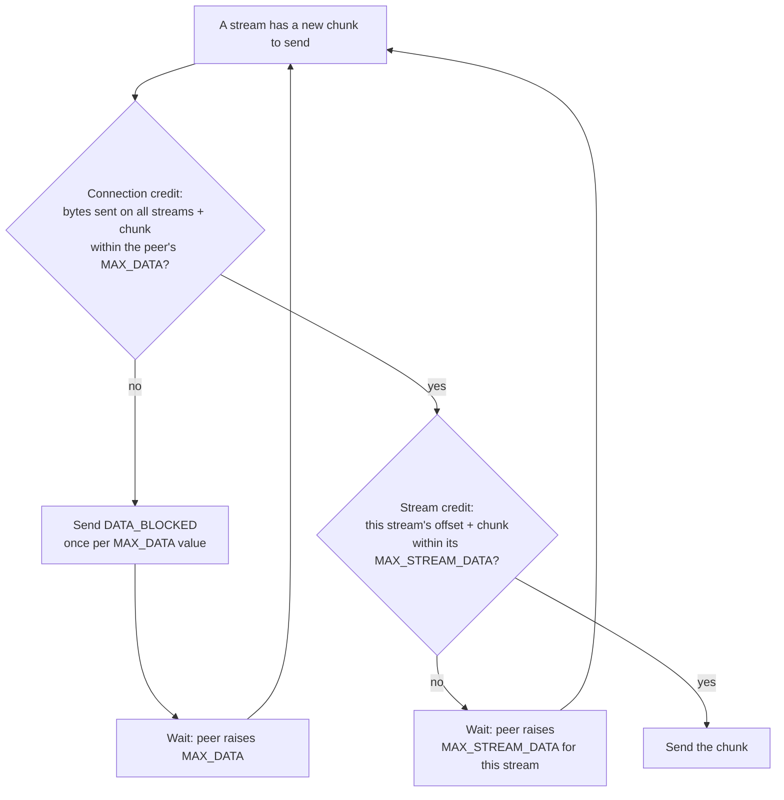
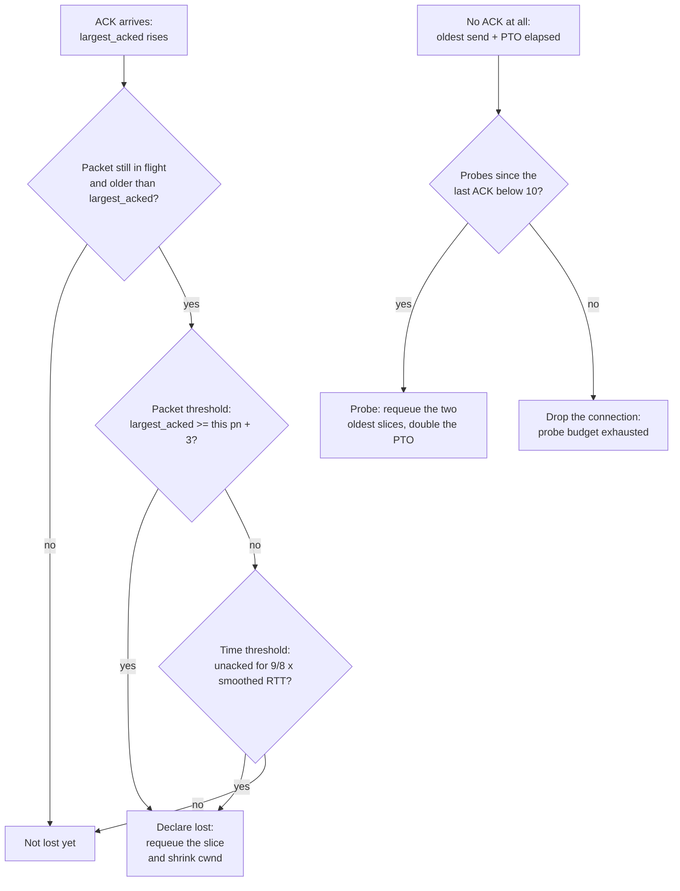
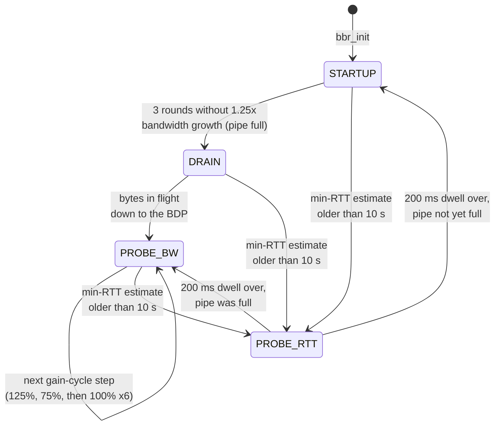
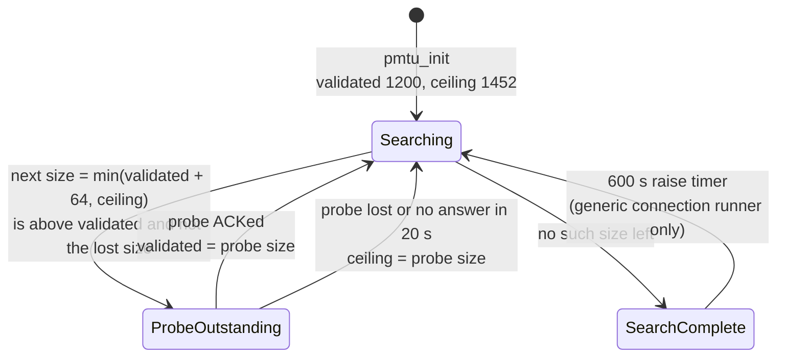
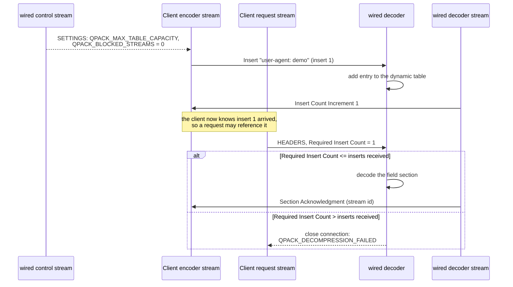

# The Layers

[Docs](../README.md) › Architecture › The Layers

> **TL;DR** — five layers, bottom-up: **common** (byte primitives) →
> **crypto** (pure cryptographic functions) → **transport** (QUIC itself)
> and **tls** (keys and authentication) → **app** (HTTP/3, WebTransport,
> MoQT). Each section below is self-contained; read only the layer you care
> about.

This page explains what each of the five layers under `src/` does, and why
it exists, in terms of the problem it solves. It is for readers who want to
change or review code inside a layer, or who want to know where a protocol
mechanism lives. The dependency picture is in the
[overview](overview.md#the-five-layers): dependencies mostly point
downward, with three exceptions. The main one is that transport and tls
include each other.

To *use* the SDK rather than read its internals, start with the
[guide](https://hakkadaikon.github.io/wired/guide/en/).

## common: share the byte-level primitives

common holds the small pieces every other layer needs. It depends on
nothing below it.

### The variable-length integer (varint)

QUIC writes almost every number on the wire as a varint: packet numbers,
frame types, stream IDs and lengths. A varint is one, two, four or eight
bytes long. The top two bits of the first byte say which length it is, and
the remaining bits hold the value in big-endian order (RFC 9000 §16).

| Top two bits | Length  | Largest value                 |
|--------------|---------|-------------------------------|
| `00`         | 1 byte  | 63                            |
| `01`         | 2 bytes | 16383                         |
| `10`         | 4 bytes | 1073741823                    |
| `11`         | 8 bytes | 4611686018427387903 (2^62 − 1) |

Two examples from RFC 9000 Appendix A.1, worked by hand:

- **37** fits in 6 bits, so it takes one byte: prefix `00` and value
  `100101` give `0x25`.
- **15293** is `0x3BBD`, larger than 63 but at most 16383, so it takes two
  bytes. The prefix `01` sets the top bits: `0x4000 | 0x3BBD = 0x7BBD`, sent
  as `7b bd`.

Small values cost one byte, and large ones are still possible. Every layer
reads and writes varints, so one shared implementation (`varint_encode`,
`varint_decode`, `varint_put`, `varint_take`) lives here. If each layer had
its own copy, the smallest difference between copies would become an
interoperability bug.

### Byte cursors and shared helpers

A byte cursor is a byte string plus a read or write position. Parsers and
builders in every layer use it to walk a packet without off-by-one errors.

The tests compile every source file into a single translation unit. Two
`static` helpers with the same name in different files would then collide.
So small helpers such as byte copies, big-endian load/store and
constant-time compare live once in `common/bytes/util/` as `inline`
functions, instead of being rewritten in each place.

### The kernel boundary

The syscall wrappers, the random-number source (`getrandom`) and the error
codes also live in common. The [overview](overview.md) explains why every
syscall goes through `common/arch/`.

## crypto: protect the packets, prove the peer

crypto has one concern: cryptography. QUIC encrypts every packet, even the
first Initial packet, so packet protection is needed in every phase of a
connection. Certificate checks need signature verification, and the key
schedule needs key derivation.

### Why it is a separate layer

The primitives here are pure: they know nothing of QUIC. AES-GCM,
ChaCha20-Poly1305, SHA-256 and Ed25519 map input bytes to output bytes the
same way every time, without reading QUIC state or TLS messages. Because
they have no such dependency, each one can be tested on its own against the
official test vectors.

The primitives rely on common alone. A few files around them reuse tls
types: the key sets in `crypto/kdf/keys/` use tls's Initial-key type, and
the certificate-signature code (`cvecdsa`, `certreq`) uses TLS handshake
and signature-algorithm constants. So some crypto files include tls
headers, though the primitives themselves do not.

crypto gives AEAD (authenticated encryption:
encryption plus a tag that detects tampering) to transport for packet
protection, and HKDF (a hash-based key derivation function) to tls for the
key schedule.

### Where crypto meets tls

The meeting point is `HKDF-Expand-Label` (`hkdf_expand_label`). The TLS 1.3
key schedule derives every secret with this labeled HKDF expansion, and
QUIC derives its packet-protection keys with the same function. Because of
this one shared step, the key sets in `crypto/kdf/keys/` use the same
type as tls's Initial keys (the keys for the first handshake packets,
derived from a public value, RFC 9001 §5.2). A key set derived here can be
handed to transport for packet protection with no conversion.

### crypto domains

- AEAD: AES-GCM and ChaCha20-Poly1305
- Hashing: SHA-256, SHA-384, SHA-512, HMAC
- Signatures: Ed25519, ECDSA P-256 / P-384 / P-521, RSA-PSS and RSA
  PKCS#1 v1.5
- Key derivation: HKDF
- Certificates: X.509 parsing and verification

X25519 key exchange is not here: it lives in tls, next to the handshake
that uses it. To call a hash from an application, see the guide's
[SHA-256](https://hakkadaikon.github.io/wired/guide/en/tls/sha256/) page.

## transport: lay reliable multiplexed streams over UDP

transport adds everything UDP lacks: reliable, ordered, multiplexed
streams. It relies on crypto (packet protection) and common below. It
also includes tls in many places: packet protection uses tls's key types,
and the event loop and key-update code call into the handshake (see
[How QUIC carries TLS](#how-quic-carries-tls)). It gives app one reliable
byte stream for each QUIC stream.

### Why UDP and not TCP

TCP sends its headers in plaintext. Routers and firewalls on the path read
those headers and act on what they expect to see, so any change to TCP
breaks somewhere. This has held TCP's evolution back for years.

QUIC avoids this in three ways:

- It encrypts almost the whole packet, so boxes on the path cannot depend
  on its contents.
- It runs several streams inside one connection, so a lost packet stalls
  only the stream it belongs to (see below).
- It does loss recovery and congestion control in the application, not the
  kernel, so they can change without a kernel update.

All three need a base that adds nothing of its own, and UDP is that base.
The price is that UDP does not resend lost packets. transport therefore
holds loss detection, congestion control and ACK handling itself. `io` is
the boundary with the kernel: it builds the IPv4 and UDP headers and runs
the socket.

### Head-of-line blocking

TCP delivers one ordered byte stream. If one packet is lost, every byte
after it waits until the resend arrives, even bytes that belong to an
unrelated HTTP request. This is head-of-line blocking.

QUIC numbers bytes per stream. A lost packet holds back only the streams
whose data it carried; the other streams keep delivering. The trade-offs
between streams and unordered datagrams are in the guide's
[Streams vs. datagrams](https://hakkadaikon.github.io/wired/guide/en/concepts/streams-vs-datagrams/).

### Two-level flow control

Flow control stops a sender from sending more than the receiver can
buffer. The receiver grants credit: "you may send up to byte N". QUIC
grants credit at two levels at once (RFC 9000 §4.1):

- **Connection credit** (`MAX_DATA`) limits the bytes of all streams
  together.
- **Stream credit** (`MAX_STREAM_DATA`) limits the bytes of one stream.

Both are needed. With only the connection limit, one busy stream could use
up the whole buffer and starve the others. With only the stream limit,
many streams together could exceed the memory the connection has.

The diagram shows the send-side check for each new chunk of stream data
(`srvrun_can_send_new`). Look at the two decisions: the chunk goes out only
when both credits have room.

Credit only ever rises: a `MAX_DATA` or `MAX_STREAM_DATA` frame that would
lower it is ignored. `DATA_BLOCKED` tells the peer that the *connection*
limit is what stopped the server, so the peer can raise `MAX_DATA`
sooner. It is sent once for each `MAX_DATA` value that blocks, not for
every blocked chunk.

The receive side mirrors this. As the application consumes bytes, the
server slides its own limits forward and sends new `MAX_DATA` and
`MAX_STREAM_DATA` frames. A peer that sends past the credit it was given
gets the connection closed with `FLOW_CONTROL_ERROR`
(`srvrun_close_on_flow_violation`). The RFC-level building blocks are
`flow_credit_*`, `stream_flow_*` and `dual_flow_ok` in
`transport/stream/flow/flow/`. A third limit, `MAX_STREAMS`, caps how many
streams the peer may open (`stream_credit_*`, `STREAM_LIMIT_ERROR`).

### Loss detection and the probe timeout

UDP never reports a lost packet, so the sender has to infer loss from the
ACKs it gets back. RFC 9002 gives two rules, and either one is enough
(`wired_sendsess_detect_lost`):

- **Packet threshold**: the packet is lost if a packet sent at least
  three packet numbers later has been acknowledged.
- **Time threshold**: the packet is lost if a later packet was
  acknowledged and this one is still missing after 9/8 of the smoothed
  round-trip time (RTT).

When the peer goes silent, no ACK arrives to run those rules. A timer
covers that case: the **PTO** (probe timeout). It is the smoothed RTT,
plus max(4 × RTT variation, 1 ms), plus a maximum ACK delay. The server
uses the RFC default of 25 ms for that delay; it does not read the peer's
own `max_ack_delay`. The sender's unit of retransmission is a slice: a
contiguous range of stream bytes that went out in one packet. If the
oldest unacknowledged packet is older than the PTO, the sender resends its
two oldest slices as probes (`wired_sendsess_pto_fire`) and doubles the PTO for
the next try. A probe asks for an ACK; it does not declare anything lost.

The diagram shows both paths. The top half runs when an ACK arrives; the
bottom half runs when the timer fires.

A lost slice is resent under a new packet number; QUIC never reuses one.
Any ACK resets the probe count. After 10 probes with no ACK
(`SRVRUN_PTO_MAX`), the server treats the peer as gone and drops the whole
connection. Before the first RTT sample exists, only the packet threshold
applies.

### Congestion control

Flow control protects the receiver; congestion control protects the
network between the two ends. The sender keeps a congestion window
(cwnd): the most bytes it may have in flight before ACKs come back.

Three algorithms are available: CUBIC, NewReno and BBR. CUBIC is the
default. An application picks the algorithm per run through
`wired_srvrun_obs.cc_algo`. NewReno's algorithm number is 0, but
`cc_algo = 0` means "use the default", so NewReno can only be chosen by
changing the default at build time (`-DWIRED_CC_ALGO_DEFAULT=0`).

Each connection starts with a window of ten maximum-size datagrams, 10 × 1200 =
12000 bytes
(`CC_INIT_WINDOW`). CUBIC and NewReno shrink the window when a loss is
declared, at most once per recovery period (the time from that shrink
until a packet sent after it is acknowledged).

BBR works differently. Instead of reacting to loss, it measures two things:
the bottleneck bandwidth and the minimum RTT. It sets the window to
cwnd_gain × bandwidth × RTT, the BDP (bandwidth-delay product, the bytes
the path can hold) scaled by a per-state gain. The diagram shows its four
states (`BBR_STARTUP`, `BBR_DRAIN`, `BBR_PROBE_BW`, `BBR_PROBE_RTT`). Follow
the arrows into `PROBE_RTT`: from any state, a stale RTT estimate sends BBR
there to measure again. BBR also paces: it spreads packets out at
pacing gain × estimated bandwidth instead of sending a whole window in one
burst. A round is one round trip.

- **STARTUP** sends fast (pacing gain 289%) until the bandwidth estimate
  grows by less than 25% for three rounds in a row.
- **DRAIN** sends slowly (35%) to empty the queue that STARTUP built.
- **PROBE_BW** is the steady state. It cycles through eight steps: one
  above the estimate to look for more bandwidth, one below to drain, then
  six at the estimate.
- **PROBE_RTT** keeps the window small for 200 ms so the true minimum RTT
  can be measured without queueing delay.

ACKs only feed BBR's bandwidth and RTT samplers; `cc_bbr_tick` makes the
state transitions and sets cwnd once per pass of the server loop, after that
pass's ACKs are processed.

### Path MTU discovery (DPLPMTUD)

The MTU (maximum transmission unit) is the largest packet a path carries
without splitting it. Every QUIC path must carry 1200-byte packets, so
wired starts there. Larger packets mean fewer packets and less overhead
per byte, but a packet over the path's real limit is silently dropped.

DPLPMTUD (Datagram Packetization Layer Path MTU Discovery, RFC 8899) finds
the real limit by sending padded probe packets of growing size and
watching which ones are acknowledged. Only one probe is outstanding at a
time. The diagram follows the shared core in `pmtu.c`. The states are
derived from its `searching` flag and `probe` field; the code has no named
enum for them.

On a clean path the probes are 1264, 1328, 1392 and 1452 bytes. The first
failed size becomes the ceiling, so the next candidate equals the size that
just failed and the search ends. Stream data then fills each packet up to
the validated size minus 41 bytes of header and AEAD tag (`pmtu_mps`).

The server tries a probe first at every send opportunity
(`srvrun_pmtu_try_probe`), so steady traffic cannot starve it. A probe
with no answer for 20 s counts as lost. Once the search is complete, the
server restarts it after 600 s (`pmtu_resume_search`, RFC 8899 5.2), so a
size that failed earlier is probed again.

### transport domains

Packet framing and protection, frame encoding, loss recovery and
congestion control, streams and two-level flow control, the connection
lifecycle, and UDP I/O.

## tls: make the keys, authenticate the peer

tls has two jobs: making the keys for encryption, and confirming that the
peer is who it claims to be. The handshake creates a shared secret with
ECDHE key exchange (each side contributes a fresh key pair) and derives
QUIC's packet-protection keys from that secret. At the same time it checks
the server's certificate and signature.

The two jobs cannot be split. Nothing can be encrypted without keys, and
encryption is useless if you do not know who is on the other end.

tls relies on crypto (signature verification, key derivation, hashing) and
common, and on transport's packet and version types. The X25519 key
exchange lives here too. It gives transport the protection keys for each
[encryption level](overview.md#encryption-levels-and-when-keys-are-dropped)
(Initial, Handshake, 1-RTT). For the handshake as an application sees it,
see the guide's
[TLS handshake](https://hakkadaikon.github.io/wired/guide/en/tls/handshake/)
page; for X25519 on its own, see
[X25519 key exchange](https://hakkadaikon.github.io/wired/guide/en/tls/x25519/).

### How QUIC carries TLS

TLS 1.3 normally runs over TCP and wraps its messages in its own record
layer. QUIC does not use that record layer. It carries the TLS handshake
messages inside its own CRYPTO frames instead.

So tls builds handshake messages and hands them to transport's CRYPTO
stream. In the other direction, it reassembles received CRYPTO bytes back
into handshake messages. This handoff is the main reason transport and
tls include each other: transport carries the bytes, and tls makes the
keys that protect them.

### Transport parameters

QUIC's connection settings travel inside the handshake, packed into a TLS
extension. They include the initial flow-control credits, the maximum idle
time and the connection-ID limits. A mechanism built for key exchange
doubles as the channel for QUIC's settings.

### Key update

An AEAD key can safely protect only a limited number of packets (RFC 9001
§6.6). A long connection therefore switches to fresh 1-RTT keys partway
through. This is a key update.

- The next keys come from the current secret by `HKDF-Expand-Label` with
  the label `"quic ku"` (`kuswitch_next_keys` and its suite-aware variant
  `kuswitch_next_keys_suite`). The header-protection key stays the same.
- A sender marks the switch by flipping the Key Phase bit in the short
  packet header. The server tries the current keys, then the retained old
  keys, then the next generation, and switches only when the
  next-generation keys actually decrypt (`onertt_try_any`). The generic
  connection runner picks keys by the bit instead
  (`kuswitch_key_for_phase`).
- The old keys are kept for three PTOs, so packets already in flight under
  them still decrypt. Then they are dropped (`srvrun_ku_discard_stale`).
- The server starts an update itself when its sealed-packet count reaches
  the limit (`wired_srvloop_send_onertt`). It refuses to start another while
  the previous one is unconfirmed.

### tls domains

Building and parsing ClientHello and ServerHello, the key schedule,
verification of the certificate and CertificateVerify, key update, and the
transport-parameters extension.

## app: speak HTTP and media over QUIC

app speaks application protocols over the streams that QUIC provides. It
relies on transport (streams), tls (session and key state), crypto and
common. Above it is the application itself. Two small reverse edges exist:
transport's frame code and tls's server driver and transport-parameter code
use DATAGRAM definitions and its receive extractor from `app/datagram/`, and
the TLS client reuses the server's wire helpers (`app/http3/server/srvwire/`).

The stack inside app follows the layer order HTTP/3 → WebTransport → MoQT,
with two side paths: DATAGRAM, and MoQT directly over raw QUIC.

### HTTP/3

HTTP/3 splits each request and response into frames and maps each exchange
onto its own bidirectional (bidi) QUIC stream. Settings travel on a
separate control stream. To serve a request, see the guide's
[Hello, HTTP/3](https://hakkadaikon.github.io/wired/guide/en/h3/hello/).

### Why QPACK and not HPACK

HTTP/2 compresses headers with HPACK. HPACK keeps one dynamic table of
recent header fields, shared by every stream, and it assumes every update
to that table arrives in order.

QUIC streams do not arrive in order relative to each other. If HPACK ran
on QUIC, a request referring to a new table entry could arrive before the
update that created it, and it would have to wait. That is head-of-line
blocking again, at the header layer.

QPACK (RFC 9204) fixes this with two mechanisms:

- Table updates travel on a dedicated **encoder stream**, and the decoder
  reports progress on a dedicated **decoder stream**.
- Each header block starts with a **Required Insert Count**: how many
  table insertions the decoder must have received before it can decode
  this block. A count of 0 means the block uses no dynamic entries.

The decoder uses `SETTINGS_QPACK_BLOCKED_STREAMS` to announce how many
streams may wait for missing insertions. wired sets it to 0, so on
a wired server no stream ever waits. The peer's encoder may refer only to
insertions the server has already acknowledged. The diagram shows the
order of that exchange; look at the `alt` box for the error case.

A block that names more insertions than have arrived is a connection error
(`QPACK_DECOMPRESSION_FAILED`), because with zero blocked streams the peer
was not allowed to send it. In the other direction, the server's own
encoder keeps its table capacity at 0. Its responses use only the static
table and literals, so they never make the client wait either.

### DATAGRAM

The DATAGRAM frame (RFC 9221, frame types `0x30` and `0x31`) gives up
QUIC's reliability and ordering in exchange for low latency. Lost
datagrams are not resent. For data that is useless once late, such as a
live audio frame, arriving fast matters more than arriving for certain.
When to pick datagrams over streams is covered in the guide's
[Streams vs. datagrams](https://hakkadaikon.github.io/wired/guide/en/concepts/streams-vs-datagrams/).

### WebTransport

WebTransport (`src/app/webtransport/`) turns an HTTP/3 Extended CONNECT
request into a session. The session carries its own bidi and
unidirectional (uni) streams and datagrams. A browser gets something close
to a raw QUIC connection, while HTTP/3 still handles negotiation and
multiplexing. See the guide's
[WebTransport sessions](https://hakkadaikon.github.io/wired/guide/en/wt/session/).

### MoQT

MoQT (`src/app/moqt/`) is a publish/subscribe protocol for media and other
live data. wired implements the relay-role subset of it: the server
forwards Objects between publishers and subscribers rather than producing
media itself. The subset covers SETUP, SUBSCRIBE, PUBLISH, FETCH and
namespace discovery. One endpoint pushes Track Objects to
another, which suits live audio, video and chat better than HTTP's
request/response shape. How Tracks, Groups, Subgroups and Objects map onto
media is explained in the guide's
[How MoQT maps media](https://hakkadaikon.github.io/wired/guide/en/concepts/media-mapping/).

MoQT runs over two transports:

- **WebTransport**: the draft (18, 19 or 22) is chosen per session from
  the WebTransport subprotocol (`app/moqt/ver/`).
- **Raw QUIC** (`src/app/moqt/qraw/`): the connection's ALPN (the TLS
  extension where client and server agree on the application protocol)
  itself is the draft token (`moqt-22`, `moqt-19`, `moqt-18`), and the
  connection is the session. There is no Extended CONNECT, so the client sends
  its URI's
  authority and path in the AUTHORITY and PATH Setup Options instead
  (`moqraw_policy` lets the application accept or refuse them).

The MoQT hub (`src/app/moqt/run/`, the server-side session and
subscription state that `wired_moqt_init` sets up) never branches on the
transport for I/O. `wired_moqraw_io` returns one I/O table for both. It
handles two per-transport differences:

- **Stream prefix**: a WebTransport stream begins with the WebTransport
  stream header (a stream-type varint plus the session ID), while a
  raw-QUIC stream begins directly with MoQT bytes.
- **Send budget**: on WebTransport it is the remaining session credit
  (`WT_MAX_DATA`); on raw QUIC there is no session-level credit, because
  the connection's own `MAX_DATA` credit already limits sending.

### rawquic: telling the two bindings apart

`src/app/rawquic/` holds stateless helpers that answer one question at
five points: is this connection raw QUIC or WebTransport over HTTP/3? The
five points are stream routing (`rawq_route`), the error code put in
RESET_STREAM and STOP_SENDING, datagram framing, the first server uni
stream ID, and the identity of the implicit session. On raw QUIC there is
no CONNECT request, so the whole connection is one implicit session.

Server-opened uni streams have IDs 3, 7, 11, 15, and so on: the low two
bits of a stream ID mark who opened it and its direction, so the IDs step
by 4. On raw QUIC the server's first uni stream is ID 3. On HTTP/3 it is
15, because IDs 3, 7 and 11 already carry the control and QPACK streams.

### media: cutting MP4 files into Objects

`src/app/media/mp4frag/` reads the top-level box layout of a fragmented
MP4 file (`mp4frag_scan`). It returns the init segment (`ftyp` through
`moov`) and each `moof`+`mdat` media fragment as views into the file, with
no copying and no sample-table parsing. A publisher sends each fragment
as one MoQT Group. The guide's
[Publish a live track](https://hakkadaikon.github.io/wired/guide/en/moqt/live/)
shows it in use.

### app domains

HTTP/3 frames and the control stream, request and response assembly, QPACK
encoding and decoding, DATAGRAM, WebTransport, MoQT (over WebTransport and
over raw QUIC), the raw-QUIC binding helpers, and fragmented-MP4 parsing.

---

**Next:** [Implemented Specifications](rfcs.md) — every spec these layers
implement. ([all docs](../README.md))
