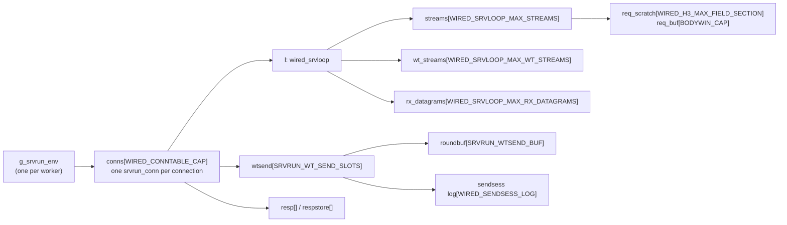
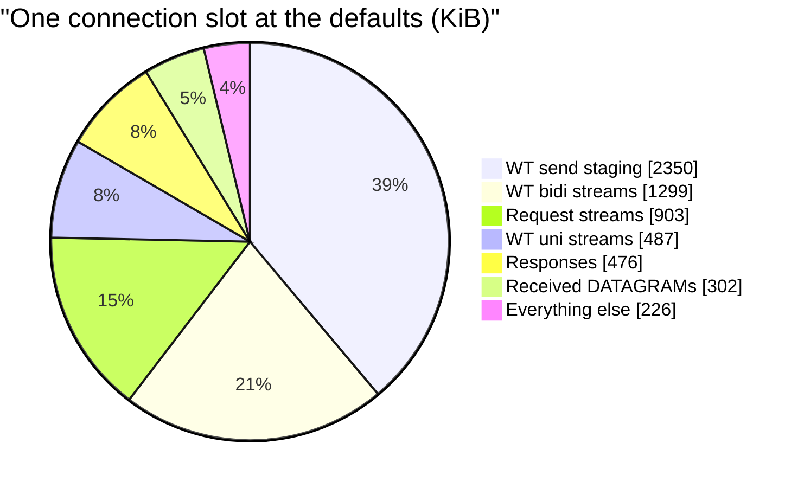
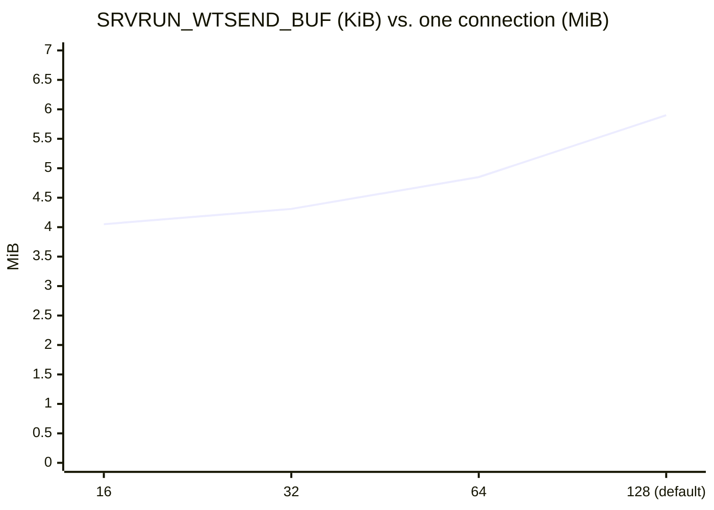
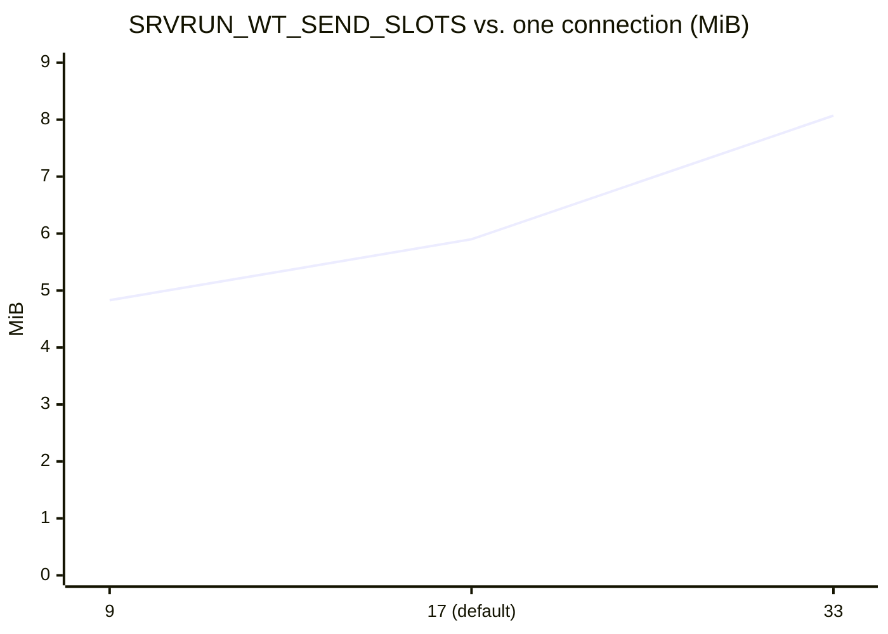
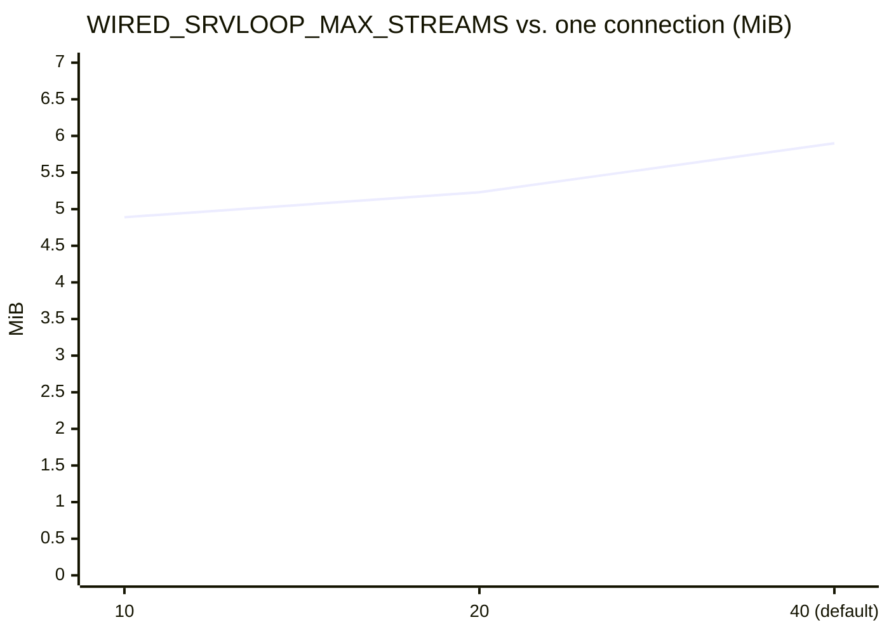
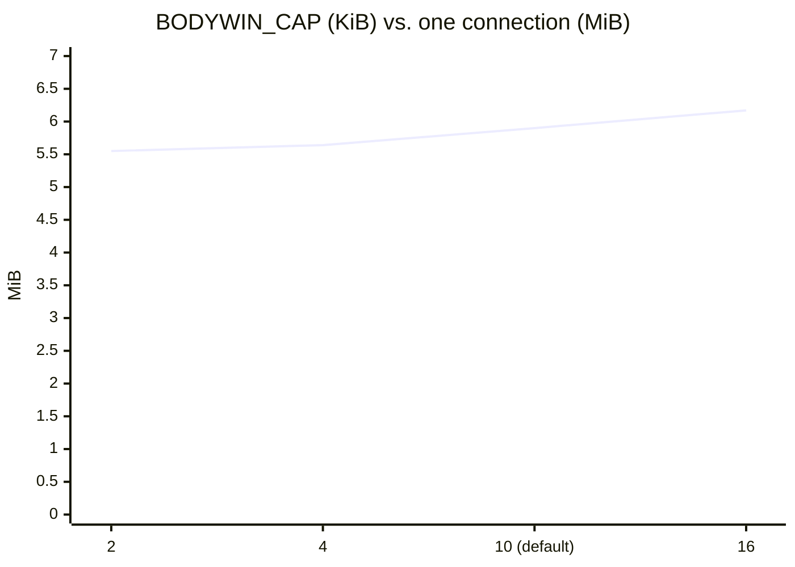
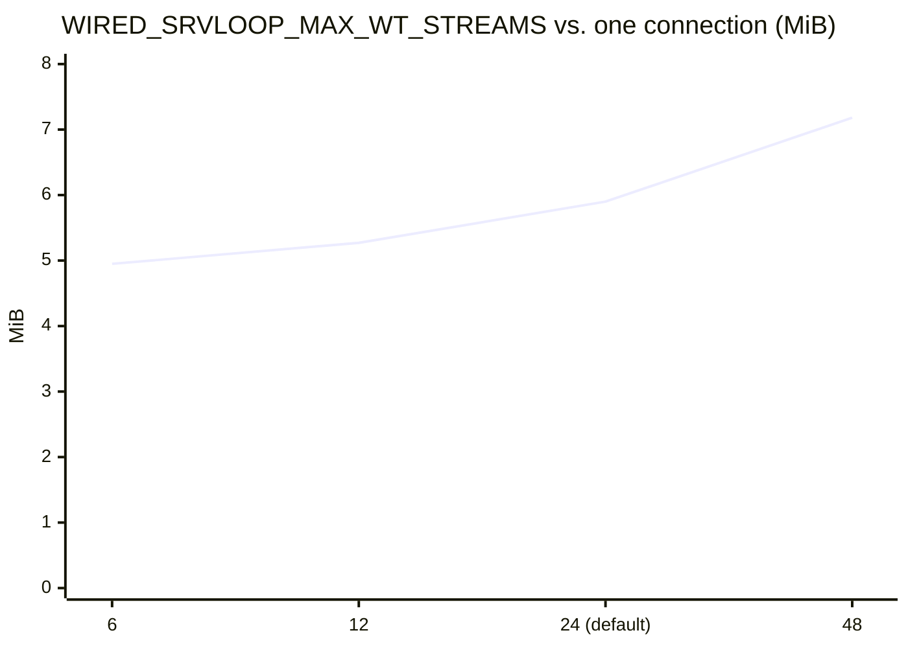
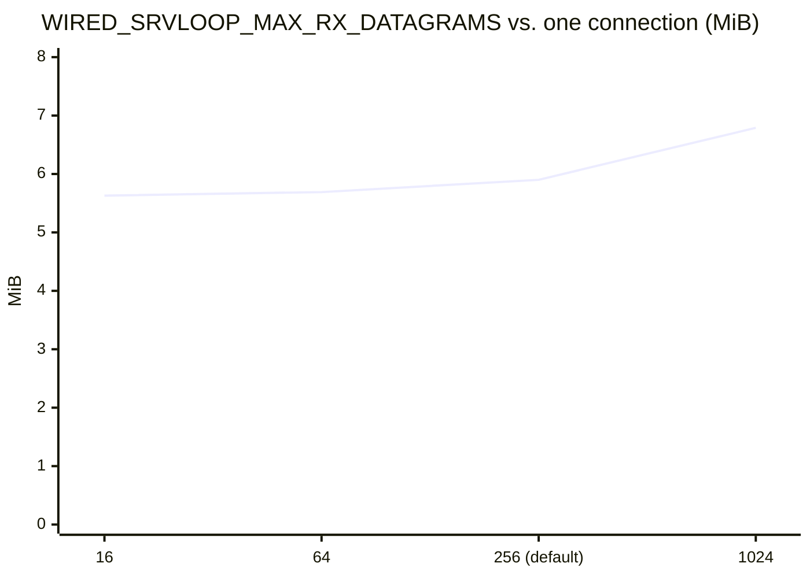
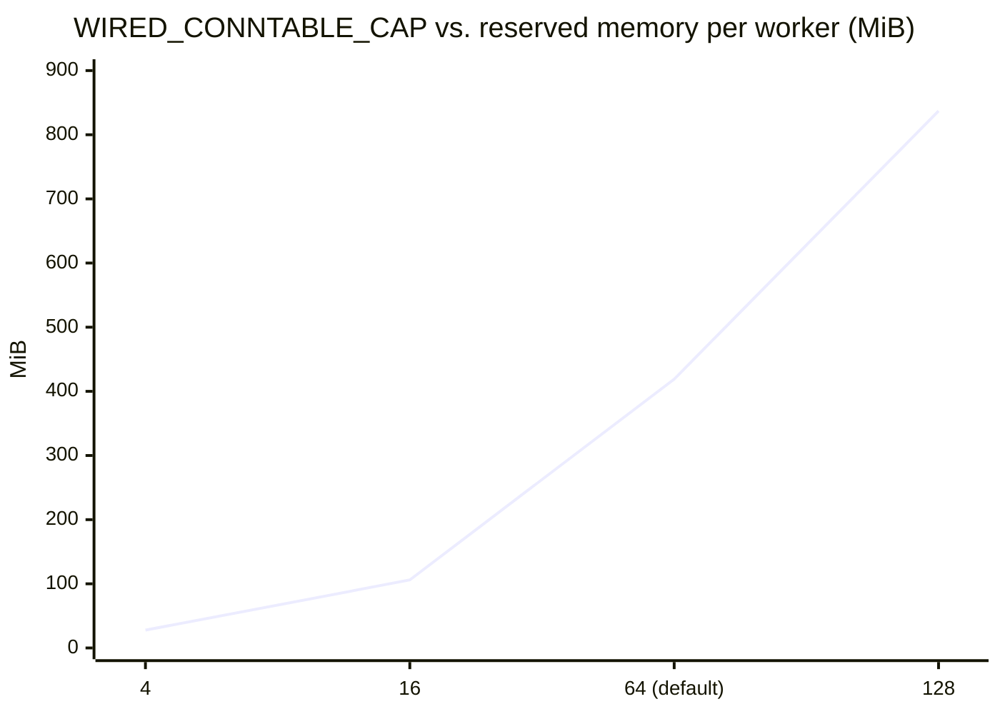

# メモリ配置とサイズの見積もり

[Docs](../README.md) › アーキテクチャ › メモリ

このページでは、サーバーのメモリがどう配置されているか、容量の定数を変えるとそれがどう変わるかを示します。バッファーのサイズやスロット数を増やす前や、想定するコネクション数に合わせてマシンのサイズを決めるときに読んでください。

> **要約**: wired にはヒープがないので、どの容量も固定のテーブルです。予約されるメモリは `slots × slot size`(スロット数 × スロットのサイズ)をコネクションごとに合計し、それに `WIRED_CONNTABLE_CAP` を掛けた値です。定数を 1 つ変えると、メモリはちょうどその比率で変わります。各定数のコストは下の表にあります。

## バイトの置き場所

どのテーブルも静的な配列なので、サイズはサーバーのビルド時に決まります。テーブルは実行ファイルの `bss` セクションに置かれます。`bss` はアドレス空間であって、使用中のメモリではありません。カーネルがページを RAM に載せるのは、サーバーがそのページに初めて書き込んだときだけです。そのため、このページの数値は*予約*サイズ、つまり負荷が最大のサーバーが到達しうる上限であり、アイドル中や負荷の軽いサーバーが使う量ではありません。

`bss` のほぼすべては 1 つのオブジェクト `g_srvrun_env`(`wired_srvrun_env`。`src/app/http3/server/srvrun/srvrun_impl_srvrun.h` にあります)です。threads ドライバーではワーカーごとに 1 つあります。その大部分はコネクションテーブルです。



## デフォルト設定での 1 コネクション

1 つのコネクションスロット(`sizeof(srvrun_conn)`)は、デフォルトで **6,187,832 バイト(5.90 MiB)** です。内訳は次のとおりです。

| 部分 | コネクションあたりのサイズ | 割合 |
|---|---|---|
| WT 送信のステージング、`wtsend[17]` | 2,405,976 B | 38.9% |
| WT 双方向ストリーム、`l.wt_streams[24]` | 1,330,176 B | 21.5% |
| リクエストストリーム、`l.streams[40]` | 924,160 B | 14.9% |
| WT 単方向ストリーム、`l.wt_uni_streams[]` | 498,816 B | 8.1% |
| レスポンス、`resp[]` | 487,680 B | 7.9% |
| 受信した DATAGRAM、`l.rx_datagrams[256]` | 309,248 B | 5.0% |
| その他(TLS の状態、起動時のフライト、鍵、カウンター) | 231,776 B | 3.7% |

WT 双方向ストリームのスロット(`wired_srvloop_wt_stream_slot`、55,424 B)の中身は、48 KiB の受信ウィンドウ(`WIRED_SRVLOOP_WT_BUF_CAP`)、そのウィンドウの 6 KiB の受信済みバイトのビットマップ、少しの管理情報です。HTTP/3 のリクエスト用バッファーは持ちません。それら(`req_scratch`、`req_buf`)があるのはリクエストストリームのスロットだけです。リクエストは `req_buf` の上でその場でデコードするので、ウィンドウを連続した領域に並べ直したコピーをもう 1 つ持つことはありません。



## 定数ごとのコスト

各行は現在のソースで定数をいくつかの値に設定し、ほかの定数はすべてデフォルトのまま `sizeof(srvrun_conn)` を取って測りました。どの場合も関係は完全に線形だったので、「1 単位あたりのコスト」の列は許される範囲の中のどの値にも当てはまります。

| 定数 | デフォルト | コネクションあたりのコスト | 許される範囲 |
|---|---|---|---|
| `SRVRUN_WTSEND_BUF`(スロットごとの WT 送信のステージング) | 131,072 B | 1 バイトあたり +17 B(送信スロットごとに 1 回) | `ceil(SRVRUN_WTSEND_BUF / 1100) ≤ WIRED_SENDSESS_LOG` |
| `WIRED_SENDSESS_LOG`(送信セッションごとの送信中のスライス) | 128 | 1 エントリあたり +4,560 B | 上の下限以上 |
| `SRVRUN_WT_SEND_SLOTS`(同時に使える WT 送信スロット) | 17 | 1 スロットあたり +141,616 B | — |
| `WIRED_SRVLOOP_MAX_STREAMS`(リクエストストリーム) | 40 | 1 ストリームあたり +35,514 B | ≤ 64(`wt_held_mask` が 64 ビットのマスク 1 つのため) |
| `BODYWIN_CAP`(リクエストボディのウィンドウ) | 10,240 B | 1 バイトあたり +45 B | — |
| `WIRED_H3_MAX_FIELD_SECTION`(リクエストのフィールドセクション) | 10,240 B | 1 バイトあたり +40 B | RFC 9110 §4.1 のリクエストターゲットのため ≥ 8000 |
| `WIRED_SRVLOOP_MAX_WT_STREAMS`(WT 双方向ストリーム) | 24 | 1 ストリームあたり +55,560 B | — |
| `WIRED_SRVLOOP_MAX_RX_DATAGRAMS`(キューに入る受信 DATAGRAM) | 256 | 1 スロットあたり +1,208 B | — |

2 つの定数は連動しています。ステージングした WT 送信の 1 ラウンドは 1,100 バイトのスライスに切り分けられ、スライスごとに送信ログのエントリが 1 つ必要です。そのため `SRVRUN_WTSEND_BUF` を 2 倍の 262,144 にすると、`WIRED_SENDSESS_LOG` も 239 以上に上げなければなりません。後者を変えずに前者だけを変えると、ビルドが通りません(`srvrun_impl_srvrun.h` の静的アサーション)。

### 定数ごとの 1 コネクションの増え方

下のグラフは各定数を動かしたときの 1 コネクションスロットのサイズ(MiB)を示します。ほかの定数はすべてデフォルトのままです。「デフォルト」と記した点は、どのグラフでも 5.90 MiB です。













`WIRED_H3_MAX_FIELD_SECTION` は `BODYWIN_CAP` と同じように振る舞い、傾きはその半分です。2 KiB で 5.60 MiB、10 KiB(デフォルト)で 5.90 MiB、16 KiB で 6.14 MiB です。`WIRED_SENDSESS_LOG` を 256 にすると 6.46 MiB になります。

## サーバー全体: `WIRED_CONNTABLE_CAP`

ここまでのすべてに、コネクション数が掛かります。コネクションを 1 つ増やすごとに **6,843,260 B(6.53 MiB)** かかります。5.90 MiB のコネクションスロットに、そのレスポンスの保存領域とテーブルのエントリを加えた値です。ワーカーごとの固定分は約 1.6 MiB です。この中には、起動時に渡された ID 情報とパスを実行側が自分で持つコピー(`srvrun_own`、約 34 KiB。16 KiB の証明書チェーン、4 KiB のパス 4 つ、512 バイトの ID リスト 2 つ、鍵)も入っています。そのため、実行中に読むもので呼び出し側のメモリに置かれるものはありません。例外はクライアント認証のトラストストア(`client_ca`)で、そのストア、ルートの配列、CA の DER は呼び出し側に残るので、実行が終わるまで生きていなければなりません。

```text
bss per worker ≈ 1.6 MiB + WIRED_CONNTABLE_CAP × 6.53 MiB
```

| `WIRED_CONNTABLE_CAP` | ワーカーあたりの予約サイズ |
|---|---|
| 4 | 27.8 MiB |
| 16 | 106 MiB |
| 64(ライブラリのデフォルト) | 419 MiB |
| 128 | 837 MiB |



threads ドライバーでは、これにさらにワーカー数が掛かります。デフォルトの ninja ビルドは `-DWIRED_CONNTABLE_CAP=4` を設定し、interop イメージは 64 でビルドします。

## 予約サイズと常駐サイズは違う

ページは初めて書き込まれたときにだけ割り当てられるので、サーバーはテーブル全体を予約しても、実際に使うのはずっと少ない量です。[Implementation Comparison](../performance/comparison.md) のループバックのレーン(4 コネクションのビルド、1 つのコネクション上で 20 ストリームを同時に流す)では、予約が 27.7 MiB だったのに対し、wired が使った RAM はアイドル時 512 KiB、ピーク時 1,932 KiB でした(2026-11-02、`efd61452e`)。常駐メモリは、コネクションが実際に触れた分だけ増えます。大きな WebTransport のラウンドを送るコネクションは 128 KiB のステージングバッファーを埋め、長いターゲットを持つリクエストは 10 KiB のリクエストウィンドウを埋めます。

コネクションが閉じると、サーバーはそのスロットの大きなテーブル(リクエストと WT のストリームスロット、受信した DATAGRAM、WT 送信のステージング、その `respstore` の行)を、`madvise(MADV_DONTNEED)` でカーネルに返します。これはクローズごとに 1 回行います。そのため常駐メモリはピークのまま留まらず、負荷が去ると下がります。同じレーンでは、負荷のラウンドのあとに 1,412 KiB でした。返したページはそのあと 0 として読めます。これは新しいスロットが持つべき内容と同じなので、次にスロットを確保するときは書き直しを省き、新しいコネクションが使うページだけに触れます。これがピーク自体を低く保っています。

## 定数の選び方

- **要件からサイズを決めます**。理由を定数の横に書いてください。RFC の最低値(8000 オクテットのリクエストターゲット、RFC 9110 §4.1)、interop で見た相手の挙動、帯域幅遅延積などです。
- **マージする前に掛け算をします**。上のコストの列に `WIRED_CONNTABLE_CAP` とワーカー数を掛け、対象マシンのアドレス空間と RAM と比べてください。
- **連動する上限を守ります**。`SRVRUN_WTSEND_BUF` を上げるときは `WIRED_SENDSESS_LOG` も上げ、`WIRED_SRVLOOP_MAX_STREAMS` は 64 以下に保ってください。
- **定数をテストと共有します**。本番のバッファーより大きいテストのバッファーは、オーバーフローを隠してしまいます。両側で同じ `#define` を使ってください。

**次へ:** [レイヤー](layers.md): 各テーブルがどこに属するか。
