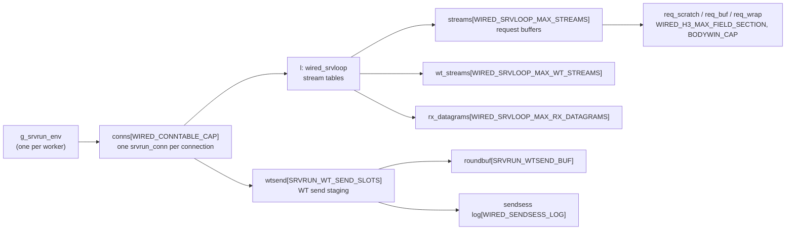
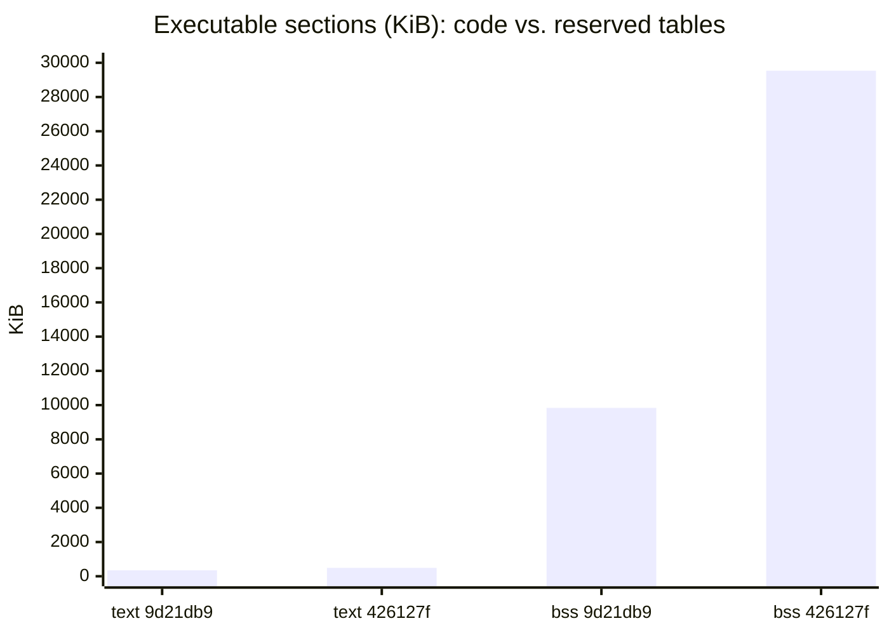
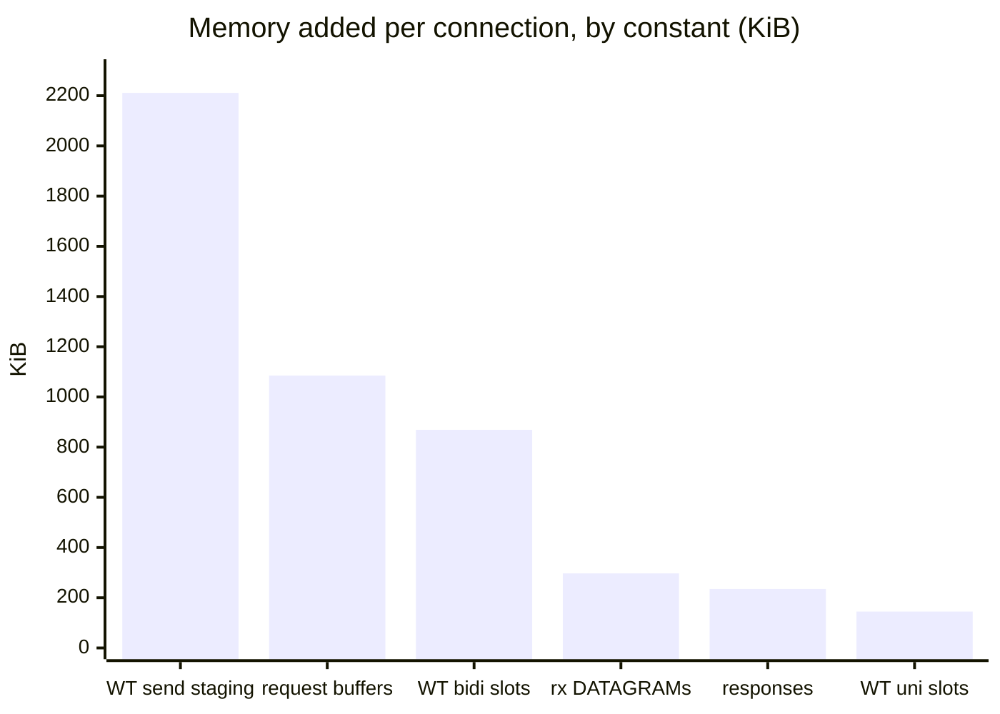

# Memory Layout and Sizing

[Docs](../README.md) › Architecture › Memory

This page explains where the server's memory comes from, and how it grows
when a capacity constant grows. Read it before you raise a buffer size or a
slot count, or when you want to know why the binary and the resident memory
grew between two releases.

> **TL;DR** — the file size of the binary grows with code; the memory grows
> with constants. Every capacity is a fixed table, so the reserved memory is
> `slots × slot size`, multiplied again by the number of connections. Raising
> one constant raises the memory in exact proportion, and never touches the
> file size.

## Where the bytes live

wired has no heap. Every table is a static array, so its size is fixed when
the server is built. The linker puts the code and the tables into three
sections of the executable:

| Section | Holds | Grows with | Costs |
|---|---|---|---|
| `text` | machine code and read-only tables | code: new features and checks | file size and RAM |
| `data` | initialized globals | small lookup tables | file size and RAM |
| `bss` | zero-initialized globals: every connection, stream and buffer table | capacity constants | address space only; RAM only for the pages actually touched |

Nearly all of `bss` is one object, `g_srvrun_env` (`wired_srvrun_env`, in
`src/app/http3/server/srvrun/srvrun_impl_srvrun.h`). Under the threads driver
there is one per worker. Its largest member is the connection table:



So the reserved memory follows directly from the constants:

```text
bss  ≈ WIRED_CONNTABLE_CAP × sizeof(srvrun_conn) + fixed per-env tables
sizeof(srvrun_conn) ≈ SRVRUN_WT_SEND_SLOTS × sizeof(srvrun_wtsend)
                    + WIRED_SRVLOOP_MAX_STREAMS × sizeof(stream slot)
                    + WIRED_SRVLOOP_MAX_WT_STREAMS × sizeof(WT stream slot)
                    + WIRED_SRVLOOP_MAX_RX_DATAGRAMS × sizeof(rx datagram)
                    + ...
```

Each term is a slot count times a slot size, and a slot size is itself a sum
of buffer constants. Doubling a constant therefore doubles its term, and
nothing else.

## Example: 2026-08-16 (`9d21db9`) to 2026-10-27 (`426127f`)

The numbers below come from measuring each member with `sizeof` against the
headers of both commits. The build is `examples/word_list/wired_server` with
the default ninja flags, which set the connection table to 4 slots
(`-DWIRED_CONNTABLE_CAP=4`).

### File size and memory moved independently

| Section | `9d21db9` | `426127f` | Change | Cause |
|---|---|---|---|---|
| `text` | 356,383 B | 499,536 B | +40% | new code: RFC checks, MoQT relay, recovery, WebTransport |
| `data` | 4,640 B | 7,994 B | +72% | new lookup tables |
| `bss` | 10,070,944 B | 30,243,800 B | +200% | larger capacity constants |



The file grew by 143 KB of code. The reserved memory grew by 20 MB of
tables. Neither caused the other.

### Which constants grew the memory

One connection slot (`sizeof(srvrun_conn)`) grew from 1,397,640 B to
6,383,952 B. The growth splits into these terms:

| Member | Constant that changed | Old | New | Added per connection |
|---|---|---|---|---|
| `wtsend[]` | `SRVRUN_WTSEND_BUF` 4,096 → 131,072; `WIRED_SENDSESS_LOG` 64 → 128; `SRVRUN_WT_SEND_SLOTS` 16 → 17 | 16 × 8,840 B | 17 × 141,528 B | +2,264,536 B |
| `l.streams[]` | `WIRED_H3_MAX_FIELD_SECTION` 512 → 10,240 (`req_scratch`); `BODYWIN_CAP` 2,048 → 10,240 (`req_buf`, `req_wrap`) | 40 × 5,592 B | 40 × 33,376 B | +1,111,360 B |
| `l.wt_streams[]` | `WIRED_SRVLOOP_MAX_WT_STREAMS` 6 → 24 | 296,304 B | 1,185,984 B | +889,680 B |
| `l.rx_datagrams[]` | `WIRED_SRVLOOP_MAX_RX_DATAGRAMS` 4 → 256 | 4 × 1,208 B | 256 × 1,208 B | +304,416 B |
| `l.wt_uni_streams[]` | WT unidirectional slots | 296,304 B | 444,744 B | +148,440 B |
| `resp[]` | response slots | 247,040 B | 487,680 B | +240,640 B |



Each bar is its constant's ratio times the old term. For example, the rx
DATAGRAM table went from 4 to 256 slots of the same size, so it grew exactly
64×. The request buffers went from about 4.6 KiB to 30 KiB per stream.
Multiplied by 40 streams, that is the 1.1 MB in the table.

The connection table multiplies all of this again. With 4 slots the
environment is 29.9 MB. With the library default of 64 slots
(`src/transport/conn/lifecycle/conntable/conntable.h`) it is about 64 ×
6.4 MB ≈ 409 MB of `bss`, per worker.

## Reserved is not resident

`bss` is address space, not memory in use. The kernel maps a page into RAM
only when the server first writes to it, so a buffer that is reserved but
unused costs nothing. In the loopback lane of
[Implementation Comparison](../performance/comparison.md) (this same
4-slot build, 20 concurrent streams), wired used:

| | `9d21db9` | `426127f` |
|---|---|---|
| RSS when idle | 380 KiB | 504 KiB |
| Peak RSS under load | 1,928 KiB | 6,984 KiB |

The peak grew because a busy connection now touches more of its larger
buffers (10 KiB request windows instead of 2 KiB, 128 KiB send staging
instead of 4 KiB). The reserved 30 MB is not resident.

## Choosing a constant

- **Size it from a requirement.** Write the reason next to the constant: an
  RFC minimum (8000-octet request targets, RFC 9110 §4.1), a peer behavior
  measured in interop, or a bandwidth-delay product. Ten past capacity bumps
  in this project were guesses made after a failure, and one crashed CI.
- **Multiply before you merge.** A per-stream buffer is paid for 40 times per
  connection and 64 times per worker. Check
  `slots × size × WIRED_CONNTABLE_CAP` against the target machine, not only
  the buffer itself.
- **Share the constant with the tests.** A test buffer that is larger than
  the production buffer hides an overflow. Use the same `#define` on both
  sides.
- **Expect no change in file size.** If a constant change moves `text`, the
  compiler is copying the table into code. Look for an initializer that
  should have stayed zero.

**Next:** [The Layers](layers.md) — what each table belongs to.
