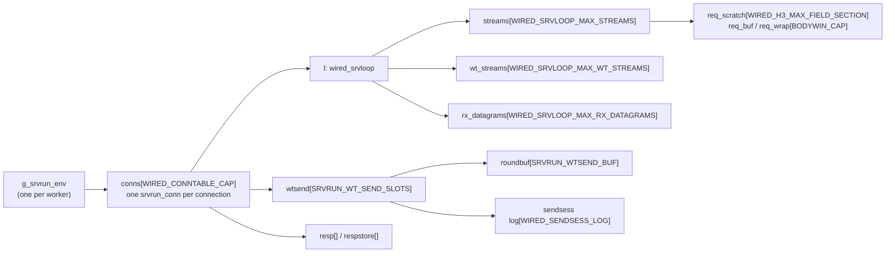
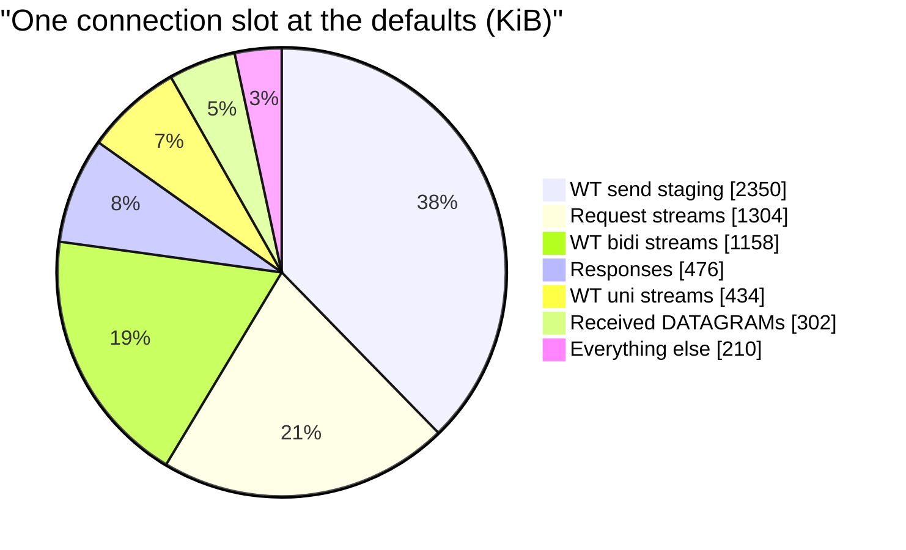
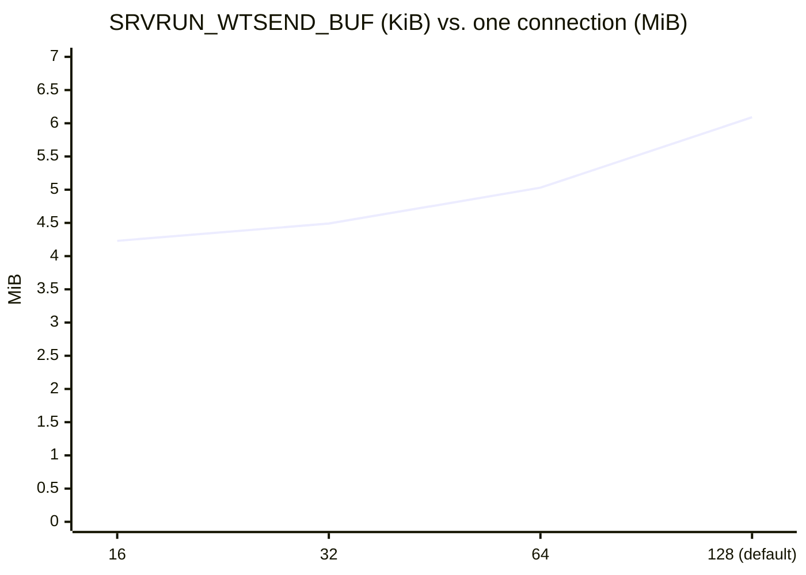
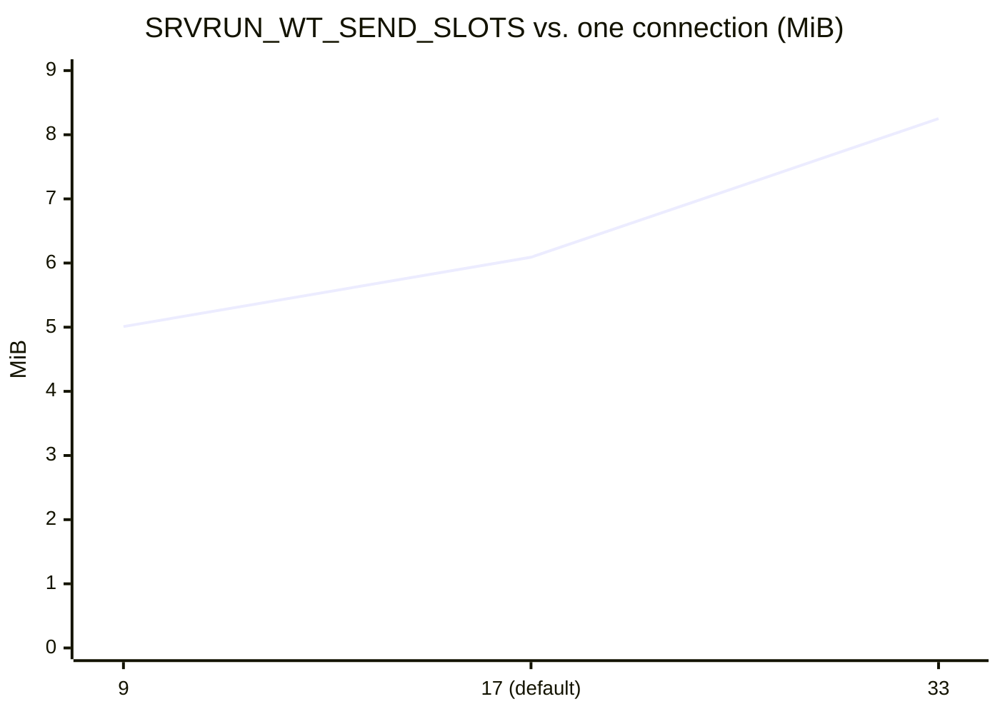
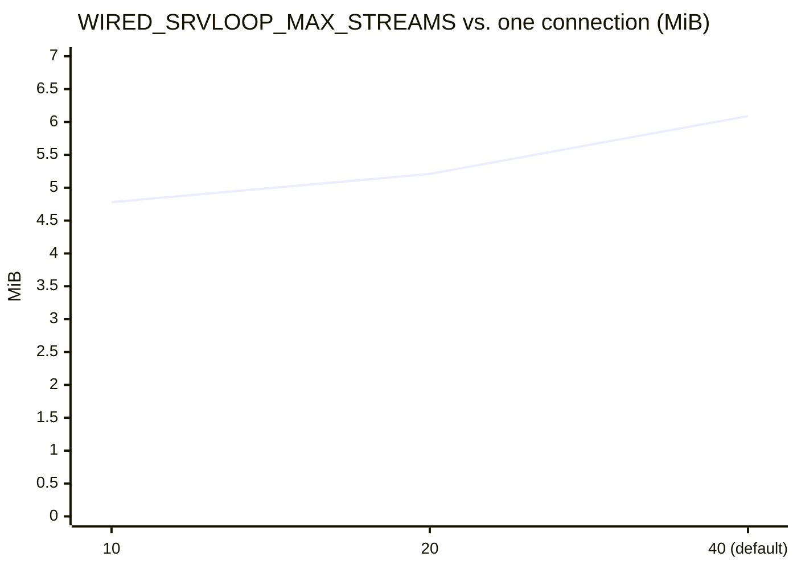
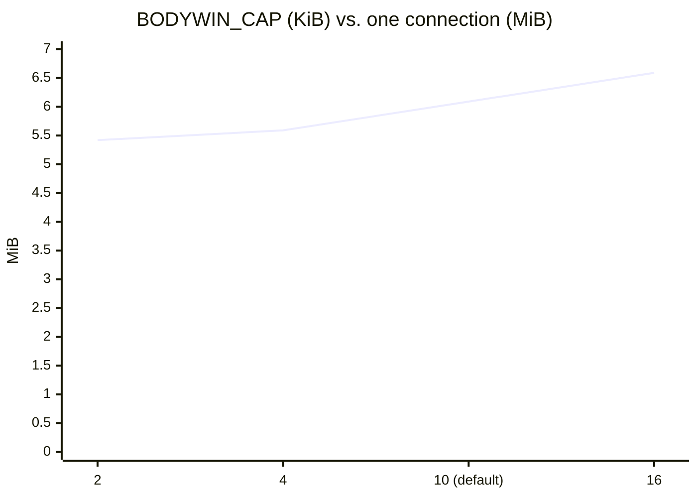
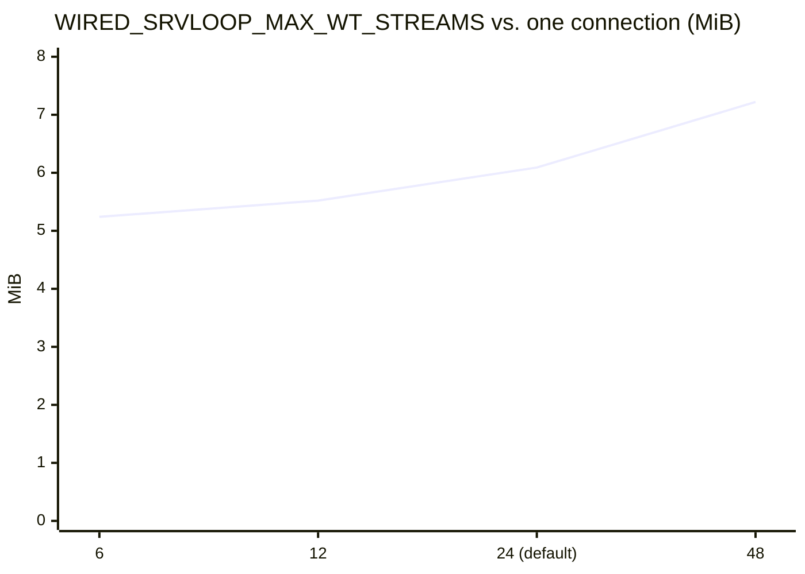
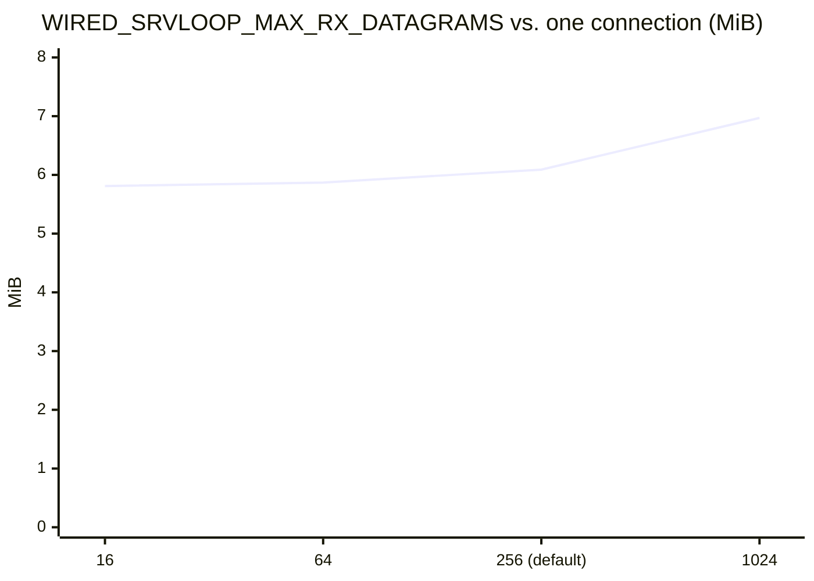
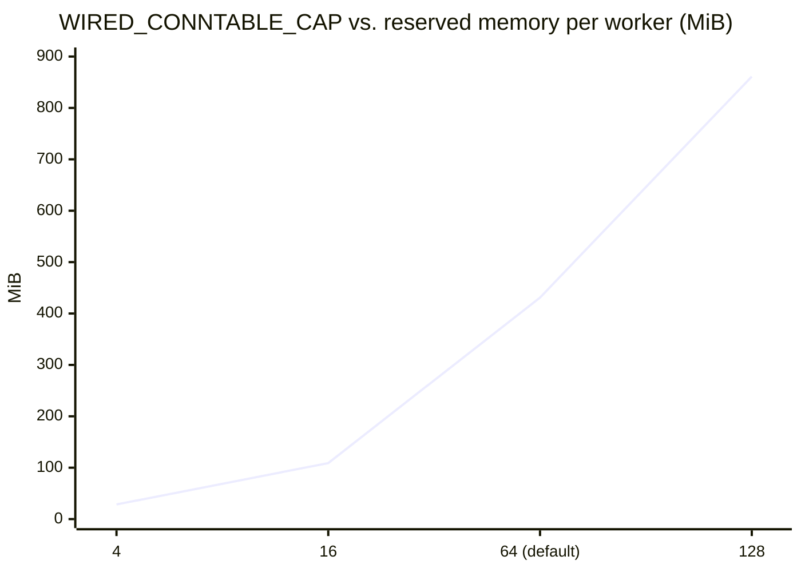

# Memory Layout and Sizing

[Docs](../README.md) › Architecture › Memory

This page shows how the server's memory is laid out and how it changes when
you change a capacity constant. Read it before you raise a buffer size or a
slot count, or when you size a machine for a given number of connections.

> **TL;DR** — wired has no heap, so every capacity is a fixed table. The
> reserved memory is `slots × slot size`, summed per connection and then
> multiplied by `WIRED_CONNTABLE_CAP`. Changing one constant changes the
> memory in exact proportion; the table below gives the cost of each one.

## Where the bytes live

Every table is a static array, so its size is fixed when the server is
built. The tables land in the `bss` section of the executable. `bss` is
address space, not memory in use: the kernel puts a page into RAM only when
the server first writes to it. So the numbers on this page are the
*reserved* size, the ceiling a fully loaded server can reach, not what an
idle or lightly loaded server uses.

Nearly all of `bss` is one object, `g_srvrun_env` (`wired_srvrun_env`, in
`src/app/http3/server/srvrun/srvrun_impl_srvrun.h`). Under the threads
driver there is one per worker. Its bulk is the connection table:



## One connection at the default settings

One connection slot (`sizeof(srvrun_conn)`) is **6,383,952 bytes (6.09 MiB)**
at the defaults. It splits into these parts:

| Part | Size per connection | Share |
|---|---|---|
| WT send staging, `wtsend[17]` | 2,405,976 B | 37.7% |
| Request streams, `l.streams[40]` | 1,335,040 B | 20.9% |
| WT bidi streams, `l.wt_streams[24]` | 1,185,984 B | 18.6% |
| Responses, `resp[]` | 487,680 B | 7.6% |
| WT uni streams, `l.wt_uni_streams[]` | 444,744 B | 7.0% |
| Received DATAGRAMs, `l.rx_datagrams[256]` | 309,248 B | 4.8% |
| Everything else (TLS state, boot flight, keys, counters) | 215,280 B | 3.4% |



## What each constant costs

Each row was measured by setting the constant to several values in the
current source and taking `sizeof(srvrun_conn)`, with all other constants at
their defaults. The relationship was exactly linear in every case, so the
"cost per step" column applies at any value inside the allowed range.

| Constant | Default | Cost per connection | Allowed range |
|---|---|---|---|
| `SRVRUN_WTSEND_BUF` (WT send staging per slot) | 131,072 B | +17 B per byte (once per send slot) | `ceil(SRVRUN_WTSEND_BUF / 1100) ≤ WIRED_SENDSESS_LOG` |
| `WIRED_SENDSESS_LOG` (in-flight slices per send session) | 128 | +4,560 B per entry | at least the bound above |
| `SRVRUN_WT_SEND_SLOTS` (concurrent WT send slots) | 17 | +141,616 B per slot | — |
| `WIRED_SRVLOOP_MAX_STREAMS` (request streams) | 40 | +45,786 B per stream | ≤ 64 (`wt_held_mask` is one 64-bit mask) |
| `BODYWIN_CAP` (request body window) | 10,240 B | +85 B per byte | — |
| `WIRED_H3_MAX_FIELD_SECTION` (request field section) | 10,240 B | +40 B per byte | ≥ 8000 for RFC 9110 §4.1 request targets |
| `WIRED_SRVLOOP_MAX_WT_STREAMS` (WT bidi streams) | 24 | +49,552 B per stream | — |
| `WIRED_SRVLOOP_MAX_RX_DATAGRAMS` (queued received DATAGRAMs) | 256 | +1,208 B per slot | — |

Two constants are coupled. One staged WT send round is cut into 1,100-byte
slices, and every slice needs a send-log entry. So doubling
`SRVRUN_WTSEND_BUF` to 262,144 also forces `WIRED_SENDSESS_LOG` up to at
least 239; the build refuses the first change without the second (a static
assertion in `srvrun_impl_srvrun.h`).

### How one connection grows with each constant

The charts below show the size of one connection slot (MiB) as each constant
moves, with every other constant at its default. The point marked
"default" reads 6.09 MiB on every chart.













`WIRED_H3_MAX_FIELD_SECTION` behaves like `BODYWIN_CAP` at half the slope:
5.78 MiB at 2 KiB, 6.09 MiB at 10 KiB (default), 6.32 MiB at 16 KiB.
`WIRED_SENDSESS_LOG` at 256 gives 6.64 MiB.

## The whole server: `WIRED_CONNTABLE_CAP`

The connection count multiplies everything above. Each extra connection
costs **7,039,380 B (6.71 MiB)**: the 6.09 MiB connection slot plus its
response storage and table entry. About 1.6 MiB is fixed per worker.

```text
bss per worker ≈ 1.6 MiB + WIRED_CONNTABLE_CAP × 6.71 MiB
```

| `WIRED_CONNTABLE_CAP` | Reserved per worker |
|---|---|
| 4 | 28.5 MiB |
| 16 | 109 MiB |
| 64 (library default) | 431 MiB |
| 128 | 861 MiB |



The threads driver multiplies again by the number of workers. The default
ninja build sets `-DWIRED_CONNTABLE_CAP=4`; the interop image builds with 64.

## Reserved is not resident

Because pages are mapped only on first write, a server reserves the full
table but uses far less. On the loopback lane of
[Implementation Comparison](../performance/comparison.md) (the 4-connection
build, 20 concurrent streams on one connection), wired used 504 KiB of RAM
when idle and 6,984 KiB at its peak, against 28.5 MiB reserved. Resident
memory grows with what connections actually touch: a connection that sends
a large WebTransport round fills its 128 KiB staging buffer, and a request
with a long target fills its 10 KiB request window.

## Choosing a constant

- **Size it from a requirement.** Write the reason next to the constant: an
  RFC minimum (8000-octet request targets, RFC 9110 §4.1), a peer behavior
  seen in interop, or a bandwidth-delay product.
- **Multiply before you merge.** Use the cost column above times
  `WIRED_CONNTABLE_CAP` times the worker count, and compare that with the
  target machine's address space and RAM.
- **Respect the coupled limits.** Raise `WIRED_SENDSESS_LOG` with
  `SRVRUN_WTSEND_BUF`, and keep `WIRED_SRVLOOP_MAX_STREAMS` at 64 or below.
- **Share the constant with the tests.** A test buffer larger than the
  production buffer hides an overflow. Use the same `#define` on both sides.

**Next:** [The Layers](layers.md) — what each table belongs to.
