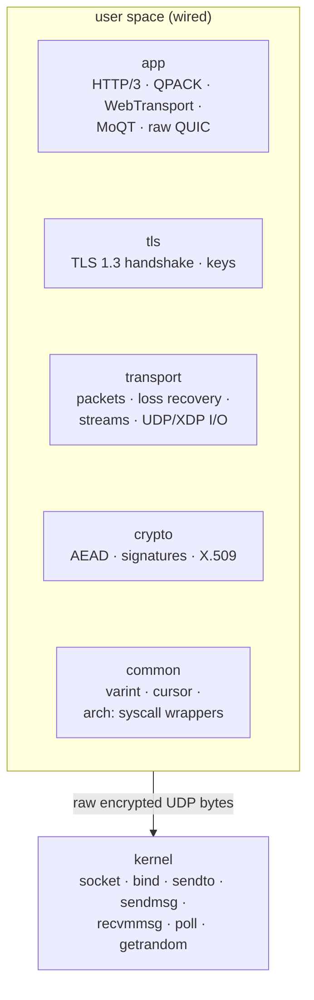
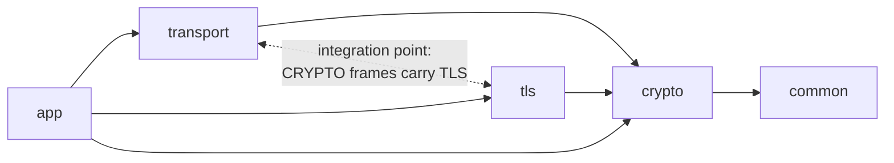
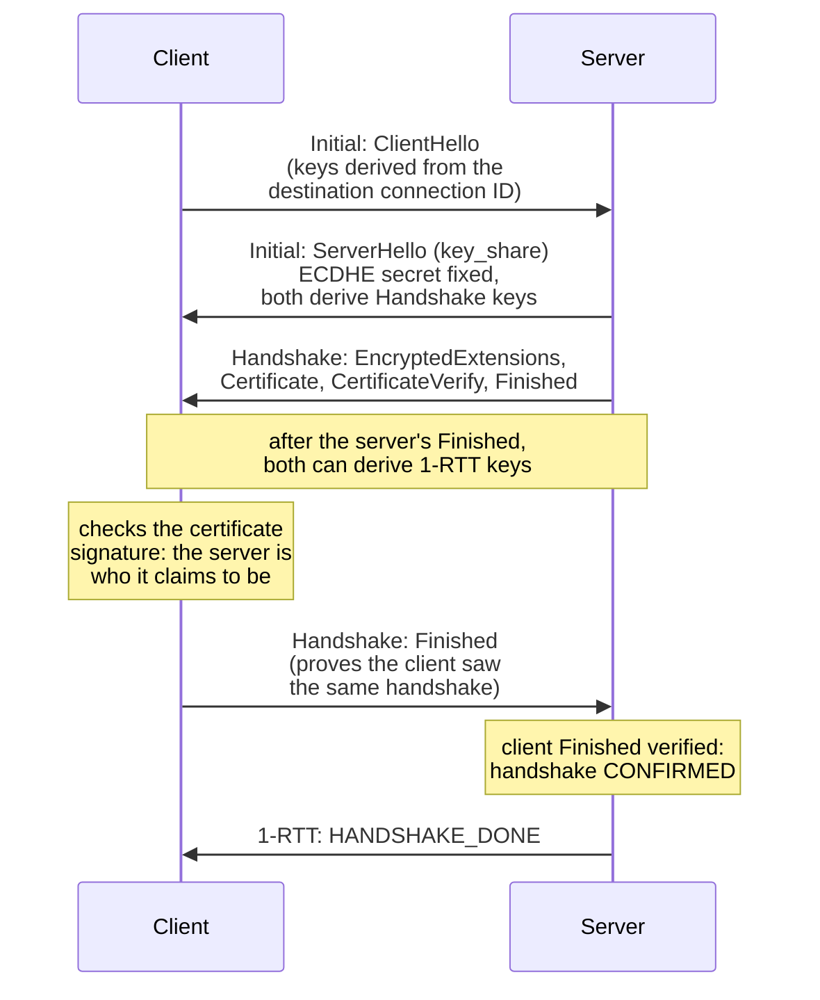
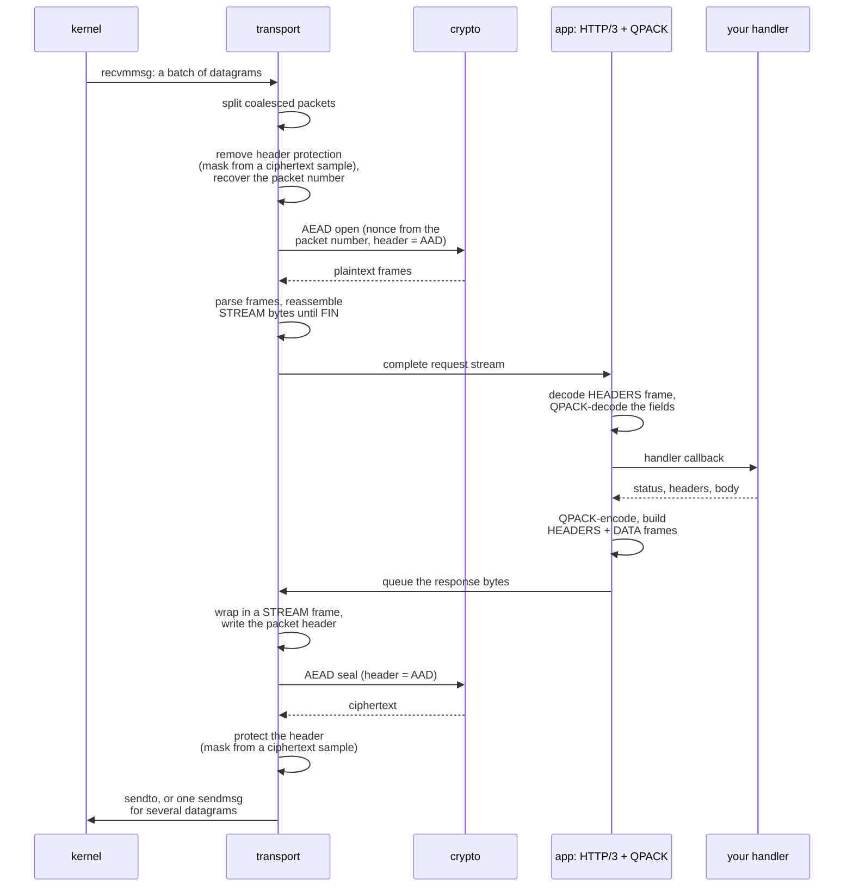
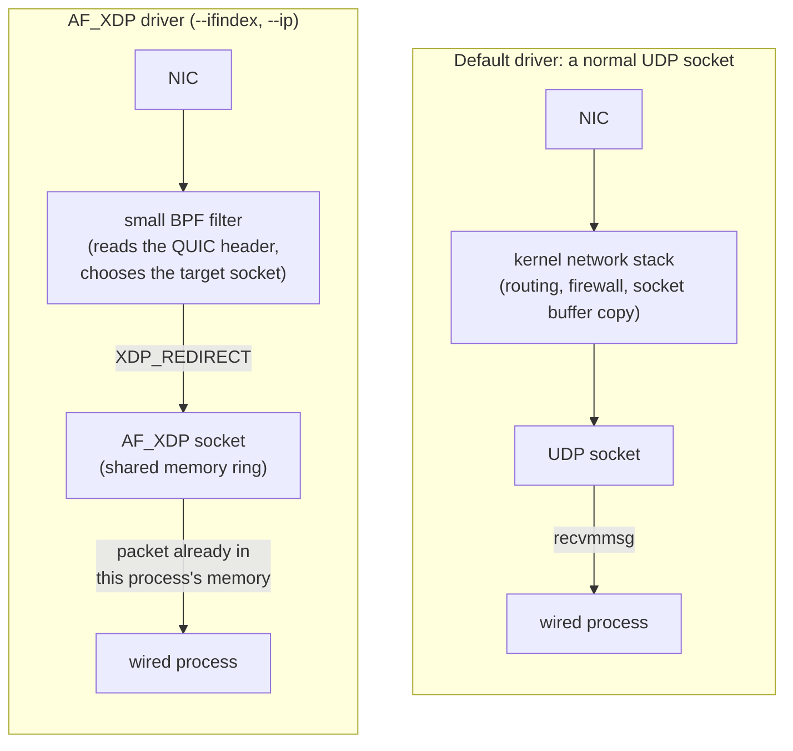
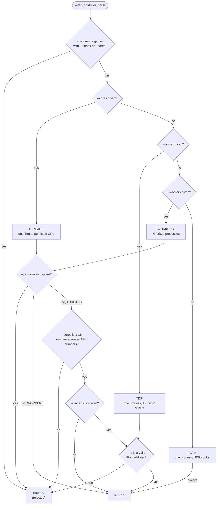
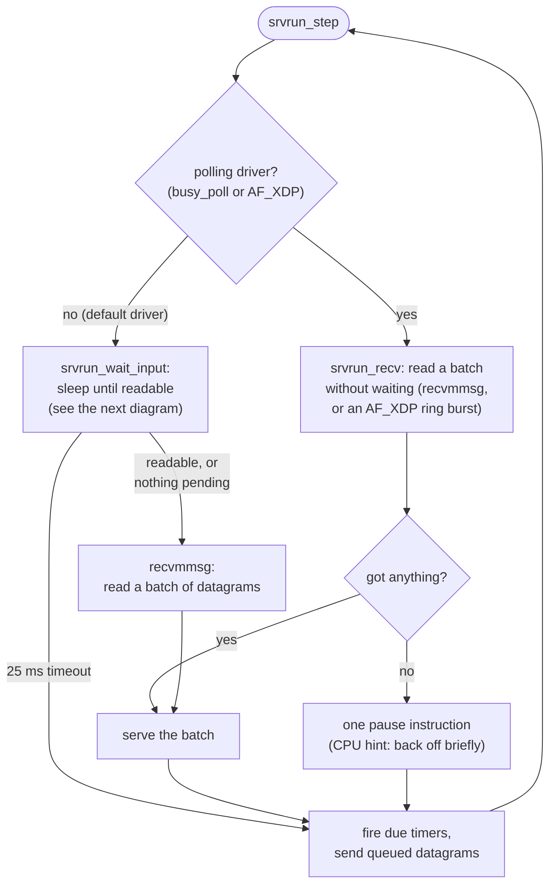
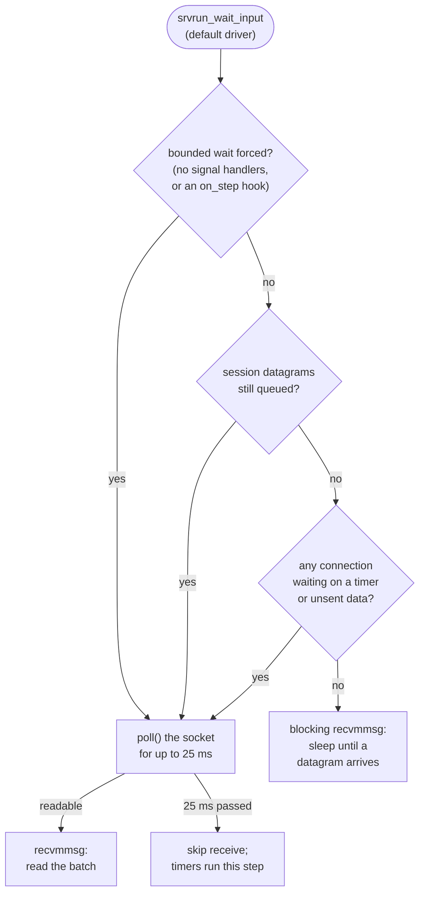

# Architecture and Data Flow

[Docs](../README.md) › Architecture › Overview

This page gives the big picture of the SDK: what the kernel does, what the
SDK does itself, how its five layers fit together, and which path a request
takes through them. Read it before [The Layers](layers.md) if you want to
change or debug the SDK, not just call it from an application.

> **TL;DR** — the kernel only moves already-encrypted UDP bytes. Everything
> QUIC-related — packets, keys, retransmission, HTTP/3 — happens in five
> user-space layers inside this SDK.

## The boundary between user space and the kernel

With TCP, the kernel owns retransmission, ordering, congestion control and
all of the connection state. QUIC runs on top of UDP instead. UDP only
carries single datagrams, with no reliability, no ordering and no
encryption, so all of those jobs can move into the application. wired takes
this to the limit: the kernel sees UDP datagrams and nothing of QUIC.

The diagram shows the five layers stacked top to bottom, and the one kind
of thing that crosses into the kernel. The boxes show stacking order only;
the real dependencies between layers are in [The five layers](#the-five-layers)
below. XDP, named in the transport box, is a fast Linux receive path,
explained in [I/O drivers](#how-a-packet-reaches-the-application-io-drivers).

### How the SDK reaches the kernel

A syscall (system call) is how a program asks the kernel to do something,
such as send a UDP datagram. wired is built without the C library, so it
issues every syscall itself. To keep that contact small and easy to audit,
it lives in one place: `src/common/arch/`.

- Domain code calls typed wrappers named `wired_arch_<name>`
  (`wired_arch_sendto`, `wired_arch_recvmmsg`, ...) from
  `common/arch/sysops.h`. It never writes a syscall number or assembly.
- The wrappers call one inline-assembly function, `syscall6`, in
  `common/arch/x8664/x8664.h`.
- Three small assembly stubs cannot go through that function: the thread
  start trampoline, the signal-return stub and the `_start` entry point.
  They run where a normal C function call is not possible (on a fresh
  thread stack, on a frame the kernel prepared, or before the C stack is
  set up), so they are written directly in assembly. They live under
  `common/arch/x8664/` too.

The wire loop needs only a few syscalls: UDP send and receive, socket setup,
`poll` and `getrandom`. The full list, with why each one is needed, is in
[Syscalls](../syscalls.md).

Everything else stays in user space: packet framing, encryption, the TLS
handshake, loss recovery, congestion control, stream multiplexing, HTTP/3
and QPACK, X.509 certificate checks and every cryptographic function. The
in-memory loopback transport used by tests (memlink, under
`src/transport/io/socket/net/`) issues no syscall at all.

This is what makes the libc-free design checkable. Compiling under
`-ffreestanding -nostdlib` proves there is no hidden dependency, and
because all kernel contact is confined to `common/arch/`, every other line
is a pure transformation of bytes.

## The five layers

| Layer | Directory | Responsibility |
|----|------------|------|
| app | `src/app/` | HTTP/3, QPACK, WebTransport, MoQT, raw QUIC, datagrams |
| tls | `src/tls/` | TLS 1.3 handshake, key schedule, transport parameters |
| transport | `src/transport/` | Packets, protection, loss recovery, streams, UDP/XDP I/O |
| crypto | `src/crypto/` | AEAD, hashing, signatures, key derivation, X.509 |
| common | `src/common/` | varint, byte cursor, `arch/` syscall wrappers, randomness |

The app layer holds more than HTTP/3:

- `http3/` and `qpack/`: HTTP/3 frames, the request state machine, and QPACK
  header compression.
- `webtransport/`: WebTransport sessions over HTTP/3 Extended CONNECT.
- `moqt/`: Media over QUIC Transport (MoQT). `moqt/qraw/` runs MoQT directly
  on a QUIC connection, without WebTransport.
- `rawquic/`: helpers that tell a raw-QUIC application connection (one that
  does not use HTTP/3) apart from a WebTransport one.
- `media/`: fragmented-MP4 splitting for publishers.
- `datagram/`: QUIC DATAGRAM frames (RFC 9221) and their delivery.

Dependencies mostly point downward, with three exceptions. The main one is
the QUIC⇄TLS integration point: transport and tls include each other. The
graph shows the main edges only. Every layer also uses common, which is
left out for clarity.

The two layers need each other because the QUIC handshake carries TLS
messages inside CRYPTO frames, which travel in QUIC packets. tls makes the
keys, but transport carries the bytes those keys protect. Forcing the
dependency fully downward would split that integration in an unnatural
place.

The other two exceptions are small and not drawn:

- **crypto reuses a few tls types**: the Initial-key type (in the key-set
  type), handshake message constants and signature-algorithm constants.
  These describe TLS data that the crypto code signs or checks, so they
  live with TLS.
- **tls and transport include a few app headers**: some files include the
  DATAGRAM constants from `app/datagram/`, and the TLS client reuses the
  server's wire helpers (`srvwire`). Both reuse code that already exists
  instead of copying it into a lower layer.

common is the bottom layer and depends on nothing. Every layer shares its
varint encoding and byte cursor. Small shared helpers live there as
`inline` functions. The test build compiles the whole SDK as one
translation unit: a single `.c` file that `#include`s every other one. Two
`static` helpers with the same name would collide there.

## Data flow

Three flows follow: the handshake that makes the keys, the encryption
levels those keys belong to, and one request through the layers once the
keys exist.

### The handshake: making the keys while connecting

QUIC uses TLS 1.3 for its handshake. The two sides agree on a shared secret
with ECDHE (elliptic-curve Diffie-Hellman: each side sends a public key, and
both compute the same secret, which an eavesdropper cannot compute). For how
to run a server that completes this handshake, see the guide page
[TLS 1.3 handshake](https://hakkadaikon.github.io/wired/guide/en/tls/handshake/).

A connection ID is an identifier QUIC puts in every packet header, so each
side can tell which connection a packet belongs to even if the IP address or
port changes. The destination connection ID is the one chosen for the
receiver of the packet.

Read the diagram top to bottom: each message is sent at the encryption
level named before the colon, and each step produces the keys for the next
level.

The 1-RTT keys come from the handshake messages up to the server's
Finished, so the client's Finished does not create them. CONFIRMED is the
server's last handshake phase (`WIRED_SERVER_HS_CONFIRMED`): the client's
Finished has been verified, so the server knows both sides derived the same
1-RTT keys and starts accepting the client's 1-RTT packets. HANDSHAKE_DONE
is the frame that tells the client so. The handshake solves its own
bootstrap problem (nothing can be encrypted without a key) by producing the
keys as it goes.

### Encryption levels and when keys are dropped

QUIC has an encryption level per handshake stage, each with its own keys:
Initial, Handshake and 1-RTT (plus optional 0-RTT for early data on a
resumed connection). The diagram shows the server's levels and what it
discards on the way. Three terms it uses:

- A **flight** is the group of handshake messages one side sends in one go.
  The server's flight is ServerHello through its Finished.
- FLIGHT_SENT and CONFIRMED are server phases (`WIRED_SERVER_HS_FLIGHT_SENT`
  and `WIRED_SERVER_HS_CONFIRMED`): the server's flight is built, and the
  client's Finished is verified.
- A **PTO** (probe timeout) is the timer after which QUIC assumes a packet
  was lost and sends a probe.

```mermaid
stateDiagram-v2
    [*] --> Initial: ClientHello arrives
    Initial: Initial<br/>keys from the client's<br/>destination connection ID
    Handshake: Handshake<br/>keys from the ECDHE secret
    OneRTT: 1-RTT<br/>application keys
    Initial --> Handshake: server flight built<br/>(FLIGHT_SENT)
    Handshake --> OneRTT: client Finished verified<br/>(CONFIRMED)
    OneRTT --> OneRTT: key update<br/>(old keys dropped after 3 PTO)
    OneRTT --> [*]: connection closed<br/>(slot freed; keys stay<br/>until the slot is reused)
    note right of OneRTT
        At CONFIRMED: 0-RTT keys erased,
        Initial and Handshake sending stops,
        Handshake keys stay in the slot
    end note
```

What actually happens to each set of keys:

- **Initial keys are never stored.** Anyone can derive them from the
  client's destination connection ID, so the server derives them again for
  each Initial packet it seals or opens.
- **0-RTT keys are erased at CONFIRMED** (`sdrv_discard_early_keys`). Late
  0-RTT packets then fail to decrypt and are dropped.
- **Handshake keys stay in the connection slot**, after CONFIRMED and even
  after the connection closes. After CONFIRMED the server stops sending
  Handshake packets, but it can still open incoming ones. When a connection
  closes, `srvrun_free_slot` releases the slot but leaves its key schedule
  in place; the bytes are overwritten only when `srvrun_open_slot` reuses
  the slot. (`wired_server_close` wipes the key schedule with
  `keysched_wipe`, but the server loop does not call it.) RFC 9001 §4.9.2
  requires (MUST) discarding Handshake keys at confirmation; the server
  does not do that yet.
- **Old 1-RTT keys** are dropped three PTOs after a key update
  (`srvrun_ku_discard_stale`). Waiting three PTOs lets packets still in
  flight under the old keys arrive.

The server may also send 1-RTT data before CONFIRMED, once its own flight
is out (`wired_server_early_send_keys`). This is called 0.5-RTT: the server
sends application data after its flight but before the client's Finished
arrives, half a round trip early.

### One HTTP/3 GET through the layers

This is a GET on a connection whose handshake is already done. Follow the
arrows top to bottom: the request comes up through the layers, your handler
answers, and the response goes back down.

Three terms from the diagram:

- **Coalescing**: QUIC lets a sender pack several packets, for example an
  Initial and a Handshake packet (two of the encryption levels
  [above](#encryption-levels-and-when-keys-are-dropped)), into one UDP
  datagram. The receiver
  splits them apart first (`udploop_split`). The server's own 1-RTT
  responses are one packet per datagram.
- **AEAD and AAD**: AEAD (authenticated encryption) encrypts the payload
  and adds a tag that proves nobody changed it. AAD (additional
  authenticated data) is data the tag also covers without encrypting it.
  Here the AAD is the packet header, so a changed header makes the packet
  fail to decrypt.
- **Header protection**: after encryption, part of the header (the packet
  number and some flag bits) is XORed with a mask. The mask comes from
  encrypting a 16-byte sample of the ciphertext with a separate key. This
  hides packet numbers from observers on the network. The sender also
  shortens the packet number to its low bytes, so the receiver rebuilds
  (recovers) the full number from the largest one it has seen.

The order of the crypto steps cannot change, on either side:

- **Sending**: AEAD needs the finished header as its AAD, so the header is
  written before sealing. Header protection needs a ciphertext sample, so
  it runs after sealing.
- **Receiving**: the packet number is hidden under header protection, and
  the AEAD nonce (a value the cipher requires to be unique per packet) is
  built from the packet number. So header protection comes off first, then AEAD
  opens the payload.

The main symbols on this path are `hspkt_onertt_open_suite` (receive) and
`hspkt_onertt_build_suite` (send) in `src/transport/packet/build/hspkt/`,
with the cipher dispatch in `src/transport/packet/protect/`. The HTTP/3
side starts at `wired_h3srv_on_request`, and the handler is called from
`srvrun_call_handler`.

## How a packet reaches the application: I/O drivers

Everything above this point is the same however a datagram physically
arrives. *How* it arrives is a real design choice with a speed and CPU
trade-off: which kernel API moves the bytes, and whether the process sleeps
or spins while it waits. This section covers `src/transport/io/` and the
receive loop in `src/app/http3/server/srvrun/`, one level below the
"UDP/XDP I/O" box in the layer diagram.

### Two ways to get a datagram out of the kernel

The left path is a normal UDP socket. The right path skips most of the
kernel's network stack with AF_XDP.

**Default driver** (no driver flag): a plain `socket()` and `bind()` UDP
socket, the API every server uses. The kernel's normal network stack runs
for every packet before wired sees it: routing, firewall rules and a copy
into the socket's receive buffer. quic-go, quiche, ngtcp2 and picoquic all
work this way, since none of them has an AF_XDP driver.

**AF_XDP driver** (`--ifindex <n> --ip <addr>`): BPF is a small program
format the Linux kernel can run safely inside itself. XDP runs such a
program on each packet as soon as the network card hands it over, before
the normal stack.

wired's BPF filter (`xdpbpf_prog_build`) looks at each packet and returns
one of two answers:

- **XDP_REDIRECT** for UDP packets to the server's port. The filter reads
  the first byte of the QUIC destination connection ID to choose a target
  socket, and the packet moves into that AF_XDP socket: a ring buffer
  shared between the kernel and the process, so the data needs no second
  copy.
- **XDP_PASS** for everything else, which goes through the normal stack.

This path measured faster because it makes fewer copies and does less
stack work per packet (see
[`comparison.md`](../performance/comparison.md#speed-af_xdp-driver-over-a-real-nic-informational)).

`--skb-mode` selects the software-emulated "generic" XDP mode, for a
network card driver without native XDP support.

### How the driver is chosen

`wired_srvdriver_parse` turns the command-line flags into one of four
driver kinds, or rejects them. The guide page
[Server flags](https://hakkadaikon.github.io/wired/guide/en/quic/server-flags/)
shows how to use the flags.

The kinds differ on two axes. The I/O path (UDP socket or AF_XDP) decides
how a packet reaches a process. The process count is separate: WORKERS
forks *N* processes that share one port through `SO_REUSEPORT` (a socket
option that lets several sockets bind the same port, with the kernel
spreading incoming packets across them).

| Kind | Flags | Processes | Waits by |
|---|---|---|---|
| PLAIN | *(none)* | 1 | blocking (or spinning with `busy_poll`) |
| WORKERS | `--workers N` | N, forked | blocking, per worker |
| THREADS | `--cores a,b,c` | 1, one thread per CPU | 25 ms bounded poll (spinning with `--ifindex`) |
| XDP | `--ifindex <n> --ip <addr>` | 1 | spinning |

`busy_poll` and the bounded poll are explained in
[Waiting for the next packet](#waiting-for-the-next-packet-block-or-spin).

The diagram below shows the order of the checks and every case where the
function returns 0.

`--pin-core` is rejected for WORKERS and THREADS because those kinds have
their own pinning flags (`--pin-cores` and `--control-core`). THREADS with
`--ifindex` is AF_XDP multi-queue mode: worker thread *i* serves network
card queue *i*.

WORKERS has a known limitation, described in `srvworkers.h`. The kernel
picks a worker from a hash of the address and port, so the packets of one
connection are not guaranteed to reach the same worker. Nothing uses the
connection ID to keep a connection on its worker, so if the kernel's spread
changes mid-handshake, the next datagram reaches a worker that has no state
for it. As a result, a handshake can fail intermittently. See the
SO_REUSEPORT entry under "Platform / I/O" in
[Known limitations](../features/known-limitations.md).

AF_XDP needs `CAP_BPF` and `CAP_NET_ADMIN` and is less hardened than the
default path.

### Waiting for the next packet: block or spin

The server loop (`srvrun_loop`) repeats one step (`srvrun_step`) until
shutdown. Each step must decide whether to sleep until a packet arrives or
to keep checking in a tight loop.

The **default driver blocks**: the process sleeps and the kernel wakes it
when a datagram arrives. CPU use stays near zero while idle, at the cost of
a wake-up delay on each new packet.

**`busy_poll` and AF_XDP never block.** `busy_poll` is a run option
(`wired_srvrun_opt.busy_poll`; the word_list example exposes it as
`--busy-poll`). These drivers read a batch, and if it is empty, run one
`pause` instruction (`wired_arch_pause`, an x86 hint that saves power during
a spin without sleeping) and check again. This trades CPU for latency: a
polling core shows about 100% CPU even with no traffic. AF_XDP always works
this way in this SDK, because its ring gives `poll()` nothing to wait on in
the way a normal socket does.

For the default driver, how long to sleep depends on whether anything needs
the clock. `srvrun_wait_input` sleeps without a time limit only when nothing
is pending; otherwise it waits at most 25 ms (`SRVRUN_PTO_MS`) so timers
still run. The next diagram expands the "sleep until readable" box above
(the polling check is already made there).

Why each branch forces a time limit (`srvrun_bounded_wait_forced`,
`srvrun_may_block_unbounded`):

- **No signal handlers**: a `--cores` worker thread keeps SIGTERM blocked,
  so a signal cannot wake it from an unbounded sleep. Only a timeout lets it
  notice shutdown.
- **An `on_step` hook**: the application's per-step callback is driven by
  time, not by input, so an idle socket must not stall it.
- **Queued session datagrams**: a step sends only part of the queue, and the
  rest needs another step.
- **A connection waiting**: unsent or unacknowledged data, a closing
  connection, or an outstanding path check all need a timer to fire even if
  the peer stays silent.

---

**Next:** [The Layers](layers.md) — each layer in depth.
([all docs](../README.md))
