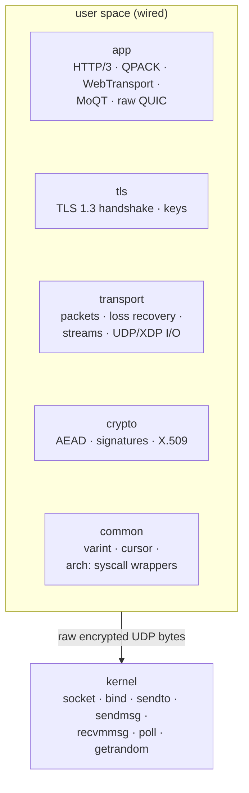
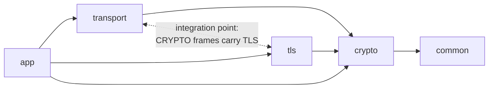
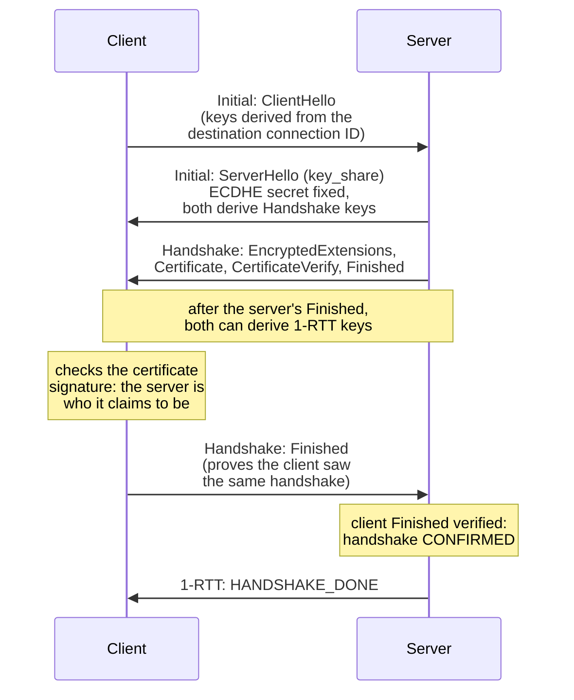
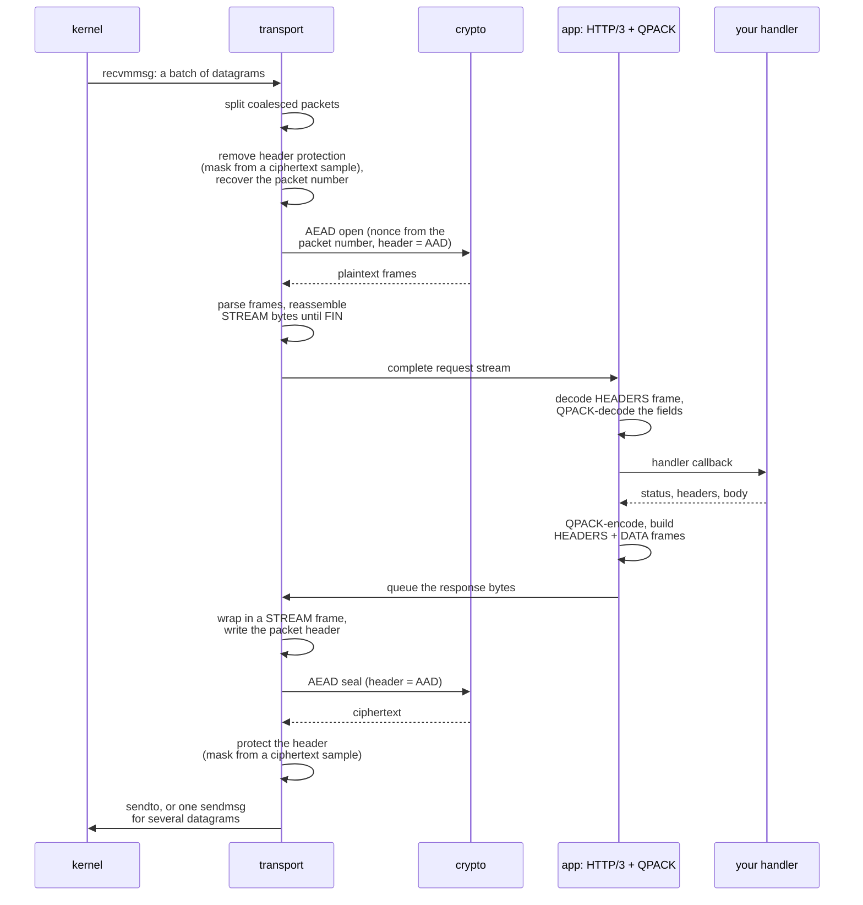
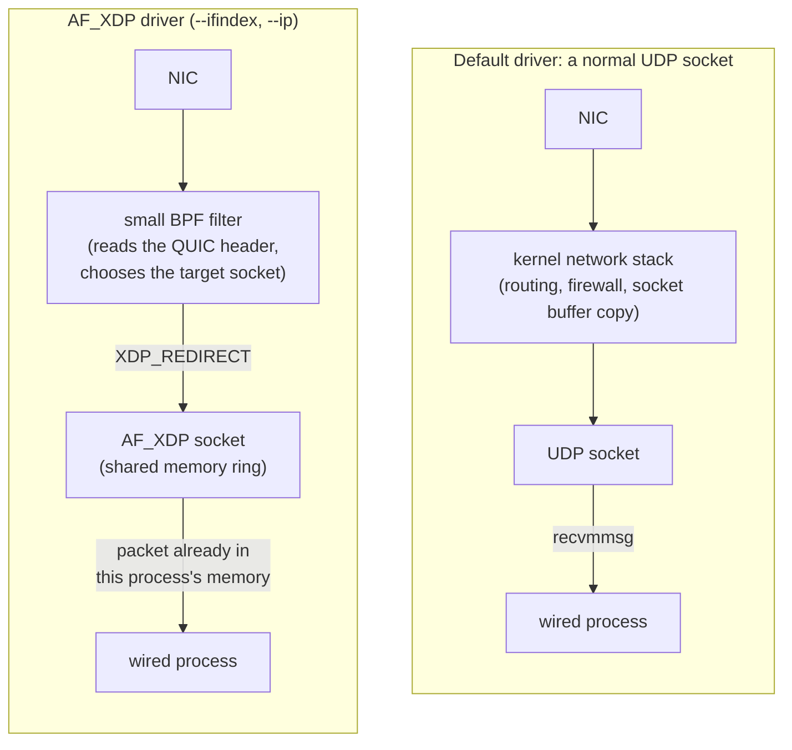
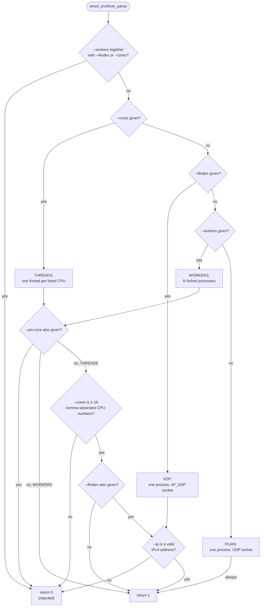
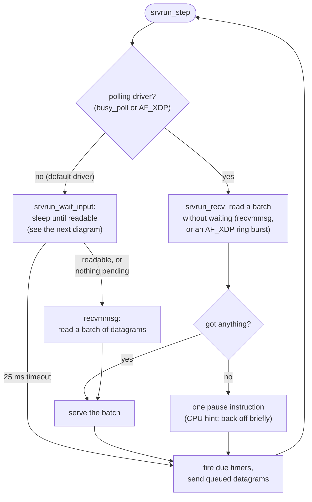
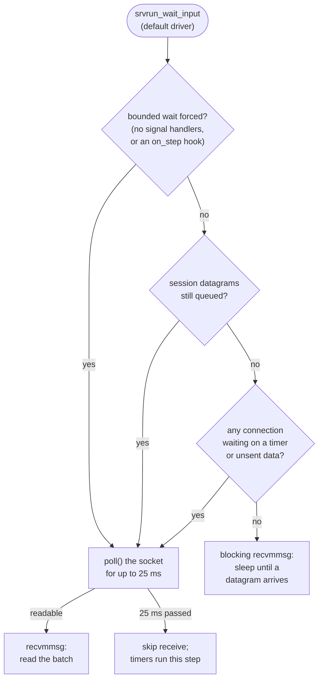

# アーキテクチャとデータの流れ

[Docs](../README.md) › アーキテクチャ › 概要

このページでは SDK の全体像を示します。カーネルが何をして、SDK が自分で何をするか、5 つのレイヤーがどう組み合わさるか、リクエストがどの経路でレイヤーを通るかです。アプリケーションから呼ぶだけでなく、SDK を変更したりデバッグしたりしたいなら、[レイヤー](layers.md)より先にこのページを読んでください。

> **要約**: カーネルが運ぶのは暗号化済みの UDP のバイト列だけです。パケット、鍵、再送、HTTP/3 といった QUIC に関わる処理は、すべてこの SDK の中にある 5 つのユーザー空間のレイヤーで行います。

## ユーザー空間とカーネルの境界

TCP では、再送、順序制御、輻輳制御とコネクションの状態のすべてをカーネルが持ちます。一方 QUIC は UDP の上で動きます。UDP は単独のデータグラムを運ぶだけで、信頼性も順序も暗号化もないので、これらの仕事はすべてアプリケーション側に移せます。wired はこれを突き詰めており、カーネルから見えるのは UDP データグラムだけで、QUIC のことは何も見えません。

下の図は 5 つのレイヤーを上から下へ積み重ね、カーネルへ渡る唯一のものを示しています。箱が示すのは積み重ねの順序だけで、レイヤー間の実際の依存関係は後の[5 つのレイヤー](#5-つのレイヤー)にあります。transport の箱にある XDP は Linux の高速な受信経路で、[I/O ドライバー](#io-ドライバーとパケットの届き方)で説明します。

### SDK からカーネルを呼ぶ仕組み

システムコール(syscall)は、UDP データグラムの送信のように、プログラムがカーネルに処理を頼む手段です。wired は C ライブラリなしでビルドするので、すべてのシステムコールを自分で発行します。カーネルとの接点を小さく保ち、監査しやすくするため、その処理は `src/common/arch/` の 1 か所にまとめています。

- ドメインのコードは `common/arch/sysops.h` にある `wired_arch_<name>` という名前の型付きラッパー(`wired_arch_sendto`、`wired_arch_recvmmsg` など)を呼びます。システムコール番号やアセンブリを直接書くことはありません。
- ラッパーは `common/arch/x8664/x8664.h` にあるインラインアセンブリの関数 `syscall6` を 1 つだけ呼びます。
- 3 つの小さなアセンブリスタブは、この関数を通せません。スレッド開始のトランポリン、シグナルからの復帰スタブ、`_start` エントリポイントです。これらは通常の C の関数呼び出しができない場所(新しいスレッドのスタック上、カーネルが用意したフレーム上、C のスタックを準備する前)で動くため、アセンブリで直接書いています。これらも `common/arch/x8664/` にあります。

送受信のループに必要なシステムコールはわずかです。UDP の送受信、ソケットの準備、`poll`、`getrandom` だけです。全一覧とそれぞれが必要な理由は [Syscalls](../syscalls.md) にあります。

それ以外はすべてユーザー空間に残ります。パケットの組み立て、暗号化、TLS ハンドシェイク、損失回復、輻輳制御、ストリームの多重化、HTTP/3 と QPACK、X.509 証明書の検証、すべての暗号関数です。テストで使うメモリ内のループバックトランスポート(memlink、`src/transport/io/socket/net/` にあります)は、システムコールを 1 つも発行しません。

libc を使わない設計を検証できるのは、このためです。`-ffreestanding -nostdlib` でコンパイルできることが隠れた依存がない証拠になります。そしてカーネルとの接点がすべて `common/arch/` に閉じているので、それ以外の行はすべてバイト列の純粋な変換です。

## 5 つのレイヤー

| レイヤー | ディレクトリ | 担当 |
|----|------------|------|
| app | `src/app/` | HTTP/3、QPACK、WebTransport、MoQT、raw QUIC、データグラム |
| tls | `src/tls/` | TLS 1.3 ハンドシェイク、鍵スケジュール、トランスポートパラメーター |
| transport | `src/transport/` | パケット、保護、損失回復、ストリーム、UDP/XDP I/O |
| crypto | `src/crypto/` | AEAD、ハッシュ、署名、鍵導出、X.509 |
| common | `src/common/` | varint、バイトカーソル、`arch/` のシステムコールラッパー、乱数 |

app レイヤーには HTTP/3 以外のものも入っています。

- `http3/` と `qpack/`: HTTP/3 のフレーム、リクエストの状態機械、QPACK によるヘッダー圧縮。
- `webtransport/`: HTTP/3 の Extended CONNECT 上の WebTransport セッション。
- `moqt/`: Media over QUIC Transport(MoQT)。`moqt/qraw/` は WebTransport を使わず、QUIC のコネクション上で直接 MoQT を動かします。
- `rawquic/`: raw QUIC のアプリケーションのコネクション(HTTP/3 を使わないもの)を WebTransport のコネクションと見分けるためのヘルパー。
- `media/`: パブリッシャー向けの fragmented MP4 の分割。
- `datagram/`: QUIC の DATAGRAM フレーム(RFC 9221)とその配送。

依存はおおむね下向きですが、例外が 3 つあります。主な例外は QUIC と TLS の統合点で、transport と tls は互いをインクルードしています。図には主な依存だけを描きました。すべてのレイヤーは common も使いますが、見やすさのために省いています。

2 つのレイヤーが互いを必要とするのは、QUIC のハンドシェイクが TLS のメッセージを CRYPTO フレームに入れて運び、その CRYPTO フレームが QUIC のパケットで運ばれるからです。tls は鍵を作りますが、その鍵で保護するバイト列を運ぶのは transport です。依存を完全に下向きにそろえると、この統合を不自然な位置で分けることになります。

ほかの 2 つの例外は小さいので、図には描いていません。

- **crypto は tls の型をいくつか再利用しています**。鍵セットの型に含まれる Initial 鍵の型、ハンドシェイクメッセージの定数、署名アルゴリズムの定数です。これらは crypto のコードが署名したり検証したりする TLS のデータを表すものなので、TLS 側に置いています。
- **tls と transport は app のヘッダーをいくつかインクルードしています**。`app/datagram/` の DATAGRAM の定数をインクルードするファイルがあり、TLS クライアントはサーバーの送受信用ヘルパー(`srvwire`)を再利用しています。どちらも既存のコードを下のレイヤーにコピーせずに再利用するためです。

common は最下層のレイヤーで、何にも依存しません。すべてのレイヤーが common の varint エンコードとバイトカーソルを共有します。小さな共有ヘルパーは `inline` 関数としてここに置きます。テストのビルドでは SDK 全体を 1 つの翻訳単位としてコンパイルします。ほかのすべての `.c` を `#include` する 1 つの `.c` ファイルです。そこでは、同じ名前の `static` ヘルパーが 2 つあると衝突します。

## データの流れ

ここでは 3 つの流れを順に示します。鍵を作るハンドシェイク、その鍵が属する暗号化レベル、そして鍵ができたあとにリクエストが 1 件レイヤーを通る流れです。

### ハンドシェイクで接続しながら鍵を作る

QUIC はハンドシェイクに TLS 1.3 を使います。両者は ECDHE(楕円曲線 Diffie-Hellman。両者が公開鍵を送り合い、同じ秘密を計算します。盗聴者にはこの秘密を計算できません)で共有の秘密を取り決めます。このハンドシェイクを完了させるサーバーの動かし方は、ガイドのページ [TLS 1.3 ハンドシェイク](https://hakkadaikon.github.io/wired/guide/ja/tls/handshake/) を参照してください。

コネクション ID は、QUIC がすべてのパケットヘッダーに入れる識別子です。IP アドレスやポートが変わっても、パケットがどのコネクションのものかを両者が判別できます。宛先コネクション ID はパケットの受信側のために選んだ ID です。

図は上から下へ読みます。各メッセージはコロンの前に書いた暗号化レベルで送られ、各段階が次のレベルの鍵を生みます。

1-RTT 鍵はサーバーの Finished までのハンドシェイクメッセージから作るので、クライアントの Finished が 1-RTT 鍵を生むわけではありません。CONFIRMED はサーバーのハンドシェイクの最後の段階(`WIRED_SERVER_HS_CONFIRMED`)です。クライアントの Finished を検証済みなので、サーバーは両者が同じ 1-RTT 鍵を導出したと分かり、クライアントの 1-RTT パケットを受け付け始めます。HANDSHAKE_DONE はそれをクライアントに伝えるフレームです。ハンドシェイクは、進みながら鍵を作ることで、鍵がなければ何も暗号化できないという立ち上げの問題を自分で解決しています。

### 暗号化レベルと鍵を捨てるタイミング

QUIC には、ハンドシェイクの段階ごとに暗号化レベルがあり、それぞれ専用の鍵を持ちます。Initial、Handshake、1-RTT です(加えて、再開したコネクションで早期データを送るための 0-RTT を任意で使えます)。図はサーバーのレベルと、その途中でサーバーが捨てるものを示します。図で使う用語は 3 つです。

- **フライト**は、一方が一度にまとめて送るハンドシェイクメッセージの組です。サーバーのフライトは ServerHello から自分の Finished までです。
- FLIGHT_SENT と CONFIRMED はサーバーの段階(`WIRED_SERVER_HS_FLIGHT_SENT` と `WIRED_SERVER_HS_CONFIRMED`)です。それぞれ、サーバーのフライトを組み立て終えた段階と、クライアントの Finished を検証した段階を表します。
- **PTO**(probe timeout)は、QUIC がパケットを失われたとみなしてプローブを送るまでのタイマーです。

```mermaid
stateDiagram-v2
    [*] --> Initial: ClientHello arrives
    Initial: Initial<br/>keys from the client's<br/>destination connection ID
    Handshake: Handshake<br/>keys from the ECDHE secret
    OneRTT: 1-RTT<br/>application keys
    Initial --> Handshake: server flight built<br/>(FLIGHT_SENT)
    Handshake --> OneRTT: client Finished verified<br/>(CONFIRMED)
    OneRTT --> OneRTT: key update<br/>(old keys dropped after 3 PTO)
    OneRTT --> [*]: connection closed<br/>(slot freed; keys stay<br/>until the slot is reused)
    note right of OneRTT
        At CONFIRMED: 0-RTT keys erased,
        Initial and Handshake sending stops,
        Handshake keys stay in the slot
    end note
```

それぞれの鍵が実際にどうなるかは次のとおりです。

- **Initial 鍵は保存しません**。クライアントの宛先コネクション ID から誰でも導出できるので、サーバーは Initial パケットを封じたり開いたりするたびに導出し直します。
- **0-RTT 鍵は CONFIRMED の時点で消去します**(`sdrv_discard_early_keys`)。そのあとに遅れて届いた 0-RTT パケットは復号に失敗し、破棄されます。
- **Handshake 鍵はコネクションのスロットに残ります**。CONFIRMED のあとも、コネクションが閉じたあとも残ります。CONFIRMED のあと、サーバーは Handshake パケットの送信をやめますが、届いた Handshake パケットはまだ開けます。コネクションが閉じると、`srvrun_free_slot` はスロットを解放しますが、鍵スケジュールはそのまま残します。そのバイト列が上書きされるのは、`srvrun_open_slot` がスロットを再利用したときだけです(`wired_server_close` は `keysched_wipe` で鍵スケジュールを消去しますが、サーバーループはこれを呼びません)。RFC 9001 §4.9.2 は確認の時点で Handshake 鍵を捨てることを要求しています(MUST)。サーバーはまだこれを満たしていません。
- **古い 1-RTT 鍵**は鍵の更新から 3 PTO 後に捨てます(`srvrun_ku_discard_stale`)。3 PTO 待つのは、古い鍵で送られて転送中のパケットを届かせるためです。

サーバーは自分のフライトを送り終えれば、CONFIRMED の前でも 1-RTT のデータを送れます(`wired_server_early_send_keys`)。これを 0.5-RTT と呼びます。サーバーはフライトのあと、クライアントの Finished が届く前、つまり半往復早くアプリケーションデータを送ります。

### HTTP/3 の GET 1 件がレイヤーを通る流れ

ハンドシェイクを終えたコネクション上の GET を例にします。矢印を上から下へたどってください。リクエストがレイヤーを上がっていき、ハンドラーが応答し、レスポンスがレイヤーを下りていきます。

図に出てくる用語は 3 つです。

- **結合(coalescing)**: QUIC では、送信側が複数のパケットを 1 つの UDP データグラムに詰められます。たとえば Initial パケットと Handshake パケット([前述](#暗号化レベルと鍵を捨てるタイミング)の暗号化レベルのうちの 2 つ)です。受信側はまずこれを分割します(`udploop_split`)。サーバー自身の 1-RTT のレスポンスは、1 データグラムに 1 パケットです。
- **AEAD と AAD**: AEAD(認証付き暗号)はペイロードを暗号化し、誰も改ざんしていないことを証明するタグを付けます。AAD(追加認証データ)は、暗号化はしないがタグの検証対象には含めるデータです。ここでは AAD がパケットヘッダーなので、ヘッダーを書き換えるとパケットの復号に失敗します。
- **ヘッダー保護**: 暗号化のあと、ヘッダーの一部(パケット番号といくつかのフラグビット)をマスクと XOR します。マスクは暗号文から取った 16 バイトのサンプルを別の鍵で暗号化して作ります。こうしてネットワーク上の観測者からパケット番号を隠します。送信側はパケット番号を下位のバイトだけに縮めるので、受信側はそれまでに見た最大の番号から完全な番号を組み立て直します(復元します)。

暗号の処理の順序は送信側でも受信側でも変えられません。

- **送信**: AEAD は完成したヘッダーを AAD として必要とするので、封じる前にヘッダーを書きます。ヘッダー保護は暗号文のサンプルを必要とするので、封じたあとに行います。
- **受信**: パケット番号はヘッダー保護の下に隠れており、AEAD のノンス(パケットごとに一意であることを暗号方式が要求する値)はパケット番号から作ります。そのため、先にヘッダー保護を外し、そのあと AEAD でペイロードを開きます。

この経路の主なシンボルは `src/transport/packet/build/hspkt/` にある `hspkt_onertt_open_suite`(受信)と `hspkt_onertt_build_suite`(送信)です。暗号方式の振り分けは `src/transport/packet/protect/` にあります。HTTP/3 側の入口は `wired_h3srv_on_request_raw` で、ハンドラーは `srvrun_call_handler` から呼ばれます。

## I/O ドライバーとパケットの届き方

ここまでの内容は、データグラムが物理的にどう届くかに関係なく同じです。*どう*届くかは速度と CPU のトレードオフを伴う実際の設計上の選択です。どのカーネル API でバイト列を運ぶか、待つあいだプロセスが眠るかスピンするかを選びます。この節では `src/transport/io/` と、`src/app/http3/server/srvrun/` の受信ループを扱います。レイヤーの図の「UDP/XDP I/O」の箱より 1 段下の話です。

### カーネルからデータグラムを取り出す 2 つの方法

左の経路は通常の UDP ソケットです。右の経路は AF_XDP を使い、カーネルのネットワークスタックの大部分を飛ばします。

**デフォルトのドライバー**(ドライバーのフラグなし): `socket()` と `bind()` で作る普通の UDP ソケットで、どのサーバーも使う API です。wired がパケットを見る前に、カーネルの通常のネットワークスタックがパケットごとに動きます。ルーティング、ファイアウォールのルール、ソケットの受信バッファーへのコピーです。quic-go、quiche、ngtcp2、picoquic はどれも AF_XDP ドライバーを持たないので、すべてこの方式で動きます。

**AF_XDP ドライバー**(`--ifindex <n> --ip <addr>`): BPF は、Linux カーネルが自分の中で安全に実行できる小さなプログラムの形式です。XDP は、ネットワークカードがパケットを渡した直後、通常のスタックより前に、そうしたプログラムを各パケットに対して実行します。

wired の BPF フィルター(`xdpbpf_prog_build`)は各パケットを見て、次の 2 つのどちらかを返します。

- UDP でサーバーのポート宛てのパケットには **XDP_REDIRECT**。フィルターは QUIC の宛先コネクション ID の先頭バイトを読んで宛先のソケットを選び、パケットはその AF_XDP ソケットへ移ります。AF_XDP ソケットはカーネルとプロセスが共有するリングバッファーなので、データを 2 度目にコピーする必要はありません。
- それ以外のパケットには **XDP_PASS**。これらは通常のスタックを通ります。

この経路は、デフォルトの UDP の経路よりパケットあたりのコピーが少なく、スタックの処理も少なく済みます。

`--skb-mode` は、ソフトウェアでエミュレートする「generic」XDP モードを選びます。ネイティブの XDP に対応していないネットワークカードのドライバー向けです。

### ドライバーの選び方

`wired_srvdriver_parse` は、コマンドラインのフラグを 4 種類のドライバーのどれかに変換するか、拒否します。フラグの使い方はガイドのページ [サーバーのフラグ](https://hakkadaikon.github.io/wired/guide/ja/quic/server-flags/) にあります。

種類の違いには 2 つの軸があります。I/O の経路(UDP ソケットか AF_XDP か)は、パケットがプロセスにどう届くかを決めます。プロセス数はこれとは別の軸です。WORKERS は *N* 個のプロセスを fork し、それらは `SO_REUSEPORT` で 1 つのポートを共有します(`SO_REUSEPORT` は、複数のソケットが同じポートに bind できるようにするソケットオプションで、届いたパケットはカーネルがそれらのソケットに振り分けます)。

| 種類 | フラグ | プロセス | 待ち方 |
|---|---|---|---|
| PLAIN | *(なし)* | 1 | ブロック(`busy_poll` ならスピン) |
| WORKERS | `--workers N` | N、fork | ブロック、ワーカーごと |
| THREADS | `--cores a,b,c` | 1、CPU ごとに 1 スレッド | 25 ms の上限付き poll(`--ifindex` ならスピン) |
| XDP | `--ifindex <n> --ip <addr>` | 1 | スピン |

`busy_poll` と上限付きの poll は[次のパケットの待ち方](#次のパケットの待ち方-ブロックかスピンか)で説明します。

下の図はチェックの順序と、関数が 0 を返すすべての場合を示します。

WORKERS と THREADS で `--pin-core` を拒否するのは、これらの種類にはそれぞれ専用の固定用フラグ(`--pin-cores` と `--control-core`)があるからです。THREADS に `--ifindex` を付けると AF_XDP のマルチキューモードになり、ワーカースレッド *i* がネットワークカードのキュー *i* を担当します。

WORKERS には既知の制限があります(`srvworkers.h` の「KNOWN LIMITATION (workers > 1)」のコメント)。カーネルはアドレスとポートのハッシュからワーカーを選ぶので、1 つのコネクションのパケットが同じワーカーに届く保証はありません。コネクション ID を使ってコネクションをそのワーカーに留める仕組みはないため、ハンドシェイクの途中でカーネルの振り分けが変わると、次のデータグラムはそのコネクションの状態を持たないワーカーに届きます。その結果、ハンドシェイクがときどき失敗することがあります。

AF_XDP には `CAP_BPF` と `CAP_NET_ADMIN` が必要で、デフォルトの経路ほど堅牢化されていません。

### 次のパケットの待ち方: ブロックかスピンか

サーバーループ(`srvrun_loop`)は、停止するまで 1 ステップ(`srvrun_step`)を繰り返します。各ステップでは、パケットが届くまで眠るか、短いループで確認し続けるかを決めなければなりません。

**デフォルトのドライバーはブロックします**。プロセスは眠り、データグラムが届くとカーネルが起こします。待機中の CPU 使用率はほぼ 0 のままですが、新しいパケットのたびに起床の遅れが生じます。

**`busy_poll` と AF_XDP はブロックしません**。`busy_poll` は実行オプション(`wired_srvrun_opt.busy_poll`)で、word_list のサンプルでは `--busy-poll` として指定できます。これらのドライバーはまとめて読み、空なら `pause` 命令(`wired_arch_pause`。眠らずにスピン中の電力を抑える x86 のヒント)を 1 回実行して、再び確認します。これは CPU と引き換えにレイテンシーを下げる方式で、ポーリングするコアは通信がなくても CPU 使用率がほぼ 100% になります。この SDK の AF_XDP は常にこの方式で動きます。ドライバーはスピンループの中で直接リングを読み(`srvrun_recv_xdp`)、`poll()` で眠ることはありません。CPU と引き換えに、受信のレイテンシーを最小にします。

デフォルトのドライバーでどれだけ眠るかは、時計を必要とするものがあるかどうかで決まります。`srvrun_wait_input` が時間制限なしで眠るのは、保留中のものが何もないときだけです。それ以外では、タイマーを動かし続けるため、最大 25 ms(`SRVRUN_PTO_MS`)だけ待ちます。次の図は上の図の「読めるようになるまで眠る」の箱を展開したものです(ポーリングするかどうかの判定は上の図で済んでいます)。

preferred address のソケット(RFC 9000 §9.6)があるときは、両方のソケットで受信がノンブロッキングになるので、上の時間制限なしの眠りは使いません。

それぞれの分岐で時間制限を強制する理由は次のとおりです(`srvrun_bounded_wait_forced`、`srvrun_may_block_unbounded`)。

- **シグナルハンドラーがない**: `--cores` のワーカースレッドは SIGTERM をブロックしたままなので、時間制限のない眠りからシグナルで起こせません。停止に気づけるのはタイムアウトだけです。
- **`on_step` フックがある**: アプリケーションのステップごとのコールバックは入力ではなく時間で動くので、アイドルなソケットでそれを止めてはいけません。
- **セッションのデータグラムがキューにある**: 1 ステップで送るのはキューの一部だけで、残りには次のステップが必要です。
- **待っているコネクションがある**: 未送信または未確認応答のデータ、閉じかけのコネクション、未完了の経路チェックは、相手が黙ったままでもタイマーを発火させる必要があります。

---

**次へ:** [レイヤー](layers.md): 各レイヤーの詳細。
([すべてのドキュメント](../README.md))
