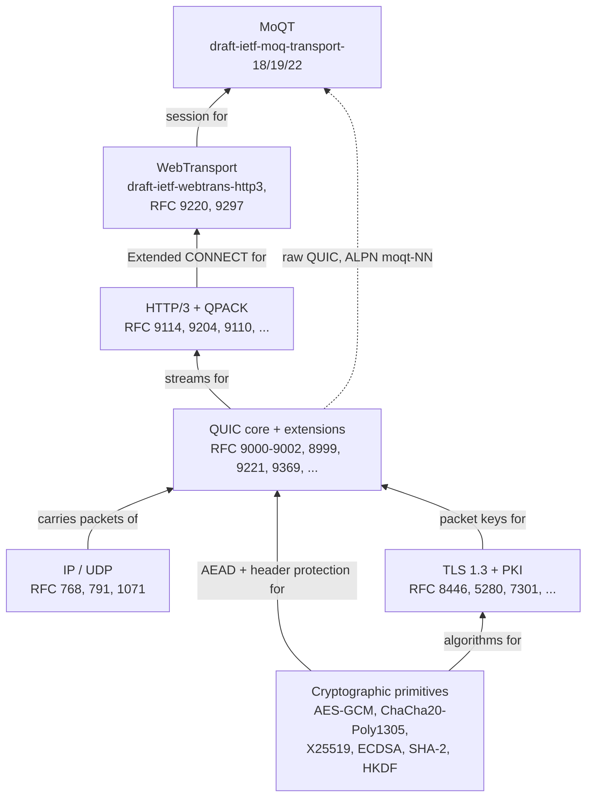

# Implemented Specifications and Why They Matter

[Docs](../README.md) › Architecture › Specifications

This page lists every specification the SDK implements and says, for each
one, why a server needs it. Read it when a code comment cites an RFC or a
draft you do not recognize, or when you want to know which standard a
behavior comes from. It is a lookup table, not a reading list. Specs
that code comments only mention in passing (for example RFC 9525 or RFC
1035) are left out. Every row here has code behind it; a few rows are
helpers not yet wired into the server, and the row says so.

> **At a glance** — eight groups: the QUIC core (4 RFCs), QUIC extensions
> (13), TLS and PKI (16), cryptographic primitives (11), HTTP/3 and QPACK
> (6), WebTransport (4), MoQT (3 drafts), and the IP/UDP foundations (3). Each
> group's intro says why the group exists; each table row says why that one
> spec is needed.

## How the groups stack

No single RFC defines a working QUIC server. QUIC is a transport that runs
over UDP, gets its encryption keys from a TLS 1.3 handshake, and carries
HTTP/3 on top. WebTransport and MoQT then add layers above HTTP/3. Each
layer is its own standard, so a server that answers a browser needs all of
them at once.

The diagram shows which group each group depends on. Read it from the
bottom up. The dashed edge is the one shortcut: MoQT can also run directly
on a QUIC connection, skipping HTTP/3 and WebTransport.

The sections below follow the same groups, from the QUIC core outward, and
end with the IP/UDP foundations.

## QUIC core

QUIC is the transport under HTTP/3. Like TCP it gives reliable, ordered
byte streams, but it runs over UDP, encrypts almost every byte, and carries
many independent streams in one connection. Its minimal core has three
jobs: the transport itself, its encryption, and loss recovery.

RFC 9000 defines the shape of packets and frames and the connection's
states. RFC 9001 ties the TLS 1.3 handshake into QUIC's keys. RFC 9002 adds
the retransmission and congestion control that UDP does not provide. RFC
8999 gathers the few header properties that every QUIC version keeps.

| Spec | Title | Link | Why |
|------|------------|--------|-----------|
| RFC 9000 | QUIC: A UDP-Based Multiplexed and Secure Transport | <https://www.rfc-editor.org/rfc/rfc9000> | Defines the packet and frame formats, streams, and the connection's state transitions. |
| RFC 9001 | Using TLS to Secure QUIC | <https://www.rfc-editor.org/rfc/rfc9001> | Ties the TLS 1.3 handshake into QUIC's key derivation and packet protection. |
| RFC 9002 | QUIC Loss Detection and Congestion Control | <https://www.rfc-editor.org/rfc/rfc9002> | Defines how the sender detects lost packets and controls congestion itself, because UDP does neither. |
| RFC 8999 | Version-Independent Properties of QUIC | <https://www.rfc-editor.org/rfc/rfc8999> | Defines the header properties that are fixed regardless of version, forming the basis for version negotiation. |

The guide's [QUIC header page](https://hakkadaikon.github.io/wired/guide/en/quic/header/)
walks through the packet header these RFCs define.

## QUIC extensions

The core is enough to move bytes, but real clients and networks expect
more. Some clients offer QUIC version 2, and browsers use unreliable
datagrams for WebTransport. Operators need to know what the path can
observe and need logs they can read. A server that sends media needs good
congestion control and the largest packet size the path allows. These
features were standardized after the core, so each one is a separate RFC
or draft.

| Spec | Title | Link | Why |
|------|------------|--------|-----------|
| RFC 9221 | An Unreliable Datagram Extension to QUIC | <https://www.rfc-editor.org/rfc/rfc9221> | Adds the DATAGRAM frame, which trades reliability for low latency. |
| RFC 9287 | Greasing the QUIC Bit | <https://www.rfc-editor.org/rfc/rfc9287> | Greasing the fixed bit; the encode/accept helpers exist and are tested, but the server does not advertise grease_quic_bit yet, so it always sends the bit set. |
| RFC 9368 | Compatible Version Negotiation for QUIC | <https://www.rfc-editor.org/rfc/rfc9368> | Defines the procedure to move to a compatible version without an extra round trip. |
| RFC 9369 | QUIC Version 2 | <https://www.rfc-editor.org/rfc/rfc9369> | A second version to avoid version ossification; the salts and labels differ per version. |
| RFC 9308 | Applicability of the QUIC Transport Protocol | <https://www.rfc-editor.org/rfc/rfc9308> | Operational guidance. Section 5.6 suggests a Retry under load; the server offers this as an operator switch (`force_retry`, off by default) that sends a Retry to every new client. |
| RFC 9312 | Manageability of the QUIC Transport Protocol | <https://www.rfc-editor.org/rfc/rfc9312> | Describes what an on-path observer can see in a QUIC header. The server leaves the spin bit at 0 (RFC 9000 17.4 allows disabling it); the spin-bit helpers exist and are tested but are not wired in. |
| RFC 8899 | Packetization Layer Path MTU Discovery for Datagram Transport Protocols | <https://www.rfc-editor.org/rfc/rfc8899> | Discovers the MTU of a datagram path without relying on ICMP. |
| RFC 9438 | CUBIC for Fast and Long-Distance Networks | <https://www.rfc-editor.org/rfc/rfc9438> | The default congestion-control algorithm, growing the window as a cubic function of time since the last loss. |
| RFC 9406 | HyStart++: Modified Slow Start for TCP | <https://www.rfc-editor.org/rfc/rfc9406> | Exits slow start on a round-trip-time signal instead of only on loss, avoiding a large overshoot. |
| draft-cardwell-iccrg-bbr-congestion-control | BBR Congestion Control | <https://datatracker.ietf.org/doc/draft-cardwell-iccrg-bbr-congestion-control/> | A selectable alternative to CUBIC that paces sending from a model of bandwidth and round-trip time instead of reacting to loss. |
| RFC 3168 | The Addition of Explicit Congestion Notification (ECN) to IP | <https://www.rfc-editor.org/rfc/rfc3168> | Marks outgoing packets ECT(0) and reads the ECN bits of received ones, so routers can signal congestion without dropping packets. |
| draft-ietf-quic-reliable-stream-reset | QUIC Stream Resets with Partial Delivery | <https://datatracker.ietf.org/doc/draft-ietf-quic-reliable-stream-reset/> | Adds the RESET_STREAM_AT frame, which resets a stream but still delivers its first bytes; WebTransport requires it. |
| RFC 7464 | JavaScript Object Notation (JSON) Text Sequences | <https://www.rfc-editor.org/rfc/rfc7464> | The JSON-SEQ framing of the qlog files the SDK writes for debugging. |

A few terms from the table:

- A **middlebox** is a router, firewall, or NAT between the two ends. When
  a header field never changes, middleboxes start to depend on its value
  and break when it does change. This is called **ossification**, and
  greasing (sending deliberately varied values) prevents it.
- The **MTU** is the largest packet a path carries without splitting it.
  ICMP messages that report it are often filtered, so RFC 8899 probes with
  packets of growing size instead.
- The **fixed bit** is a header bit that RFC 9000 always sets to 1.
- **ECN** uses two bits in the IP header. A sender sets them to ECT(0)
  ("this packet can carry a congestion mark"), and a congested router
  changes them to CE instead of dropping the packet.
- A **salt** and a **label** are constants mixed into key derivation, so
  version 1 and version 2 packets get different keys.
- **qlog** is a JSON log format for QUIC events that tools such as qvis
  can display.
- **Slow start** is the phase where a sender doubles its sending rate each
  round trip until it detects congestion.

## TLS and PKI

QUIC encrypts its packets with keys that come out of a TLS 1.3 handshake
(RFC 8446). Without those keys the server cannot send even its first
encrypted packet, so this group is a precondition for everything above it.

The handshake also has to prove the server is who it claims to be. It does
that with an X.509 certificate: the server sends its certificate and signs
the handshake with the matching private key, and the client checks the
certificate's name and the chain of signatures up to a trusted root. That
is why a server SDK needs the PKI specs (Public Key Infrastructure, the
rules for certificates and their signatures). The SDK parses and generates
certificates, and its client role verifies a chain against a trust store
(`castore_validate_chain`). Two TLS extensions round out the group: SNI
names the host the client wants, and ALPN picks the application protocol
(for example `h3` for HTTP/3) during the handshake.

The server also has to read its own key and certificate from disk. Those files
are usually PEM: base64 text between `-----BEGIN ...-----` lines, wrapping a
DER-encoded private key or certificate. That is why the PEM, base64, and
private-key formats appear in this group, next to the LDAP string-matching
rules that certificate name checks use. The SSLKEYLOGFILE draft is the
debugging hook: it writes the session secrets to a file so Wireshark can
decrypt a capture.

| Spec | Title | Link | Why |
|------|------------|--------|-----------|
| RFC 8446 | The Transport Layer Security (TLS) Protocol Version 1.3 | <https://www.rfc-editor.org/rfc/rfc8446> | Defines the handshake (key exchange and authentication) and the key schedule. |
| RFC 5280 | Internet X.509 Public Key Infrastructure Certificate and CRL Profile | <https://www.rfc-editor.org/rfc/rfc5280> | Defines the certificate syntax and the constraints to honor during verification. |
| RFC 5480 | Elliptic Curve Cryptography Subject Public Key Information | <https://www.rfc-editor.org/rfc/rfc5480> | Defines the representation of elliptic-curve public keys in a certificate. |
| RFC 5758 | Internet X.509 PKI: Additional Algorithms and Identifiers for DSA and ECDSA | <https://www.rfc-editor.org/rfc/rfc5758> | Maps the ECDSA signature-algorithm identifiers onto certificates. |
| RFC 8410 | Algorithm Identifiers for Ed25519, Ed448, X25519, and X448 | <https://www.rfc-editor.org/rfc/rfc8410> | The identifiers for handling Ed25519 and X25519 in certificates and key information. |
| RFC 6066 | Transport Layer Security (TLS) Extensions: Extension Definitions | <https://www.rfc-editor.org/rfc/rfc6066> | Defines several TLS extensions, including SNI, which carries the host name the client wants. |
| RFC 6125 | Representation and Verification of Domain-Based Application Service Identity | <https://www.rfc-editor.org/rfc/rfc6125> | Defines the rules for matching the certificate name against the target host name (obsoleted by RFC 9525; the code follows 6125's CN fallback, which 9525 drops). |
| RFC 7301 | Transport Layer Security (TLS) Application-Layer Protocol Negotiation Extension | <https://www.rfc-editor.org/rfc/rfc7301> | Selects HTTP/3 during the handshake via ALPN. |
| RFC 8017 | PKCS #1: RSA Cryptography Specifications Version 2.2 | <https://www.rfc-editor.org/rfc/rfc8017> | Defines the RSA signature schemes (PKCS #1 v1.5 and RSASSA-PSS) and how to verify them; needed to verify RSA certificates. |
| RFC 7468 | Textual Encodings of PKIX, PKCS, and CMS Structures | <https://www.rfc-editor.org/rfc/rfc7468> | The PEM text format of the certificate and key files the server loads. |
| RFC 4648 | The Base16, Base32, and Base64 Data Encodings | <https://www.rfc-editor.org/rfc/rfc4648> | The base64 decoding inside a PEM block. |
| RFC 5958 | Asymmetric Key Packages | <https://www.rfc-editor.org/rfc/rfc5958> | The PKCS #8 wrapper around a private key file. |
| RFC 5915 | Elliptic Curve Private Key Structure | <https://www.rfc-editor.org/rfc/rfc5915> | The SEC1 structure that holds a P-256 private key, on its own or inside PKCS #8. |
| RFC 5891 | Internationalized Domain Names in Applications (IDNA): Protocol | <https://www.rfc-editor.org/rfc/rfc5891> | Host names are compared in ASCII (A-label, the `xn--...` ASCII form of an internationalized name) form; a non-ASCII name is refused, with no Punycode conversion. Helper only, not yet called by the SNI or certificate checks. |
| RFC 4518 | LDAP: Internationalized String Preparation | <https://www.rfc-editor.org/rfc/rfc4518> | Case-insensitive, space-collapsing comparison of certificate names (ASCII subset only). |
| draft-ietf-tls-keylogfile | The SSLKEYLOGFILE Format for TLS | <https://datatracker.ietf.org/doc/draft-ietf-tls-keylogfile/> | Writes session secrets to a key log file so a packet capture can be decrypted for debugging. |

The guide covers the
[handshake](https://hakkadaikon.github.io/wired/guide/en/tls/handshake/) and
[certificates](https://hakkadaikon.github.io/wired/guide/en/tls/certificates/)
from the point of view of an application built on the SDK.

## Cryptographic primitives

Most servers get these algorithms from a library such as OpenSSL. This SDK
uses no libc and no crypto library, so it implements every algorithm the
handshake and packet protection need itself. Each one comes from its own
standard.

The group holds the building blocks that TLS and QUIC combine. An **AEAD**
(authenticated encryption with associated data) encrypts a packet and
detects any tampering in one step. **HKDF** derives many keys from one
shared secret. **X25519** is the key exchange that creates that secret,
and the signature schemes (ECDSA, Ed25519) prove the server owns its
certificate. Hashes (SHA-2) and HMAC sit under all of them. QUIC calls the
AEAD and header-protection ciphers directly for every packet; TLS only
hands it the keys. None of these
functions knows anything about QUIC, so each is tested on its own against
the standard's published test vectors.

| Spec | Title | Link | Why |
|------|------------|--------|-----------|
| RFC 8439 | ChaCha20 and Poly1305 for IETF Protocols | <https://www.rfc-editor.org/rfc/rfc8439> | An AEAD cipher that stays fast on CPUs without AES hardware instructions. |
| FIPS 197 | Advanced Encryption Standard (AES) | <https://csrc.nist.gov/pubs/fips/197/final> | Defines the AES block cipher that AES-GCM builds on. |
| SP 800-38D | Recommendation for Block Cipher Modes of Operation: GCM and GMAC | <https://csrc.nist.gov/pubs/sp/800/38/d/final> | The GCM mode that turns AES into an AEAD; the default packet-protection scheme. |
| RFC 7748 | Elliptic Curves for Security | <https://www.rfc-editor.org/rfc/rfc7748> | Defines the curve arithmetic for X25519 key exchange; creates the ECDHE shared secret. |
| RFC 8032 | Edwards-Curve Digital Signature Algorithm (EdDSA) | <https://www.rfc-editor.org/rfc/rfc8032> | Ed25519 signing (the server's CertificateVerify and self-signed certificates) and verification (certificate signatures). |
| RFC 6979 | Deterministic Usage of DSA and ECDSA | <https://www.rfc-editor.org/rfc/rfc6979> | Derives the ECDSA nonce deterministically, so a weak random-number generator cannot leak the private key. |
| RFC 6090 | Fundamental Elliptic Curve Cryptography Algorithms | <https://www.rfc-editor.org/rfc/rfc6090> | Defines the basic operations on elliptic curves; the foundation of the P-256 implementation. |
| FIPS 186-4 | Digital Signature Standard (DSS) | <https://csrc.nist.gov/pubs/fips/186/4/final> | The rules and curve parameters for ECDSA P-256 signing and verification. |
| FIPS 180-4 | Secure Hash Standard (SHS) | <https://csrc.nist.gov/pubs/fips/180/4/final> | SHA-256, SHA-384, and SHA-512; the foundation of the handshake transcript and key derivation. |
| FIPS 198-1 | The Keyed-Hash Message Authentication Code (HMAC) | <https://csrc.nist.gov/pubs/fips/198/1/final> | HMAC; the foundation of HKDF and Finished verification. |
| RFC 5869 | HMAC-based Extract-and-Expand Key Derivation Function (HKDF) | <https://www.rfc-editor.org/rfc/rfc5869> | The key-derivation function that drives the whole TLS 1.3 key schedule. |

ECDHE in the RFC 7748 row means the key pair is fresh for each connection,
so a key stolen later cannot decrypt recorded traffic. The guide shows
[X25519](https://hakkadaikon.github.io/wired/guide/en/tls/x25519/) and
[SHA-256](https://hakkadaikon.github.io/wired/guide/en/tls/sha256/) in use.

## HTTP/3 and QPACK

HTTP/3 is HTTP (methods, status codes, headers) mapped onto QUIC streams:
each request gets its own stream, so one slow response does not hold up
the others. RFC 9114 defines that mapping, and RFC 9110 defines the HTTP
meaning that stays the same across HTTP versions.

Headers are compressed, but HTTP/2's compressor (HPACK) cannot be reused as
is. HPACK assumes every header block arrives in order on one connection.
QUIC streams arrive independently, so with HPACK one lost packet would stall
headers on every other stream. This stall is called **head-of-line
blocking**. QPACK (RFC 9204) avoids it by sending the compressor's table
updates on separate streams; each header block states how many updates it
needs (its Required Insert Count) before it can be decoded.

| Spec | Title | Link | Why |
|------|------------|--------|-----------|
| RFC 9114 | HTTP/3 | <https://www.rfc-editor.org/rfc/rfc9114> | Maps HTTP semantics onto frames carried on QUIC streams. |
| RFC 9110 | HTTP Semantics | <https://www.rfc-editor.org/rfc/rfc9110> | The version-independent HTTP semantics such as methods, status, and headers. |
| RFC 9204 | QPACK: Field Compression for HTTP/3 | <https://www.rfc-editor.org/rfc/rfc9204> | Header compression that avoids head-of-line blocking even though streams arrive independently. |
| RFC 7541 | HPACK: Header Compression for HTTP/2 | <https://www.rfc-editor.org/rfc/rfc7541> | Defines the static table, Huffman code, and integer encoding that QPACK reuses. |
| RFC 9218 | Extensible Prioritization Scheme for HTTP | <https://www.rfc-editor.org/rfc/rfc9218> | Defines the mechanism for conveying request priorities. |
| RFC 8941 | Structured Field Values for HTTP | <https://www.rfc-editor.org/rfc/rfc8941> | The header-value syntax of the WebTransport subprotocol offer (`wt-available-protocols`, `wt-protocol`), which selects the MoQT draft, and of the RFC 9218 `Priority` value. |

The guide's [HTTP/3 hello](https://hakkadaikon.github.io/wired/guide/en/h3/hello/)
is the shortest server that uses this group.

## WebTransport

HTTP/3 carries requests and responses. A browser application that wants
its own streams and datagrams to a server, without the request/response
shape, needs one more layer: WebTransport. The browser sends an **Extended
CONNECT** request (an HTTP CONNECT request with a `:protocol`
pseudo-header, from RFC 9220). When the server accepts it, a session opens,
and the streams and datagrams bound to that session belong to the
application. This SDK implements the server side: the session state
machine, the WebTransport capsules, and the error-code mapping. A
**capsule** is a small typed message sent inside the CONNECT request's
stream, used for example to close the session. The guide's
[browser page](https://hakkadaikon.github.io/wired/guide/en/wt/browser/)
drives a live session from a real browser, and the
[session lifecycle page](https://hakkadaikon.github.io/wired/guide/en/wt/session-lifecycle/)
shows how a session closes.

| Spec | Title | Link | Why |
|------|------------|--------|-----------|
| draft-ietf-webtrans-http3 | WebTransport over HTTP/3 | <https://datatracker.ietf.org/doc/html/draft-ietf-webtrans-http3> | The core spec: the session state machine, the WebTransport stream signals, the session-close capsules, and the application error-code mapping; implemented against draft-16 (the version MoQT draft-19 and later reference). |
| RFC 9220 | Bootstrapping WebSockets with HTTP/3 | <https://www.rfc-editor.org/rfc/rfc9220> | Brings Extended CONNECT into HTTP/3; the `:protocol` pseudo-header and SETTINGS_ENABLE_CONNECT_PROTOCOL that session establishment rides on. |
| RFC 9297 | HTTP Datagrams and the Capsule Protocol | <https://www.rfc-editor.org/rfc/rfc9297> | Binds DATAGRAMs to a request stream via SETTINGS_H3_DATAGRAM and defines the generic capsule envelope the WebTransport capsules are layered on. |
| RFC 3629 | UTF-8, a transformation format of ISO 10646 | <https://www.rfc-editor.org/rfc/rfc3629> | Validates the UTF-8 close reason in a session-close capsule and truncates it only on a character boundary. |

WebTransport is still an Internet-Draft, so the version matters. The
implementation targets draft-16, the version MoQT draft-19 and draft-22
cite (MoQT draft-18 still cites draft-15). The requirement ledger
([draft-webtrans-http3](../features/draft-webtrans-http3.md)) is extracted
from draft-16 too.

### Why code comments cite draft-15

Code comments cite draft-15 far more often than draft-16. The code was
first written against draft-15. When the target moved to draft-16, only the
sections that changed were reimplemented and re-cited: flow control
(initial SETTINGS, WT_MAX_STREAMS, WT_MAX_DATA), session establishment
checks (Section 3.2), session-close validation (Section 6), and the error
codes (Section 9.5). Sections that read the same in both drafts kept their
draft-15 citation.

### Why several enable settings are sent

A client opens WebTransport only if the server's HTTP/3 SETTINGS contain a
setting ID the client knows, and different clients look for different IDs.
So the server sends three generations at once. SETTINGS_WT_ENABLED
(`H3_SETTINGS_WT_ENABLED`, numeric setting ID 0x2c7cf000, the same in
draft-15 and draft-16) is what webtransport-go requires. Chrome looks for
the older draft-02 and draft-07 settings, so the server sends those too.

## Media over QUIC Transport (MoQT)

WebTransport gives an application raw streams and datagrams, but a live
media service still needs rules on top: how a client announces what it
publishes, how another client subscribes, and how media is cut into
pieces. MoQT defines those rules. Its control messages set up a session
and its subscriptions. Its object model splits a Track into Groups,
Subgroups, and Objects, which a publisher pushes and a hub forwards. The
guide's [hub page](https://hakkadaikon.github.io/wired/guide/en/moqt/hub/)
shows that model in code.

Different clients and browsers implement different MoQT drafts, so the hub
accepts three: draft-18, draft-19, and draft-22. Each session picks one from
the WebTransport subprotocol the peer offers (`moqt-18`, `moqt-19`, or
`moqt-22`). A peer that offers no subprotocol gets draft-19. MoQT can also
run on a raw QUIC connection without HTTP/3; there the ALPN value (for
example `moqt-22`) picks the draft. The code lives under `src/app/moqt/`;
see [Layers](layers.md) for its modules.

Three examples drive it. `examples/moqt_chat` is a live audio, video, and
chat hub over WebTransport. It uses draft-22 when the browser can offer the
`moqt-22` subprotocol through the WebTransport `protocols` option, and
draft-19 otherwise. The guide's MoQT samples run draft-22.
`examples/moqt_interop` offers all three drafts to the moq-interop-runner
clients.

Per-draft differences are listed in the requirement ledgers:
[draft-18](../features/draft-moq-transport-18.md),
[draft-19](../features/draft-moq-transport.md), and
[draft-22](../features/draft-moq-transport-22.md).

| Spec | Title | Link | Why |
|------|------------|--------|-----------|
| draft-ietf-moq-transport-18 | Media over QUIC Transport | <https://datatracker.ietf.org/doc/draft-ietf-moq-transport/18/> | Older draft, negotiated via `moqt-18`. Wire-compatible with draft-19 except for a few control-message details. |
| draft-ietf-moq-transport-19 | Media over QUIC Transport | <https://datatracker.ietf.org/doc/draft-ietf-moq-transport/19/> | The core spec for publish/subscribe media over a WebTransport session or raw QUIC; negotiated via `moqt-19`, and the default when the peer offers no subprotocol. Hub-role subset: SETUP, SUBSCRIBE, PUBLISH, FETCH, namespace discovery, with the SUBGROUP_HEADER and OBJECT_DATAGRAM data plane. |
| draft-ietf-moq-transport-22 | Media over QUIC Transport | <https://datatracker.ietf.org/doc/draft-ietf-moq-transport/22/> | Newest draft, negotiated via `moqt-22`. Reworks subscription filters and FETCH. |

## IP and UDP foundations

QUIC packets travel inside UDP datagrams, which travel inside IP packets.
Usually the kernel builds those headers. This SDK can also bypass the
kernel's network stack with AF_XDP (a Linux socket type that hands raw
frames straight to the program). On that path it writes the IPv4 header,
the UDP header, and their checksums itself, so these old RFCs are in scope
too.

| Spec | Title | Link | Why |
|------|------------|--------|-----------|
| RFC 768 | User Datagram Protocol | <https://www.rfc-editor.org/rfc/rfc768> | The UDP header format and checksum that QUIC rides on. |
| RFC 791 | Internet Protocol | <https://www.rfc-editor.org/rfc/rfc791> | The IPv4 header format that carries the UDP datagram. |
| RFC 1071 | Computing the Internet Checksum | <https://www.rfc-editor.org/rfc/rfc1071> | The checksum-computation procedure for IP and UDP. |

---

**Next:** [Test Coverage](../test-coverage.md) — how far each of these
specs is tested. ([all docs](../README.md))
