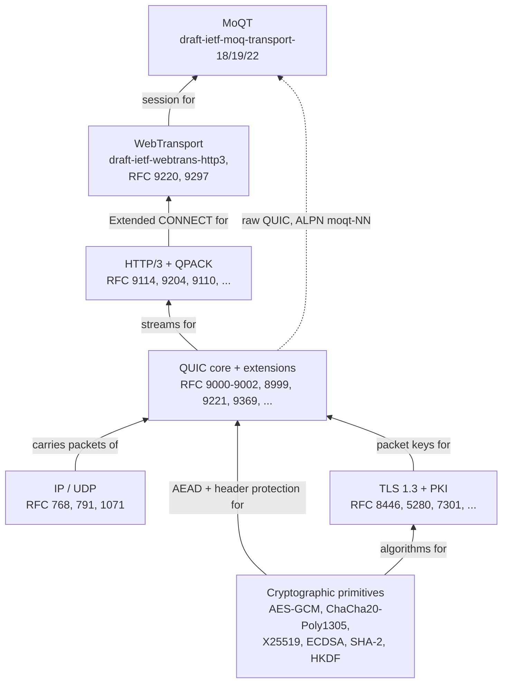

# 実装している仕様とその理由

[Docs](../README.md) › アーキテクチャ › 仕様

このページは、SDK が実装しているすべての仕様を挙げ、それぞれについてサーバーがなぜ必要とするかを説明します。コードのコメントが見覚えのない RFC やドラフトを引いているときや、ある動作がどの規格から来ているかを知りたいときに参照してください。通読するための資料ではなく、引くための一覧表です。コードのコメントで触れるだけの仕様(たとえば RFC 9525 や RFC 1035)は載せていません。ここにある行には、どれも裏付けとなるコードがあります。いくつかの行(主に証明書の検証)は、サーバーがまだ呼び出していないヘルパーで、その行にはそう書いてあります。

> **概要**: 8 つのグループがあります。QUIC のコア(4 本の RFC)、QUIC の拡張(13)、TLS と PKI(16)、暗号プリミティブ(11)、HTTP/3 と QPACK(6)、WebTransport(4)、MoQT(3 本のドラフト)、IP/UDP の基盤(3)です。各グループの導入文でそのグループがある理由を、表の各行でその仕様が必要な理由を説明します。

## グループの積み重なり

動く QUIC サーバーを 1 本の RFC だけで定義することはできません。QUIC は UDP の上で動くトランスポートで、暗号鍵を TLS 1.3 のハンドシェイクから得て、その上に HTTP/3 を載せます。さらに WebTransport と MoQT が HTTP/3 の上に層を足します。層ごとに別の規格なので、ブラウザーに応答するサーバーはそれらすべてを同時に必要とします。

図は、各グループがどのグループに依存するかを示します。下から上へ読んでください。破線の辺が唯一の近道で、MoQT は HTTP/3 と WebTransport を飛ばして QUIC コネクションの上で直接動くこともできます。

以下の節も同じグループに沿って QUIC のコアから外側へ進み、最後に IP/UDP の基盤を扱います。

## QUIC のコア

QUIC は HTTP/3 の下にあるトランスポートです。TCP と同じく信頼性があり順序の保たれたバイトストリームを提供しますが、UDP の上で動き、ほぼすべてのバイトを暗号化し、1 つのコネクションで独立した多数のストリームを運びます。最小限のコアが受け持つ仕事は 3 つで、トランスポートそのもの、その暗号化、損失回復です。

RFC 9000 はパケットとフレームの形、コネクションの状態を定義します。RFC 9001 は TLS 1.3 のハンドシェイクを QUIC の鍵に結び付けます。RFC 9002 は UDP にない再送と輻輳制御を加えます。RFC 8999 はどの QUIC バージョンでも変わらない少数のヘッダーの性質をまとめています。

| 仕様 | タイトル | リンク | 理由 |
|------|------------|--------|-----------|
| RFC 9000 | QUIC: UDP ベースの多重化されたセキュアなトランスポート | <https://www.rfc-editor.org/rfc/rfc9000> | パケットとフレームの形式、ストリーム、コネクションの状態遷移を定義する。 |
| RFC 9001 | TLS による QUIC の保護 | <https://www.rfc-editor.org/rfc/rfc9001> | TLS 1.3 のハンドシェイクを QUIC の鍵導出とパケット保護に結び付ける。 |
| RFC 9002 | QUIC の損失検出と輻輳制御 | <https://www.rfc-editor.org/rfc/rfc9002> | UDP はどちらも行わないため、送信側が失われたパケットを自分で検出し、輻輳を自分で制御する方法を定義する。 |
| RFC 8999 | QUIC のバージョンに依存しない性質 | <https://www.rfc-editor.org/rfc/rfc8999> | バージョンによらず固定のヘッダーの性質を定義し、バージョンネゴシエーションの土台になる。 |

ガイドの [QUIC ヘッダーのページ](https://hakkadaikon.github.io/wired/guide/ja/quic/header/)で、これらの RFC が定義するパケットヘッダーを順に説明しています。

## QUIC の拡張

バイトを運ぶだけならコアで足りますが、実際のクライアントやネットワークはそれ以上を求めます。QUIC バージョン 2 を提示するクライアントがあり、ブラウザーは WebTransport で信頼性のないデータグラムを使います。運用者は経路上から何が観測できるかを知る必要があり、読めるログも必要です。メディアを送るサーバーには、良い輻輳制御と、経路が許す最大のパケットサイズが要ります。これらの機能はコアより後に標準化されたため、それぞれが別の RFC やドラフトになっています。

| 仕様 | タイトル | リンク | 理由 |
|------|------------|--------|-----------|
| RFC 9221 | QUIC の信頼性のないデータグラム拡張 | <https://www.rfc-editor.org/rfc/rfc9221> | 信頼性と引き換えに低遅延を得る DATAGRAM フレームを加える。 |
| RFC 9287 | QUIC ビットのグリース | <https://www.rfc-editor.org/rfc/rfc9287> | fixed bit のグリース。エンコードと受理のヘルパーはありテストもあるが、サーバーはまだ grease_quic_bit を通知しないため、常にこのビットを立てて送る。 |
| RFC 9368 | QUIC の互換バージョンネゴシエーション | <https://www.rfc-editor.org/rfc/rfc9368> | 余分なラウンドトリップなしに互換バージョンへ移る手順を定義する。 |
| RFC 9369 | QUIC バージョン 2 | <https://www.rfc-editor.org/rfc/rfc9369> | バージョンの硬直化を避けるための 2 つ目のバージョン。salt と label がバージョンごとに異なる。 |
| RFC 9308 | QUIC トランスポートプロトコルの適用性 | <https://www.rfc-editor.org/rfc/rfc9308> | 運用上の指針。5.6 節は高負荷時に Retry を使うことを提案している。サーバーはこれを運用者向けのスイッチ(`force_retry`、既定はオフ)として提供し、オンにするとすべての新しいクライアントに Retry を送る。 |
| RFC 9312 | QUIC トランスポートプロトコルの管理性 | <https://www.rfc-editor.org/rfc/rfc9312> | 経路上の観測者が QUIC ヘッダーから何を見られるかを説明する。サーバーは spin bit を 0 のままにする(RFC 9000 17.4 は無効化を認めている)。spin bit のヘルパーはありテストもあるが、組み込まれていない。 |
| RFC 8899 | データグラムトランスポートのためのパケット化層パス MTU 探索 | <https://www.rfc-editor.org/rfc/rfc8899> | ICMP に頼らずにデータグラム経路の MTU を探索する。 |
| RFC 9438 | 高速・長距離ネットワークのための CUBIC | <https://www.rfc-editor.org/rfc/rfc9438> | 既定の輻輳制御アルゴリズム。直前の損失からの経過時間の 3 次関数としてウィンドウを広げる。 |
| RFC 9406 | HyStart++: TCP のための修正スロースタート | <https://www.rfc-editor.org/rfc/rfc9406> | 損失だけでなくラウンドトリップ時間のシグナルでもスロースタートを抜け、大きなオーバーシュートを避ける。 |
| draft-cardwell-iccrg-bbr-congestion-control | BBR 輻輳制御 | <https://datatracker.ietf.org/doc/draft-cardwell-iccrg-bbr-congestion-control/> | CUBIC に代えて選べるアルゴリズム。損失に反応する代わりに、帯域とラウンドトリップ時間のモデルから送信ペースを決める。 |
| RFC 3168 | IP への明示的輻輳通知(ECN)の追加 | <https://www.rfc-editor.org/rfc/rfc3168> | 送信パケットに ECT(0) を付け、受信パケットの ECN ビットを読む。これによりルーターはパケットを捨てずに輻輳を知らせられる。 |
| draft-ietf-quic-reliable-stream-reset | 部分配送付きの QUIC ストリームリセット | <https://datatracker.ietf.org/doc/draft-ietf-quic-reliable-stream-reset/> | ストリームをリセットしつつ先頭のバイトは配送する RESET_STREAM_AT フレームを加える。WebTransport が必要とする。 |
| RFC 7464 | JSON テキストシーケンス | <https://www.rfc-editor.org/rfc/rfc7464> | SDK がデバッグ用に書き出す qlog ファイルの JSON-SEQ 形式の区切り方。 |

表に出てくる用語をいくつか説明します。

- **ミドルボックス**は両端のあいだにあるルーター、ファイアウォール、NAT のことです。ヘッダーのフィールドがまったく変わらないと、ミドルボックスはその値に依存するようになり、値が変わったときに動かなくなります。これを**硬直化**(ossification)と呼び、グリース(わざと値を変えて送ること)で防ぎます。
- **MTU** は、経路が分割せずに運べる最大のパケットサイズです。MTU を知らせる ICMP メッセージはフィルターされることが多いため、RFC 8899 は代わりにサイズを大きくしながらパケットを送って探ります。
- **fixed bit** は、RFC 9000 が常に 1 にするヘッダーのビットです。
- **ECN** は IP ヘッダーの 2 ビットを使います。送信側がこれを ECT(0)(「このパケットは輻輳の印を運べる」)にし、輻輳したルーターはパケットを捨てる代わりに CE に書き換えます。
- **salt** と **label** は鍵導出に混ぜる定数で、これによりバージョン 1 とバージョン 2 のパケットは異なる鍵を得ます。
- **qlog** は QUIC のイベントを記録する JSON のログ形式で、qvis などのツールで表示できます。
- **スロースタート**は、送信側が輻輳を検出するまでラウンドトリップごとに送信レートを倍にしていく段階です。

## TLS と PKI

QUIC はパケットを、TLS 1.3 のハンドシェイク(RFC 8446)から得た鍵で暗号化します。この鍵がなければサーバーは最初の暗号化パケットすら送れないため、このグループはその上にあるすべての前提になります。

ハンドシェイクでは、サーバーが名乗ったとおりの相手であることも証明しなければなりません。そのために X.509 証明書を使います。サーバーは証明書を送り、対応する秘密鍵でハンドシェイクに署名し、クライアントは証明書の名前と、信頼されたルートまでの署名の連鎖を確かめます。サーバー SDK が PKI(公開鍵基盤。証明書とその署名に関する規則)の仕様を必要とするのはこのためです。SDK は証明書を解析し、生成します。トラストストアに照らして証明書チェーンを検証する TLS クライアントの役割(`castore_validate_chain`)もありますが、サーバーはまだ使っていないため、下の表で検証に関わる行はヘルパーのみと記しています。このグループには TLS の拡張も 2 つ入ります。SNI はクライアントが求めるホストを名指しし、ALPN はハンドシェイク中にアプリケーションプロトコル(たとえば HTTP/3 なら `h3`)を選びます。

サーバーは自分の鍵と証明書をディスクから読む必要もあります。これらのファイルはふつう PEM 形式で、`-----BEGIN ...-----` の行のあいだにある base64 のテキストが、DER でエンコードされた秘密鍵や証明書を包んでいます。PEM、base64、秘密鍵の形式がこのグループにあるのはこのためで、(まだ組み込まれていない)証明書の名前チェックが使う LDAP の文字列照合の規則も並んでいます。SSLKEYLOGFILE のドラフトはデバッグ用のフックで、セッションのシークレットをファイルに書き出し、Wireshark がキャプチャーを復号できるようにします。

| 仕様 | タイトル | リンク | 理由 |
|------|------------|--------|-----------|
| RFC 8446 | トランスポート層セキュリティ(TLS)プロトコル バージョン 1.3 | <https://www.rfc-editor.org/rfc/rfc8446> | ハンドシェイク(鍵交換と認証)と鍵スケジュールを定義する。 |
| RFC 5280 | インターネット X.509 公開鍵基盤の証明書と CRL のプロファイル | <https://www.rfc-editor.org/rfc/rfc5280> | 証明書の構文と、検証時に守るべき制約を定義する。サーバーは構文を使って証明書を組み立て、解析する。制約はクライアント側だけで使い、まだ組み込まれていない。 |
| RFC 5480 | 楕円曲線暗号の主体公開鍵情報 | <https://www.rfc-editor.org/rfc/rfc5480> | 証明書の中での楕円曲線公開鍵の表し方を定義する。 |
| RFC 5758 | インターネット X.509 PKI: DSA と ECDSA の追加アルゴリズムと識別子 | <https://www.rfc-editor.org/rfc/rfc5758> | ECDSA の署名アルゴリズム識別子を証明書に対応付ける。 |
| RFC 8410 | Ed25519、Ed448、X25519、X448 のアルゴリズム識別子 | <https://www.rfc-editor.org/rfc/rfc8410> | 証明書と鍵情報で Ed25519 と X25519 を扱うための識別子。ヘルパーのみ(クライアント側の検証、まだ組み込まれていない)。 |
| RFC 6066 | トランスポート層セキュリティ(TLS)拡張: 拡張の定義 | <https://www.rfc-editor.org/rfc/rfc6066> | いくつかの TLS 拡張を定義する。その中の SNI は、クライアントが求めるホスト名を運ぶ。 |
| RFC 6125 | ドメインベースのアプリケーションサービス識別子の表現と検証 | <https://www.rfc-editor.org/rfc/rfc6125> | 証明書の名前を接続先のホスト名と照合する規則を定義する(RFC 9525 により廃止。コードは 6125 の CN へのフォールバックに従っており、9525 ではこれがなくなっている)。ヘルパーのみ(クライアント側の検証、まだ組み込まれていない)。 |
| RFC 7301 | トランスポート層セキュリティ(TLS)アプリケーション層プロトコルネゴシエーション拡張 | <https://www.rfc-editor.org/rfc/rfc7301> | ハンドシェイク中に ALPN で HTTP/3 を選ぶ。 |
| RFC 8017 | PKCS #1: RSA 暗号仕様 バージョン 2.2 | <https://www.rfc-editor.org/rfc/rfc8017> | RSA の署名方式(PKCS #1 v1.5 と RSASSA-PSS)とその検証方法を定義する。RSA 証明書の検証に必要。ヘルパーのみ(クライアント側の検証、まだ組み込まれていない)。 |
| RFC 7468 | PKIX、PKCS、CMS の構造のテキストエンコーディング | <https://www.rfc-editor.org/rfc/rfc7468> | サーバーが読み込む証明書と鍵のファイルの PEM テキスト形式。 |
| RFC 4648 | Base16、Base32、Base64 のデータエンコーディング | <https://www.rfc-editor.org/rfc/rfc4648> | PEM ブロックの中の base64 のデコード。 |
| RFC 5958 | 非対称鍵パッケージ | <https://www.rfc-editor.org/rfc/rfc5958> | 秘密鍵ファイルを包む PKCS #8 の形式。 |
| RFC 5915 | 楕円曲線秘密鍵の構造 | <https://www.rfc-editor.org/rfc/rfc5915> | P-256 の秘密鍵を単体で、または PKCS #8 の中で保持する SEC1 の構造。 |
| RFC 5891 | アプリケーションにおける国際化ドメイン名(IDNA): プロトコル | <https://www.rfc-editor.org/rfc/rfc5891> | ホスト名を A-label(国際化された名前の `xn--...` という ASCII 形式)として比較する。非 ASCII の名前は拒否し、Punycode への変換はしない。ヘルパーのみで、SNI や証明書のチェックからはまだ呼ばれていない。 |
| RFC 4518 | LDAP: 国際化された文字列の準備 | <https://www.rfc-editor.org/rfc/rfc4518> | 大文字小文字を区別せず、空白をまとめて証明書の名前を比較する(ASCII の範囲のみ)。ヘルパーのみ(クライアント側の検証、まだ組み込まれていない)。 |
| draft-ietf-tls-keylogfile | TLS の SSLKEYLOGFILE 形式 | <https://datatracker.ietf.org/doc/draft-ietf-tls-keylogfile/> | セッションのシークレットをキーログファイルに書き出し、デバッグのためにパケットキャプチャーを復号できるようにする。 |

ガイドでは SDK の上に作るアプリケーションの視点から、[ハンドシェイク](https://hakkadaikon.github.io/wired/guide/ja/tls/handshake/)と[証明書](https://hakkadaikon.github.io/wired/guide/ja/tls/certificates/)を説明しています。

## 暗号プリミティブ

たいていのサーバーはこれらのアルゴリズムを OpenSSL などのライブラリから得ます。この SDK は libc も暗号ライブラリも使わないため、ハンドシェイクとパケット保護に必要なアルゴリズムをすべて自前で実装しています。それぞれが別の規格に基づいています。

このグループには、TLS と QUIC が組み合わせて使う部品が入っています。**AEAD**(関連データ付き認証付き暗号)は、パケットの暗号化と改ざんの検出を 1 回の処理で済ませます。**HKDF** は 1 つの共有シークレットから多数の鍵を導出します。**X25519** はその共有シークレットを作る鍵交換で、署名方式(ECDSA P-256)はサーバーが自分の証明書の持ち主であることを証明します。その全部の下にハッシュ(SHA-2)と HMAC があります。QUIC は AEAD とヘッダー保護の暗号をパケットごとに直接呼び出し、TLS は鍵を渡すだけです。これらの関数はどれも QUIC について何も知らないため、それぞれ単独で、規格が公開しているテストベクターに照らしてテストしています。

| 仕様 | タイトル | リンク | 理由 |
|------|------------|--------|-----------|
| RFC 8439 | IETF プロトコルのための ChaCha20 と Poly1305 | <https://www.rfc-editor.org/rfc/rfc8439> | AES のハードウェア命令がない CPU でも速さを保つ AEAD 暗号。 |
| FIPS 197 | Advanced Encryption Standard (AES) | <https://csrc.nist.gov/pubs/fips/197/final> | AES-GCM の土台となる AES ブロック暗号を定義する。 |
| SP 800-38D | ブロック暗号の利用モードに関する勧告: GCM と GMAC | <https://csrc.nist.gov/pubs/sp/800/38/d/final> | AES を AEAD にする GCM モード。既定のパケット保護方式。 |
| RFC 7748 | セキュリティのための楕円曲線 | <https://www.rfc-editor.org/rfc/rfc7748> | X25519 鍵交換の曲線演算を定義し、ECDHE の共有シークレットを作る。 |
| RFC 8032 | エドワーズ曲線デジタル署名アルゴリズム(EdDSA) | <https://www.rfc-editor.org/rfc/rfc8032> | Ed25519 の署名と検証。ヘルパーのみ。サーバーは ECDSA P-256 で署名し、Ed25519 の CertificateVerify と自己署名証明書のビルダーはまだ呼ばれていない。 |
| RFC 6979 | DSA と ECDSA の決定的な使用法 | <https://www.rfc-editor.org/rfc/rfc6979> | ECDSA の nonce を決定的に導出し、乱数生成器が弱くても秘密鍵が漏れないようにする。 |
| RFC 6090 | 基本的な楕円曲線暗号アルゴリズム | <https://www.rfc-editor.org/rfc/rfc6090> | 楕円曲線上の基本演算を定義する。P-256 実装の土台。 |
| FIPS 186-4 | Digital Signature Standard (DSS) | <https://csrc.nist.gov/pubs/fips/186/4/final> | ECDSA P-256 の署名(サーバーの CertificateVerify と証明書)と検証(クライアント側のみ、まだ組み込まれていない)の規則と曲線パラメーター。 |
| FIPS 180-4 | Secure Hash Standard (SHS) | <https://csrc.nist.gov/pubs/fips/180/4/final> | SHA-256、SHA-384、SHA-512。ハンドシェイクのトランスクリプトと鍵導出の土台。 |
| FIPS 198-1 | The Keyed-Hash Message Authentication Code (HMAC) | <https://csrc.nist.gov/pubs/fips/198/1/final> | HMAC。HKDF と Finished の検証の土台。 |
| RFC 5869 | HMAC ベースの抽出・展開鍵導出関数(HKDF) | <https://www.rfc-editor.org/rfc/rfc5869> | TLS 1.3 の鍵スケジュール全体を動かす鍵導出関数。 |

RFC 7748 の行にある ECDHE は、鍵ペアをコネクションごとに新しく作ることを意味します。そのため、後で鍵が盗まれても、記録された通信は復号できません。ガイドでは [X25519](https://hakkadaikon.github.io/wired/guide/ja/tls/x25519/) と [SHA-256](https://hakkadaikon.github.io/wired/guide/ja/tls/sha256/) の使い方を示しています。

## HTTP/3 と QPACK

HTTP/3 は HTTP(メソッド、ステータスコード、ヘッダー)を QUIC のストリームに対応付けたものです。リクエストごとに専用のストリームを使うため、1 つの応答が遅れても他の応答は待たされません。RFC 9114 がこの対応付けを定義し、RFC 9110 が HTTP のバージョンをまたいで変わらない HTTP の意味を定義します。

ヘッダーは圧縮されますが、HTTP/2 の圧縮方式(HPACK)はそのままでは使えません。HPACK は、すべてのヘッダーブロックが 1 本のコネクション上で順番どおりに届くことを前提にしています。QUIC のストリームは互いに独立して届くため、HPACK では 1 つのパケットが失われると他のすべてのストリームのヘッダーが止まってしまいます。この停止を **head-of-line blocking** と呼びます。QPACK(RFC 9204)は圧縮テーブルの更新を別のストリームで送ることでこれを避けます。各ヘッダーブロックはデコードできるようになるまでに必要な更新の数(Required Insert Count)を示します。

| 仕様 | タイトル | リンク | 理由 |
|------|------------|--------|-----------|
| RFC 9114 | HTTP/3 | <https://www.rfc-editor.org/rfc/rfc9114> | HTTP のセマンティクスを、QUIC ストリーム上を運ばれるフレームに対応付ける。 |
| RFC 9110 | HTTP セマンティクス | <https://www.rfc-editor.org/rfc/rfc9110> | メソッド、ステータス、ヘッダーなど、バージョンに依存しない HTTP のセマンティクス。 |
| RFC 9204 | QPACK: HTTP/3 のフィールド圧縮 | <https://www.rfc-editor.org/rfc/rfc9204> | ストリームが独立して届いても head-of-line blocking を起こさないヘッダー圧縮。 |
| RFC 7541 | HPACK: HTTP/2 のヘッダー圧縮 | <https://www.rfc-editor.org/rfc/rfc7541> | QPACK が再利用する静的テーブル、ハフマン符号、整数エンコーディングを定義する。 |
| RFC 9218 | HTTP の拡張可能な優先度付け方式 | <https://www.rfc-editor.org/rfc/rfc9218> | リクエストの優先度を伝える仕組みを定義する。 |
| RFC 8941 | HTTP の構造化フィールド値 | <https://www.rfc-editor.org/rfc/rfc8941> | MoQT のドラフトを選ぶ WebTransport サブプロトコルの提示(`wt-available-protocols`、`wt-protocol`)と、RFC 9218 の `Priority` の値に使うヘッダー値の構文。 |

ガイドの [HTTP/3 hello](https://hakkadaikon.github.io/wired/guide/ja/h3/hello/) が、このグループを使う最も短いサーバーです。

## WebTransport

HTTP/3 はリクエストと応答を運びます。ブラウザーのアプリケーションが、リクエストと応答の形にとらわれずにサーバーとのあいだで独自のストリームやデータグラムを使いたいなら、もう 1 つ層が必要です。それが WebTransport です。ブラウザーは **Extended CONNECT** リクエスト(`:protocol` 疑似ヘッダーを付けた HTTP の CONNECT リクエスト。RFC 9220 で導入)を送ります。サーバーがこれを受け入れるとセッションが開き、そのセッションに結び付いたストリームとデータグラムはアプリケーションのものになります。この SDK はサーバー側を実装しています。具体的には、セッションの状態機械、WebTransport のカプセル、エラーコードの対応付けです。**カプセル**は CONNECT リクエストのストリームの中で送る型付きの小さなメッセージで、たとえばセッションを閉じるときに使います。ガイドの[ブラウザーのページ](https://hakkadaikon.github.io/wired/guide/ja/wt/browser/)では本物のブラウザーから実際のセッションを動かし、[セッションのライフサイクルのページ](https://hakkadaikon.github.io/wired/guide/ja/wt/session-lifecycle/)ではセッションの閉じ方を示しています。

| 仕様 | タイトル | リンク | 理由 |
|------|------------|--------|-----------|
| draft-ietf-webtrans-http3 | HTTP/3 上の WebTransport | <https://datatracker.ietf.org/doc/html/draft-ietf-webtrans-http3> | 中核の仕様。セッションの状態機械、WebTransport ストリームのシグナル、セッションを閉じるカプセル、アプリケーションのエラーコードの対応付けを定める。draft-16(MoQT draft-19 以降が参照する版)に合わせて実装している。 |
| RFC 9220 | HTTP/3 による WebSocket のブートストラップ | <https://www.rfc-editor.org/rfc/rfc9220> | Extended CONNECT を HTTP/3 に持ち込む。セッションの確立が依存する `:protocol` 疑似ヘッダーと SETTINGS_ENABLE_CONNECT_PROTOCOL。 |
| RFC 9297 | HTTP データグラムとカプセルプロトコル | <https://www.rfc-editor.org/rfc/rfc9297> | SETTINGS_H3_DATAGRAM で DATAGRAM をリクエストストリームに結び付け、WebTransport のカプセルが載る汎用のカプセルの外枠を定義する。 |
| RFC 3629 | UTF-8: ISO 10646 の変換形式 | <https://www.rfc-editor.org/rfc/rfc3629> | セッションを閉じるカプセルにある UTF-8 の終了理由を検証し、切り詰めるときは文字の境目でだけ切る。 |

WebTransport はまだ Internet-Draft なので、版が重要です。実装は draft-16 を対象にしています。MoQT draft-19 と draft-22 が引用している版です(MoQT draft-18 はまだ draft-15 を引用しています)。要件台帳([draft-webtrans-http3](../features/draft-webtrans-http3.md))も draft-16 から抽出しています。

### コードのコメントが draft-15 を引用している理由

コードのコメントでは、draft-16 よりも draft-15 の引用のほうがはるかに多くなっています。コードは最初に draft-15 に合わせて書かれました。対象を draft-16 に移したとき、変わった節だけを実装し直して引用も改めました。フロー制御(初期 SETTINGS、WT_MAX_STREAMS、WT_MAX_DATA)、セッション確立時のチェック(3.2 節)、セッションを閉じるときの検証(6 節)、エラーコード(9.5 節)です。両方のドラフトで内容が同じ節は、draft-15 の引用のままです。

### 有効化の設定を複数送る理由

クライアントが WebTransport を開くのは、サーバーの HTTP/3 SETTINGS に自分の知っている設定 ID が含まれているときだけで、クライアントによって探す ID が違います。そのため、サーバーは 3 世代の設定を同時に送ります。SETTINGS_WT_ENABLED(`H3_SETTINGS_WT_ENABLED`、設定 ID の数値は 0x2c7cf000 で draft-15 と draft-16 で同じ)は webtransport-go が必要とするものです。Chrome は古い draft-02 と draft-07 の設定を探すので、サーバーはそれらも送ります。

## Media over QUIC Transport (MoQT)

WebTransport はアプリケーションに生のストリームとデータグラムを提供しますが、ライブメディアのサービスにはその上の規則がまだ必要です。クライアントが何を配信するかを告知する方法、別のクライアントがそれを購読する方法、メディアを区切る方法です。MoQT がこれらの規則を定めます。制御メッセージでセッションとその購読を確立します。オブジェクトモデルは Track を Group、Subgroup、Object に分け、パブリッシャーがそれを送り出し、ハブが転送します。ガイドの[ハブのページ](https://hakkadaikon.github.io/wired/guide/ja/moqt/hub/)で、このモデルをコードで示しています。

クライアントやブラウザーによって実装している MoQT のドラフトが違うため、ハブは draft-18、draft-19、draft-22 の 3 つを受け付けます。各セッションは、相手が提示する WebTransport サブプロトコル(`moqt-18`、`moqt-19`、`moqt-22`)から 1 つを選びます。サブプロトコルを提示しない相手には draft-19 を使います。MoQT は HTTP/3 を使わずに生の QUIC コネクション上で動くこともでき、その場合は ALPN の値(たとえば `moqt-22`)でドラフトを選びます。コードは `src/app/moqt/` にあります。そのモジュールについては [Layers](layers.md) を参照してください。

これを使う例は 3 つあります。`examples/moqt_chat` は、WebTransport 上で音声、映像、チャットを扱うライブのハブです。ブラウザーが WebTransport の `protocols` オプションで `moqt-22` サブプロトコルを提示できるときは draft-22 を、できないときは draft-19 を使います。ガイドの MoQT のサンプルは draft-22 で動きます。`examples/moqt_interop` は、moq-interop-runner のクライアントに 3 つのドラフトすべてを提示します。

ドラフトごとの違いは要件台帳に載っています。[draft-18](../features/draft-moq-transport-18.md)、[draft-19](../features/draft-moq-transport.md)、[draft-22](../features/draft-moq-transport-22.md) です。

| 仕様 | タイトル | リンク | 理由 |
|------|------------|--------|-----------|
| draft-ietf-moq-transport-18 | Media over QUIC Transport | <https://datatracker.ietf.org/doc/draft-ietf-moq-transport/18/> | 古いドラフトで、`moqt-18` でネゴシエーションする。いくつかの制御メッセージの細部を除けば、ワイヤー上では draft-19 と互換。 |
| draft-ietf-moq-transport-19 | Media over QUIC Transport | <https://datatracker.ietf.org/doc/draft-ietf-moq-transport/19/> | WebTransport セッションまたは生の QUIC 上での、パブリッシュ/サブスクライブ型メディアの中核の仕様。`moqt-19` でネゴシエーションし、相手がサブプロトコルを提示しないときの既定。ハブの役割に絞った部分集合: SETUP、SUBSCRIBE、PUBLISH、FETCH、名前空間の探索と、SUBGROUP_HEADER と OBJECT_DATAGRAM のデータプレーン。 |
| draft-ietf-moq-transport-22 | Media over QUIC Transport | <https://datatracker.ietf.org/doc/draft-ietf-moq-transport/22/> | 最新のドラフトで、`moqt-22` でネゴシエーションする。購読のフィルターと FETCH を作り直している。 |

## IP と UDP の基盤

QUIC のパケットは UDP データグラムの中を、UDP データグラムは IP パケットの中を運ばれます。ふつうはカーネルがこれらのヘッダーを組み立てます。この SDK は AF_XDP(生のフレームをプログラムへ直接渡す Linux のソケット種別)でカーネルのネットワークスタックを迂回することもできます。その経路では IPv4 ヘッダー、UDP ヘッダー、それらのチェックサムを自分で書くため、これらの古い RFC も対象に入ります。

| 仕様 | タイトル | リンク | 理由 |
|------|------------|--------|-----------|
| RFC 768 | ユーザーデータグラムプロトコル | <https://www.rfc-editor.org/rfc/rfc768> | QUIC が載る UDP のヘッダー形式とチェックサム。 |
| RFC 791 | インターネットプロトコル | <https://www.rfc-editor.org/rfc/rfc791> | UDP データグラムを運ぶ IPv4 のヘッダー形式。 |
| RFC 1071 | インターネットチェックサムの計算 | <https://www.rfc-editor.org/rfc/rfc1071> | IP と UDP のチェックサムの計算手順。 |

---

**次へ:** [テストカバレッジ](../test-coverage.md)。これらの仕様それぞれがどこまでテストされているかを説明します。([すべてのドキュメント](../README.md))
