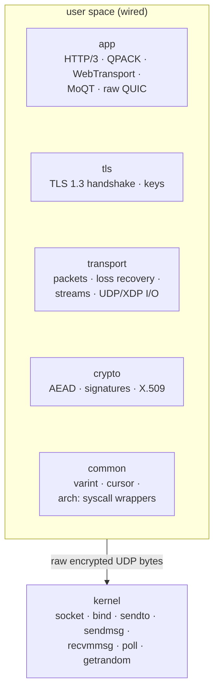
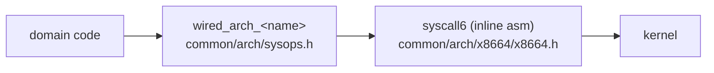
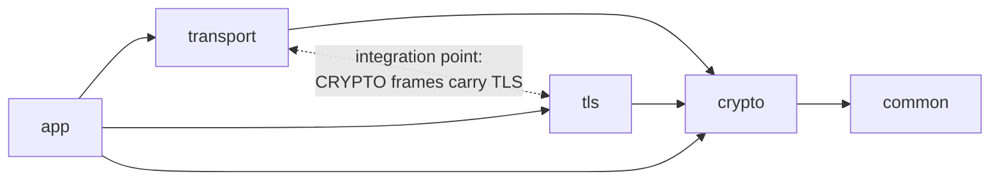

# 基本設計

[ドキュメント](../README.md) › 基本設計

| 項目 | 内容 |
|---|---|
| 目的 | SDK の全体構成、カーネルとの境界、層の依存を示す |
| 読む人 | SDK を変更・デバッグするコントリビューター |
| 前提文書 | [概要書](../overview/README.md) |
| 関連文書 | [詳細設計](../design/README.md)、[システムコール](../syscalls.md) |

## 1. 文書の構成

| 文書 | 中身 |
|---|---|
| この文書 | カーネルとの境界、5 つの層と依存 |
| [データの流れ](dataflow.md) | HTTP/3 の GET 1 件が層を通る流れ、暗号処理の順序 |
| [I/O ドライバー](io-drivers.md) | データグラムの受け取り方、ドライバーの選択、待ち方 |
| [暗号化レベルと鍵](keys.md) | ハンドシェイク、暗号化レベル、鍵を捨てる時点 |
| [メモリ配置とサイズ](memory.md) | テーブルの配置、定数ごとのメモリ量 |

## 2. カーネルとの境界

カーネルが運ぶのは暗号化済みの UDP のバイト列だけである。パケット、鍵、再送、HTTP/3 の処理は、すべて SDK の 5 つの層がユーザー空間で行う。UDP には信頼性も順序も暗号化もないので、TCP ではカーネルが持つこれらの処理をユーザー空間に置ける。

箱は積み重ねの順序だけを示す。層の依存は [3 章](#3-5-つの層) にある。transport の XDP は [I/O ドライバー](io-drivers.md) で扱う。

### 2.1 システムコールの経路

SDK は libc なしでビルドするので、システムコールをすべて自分で発行する。カーネルとの接点を小さくして監査しやすくするため、その処理は `src/common/arch/` の 1 か所にまとめる。

- ドメインのコードは `common/arch/sysops.h` の型付きラッパー `wired_arch_<name>`(`wired_arch_sendto`、`wired_arch_recvmmsg` など)を呼ぶ。システムコール番号やアセンブリは書かない。
- ラッパーは `common/arch/x8664/x8664.h` のインラインアセンブリ関数 `syscall6` だけを呼ぶ。
- スレッド開始のトランポリン、シグナルからの復帰スタブ、`_start` エントリポイントの 3 つは、`syscall6` を通さないアセンブリのスタブである。新しいスレッドのスタック上、カーネルが用意したフレーム上、C のスタックを準備する前で動くので、C の関数呼び出しが使えない。これらも `common/arch/x8664/` に置く。

送受信のループが使うシステムコールは、UDP の送受信、ソケットの準備、`poll`、`getrandom` である。全一覧と各呼び出しの理由は [システムコール](../syscalls.md) にある。

パケットの組み立て、暗号化、TLS ハンドシェイク、損失回復、輻輳制御、ストリームの多重化、HTTP/3 と QPACK、X.509 証明書の検証、暗号関数はユーザー空間に残る。

`-ffreestanding -nostdlib` でコンパイルできることが、libc への隠れた依存がない証拠になる。カーネルとの接点が `common/arch/` に閉じるので、それ以外のコードはバイト列の変換だけである。

## 3. 5 つの層

| 層 | ディレクトリ | 担当 |
|---|---|---|
| app | `src/app/` | HTTP/3、QPACK、WebTransport、MoQT、raw QUIC、データグラム |
| tls | `src/tls/` | TLS 1.3 ハンドシェイク、鍵スケジュール、トランスポートパラメーター |
| transport | `src/transport/` | パケット、保護、損失回復、ストリーム、UDP/XDP I/O |
| crypto | `src/crypto/` | AEAD、ハッシュ、署名、鍵導出、X.509 |
| common | `src/common/` | varint、バイトカーソル、`arch/` のシステムコールラッパー、乱数 |

app 層のディレクトリは次のとおりである。

| ディレクトリ | 担当 |
|---|---|
| `http3/`、`qpack/` | HTTP/3 のフレーム、リクエストの状態機械、QPACK によるヘッダー圧縮 |
| `webtransport/` | HTTP/3 の Extended CONNECT 上の WebTransport セッション |
| `moqt/` | MoQT。`moqt/qraw/` は WebTransport を使わず、QUIC の接続上で直接 MoQT を動かす |
| `rawquic/` | HTTP/3 を使わない raw QUIC の接続を WebTransport の接続と見分けるヘルパー |
| `media/` | パブリッシャー向けの fragmented MP4 の分割 |
| `datagram/` | QUIC の DATAGRAM フレーム(RFC 9221)とその配送 |

### 3.1 層の依存

依存はおおむね下向きで、例外が 3 つある。図は主な依存だけを描く。すべての層が使う common への矢印は省く。

| 例外 | 内容 | 理由 |
|---|---|---|
| transport と tls が互いをインクルードする | QUIC と TLS の統合点 | QUIC のハンドシェイクは TLS のメッセージを CRYPTO フレームで運び、CRYPTO フレームは QUIC のパケットで運ぶ。tls が鍵を作り、その鍵で保護するバイト列を transport が運ぶ。依存を下向きにそろえると、この統合を途中で分けることになる |
| crypto が tls の型を再利用する | 鍵セットの型に含まれる Initial 鍵の型、ハンドシェイクメッセージの定数、署名アルゴリズムの定数 | crypto のコードが署名・検証する TLS のデータを表す型なので、TLS 側に置く |
| tls と transport が app のヘッダーをインクルードする | `app/datagram/` の DATAGRAM の定数。TLS クライアントはサーバーの送受信用ヘルパー `srvwire` を再利用する | 既存のコードを下の層にコピーせずに再利用する |

common は最下層で、何にも依存しない。すべての層が common の varint エンコードとバイトカーソルを共有する。小さな共有ヘルパーは `inline` 関数として common に置く。ユニティビルドでは同じ名前の `static` ヘルパーが 2 つあると衝突するためである([ビルド](../standards/build.md))。
