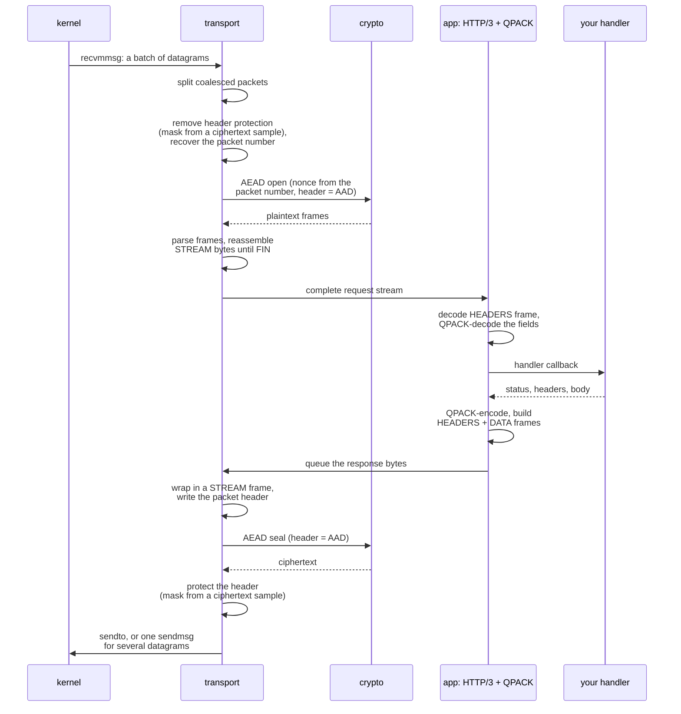

# データの流れ

[ドキュメント](../README.md) › [基本設計](README.md) › データの流れ

| 項目 | 内容 |
|---|---|
| 目的 | ハンドシェイクを終えた接続で、HTTP/3 のリクエスト 1 件が層を通る順序を示す |
| 読む人 | パケットの経路を変更・デバッグするコントリビューター |
| 前提文書 | [基本設計](README.md)、[暗号化レベルと鍵](keys.md) |
| 関連文書 | [I/O ドライバー](io-drivers.md) |

## 1. HTTP/3 の GET 1 件

リクエストが層を上がり、ハンドラーが応答し、レスポンスが層を下りる。

| 処理 | 内容 |
|---|---|
| 結合の分割 | 送信側は複数のパケット(Initial と Handshake など)を 1 つの UDP データグラムに結合できる。受信側はまず分割する(`udploop_split`)。サーバー自身の 1-RTT のレスポンスは 1 データグラムに 1 パケットである |
| AEAD の AAD | AAD はパケットヘッダーである。ヘッダーを書き換えると復号に失敗する |
| ヘッダー保護 | 暗号化のあと、パケット番号といくつかのフラグビットをマスクと XOR する。マスクは暗号文から取った 16 バイトのサンプルを別の鍵で暗号化して作る。ネットワーク上の観測者からパケット番号を隠す |
| パケット番号の復元 | 送信側はパケット番号を下位のバイトだけに縮める。受信側はそれまでに見た最大の番号から完全な番号を復元する |

## 2. 暗号処理の順序

送信側でも受信側でも、順序は入れ替えられない。

| 方向 | 順序 | 理由 |
|---|---|---|
| 送信 | ヘッダーを書く → AEAD で封じる → ヘッダー保護 | AEAD は完成したヘッダーを AAD に使う。ヘッダー保護は暗号文のサンプルを使う |
| 受信 | ヘッダー保護を外す → AEAD で開く | パケット番号はヘッダー保護の下にあり、AEAD の nonce はパケット番号から作る |

## 3. 主なシンボル

| 役割 | シンボル・場所 |
|---|---|
| 1-RTT の受信 | `hspkt_onertt_open_suite`(`src/transport/packet/build/hspkt/`) |
| 1-RTT の送信 | `hspkt_onertt_build_suite`(同上) |
| 暗号スイートの振り分け | `src/transport/packet/protect/` |
| HTTP/3 の入口 | `wired_h3srv_on_request_raw` |
| ハンドラーの呼び出し | `srvrun_call_handler` |
