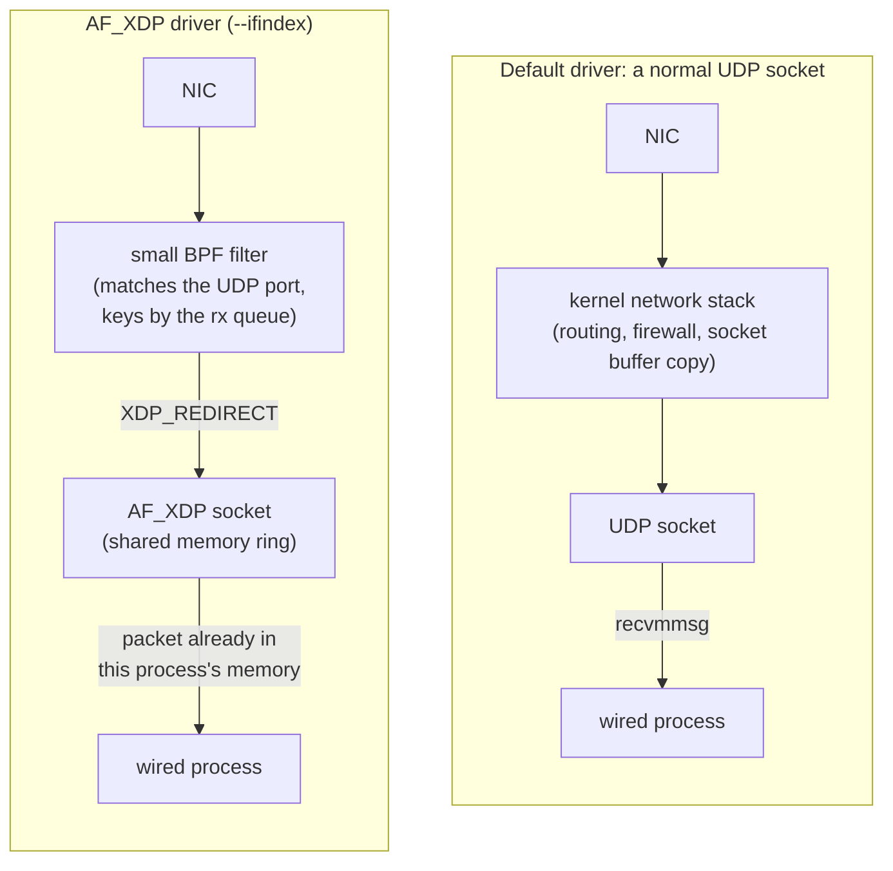
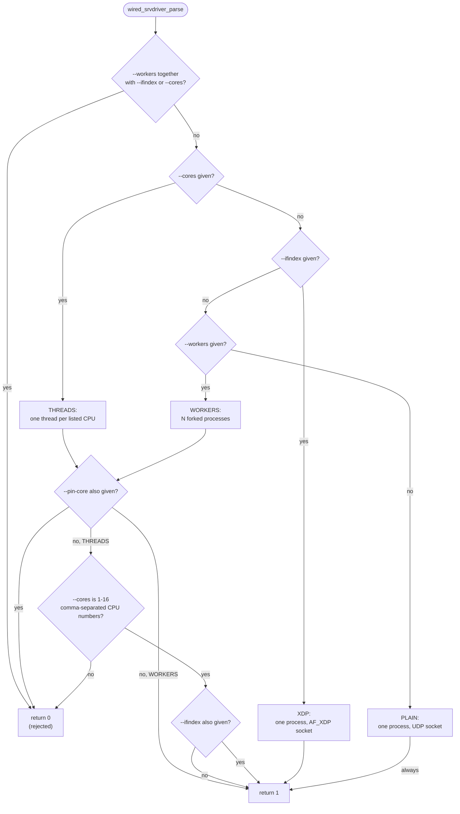
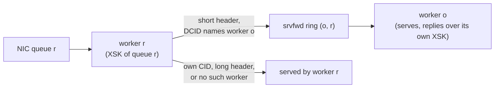
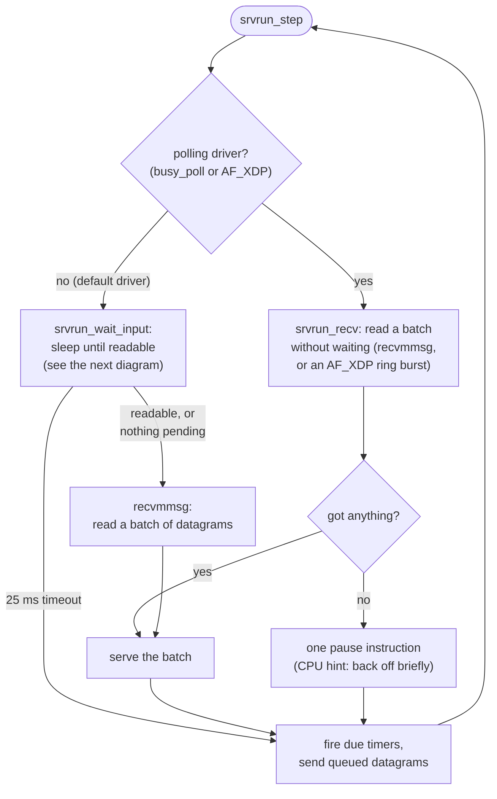
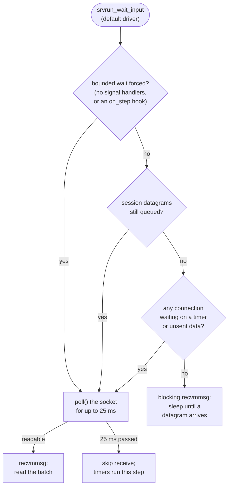

# I/O ドライバー

[ドキュメント](../README.md) › [基本設計](README.md) › I/O ドライバー

| 項目 | 内容 |
|---|---|
| 目的 | データグラムがプロセスに届く経路、ドライバーの選択、次のパケットの待ち方を示す |
| 読む人 | `src/transport/io/` と `src/app/http3/server/srvrun/` の受信ループを変更するコントリビューター |
| 前提文書 | [基本設計](README.md) |
| 関連文書 | [データの流れ](dataflow.md)、[メモリ配置とサイズ](memory.md) |

フラグの使い方は利用者向けのガイド [サーバーのフラグ](https://hakkadaikon.github.io/wired/guide/ja/quic/server-flags/) にある。

## 1. 受信の経路

| 項目 | デフォルトのドライバー | AF_XDP ドライバー |
|---|---|---|
| フラグ | なし | `--ifindex <n>` |
| ソケット | `socket()` と `bind()` で作る UDP ソケット | AF_XDP ソケット(カーネルとプロセスが共有するリングバッファー) |
| パケットごとのカーネルの処理 | ルーティング、ファイアウォールのルール、ソケットの受信バッファーへのコピー | BPF フィルター(`xdpbpf_prog_build`)。通常のスタックより前に動く |
| コピーとスタックの処理 | AF_XDP より多い | 共有のリングなので 2 度目のコピーがない |
| 必要な権限 | なし | `CAP_BPF`、`CAP_NET_ADMIN` |
| 堅牢化 | — | デフォルトの経路より少ない |

BPF フィルターは各パケットに次のどちらかを返す。

| 戻り値 | 対象 | 動作 |
|---|---|---|
| `XDP_REDIRECT` | UDP でサーバーのポート宛て | 受信したキュー(`rx_queue_index`)の AF_XDP ソケットへ移す |
| `XDP_PASS` | それ以外 | 通常のスタックを通す |

`--skb-mode` は、ソフトウェアでエミュレートする generic XDP モードを選ぶ。ネイティブの XDP に対応しない NIC のドライバー向けである。quic-go、quiche、ngtcp2、picoquic は AF_XDP ドライバーを持たず、デフォルトのドライバーと同じ UDP ソケットで動く。

## 2. ドライバーの選択

`wired_srvdriver_parse` は、コマンドラインのフラグを 4 種類のドライバー(`WIRED_SRVDRIVER_*`)のどれかに変換するか、拒否する。I/O の経路(UDP ソケットか AF_XDP か)とプロセス数は別の軸である。

| 種類 | README の呼び名 | フラグ | プロセス | 待ち方 |
|---|---|---|---|---|
| PLAIN | poll | なし | 1 | ブロック(`busy_poll` ならスピン) |
| WORKERS | fork | `--workers N` | N、fork。`SO_REUSEPORT` で 1 つのポートを共有する | ブロック、ワーカーごと |
| THREADS | threads | `--cores a,b,c` | 1、CPU ごとに 1 スレッド | 25 ms の上限付き poll(`--ifindex` ならスピン) |
| XDP | AF_XDP | `--ifindex <n>` | 1 | スピン |

図はチェックの順序と、関数が 0 を返すすべての場合を示す。

- WORKERS と THREADS が `--pin-core` を拒否するのは、それぞれ専用の固定用フラグ(`--pin-cores` と `--control-core`)を持つからである。
- THREADS に `--ifindex` を付けると AF_XDP のマルチキューモードになり、ワーカースレッド *i* が NIC のキュー *i* を担当する。振り分けは 2.2 節。WORKERS(fork)は AF_XDP を使わない(`srvworkers` が `xdp` を 0 にする)。
- CI の `xdp.yml` は、veth のペアの片側を XDP ドライバーの汎用モード(`--skb-mode`)で動かし、もう片側のネットワーク名前空間から quic-go のクライアントで HTTP/3 を送って確かめる(`scripts/xdp_smoke.sh`)。NIC のドライバーモード(ゼロコピー)は試さない。

### 2.1 複数ワーカーのパケットの振り分け(UDP モード)

ワーカーが 2 つ以上のとき、ドライバーはワーカーを起動する前に、ワーカーの数だけ SO_REUSEPORT のソケットをワーカーの順に bind し、そのグループに classic BPF の選択プログラムを付ける(`srvsteer` と `rpsteer`。fork は `srvworkers`、スレッドは `srvthreads` が行う)。各ワーカーは、発行するすべての接続 ID に自分の番号を鍵付きで埋める(`srvrun_issue_cid`)。プログラムは届いたデータグラムの Destination Connection ID からその番号を復号してソケットを選ぶので、サーバーが発行した接続 ID を持つパケットは、NAT のリバインドや移行のあともその接続を持つワーカーに届く(RFC 9000 5.2、9)。

クライアントが選んだ最初の Initial の DCID は、復号してもワーカーの番号の範囲に入らないことが多く、その場合はカーネルのハッシュで選ぶ。どちらの判定も同じバイト列の再送には同じ結果を返すので、ハンドシェイクは 1 つのワーカーで進む。ソケットの確保や取り付けに失敗したとき、ワーカーが 1 つのとき、接続 ID が 5 バイト未満のときは、従来どおりカーネルのハッシュだけで振り分ける。

### 2.2 複数キューのパケットの振り分け(AF_XDP)

カーネルは、XSKMAP へリダイレクトしたフレームを、そのフレームが届いたキューに bind した AF_XDP ソケットにしか渡さない(`net/xdp/xsk.c` の `xsk_rcv_check`)。ほかのキューのソケットを選ぶとフレームは捨てられる。そのため BPF フィルターは常に受信したキューのソケットを選ぶ(`xdpbpf_prog_build`)。

接続の持ち主は利用者空間で決める。各ワーカーは発行する接続 ID に自分の番号を鍵付きで埋める(`srvrun_issue_cid` が `srvrun_route_cid` を呼ぶ)。short header を受けたワーカーは DCID からその番号を復号し、自分以外のワーカーなら転送用のリングに積む(`srvxdp_fwd.c`)。持ち主は次の受信でそれを取り出し、自分のソケットで受けたものとして元の送信元アドレスのまま処理する。そのため移行や NAT のリバインド、RSS の表の変更でキューが変わっても接続は続き、経路の検証(RFC 9000 8.2、9.3)も通常どおり走る。

| 項目 | 内容 |
|---|---|
| リング | 持ち主と受信側の組ごとに 1 つ、計 N×N 個(`srvfwd`)。生産者と消費者が 1 つずつなので CAS もロックも使わない |
| 深さ | 16 データグラム。満杯なら捨てて `drops` を数える。QUIC の再送が補う |
| 運ぶもの | ペイロード、送信元アドレス、相手と自分の MAC、自分の IP。持ち主は相手の MAC を学び、自分のソケットから返信する |
| 取り出しの割合 | 1 回の受信の半分(切り上げ)までを転送分に使い、残りを自分のキューに使う。転送分は行のリングを 1 回ごとにずらした位置から読む |
| long header | 転送しない。ハンドシェイク中は移行できず(RFC 9000 9)、最初の Initial の DCID はクライアントが選ぶ(RFC 9000 7.2) |

## 3. 次のパケットの待ち方

サーバーループ(`srvrun_loop`)は、停止するまで `srvrun_step` を繰り返す。各ステップは、パケットが届くまで眠るか、確認し続けるかを決める。

| 方式 | 対象 | 動作 | CPU 使用率 |
|---|---|---|---|
| ブロック | デフォルトのドライバー | プロセスは眠り、データグラムが届くとカーネルが起こす。パケットごとに起床の遅れがある | 待機中はほぼ 0 |
| スピン | `busy_poll`、AF_XDP | まとめて読み、空なら `pause` 命令(`wired_arch_pause`)を 1 回実行して再び確認する。CPU と引き換えに受信のレイテンシーを下げる | 通信がなくてもポーリングするコアはほぼ 100% |

- `busy_poll` は実行オプション `wired_srvrun_opt.busy_poll` で、word_list のサンプルでは `--busy-poll` で指定する。
- AF_XDP は常にスピンする。スピンループの中で直接リングを読み(`srvrun_recv_xdp`)、`poll()` で眠らない。

### 3.1 デフォルトのドライバーの眠り方

`srvrun_wait_input` が時間制限なしで眠るのは、保留中のものが何もないときだけである。それ以外はタイマーを動かすため最大 25 ms(`SRVRUN_PTO_MS`)だけ待つ。次の図は前の図の `srvrun_wait_input` の箱を展開したものである。

優先アドレスのソケット(RFC 9000 §9.6)があるときは、両方のソケットの受信がノンブロッキングになり、時間制限なしの眠りは使わない。

各分岐で時間制限を強制する理由(`srvrun_bounded_wait_forced`、`srvrun_may_block_unbounded`)は次のとおりである。

| 条件 | 理由 |
|---|---|
| シグナルハンドラーがない | `--cores` のワーカースレッドは SIGTERM をブロックしたままで、シグナルで起こせない。停止に気づけるのはタイムアウトだけである |
| `on_step` フックがある | アプリケーションのステップごとのコールバックは入力でなく時間で動く。アイドルなソケットで止めない |
| セッションのデータグラムがキューにある | 1 ステップで送るのはキューの一部だけで、残りは次のステップで送る |
| 待っている接続がある | 未送信または未確認応答のデータ、閉じかけの接続、未完了のパスの検証は、相手が黙っていてもタイマーを発火させる |
