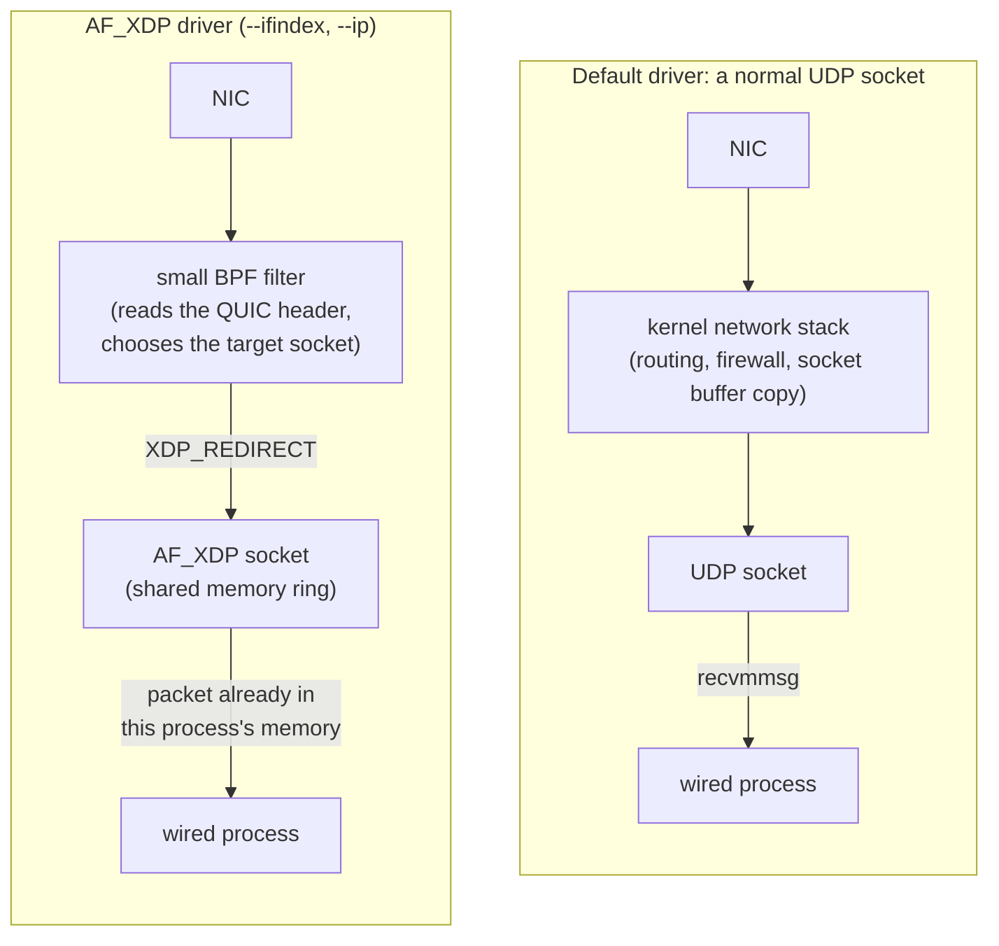
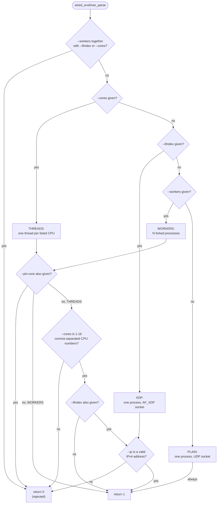
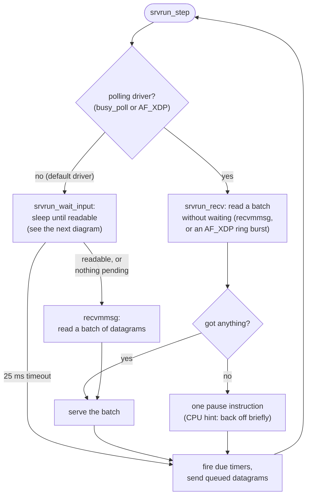
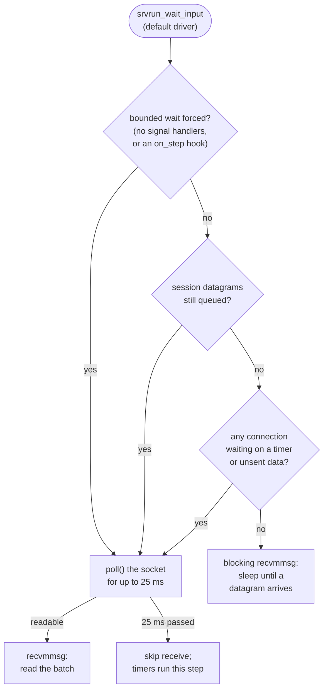

# I/O ドライバー

[ドキュメント](../README.md) › [基本設計](README.md) › I/O ドライバー

| 項目 | 内容 |
|---|---|
| 目的 | データグラムがプロセスに届く経路、ドライバーの選択、次のパケットの待ち方を示す |
| 読む人 | `src/transport/io/` と `src/app/http3/server/srvrun/` の受信ループを変更するコントリビューター |
| 前提文書 | [基本設計](README.md) |
| 関連文書 | [データの流れ](dataflow.md)、[メモリ配置とサイズ](memory.md) |

フラグの使い方は利用者向けのガイド [サーバーのフラグ](https://hakkadaikon.github.io/wired/guide/ja/quic/server-flags/) にある。

## 1. 受信の経路

| 項目 | デフォルトのドライバー | AF_XDP ドライバー |
|---|---|---|
| フラグ | なし | `--ifindex <n> --ip <addr>` |
| ソケット | `socket()` と `bind()` で作る UDP ソケット | AF_XDP ソケット(カーネルとプロセスが共有するリングバッファー) |
| パケットごとのカーネルの処理 | ルーティング、ファイアウォールのルール、ソケットの受信バッファーへのコピー | BPF フィルター(`xdpbpf_prog_build`)。通常のスタックより前に動く |
| コピーとスタックの処理 | AF_XDP より多い | 共有のリングなので 2 度目のコピーがない |
| 必要な権限 | なし | `CAP_BPF`、`CAP_NET_ADMIN` |
| 堅牢化 | — | デフォルトの経路より少ない |

BPF フィルターは各パケットに次のどちらかを返す。

| 戻り値 | 対象 | 動作 |
|---|---|---|
| `XDP_REDIRECT` | UDP でサーバーのポート宛て | QUIC の宛先接続 ID の先頭バイトで宛先のソケットを選び、その AF_XDP ソケットへ移す |
| `XDP_PASS` | それ以外 | 通常のスタックを通す |

`--skb-mode` は、ソフトウェアでエミュレートする generic XDP モードを選ぶ。ネイティブの XDP に対応しない NIC のドライバー向けである。quic-go、quiche、ngtcp2、picoquic は AF_XDP ドライバーを持たず、デフォルトのドライバーと同じ UDP ソケットで動く。

## 2. ドライバーの選択

`wired_srvdriver_parse` は、コマンドラインのフラグを 4 種類のドライバー(`WIRED_SRVDRIVER_*`)のどれかに変換するか、拒否する。I/O の経路(UDP ソケットか AF_XDP か)とプロセス数は別の軸である。

| 種類 | README の呼び名 | フラグ | プロセス | 待ち方 |
|---|---|---|---|---|
| PLAIN | poll | なし | 1 | ブロック(`busy_poll` ならスピン) |
| WORKERS | fork | `--workers N` | N、fork。`SO_REUSEPORT` で 1 つのポートを共有する | ブロック、ワーカーごと |
| THREADS | threads | `--cores a,b,c` | 1、CPU ごとに 1 スレッド | 25 ms の上限付き poll(`--ifindex` ならスピン) |
| XDP | AF_XDP | `--ifindex <n> --ip <addr>` | 1 | スピン |

図はチェックの順序と、関数が 0 を返すすべての場合を示す。

- WORKERS と THREADS が `--pin-core` を拒否するのは、それぞれ専用の固定用フラグ(`--pin-cores` と `--control-core`)を持つからである。
- THREADS に `--ifindex` を付けると AF_XDP のマルチキューモードになり、ワーカースレッド *i* が NIC のキュー *i* を担当する。

### 2.1 WORKERS の既知の制限

`srvworkers.h` の「KNOWN LIMITATION (workers > 1)」のコメントにある制限である。カーネルはアドレスとポートのハッシュでワーカーを選ぶので、1 つの接続のパケットが同じワーカーに届く保証はない。接続 ID で接続をワーカーに留める仕組みはない。ハンドシェイクの途中で振り分けが変わると、次のデータグラムは接続の状態を持たないワーカーに届き、ハンドシェイクがときどき失敗する。

## 3. 次のパケットの待ち方

サーバーループ(`srvrun_loop`)は、停止するまで `srvrun_step` を繰り返す。各ステップは、パケットが届くまで眠るか、確認し続けるかを決める。

| 方式 | 対象 | 動作 | CPU 使用率 |
|---|---|---|---|
| ブロック | デフォルトのドライバー | プロセスは眠り、データグラムが届くとカーネルが起こす。パケットごとに起床の遅れがある | 待機中はほぼ 0 |
| スピン | `busy_poll`、AF_XDP | まとめて読み、空なら `pause` 命令(`wired_arch_pause`)を 1 回実行して再び確認する。CPU と引き換えに受信のレイテンシーを下げる | 通信がなくてもポーリングするコアはほぼ 100% |

- `busy_poll` は実行オプション `wired_srvrun_opt.busy_poll` で、word_list のサンプルでは `--busy-poll` で指定する。
- AF_XDP は常にスピンする。スピンループの中で直接リングを読み(`srvrun_recv_xdp`)、`poll()` で眠らない。

### 3.1 デフォルトのドライバーの眠り方

`srvrun_wait_input` が時間制限なしで眠るのは、保留中のものが何もないときだけである。それ以外はタイマーを動かすため最大 25 ms(`SRVRUN_PTO_MS`)だけ待つ。次の図は前の図の `srvrun_wait_input` の箱を展開したものである。

優先アドレスのソケット(RFC 9000 §9.6)があるときは、両方のソケットの受信がノンブロッキングになり、時間制限なしの眠りは使わない。

各分岐で時間制限を強制する理由(`srvrun_bounded_wait_forced`、`srvrun_may_block_unbounded`)は次のとおりである。

| 条件 | 理由 |
|---|---|
| シグナルハンドラーがない | `--cores` のワーカースレッドは SIGTERM をブロックしたままで、シグナルで起こせない。停止に気づけるのはタイムアウトだけである |
| `on_step` フックがある | アプリケーションのステップごとのコールバックは入力でなく時間で動く。アイドルなソケットで止めない |
| セッションのデータグラムがキューにある | 1 ステップで送るのはキューの一部だけで、残りは次のステップで送る |
| 待っている接続がある | 未送信または未確認応答のデータ、閉じかけの接続、未完了のパスの検証は、相手が黙っていてもタイマーを発火させる |
