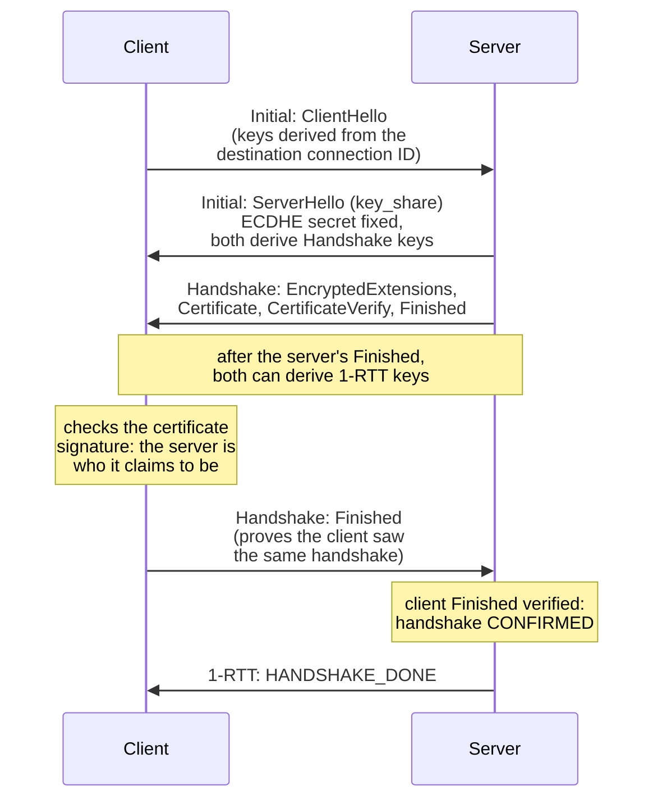

# 暗号化レベルと鍵

[ドキュメント](../README.md) › [基本設計](README.md) › 暗号化レベルと鍵

| 項目 | 内容 |
|---|---|
| 目的 | ハンドシェイクで鍵ができる順序と、サーバーが各暗号化レベルの鍵を捨てる時点を示す |
| 読む人 | ハンドシェイクと鍵の管理を変更するコントリビューター |
| 前提文書 | [基本設計](README.md) |
| 関連文書 | [データの流れ](dataflow.md)、[セキュリティ設計](../security/README.md)、ガイドの [TLS 1.3 ハンドシェイク](https://hakkadaikon.github.io/wired/guide/ja/tls/handshake/)(サーバーの動かし方) |

## 1. ハンドシェイク

QUIC はハンドシェイクに TLS 1.3 を使い、両者は ECDHE で共有の秘密を取り決める。各メッセージはコロンの前の暗号化レベルで送り、各段階が次のレベルの鍵を生む。

- 1-RTT 鍵はサーバーの Finished までのハンドシェイクメッセージから作る。クライアントの Finished は 1-RTT 鍵を生まない。
- CONFIRMED はサーバーのハンドシェイクの最後の段階(`WIRED_SERVER_HS_CONFIRMED`)である。クライアントの Finished を検証したので、サーバーは両者が同じ 1-RTT 鍵を導出したと分かり、クライアントの 1-RTT パケットを受け付け始める。
- HANDSHAKE_DONE は CONFIRMED をクライアントに伝えるフレームである。

## 2. 暗号化レベル

暗号化レベルは Initial、Handshake、1-RTT の 3 つで、再開した接続の早期データには 0-RTT も使える。図はサーバーのレベルと、その途中で捨てるものを示す。

```mermaid
stateDiagram-v2
    [*] --> Initial: ClientHello arrives
    Initial: Initial<br/>keys from the client's<br/>destination connection ID
    Handshake: Handshake<br/>keys from the ECDHE secret
    OneRTT: 1-RTT<br/>application keys
    Initial --> Handshake: server flight built<br/>(FLIGHT_SENT)
    Handshake --> OneRTT: client Finished verified<br/>(CONFIRMED)
    OneRTT --> OneRTT: key update<br/>(old keys dropped after 3 PTO)
    OneRTT --> [*]: connection closed<br/>(slot freed; keys stay<br/>until the slot is reused)
    note right of OneRTT
        At CONFIRMED: 0-RTT keys erased,
        Initial and Handshake sending stops,
        Handshake keys stay in the slot
    end note
```

| 段階 | 定数 | 意味 |
|---|---|---|
| FLIGHT_SENT | `WIRED_SERVER_HS_FLIGHT_SENT` | サーバーのフライト(ServerHello から自分の Finished まで)を組み立て終えた |
| CONFIRMED | `WIRED_SERVER_HS_CONFIRMED` | クライアントの Finished を検証した |

## 3. 鍵を捨てる時点

| 鍵 | 扱い | 関数 |
|---|---|---|
| Initial | 保存しない。クライアントの宛先接続 ID から誰でも導出できるので、Initial パケットを封じる・開くたびに導出し直す | — |
| 0-RTT | CONFIRMED で消去する。そのあとに届いた 0-RTT パケットは復号に失敗し、破棄する | `sdrv_discard_early_keys` |
| Handshake | 接続のスロットに残る(下記) | `srvrun_free_slot`、`srvrun_open_slot` |
| 古い 1-RTT | 鍵更新から 3 PTO 後に捨てる。古い鍵で送った送信中(in flight)のパケットを届かせるため | `srvrun_ku_discard_stale` |

Handshake 鍵は CONFIRMED のあとも、接続が閉じたあとも残る。CONFIRMED のあと、サーバーは Handshake パケットを送らないが、届いた Handshake パケットは開ける。

接続が閉じると `srvrun_free_slot` がスロットを解放し、鍵スケジュールは残す。そのバイト列を上書きするのは、`srvrun_open_slot` がスロットを再利用したときだけである。

`wired_server_close` は `keysched_wipe` で鍵スケジュールを消去するが、サーバーループはこれを呼ばない。RFC 9001 §4.9.2 は確認の時点で Handshake 鍵を捨てることを要求する(MUST)。サーバーはこれをまだ満たしていない。

## 4. 0.5-RTT

サーバーは自分のフライトを送り終えれば、CONFIRMED の前でも 1-RTT のデータを送れる(`wired_server_early_send_keys`)。フライトのあと、クライアントの Finished が届く前の送信で、半往復早い。
