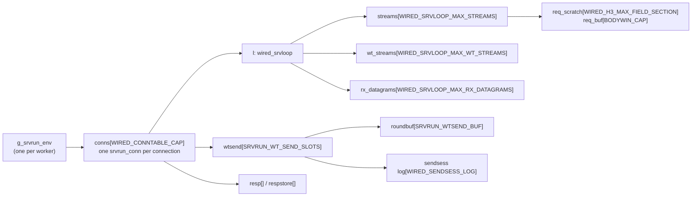
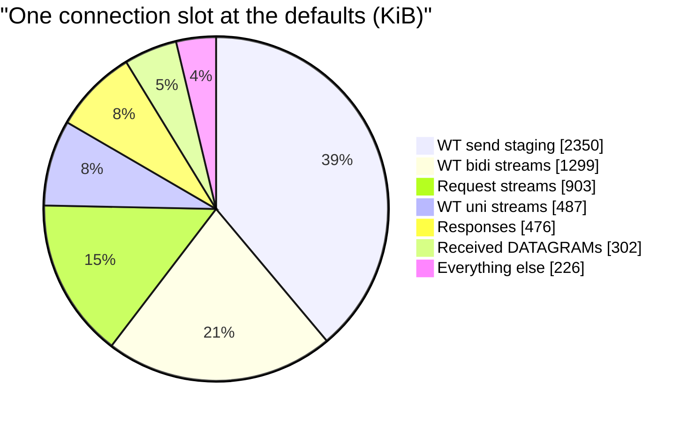
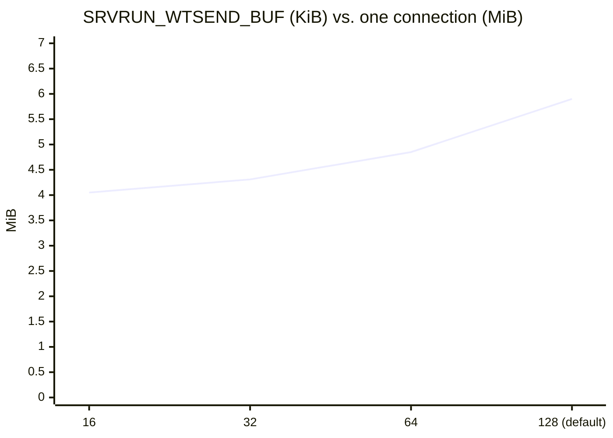
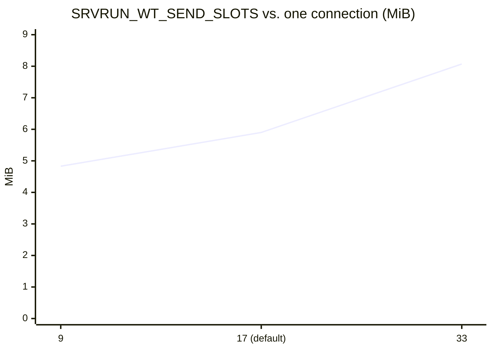
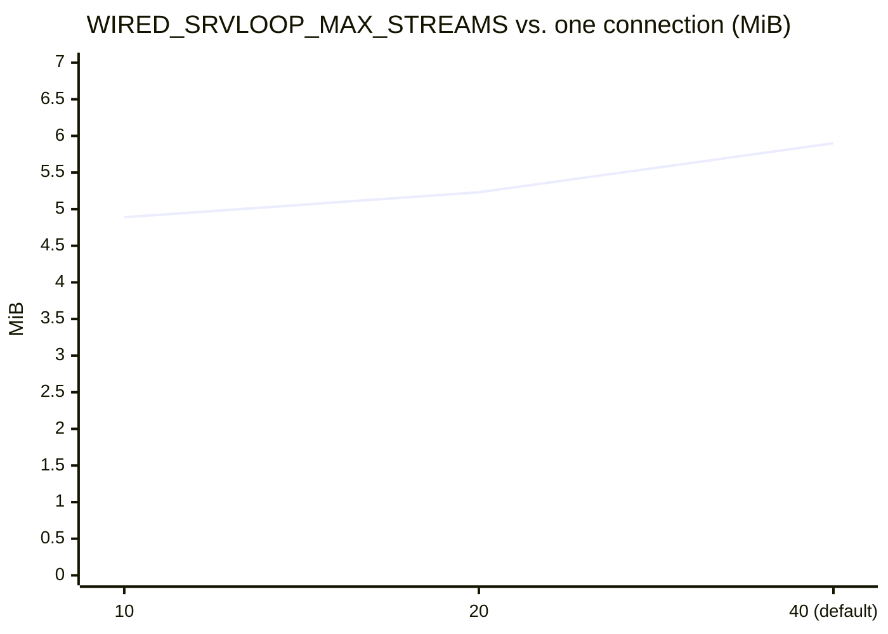
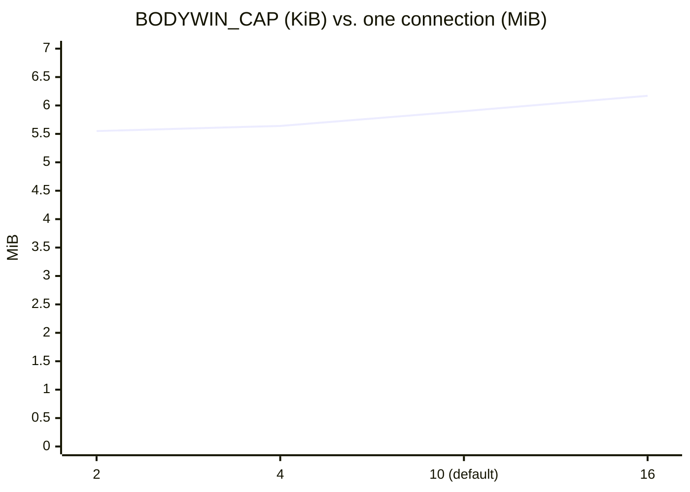
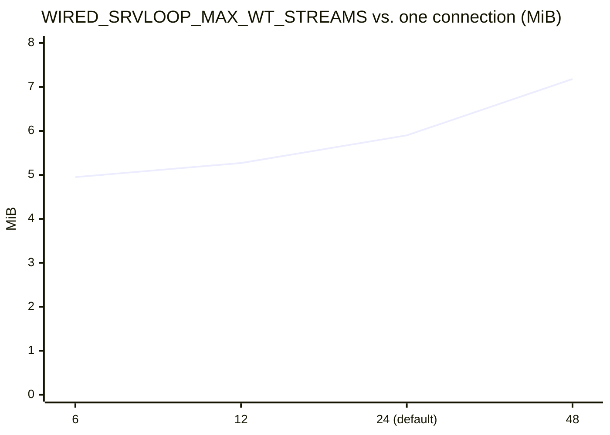
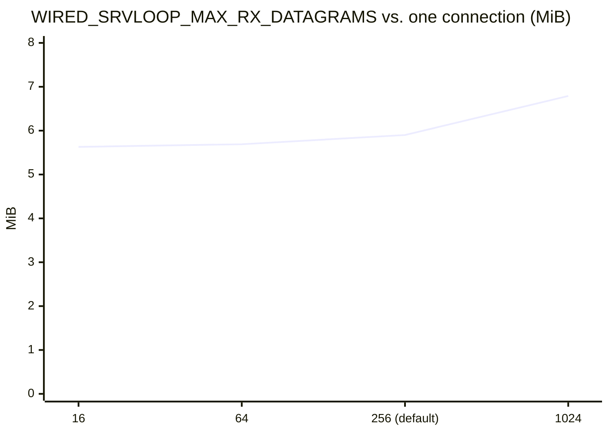
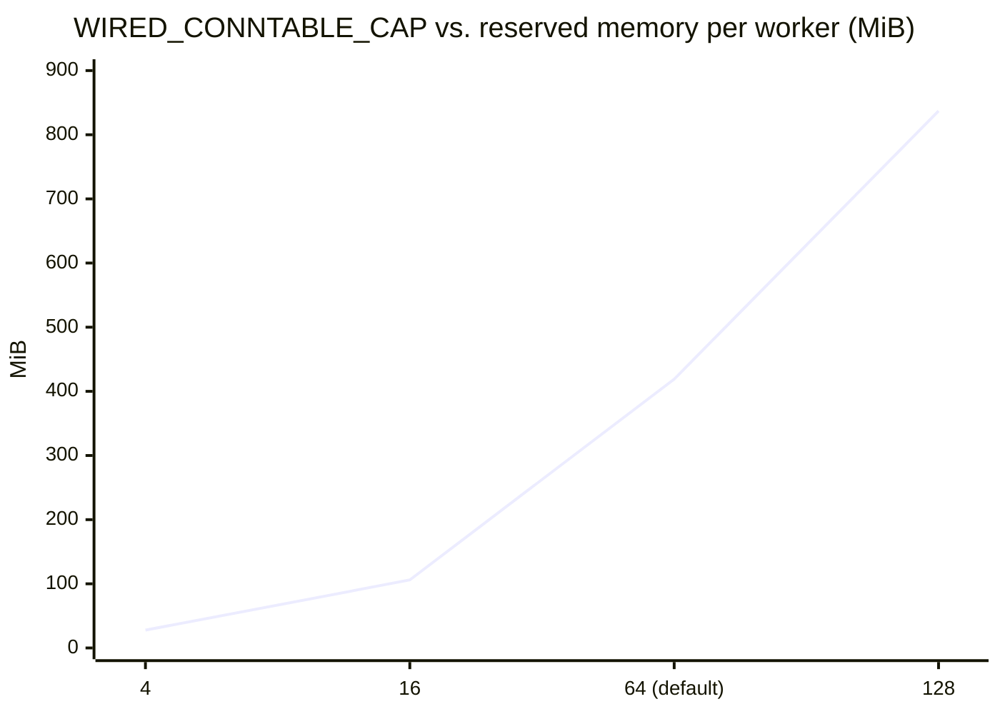

# メモリ配置とサイズ

[ドキュメント](../README.md) › [基本設計](README.md) › メモリ配置とサイズ

| 項目 | 内容 |
|---|---|
| 目的 | サーバーのメモリの配置と、容量の定数を変えたときのメモリ量を示す |
| 読む人 | バッファーのサイズやスロット数を変える、またはマシンのサイズを決めるコントリビューター |
| 前提文書 | [基本設計](README.md) |
| 関連文書 | [README 2.2](../../README.md#22-メモリ管理)(ヒープを使わない理由)、[実装の比較](../performance/comparison.md) |

ヒープがないので、容量はすべて固定のテーブルである。予約するメモリは接続ごとに `slots × slot size`(スロット数 × スロットのサイズ)を合計し、`WIRED_CONNTABLE_CAP` を掛けた値になる。定数を 1 つ変えると、メモリはその比率で変わる。

## 1. バイトの置き場所

テーブルはすべて静的な配列で、サイズはビルド時に決まる。テーブルは実行ファイルの `bss` セクションに置く。カーネルがページを RAM に載せるのは、サーバーがそのページに初めて書き込んだときである。この文書の数値は予約サイズ(負荷が最大のサーバーが到達しうる上限)で、アイドルや負荷の軽いサーバーの使用量ではない。

`bss` のほぼすべては `g_srvrun_env`(`wired_srvrun_env`、`src/app/http3/server/srvrun/srvrun_impl_srvrun.h`)である。threads ドライバーではワーカーごとに 1 つある。その大部分は接続テーブルである。



## 2. デフォルト設定での 1 接続

1 つの接続のスロット(`sizeof(srvrun_conn)`)は、デフォルトで **6,187,832 バイト(5.90 MiB)** である。

| 部分 | 接続あたりのサイズ | 割合 |
|---|---|---|
| WT 送信のステージング、`wtsend[17]` | 2,405,976 B | 38.9% |
| WT 双方向ストリーム、`l.wt_streams[24]` | 1,330,176 B | 21.5% |
| リクエストストリーム、`l.streams[40]` | 924,160 B | 14.9% |
| WT 単方向ストリーム、`l.wt_uni_streams[]` | 498,816 B | 8.1% |
| レスポンス、`resp[]` | 487,680 B | 7.9% |
| 受信した DATAGRAM、`l.rx_datagrams[256]` | 309,248 B | 5.0% |
| その他(TLS の状態、起動時のフライト、鍵、カウンター) | 231,776 B | 3.7% |



WT 双方向ストリームのスロット(`wired_srvloop_wt_stream_slot`、55,424 B)は、48 KiB の受信ウィンドウ(`WIRED_SRVLOOP_WT_BUF_CAP`)、そのウィンドウの 6 KiB の受信済みバイトのビットマップ、管理情報からなる。

HTTP/3 のリクエスト用バッファー(`req_scratch`、`req_buf`)はリクエストストリームのスロットだけが持つ。リクエストは `req_buf` の上でその場でデコードし、ウィンドウを連続した領域に並べ直したコピーは持たない。

## 3. 定数ごとのコスト

各行は定数をいくつかの値に設定し、ほかの定数をデフォルトのまま `sizeof(srvrun_conn)` を測った結果である。どの場合も関係は線形で、コストの列は許される範囲のどの値にも当てはまる。

| 定数 | デフォルト | 接続あたりのコスト | 許される範囲 |
|---|---|---|---|
| `SRVRUN_WTSEND_BUF`(スロットごとの WT 送信のステージング) | 131,072 B | 1 バイトあたり +17 B(送信スロットごとに 1 回) | `ceil(SRVRUN_WTSEND_BUF / 1100) ≤ WIRED_SENDSESS_LOG` |
| `WIRED_SENDSESS_LOG`(送信セッションごとの送信中のスライス) | 128 | 1 エントリあたり +4,560 B | 上の下限以上 |
| `SRVRUN_WT_SEND_SLOTS`(同時に使える WT 送信スロット) | 17 | 1 スロットあたり +141,616 B | — |
| `WIRED_SRVLOOP_MAX_STREAMS`(リクエストストリーム) | 40 | 1 ストリームあたり +35,514 B | ≤ 64(`wt_held_mask` が 64 ビットのマスク 1 つのため) |
| `BODYWIN_CAP`(リクエストの body のウィンドウ) | 10,240 B | 1 バイトあたり +45 B | — |
| `WIRED_H3_MAX_FIELD_SECTION`(リクエストのフィールドセクション) | 10,240 B | 1 バイトあたり +40 B | RFC 9110 §4.1 のリクエストターゲットのため ≥ 8000 |
| `WIRED_SRVLOOP_MAX_WT_STREAMS`(WT 双方向ストリーム) | 24 | 1 ストリームあたり +55,560 B | — |
| `WIRED_SRVLOOP_MAX_RX_DATAGRAMS`(キューに入る受信 DATAGRAM) | 256 | 1 スロットあたり +1,208 B | — |

`SRVRUN_WTSEND_BUF` と `WIRED_SENDSESS_LOG` は連動する。ステージングした WT 送信の 1 ラウンドは 1,100 バイトのスライスに切り分け、スライスごとに送信ログのエントリを 1 つ使う。

`SRVRUN_WTSEND_BUF` を 262,144 にすると、`WIRED_SENDSESS_LOG` も 239 以上に上げないとビルドが通らない(`srvrun_impl_srvrun.h` の静的アサーション)。

### 3.1 定数ごとの 1 接続の増え方

各グラフは 1 つの定数を動かしたときの 1 接続のスロットのサイズ(MiB)である。ほかの定数はデフォルトのままで、デフォルトの点はどのグラフも 5.90 MiB である。













グラフのない 2 つの定数の値は次のとおりである。

| 定数 | 値 | 1 接続 |
|---|---|---|
| `WIRED_H3_MAX_FIELD_SECTION`(`BODYWIN_CAP` の半分の傾き) | 2 KiB / 10 KiB(デフォルト)/ 16 KiB | 5.60 / 5.90 / 6.14 MiB |
| `WIRED_SENDSESS_LOG` | 256 | 6.46 MiB |

## 4. サーバー全体

ここまでの値に接続数(`WIRED_CONNTABLE_CAP`)が掛かる。接続 1 つあたり **6,843,260 B(6.53 MiB)** で、5.90 MiB の接続のスロットに、レスポンスの保存領域とテーブルのエントリを加えた値である。ワーカーごとの固定分は約 1.6 MiB である。

```text
bss per worker ≈ 1.6 MiB + WIRED_CONNTABLE_CAP × 6.53 MiB
```

| `WIRED_CONNTABLE_CAP` | ワーカーあたりの予約サイズ |
|---|---|
| 4 | 27.8 MiB |
| 16 | 106 MiB |
| 64(ライブラリのデフォルト) | 419 MiB |
| 128 | 837 MiB |



threads ドライバーでは、これにワーカー数が掛かる。デフォルトの ninja ビルドは `-DWIRED_CONNTABLE_CAP=4` を設定し、interop イメージは 64 でビルドする。

固定分には、起動時に渡された ID 情報とパスを実行側が持つコピー(`srvrun_own`、約 34 KiB)が入る。中身は 16 KiB の証明書チェーン、4 KiB のパス 4 つ、512 バイトの ID リスト 2 つ、鍵である。実行中に読むもので呼び出し側のメモリに置くものはない。

例外はクライアント認証のトラストストア(`client_ca`)で、ストア、ルートの配列、CA の DER は呼び出し側に残り、実行が終わるまで生きていなければならない。

## 5. 予約サイズと常駐サイズ

ページは初めて書き込まれたときに割り当てるので、常駐メモリは接続が触れた分だけ増える。大きな WebTransport のラウンドを送る接続は 128 KiB のステージングバッファーを埋め、長いターゲットを持つリクエストは 10 KiB のリクエストウィンドウを埋める。

| 計測(2026-11-02、`efd61452e`) | サイズ |
|---|---|
| 予約 | 27.7 MiB |
| 常駐、アイドル時 | 512 KiB |
| 常駐、ピーク時 | 1,932 KiB |
| 常駐、負荷のラウンドのあと | 1,412 KiB |

計測は [実装の比較](../performance/comparison.md) のループバックのレーンである(4 接続のビルド、1 つの接続上で 20 ストリームを同時に流す)。

接続が閉じると、サーバーはそのスロットの大きなテーブル(リクエストと WT のストリームスロット、受信した DATAGRAM、WT 送信のステージング、その `respstore` の行)を `madvise(MADV_DONTNEED)` でカーネルに返す。返すのはクローズごとに 1 回で、常駐メモリは負荷が去ると下がる。

返したページは 0 として読め、これは新しいスロットの初期値と同じである。次にスロットを確保するときは書き直しを省き、新しい接続が使うページだけに触れる。これでピークが下がる。

## 6. 定数の選び方

1. 要件からサイズを決め、理由を定数の横に書く。例は RFC の最低値(8000 オクテットのリクエストターゲット、RFC 9110 §4.1)、相互運用性テストで見たピアの挙動、帯域幅遅延積である。
2. マージする前に、3 章のコストに `WIRED_CONNTABLE_CAP` とワーカー数を掛け、対象マシンのアドレス空間と RAM と比べる。
3. 連動する上限を守る。`SRVRUN_WTSEND_BUF` を上げるときは `WIRED_SENDSESS_LOG` も上げ、`WIRED_SRVLOOP_MAX_STREAMS` は 64 以下に保つ。
4. 定数をテストと共有する。本番のバッファーより大きいテストのバッファーはオーバーフローを隠す。両側で同じ `#define` を使う([テスト](../standards/testing.md))。
