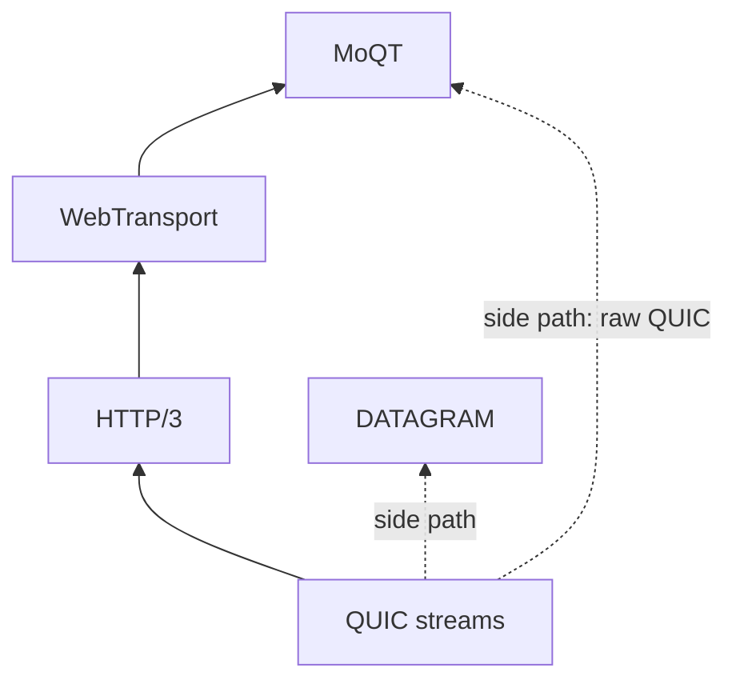
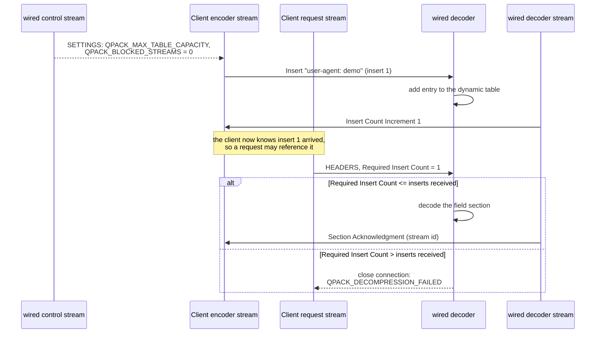

# app の詳細設計

[ドキュメント](../README.md) › [詳細設計](README.md) › app

| 項目 | 内容 |
|---|---|
| 目的 | app 層の設計(HTTP/3、QPACK、DATAGRAM、WebTransport、MoQT、生の QUIC、MP4 の分割)を示す |
| 読む人 | app のコードを変更・レビューするコントリビューター |
| 前提文書 | [詳細設計](README.md) |
| 関連文書 | [transport](transport.md)、[実装している仕様](specs.md) |

app は QUIC のストリームの上でアプリケーションプロトコルを扱う。

## 1. 依存と層の順序

| 項目 | 内容 |
|---|---|
| 依存先 | transport(ストリーム)、tls(セッションと鍵の状態)、crypto、common |
| 上にあるもの | アプリケーション |
| 逆向きの依存 1 | transport のフレームのコード、tls のサーバードライバーとトランスポートパラメーターのコードが、`app/datagram/` の DATAGRAM の定義と受信用の抽出関数を使う |
| 逆向きの依存 2 | TLS クライアントがサーバーのワイヤー用ヘルパー(`app/http3/server/srvwire/`)を再利用する |

## 2. HTTP/3

HTTP/3 はリクエストとレスポンスをフレームに分け、1 回のやり取りごとに専用の双方向ストリームを割り当てる。設定は別の制御ストリームで運ぶ。

## 3. QPACK を使う理由

HTTP/2 の HPACK は最近のヘッダーフィールドを入れた動的テーブルを全ストリームで共有し、テーブルの更新が順番どおりに届くことを前提にする。QUIC のストリーム同士は順番どおりに届かない。

HPACK を QUIC で使うと、新しいエントリを参照するリクエストがエントリを作る更新より先に届いて待たされ、ヘッダー層でヘッドオブラインブロッキングが起きる。

| QPACK(RFC 9204)の仕組み | 内容 |
|---|---|
| 専用ストリーム | テーブルの更新はエンコーダーストリームで運び、デコーダーはデコーダーストリームで進み具合を報告する |
| Required Insert Count | 各ヘッダーブロックの先頭にあり、デコード前に受け取っておく挿入の数を示す。0 なら動的エントリを使わない |

デコーダーは `SETTINGS_QPACK_BLOCKED_STREAMS` で、挿入を待ってよいストリーム数を知らせる。wired はこれを 0 にするので、wired サーバーで待つストリームはない。ピアのエンコーダーが参照してよいのは、サーバーが確認応答した挿入だけである。

届いた数より多い挿入を指すブロックは接続エラー(`QPACK_DECOMPRESSION_FAILED`)にする。ブロックされるストリームが 0 なので、ピアはそのブロックを送ってはならないからである。サーバー自身のエンコーダーはテーブル容量を 0 に保つ。レスポンスは静的テーブルとリテラルだけを使うので、クライアントを待たせない。

## 4. DATAGRAM

DATAGRAM フレーム(RFC 9221、フレーム型 `0x30` と `0x31`)は信頼性と順序の保証を持たず、失ったデータグラムを再送しない。ライブ音声のフレームのように、遅れて届くと使えないデータに向く。

## 5. WebTransport

WebTransport(`src/app/webtransport/`)は、HTTP/3 の Extended CONNECT リクエストをセッションに変える。セッションは独自の双方向ストリーム、単方向ストリーム、データグラムを運ぶ。ネゴシエーションと多重化は HTTP/3 が受け持つ。

## 6. MoQT

MoQT(`src/app/moqt/`)は、ライブデータのための publish/subscribe プロトコルである。wired はリレーの役のサブセットを実装する。サーバーはメディアを作らず、パブリッシャーと購読者の間で Object を転送する。サブセットは SETUP、SUBSCRIBE、PUBLISH、FETCH、名前空間の探索である。

| トランスポート | ドラフトの選び方 | セッション |
|---|---|---|
| WebTransport | WebTransport のサブプロトコル(`app/moqt/ver/`)でセッションごとに 18、19、22、23 から選ぶ | Extended CONNECT で開く |
| 生の QUIC(`src/app/moqt/qraw/`) | ALPN がドラフトのトークン(`moqt-23`、`moqt-22`、`moqt-19`、`moqt-18`)になる | 接続がそのままセッションになる |

生の QUIC には Extended CONNECT がないので、クライアントは URI の authority と path を AUTHORITY と PATH の Setup Option で送る。アプリケーションは `moqraw_policy` で受け入れか拒否かを決める。

MoQT ハブ(`src/app/moqt/run/`)は、`wired_moqt_init` が用意するサーバー側のセッションと購読の状態である。ハブは I/O のためにトランスポートで分岐しない。`wired_moqraw_io` が両方に共通の I/O テーブルを 1 つ返し、トランスポートごとの違いはこのテーブルが扱う。

| 違い | WebTransport | 生の QUIC |
|---|---|---|
| ストリームの先頭 | WebTransport のストリームヘッダー(ストリーム型の varint とセッション ID) | MoQT のバイトから始まる |
| 送信の予算 | 残りのセッションクレジット(`WT_MAX_DATA`) | セッション単位のクレジットはない。接続の `MAX_DATA` が送信を制限する |

## 7. rawquic: 2 つのバインディングの見分け

`src/app/rawquic/` は状態を持たないヘルパーを置く。接続が生の QUIC か HTTP/3 上の WebTransport かという問いに、次の 5 か所で答える。

1. ストリームのルーティング(`rawq_route`)
2. RESET_STREAM と STOP_SENDING に入れるエラーコード
3. データグラムのフレーミング
4. サーバーの最初の単方向ストリーム ID
5. 暗黙のセッションの識別

生の QUIC には CONNECT リクエストがないので、接続全体が 1 つの暗黙のセッションになる。

ストリーム ID の下位 2 ビットが開いた側と方向を示すので、サーバーが開く単方向ストリームの ID は 3、7、11、15 と 4 ずつ進む。最初の単方向ストリームは生の QUIC では ID 3、HTTP/3 では 15 である。HTTP/3 では ID 3、7、11 を制御ストリームと QPACK のストリームが使う。

## 8. media: MP4 ファイルを Object に分ける

`src/app/media/mp4frag/` は、フラグメント化 MP4 ファイルのトップレベルのボックス構成を読む(`mp4frag_scan`)。初期化セグメント(`ftyp` から `moov` まで)と、`moof`+`mdat` のメディアフラグメントを、ファイルへのビューとして返す。コピーもサンプルテーブルの解析もしない。

パブリッシャーは各フラグメントを 1 つの MoQT Group として送る。

## 9. ドメイン

HTTP/3 のフレームと制御ストリーム、リクエストとレスポンスの組み立て、QPACK のエンコードとデコード、DATAGRAM、WebTransport、MoQT(WebTransport 上と生の QUIC 上)、生の QUIC のバインディング用ヘルパー、フラグメント化 MP4 の解析。

## 10. ガイドの関連ページ

| 内容 | ページ |
|---|---|
| HTTP/3 のリクエストに応答する | [はじめての HTTP/3](https://hakkadaikon.github.io/wired/guide/ja/h3/hello/) |
| ストリームとデータグラムの選び方 | [ストリームとデータグラム](https://hakkadaikon.github.io/wired/guide/ja/concepts/streams-vs-datagrams/) |
| WebTransport のセッション | [WebTransport セッション](https://hakkadaikon.github.io/wired/guide/ja/wt/session/) |
| Track、Group、Subgroup、Object とメディアの対応 | [MoQT とメディアの対応](https://hakkadaikon.github.io/wired/guide/ja/concepts/media-mapping/) |
| MP4 の配信 | [ライブトラックを配信する](https://hakkadaikon.github.io/wired/guide/ja/moqt/live/) |
