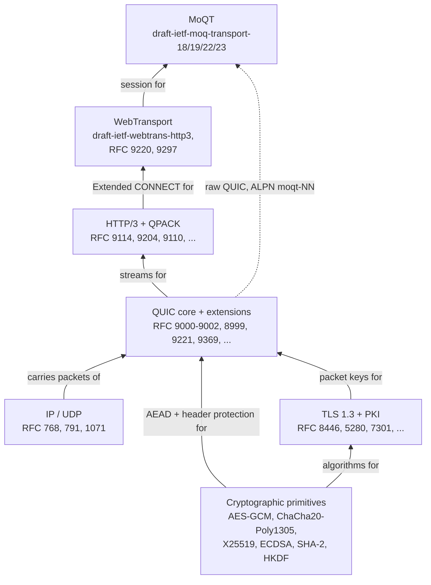

# 実装している仕様

[ドキュメント](../README.md) › [詳細設計](README.md) › 実装している仕様

| 項目 | 内容 |
|---|---|
| 目的 | SDK が実装している仕様と、それぞれが必要な理由を一覧にする |
| 読む人 | コードのコメントが引く RFC やドラフトを調べるコントリビューター |
| 前提文書 | [詳細設計](README.md) |
| 関連文書 | [要件台帳](../features/README.md)、[試験と品質](../verification/README.md) |

表の各行には裏付けのコードがある。コードのコメントで触れるだけの仕様(RFC 9525、RFC 1035 など)は載せない。サーバーがまだ呼ばないヘルパーだけの行は、理由の列にそう書く。

| グループ | 仕様の数 |
|---|---|
| QUIC のコア | 4 |
| QUIC の拡張 | 13 |
| TLS と PKI | 16 |
| 暗号プリミティブ | 11 |
| HTTP/3 と QPACK | 6 |
| WebTransport | 4 |
| MoQT | 3(ドラフト) |
| IP と UDP の基盤 | 3 |

## 1. グループの依存

図は下から上へ読む。破線は唯一の近道で、MoQT は HTTP/3 と WebTransport を通らずに QUIC の接続の上で直接動く。

## 2. QUIC のコア

| 仕様 | タイトル | リンク | 理由 |
|------|------------|--------|-----------|
| RFC 9000 | QUIC: UDP ベースの多重化されたセキュアなトランスポート | <https://www.rfc-editor.org/rfc/rfc9000> | パケットとフレームの形式、ストリーム、接続の状態遷移を定義する。 |
| RFC 9001 | TLS による QUIC の保護 | <https://www.rfc-editor.org/rfc/rfc9001> | TLS 1.3 のハンドシェイクを QUIC の鍵導出とパケット保護に結び付ける。 |
| RFC 9002 | QUIC の損失検出と輻輳制御 | <https://www.rfc-editor.org/rfc/rfc9002> | UDP はどちらも行わないため、送信側が失われたパケットを自分で検出し、輻輳を自分で制御する方法を定義する。 |
| RFC 8999 | QUIC のバージョンに依存しない性質 | <https://www.rfc-editor.org/rfc/rfc8999> | バージョンによらず固定のヘッダーの性質を定義し、バージョンネゴシエーションの土台になる。 |

パケットヘッダーの説明はガイドの [QUIC ヘッダー](https://hakkadaikon.github.io/wired/guide/ja/quic/header/) にある。

## 3. QUIC の拡張

コアより後に標準化された機能で、それぞれが別の RFC かドラフトである。

| 仕様 | タイトル | リンク | 理由 |
|------|------------|--------|-----------|
| RFC 9221 | QUIC の信頼性のないデータグラム拡張 | <https://www.rfc-editor.org/rfc/rfc9221> | 信頼性と引き換えに低遅延を得る DATAGRAM フレームを加える。 |
| RFC 9287 | QUIC ビットのグリース | <https://www.rfc-editor.org/rfc/rfc9287> | fixed bit(RFC 9000 が常に 1 にするビット)のグリース。エンコードと受理のヘルパーはありテストもあるが、サーバーはまだ grease_quic_bit を通知しないため、常にこのビットを立てて送る。 |
| RFC 9368 | QUIC の互換バージョンネゴシエーション | <https://www.rfc-editor.org/rfc/rfc9368> | 余分なラウンドトリップなしに互換バージョンへ移る手順を定義する。 |
| RFC 9369 | QUIC バージョン 2 | <https://www.rfc-editor.org/rfc/rfc9369> | バージョンの硬直化を避けるための 2 つ目のバージョン。鍵導出に混ぜる salt と label がバージョンごとに異なり、バージョン 1 と 2 のパケットは異なる鍵を得る。 |
| RFC 9308 | QUIC トランスポートプロトコルの適用性 | <https://www.rfc-editor.org/rfc/rfc9308> | 運用上の指針。5.6 節は高負荷時に Retry を使うことを提案している。サーバーはこれを運用者向けのスイッチ(`force_retry`、既定はオフ)として提供し、オンにするとすべての新しいクライアントに Retry を送る。 |
| RFC 9312 | QUIC トランスポートプロトコルの管理性 | <https://www.rfc-editor.org/rfc/rfc9312> | 経路上の観測者が QUIC ヘッダーから何を見られるかを説明する。サーバーは spin bit を 0 のままにする(RFC 9000 17.4 は無効化を認めている)。spin bit のヘルパーはありテストもあるが、組み込まれていない。 |
| RFC 8899 | データグラムトランスポートのためのパケット化層パス MTU 探索 | <https://www.rfc-editor.org/rfc/rfc8899> | ICMP に頼らずにデータグラム経路の MTU を探索する。MTU を知らせる ICMP はフィルターされることが多い。 |
| RFC 9438 | 高速・長距離ネットワークのための CUBIC | <https://www.rfc-editor.org/rfc/rfc9438> | 既定の輻輳制御アルゴリズム。直前の損失からの経過時間の 3 次関数としてウィンドウを広げる。 |
| RFC 9406 | HyStart++: TCP のための修正スロースタート | <https://www.rfc-editor.org/rfc/rfc9406> | 損失だけでなくラウンドトリップ時間のシグナルでもスロースタートを抜け、大きなオーバーシュートを避ける。 |
| draft-cardwell-iccrg-bbr-congestion-control | BBR 輻輳制御 | <https://datatracker.ietf.org/doc/draft-cardwell-iccrg-bbr-congestion-control/> | CUBIC に代えて選べるアルゴリズム。損失に反応する代わりに、帯域とラウンドトリップ時間のモデルから送信ペースを決める。 |
| RFC 3168 | IP への明示的輻輳通知(ECN)の追加 | <https://www.rfc-editor.org/rfc/rfc3168> | 送信パケットに ECT(0) を付け、受信パケットの ECN ビットを読む。輻輳したルーターはパケットを捨てる代わりに CE に書き換えて輻輳を知らせる。 |
| draft-ietf-quic-reliable-stream-reset | 部分配送付きの QUIC ストリームリセット | <https://datatracker.ietf.org/doc/draft-ietf-quic-reliable-stream-reset/> | ストリームをリセットしつつ先頭のバイトは配送する RESET_STREAM_AT フレームを加える。WebTransport が必要とする。 |
| RFC 7464 | JSON テキストシーケンス | <https://www.rfc-editor.org/rfc/rfc7464> | SDK がデバッグ用に書き出す qlog ファイルの JSON-SEQ 形式の区切り方。 |

## 4. TLS と PKI

パケット保護の鍵は TLS 1.3 のハンドシェイク(RFC 8446)から得る。ハンドシェイクでは、サーバーが X.509 証明書を送り、対応する秘密鍵で署名する。

| 区分 | 内容 |
|---|---|
| 証明書 | SDK は解析と生成をする。トラストストアに照らしてチェーンを検証する TLS クライアントの役割(`castore_validate_chain`)はあるが、サーバーはまだ使わない。表で検証に関わる行は「ヘルパーのみ」と書く |
| TLS の拡張 | SNI はクライアントが求めるホストを示し、ALPN はアプリケーションプロトコル(HTTP/3 なら `h3`)を選ぶ |
| 鍵と証明書のファイル | PEM 形式。`-----BEGIN ...-----` の行の間の base64 が DER の秘密鍵や証明書を包む。PEM、base64、秘密鍵の形式の仕様はこのため |
| 名前の照合 | まだ組み込まれていない証明書の名前のチェックが LDAP の文字列照合の規則を使う |
| SSLKEYLOGFILE | デバッグ用。セッションのシークレットをファイルに書き出し、Wireshark がキャプチャーを復号できるようにする |

| 仕様 | タイトル | リンク | 理由 |
|------|------------|--------|-----------|
| RFC 8446 | トランスポート層セキュリティ(TLS)プロトコル バージョン 1.3 | <https://www.rfc-editor.org/rfc/rfc8446> | ハンドシェイク(鍵交換と認証)と鍵スケジュールを定義する。 |
| RFC 5280 | インターネット X.509 公開鍵基盤の証明書と CRL のプロファイル | <https://www.rfc-editor.org/rfc/rfc5280> | 証明書の構文と、検証時に守るべき制約を定義する。サーバーは構文を使って証明書を組み立て、解析する。制約はクライアント側だけで使い、まだ組み込まれていない。 |
| RFC 5480 | 楕円曲線暗号の主体公開鍵情報 | <https://www.rfc-editor.org/rfc/rfc5480> | 証明書の中での楕円曲線公開鍵の表し方を定義する。 |
| RFC 5758 | インターネット X.509 PKI: DSA と ECDSA の追加アルゴリズムと識別子 | <https://www.rfc-editor.org/rfc/rfc5758> | ECDSA の署名アルゴリズム識別子を証明書に対応付ける。 |
| RFC 8410 | Ed25519、Ed448、X25519、X448 のアルゴリズム識別子 | <https://www.rfc-editor.org/rfc/rfc8410> | 証明書と鍵情報で Ed25519 と X25519 を扱うための識別子。ヘルパーのみ(クライアント側の検証、まだ組み込まれていない)。 |
| RFC 6066 | トランスポート層セキュリティ(TLS)拡張: 拡張の定義 | <https://www.rfc-editor.org/rfc/rfc6066> | いくつかの TLS 拡張を定義する。その中の SNI は、クライアントが求めるホスト名を運ぶ。 |
| RFC 6125 | ドメインベースのアプリケーションサービス識別子の表現と検証 | <https://www.rfc-editor.org/rfc/rfc6125> | 証明書の名前を接続先のホスト名と照合する規則を定義する(RFC 9525 により廃止。コードは 6125 の CN へのフォールバックに従っており、9525 ではこれがなくなっている)。ヘルパーのみ(クライアント側の検証、まだ組み込まれていない)。 |
| RFC 7301 | トランスポート層セキュリティ(TLS)アプリケーション層プロトコルネゴシエーション拡張 | <https://www.rfc-editor.org/rfc/rfc7301> | ハンドシェイク中に ALPN で HTTP/3 を選ぶ。 |
| RFC 8017 | PKCS #1: RSA 暗号仕様 バージョン 2.2 | <https://www.rfc-editor.org/rfc/rfc8017> | RSA の署名方式(PKCS #1 v1.5 と RSASSA-PSS)とその検証方法を定義する。RSA 証明書の検証に必要。ヘルパーのみ(クライアント側の検証、まだ組み込まれていない)。 |
| RFC 7468 | PKIX、PKCS、CMS の構造のテキストエンコーディング | <https://www.rfc-editor.org/rfc/rfc7468> | サーバーが読み込む証明書と鍵のファイルの PEM テキスト形式。 |
| RFC 4648 | Base16、Base32、Base64 のデータエンコーディング | <https://www.rfc-editor.org/rfc/rfc4648> | PEM ブロックの中の base64 のデコード。 |
| RFC 5958 | 非対称鍵パッケージ | <https://www.rfc-editor.org/rfc/rfc5958> | 秘密鍵ファイルを包む PKCS #8 の形式。 |
| RFC 5915 | 楕円曲線秘密鍵の構造 | <https://www.rfc-editor.org/rfc/rfc5915> | P-256 の秘密鍵を単体で、または PKCS #8 の中で保持する SEC1 の構造。 |
| RFC 5891 | アプリケーションにおける国際化ドメイン名(IDNA): プロトコル | <https://www.rfc-editor.org/rfc/rfc5891> | ホスト名を A-label(国際化された名前の `xn--...` という ASCII 形式)として比較する。非 ASCII の名前は拒否し、Punycode への変換はしない。ヘルパーのみで、SNI や証明書のチェックからはまだ呼ばれていない。 |
| RFC 4518 | LDAP: 国際化された文字列の準備 | <https://www.rfc-editor.org/rfc/rfc4518> | 大文字小文字を区別せず、空白をまとめて証明書の名前を比較する(ASCII の範囲のみ)。ヘルパーのみ(クライアント側の検証、まだ組み込まれていない)。 |
| draft-ietf-tls-keylogfile | TLS の SSLKEYLOGFILE 形式 | <https://datatracker.ietf.org/doc/draft-ietf-tls-keylogfile/> | セッションのシークレットをキーログファイルに書き出し、デバッグのためにパケットキャプチャーを復号できるようにする。 |

ガイドの関連ページは [ハンドシェイク](https://hakkadaikon.github.io/wired/guide/ja/tls/handshake/) と [証明書](https://hakkadaikon.github.io/wired/guide/ja/tls/certificates/) である。

## 5. 暗号プリミティブ

SDK は libc も暗号ライブラリも使わないので、ハンドシェイクとパケット保護のアルゴリズムをすべて実装する。各関数は QUIC に依存しないので、規格が公開するテストベクターで単独にテストする([crypto](crypto.md))。

| 部品 | 役割 |
|---|---|
| AEAD | パケットの暗号化と改ざんの検出を 1 回の処理で行う |
| HKDF | 1 つの共有シークレットから多数の鍵を導出する |
| X25519 | 共有シークレットを作る鍵交換。ECDHE なので鍵ペアは接続ごとに新しく作り、後で鍵が盗まれても記録された通信は復号できない |
| ECDSA P-256 | サーバーが自分の証明書の持ち主であることを示す署名 |
| SHA-2、HMAC | 上のすべての土台 |

QUIC は AEAD とヘッダー保護の暗号をパケットごとに直接呼び、TLS は鍵を渡すだけである。

| 仕様 | タイトル | リンク | 理由 |
|------|------------|--------|-----------|
| RFC 8439 | IETF プロトコルのための ChaCha20 と Poly1305 | <https://www.rfc-editor.org/rfc/rfc8439> | AES のハードウェア命令がない CPU でも速さを保つ AEAD 暗号。 |
| FIPS 197 | Advanced Encryption Standard (AES) | <https://csrc.nist.gov/pubs/fips/197/final> | AES-GCM の土台となる AES ブロック暗号を定義する。 |
| SP 800-38D | ブロック暗号の利用モードに関する勧告: GCM と GMAC | <https://csrc.nist.gov/pubs/sp/800/38/d/final> | AES を AEAD にする GCM モード。既定のパケット保護方式。 |
| RFC 7748 | セキュリティのための楕円曲線 | <https://www.rfc-editor.org/rfc/rfc7748> | X25519 鍵交換の曲線演算を定義し、ECDHE の共有シークレットを作る。 |
| RFC 8032 | エドワーズ曲線デジタル署名アルゴリズム(EdDSA) | <https://www.rfc-editor.org/rfc/rfc8032> | Ed25519 の署名と検証。ヘルパーのみ。サーバーは ECDSA P-256 で署名し、Ed25519 の CertificateVerify と自己署名証明書のビルダーはまだ呼ばれていない。 |
| RFC 6979 | DSA と ECDSA の決定的な使用法 | <https://www.rfc-editor.org/rfc/rfc6979> | ECDSA の nonce を決定的に導出し、乱数生成器が弱くても秘密鍵が漏れないようにする。 |
| RFC 6090 | 基本的な楕円曲線暗号アルゴリズム | <https://www.rfc-editor.org/rfc/rfc6090> | 楕円曲線上の基本演算を定義する。P-256 実装の土台。 |
| FIPS 186-4 | Digital Signature Standard (DSS) | <https://csrc.nist.gov/pubs/fips/186/4/final> | ECDSA P-256 の署名(サーバーの CertificateVerify と証明書)と検証(クライアント側のみ、まだ組み込まれていない)の規則と曲線パラメーター。 |
| FIPS 180-4 | Secure Hash Standard (SHS) | <https://csrc.nist.gov/pubs/fips/180/4/final> | SHA-256、SHA-384、SHA-512。ハンドシェイクのトランスクリプトと鍵導出の土台。 |
| FIPS 198-1 | The Keyed-Hash Message Authentication Code (HMAC) | <https://csrc.nist.gov/pubs/fips/198/1/final> | HMAC。HKDF と Finished の検証の土台。 |
| RFC 5869 | HMAC ベースの抽出・展開鍵導出関数(HKDF) | <https://www.rfc-editor.org/rfc/rfc5869> | TLS 1.3 の鍵スケジュール全体を動かす鍵導出関数。 |

ガイドの関連ページは [X25519](https://hakkadaikon.github.io/wired/guide/ja/tls/x25519/) と [SHA-256](https://hakkadaikon.github.io/wired/guide/ja/tls/sha256/) である。

## 6. HTTP/3 と QPACK

RFC 9114 が HTTP を QUIC のストリームに対応付け、RFC 9110 がバージョンをまたいで変わらない HTTP の意味を定義する。HPACK を使わず QPACK を使う理由は [app](app.md) にある。

| 仕様 | タイトル | リンク | 理由 |
|------|------------|--------|-----------|
| RFC 9114 | HTTP/3 | <https://www.rfc-editor.org/rfc/rfc9114> | HTTP のセマンティクスを、QUIC ストリーム上を運ばれるフレームに対応付ける。 |
| RFC 9110 | HTTP セマンティクス | <https://www.rfc-editor.org/rfc/rfc9110> | method、ステータス、ヘッダーなど、バージョンに依存しない HTTP のセマンティクス。 |
| RFC 9204 | QPACK: HTTP/3 のフィールド圧縮 | <https://www.rfc-editor.org/rfc/rfc9204> | ストリームが独立して届いてもヘッドオブラインブロッキングを起こさないヘッダー圧縮。 |
| RFC 7541 | HPACK: HTTP/2 のヘッダー圧縮 | <https://www.rfc-editor.org/rfc/rfc7541> | QPACK が再利用する静的テーブル、ハフマン符号、整数エンコーディングを定義する。 |
| RFC 9218 | HTTP の拡張可能な優先度付け方式 | <https://www.rfc-editor.org/rfc/rfc9218> | リクエストの優先度を伝える仕組みを定義する。 |
| RFC 8941 | HTTP の構造化フィールド値 | <https://www.rfc-editor.org/rfc/rfc8941> | MoQT のドラフトを選ぶ WebTransport サブプロトコルの提示(`wt-available-protocols`、`wt-protocol`)と、RFC 9218 の `Priority` の値に使うヘッダー値の構文。 |

このグループを使う最小のサーバーはガイドの [HTTP/3 hello](https://hakkadaikon.github.io/wired/guide/ja/h3/hello/) にある。

## 7. WebTransport

ブラウザーは Extended CONNECT リクエスト(`:protocol` 擬似ヘッダーを付けた CONNECT。RFC 9220)を送る。サーバーが受け入れるとセッションが開き、セッションに結び付いたストリームとデータグラムはアプリケーションが使う。

SDK はサーバー側(セッションの状態機械、WebTransport のカプセル、エラーコードの対応付け)を実装する。カプセルは CONNECT のストリームで送る型付きのメッセージで、セッションを閉じるときなどに使う。

| 仕様 | タイトル | リンク | 理由 |
|------|------------|--------|-----------|
| draft-ietf-webtrans-http3 | HTTP/3 上の WebTransport | <https://datatracker.ietf.org/doc/html/draft-ietf-webtrans-http3> | 中核の仕様。セッションの状態機械、WebTransport ストリームのシグナル、セッションを閉じるカプセル、アプリケーションのエラーコードの対応付けを定める。draft-16(MoQT draft-19 以降が参照する版)に合わせて実装している。 |
| RFC 9220 | HTTP/3 による WebSocket のブートストラップ | <https://www.rfc-editor.org/rfc/rfc9220> | Extended CONNECT を HTTP/3 に持ち込む。セッションの確立が依存する `:protocol` 擬似ヘッダーと SETTINGS_ENABLE_CONNECT_PROTOCOL。 |
| RFC 9297 | HTTP データグラムとカプセルプロトコル | <https://www.rfc-editor.org/rfc/rfc9297> | SETTINGS_H3_DATAGRAM で DATAGRAM をリクエストストリームに結び付け、WebTransport のカプセルが載る汎用のカプセルの外枠を定義する。 |
| RFC 3629 | UTF-8: ISO 10646 の変換形式 | <https://www.rfc-editor.org/rfc/rfc3629> | セッションを閉じるカプセルにある UTF-8 の終了理由を検証し、切り詰めるときは文字の境目でだけ切る。 |

WebTransport はまだ Internet-Draft である。実装の対象は draft-16 で、MoQT draft-19 と draft-22 が引用する版である(MoQT draft-18 は draft-15 を引用する)。

要件台帳([draft-webtrans-http3](../features/draft-webtrans-http3.md))も draft-16 から抽出している。

ガイドの関連ページは [ブラウザー](https://hakkadaikon.github.io/wired/guide/ja/wt/browser/)(実際のブラウザーでセッションを動かす)と [セッションのライフサイクル](https://hakkadaikon.github.io/wired/guide/ja/wt/session-lifecycle/)(セッションの閉じ方)である。

### 7.1 コードのコメントが draft-15 を引く理由

コードは最初に draft-15 に合わせて書いた。対象を draft-16 に移したとき、変わった節だけを実装し直して引用を改めた。

| 改めた節 | 内容 |
|---|---|
| フロー制御 | 初期 SETTINGS、WT_MAX_STREAMS、WT_MAX_DATA |
| 3.2 節 | セッション確立時のチェック |
| 6 節 | セッションを閉じるときの検証 |
| 9.5 節 | エラーコード |

両方のドラフトで内容が同じ節は draft-15 の引用のままなので、コメントでは draft-15 の引用が draft-16 より多い。

### 7.2 有効化の設定を複数送る理由

クライアントは、サーバーの HTTP/3 SETTINGS に自分の知る設定 ID があるときだけ WebTransport を開く。探す ID はクライアントで違うので、サーバーは 3 世代の設定を同時に送る。

| 設定 | 探すクライアント |
|---|---|
| SETTINGS_WT_ENABLED(`H3_SETTINGS_WT_ENABLED`、ID 0x2c7cf000。draft-15 と draft-16 で同じ) | webtransport-go |
| draft-02 の設定 | Chrome |
| draft-07 の設定 | Chrome |

## 8. Media over QUIC Transport (MoQT)

MoQT は配信の告知、購読、メディアの区切り方を定める。制御メッセージでセッションと購読を確立する。データモデルは Track を Group、Subgroup、Object に分け、パブリッシャーが送り、ハブが転送する。

コードは `src/app/moqt/` にあり、設計は [app](app.md) にある。

| 項目 | 内容 |
|---|---|
| 受け付けるドラフト | draft-18、draft-19、draft-22(クライアントによって実装するドラフトが違うため) |
| WebTransport での選択 | ピアが提示するサブプロトコル(`moqt-18`、`moqt-19`、`moqt-22`、`moqt-23`)から 1 つ選ぶ。提示がなければ draft-19 |
| 生の QUIC での選択 | ALPN の値(`moqt-22` など) |

| 例 | 使うドラフト |
|---|---|
| `examples/moqt_chat`(WebTransport 上の音声、映像、チャットのハブ) | ブラウザーが WebTransport の `protocols` オプションで `moqt-22` を提示できれば draft-22、できなければ draft-19 |
| ガイドの MoQT のサンプル | draft-22 |
| `examples/moqt_interop` | moq-interop-runner のクライアントに 3 つのドラフトすべてを提示する |

ドラフトごとの違いは要件台帳の [draft-18](../features/draft-moq-transport-18.md)、[draft-19](../features/draft-moq-transport.md)、[draft-22](../features/draft-moq-transport-22.md) にある。

データモデルのコード例はガイドの [ハブ](https://hakkadaikon.github.io/wired/guide/ja/moqt/hub/) にある。

| 仕様 | タイトル | リンク | 理由 |
|------|------------|--------|-----------|
| draft-ietf-moq-transport-18 | Media over QUIC Transport | <https://datatracker.ietf.org/doc/draft-ietf-moq-transport/18/> | 古いドラフトで、`moqt-18` でネゴシエーションする。いくつかの制御メッセージの細部を除けば、ワイヤー上では draft-19 と互換。 |
| draft-ietf-moq-transport-19 | Media over QUIC Transport | <https://datatracker.ietf.org/doc/draft-ietf-moq-transport/19/> | WebTransport セッションまたは生の QUIC 上での、パブリッシュ/サブスクライブ型メディアの中核の仕様。`moqt-19` でネゴシエーションし、ピアがサブプロトコルを提示しないときの既定。ハブの役割に絞った部分集合: SETUP、SUBSCRIBE、PUBLISH、FETCH、名前空間の探索と、SUBGROUP_HEADER と OBJECT_DATAGRAM のデータプレーン。 |
| draft-ietf-moq-transport-22 | Media over QUIC Transport | <https://datatracker.ietf.org/doc/draft-ietf-moq-transport/22/> | `moqt-22` でネゴシエーションする。購読のフィルターと FETCH を作り直している。 |
| draft-ietf-moq-transport-23 | Media over QUIC Transport | <https://datatracker.ietf.org/doc/draft-ietf-moq-transport/23/> | 最新のドラフトで、`moqt-23` でネゴシエーションする。制御メッセージの Length を vi64 にし、FETCH の応答を REQUEST_OK にし、セッション終了のコードを原因ごとに分けている。 |

## 9. IP と UDP の基盤

通常はカーネルが IP と UDP のヘッダーを組み立てる。SDK は AF_XDP(生のフレームをプログラムへ直接渡す Linux のソケット種別)でカーネルのネットワークスタックを迂回できる。その経路では IPv4 ヘッダー、UDP ヘッダー、チェックサムを SDK が書く。

| 仕様 | タイトル | リンク | 理由 |
|------|------------|--------|-----------|
| RFC 768 | ユーザーデータグラムプロトコル | <https://www.rfc-editor.org/rfc/rfc768> | QUIC が載る UDP のヘッダー形式とチェックサム。 |
| RFC 791 | インターネットプロトコル | <https://www.rfc-editor.org/rfc/rfc791> | UDP データグラムを運ぶ IPv4 のヘッダー形式。 |
| RFC 1071 | インターネットチェックサムの計算 | <https://www.rfc-editor.org/rfc/rfc1071> | IP と UDP のチェックサムの計算手順。 |
