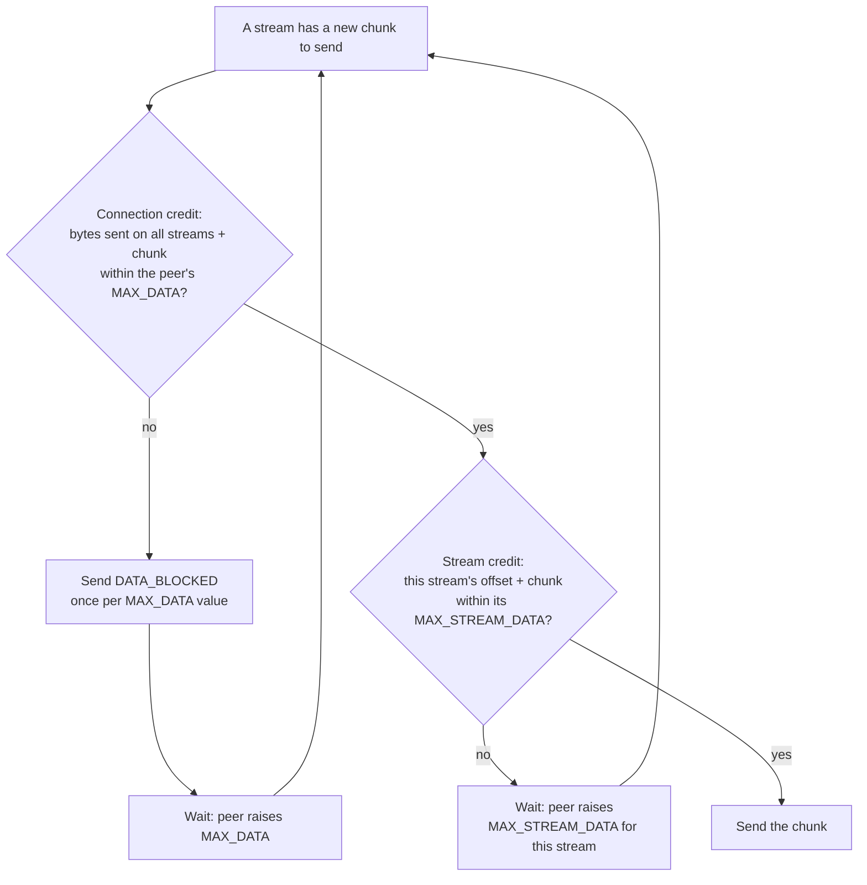
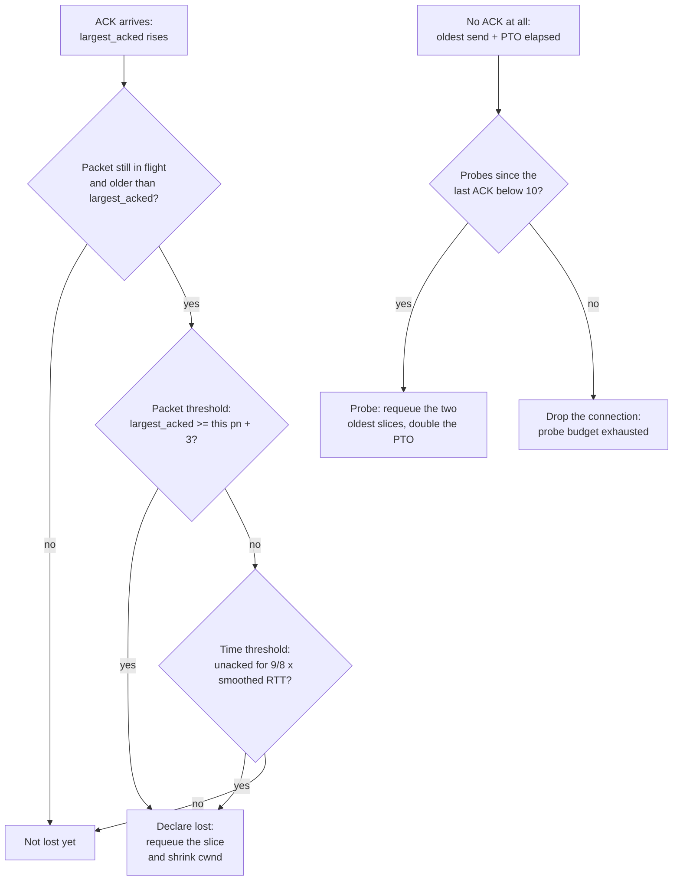
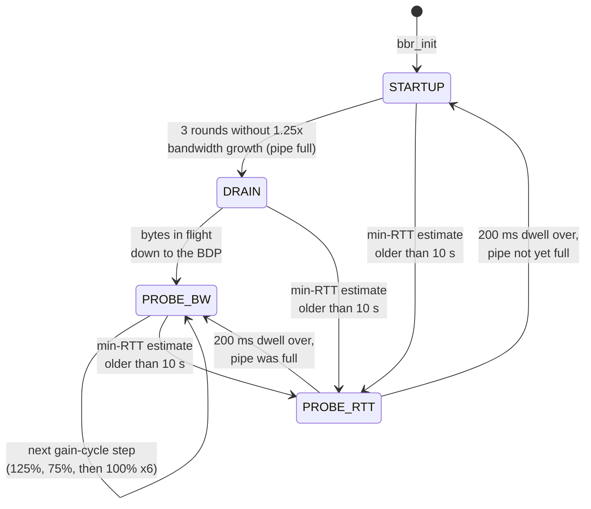
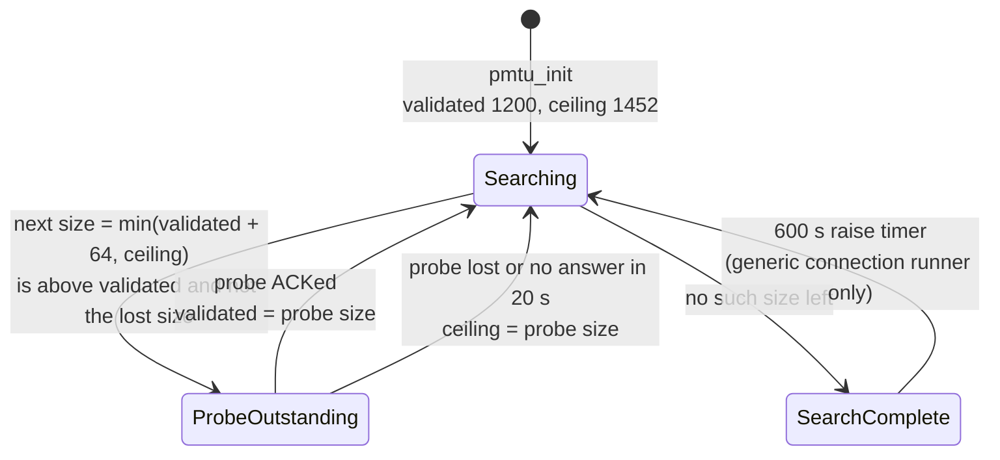

# transport の詳細設計

[ドキュメント](../README.md) › [詳細設計](README.md) › transport

| 項目 | 内容 |
|---|---|
| 目的 | transport 層の設計(UDP の選択、フロー制御、損失検出、輻輳制御、パス MTU 探索)を示す |
| 読む人 | transport のコードを変更・レビューするコントリビューター |
| 前提文書 | [詳細設計](README.md) |
| 関連文書 | [tls](tls.md)、[実装している仕様](specs.md)、ガイドの [ストリームとデータグラム](https://hakkadaikon.github.io/wired/guide/ja/concepts/streams-vs-datagrams/) |

transport は UDP の上に、信頼性があり順序どおりで多重化されたストリームを作る。app には QUIC ストリームごとに 1 本のバイトストリームを渡す。

| 依存先 | 使うもの |
|---|---|
| crypto | パケット保護 |
| common | 部品 |
| tls | パケット保護が tls の鍵の型を使う。イベントループと鍵更新のコードがハンドシェイクを呼ぶ([tls](tls.md) の 1 章) |

## 1. UDP を使う理由

TCP はヘッダーを平文で送る。経路上のルーターやファイアウォールはヘッダーの内容を前提に動くので、TCP を変更すると経路のどこかで通らなくなる。

| QUIC の方式 | 避けられること |
|---|---|
| パケットのほぼ全体を暗号化する | 経路上の機器が中身に依存する |
| 1 つの接続で複数のストリームを動かす | 1 パケットの損失で全ストリームが止まる(2 章) |
| 損失回復と輻輳制御をアプリケーションで行う | 変更にカーネルの更新が要る |

UDP は QUIC に機能を加えず、失ったパケットも再送しない。そのため transport が損失検出、輻輳制御、ACK の処理を持つ。`io` はカーネルとの境界で、IPv4 と UDP のヘッダーを組み立て、ソケットを動かす。

## 2. ヘッドオブラインブロッキング

TCP は順序付きのバイトストリームを 1 本だけ届ける。パケットを 1 つ失うと、後ろのバイトはすべて再送を待つ。無関係な HTTP リクエストのバイトも同じである。

QUIC はストリームごとにバイトの番号を振る。失ったパケットが止めるのは、そのパケットがデータを運んでいたストリームだけである。

## 3. 2 段階のフロー制御

受信側は「バイト N まで送ってよい」というクレジットを与える。QUIC はクレジットを 2 段階で与える(RFC 9000 §4.1)。

| 段階 | フレーム | 制限するもの | この上限がないときのおそれ |
|---|---|---|---|
| 接続 | `MAX_DATA` | 全ストリームの合計バイト数 | 多数のストリームの合計が接続のメモリを超えうる |
| ストリーム | `MAX_STREAM_DATA` | 1 本のストリームのバイト数 | 1 本のストリームがバッファー全体を使い、ほかが送れなくなりうる |

送信側は新しいチャンクごとに次の検査をする(`srvrun_can_send_new`)。

クレジットは増えるだけで、下げる `MAX_DATA` と `MAX_STREAM_DATA` は無視する。`DATA_BLOCKED` は接続の上限で止まったことをピアに伝え、ピアが `MAX_DATA` を早めに上げられるようにする。送るのはブロックの原因になった `MAX_DATA` の値ごとに 1 回で、チャンクごとではない。

| 受信側の処理 | 内容 |
|---|---|
| 上限の更新 | アプリケーションがバイトを消費すると、上限を前へずらし、新しい `MAX_DATA` と `MAX_STREAM_DATA` を送る |
| 違反 | クレジットを超えて送ったピアとは `FLOW_CONTROL_ERROR` で接続を閉じる(`srvrun_close_on_flow_violation`) |
| ストリーム数 | 3 つ目の上限 `MAX_STREAMS` がピアの開けるストリーム数を制限する(`STREAM_LIMIT_ERROR`) |

## 4. 損失検出とプローブタイムアウト

UDP は損失を知らせないので、送信側は返ってくる ACK から損失を推定する。RFC 9002 の 2 つの規則のどちらかで損失と判定する(`wired_sendsess_detect_lost`)。

| 規則 | 損失とみなす条件 |
|---|---|
| パケットしきい値 | 3 つ以上後のパケット番号で送ったパケットが確認応答された |
| 時間しきい値 | 後のパケットが確認応答され、平滑化 RTT の 9/8 が経っても未着 |

ピアが黙ると ACK が届かないので、プローブタイムアウト(PTO)のタイマーが受け持つ。PTO は平滑化 RTT + max(4 × RTT の変動, 1 ms) + 最大 ACK 遅延である。サーバーは最大 ACK 遅延に RFC の既定値 25 ms を使い、ピアの `max_ack_delay` は読まない。

再送の単位はスライスで、1 つのパケットで送った連続するストリームバイトの範囲である。確認応答されていない最も古いパケットが PTO より古くなると、最も古い 2 つのスライスをプローブとして再送し(`wired_sendsess_pto_fire`)、PTO を 2 倍にする。プローブは ACK を求めるもので、損失の判定はしない。

失ったスライスは新しいパケット番号で再送する。QUIC はパケット番号を再利用しない。ACK が 1 つ届けばプローブの回数は 0 に戻り、ACK なしで 10 回に達すると(`SRVRUN_PTO_MAX`)接続全体を破棄する。最初の RTT サンプルが得られるまでは、パケットしきい値だけを使う。

## 5. 輻輳制御

フロー制御は受信側を、輻輳制御は両端の間のネットワークを守る。送信側の輻輳ウィンドウ(cwnd)は、ACK が戻るまでに送信中(in flight)にしておける最大のバイト数である。

| 項目 | 内容 |
|---|---|
| アルゴリズム | CUBIC(既定)、NewReno、BBR |
| 選び方 | 実行ごとに `wired_srvrun_obs.cc_algo`。`cc_algo = 0` は既定値を意味する |
| NewReno | 番号は 0 なので、ビルド時に既定値を変える(`-DWIRED_CC_ALGO_DEFAULT=0`)ときだけ選べる |
| 初期ウィンドウ | 最大サイズのデータグラム 10 個分、10 × 1200 = 12000 バイト(`CC_INIT_WINDOW`) |
| CUBIC と NewReno の縮小 | 損失の判定で縮める。回復期間(縮めてから、その後に送ったパケットが確認応答されるまで)ごとに最大 1 回 |

利用者向けの選び方はガイドの [ハンドシェイクと可観測性のつまみ](https://hakkadaikon.github.io/wired/guide/ja/ops/handshake-knobs/) にある。

### 5.1 BBR

BBR は損失に反応せず、ボトルネック帯域幅と最小 RTT を測る。ウィンドウは cwnd_gain × 帯域幅 × RTT、つまり BDP(帯域幅遅延積)に状態ごとのゲインを掛けた値である。ウィンドウを一度に送らず、ペーシングゲイン × 推定帯域幅の速さで間隔を空けて送る。ラウンドは 1 往復を指す。

| 状態(`BBR_*`) | 動作 |
|---|---|
| `BBR_STARTUP` | 帯域幅の推定値の伸びが 3 ラウンド続けて 25% 未満になるまで、ペーシングゲイン 289% で送る |
| `BBR_DRAIN` | STARTUP が作ったキューを空けるため、35% で送る |
| `BBR_PROBE_BW` | 定常状態。8 段階を順に回り、推定値より上の段階で余地を探し、下の段階でキューを空け、残り 6 段階は推定値で送る |
| `BBR_PROBE_RTT` | キューイング遅延のない最小 RTT を測るため、200 ms の間ウィンドウを小さく保つ |

ACK は帯域幅と RTT のサンプラーに値を渡すだけである。状態遷移と cwnd の設定は `cc_bbr_tick` が行い、サーバーループの 1 周ごとに、その周の ACK を処理したあとで 1 回実行する。

## 6. パス MTU 探索(DPLPMTUD)

QUIC のパスはどれも 1200 バイトのパケットを運べる必要があるので、wired は 1200 バイトから始める。パケットが大きいほど 1 バイトあたりのオーバーヘッドが減る。パスの上限を超えたパケットは通知なしに捨てられる。

DPLPMTUD(RFC 8899)は、パディングしたプローブのサイズを上げながら送り、確認応答されたサイズから上限を探す。未応答のプローブは同時に 1 つだけである。図は `pmtu.c` の共有コアに沿う。状態は `searching` フラグと `probe` フィールドから導いたもので、コードに名前付きの enum はない。

損失のないパスでは、プローブは 1264、1328、1392、1452 バイトになる。最初に失敗したサイズが上限になり、次の候補が失敗したサイズと等しくなって探索が終わる。その後のストリームデータは検証済みサイズからヘッダーと AEAD タグの 41 バイトを引いた大きさまでパケットを埋める(`pmtu_mps`)。

サーバーは送信の機会ごとに、まずプローブを試す(`srvrun_pmtu_try_probe`)。定常のトラフィックがあってもプローブは後回しにならない。探索の完了から 600 秒後に探索を再開し(`pmtu_resume_search`、RFC 8899 5.2)、以前に失敗したサイズも再びプローブする。

## 7. ドメイン

パケットのフレーミングと保護、フレームのエンコード、損失回復と輻輳制御、ストリームと 2 段階のフロー制御、接続のライフサイクル、UDP の I/O。
