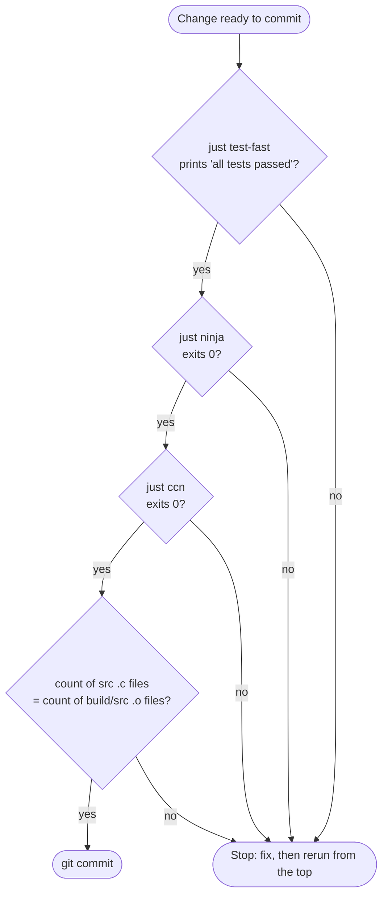
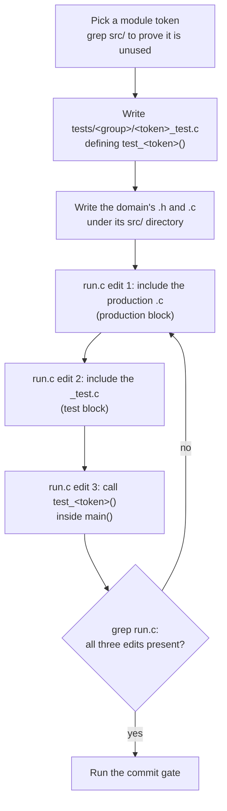

# Development

[Docs](README.md) › Development

This page is for contributors who change the code under `src/` or `tests/`.
It explains the rules every change must follow, why each rule exists, and
the checks you run before a commit. If you only want to build an
application on top of `wired`, start with the
[guide](https://hakkadaikon.github.io/wired/guide/en/getting-started/hello/)
instead.

> **The 30-second version.** Four rules govern every change:
> **(1)** no libc (`src/` must compile freestanding);
> **(2)** every function has cyclomatic complexity ≤ 3;
> **(3)** one concern lives in exactly one `src/` directory;
> **(4)** all symbols share one global namespace, so grep before you name
> anything.
> Before each commit, `just test-fast`, `just ninja`, and `just ccn` must
> pass, and the number of compiled objects must equal the number of sources.
> Before pushing a diff that adds new names, also run the slower `just test`
> once, because only it catches every name collision (see
> [test-fast or test](#test-fast-or-test)).

## Philosophy

`wired` is a QUIC, HTTP/3, WebTransport, and MoQT stack in C, built under
three self-imposed disciplines. Each one is unusual for a C project, so
this section gives the reason before the rule.

### No libc

Most C programs link against libc, the C standard library that provides
`printf`, `memcpy`, `malloc`, and the startup code (the CRT) that runs
before `main`. `wired` uses none of it. The SDK talks to the Linux kernel
directly through its own system-call wrappers, and copies bytes with its
own small helpers.

The reason is control: the SDK's behavior, memory use, and attack surface
do not depend on which libc the host has. Two checks enforce the rule.
First, every production source is compiled with `-ffreestanding
-nostdlib`, the compiler flags for code that has no standard library.
Second, the example and guide binaries are linked with `-nostdlib
-static`, so a call into libc such as `memcpy` has no library to resolve
against, and the link fails.
The compiler can still find system headers, though, so a
`#include <string.h>` on its own compiles; a grep (see
[Hard constraints](#hard-constraints)) catches it instead.

### Low complexity by construction

Cyclomatic complexity (CCN) counts the independent paths through a
function: a function with no branches has CCN 1, and every `if`, loop,
`&&`, `||`, or `?:` adds one. `wired` caps every function at CCN 3, and
the tool `lizard` enforces the cap.

The reason is reviewability. A protocol codec with CCN 3 per function can
be read side by side with its RFC section, one small step at a time. The
cap forces small functions, named predicate helpers, and table-driven
dispatch instead of long `if`/`else` chains.

### Verification-driven

Behavior is implemented against the IETF primary source (the RFC text),
with test vectors recomputed by hand. State machines and critical math get
an extra check before the code is written; see
[Verification layers](#verification-layers).

## Architecture

The code is split into five top-level groups under `src/`, and the groups
form layers. `common` and `crypto` sit at the bottom, `tls` builds on
them, `transport` (QUIC) builds on `tls`, and `app` sits on top: HTTP/3
first, then WebTransport (WT) and MoQT. In protocol terms the order is
TLS → QUIC → H3 → WT → MoQT, each arrow pointing to the layer that uses
the one before it.

| Group | Role | Example subdirectories |
|---|---|---|
| `app` | HTTP/3 and everything above it | `http3`, `qpack`, `datagram`, `webtransport`, `moqt` |
| `transport` | QUIC transport | `conn`, `packet`, `stream`, `recovery`, `version`, `io` |
| `tls` | TLS 1.3 handshake and keys | `handshake`, `ext`, `keys` |
| `crypto` | Cryptographic primitives | `symmetric`, `asymmetric`, `kdf`, `pki` |
| `common` | Foundation shared by all | `bytes`, `diag`, `platform`, `arch`, `fmt` |

A domain is a leaf directory inside one of these subdirectories. For
example, `src/common/bytes/varint/` holds the QUIC variable-length integer
codec.
For how the layers call each other and how a packet moves through them,
read [Architecture and Data Flow](arch/overview.md) and
[Layers](arch/layers.md).

### MECE: one concern, one directory

MECE means "mutually exclusive, collectively exhaustive": every concern
has exactly one home, and every piece of code has a home. In `wired` this
is a directory rule. One concern lives in exactly one `src/` directory, so
finding the code for a behavior is one `grep` in one place, and a new
behavior goes into the layer whose responsibility it matches.

### Name prefixes tell you the audience

The prefix of a non-`static` name says who may call it.

- **Application-facing API** (anything the examples call) uses `wired_*`
  or `WIRED_*`.
- **Internal API** uses the module's own token as its prefix, such as
  `varint_*`, `sdrv_*`, or `moqctl_*`.

[API stability](api-stability.md) decides which side each name belongs
to.

## Build system

`just` is a command runner: each `just <recipe>` runs a named recipe from
the `justfile`. All compiler flags are defined once in the `justfile`, and
sources are found automatically, so adding a `src/**/*.c` file needs no
`justfile` edit.

The code is compiled in two different ways, and both matter.

- **Freestanding** (`just ninja`): each `src/**/*.c` is compiled on its
  own with `-ffreestanding -nostdlib -Werror` into a path-qualified
  `build/<path>.o`. The full path in the object name keeps the objects of
  sources that share a basename (`frame.c`, `grease.c`, ...) from
  overwriting each other.
- **Hosted test** (`just test` and `just test-fast`): the tests are built
  against the normal host libc so they can print results, and they run
  with assertions on.

### Unity build: one translation unit

A translation unit (TU) is what the compiler sees after it pastes in every
`#include`: one `.c` file plus everything it includes. Normally each `.c`
file is its own TU, so two files can each have a `static` helper named
`put_bytes` without conflict.

`wired`'s test build is different. `tests/run.c` is a unity build: a
single TU that `#include`s every production `.c` once and every
`*_test.c` once. The tests therefore exercise the real implementation, not
a mock. The cost is that every name in the repository, including `static`
helpers, `typedef`s, macros, and constants, now lives in one global
namespace. Two files that each define `static put_bytes` compile fine on
their own and only fail when `run.c` pulls them into the same TU. That is
why collisions show up only in the unity build, and why you grep before
naming.

### test-fast or test

Both recipes run the same tests and print the same `all tests passed`
line. They differ in how `tests/run.c` is compiled.

| Recipe | How it compiles | Catches cross-file `static`/`typedef`/macro collisions |
|---|---|---|
| `just test` | One TU, as CI does | Yes |
| `just test-fast` | `run.c` split into 8 shard TUs, compiled in parallel | Only inside a shard |

`test-fast` is about 3x faster, so the per-commit gate uses it. The split,
made by `scripts/gen_shards.py`, keeps each production file in the same
shard as its test. Two unrelated files can still land in different
shards, and a collision between them then stays invisible. Duplicate
non-`static` functions are still caught, because they collide at link
time. Run `just test` once before pushing any diff that adds new names; CI
runs it on every push.

Both recipes run `just fmt` first, so they may reformat your sources in
place.

### All recipes

Install the toolchain first with `just setup` and `nix develop`; see
[Getting started](getting-started.md) for what the Nix devShell is and why
its tool versions are pinned.

Run every build and check through a recipe, never `lizard`, `ninja`,
`clang`, `clang-format`, or `clang-tidy` by hand. The recipe regenerates
`build.ninja`, pins the flags, and switches to the Nix devShell where the
tool version matters, so a local run matches CI. The `justfile` has 22
recipes.

| Recipe | What it does |
|---|---|
| `setup` | One-time bootstrap: install Nix if absent. |
| `nix <recipe>` | Run any recipe inside the pinned flake devShell. |
| `build` | `fmt` + `ninja` + `lint` in the devShell. |
| `gen-ninja` | Regenerate `build.ninja` from the source list. |
| `ninja [targets]` | Freestanding compile of all of `src/`, or of the named targets. |
| `lib` | Archive the SDK objects into `build/libwired.a`. |
| `compdb` | Emit `compile_commands.json` for clangd. |
| `test` | Build and run the single-TU unity test. |
| `test-fast` | Same tests as `test`, from parallel shard TUs. |
| `check` | `ccn` + `test`. |
| `ccn [paths]` | Check that every function has CCN ≤ 3 (lizard). |
| `wire-check` | Check that every source is in `tests/run.c` once and builds one object. |
| `cov` | Line coverage of the unity test. |
| `valgrind` | Run the unity test under valgrind. |
| `golden-check` | Check that `tests/app/moqt_golden.h` matches its test vectors. |
| `fuzz-smoke` | Build each fuzz harness and run it once. |
| `fuzz-ci [secs]` | Run each fuzz harness for `secs` seconds (default 120). |
| `fmt` | Format C sources in place with the pinned clang-format. |
| `fmt-check` | Verify formatting without writing. |
| `lint` | clang-tidy static analysis; any warning fails. |
| `docs` | Regenerate the doxygen API reference into `docs/sdk/`. |
| `guide-verify [ids]` | Run the guide snippets and compare with `golden.txt`. |

Notes on a few recipes:

- **`ninja`** takes targets to build only those, for example
  `just ninja examples/word_list/wired_server`, `just ninja guide`, or
  `just ninja build/src/<path>.o`.
- **`lib`** leaves out `sys.o`, the SDK's own `_start` entry stub, so an
  application that links `libwired.a` supplies its own entry point.
  `examples/word_list` builds this way.
- **`lint`** runs clang-tidy with the CERT C checks plus the `bugprone-*`
  and `clang-analyzer-*` bug-finding checks. CERT
  C is the SEI CERT C Coding Standard, a published set of secure-coding
  rules for C (for example, rules against integer overflow and
  out-of-bounds access).
- **`wire-check`** is a stronger form of the count check below: it also
  proves that every source except `sys.c` is `#include`d in `tests/run.c`.
- **`valgrind`** names the culprit of a hang that happens only sometimes.
  Freestanding code gets no implicit zeroing, so such a hang usually means
  an uninitialized variable.
- **`docs`** reads `wired.h`'s transitive includes and treats warnings as
  errors, so a public declaration without a doxygen comment fails it.

## Hard constraints

A change that breaks any of these is not done.

- **No libc, no CRT.** `src/` includes only headers from this
  repository, never a system or standard-library header (`#include <...>`).
  For system types and calls it uses the repo's own facade
  `common/platform/sys/syscall.h` (not libc's `<sys/syscall.h>`). Do not
  add a standard header to make a file compile; fix the code. Verify: the
  first grep below prints nothing, and `just ninja` passes.
- **Reuse the util helpers.** `src/common/bytes/util/` (called `util/` for
  short on this page) already has `bytes.h` (byte copy, put, take), `be.h`
  (big-endian store and load), `ct.h` (constant-time compare), and `num.h`
  (`u64_max` and friends). Never write a second `static` copy of these.
- **Architecture-specific code stays in `common/arch/`.** Inline assembly,
  CPU builtins, and raw system calls live only there, behind `wired_arch_*`
  names. A domain file calls the typed wrappers in `sysops.h`. A new system
  call means a number in `x8664.h`, a wrapper in `sysops.h`, and a row in
  [System calls](syscalls.md).
- **CCN ≤ 3 for every function.** Count branches before you write. Move a
  compound condition into a named predicate helper, split three or more
  `if (!put(...)) return 0;` lines into two helpers, and replace a branch
  cluster with a lookup table of function pointers. Verify: `just ccn`.
- **MECE: one domain, one directory.** Do not scatter a concern across
  directories or merge two concerns into one.
- **One global namespace.** Grep `src/` before adding any name. When you
  write the same small helper a second time, move it to `util/` as an
  `inline` function instead. Verify: `just test`.

Two of these rules can be checked with grep, and each of the three
commands must print nothing. The first checks the no-libc rule by finding
a system or standard-library header. The second and third check the
`common/arch/` rule: one finds inline assembly and CPU builtins, the other
raw system calls.

```sh
grep -rn '#include <' src/
grep -rn '__asm__\|__builtin_ia32' src/ | grep -v common/arch/
grep -rn 'syscall[1-6](\|SYS_[a-z]' src/ | grep -v common/arch/
```

## The commit gate

Each check in the gate exists because skipping it once let a broken
commit reach `main`. The hosted test build and the freestanding build
enable different warnings, so one can pass while the other fails. And
because `tests/run.c` is edited by hand, a new source can be committed
without ever being compiled; the count check catches that.

The gate runs four checks in order. Any red result stops the commit; you
fix the cause and start again from the top.



Run it as one guarded command, so a red result cannot reach `git commit`:

```sh
if just test-fast 2>&1 | grep -q "all tests passed" \
   && just ninja >/dev/null 2>&1 \
   && just ccn \
   && [ "$(find src -name '*.c' | wc -l)" = "$(find build/src -name '*.o' | wc -l)" ]; then
    git commit -m "..."
fi
```

Count `build/src` only, not all of `build/`: `build/shards/` holds the
`test-fast` shard objects, which would skew the count.

Two shell mistakes have shipped red commits before:

- **Piping a gate into `tail` or `head`, then `&&`-ing the commit.** The
  exit status of a pipe is the last command's, so `tail` succeeds even
  when the gate failed.
- **Chaining the gate and the commit with `;`.** A `;` ignores the
  failure. Use `&&` or `if`.

### Before you push

The gate is a local subset of CI. `.github/workflows/ci.yml` also runs
these jobs, so run the matching recipe when your diff touches the files
listed.

| CI job | Run locally | When |
|---|---|---|
| test (single TU) | `just test` | Your diff adds new names |
| fmt-check | `just fmt-check` | Any `.c` or `.h` changed |
| lint | `just lint` | Any `src/` file changed |
| golden-check | `just golden-check` | MoQT test vectors changed |
| fuzz smoke | `just fuzz-smoke` | A `src/` function signature changed |

Two other workflows matter: `docs.yml` runs `just docs` on every push to
`main`, and `guide.yml` runs the guide snippets against their
`golden.txt` (locally `just guide-verify`). Run `find .github/workflows
-type f` to see the full, current list.

## Adding a domain

A domain is a leaf directory (see Architecture) that holds a header
(types, constants, prototypes) and its `.c` implementation. For example,
the varint domain is `src/common/bytes/varint/varint.{h,c}`, and its test
is `tests/common/varint_test.c`.

The `justfile` finds new sources by itself, but `tests/run.c` does not.
A new domain needs three edits there, or it is committed but never built
by the tests. The diagram shows the order.



In the steps below, `<token>` is the domain's module token, such as
`varint`.

1. **Pick a module token.** Internal API is `<token>_*`; use
   `wired_<token>_*` only if applications will call it. Grep `src/` to
   confirm the token is unused.
1. **Write the test first.** Write `tests/<group>/<token>_test.c` with a
   `void test_<token>(void)` that uses the `CHECK(...)` macro from
   `tests/test.h`. Cover the RFC vector, a round trip, and malformed input
   (see [Test strategy](#test-strategy)).
1. **Write the domain.** Add the `.h` and `.c` under the domain's `src/`
   directory, with the smallest code that makes the test pass.
1. **Wire `tests/run.c`.** Add `#include "<path>/<file>.c"` in the
   production block, `#include "<group>/<token>_test.c"` in the test
   block, and `test_<token>();` inside `main()`. Each production `.c` must
   come before the test that uses it: because `run.c` is one TU, a test can
   only call what the compiler has already seen above it.
1. **Confirm the edits landed.** Grep `run.c` for all three lines. Scripted
   edits to `run.c` have failed silently before, leaving dozens of sources
   unbuilt.
1. **Run the commit gate.** If it is red, split a CCN-4 function or rename
   a colliding symbol, then rerun. When it is green, commit.

## Verification layers

Different properties need different kinds of evidence, so decide the layer
while planning, before writing code. Using a heavy layer on simple logic
is over-engineering. Ask two questions in order. If both answers are no,
use TDD alone.

1. Does the design have state transitions, concurrency, or a protocol
   lifecycle? Use **TLA+**.
1. Otherwise, is there a critical crypto or math property? Use **Lean 4**.

- **TLA+** is a language for describing a system as states and the steps
  between them. Its model checker, TLC, explores every reachable state and
  reports a counterexample trace when a rule can be broken. The specs are
  also mutated on purpose, to confirm the checker catches a planted bug.
  Specs cover stream, connection, handshake, packet-number space,
  close-and-draining, key update, path, version negotiation, Retry and
  reconnection, and HTTP/3 control state. Each counterexample becomes an
  acceptance test.
- **Lean 4** is a proof assistant: you state a property and the tool
  checks your proof of it. Proofs cover varint encoding, packet-number
  decoding, AEAD round trip, congestion window, RTT estimation, and the
  Ed25519 signature equation, with no unfinished (`sorry`) steps.
- **TDD** (test-driven development): write the test list, watch a test
  fail (red), write the minimum code to pass (green), then refactor.

Properties checked with TLA+ or proven with Lean become one-to-one
predicates in the TDD test list. The specs and proofs are working files
kept outside the repository; what lands in the repository is the code and
the tests derived from them.

## Test strategy

Because `tests/run.c` is the single unity TU, tests run against the real
implementation, and a name collision fails the build at once. Each
domain's test covers four kinds of check against its RFC:

- **Official golden vector.** The published RFC or FIPS vector,
  recomputed by hand before it goes into a test. External snippets have
  been wrong before: a nonce with a mis-XORed byte, and a truncated
  ClientHello. When a full vector cannot be obtained, combine a round
  trip, known sub-component vectors, and hand-computed parts. Never
  present such a combination as a match against the full golden vector.
- **Encode/decode round trip.** Encoding then decoding returns the input.
- **Boundary values and equivalence partitioning.** Equivalence
  partitioning tests one value from each class of inputs that should
  behave the same; boundary values test the edges between classes. Here
  that means lengths, offsets, varint size classes, and connection ID edge
  lengths.
- **Malformed-input rejection.** Truncated, tampered, and out-of-range
  inputs are rejected, not silently accepted.

A test that exercises a size or boundary must use the production buffer
size, through a shared constant. A test buffer larger than the real one
once hid an overflow that broke the real server.

## Workflow

[Adding a domain](#adding-a-domain) gives the steps for new code. Three
habits apply to every change, new domain or not.

1. **Read the RFC first.** Find its published test vector before writing
   code.
1. **Implement minimally.** Write the smallest code that passes and stays
   at CCN ≤ 3. Before adding a helper, check whether `util/`, the varint
   helpers, or `fsm_step` already does the job. `fsm_step` is the
   table-driven state-machine engine in
   `src/transport/conn/lifecycle/fsm/` that the stream and connection state
   machines share.
1. **Micro-commit.** Make conventional commits of about 30 to 50 lines,
   with an RFC section reference where relevant. Keep `feat(<domain>):`
   and `test(<domain>):` as separate commits.

---

**Next:** [Architecture and Data Flow](arch/overview.md) — the structure
you are changing. ([all docs](README.md))
