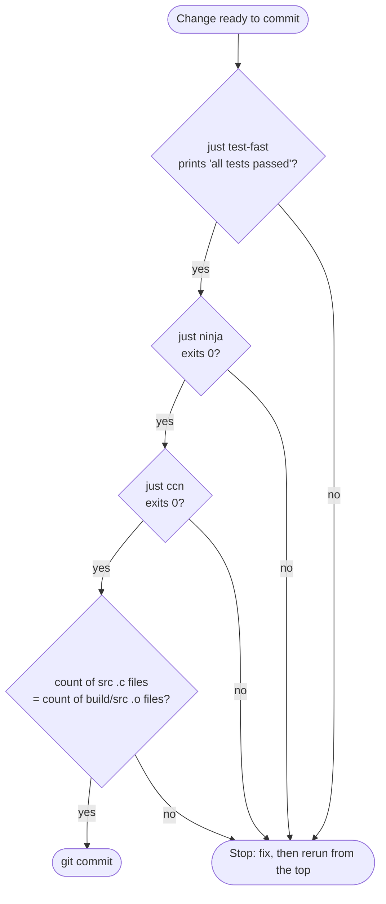
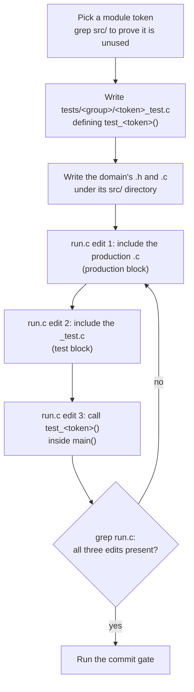

# 開発

[Docs](README.md) › 開発

このページは `src/` や `tests/` のコードを変更するコントリビューター向けです。どの変更も守るべきルールと、各ルールがある理由、コミット前に実行する検査を説明します。`wired` の上にアプリケーションを作るだけなら、代わりに [ガイド](https://hakkadaikon.github.io/wired/guide/ja/getting-started/hello/) から始めてください。

> **30 秒で読む要約。** すべての変更は 4 つのルールに従います。
> **(1)** libc を使わない(`src/` は freestanding でコンパイルできなければならない)。
> **(2)** すべての関数の循環的複雑度は 3 以下。
> **(3)** 1 つの関心事は `src/` のちょうど 1 つのディレクトリに置く。
> **(4)** すべてのシンボルが 1 つのグローバル名前空間を共有するので、名前を付ける前に grep する。
> 各コミットの前に `just test-fast`、`just ninja`、`just ccn` が通り、コンパイルされたオブジェクトの数がソースの数と一致しなければなりません。
> 新しい名前を追加する差分を push する前には、時間のかかる `just test` も 1 回実行してください。すべての名前の衝突を検出できるのはこれだけだからです([test-fast と test の使い分け](#test-fast-と-test-の使い分け) を参照)。

## 設計思想

`wired` は C で書いた QUIC、HTTP/3、WebTransport、MoQT のスタックで、自らに課した 3 つの規律のもとで作っています。どれも C のプロジェクトとしては珍しいため、この節ではルールの前に理由を述べます。

### libc を使わない

ほとんどの C プログラムは libc にリンクします。libc は C の標準ライブラリで、`printf`、`memcpy`、`malloc` と、`main` の前に動くスタートアップコード(CRT)を提供します。`wired` はそのどれも使いません。SDK は独自のシステムコールラッパーで Linux カーネルと直接やり取りし、バイトのコピーも独自の小さなヘルパーで行います。

理由は制御です。SDK の振る舞い、メモリ使用量、攻撃対象領域が、ホストにどの libc があるかに左右されません。このルールは 2 つの検査で強制しています。1 つ目に、本番のソースはすべて `-ffreestanding -nostdlib`(標準ライブラリを持たないコード向けのコンパイラーフラグ)でコンパイルします。2 つ目に、examples と guide のバイナリは `-nostdlib -static` でリンクするので、`memcpy` のような libc の呼び出しは解決先のライブラリがなく、リンクが失敗します。
ただしコンパイラーはシステムヘッダーを見つけられるため、`#include <string.h>` だけならコンパイルは通ります。こちらは grep([必須の制約](#必須の制約) を参照)で検出します。

### 構造で複雑さを抑える

循環的複雑度(CCN)は関数を通る独立した経路の数を数えます。分岐のない関数は CCN 1 で、`if`、ループ、`&&`、`||`、`?:` のそれぞれが 1 を足します。`wired` はすべての関数を CCN 3 までに制限し、ツール `lizard` でこの上限を強制しています。

理由はレビューのしやすさです。関数ごとに CCN 3 のプロトコルコーデックなら、対応する RFC の節と並べて、小さな段階ごとに読めます。この上限があると、長い `if`/`else` の連鎖の代わりに、小さな関数、名前付きの述語ヘルパー、テーブル駆動のディスパッチを使うことになります。

### 検証駆動

振る舞いは IETF の一次資料(RFC の本文)に沿って実装し、テストベクターは手で計算し直します。状態機械と重要な数学には、コードを書く前に追加の検査をします。[検証の層](#検証の層) を参照してください。

## アーキテクチャ

コードは `src/` の下で 5 つのトップレベルのグループに分かれ、グループは層をなします。いちばん下に `common` と `crypto` があり、`tls` がその上に、`transport`(QUIC)が `tls` の上に、`app` が最上位に乗ります。`app` の中は HTTP/3 が先で、その上に WebTransport(WT)と MoQT が来ます。プロトコルで言えば順序は TLS → QUIC → H3 → WT → MoQT で、各矢印は前の層を使う層を指します。

| グループ | 役割 | サブディレクトリの例 |
|---|---|---|
| `app` | HTTP/3 とその上のすべて | `http3`, `qpack`, `datagram`, `webtransport`, `moqt` |
| `transport` | QUIC トランスポート | `conn`, `packet`, `stream`, `recovery`, `version`, `io` |
| `tls` | TLS 1.3 のハンドシェイクと鍵 | `handshake`, `ext`, `keys` |
| `crypto` | 暗号プリミティブ | `symmetric`, `asymmetric`, `kdf`, `pki` |
| `common` | すべてが共有する土台 | `bytes`, `diag`, `platform`, `arch`, `fmt` |

ドメインはこれらのサブディレクトリの中にある末端のディレクトリです。たとえば `src/common/bytes/varint/` には QUIC の可変長整数のコーデックがあります。
層同士がどう呼び合い、パケットが層をどう通るかは、[アーキテクチャとデータフロー](arch/overview.md) と [レイヤー](arch/layers.md) を読んでください。

### MECE: 関心事ごとに 1 つのディレクトリ

MECE は「mutually exclusive, collectively exhaustive(互いに重ならず、全体として漏れがない)」の略です。どの関心事にもちょうど 1 つの置き場所があり、どのコードにも置き場所があります。`wired` ではこれをディレクトリのルールにしています。1 つの関心事は `src/` のちょうど 1 つのディレクトリに置くので、ある振る舞いのコードは 1 か所を 1 回 `grep` すれば見つかり、新しい振る舞いは責務の合う層に入ります。

### 名前の接頭辞が示す呼び出し側

非 `static` な名前の接頭辞は、誰が呼んでよいかを示します。

- **アプリケーション向け API**(examples が呼ぶものすべて)は `wired_*` か `WIRED_*` を使います。
- **内部 API** は `varint_*`、`sdrv_*`、`moqctl_*` のように、モジュール自身のトークンを接頭辞にします。

各名前がどちら側に属するかは [API の安定性](api-stability.md) で決めます。

## ビルドシステム

`just` はコマンドランナーで、`just <recipe>` は `justfile` にある名前付きのレシピを実行します。レシピの本体はどれも 1〜2 行で、それより長いものは `scripts/just/` の下のスクリプトにしています。コンパイラーフラグはすべて `scripts/just/flags.sh` で 1 回だけ定義し、ソースは自動で見つけるので、`src/**/*.c` のファイルを追加しても `justfile` の編集は要りません。

コードは 2 通りの方法でコンパイルされ、どちらも重要です。

- **Freestanding**(`just ninja`): `src/**/*.c` をそれぞれ単独で `-ffreestanding -nostdlib -Werror` でコンパイルし、パス付きの `build/<path>.o` を出力します。オブジェクト名にフルパスを含めることで、basename が同じソース(`frame.c`、`grease.c` など)のオブジェクトが互いを上書きしません。
- **ホスト向けテスト**(`just test` と `just test-fast`): テストは結果を表示できるよう通常のホストの libc に対してビルドし、アサーションを有効にして実行します。

### ユニティビルドと 1 つの翻訳単位

翻訳単位(TU)は、コンパイラーがすべての `#include` を展開したあとに見るもので、1 つの `.c` ファイルとそれがインクルードするすべてを合わせたものです。通常は `.c` ファイルごとに別の TU なので、2 つのファイルがそれぞれ `put_bytes` という `static` ヘルパーを持っていても衝突しません。

`wired` のテストビルドは違います。`tests/run.c` はユニティビルドで、本番の `.c` をすべて 1 回ずつ、`*_test.c` もすべて 1 回ずつ `#include` する単一の TU です。そのためテストはモックではなく本物の実装を動かします。その代わり、`static` ヘルパー、`typedef`、マクロ、定数を含め、リポジトリ中のすべての名前が 1 つのグローバル名前空間に入ります。それぞれ `static put_bytes` を定義する 2 つのファイルは単独ならコンパイルでき、`run.c` が両者を同じ TU に取り込んだときに初めて失敗します。衝突がユニティビルドでしか現れず、名前を付ける前に grep するのはこのためです。

### test-fast と test の使い分け

どちらのレシピも同じテストを実行し、同じ `all tests passed` の行を表示します。違いは `tests/run.c` のコンパイル方法です。

| レシピ | コンパイル方法 | ファイルをまたぐ `static`/`typedef`/マクロの衝突の検出 |
|---|---|---|
| `just test` | CI と同じく 1 つの TU | 検出する |
| `just test-fast` | `run.c` を 8 つのシャード TU に分け、並列にコンパイル | シャードの中だけ |

`test-fast` は約 3 倍速いので、コミットごとのゲートではこちらを使います。分割は `scripts/gen_shards.py` が行い、本番のファイルとそのテストを同じシャードに置きます。それでも無関係な 2 つのファイルは別々のシャードに入ることがあり、その間の衝突は見えないままになります。非 `static` な関数の重複はリンク時に衝突するので、こちらは検出できます。新しい名前を追加する差分は、push する前に `just test` を 1 回実行してください。CI は push のたびにこれを実行します。

どちらのレシピも先に `just fmt` を実行するので、ソースがその場で整形されることがあります。

### レシピ一覧

まず `just setup` と `nix develop` でツールチェーンを入れます。Nix の devShell が何で、なぜツールのバージョンを固定しているかは [はじめに](getting-started.md) を参照してください。

ビルドと検査はすべてレシピ経由で実行し、`lizard`、`ninja`、`clang`、`clang-format`、`clang-tidy` を手で実行しないでください。レシピは `build.ninja` を作り直し、フラグを固定し、ツールのバージョンが問題になる所では Nix の devShell に切り替えるので、ローカルの実行結果が CI と一致します。`justfile` には 22 個のレシピがあります。

| レシピ | 内容 |
|---|---|
| `setup` | 最初に 1 回だけ行う準備: Nix がなければインストールする。 |
| `nix <recipe>` | 任意のレシピを、固定した flake の devShell の中で実行する。 |
| `build` | devShell の中で `fmt` + `ninja` + `lint`。 |
| `gen-ninja` | ソースの一覧から `build.ninja` を作り直す。 |
| `ninja [targets]` | `src/` 全体、または指定したターゲットを freestanding でコンパイルする。 |
| `lib` | SDK のオブジェクトを `build/libwired.a` にまとめる。 |
| `compdb` | clangd 向けに `compile_commands.json` を出力する。 |
| `test` | 単一 TU のユニティテストをビルドして実行する。 |
| `test-fast` | `test` と同じテストを、並列のシャード TU から実行する。 |
| `test-san` | CI 専用: ASan + UBSan 下のユニティテスト。 |
| `check` | `ccn` + `test`。 |
| `ccn [paths]` | すべての関数の CCN が 3 以下かを確かめる(lizard)。 |
| `wire-check` | すべてのソースが `tests/run.c` に 1 回ずつあり、オブジェクトを 1 つ生成するかを確かめる。 |
| `cov` | ユニティテストの行カバレッジ。 |
| `valgrind` | ユニティテストを valgrind 下で実行する。 |
| `san-check [ids]` | CI 専用: UBSan のトラップ付き本番ビルドを、guide のスニペットで動かす。 |
| `golden-check` | `tests/app/moqt_golden.h` がテストベクターと一致するかを確かめる。 |
| `fuzz-smoke` | 各ファズハーネスをビルドし、1 回ずつ実行する。 |
| `cbmc` | WebTransport セッションの参照とコネクションの世代のライフサイクルを有界モデル検査する(`verify/cbmc`、CBMC は flake の `verify` シェルのもの)。検証専用。 |
| `cbmc-mutate` | 2 つの `cbmc` ハーネスを、`srvrun_gen.h` に手で入れた 5 つのバグでミューテーションテストする。検証専用。 |
| `view-check` | 保存したビューがストレージクラスを明記し、ローカル配列から設定されたものがないかを確かめる(`scripts/viewcheck.py`。`py-check` からも実行される)。 |
| `fuzz-ci [secs]` | 各ファズハーネスを `secs` 秒ずつ実行する(既定は 120)。 |
| `fmt` | 固定した clang-format で C のソースをその場で整形する。 |
| `fmt-check` | 書き込まずに整形を確かめる。 |
| `lint` | clang-tidy による静的解析。警告が 1 つでも出たら失敗。 |
| `docs` | doxygen の API リファレンスを `docs/sdk/` に作り直す。 |
| `guide-verify [ids]` | guide のスニペットを実行し、`golden.txt` と比べる。 |

いくつかのレシピの補足です。

- **`ninja`** はターゲットを渡すとそれだけをビルドします。たとえば `just ninja examples/word_list/wired_server`、`just ninja guide`、`just ninja build/src/<path>.o` です。
- **`lib`** は SDK 独自の `_start` エントリスタブである `sys.o` を含めないので、`libwired.a` にリンクするアプリケーションは自前のエントリポイントを用意します。`examples/word_list` はこの方法でビルドしています。
- **`lint`** は、CERT C の検査に加えて、バグを見つける `bugprone-*` と `clang-analyzer-*` の検査で clang-tidy を実行します。CERT C は SEI CERT C Coding Standard のことで、C 向けに公開されたセキュアコーディングのルール集です(たとえば整数オーバーフローや範囲外アクセスを禁じるルールがあります)。
- **`wire-check`** は下のカウント検査を強めたもので、`sys.c` 以外のすべてのソースが `tests/run.c` で `#include` されていることも確かめます。
- **`valgrind`** は、ときどきしか起きないハングの原因を特定します。freestanding のコードは暗黙のゼロ初期化を受けないので、そうしたハングはたいてい未初期化の変数が原因です。
- **`test-san`** はユニティテストを AddressSanitizer と UndefinedBehaviorSanitizer 付きでビルドするので、範囲外アクセス(スタック、グローバル、ヒープ)や未定義動作が起きると、その行で実行が止まります。`test` の数倍の時間がかかるため、CI(`sanitize` ジョブ)では実行し、ローカルの作業の流れでは実行しません。メモリ破壊を追うときは手で実行してください。
- **`san-check`** は、freestanding の SDK、examples、guide のスニペットを、UBSan と配列境界の検査をトラップモードにして `build/san/` の下にビルドし直し、guide のスニペットをそれに対して実行します。検査が発動するとサーバーが SIGILL で終了し、スニペットは失敗します。ASan はランタイムに libc が要るため、ここでは使えません。go と node 22 が必要です。CI は同じ `sanitize` ジョブでこれを実行します。
- **`docs`** は `wired.h` から推移的にインクルードされるヘッダーを読み、警告をエラーとして扱うので、doxygen コメントのない公開宣言があると失敗します。

## 必須の制約

どれか 1 つでも破る変更は完了とはみなしません。

- **libc も CRT も使わない。** `src/` はこのリポジトリのヘッダーだけをインクルードし、システムや標準ライブラリのヘッダー(`#include <...>`)はインクルードしません。システムの型と呼び出しには、リポジトリ独自のファサード `common/platform/sys/syscall.h`(libc の `<sys/syscall.h>` ではありません)を使います。コンパイルを通すために標準ヘッダーを足さず、コードを直してください。確認: 下の 1 つ目の grep が何も表示せず、`just ninja` が通ること。
- **util のヘルパーを再利用する。** `src/common/bytes/util/`(このページでは略して `util/` と呼びます)には、すでに `bytes.h`(バイトのコピー、put、take)、`be.h`(ビッグエンディアンの格納と読み出し)、`ct.h`(定数時間の比較)、`num.h`(`u64_max` など)があります。これらの `static` な複製を新たに書かないでください。
- **アーキテクチャ固有のコードは `common/arch/` に置く。** インラインアセンブリ、CPU の builtin、生のシステムコールはそこにだけ置き、`wired_arch_*` の名前の後ろに隠します。ドメインのファイルは `sysops.h` の型付きラッパーを呼びます。新しいシステムコールを使うには、`x8664.h` に番号を、`sysops.h` にラッパーを、[システムコール](syscalls.md) に行を追加します。
- **すべての関数で CCN 3 以下。** 書く前に分岐を数えてください。複合条件は名前付きの述語ヘルパーに移し、3 つ以上並ぶ `if (!put(...)) return 0;` は 2 つのヘルパーに分け、分岐の固まりは関数ポインターのルックアップテーブルに置き換えます。確認: `just ccn`。
- **すべての関数でネストの深さ 2 以下、認知的複雑度 4 以下。** どちらの上限も設定した時点でのツリー内の最大値です。ネストの深さは `just ccn` が、認知的複雑度は `just lint` が確かめます。
- **関数ごとの Halstead、MI、出口、引数と、ファイルごとのサイズ。** `just halstead-check` は、Halstead volume 1000、difficulty 30、推定バグ数 0.5 のいずれかを超える関数、MI が 65 未満の関数、出口が 4 つまたは引数が 7 つを超える関数で失敗し、volume 8000 か推定バグ数 2 を超える `.c`/`.h` でも失敗します。上限を超えたファイルは分割します。1 つの断片だけが使う関数とテーブルはその断片で `static` のままにし、複数の断片が共有するものはモジュールの接頭辞付きで `<stem>_impl.h` という内部ヘッダーに宣言します。ホットなヘルパー(暗号の体演算やブロック演算)は、代わりに `static inline` としてそこに置きます。そうしないとオブジェクトごとのビルドでインライン化が失われ、コードが遅くなります。
- **MECE: 1 つのドメインに 1 つのディレクトリ。** 1 つの関心事を複数のディレクトリに散らしたり、2 つの関心事を 1 つにまとめたりしないでください。
- **1 つのグローバル名前空間。** 名前を追加する前に `src/` を grep してください。同じ小さなヘルパーを 2 回目に書くときは、代わりに `inline` 関数として `util/` に移します。確認: `just test`。

このうち 2 つのルールは grep で確かめられ、次の 3 つのコマンドはどれも何も表示してはなりません。1 つ目はシステムや標準ライブラリのヘッダーを探して libc を使わないルールを確かめます。2 つ目と 3 つ目は `common/arch/` のルールを確かめるもので、片方はインラインアセンブリと CPU の builtin を、もう片方は生のシステムコールを探します。

```sh
grep -rn '#include <' src/
grep -rn '__asm__\|__builtin_ia32' src/ | grep -v common/arch/
grep -rn 'syscall[1-6](\|SYS_[a-z]' src/ | grep -v common/arch/
```

## コミットゲート

ゲートの各検査は、それを一度飛ばしたせいで壊れたコミットが `main` に届いたことから設けたものです。ホスト向けのテストビルドと freestanding のビルドでは有効な警告が異なるので、片方が通っても、もう片方が失敗することがあります。また `tests/run.c` は手で編集するので、新しいソースが一度もコンパイルされないままコミットされることがあり、カウント検査がそれを検出します。

ゲートは 4 つの検査を順に実行します。どれかが赤ならコミットは止まり、原因を直してから最初からやり直します。



赤の結果が `git commit` に届かないよう、ガード付きの 1 つのコマンドとして実行してください。

```sh
if just test-fast 2>&1 | grep -q "all tests passed" \
   && just ninja >/dev/null 2>&1 \
   && just ccn \
   && [ "$(find src -name '*.c' | wc -l)" = "$(find build/src -name '*.o' | wc -l)" ]; then
    git commit -m "..."
fi
```

数えるのは `build/` 全体ではなく `build/src` だけです。`build/shards/` には `test-fast` のシャードのオブジェクトがあり、数がずれるためです。

これまでに赤いコミットを出したシェルの誤りが 2 つあります。

- **ゲートを `tail` や `head` にパイプし、そのあと `&&` でコミットする。** パイプの終了ステータスは最後のコマンドのものなので、ゲートが失敗しても `tail` は成功します。
- **ゲートとコミットを `;` でつなぐ。** `;` は失敗を無視します。`&&` か `if` を使ってください。

### push の前に

ゲートは CI の一部をローカルで実行するものです。`.github/workflows/ci.yml` はほかに次のジョブも実行するので、差分が表に挙げたファイルに触れるときは、対応するレシピを実行してください。

| CI のジョブ | ローカルで実行するもの | 実行するとき |
|---|---|---|
| test(単一 TU) | `just test` | 差分が新しい名前を追加する |
| fmt-check | `just fmt-check` | `.c` か `.h` を変更した |
| lint | `just lint` | `src/` のファイルを変更した |
| golden-check | `just golden-check` | MoQT のテストベクターを変更した |
| fuzz smoke | `just fuzz-smoke` | `src/` の関数シグネチャを変更した |
| py-check | `just py-check` | `scripts/**/*.py` か `tests/scripts/` を変更した |
| sh-check | `just sh-check` | `.sh` か `justfile` を変更した |
| js(ジョブ) | `just js-check` | moqt_chat の frontend か e2e を変更した |

`ccn`、`halstead-check`、`lint` は `src/` に加えて examples の C も対象にし、`halstead-check` は `scripts/` も対象にします。frontend と e2e には `js-check` で別の上限があります。frontend は CCN <= 10 です。e2e の CCN と、両者の Halstead 指標一式には、ゲートを追加した時点で測った最大値を上限にしており(`scripts/halstead.py` の `PROFILES`)、それより悪くはなりません。

ほかに 2 つのワークフローが関係します。`docs.yml` は `main` への push のたびに `just docs` を実行し、`guide.yml` は guide のスニペットを実行して `golden.txt` と比べます(ローカルでは `just guide-verify`)。最新の全一覧は `find .github/workflows -type f` で確かめてください。

上限の元になる値を表示するだけのレシピが 2 つあります。`just metrics` は関数ごとの NLOC、長さ、ネストの深さと、ファイルごとの NLOC を表示します。`just cognitive` は関数ごとの認知的複雑度を表示します。どちらも `just ccn` と同じくパスを受け取ります。`just halstead` も表示するだけで、Halstead の volume、difficulty、effort、推定バグ数と、元の形・SEI の形・Visual Studio の形の保守性指標(maintainability index)を、関数ごととファイルごとに表示します(rust-code-analysis)。これらには上限を設けていません。

## ドメインの追加

ドメインは末端のディレクトリ([アーキテクチャ](#アーキテクチャ) を参照)で、ヘッダー(型、定数、プロトタイプ)とその `.c` 実装を持ちます。たとえば varint のドメインは `src/common/bytes/varint/varint.{h,c}` で、そのテストは `tests/common/varint_test.c` です。

`justfile` は新しいソースを自動で見つけますが、`tests/run.c` は見つけません。新しいドメインには `run.c` の編集が 3 か所必要で、これを忘れるとコミットはされてもテストでビルドされません。順序は図のとおりです。



以下の手順では、`<token>` は `varint` のようなドメインのモジュールトークンを表します。

1. **モジュールトークンを決める。** 内部 API は `<token>_*` です。アプリケーションが呼ぶ場合だけ `wired_<token>_*` を使います。`src/` を grep して、トークンが未使用だと確かめてください。
1. **テストを先に書く。** `tests/<group>/<token>_test.c` を書き、`tests/test.h` の `CHECK(...)` マクロを使う `void test_<token>(void)` を定義します。RFC のベクター、ラウンドトリップ、不正な入力を扱います([テスト戦略](#テスト戦略) を参照)。
1. **ドメインを書く。** ドメインの `src/` ディレクトリに `.h` と `.c` を追加し、テストを通す最小のコードを書きます。
1. **`tests/run.c` に組み込む。** 本番ブロックに `#include "<path>/<file>.c"` を、テストブロックに `#include "<group>/<token>_test.c"` を、`main()` の中に `test_<token>();` を追加します。本番の `.c` は、それを使うテストより前に置かなければなりません。`run.c` は 1 つの TU なので、テストから呼べるのは、コンパイラーがそれより上ですでに見たものだけだからです。
1. **編集が入ったことを確かめる。** `run.c` を grep して 3 行すべてがあるか確かめます。スクリプトによる `run.c` の編集は、これまでにエラーを出さずに失敗し、数十のソースがビルドされないまま残ったことがあります。
1. **コミットゲートを実行する。** 赤なら CCN 4 の関数を分割するか、衝突したシンボルの名前を変えて、やり直します。緑になったらコミットします。

## 検証の層

性質によって必要な証拠の種類が違うので、層はコードを書く前の計画の段階で決めます。単純なロジックに重い層を使うのは過剰設計です。次の 2 つを順に問い、どちらも答えが「いいえ」なら TDD だけを使います。

1. 設計に状態遷移、並行性、プロトコルのライフサイクルがあるか。あれば **TLA+** を使います。
1. そうでなければ、暗号や数学の重要な性質があるか。あれば **Lean 4** を使います。

- **TLA+** は、システムを状態とその間の遷移として記述する言語です。モデル検査器の TLC は到達可能なすべての状態を探索し、ルールが破られうるときは反例のトレースを報告します。仕様はわざとミューテーションも加え、仕込んだバグを検査器が捕まえるかを確かめます。仕様が扱うのは、ストリーム、コネクション、ハンドシェイク、パケット番号空間、クローズと draining、鍵更新、パス、バージョンネゴシエーション、Retry と再接続、HTTP/3 の制御状態です。反例はそれぞれ受け入れテストになります。
- **Lean 4** は証明支援系で、性質を書くと、その証明をツールが確かめます。証明が扱うのは、varint のエンコード、パケット番号のデコード、AEAD のラウンドトリップ、輻輳ウィンドウ、RTT の推定、Ed25519 の署名方程式で、未完了(`sorry`)の段階はありません。
- **TDD**(テスト駆動開発): テストリストを書き、テストが失敗する(red)のを確かめ、通すための最小のコードを書き(green)、それからリファクタリングします。

TLA+ で検査した性質や Lean で証明した性質は、TDD のテストリストで 1 対 1 の述語になります。仕様と証明はリポジトリの外に置く作業用のファイルで、リポジトリに入るのは、そこから導いたコードとテストです。

## テスト戦略

`tests/run.c` が単一のユニティ TU なので、テストは本物の実装に対して動き、名前が衝突すればすぐにビルドが失敗します。各ドメインのテストは、RFC に照らして 4 種類の検査を含みます。

- **公式のゴールデンベクター。** 公開されている RFC や FIPS のベクターを、テストに入れる前に手で計算し直します。外部から得た断片が誤っていたことがあります。XOR を誤ったバイトを含む nonce と、途中で切れた ClientHello です。完全なベクターが手に入らないときは、ラウンドトリップ、既知の部分要素のベクター、手で計算した部分を組み合わせます。その組み合わせを、完全なゴールデンベクターとの一致として示してはいけません。
- **エンコードとデコードのラウンドトリップ。** エンコードしてからデコードすると入力に戻ること。
- **境界値と同値分割。** 同値分割は、同じ振る舞いをするはずの入力のクラスから 1 つずつ値を選んでテストし、境界値はクラスの間の境目をテストします。ここでは長さ、オフセット、varint のサイズクラス、コネクション ID の長さの両端がそれに当たります。
- **不正な入力の拒否。** 途中で切れた入力、改ざんされた入力、範囲外の入力を、黙って受け入れずに拒否すること。

サイズや境界を扱うテストは、共有の定数を通して本番と同じバッファーサイズを使わなければなりません。本物より大きなテスト用バッファーが、本物のサーバーを壊すオーバーフローを隠していたことがあります。

## 作業の流れ

新しいコードの手順は [ドメインの追加](#ドメインの追加) にあります。新しいドメインかどうかにかかわらず、すべての変更に次の 3 つの習慣が当てはまります。

1. **まず RFC を読む。** コードを書く前に、公開されているテストベクターを見つけます。
1. **最小限に実装する。** テストを通し、CCN 3 以下に収まる最小のコードを書きます。ヘルパーを追加する前に、`util/`、varint のヘルパー、`fsm_step` がすでにその役目を果たしていないか確かめてください。`fsm_step` は `src/transport/conn/lifecycle/fsm/` にあるテーブル駆動の状態機械エンジンで、ストリームとコネクションの状態機械が共有しています。
1. **マイクロコミットする。** 30〜50 行程度の conventional commit にし、関係する場合は RFC の節を参照します。`feat(<domain>):` と `test(<domain>):` は別のコミットにします。

---

**次へ:** [アーキテクチャとデータフロー](arch/overview.md)。変更する対象の構造です。([すべてのドキュメント](README.md))
