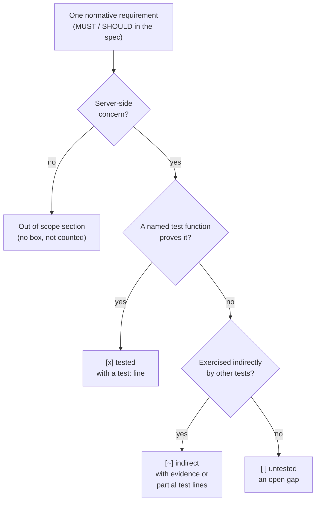

# 要件台帳

[ドキュメント](../README.md) › 要件台帳

| 項目 | 内容 |
|---|---|
| 目的 | 仕様ごとの要件台帳の一覧と、各台帳のテストの件数を示す |
| 読む人 | wired のプロトコル対応を確かめる人、テストが必要な所を探すコントリビューター |
| 前提文書 | [台帳の書式](FORMAT.md) |
| 関連文書 | [相互運用性の検証結果](../verification/interop.md)、[既知の制限](../security/limitations/README.md) |

## 1. 要件台帳

各台帳は 1 つの仕様の要件台帳である。サーバーに当てはまる規範的な要件(仕様の MUST、SHOULD などの文)1 つにつき 1 項目を立て、それを確かめるテストに結び付ける。要件は EARS 形式(「T とき、サーバーは X しなければならない」などの決まった文型)で書き直し、各要件を単独で確かめられる形にする。

サーバーの役目ではない要件(クライアントだけの動作、運用者向けの指針)は、理由を添えて台帳の「対象外」の節に入れ、数えない。

| 規則 | 内容 |
|---|---|
| 書式 | すべての台帳が [台帳の書式](FORMAT.md) に従う |
| 項目 | ID、仕様の節、印を 1 つずつ持つ |
| ID | ほかのページや issue が引用するので変えない。消した項目の番号は欠番のまま残し、新しい項目は仕様の順序と合わなくても次の空き番号を使う。RFC 9000 の台帳は仮の ID `9000-XXX` を使う |
| `test:` 行 | `tests/` の下のテストファイルと、その中のテスト関数を挙げる |
| 検査 | `scripts/check_features.py`(`just features-check`。CI で実行)が、挙げたファイルと関数の存在、ID の重複のなさ、各カバレッジ行と下の表がチェックボックスと一致することを確かめる |

## 2. 印の意味

| 印 | 意味 | 示し方 |
|---|---|---|
| `[x]` テスト済み | 名前を挙げたテスト関数がこの要件を確かめる | `test:` 行 |
| `[~]` 間接 | その要件だけを狙ったテストはないが、ほかのテストがそれを動かす | evidence 行か、要件の一部を確かめるテストの `test:` 行 |
| `[ ]` 未テスト | どのテストでも確かめていない。この一覧が未解決のギャップの一覧である | なし |

`[x]` のテストは、出荷するサーバーが実行するコード、つまり `examples/` からサーバーループを通って届くコードを動かすものに限る。本番の経路から呼ばれないヘルパーのテストは、そのヘルパーが動くことしか示さないので、数えても間接どまりである。

この到達性の規則は、「実装は〜しなければならない」と書くライブラリやコーデックの項目を含め、すべての項目に当てはまる。テスト、ファズハーネス、出荷していないクライアントからしか呼ばれないプリミティブは `[~]` で、サーバーの経路でまったく動かないなら `[ ]` である。

次の図は 1 つの要件に付く印の判定である。どの要件もちょうど 1 つの箱に行き着く。

## 3. 表の読み方

| 列 | 意味 |
|---|---|
| 確認済み | `[x]` と `[~]` の合計を「件数/総数」で示す。総数はその台帳の対象範囲の要件の数(テスト済み + 間接 + 未テスト) |
| テスト済み | `[x]` の数 |
| 間接 | `[~]` の数(確認済みとテスト済みの差) |
| 未テスト | `[ ]` の数 |

## 4. 相互運用性を別に追う理由

台帳が示すのは、wired のテストが解釈した仕様のとおりに wired のコードが動くことである。wired が自分自身と通信するテスト(ループバックテスト)では両端が同じコードなので、共通の誤りは打ち消し合い、テストは通る。

ワイヤー上の互換性は独立した実装(第三者の QUIC クライアント)を相手に動かしたときだけ示せるので、その結果は [相互運用性の検証結果](../verification/interop.md) にまとめている。

## 5. 仕様ごとのカバレッジ

**合計: 2554/2563 件の要件を確認済み(99.6%)。内訳は直接テスト 2219 件、
間接 335 件、未テスト 9 件。**

### 5.1 QUIC のコア

| 仕様 | 確認済み | テスト済み | 間接 | 未テスト |
|---|---|---|---|---|
| [RFC 9000: QUIC トランスポート](rfc9000.md) | 273/273 | 250 | 23 | 0 |
| [RFC 9001: TLS を使った QUIC の保護](rfc9001.md) | 78/78 | 72 | 6 | 0 |
| [RFC 9002: 損失検出と輻輳制御](rfc9002.md) | 75/75 | 62 | 13 | 0 |
| [RFC 8999: バージョンに依存しない性質](rfc8999.md) | 16/16 | 14 | 2 | 0 |

### 5.2 QUIC の拡張

| 仕様 | 確認済み | テスト済み | 間接 | 未テスト |
|---|---|---|---|---|
| [RFC 9221: 信頼性のないデータグラム拡張](rfc9221.md) | 26/26 | 23 | 3 | 0 |
| [RFC 9287: QUIC ビットのグリース](rfc9287.md) | 8/8 | 7 | 1 | 0 |
| [RFC 9368: 互換バージョンネゴシエーション](rfc9368.md) | 25/25 | 20 | 5 | 0 |
| [RFC 9369: QUIC バージョン 2](rfc9369.md) | 29/29 | 23 | 6 | 0 |
| [RFC 9308: 適用性(Informational)](rfc9308.md) | 10/10 | 9 | 1 | 0 |
| [RFC 9312: 管理性(Informational)](rfc9312.md) | 5/5 | 3 | 2 | 0 |
| [RFC 8899: DPLPMTUD](rfc8899.md) | 34/34 | 26 | 8 | 0 |

### 5.3 TLS と PKI

| 仕様 | 確認済み | テスト済み | 間接 | 未テスト |
|---|---|---|---|---|
| [RFC 8446: TLS 1.3](rfc8446.md) | 139/139 | 112 | 27 | 0 |
| [RFC 5280: X.509 / PKI](rfc5280.md) | 57/57 | 47 | 10 | 0 |
| [RFC 5480: 証明書の楕円曲線公開鍵](rfc5480.md) | 21/21 | 21 | 0 | 0 |
| [RFC 5758: ECDSA / SHA-2 の署名 OID](rfc5758.md) | 9/9 | 8 | 1 | 0 |
| [RFC 8410: Ed25519/X25519 のアルゴリズム識別子](rfc8410.md) | 19/19 | 15 | 4 | 0 |
| [RFC 6066: TLS 拡張(SNI)](rfc6066.md) | 14/14 | 13 | 1 | 0 |
| [RFC 6125: サービスアイデンティティの検証](rfc6125.md) | 14/14 | 11 | 3 | 0 |
| [RFC 7301: ALPN](rfc7301.md) | 15/15 | 13 | 2 | 0 |
| [RFC 8017: PKCS #1(RSA)](rfc8017.md) | 23/23 | 18 | 5 | 0 |

### 5.4 暗号プリミティブ

| 仕様 | 確認済み | テスト済み | 間接 | 未テスト |
|---|---|---|---|---|
| [RFC 8439: ChaCha20-Poly1305](rfc8439.md) | 34/34 | 24 | 10 | 0 |
| [RFC 7748: X25519](rfc7748.md) | 16/16 | 13 | 3 | 0 |
| [RFC 8032: Ed25519](rfc8032.md) | 20/20 | 18 | 2 | 0 |
| [RFC 6979: 決定論的 ECDSA](rfc6979.md) | 21/21 | 17 | 4 | 0 |
| [RFC 5869: HKDF](rfc5869.md) | 9/9 | 9 | 0 | 0 |
| [RFC 6090: 楕円曲線の演算](rfc6090.md) | 28/28 | 26 | 2 | 0 |
| [FIPS 197: AES](fips197.md) | 15/15 | 12 | 3 | 0 |
| [SP 800-38D: GCM](sp800-38d.md) | 23/23 | 15 | 8 | 0 |
| [FIPS 186-4: ECDSA / DSS](fips186-4.md) | 24/24 | 20 | 4 | 0 |
| [FIPS 180-4: SHA-2](fips180-4.md) | 26/26 | 24 | 2 | 0 |
| [FIPS 198-1: HMAC](fips198-1.md) | 10/10 | 9 | 1 | 0 |

### 5.5 HTTP/3 と QPACK

| 仕様 | 確認済み | テスト済み | 間接 | 未テスト |
|---|---|---|---|---|
| [RFC 9114: HTTP/3](rfc9114.md) | 96/97 | 81 | 15 | 1 |
| [RFC 9110: HTTP のセマンティクス](rfc9110.md) | 43/43 | 42 | 1 | 0 |
| [RFC 9204: QPACK](rfc9204.md) | 66/67 | 57 | 9 | 1 |
| [RFC 7541: HPACK(QPACK が再利用)](rfc7541.md) | 18/18 | 18 | 0 | 0 |
| [RFC 9218: 拡張可能な優先度](rfc9218.md) | 22/22 | 18 | 4 | 0 |

### 5.6 WebTransport

| 仕様 | 確認済み | テスト済み | 間接 | 未テスト |
|---|---|---|---|---|
| [draft-ietf-webtrans-http3-16](draft-webtrans-http3.md) | 81/81 | 74 | 7 | 0 |
| [RFC 9220: Extended CONNECT](rfc9220.md) | 10/10 | 9 | 1 | 0 |
| [RFC 9297: HTTP データグラムとカプセル](rfc9297.md) | 27/27 | 22 | 5 | 0 |

### 5.7 MOQT

| 仕様 | 確認済み | テスト済み | 間接 | 未テスト |
|---|---|---|---|---|
| [draft-ietf-moq-transport-18](draft-moq-transport-18.md) | 246/248 | 219 | 27 | 2 |
| [draft-ietf-moq-transport-19](draft-moq-transport.md) | 246/248 | 213 | 33 | 2 |
| [draft-ietf-moq-transport-22](draft-moq-transport-22.md) | 258/259 | 224 | 34 | 1 |
| [draft-ietf-moq-transport-23](draft-moq-transport-23.md) | 295/297 | 261 | 34 | 2 |

上の表は実験的な機能を数えない。[MoQT の Track 切り替え](moqt-track-switching.md) は moqtail 互換のオプトインの拡張(SWITCH_FROM 0x24、SWITCHING_SET_ASSIGNMENT 0x41、SSTS_ALGORITHMS 0x09)で、draft-22 のセッションで使える。draft-23 のセッションでは SSTS_ALGORITHMS を 0x3F01 に移す。

テストはプロセス内だけで、第三者との相互運用性テストはしていない。項目は draft-22 の台帳の [実験的な拡張](draft-moq-transport-22.md#実験的な拡張moqtail-互換の-track-切り替え) の節にある。

### 5.8 IP/UDP の基盤

| 仕様 | 確認済み | テスト済み | 間接 | 未テスト |
|---|---|---|---|---|
| [RFC 768: UDP](rfc768.md) | 9/9 | 9 | 0 | 0 |
| [RFC 791: IPv4](rfc791.md) | 16/16 | 14 | 2 | 0 |
| [RFC 1071: インターネットチェックサム](rfc1071.md) | 5/5 | 4 | 1 | 0 |

意図的な制限、仕様からの逸脱、容量の制限は [既知の制限](../security/limitations/README.md) にまとめている。
