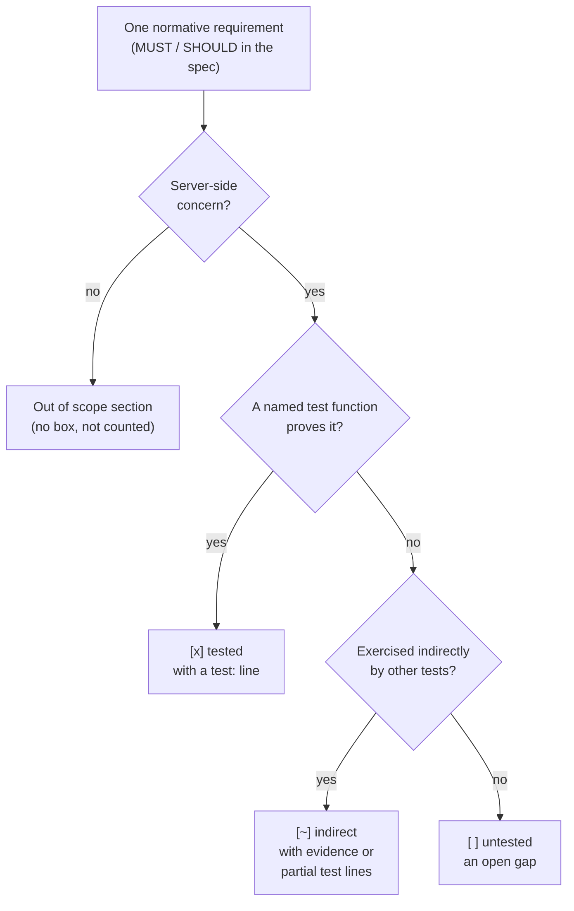

# Features — Per-Spec Requirement Ledgers

[Docs](../README.md) › Features

This page answers "how much of each spec does wired actually prove it
follows?" It is for anyone choosing wired who wants to check a protocol
claim, and for contributors looking for what still needs a test.

## What a requirement ledger is

A spec such as an RFC states its rules as normative sentences ("the server
MUST ...", "SHOULD ..."). Each file linked below is a requirement ledger for
one spec: one entry per normative requirement that applies to a server, each
linked to the test that proves it. The requirements are rewritten in EARS
form, a fixed sentence pattern ("When T, the server shall X") that makes
each one checkable on its own. A requirement that is not the server's job
(client-only behavior, operator guidance) goes into the ledger's
"Out of scope" section with a reason and is not counted.

Every ledger uses the same format: each item has an ID (most ledgers number
them in spec order; the RFC 9000 ledger still uses the placeholder `9000-XXX`),
the spec section, and one marker. Each `test:` line names a test file under
`tests/` and a test function in it. A maintainer script checks that every cited
file and function name exists and that each ledger's coverage line matches its
boxes; it is run by hand, not in CI.

## What the markers mean

- `[x]` tested: a named test function proves this requirement. The test
  has to drive the code the shipping server runs. A test of a helper that
  no production path calls shows only that the helper works, so it counts
  as indirect at most.
- `[~]` indirect: no test targets it alone, but other tests exercise it. An
  evidence line, or `test:` lines for the tests that cover part of it, says
  which ones.
- `[ ]` untested: no test shows it yet. These boxes are the list of open
  gaps.

The flowchart shows how one requirement gets its marker. Follow the arrows
from the top; each requirement ends in exactly one box.

## Reading the tables

**Tested** counts the `[x]` items. **Demonstrated** counts `[x]` plus
`[~]`: every requirement with some test evidence, direct or indirect. So the
gap between the two columns is the **Indirect** column. **Untested** is the
`[ ]` count. Demonstrated is shown as n/total, where total is the number of
in-scope requirements in that ledger (Tested + Indirect + Untested).

## Why interop is tracked separately

These ledgers show that wired's code does what the spec says, as wired's own
tests interpret the spec. A test where wired talks to itself (a loopback test)
has the same code on both ends, so a shared mistake cancels out and the test
still passes. Only running against an independent implementation (a third-party
QUIC client) proves wire compatibility, so those results live on their own
page: **[Interop Results](../interop.md)**.

## Coverage by spec

**Total: 2237/2256 requirements demonstrated (99.2%) — 1943 directly tested,
294 indirect, 19 untested.**

## QUIC core

| Spec | Demonstrated | Tested | Indirect | Untested |
|---|---|---|---|---|
| [RFC 9000 — QUIC Transport](rfc9000.md) | 275/275 | 256 | 19 | 0 |
| [RFC 9001 — Using TLS to Secure QUIC](rfc9001.md) | 78/78 | 74 | 4 | 0 |
| [RFC 9002 — Loss Detection and Congestion Control](rfc9002.md) | 75/75 | 62 | 13 | 0 |
| [RFC 8999 — Version-Independent Properties](rfc8999.md) | 16/16 | 14 | 2 | 0 |

## QUIC extensions

| Spec | Demonstrated | Tested | Indirect | Untested |
|---|---|---|---|---|
| [RFC 9221 — Unreliable Datagram Extension](rfc9221.md) | 26/26 | 23 | 3 | 0 |
| [RFC 9287 — Greasing the QUIC Bit](rfc9287.md) | 8/8 | 7 | 1 | 0 |
| [RFC 9368 — Compatible Version Negotiation](rfc9368.md) | 25/25 | 21 | 4 | 0 |
| [RFC 9369 — QUIC Version 2](rfc9369.md) | 29/29 | 24 | 5 | 0 |
| [RFC 9308 — Applicability (informational)](rfc9308.md) | 10/10 | 9 | 1 | 0 |
| [RFC 9312 — Manageability (informational)](rfc9312.md) | 5/5 | 3 | 2 | 0 |
| [RFC 8899 — DPLPMTUD](rfc8899.md) | 34/34 | 27 | 7 | 0 |

## TLS and PKI

| Spec | Demonstrated | Tested | Indirect | Untested |
|---|---|---|---|---|
| [RFC 8446 — TLS 1.3](rfc8446.md) | 131/131 | 106 | 25 | 0 |
| [RFC 5280 — X.509 / PKI](rfc5280.md) | 57/57 | 47 | 10 | 0 |
| [RFC 5480 — EC public keys in certificates](rfc5480.md) | 21/21 | 21 | 0 | 0 |
| [RFC 5758 — ECDSA / SHA-2 signature OIDs](rfc5758.md) | 9/9 | 8 | 1 | 0 |
| [RFC 8410 — Ed25519/X25519 algorithm identifiers](rfc8410.md) | 19/19 | 15 | 4 | 0 |
| [RFC 6066 — TLS extensions (SNI)](rfc6066.md) | 14/14 | 13 | 1 | 0 |
| [RFC 6125 — Service identity verification](rfc6125.md) | 14/14 | 11 | 3 | 0 |
| [RFC 7301 — ALPN](rfc7301.md) | 15/15 | 13 | 2 | 0 |
| [RFC 8017 — PKCS #1 (RSA)](rfc8017.md) | 23/23 | 18 | 5 | 0 |

## Cryptographic primitives

| Spec | Demonstrated | Tested | Indirect | Untested |
|---|---|---|---|---|
| [RFC 8439 — ChaCha20-Poly1305](rfc8439.md) | 34/34 | 24 | 10 | 0 |
| [RFC 7748 — X25519](rfc7748.md) | 16/16 | 13 | 3 | 0 |
| [RFC 8032 — Ed25519](rfc8032.md) | 20/20 | 18 | 2 | 0 |
| [RFC 6979 — Deterministic ECDSA](rfc6979.md) | 21/21 | 17 | 4 | 0 |
| [RFC 5869 — HKDF](rfc5869.md) | 9/9 | 9 | 0 | 0 |
| [RFC 6090 — EC arithmetic](rfc6090.md) | 28/28 | 26 | 2 | 0 |
| [FIPS 197 — AES](fips197.md) | 15/15 | 12 | 3 | 0 |
| [SP 800-38D — GCM](sp800-38d.md) | 23/23 | 15 | 8 | 0 |
| [FIPS 186-4 — ECDSA / DSS](fips186-4.md) | 24/24 | 20 | 4 | 0 |
| [FIPS 180-4 — SHA-2](fips180-4.md) | 26/26 | 24 | 2 | 0 |
| [FIPS 198-1 — HMAC](fips198-1.md) | 10/10 | 9 | 1 | 0 |

## HTTP/3 and QPACK

| Spec | Demonstrated | Tested | Indirect | Untested |
|---|---|---|---|---|
| [RFC 9114 — HTTP/3](rfc9114.md) | 96/97 | 81 | 15 | 1 |
| [RFC 9110 — HTTP semantics](rfc9110.md) | 43/43 | 42 | 1 | 0 |
| [RFC 9204 — QPACK](rfc9204.md) | 64/65 | 55 | 9 | 1 |
| [RFC 7541 — HPACK (reused by QPACK)](rfc7541.md) | 17/17 | 17 | 0 | 0 |
| [RFC 9218 — Extensible priorities](rfc9218.md) | 22/22 | 18 | 4 | 0 |

## WebTransport

| Spec | Demonstrated | Tested | Indirect | Untested |
|---|---|---|---|---|
| [draft-ietf-webtrans-http3-16](draft-webtrans-http3.md) | 81/81 | 73 | 8 | 0 |
| [RFC 9220 — Extended CONNECT](rfc9220.md) | 10/10 | 9 | 1 | 0 |
| [RFC 9297 — HTTP Datagrams and Capsules](rfc9297.md) | 26/26 | 21 | 5 | 0 |

## MOQT

| Spec | Demonstrated | Tested | Indirect | Untested |
|---|---|---|---|---|
| [draft-ietf-moq-transport-18](draft-moq-transport-18.md) | 242/248 | 213 | 29 | 6 |
| [draft-ietf-moq-transport-19](draft-moq-transport.md) | 244/248 | 210 | 34 | 4 |
| [draft-ietf-moq-transport-22](draft-moq-transport-22.md) | 252/259 | 218 | 34 | 7 |

Experimental, not counted above:
[MoQT track switching](moqt-track-switching.md) is an opt-in,
moqtail-compatible extension (SWITCH_FROM 0x24, SWITCHING_SET_ASSIGNMENT
0x41, SSTS_ALGORITHMS 0x09) for draft-22 sessions only. It has been tested
in-process only, with no third-party interop yet. Its items are in the
draft-22 ledger's
[Experimental extensions](draft-moq-transport-22.md#experimental-extensions-moqtail-compatible-track-switching)
section.

## IP/UDP foundations

| Spec | Demonstrated | Tested | Indirect | Untested |
|---|---|---|---|---|
| [RFC 768 — UDP](rfc768.md) | 9/9 | 9 | 0 | 0 |
| [RFC 791 — IPv4](rfc791.md) | 16/16 | 14 | 2 | 0 |
| [RFC 1071 — Internet checksum](rfc1071.md) | 5/5 | 4 | 1 | 0 |

---

**Known gaps across all specs:** [Known Limitations](known-limitations.md) — every
deliberate limitation, deviation and capacity limit in one place.

**Next:** [Interop Results](../interop.md) — cross-implementation
compatibility runs. ([all docs](../README.md))
