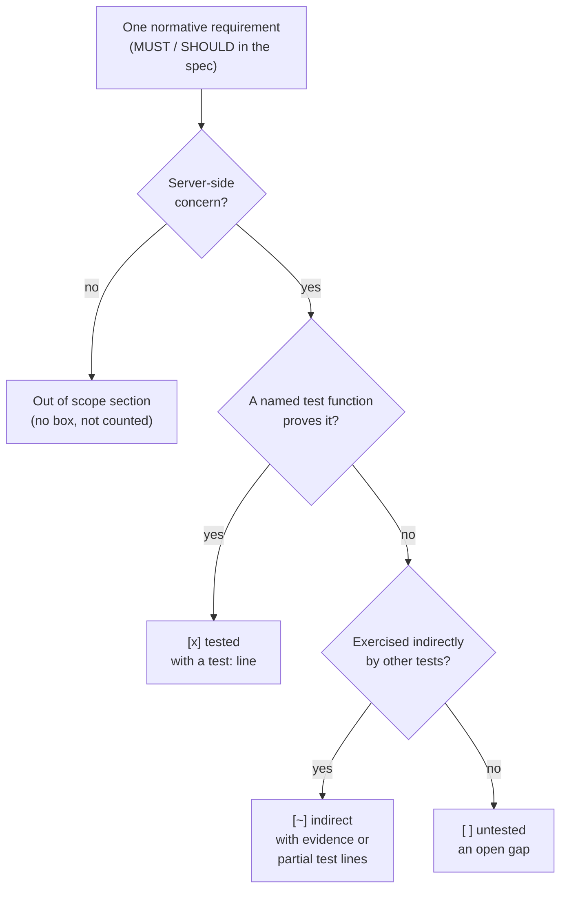

# 機能: 仕様ごとの要件台帳

[ドキュメント](../README.md) › 機能

このページは「wired は各仕様にどこまで従っていると実際に示せているのか」に答えます。
wired の採用を検討していてプロトコル対応の主張を確かめたい人と、まだテストが必要なところを探しているコントリビューターに向けたページです。

## 要件台帳とは

RFC などの仕様は規則を規範的な文("the server MUST ..."、"SHOULD ...")で書いています。
下にリンクした各ファイルは、1 つの仕様についての要件台帳です。
サーバーに当てはまる規範的な要件 1 つにつき 1 項目を立て、それぞれを、その要件を確かめるテストに結び付けています。
要件は EARS 形式で書き直しています。EARS は決まった文型(「T とき、サーバーは X しなければならない」)で、各要件を単独で確かめられる形にします。
サーバーの役目ではない要件(クライアントだけの動作や運用者向けの指針)は、理由を添えて台帳の「対象外」の節に入れ、数えません。

どの台帳も同じ書式に従います。書式は [台帳の書式](FORMAT.md) にまとめています。
各項目には ID、仕様の節、印が 1 つずつあります。
ほかのページや issue が ID を引用するので、ID は変えません。項目を消したら番号は欠番のまま残し、新しい項目は仕様の順序と合わなくても次の空き番号を使います。
RFC 9000 の台帳はまだ仮の ID `9000-XXX` を使っています。
各 `test:` 行は `tests/` の下のテストファイルと、その中のテスト関数を挙げます。
`scripts/check_features.py`(`just features-check`。CI で実行)が、挙げたファイルと関数がすべて存在すること、同じ ID が 2 回使われていないこと、各カバレッジ行と下の表がチェックボックスと一致することを確かめます。

## 印の意味

- `[x]` テスト済み: 名前を挙げたテスト関数がこの要件を確かめています。
  そのテストは、出荷するサーバーが実行するコード、つまり `examples/` からサーバーループを通って届くコードを動かすものでなければなりません。
  本番の経路から呼ばれないヘルパーのテストは、そのヘルパーが動くことしか示さないので、数えても間接どまりです。
  この到達性の規則は、「実装は〜しなければならない」と書くライブラリやコーデックの項目を含め、すべての項目に当てはまります。テスト、ファズハーネス、出荷していないクライアントからしか呼ばれないプリミティブは `[~]` で、サーバーの経路でまったく動かないなら `[ ]` です。
- `[~]` 間接: その要件だけを狙ったテストはありませんが、ほかのテストがそれを動かしています。
  evidence 行か、要件の一部を確かめるテストの `test:` 行で、どのテストかを示します。
- `[ ]` 未テスト: まだどのテストでも確かめていません。
  このチェックボックスの一覧が未解決のギャップの一覧です。

次の図は、1 つの要件にどの印が付くかを示します。
上から矢印をたどると、どの要件もちょうど 1 つの箱に行き着きます。

## 表の読み方

**テスト済み** は `[x]` の項目の数です。
**確認済み** は `[x]` と `[~]` を合わせた数で、直接か間接かを問わず、何らかのテストの裏付けがある要件の数です。
そのため、2 つの列の差が **間接** の列になります。
**未テスト** は `[ ]` の数です。
確認済みは「件数/総数」で示し、総数はその台帳の対象範囲の要件の数(テスト済み + 間接 + 未テスト)です。

## 相互接続性を別に追う理由

これらの台帳が示すのは、wired のテストが解釈した仕様のとおりに wired のコードが動くことです。
wired が自分自身と通信するテスト(ループバックテスト)では両端が同じコードなので、共通の誤りは打ち消し合い、テストは通ってしまいます。
ワイヤー上の互換性を示せるのは、独立した実装(サードパーティの QUIC クライアント)を相手に動かしたときだけです。そのため、その結果は別のページにまとめています: **[相互接続性の検証結果](../interop.md)**。

## 仕様ごとのカバレッジ

**合計: 2259/2266 件の要件を確認済み(99.7%)。内訳は直接テスト 1958 件、
間接 301 件、未テスト 7 件。**

## QUIC のコア

| 仕様 | 確認済み | テスト済み | 間接 | 未テスト |
|---|---|---|---|---|
| [RFC 9000: QUIC トランスポート](rfc9000.md) | 273/273 | 250 | 23 | 0 |
| [RFC 9001: TLS を使った QUIC の保護](rfc9001.md) | 78/78 | 72 | 6 | 0 |
| [RFC 9002: 損失検出と輻輳制御](rfc9002.md) | 75/75 | 62 | 13 | 0 |
| [RFC 8999: バージョンに依存しない性質](rfc8999.md) | 16/16 | 14 | 2 | 0 |

## QUIC の拡張

| 仕様 | 確認済み | テスト済み | 間接 | 未テスト |
|---|---|---|---|---|
| [RFC 9221: 信頼性のないデータグラム拡張](rfc9221.md) | 26/26 | 23 | 3 | 0 |
| [RFC 9287: QUIC ビットのグリース](rfc9287.md) | 8/8 | 7 | 1 | 0 |
| [RFC 9368: 互換バージョンネゴシエーション](rfc9368.md) | 25/25 | 20 | 5 | 0 |
| [RFC 9369: QUIC バージョン 2](rfc9369.md) | 29/29 | 23 | 6 | 0 |
| [RFC 9308: 適用性(Informational)](rfc9308.md) | 10/10 | 9 | 1 | 0 |
| [RFC 9312: 管理性(Informational)](rfc9312.md) | 5/5 | 3 | 2 | 0 |
| [RFC 8899: DPLPMTUD](rfc8899.md) | 34/34 | 26 | 8 | 0 |

## TLS と PKI

| 仕様 | 確認済み | テスト済み | 間接 | 未テスト |
|---|---|---|---|---|
| [RFC 8446: TLS 1.3](rfc8446.md) | 139/139 | 112 | 27 | 0 |
| [RFC 5280: X.509 / PKI](rfc5280.md) | 57/57 | 47 | 10 | 0 |
| [RFC 5480: 証明書の楕円曲線公開鍵](rfc5480.md) | 21/21 | 21 | 0 | 0 |
| [RFC 5758: ECDSA / SHA-2 の署名 OID](rfc5758.md) | 9/9 | 8 | 1 | 0 |
| [RFC 8410: Ed25519/X25519 のアルゴリズム識別子](rfc8410.md) | 19/19 | 15 | 4 | 0 |
| [RFC 6066: TLS 拡張(SNI)](rfc6066.md) | 14/14 | 13 | 1 | 0 |
| [RFC 6125: サービスアイデンティティの検証](rfc6125.md) | 14/14 | 11 | 3 | 0 |
| [RFC 7301: ALPN](rfc7301.md) | 15/15 | 13 | 2 | 0 |
| [RFC 8017: PKCS #1(RSA)](rfc8017.md) | 23/23 | 18 | 5 | 0 |

## 暗号プリミティブ

| 仕様 | 確認済み | テスト済み | 間接 | 未テスト |
|---|---|---|---|---|
| [RFC 8439: ChaCha20-Poly1305](rfc8439.md) | 34/34 | 24 | 10 | 0 |
| [RFC 7748: X25519](rfc7748.md) | 16/16 | 13 | 3 | 0 |
| [RFC 8032: Ed25519](rfc8032.md) | 20/20 | 18 | 2 | 0 |
| [RFC 6979: 決定論的 ECDSA](rfc6979.md) | 21/21 | 17 | 4 | 0 |
| [RFC 5869: HKDF](rfc5869.md) | 9/9 | 9 | 0 | 0 |
| [RFC 6090: 楕円曲線の演算](rfc6090.md) | 28/28 | 26 | 2 | 0 |
| [FIPS 197: AES](fips197.md) | 15/15 | 12 | 3 | 0 |
| [SP 800-38D: GCM](sp800-38d.md) | 23/23 | 15 | 8 | 0 |
| [FIPS 186-4: ECDSA / DSS](fips186-4.md) | 24/24 | 20 | 4 | 0 |
| [FIPS 180-4: SHA-2](fips180-4.md) | 26/26 | 24 | 2 | 0 |
| [FIPS 198-1: HMAC](fips198-1.md) | 10/10 | 9 | 1 | 0 |

## HTTP/3 と QPACK

| 仕様 | 確認済み | テスト済み | 間接 | 未テスト |
|---|---|---|---|---|
| [RFC 9114: HTTP/3](rfc9114.md) | 96/97 | 81 | 15 | 1 |
| [RFC 9110: HTTP のセマンティクス](rfc9110.md) | 43/43 | 42 | 1 | 0 |
| [RFC 9204: QPACK](rfc9204.md) | 66/67 | 57 | 9 | 1 |
| [RFC 7541: HPACK(QPACK が再利用)](rfc7541.md) | 18/18 | 18 | 0 | 0 |
| [RFC 9218: 拡張可能な優先度](rfc9218.md) | 22/22 | 18 | 4 | 0 |

## WebTransport

| 仕様 | 確認済み | テスト済み | 間接 | 未テスト |
|---|---|---|---|---|
| [draft-ietf-webtrans-http3-16](draft-webtrans-http3.md) | 81/81 | 74 | 7 | 0 |
| [RFC 9220: Extended CONNECT](rfc9220.md) | 10/10 | 9 | 1 | 0 |
| [RFC 9297: HTTP データグラムとカプセル](rfc9297.md) | 27/27 | 22 | 5 | 0 |

## MOQT

| 仕様 | 確認済み | テスト済み | 間接 | 未テスト |
|---|---|---|---|---|
| [draft-ietf-moq-transport-18](draft-moq-transport-18.md) | 246/248 | 219 | 27 | 2 |
| [draft-ietf-moq-transport-19](draft-moq-transport.md) | 246/248 | 213 | 33 | 2 |
| [draft-ietf-moq-transport-22](draft-moq-transport-22.md) | 258/259 | 224 | 34 | 1 |

上の表に数えていない実験的な機能:
[MoQT の Track 切り替え](moqt-track-switching.md) は、moqtail 互換のオプトインの拡張(SWITCH_FROM 0x24、SWITCHING_SET_ASSIGNMENT 0x41、SSTS_ALGORITHMS 0x09)で、draft-22 のセッションでのみ使えます。
テストはプロセス内だけで、サードパーティとの相互接続性テストはまだしていません。
その項目は draft-22 の台帳の
[実験的な拡張](draft-moq-transport-22.md#実験的な拡張moqtail-互換の-track-切り替え)
の節にあります。

## IP/UDP の基盤

| 仕様 | 確認済み | テスト済み | 間接 | 未テスト |
|---|---|---|---|---|
| [RFC 768: UDP](rfc768.md) | 9/9 | 9 | 0 | 0 |
| [RFC 791: IPv4](rfc791.md) | 16/16 | 14 | 2 | 0 |
| [RFC 1071: インターネットチェックサム](rfc1071.md) | 5/5 | 4 | 1 | 0 |

---

**全仕様にわたる既知のギャップ:** [既知の制限](known-limitations.md) に、意図的な制限、仕様からの逸脱、容量の制限を 1 か所にまとめています。

**次へ:** [相互接続性の検証結果](../interop.md)(実装をまたいだ互換性の実行結果)。([すべてのドキュメント](../README.md))
