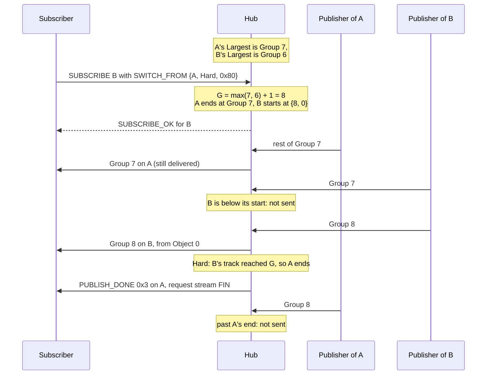
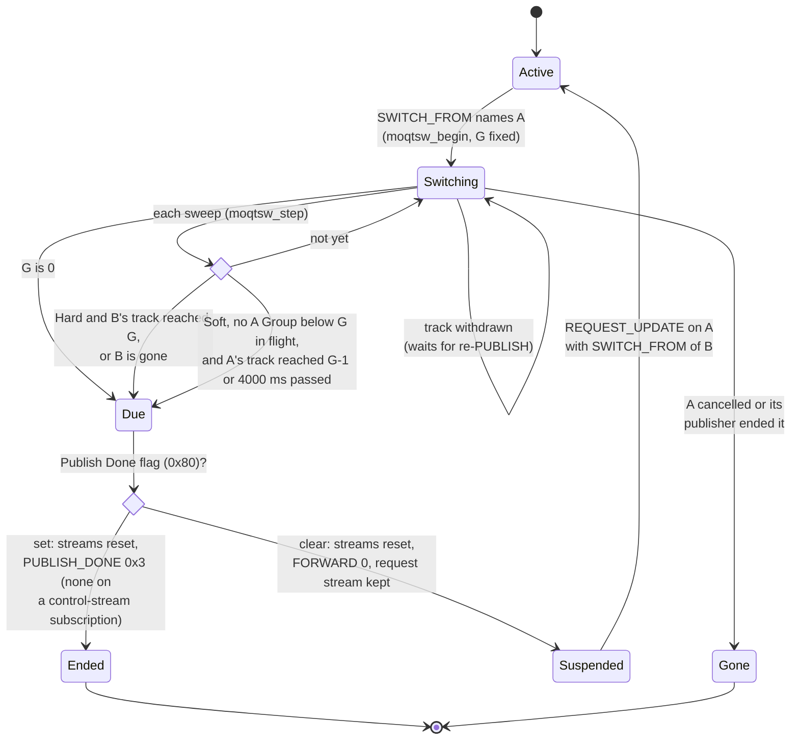
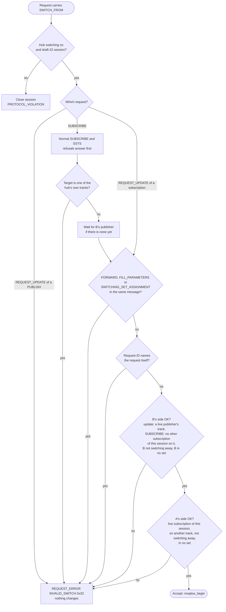
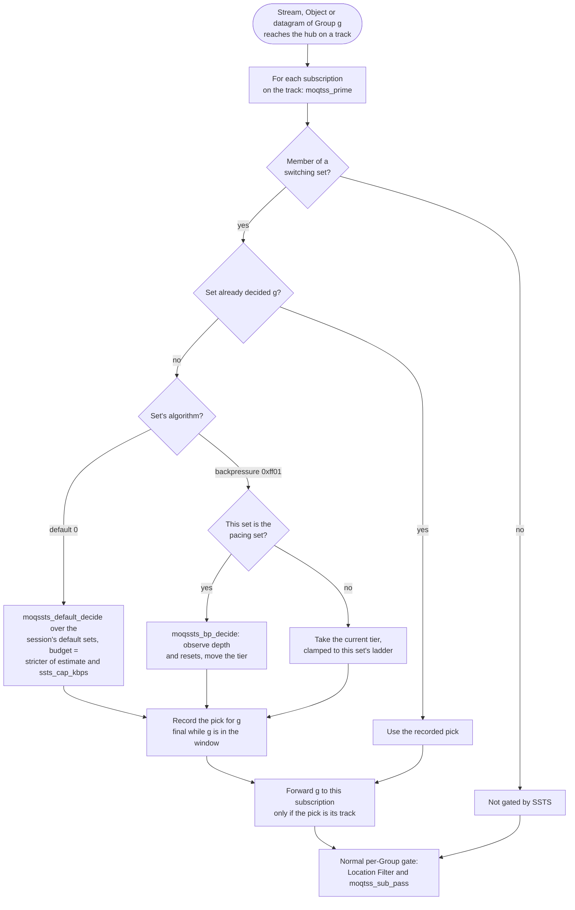

# MoQT track switching (experimental, moqtail-compatible)

[Docs](../README.md) › [Features](README.md) › MoQT track switching

This page explains how the hub moves a subscriber from one variant of a
media stream to another without a duplicate or a silent gap, and how that
looks on the wire. It is for readers who change or debug the hub's
switching code, or who build a client that talks to it. How to run a hub at
all is in the guide's [hub page](https://hakkadaikon.github.io/wired/guide/en/moqt/hub/).

The MoQT words used below (Track, Group, Object, subscription) are explained
in the guide's
[media mapping page](https://hakkadaikon.github.io/wired/guide/en/concepts/media-mapping/).
Two more are needed here. A **Request ID** is the number a client gives each
request it sends, so a later message can name that request. A track's
**Largest** is the newest Group and Object the hub has seen on it.

## What it does and how mature it is

A publisher can offer the same media in several variants, for example a
high- and a low-resolution copy of a screen share, each as its own Track.
The hub can switch a subscriber between them at a Group boundary, where a
decoder can start cleanly. It does this in two ways, both taken from
[moqtail](https://github.com/moqtail/moqtail) (commit `ee9753c`) and
wire-compatible with it:

- **SWITCH_FROM**: the subscriber asks, "activate this subscription and stop
  that one".
- **SSTS** (sender-side track switching): the subscriber puts the variants
  into a *switching set*, and the hub forwards one member per Group, chosen
  by an algorithm.

**Status: experimental.** Neither mechanism is part of
draft-ietf-moq-transport-22. Their code points are unassigned there, and the
values used are moqtail's. Everything here works **on draft-22 sessions
only**, and only when the hub enables it.

With the hub flags off, or on a draft-18 or draft-19 session, parameters
0x24 and 0x41 still close the session with PROTOCOL_VIOLATION, as they did
before the extension (`test_moqtrun_switch_off_closes`,
`test_moqtrun_switch_old_drafts_close`, `test_moqtrun_ssts_off_violates`).

All verification so far runs in-process (loopback), plus codec vectors
copied from moqtail-rs unit tests. **No third-party implementation has
been run against it yet.** See
[the draft-22 ledger](draft-moq-transport-22.md#experimental-extensions-moqtail-compatible-track-switching)
for the per-item status and
[Known Limitations](known-limitations.md#moqt-track-switching-experimental)
for the gaps.

## Wire format

MoQT encodes integers as variable-length integers (varints, "vi" below):
1 to 9 bytes, where the number of leading 1 bits in the first byte, plus
one, gives the length (`src/app/moqt/vi/moqvi.h`; not the same scheme as
QUIC's varint).

A **Message Parameter** is an optional field inside a control message. A
message carries a parameter count, then each parameter as a Type delta (its
type minus the previous parameter's type, so the first one's delta is its
type), a Length, and the value. Both parameters below may appear only in a
SUBSCRIBE, or in a REQUEST_UPDATE of a subscription (`MOQCTL_PARAM_RULES`
in `src/app/moqt/ctl/moqctl.c`). REQUEST_UPDATE is the message that changes
an existing request.

A **Setup Option** travels in the SETUP message that opens a MoQT session.
An odd option type carries a Length and that many bytes; an even one
carries a single varint (`src/app/moqt/kvp/moqkvp.h`). REQUEST_ERROR is
the answer that refuses a request. PUBLISH_DONE tells a subscriber that a
subscription has ended, with a status code saying why.

| Code point | Kind | Value | Constant (`src/app/moqt/ctl/moqctl.h`) |
|---|---|---|---|
| 0x24 | Message Parameter SWITCH_FROM | Request ID (vi), Mode (vi: 0 Hard, 1 Soft), Flags (u8: 0x80 Publish Done, other bits must be 0) | `MOQCTL_PARAM_SWITCH_FROM`, `MOQCTL_SWITCH_HARD` / `_SOFT` |
| 0x41 | Message Parameter SWITCHING_SET_ASSIGNMENT | Set ID, Algorithm ID, Threshold kbps, Weight (1..10), Activate (all vi), optional Rank (u8) | `MOQCTL_PARAM_SWITCHING_SET_ASSIGNMENT` |
| 0x09 | Setup Option SSTS_ALGORITHMS (odd: Length + bytes) | concatenated algorithm-id varints, no count | `MOQCTL_OPT_SSTS_ALGORITHMS` |
| 0x32 | REQUEST_ERROR INVALID_SWITCH | a bad SWITCH_FROM | `MOQCTL_ERR_INVALID_SWITCH` |
| 0x33 | REQUEST_ERROR UNSUPPORTED_EXTENSION | an algorithm that was not negotiated, or a track already in another set | `MOQCTL_ERR_UNSUPPORTED_EXTENSION` |
| 0x3 | PUBLISH_DONE "switched" | the old subscription of a SWITCH_FROM with Publish Done | `MOQCTL_DONE_SWITCHED` |

The golden vector (`tests/app/moqctl_switch_test.c`, the same bytes as
moqtail-rs `test_switch_from_wire_format`) is SWITCH_FROM for Request ID 7,
Hard, with Publish Done:

```text
24 03 07 00 80
```

That is Type delta 0x24, Length 3, Request ID 7, Mode 0 (Hard) and Flags
0x80. As a one-entry parameter list the bytes are `01 24 03 07 00 80`,
where the leading `01` is the parameter count.

A value with trailing bytes, an unknown Mode, a Flags bit other than 0x80,
or a Weight outside 1..10 is a decode violation. A malformed SSTS_ALGORITHMS
option closes the session with KEY_VALUE_FORMATTING_ERROR.

The extension is restricted to draft-22 partly because 0x32 means
INVALID_JOINING_REQUEST_ID in draft-18/19. 0x33 UNSUPPORTED_EXTENSION is a
standard code in all three drafts.

The hub normally passes each PUBLISH_DONE status through
`moqctl_publish_done_for`, which translates it for the session's draft. On
draft-22 that function maps 0x3 (draft-18/19 SUBSCRIPTION_ENDED) to
TRACK_ENDED, which would turn "switched" into the wrong code. So 0x3 is
written on its own path (`moqtsw_done_code` in
`src/app/moqt/run/moqtswitch.h`) and sent unchanged.

## SWITCH_FROM

Code: `src/app/moqt/run/moqtswitch.{h,c}`; tests:
`tests/app/moqtrun_switch_test.c`.

A SUBSCRIBE for track B (or a REQUEST_UPDATE of subscription B) carrying
SWITCH_FROM {A's Request ID, Mode, Flags} activates B and stops the same
session's subscription A. Below, "A" is always the subscription being left
and "B" the one being activated.

On draft-22 each request can travel on its own bidirectional stream, its
**request stream**, which also carries the answers to it. A request sent on
the session's shared control stream has no request stream of its own.

### Boundary rule

The switch must not send the subscriber any Group twice, and must not skip
a Group. So at accept time the hub picks one boundary Group G
(`moqtsw_start`):

```text
G = max(Largest_A.group, Largest_B.group) + 1     (0 when neither track has any Object)
```

A is bounded to end at Group G−1, and B to start at {G, 0} (Group G,
Object 0). Each part of the rule prevents one failure. Both failures were
found by model-checking the switch design (TLA+ is a language for
describing a design as a state machine, and its checker TLC tries every
reachable state); the names are the checker's counterexamples:

- Without the `+1` (`MC_bug_BoundaryNoPlus1`): the Group that was already
  open on A when the switch arrived was sent again on B, so the subscriber
  got that Group twice.
- Using only A's Largest (`MC_bug_BoundaryOldOnly`): when B's publisher
  was ahead, B started at a Group that had already gone by, so the Groups
  between A's last Group and B's next one were never delivered.

The diagram follows one switch. Look at which Groups each side still
sends after G is fixed.



The hub recomputes a subscription's Group range when the track's
publisher reconnects and publishes it again (a re-attach), and when the
subscriber changes its Location Filter with a REQUEST_UPDATE. While the
switch is pending, `moqtsw_rebound` re-applies the switch bounds after each
recompute, and the bounds only ever tighten. Once A has ended, B's start is
no longer clamped: a later recompute uses B's own filter again.

The variants must use the same Group numbers. The hub assumes this and does
not check it.

### Hard and Soft

The two modes trade a clean cut for speed. Soft lets A finish its last
Group; Hard switches as soon as B has data.

- **Soft (Mode 1)**: A's streams are left alone. A ends once its track has
  reached G−1 and nothing of A below G is still in flight. It also ends
  once 4000 ms (`WIRED_MOQTSW_SOFT_WAIT_MS`) have passed since the switch
  with nothing of A in flight, in case A's publisher stalls.
- **Hard (Mode 0)**: A ends once B's Group G (or a later one) reaches the
  hub, by stream or by datagram, or when B goes away (cancelled or ended).
  A's open streams are then reset with CANCELLED (0x1).
- G = 0 ends A at once in both modes.

Hard has one visible side effect. Sometimes the hub cannot open B's
Group-G stream to the subscriber yet: the subscriber has not yet allowed
another stream (QUIC stream credit), or the hub already has too many
streams queued for it. A's in-flight Groups are still reset, before B's
Group G gets through. The gap is explicit (a stream RESET), never silent.
The hub then opens B's stream later, in the middle of Group G, and the
Objects of Group G that arrived before that point are not resent.

How A ends depends on the Publish Done flag:

- **Flag 0x80 set**: A's streams are reset, A gets PUBLISH_DONE 0x3
  ("switched"), and its request stream FINs. A gets at most one
  PUBLISH_DONE, even when its publisher's TRACK_ENDED races the switch
  (`test_moqtrun_switch_done_once_track_ended`). A subscription made on the
  control stream has no request stream to carry PUBLISH_DONE; it just
  stops.
- **Flag clear**: A is *suspended*, as in moqtail. Its streams are reset,
  it gets FORWARD 0 (the hub stops sending it Objects), and its request
  stream stays open with no PUBLISH_DONE. A later REQUEST_UPDATE on A
  carrying SWITCH_FROM of B switches back (`test_moqtrun_switch_back`).

The state diagram shows A's side of a switch. The hub re-checks every
switching A on each sweep (`moqtsw_step`); while A's track is withdrawn,
A keeps waiting for its re-PUBLISH.



### Refusals

A refused switch must leave both subscriptions exactly as they were, so
every switch check runs before anything is changed.

On a SUBSCRIBE, the request's normal checks answer first: a malformed
FILL_PARAMETERS, the usual SUBSCRIBE refusals (reserved namespace, bad
filter, authorization), and the SSTS refusal of an assignment that cannot
join a set (UNSUPPORTED_EXTENSION, see [SSTS](#ssts-sender-side-track-switching)).
A SUBSCRIBE for a track nobody publishes yet is held for a publisher or
refused DOES_NOT_EXIST as usual. Its SWITCH_FROM is checked when the
publisher arrives.

After that, the hub answers REQUEST_ERROR INVALID_SWITCH (0x32) when any of
these 15 conditions holds:

- The REQUEST_UPDATE updates a PUBLISH (SWITCH_FROM names subscriptions
  only).
- The SUBSCRIBE targets one of the hub's own tracks (tracks the hub
  publishes itself, such as `wired_moqt_publish_blob` and
  `wired_moqt_publish_live`, not relayed from a peer).
- FORWARD, FILL_PARAMETERS or SWITCHING_SET_ASSIGNMENT is in the same
  message (three conditions). The switch sets B's forwarding itself.
  FILL_PARAMETERS asks the hub to also send earlier Groups of the track on
  a separate stream, which would deliver Groups below G. SSTS and
  SWITCH_FROM are not combined (`test_moqtrun_switch_fill_refused`).
- The Request ID names the request itself.
- B's side is unusable (five conditions). On a REQUEST_UPDATE: B is on one
  of the hub's own tracks, B's publisher is gone, B is itself switching
  away, or B is in an SSTS switching set. On a SUBSCRIBE: the session
  already holds another subscription on B's track.
- A's side is unusable (four conditions): the Request ID names no live
  subscription of the session on a publisher's track, A is on the same
  track as B, A is already switching away, or A is in an SSTS switching
  set.

The flowchart gives the order the switch checks run in
(`moqtsw_sub_refusal`, `moqtsw_pub_refusal`, then `moqtsw_check` /
`moqtsw_upd_check`). The first check, switching being off, is not a
refusal: it closes the session.



## SSTS (sender-side track switching)

With SWITCH_FROM the subscriber decides when to switch. With SSTS the hub
decides for it, per Group, from what it can measure about the subscriber's
connection.

Code: the pure algorithms are in `src/app/moqt/ssts/moqssts.{h,c}` (prefix
`moqssts_`, ported from moqtail's `moqtail-ssts` crate). The hub side is in
`src/app/moqt/run/moqtssts_run.{h,c}`, with per-session state in
`moqtss.h`. Tests: `tests/app/moqssts_test.c`,
`tests/app/moqtrun_ssts_test.c`.

1. **Negotiation.** When the hub is configured, its draft-22 SETUP carries
   SSTS_ALGORITHMS. The session's algorithms are the intersection of the
   hub's list and the client's list.
1. **Membership.** A SUBSCRIBE (or REQUEST_UPDATE) carrying
   SWITCHING_SET_ASSIGNMENT puts that subscription into the set named by
   its Set ID. Members are kept sorted by Threshold. A set becomes active
   once it has `Activate` members. Until then the set picks no member, so
   its members receive no Groups.
1. **Per-Group decision.** When the first stream or datagram of Group g of
   any member track reaches the hub, that set's algorithm decides g
   (`moqtss_prime`). Only the chosen member's Group g is forwarded.

The hub refuses an assignment with UNSUPPORTED_EXTENSION (0x33) when the
algorithm was not negotiated, when the track is already in another set, or
when the subscription takes part in a SWITCH_FROM. It also answers
UNSUPPORTED_EXTENSION to an assignment on a control-stream SUBSCRIBE or on
a SUBSCRIBE to the hub's own tracks: only draft-22 request-stream
subscriptions can join a set. The reason is that such a subscription is
re-attached silently when its publisher publishes the track again, and the
new publisher's Group numbers restart under a set that may already have
been removed (`moqtrun_ssts_unsettable`).

Each set keeps its own decisions, so sets whose publishers number Groups
independently do not interfere. A decision is final for g and is never
recomputed while g is no more than 5 Groups older than the set's newest
Group (`WIRED_MOQTRUN_SSTS_KEEP`). The decision is applied by the hub's normal
per-Group gate (`moqtss_sub_pass`). Fills and FETCH do not go through this
gate.

The flowchart shows one decision. Three words come from the backpressure
algorithm below: a *tier* is a quality level, a set's *ladder* is its
members ordered by Threshold (lowest tier first), and the *pacing set* is
the one backpressure set whose Groups drive tier changes. The check runs
for every member subscription on the arriving track, but the algorithm runs
only the first time a set sees Group g.



### Algorithms

| ID | Name | In one line |
|---|---|---|
| 0 | default (`moqssts_default_decide`) | Splits a bandwidth budget across sets and picks each set's best member that fits. |
| 0xff01 | backpressure (`moqssts_bp_decide`) | Moves one quality tier up or down from how many streams back up at the hub. |

**Default.** The budget is shared out in Rank order. Only active sets
take part.

- Sets with Rank 0 are served first, and each higher Rank gets only what
  the lower Ranks left over (strict priority).
- Within one Rank, the remaining budget is shared in proportion to Weight
  (1..10).
- Each set gets its highest member whose threshold fits its share, and a
  set that needs less than its share gives the rest back to the others in
  its Rank.

The budget is the stricter of the subscriber connection's delivery-rate
estimate and `ssts_cap_kbps`, and is unlimited when both are 0. The
estimate comes from `io.est_kbps` (`wired_server_wt_est_kbps`): BBR's
bottleneck bandwidth when BBR runs, else cwnd / smoothed RTT. BBR is a
congestion controller that estimates the path's bandwidth; cwnd is how many
bytes the sender may have in flight, and RTT is the round-trip time.

**Backpressure, what it measures.** For each active set, the hub counts
the subscriber streams it still holds open for that set's member tracks.
The depth is the largest of these counts. (moqtail sums the sets instead,
which keeps two sets that share one connection on the lowest tier.)

Every subscriber stream of the session that the hub has reset since the
last decision counts as a timeout and adds to the depth
(`moqtss_note_shed`). Three kinds of reset count:

- busy shed: the subscriber's stream stayed too busy to take more data for
  too many rounds, so the hub abandoned it;
- DELIVERY_TIMEOUT: an Object outlived the subscriber's delivery deadline;
- reliable stall: a stream on the reliable path made no progress, so the
  hub gave up on it.

They count only while the session has a backpressure set.

**Backpressure, when the tier moves.** One tier is shared by all of the
session's sets, and it starts at the lowest. It moves at each Group of the
pacing set (the first active backpressure set in the session's set
table) and on the hub tick
every 100 ms (`wired_moqt_tick`), so it keeps moving while that set is
paused. Other backpressure sets take the current tier, clamped to their own
ladder.

- Depth ≤ 1 for 5 observations in a row moves up one tier.
- Depth ≥ 2 moves down one tier at once and starts a cooldown.
- During the cooldown, the tier moves down again on a timeout, or on two
  decisions in a row whose depth is greater than the previous one.

The constants are in `src/app/moqt/ssts/moqssts.h`
(`MOQSSTS_DEPTH_TARGET`, `MOQSSTS_DOWNSHIFT_DEPTH`,
`MOQSSTS_UPSHIFT_GOP_STREAK`, `MOQSSTS_COOLDOWN_HIGH_STREAK`).

## Hub configuration

Both mechanisms are off unless the application turns them on, because they
are not part of the draft. Every field is in `wired_moqt_hub`
(`src/app/moqt/run/moqtrun.h`), and `wired_moqt_init` sets each one to
"off". Set them after `wired_moqt_init`:

| Field | Meaning |
|---|---|
| `switch_track` | 1 enables SWITCH_FROM on draft-22 sessions. |
| `ssts_algs`, `ssts_alg_n` | A caller-owned list of algorithm IDs to advertise. `ssts_alg_n` 0 disables SSTS. |
| `ssts_cap_kbps` | A cap on the default algorithm's budget in kbps. 0 means uncapped. |

The IDs for `ssts_algs` are `MOQCTL_SSTS_ALG_DEFAULT` (0) and
`MOQCTL_SSTS_ALG_BACKPRESSURE` (0xff01). At most `MOQCTL_SSTS_MAX_ALGS` (4)
are sent. When the delivery-rate estimate is stricter than
`ssts_cap_kbps`, the estimate is used.

From `examples/moqt_chat/wired_server.c`, which lists backpressure first
and the default allocation as the fallback:

```c
static const u64 chat_ssts_algs[] = {
    MOQCTL_SSTS_ALG_BACKPRESSURE, MOQCTL_SSTS_ALG_DEFAULT};
g_hub.switch_track = 1;
g_hub.ssts_algs    = chat_ssts_algs;
g_hub.ssts_alg_n   = sizeof chat_ssts_algs / sizeof chat_ssts_algs[0];
```

Capacity: each subscriber session can hold `WIRED_MOQTRUN_SSTS_SETS` (8)
switching sets (an assignment beyond that is refused with INTERNAL_ERROR),
and
each set can hold `MOQSSTS_MAX_MEMBERS` (4) members.
`WIRED_MOQTRUN_MAX_TRACKS_PER_PEER` is 4 (raised from 3) so that one peer
can publish a fourth, low-rate variant track.

`examples/moqt_chat` uses all of this for its screen share. See
[its README](../../examples/moqt_chat/README.md#track-switching-screen-share-hilo-variants).

---

**Next:** [Known Limitations](known-limitations.md#moqt-track-switching-experimental)
([all features](README.md))
