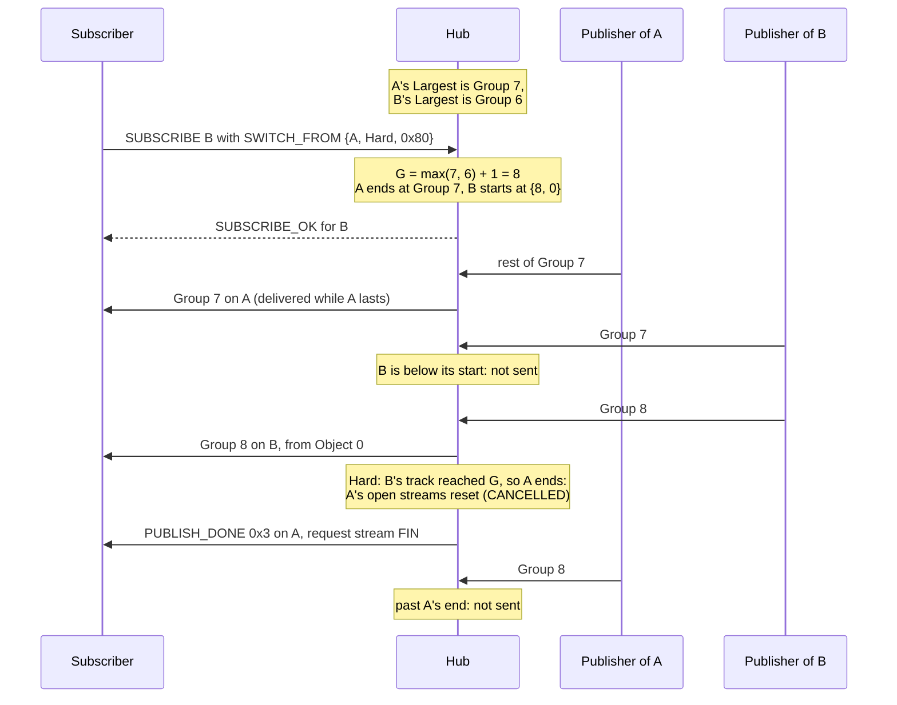

# MoQT の Track 切り替え(実験的、moqtail 互換)

[ドキュメント](../README.md) › [機能](README.md) › MoQT の Track 切り替え

このページでは、ハブが購読者をメディアストリームのある変種から別の変種へ、重複も気づかれない欠落もなく移す方法と、それがワイヤー上でどう見えるかを説明します。ハブの切り替えのコードを変更・デバッグする人と、ハブと通信するクライアントを作る人に向けたページです。ハブの動かし方そのものはガイドの [MoQT ハブ](https://hakkadaikon.github.io/wired/guide/ja/moqt/hub/) にあります。

以下で使う MoQT の用語(Track、Group、Object、購読)は、ガイドの [MoQT へのメディアの載せ方](https://hakkadaikon.github.io/wired/guide/ja/concepts/media-mapping/) で説明しています。ここではさらに 2 つの用語を使います。**Request ID** は、クライアントが送る各リクエストに付ける番号で、あとのメッセージがそのリクエストを指せるようにするものです。Track の **Largest** は、ハブがその Track で見た最も新しい Group と Object です。

## 機能と成熟度

パブリッシャーは同じメディアを複数の変種で提供できます。たとえば画面共有の高解像度版と低解像度版を、それぞれ別の Track として提供します。ハブは購読者を、デコーダーがきれいに始められる Group の境界で、それらの間で切り替えられます。切り替え方は 2 通りあり、どちらも [moqtail](https://github.com/moqtail/moqtail)(コミット `ee9753c`)から取り入れたもので、ワイヤー上で moqtail と互換です。

- **SWITCH_FROM**: 購読者が「この購読を有効にして、あの購読を止めて」と頼みます。
- **SSTS**(sender-side track switching、送信側での Track 切り替え): 購読者が変種を *switching set* に入れ、ハブがアルゴリズムで選んだメンバーを Group ごとに 1 つ転送します。

**状況: 実験的。** どちらの仕組みも draft-ietf-moq-transport-22 には含まれていません。そこではコードポイントが割り当てられておらず、使っている値は moqtail のものです。ここに書いたことはすべて **draft-22 のセッションでだけ** 動き、ハブが有効にしたときに限ります。

ハブのフラグがオフのとき、または draft-18 か draft-19 のセッションでは、パラメーター 0x24 と 0x41 は、拡張を入れる前と同じく、セッションを PROTOCOL_VIOLATION で閉じます(`test_moqtrun_switch_off_closes`、`test_moqtrun_switch_old_drafts_close`、`test_moqtrun_ssts_off_violates`)。

これまでの検証はすべてプロセス内(ループバック)で動かしたものと、moqtail-rs の単体テストから写したコーデックのベクターです。**サードパーティーの実装と組み合わせて動かしたことは、まだありません。** 項目ごとの状況は [draft-22 の要件台帳](draft-moq-transport-22.md#experimental-extensions-moqtail-compatible-track-switching) を、ギャップは [既知の制限](known-limitations.md#moqt-の-track-切り替え実験的) を参照してください。

## ワイヤー形式

MoQT は整数を可変長整数(varint。以下では "vi")でエンコードします。長さは 1 から 9 バイトで、先頭バイトの先頭に並ぶ 1 のビットの数に 1 を足したものが長さになります(`src/app/moqt/vi/moqvi.h`。QUIC の varint とは別の方式です)。

**Message Parameter** は、制御メッセージの中の省略できるフィールドです。メッセージはパラメーターの数を持ち、そのあとに各パラメーターを、Type の差分(その型から直前のパラメーターの型を引いたもの。最初のパラメーターの差分は型そのもの)、Length、値の順で持ちます。下の 2 つのパラメーターはどちらも SUBSCRIBE と、購読に対する REQUEST_UPDATE にだけ現れてもよいものです(`src/app/moqt/ctl/moqctl.c` の `MOQCTL_PARAM_RULES`)。REQUEST_UPDATE は既存のリクエストを変更するメッセージです。

**Setup Option** は MoQT のセッションを開く SETUP メッセージで運ばれます。奇数のオプション型は Length とその数のバイトを持ち、偶数のオプション型は varint を 1 つ持ちます(`src/app/moqt/kvp/moqkvp.h`)。REQUEST_ERROR はリクエストを拒否する応答です。PUBLISH_DONE は購読が終わったことを、理由を示すステータスコードとともに購読者に伝えます。

| コードポイント | 種類 | 値 | 定数(`src/app/moqt/ctl/moqctl.h`) |
|---|---|---|---|
| 0x24 | Message Parameter SWITCH_FROM | Request ID (vi)、Mode (vi: 0 Hard、1 Soft)、Flags (u8: 0x80 Publish Done、ほかのビットは 0 でなければならない) | `MOQCTL_PARAM_SWITCH_FROM`, `MOQCTL_SWITCH_HARD` / `_SOFT` |
| 0x41 | Message Parameter SWITCHING_SET_ASSIGNMENT | Set ID、Algorithm ID、Threshold kbps、Weight (1..10)、Activate(すべて vi)、省略できる Rank (u8) | `MOQCTL_PARAM_SWITCHING_SET_ASSIGNMENT` |
| 0x09 | Setup Option SSTS_ALGORITHMS(奇数: Length + バイト列) | アルゴリズム ID の varint をつなげたもの。数は持たない | `MOQCTL_OPT_SSTS_ALGORITHMS` |
| 0x32 | REQUEST_ERROR INVALID_SWITCH | 不正な SWITCH_FROM | `MOQCTL_ERR_INVALID_SWITCH` |
| 0x33 | REQUEST_ERROR UNSUPPORTED_EXTENSION | ネゴシエートしていないアルゴリズム、またはすでに別のセットに入っている Track | `MOQCTL_ERR_UNSUPPORTED_EXTENSION` |
| 0x3 | PUBLISH_DONE "switched" | Publish Done 付きの SWITCH_FROM での古い購読 | `MOQCTL_DONE_SWITCHED` |

ゴールデンベクター(`tests/app/moqctl_switch_test.c`。moqtail-rs の `test_switch_from_wire_format` と同じバイト列)は、Request ID 7、Hard、Publish Done 付きの SWITCH_FROM です。

```text
24 03 07 00 80
```

これは Type の差分 0x24、Length 3、Request ID 7、Mode 0 (Hard)、Flags 0x80 です。要素が 1 つのパラメーターリストとしてはバイト列は `01 24 03 07 00 80` になり、先頭の `01` がパラメーターの数です。

後ろに余分なバイトがある値、未知の Mode、0x80 以外の Flags のビット、1..10 の範囲外の Weight は、デコード時の違反です。不正な形式の SSTS_ALGORITHMS オプションは、セッションを KEY_VALUE_FORMATTING_ERROR で閉じます。

拡張を draft-22 に限っている理由の 1 つは、draft-18/19 では 0x32 が INVALID_JOINING_REQUEST_ID を意味することです。0x33 の UNSUPPORTED_EXTENSION は、3 つのドラフトのすべてで標準のコードです。

ハブはふだん、PUBLISH_DONE の各ステータスを `moqctl_publish_done_for` に通し、セッションのドラフトに合わせて変換します。draft-22 では、この関数は 0x3(draft-18/19 の SUBSCRIPTION_ENDED)を TRACK_ENDED に対応させるので、"switched" が間違ったコードになってしまいます。そのため 0x3 は専用の経路(`src/app/moqt/run/moqtswitch.h` の `moqtsw_done_code`)で書き、変換せずに送ります。

## SWITCH_FROM

コード: `src/app/moqt/run/moqtswitch.{h,c}`、テスト: `tests/app/moqtrun_switch_test.c`。

SWITCH_FROM {A の Request ID、Mode、Flags} を持つ Track B への SUBSCRIBE(または購読 B に対する REQUEST_UPDATE)は、B を有効にし、同じセッションの購読 A を止めます。以下では常に、"A" は離れる側の購読、"B" は有効にする側の購読です。

draft-22 では、各リクエストは専用の双方向ストリームである **リクエストストリーム** で運ぶことができ、そのリクエストへの応答もこのストリームで運ばれます。セッションで共有する制御ストリームで送ったリクエストは、専用のリクエストストリームを持ちません。

### 境界の規則

切り替えでは、購読者に同じ Group を 2 回送ってはならず、どの Group も飛ばしてはなりません。そのためハブは受け入れた時点で境界の Group G を 1 つ選びます(`moqtsw_start`)。

```text
G = max(Largest_A.group, Largest_B.group) + 1     (0 when neither track has any Object)
```

A は Group G−1 で終わるように、B は {G, 0}(Group G、Object 0)から始まるように範囲を絞ります。規則の各部分はそれぞれ 1 つの失敗を防ぎます。どちらの失敗も切り替えの設計をモデル検査して見つかったものです(TLA+ は設計を状態機械として記述する言語で、その検査器 TLC は到達しうるすべての状態を試します)。名前は検査器が出した反例の名前です。

- `+1` がない場合(`MC_bug_BoundaryNoPlus1`): 切り替えが届いたときに A ですでに開いていた Group が B でもう一度送られ、購読者はその Group を 2 回受け取りました。
- A の Largest だけを使う場合(`MC_bug_BoundaryOldOnly`): B のパブリッシャーが先に進んでいると、B はすでに過ぎた Group から始まり、A の最後の Group と B の次の Group の間の Group が届かないままになりました。

次の図は 1 回の切り替えを追ったものです。G が決まったあとに、それぞれの側がどの Group をまだ送るかに注目してください。



Track のパブリッシャーが再接続して Track をもう一度パブリッシュしたとき(再アタッチ)と、購読者が REQUEST_UPDATE で Location Filter を変えたとき、ハブは購読の Group の範囲を計算し直します。切り替えが保留中の間は、計算し直すたびに `moqtsw_rebound` が切り替えの範囲を適用し直し、範囲は狭まる方向にしか変わりません。A が終わったあとは B の開始位置はもう制限されず、その後の再計算では B 自身のフィルターがまた使われます。

変種どうしは同じ Group 番号を使わなければなりません。ハブはこれを前提としており、確かめはしません。

### Hard と Soft

2 つのモードはきれいな切れ目と速さのどちらを優先するかが違います。Soft は A に最後の Group を終えさせ、Hard は B にデータが届き次第切り替えます。

- **Soft (Mode 1)**: A のストリームには手を付けません。A の Track が G−1 に達し、G より前の A のデータがもう送信中でなくなった時点で、A は終わります。A のパブリッシャーが止まった場合に備えて、切り替えから 4000 ms(`WIRED_MOQTSW_SOFT_WAIT_MS`)が過ぎ、A のデータが送信中でなければ、そのときも A は終わります。
- **Hard (Mode 0)**: B の Group G(またはそれより後の Group)がストリームかデータグラムでハブに届いた時点、または B がなくなった(キャンセルまたは終了した)時点で、A は終わります。そのあと A の開いているストリームを CANCELLED (0x1) でリセットします。
- G = 0 のときは、どちらのモードでも A はすぐに終わります。

Hard には目に見える副作用が 1 つあります。ハブが B の Group G のストリームを購読者に向けてまだ開けないことがあります。購読者がまだ次のストリームを許可していない(QUIC のストリームのクレジット)場合や、ハブがその購読者に向けたストリームをすでに多く待たせている場合です。それでも、B の Group G が届く前に、A の送信中の Group はリセットされます。この欠落は明示的なもの(ストリームの RESET)で、気づかれないものではありません。ハブはそのあと B のストリームを Group G の途中から開き、その時点より前に届いた Group G の Object は再送しません。

A の終わり方は Publish Done フラグで決まります。

- **フラグ 0x80 が立っている**: A のストリームをリセットし、A は PUBLISH_DONE 0x3("switched")を受け取り、A のリクエストストリームは FIN で閉じます。パブリッシャーの TRACK_ENDED が切り替えと競合しても、A が受け取る PUBLISH_DONE は最大 1 つです(`test_moqtrun_switch_done_once_track_ended`)。制御ストリームで作った購読には PUBLISH_DONE を運ぶリクエストストリームがないので、単に止まります。
- **フラグが立っていない**: moqtail と同じく、A は *一時停止* します。A のストリームをリセットし、A は FORWARD 0 を受け取り(ハブは A に Object を送るのをやめます)、A のリクエストストリームは PUBLISH_DONE なしで開いたままです。あとで B の SWITCH_FROM を持つ REQUEST_UPDATE を A に送ると、元に戻ります(`test_moqtrun_switch_back`)。

次の状態遷移図は切り替えの A の側を示します。ハブはスイープのたびに(`moqtsw_step`)、切り替え中のすべての A を確かめ直します。A の Track が取り下げられている間、A はその再 PUBLISH を待ち続けます。


### 拒否

拒否した切り替えでは両方の購読をまったく元のままにしなければなりません。そのため、切り替えの検査はすべて、何かを変更する前に行います。

SUBSCRIBE では、リクエストの通常の検査が先に応答します。不正な形式の FILL_PARAMETERS、通常の SUBSCRIBE の拒否(予約済みの名前空間、不正なフィルター、認可)、セットに加われない割り当てに対する SSTS の拒否(UNSUPPORTED_EXTENSION。[SSTS](#ssts-送信側での-track-切り替え) を参照)です。まだ誰もパブリッシュしていない Track への SUBSCRIBE は、通常どおりパブリッシャーが来るまで保留されるか、DOES_NOT_EXIST で拒否されます。その SWITCH_FROM は、パブリッシャーが来た時点で検査します。

そのあと、次の 15 の条件のどれかが成り立つと、ハブは REQUEST_ERROR INVALID_SWITCH (0x32) を返します。

- REQUEST_UPDATE が PUBLISH を更新している(SWITCH_FROM が指せるのは購読だけ)。
- SUBSCRIBE がハブ自身の Track(`wired_moqt_publish_blob` や `wired_moqt_publish_live` のように、相手から中継したのではなくハブ自身がパブリッシュする Track)を対象にしている。
- FORWARD、FILL_PARAMETERS、SWITCHING_SET_ASSIGNMENT のどれかが同じメッセージにある(3 つの条件)。切り替えは B の転送を自分で設定します。FILL_PARAMETERS は Track のそれより前の Group も別のストリームで送るようハブに求めるもので、G より前の Group を届けてしまいます。SSTS と SWITCH_FROM は組み合わせません(`test_moqtrun_switch_fill_refused`)。
- Request ID がそのリクエスト自身を指している。
- B の側が使えない(5 つの条件)。REQUEST_UPDATE の場合: B がハブ自身の Track にある、B のパブリッシャーがいない、B 自身が別の購読へ切り替え中である、B が SSTS の switching set に入っている。SUBSCRIBE の場合: セッションが B の Track にすでに別の購読を持っている。
- A の側が使えない(4 つの条件)。Request ID が、パブリッシャーの Track にあるそのセッションの生きている購読を指していない、A が B と同じ Track にある、A がすでに別の購読へ切り替え中である、A が SSTS の switching set に入っている。

次のフローチャートは切り替えの検査を行う順序を示します(`moqtsw_sub_refusal`、`moqtsw_pub_refusal`、そのあと `moqtsw_check` / `moqtsw_upd_check`)。最初の検査である「切り替えがオフ」は拒否ではなく、セッションを閉じます。


## SSTS (送信側での Track 切り替え)

SWITCH_FROM では、いつ切り替えるかを購読者が決めます。SSTS では、ハブが購読者のコネクションについて測れる情報をもとに、Group ごとに購読者に代わって決めます。

コード: 純粋なアルゴリズムは `src/app/moqt/ssts/moqssts.{h,c}`(接頭辞 `moqssts_`。moqtail の `moqtail-ssts` クレートから移植)にあります。ハブ側は `src/app/moqt/run/moqtssts_run.{h,c}` にあり、セッションごとの状態は `moqtss.h` にあります。テスト: `tests/app/moqssts_test.c`、`tests/app/moqtrun_ssts_test.c`。

1. **ネゴシエーション。** ハブを設定していると、ハブの draft-22 の SETUP は SSTS_ALGORITHMS を持ちます。セッションのアルゴリズムはハブのリストとクライアントのリストの共通部分です。
1. **メンバーシップ。** SWITCHING_SET_ASSIGNMENT を持つ SUBSCRIBE(または REQUEST_UPDATE)は、その購読を Set ID が指すセットに入れます。メンバーは Threshold の順に並べて保持します。セットは `Activate` 個のメンバーがそろった時点で有効になります。それまでセットはメンバーを選ばないので、メンバーは Group を受け取りません。
1. **Group ごとの決定。** どれかのメンバーの Track で、Group g の最初のストリームまたはデータグラムがハブに届くと、そのセットのアルゴリズムが g について決めます(`moqtss_prime`)。転送するのは、選ばれたメンバーの Group g だけです。

アルゴリズムをネゴシエートしていないとき、Track がすでに別のセットに入っているとき、購読が SWITCH_FROM に関わっているとき、ハブは割り当てを UNSUPPORTED_EXTENSION (0x33) で拒否します。制御ストリームでの SUBSCRIBE や、ハブ自身の Track への SUBSCRIBE での割り当てにも UNSUPPORTED_EXTENSION を返します。セットに加われるのは、draft-22 のリクエストストリームでの購読だけです。理由は、そのような購読は、パブリッシャーが Track をもう一度パブリッシュしたときに知らせなしで再アタッチされ、新しいパブリッシャーの Group 番号が、すでに削除されたかもしれないセットのもとで振り直されるからです(`moqtrun_ssts_unsettable`)。

各セットは自分の決定を別々に保持するので、パブリッシャーがそれぞれ独立に Group に番号を振るセットどうしが干渉しません。g についての決定は確定したもので、g がセットの最新の Group から 5 Group 以内の古さである間は計算し直しません(`WIRED_MOQTRUN_SSTS_KEEP`)。決定はハブの通常の Group ごとのゲート(`moqtss_sub_pass`)で適用します。Fill と FETCH はこのゲートを通りません。

次のフローチャートは 1 回の決定を示します。3 つの用語は下で説明する backpressure アルゴリズムのものです。*tier* は品質の段階、セットの *ladder* は Threshold の順に並べたメンバー(最も低い tier が先頭)、*pacing set* は、その Group を合図に tier が変わる、ただ 1 つの backpressure セットです。検査は届いた Track 上のメンバーの購読ごとに実行しますが、アルゴリズムを実行するのは、セットが Group g を初めて見たときだけです。


### アルゴリズム

| ID | 名前 | 1 行での説明 |
|---|---|---|
| 0 | default (`moqssts_default_decide`) | 帯域の予算をセットに分け、各セットで予算に収まる最もよいメンバーを選ぶ。 |
| 0xff01 | backpressure (`moqssts_bp_decide`) | ハブで詰まっているストリームの数をもとに、品質の tier を 1 段上げるか下げる。 |

**default。** 予算は Rank の順に分配します。参加するのは有効なセットだけです。

- Rank 0 のセットから先に割り当て、より高い Rank は、それより低い Rank が残した分だけを受け取ります(厳格な優先順位)。Rank を付けずに送られたセットは Rank 0 として数えます。
- 同じ Rank の中では残りの予算を Weight(1..10)に比例して分けます。
- 各セットは、自分の取り分に threshold が収まる最も高いメンバーを受け取ります。取り分より少なくて済むセットは、残りを同じ Rank のほかのセットに返します。

予算は購読者のコネクションの配信レートの推定値と `ssts_cap_kbps` のうち厳しいほうで、両方が 0 のときは無制限です。推定値は `io.est_kbps`(`wired_server_wt_est_kbps`)から得ます。BBR が動いているときは BBR のボトルネック帯域、それ以外は cwnd / smoothed RTT です。BBR は経路の帯域を推定する輻輳制御器です。cwnd は送信側が送信中にしてよいバイト数で、RTT は往復時間です。

**backpressure が測るもの。** 有効な各セットについて、ハブはそのセットのメンバーの Track に向けてまだ開いている購読者へのストリームを数えます。深さ(depth)はそれらの数のうち最大のものです。(moqtail は代わりにセットの数を合計しますが、そうすると 1 つのコネクションを共有する 2 つのセットが最も低い tier にとどまってしまいます。)

前回の決定以降にハブがリセットした、そのセッションの購読者へのストリームは、それぞれタイムアウトとして数え、深さに加えます(`moqtss_note_shed`)。数えるリセットは 3 種類です。

- busy shed: 購読者のストリームが、多すぎるラウンドにわたって忙しくてそれ以上データを受け取れなかったので、ハブがそのストリームを手放した。
- DELIVERY_TIMEOUT: Object が購読者の配信期限より長く残った。
- reliable stall: 信頼性のある経路のストリームが進まなかったので、ハブがそのストリームをあきらめた。

これらを数えるのは、セッションに pacing set(有効な backpressure セット)がある間だけです。そのため、あとから有効になったセットは古いリセットを持ち込まずに始まります。

**backpressure で tier が動くとき。** 1 つの tier をセッションのすべてのセットで共有し、tier は最も低いところから始まります。tier は pacing set(セッションのセット表で最初の有効な backpressure セット)の Group ごとと、100 ms ごとのハブの tick(`wired_moqt_tick`)で動くので、そのセットが止まっている間も動き続けます。ほかの backpressure セットは、現在の tier を自分の ladder の範囲に収めて使います。

- 深さ ≤ 1 が 5 回の観測で続くと、tier を 1 段上げます。
- 深さ ≥ 2 になると、すぐに tier を 1 段下げ、クールダウンを始めます。
- クールダウン中は、タイムアウトがあったとき、または深さが前回より大きい決定が 2 回続いたときに、tier をもう一度下げます。

定数は `src/app/moqt/ssts/moqssts.h` にあります(`MOQSSTS_DEPTH_TARGET`、`MOQSSTS_DOWNSHIFT_DEPTH`、`MOQSSTS_UPSHIFT_GOP_STREAK`、`MOQSSTS_COOLDOWN_HIGH_STREAK`)。

## ハブの設定

どちらの仕組みもドラフトに含まれないので、アプリケーションが有効にしない限りオフです。すべてのフィールドは `wired_moqt_hub`(`src/app/moqt/run/moqtrun.h`)にあり、`wired_moqt_init` が各フィールドを「オフ」に設定します。`wired_moqt_init` のあとに設定してください。

| フィールド | 意味 |
|---|---|
| `switch_track` | 1 にすると、draft-22 のセッションで SWITCH_FROM を有効にする。 |
| `ssts_algs`, `ssts_alg_n` | 広告するアルゴリズム ID のリスト。呼び出し側が所有する。`ssts_alg_n` が 0 なら SSTS を無効にする。 |
| `ssts_cap_kbps` | default アルゴリズムの予算の上限(kbps)。0 は上限なし。 |

`ssts_algs` に入れる ID は `MOQCTL_SSTS_ALG_DEFAULT` (0) と `MOQCTL_SSTS_ALG_BACKPRESSURE` (0xff01) です。送るのは最大 `MOQCTL_SSTS_MAX_ALGS` (4) 個です。配信レートの推定値が `ssts_cap_kbps` より厳しいときは、推定値を使います。

`examples/moqt_chat/wired_server.c` からの抜粋です。backpressure を先に挙げ、default の割り当てをフォールバックにしています。

```c
static const u64 chat_ssts_algs[] = {
    MOQCTL_SSTS_ALG_BACKPRESSURE, MOQCTL_SSTS_ALG_DEFAULT};
g_hub.switch_track = 1;
g_hub.ssts_algs    = chat_ssts_algs;
g_hub.ssts_alg_n   = sizeof chat_ssts_algs / sizeof chat_ssts_algs[0];
```

容量: 購読者のセッションはそれぞれ `WIRED_MOQTRUN_SSTS_SETS` (8) 個の switching set を持てます(それを超える割り当ては INTERNAL_ERROR で拒否します)。各セットは `MOQSSTS_MAX_MEMBERS` (4) 個のメンバーを持てます。`WIRED_MOQTRUN_MAX_TRACKS_PER_PEER` は 5 です。低レートの画面の変種のために 3 から 4 になり、moqt_chat のカメラの Track(変種はない)のために 5 になりました。

`examples/moqt_chat` は、これらすべてを画面共有に使っています。[その README](../../examples/moqt_chat/README.md#track-switching-screen-share-hilo-variants) を参照してください。

---

**次へ:** [既知の制限](known-limitations.md#moqt-の-track-切り替え実験的)([すべての機能](README.md))
