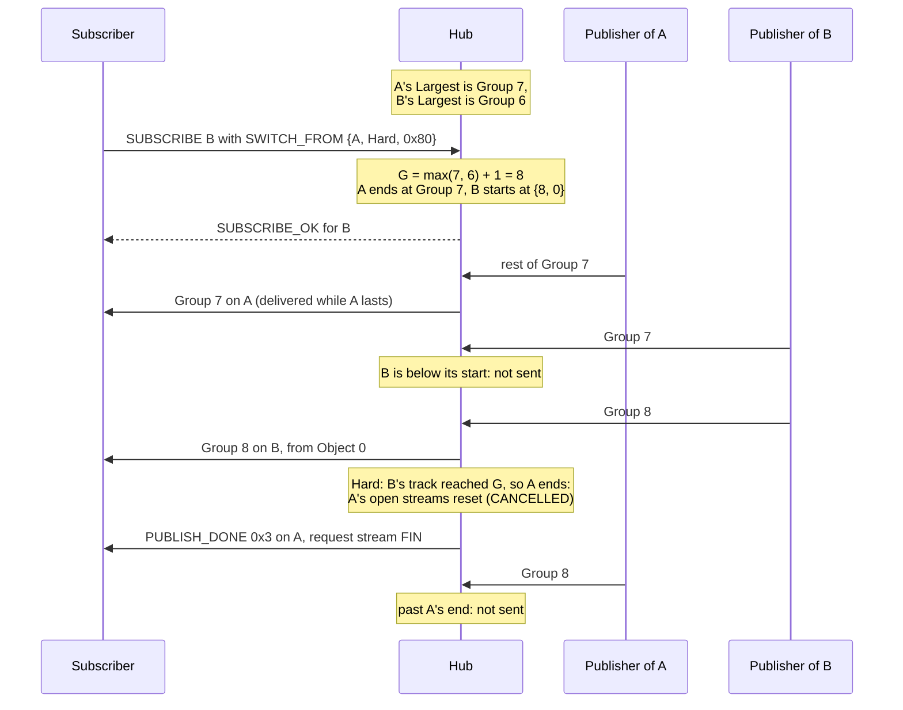
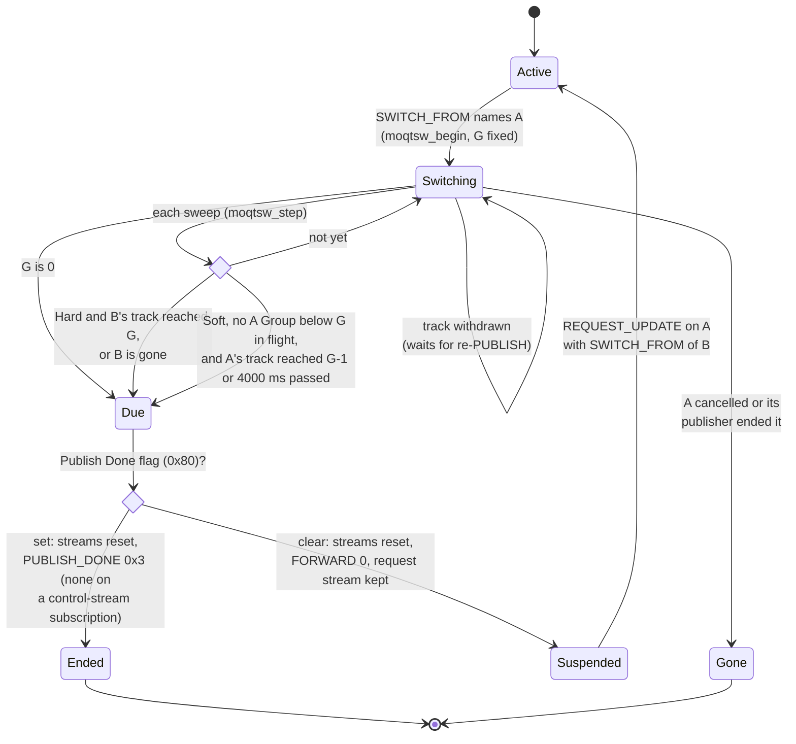
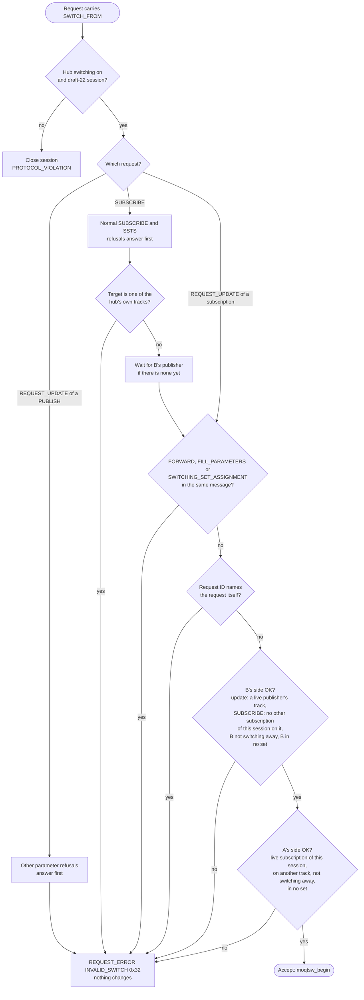
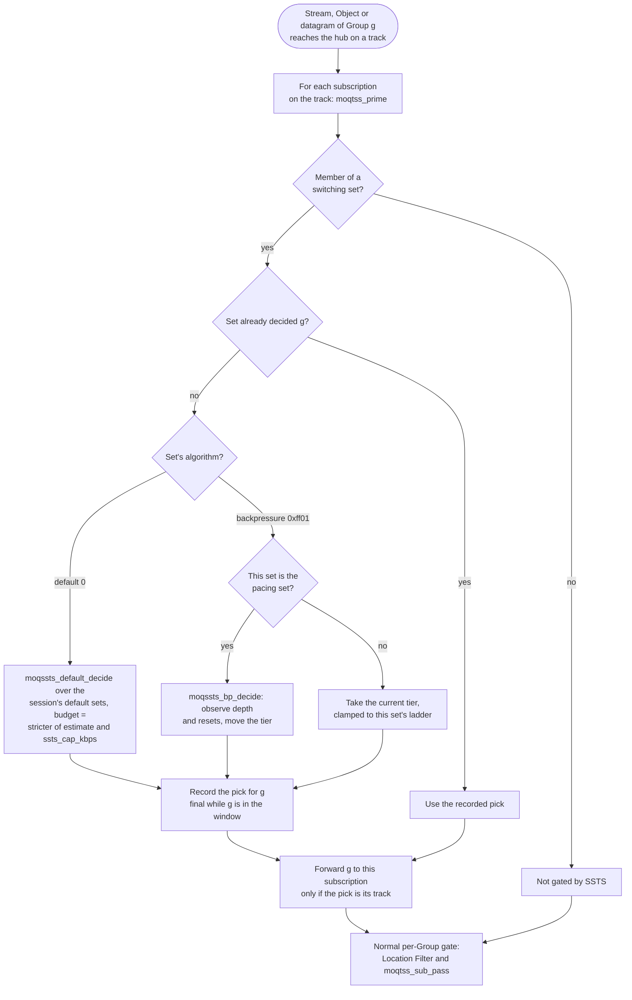

# MoQT の Track 切り替え(実験的、moqtail 互換)

[ドキュメント](../README.md) › [要件台帳](README.md) › MoQT の Track 切り替え


| 項目 | 内容 |
|---|---|
| 目的 | ハブが購読者を Track の別版の間で、重複も通知のない欠落もなく移す仕組みと、そのワイヤー形式を定める |
| 読む人 | ハブの切り替えのコードを変更・デバッグするコントリビューター、ハブと通信するクライアントを作る人 |
| 前提文書 | guide の [MoQT ハブ](https://hakkadaikon.github.io/wired/guide/ja/moqt/hub/)、[MoQT へのメディアの載せ方](https://hakkadaikon.github.io/wired/guide/ja/concepts/media-mapping/) |
| 関連文書 | [draft-22 の要件台帳](draft-moq-transport-22.md#実験的な拡張moqtail-互換の-track-切り替え)、[既知の制限: MoQT の Track 切り替え](../security/limitations/moqt-switching.md) |

| 語 | 意味 |
|---|---|
| Request ID | クライアントが各リクエストに付ける番号。あとのメッセージがそのリクエストを指すのに使う |
| Largest | ハブがその Track で見た最も新しい Group と Object |
| A / B | 切り替えで離れる側の購読 / 有効にする側の購読 |


## 1. 機能と成熟度

パブリッシャーは同じメディアを複数の別版で、それぞれ別の Track として提供できる(画面共有の高解像度版と低解像度版など)。ハブは購読者を、デコーダーが始められる Group の境界で、それらの間で切り替える。

切り替え方は 2 通りで、どちらも [moqtail](https://github.com/moqtail/moqtail)(コミット `ee9753c`)から取り入れ、ワイヤー上で moqtail と互換である。

| 方式 | 決める側 | 内容 |
|---|---|---|
| SWITCH_FROM | 購読者 | 「この購読を有効にして、あの購読を止める」と求める |
| SSTS(sender-side track switching、送信側での Track 切り替え) | ハブ | 購読者が別版を *switching set* に入れ、ハブがアルゴリズムで選んだメンバーを Group ごとに 1 つ転送する |

状況は実験的である。どちらも draft-ietf-moq-transport-22 に含まれず、コードポイントは moqtail のものを使う。動くのは **draft-22 のセッションだけ** で、ハブが有効にしたときに限る。

ハブのフラグがオフのとき、または draft-18 か draft-19 のセッションでは、パラメーター 0x24 と 0x41 は、拡張を入れる前と同じくセッションを PROTOCOL_VIOLATION で閉じる。

テスト: `test_moqtrun_switch_off_closes`、`test_moqtrun_switch_old_drafts_close`、`test_moqtrun_ssts_off_violates`。

検証はすべてプロセス内(ループバック)の実行と、moqtail-rs の単体テストから写したコーデックのベクターである。**第三者の実装と組み合わせて動かしたことはない。** 項目ごとの状況は draft-22 の要件台帳に、制限は [既知の制限: MoQT の Track 切り替え](../security/limitations/moqt-switching.md) にある。


## 2. ワイヤー形式

### 2.1 符号化の要素

| 要素 | 形式 |
|---|---|
| vi | MoQT の可変長整数。長さは 1 から 9 バイトで、先頭バイトの先頭に並ぶ 1 のビットの数に 1 を足したものが長さになる(`src/app/moqt/vi/moqvi.h`。QUIC の可変長整数とは別の方式) |
| Message Parameter | 制御メッセージの中の省略できるフィールド。メッセージはパラメーターの数を持ち、各パラメーターを Type の差分(その型から直前のパラメーターの型を引いたもの。最初は型そのもの)、Length、値の順で持つ |
| Setup Option | MoQT のセッションを開く SETUP メッセージで運ぶ。奇数の型は Length とその数のバイト、偶数の型は vi を 1 つ持つ(`src/app/moqt/kvp/moqkvp.h`) |
| REQUEST_UPDATE | 既存のリクエストを変更するメッセージ |
| REQUEST_ERROR | リクエストを拒否する応答 |
| PUBLISH_DONE | 購読が終わったことを、理由のステータスコードとともに購読者に伝えるメッセージ |

下の 2 つの Message Parameter は、どちらも SUBSCRIBE と、購読に対する REQUEST_UPDATE にだけ現れてよい(`src/app/moqt/ctl/moqctl.c` の `MOQCTL_PARAM_RULES`)。

### 2.2 コードポイント

| コードポイント | 種類 | 値 | 定数(`src/app/moqt/ctl/moqctl.h`) |
|---|---|---|---|
| 0x24 | Message Parameter SWITCH_FROM | Request ID (vi)、Mode (vi: 0 Hard、1 Soft)、Flags (u8: 0x80 Publish Done、ほかのビットは 0 でなければならない) | `MOQCTL_PARAM_SWITCH_FROM`, `MOQCTL_SWITCH_HARD` / `_SOFT` |
| 0x41 | Message Parameter SWITCHING_SET_ASSIGNMENT | Set ID、Algorithm ID、Threshold kbps、Weight (1..10)、Activate(すべて vi)、省略できる Rank (u8) | `MOQCTL_PARAM_SWITCHING_SET_ASSIGNMENT` |
| 0x09 | Setup Option SSTS_ALGORITHMS(奇数: Length + バイト列) | アルゴリズム ID の vi をつなげたもの。数は持たない | `MOQCTL_OPT_SSTS_ALGORITHMS` |
| 0x32 | REQUEST_ERROR INVALID_SWITCH | 不正な SWITCH_FROM | `MOQCTL_ERR_INVALID_SWITCH` |
| 0x33 | REQUEST_ERROR UNSUPPORTED_EXTENSION | ネゴシエートしていないアルゴリズム、またはすでに別のセットに入っている Track | `MOQCTL_ERR_UNSUPPORTED_EXTENSION` |
| 0x3 | PUBLISH_DONE "switched" | Publish Done 付きの SWITCH_FROM での古い購読 | `MOQCTL_DONE_SWITCHED` |

### 2.3 ゴールデンベクター

`tests/app/moqctl_switch_test.c` のベクターは、moqtail-rs の `test_switch_from_wire_format` と同じバイト列で、Request ID 7、Hard、Publish Done 付きの SWITCH_FROM である。

```text
24 03 07 00 80
```

| バイト | 意味 |
|---|---|
| `24` | Type の差分 0x24 |
| `03` | Length 3 |
| `07` | Request ID 7 |
| `00` | Mode 0 (Hard) |
| `80` | Flags 0x80 |

要素が 1 つのパラメーターリストとしては `01 24 03 07 00 80` になり、先頭の `01` がパラメーターの数である。

### 2.4 違反とコードの選び方

後ろに余分なバイトがある値、未知の Mode、0x80 以外の Flags のビット、1..10 の範囲外の Weight は、デコード時の違反である。不正な形式の SSTS_ALGORITHMS オプションは、セッションを KEY_VALUE_FORMATTING_ERROR で閉じる。

拡張を draft-22 に限る理由の 1 つは、draft-18/19 では 0x32 が INVALID_JOINING_REQUEST_ID を意味することである。0x33 の UNSUPPORTED_EXTENSION は 3 つのドラフトすべてで標準のコードである。

ハブは PUBLISH_DONE の各ステータスを `moqctl_publish_done_for` に通し、セッションのドラフトに合わせて変換する。

draft-22 ではこの関数が 0x3(draft-18/19 の SUBSCRIPTION_ENDED)を TRACK_ENDED に対応させるので、"switched" が別のコードになる。そのため 0x3 は専用の経路(`src/app/moqt/run/moqtswitch.h` の `moqtsw_done_code`)で書き、変換せずに送る。


## 3. SWITCH_FROM

コード: `src/app/moqt/run/moqtswitch.{h,c}`、テスト: `tests/app/moqtrun_switch_test.c`。

SWITCH_FROM {A の Request ID、Mode、Flags} を持つ Track B への SUBSCRIBE(または購読 B に対する REQUEST_UPDATE)は、B を有効にし、同じセッションの購読 A を止める。

draft-22 では、各リクエストを専用の双方向ストリームである **リクエストストリーム** で運べ、そのリクエストへの応答もこのストリームで運ぶ。セッションで共有する制御ストリームで送ったリクエストは、専用のリクエストストリームを持たない。


### 3.1 境界の規則

切り替えでは、購読者に同じ Group を 2 回送らず、どの Group も飛ばさない。そのためハブは受け入れた時点で境界の Group G を 1 つ選ぶ(`moqtsw_start`)。

```text
G = max(Largest_A.group, Largest_B.group) + 1     (0 when neither track has any Object)
```

A は Group G−1 で終わるように、B は {G, 0}(Group G、Object 0)から始まるように範囲を絞る。規則の各部分はそれぞれ 1 つの失敗を防ぐ。どちらの失敗も切り替えの設計を TLA+ で書き TLC でモデル検査して見つけたもので、名前は検査器が出した反例の名前である。

| 反例 | 規則を欠いた場合 | 起きたこと |
|---|---|---|
| `MC_bug_BoundaryNoPlus1` | `+1` がない | 切り替えが届いたときに A で開いていた Group が B でもう一度送られ、購読者はその Group を 2 回受け取った |
| `MC_bug_BoundaryOldOnly` | A の Largest だけを使う | B のパブリッシャーが先に進んでいると、B はすでに過ぎた Group から始まり、A の最後の Group と B の次の Group の間の Group が届かなかった |

次の図は 1 回の切り替えで、G が決まったあとに各側がどの Group を送るかを示す。



Track のパブリッシャーが再接続して Track をもう一度パブリッシュしたとき(再アタッチ)と、購読者が REQUEST_UPDATE で Location Filter を変えたとき、ハブは購読の Group の範囲を計算し直す。切り替えが保留中の間は、計算し直すたびに `moqtsw_rebound` が切り替えの範囲を適用し直し、範囲は狭まる方向にしか変わらない。

A が終わったあとは B の開始位置を制限せず、その後の再計算では B 自身のフィルターを使う。

別版どうしは同じ Group 番号を使う必要がある。ハブはこれを前提とし、確かめない。


### 3.2 Hard と Soft

Soft は A に最後の Group を終えさせ、Hard は B にデータが届き次第切り替える。

| モード | A が終わる時点 |
|---|---|
| Soft (Mode 1) | A のストリームには手を付けない。A の Track が G−1 に達し、G より前の A のデータが送信中でなくなった時点。A のパブリッシャーが止まった場合に備え、切り替えから 4000 ms(`WIRED_MOQTSW_SOFT_WAIT_MS`)が過ぎ、A のデータが送信中でなければ、その時点でも終わる |
| Hard (Mode 0) | B の Group G(またはそれより後の Group)がストリームかデータグラムでハブに届いた時点、または B がなくなった(キャンセルまたは終了した)時点。そのあと A の開いているストリームを CANCELLED (0x1) でリセットする |
| G = 0 | どちらのモードでも A はすぐに終わる |

Hard では、ハブが B の Group G のストリームを購読者に向けてまだ開けないことがある。購読者が次のストリームを許可していない(QUIC のストリームのクレジット)場合や、ハブがその購読者に向けたストリームを多く待たせている場合である。

それでも B の Group G が届く前に、A の送信中の Group はリセットする。この欠落はストリームの RESET で明示される。ハブはそのあと B のストリームを Group G の途中から開き、その時点より前に届いた Group G の Object は再送しない。

A の終わり方は Publish Done フラグで決まる。

| フラグ 0x80 | A の終わり方 |
|---|---|
| 立っている | A のストリームをリセットし、A は PUBLISH_DONE 0x3("switched")を受け取り、A のリクエストストリームは FIN で閉じる。パブリッシャーの TRACK_ENDED が切り替えと競合しても、A が受け取る PUBLISH_DONE は最大 1 つ(`test_moqtrun_switch_done_once_track_ended`)。制御ストリームで作った購読は PUBLISH_DONE を運ぶリクエストストリームがないので、止まるだけである |
| 立っていない | moqtail と同じく A は *一時停止* する。A のストリームをリセットし、A は FORWARD 0 を受け取り(ハブは A に Object を送るのをやめる)、A のリクエストストリームは PUBLISH_DONE なしで開いたままになる。B の SWITCH_FROM を持つ REQUEST_UPDATE を A に送ると元に戻る(`test_moqtrun_switch_back`) |

次の状態遷移図は切り替えの A の側である。ハブはスイープのたびに(`moqtsw_step`)、切り替え中のすべての A を確かめ直す。A の Track が取り下げられている間、A はその再 PUBLISH を待ち続ける。




### 3.3 拒否

拒否した切り替えでは両方の購読を元のままにする。そのため、切り替えの検査はすべて、何かを変更する前に行う。

SUBSCRIBE では、リクエストの通常の検査が先に応答する。不正な形式の FILL_PARAMETERS、通常の SUBSCRIBE の拒否(予約済みの名前空間、不正なフィルター、認可)、セットに加われない割り当てに対する SSTS の拒否(UNSUPPORTED_EXTENSION。[4. SSTS](#4-ssts送信側での-track-切り替え))である。

まだ誰もパブリッシュしていない Track への SUBSCRIBE は、通常どおりパブリッシャーが来るまで保留するか、DOES_NOT_EXIST で拒否する。その SWITCH_FROM は、パブリッシャーが来た時点で検査する。

そのあと、次の 15 の条件のどれかが成り立つと、ハブは REQUEST_ERROR INVALID_SWITCH (0x32) を返す。

| 条件 | 数 | 内容 |
|---|---|---|
| PUBLISH の更新 | 1 | REQUEST_UPDATE が PUBLISH を更新している(SWITCH_FROM が指せるのは購読だけ) |
| ハブ自身の Track | 1 | SUBSCRIBE がハブ自身の Track(`wired_moqt_publish_blob` や `wired_moqt_publish_live` のように、相手から中継せずハブがパブリッシュする Track)を対象にしている |
| 同じメッセージのパラメーター | 3 | FORWARD、FILL_PARAMETERS、SWITCHING_SET_ASSIGNMENT のどれかが同じメッセージにある。切り替えは B の転送を自分で設定する。FILL_PARAMETERS は Track のそれより前の Group も別のストリームで送るよう求め、G より前の Group を届けてしまう。SSTS と SWITCH_FROM は組み合わせない(`test_moqtrun_switch_fill_refused`) |
| 自分自身 | 1 | Request ID がそのリクエスト自身を指している |
| B の側 | 5 | REQUEST_UPDATE の場合: B がハブ自身の Track にある、B のパブリッシャーがいない、B 自身が別の購読へ切り替え中である、B が SSTS の switching set に入っている。SUBSCRIBE の場合: セッションが B の Track にすでに別の購読を持っている |
| A の側 | 4 | Request ID が、パブリッシャーの Track にあるそのセッションの生きている購読を指していない、A が B と同じ Track にある、A がすでに別の購読へ切り替え中である、A が SSTS の switching set に入っている |

次のフローチャートは検査の順序である(`moqtsw_sub_refusal`、`moqtsw_pub_refusal`、そのあと `moqtsw_check` / `moqtsw_upd_check`)。最初の「切り替えがオフ」は拒否ではなく、セッションを閉じる。




## 4. SSTS(送信側での Track 切り替え)

SWITCH_FROM では切り替える時点を購読者が決める。SSTS では、ハブが購読者の接続について測れる情報をもとに、Group ごとに決める。

| 部分 | コード |
|---|---|
| 純粋なアルゴリズム | `src/app/moqt/ssts/moqssts.{h,c}`(接頭辞 `moqssts_`。moqtail の `moqtail-ssts` クレートから移植) |
| ハブ側 | `src/app/moqt/run/moqtssts_run.{h,c}` |
| セッションごとの状態 | `moqtss.h` |
| テスト | `tests/app/moqssts_test.c`、`tests/app/moqtrun_ssts_test.c` |

1. ネゴシエーション: ハブを設定していると、ハブの draft-22 の SETUP は SSTS_ALGORITHMS を持つ。セッションのアルゴリズムはハブのリストとクライアントのリストの共通部分である。
1. メンバーシップ: SWITCHING_SET_ASSIGNMENT を持つ SUBSCRIBE(または REQUEST_UPDATE)は、その購読を Set ID が指すセットに入れる。メンバーは Threshold の順に保持する。セットは `Activate` 個のメンバーがそろった時点で有効になり、それまではメンバーを選ばないので、メンバーは Group を受け取らない。
1. Group ごとの決定: どれかのメンバーの Track で Group g の最初のストリームかデータグラムがハブに届くと、そのセットのアルゴリズムが g について決める(`moqtss_prime`)。転送するのは、選ばれたメンバーの Group g だけである。

ハブが割り当てを UNSUPPORTED_EXTENSION (0x33) で拒否するのは次の場合である。

- アルゴリズムをネゴシエートしていない。
- Track がすでに別のセットに入っている。
- 購読が SWITCH_FROM に関わっている。
- 制御ストリームでの SUBSCRIBE か、ハブ自身の Track への SUBSCRIBE に割り当てが付いている。

セットに加われるのは draft-22 のリクエストストリームでの購読だけである。制御ストリームの購読は、パブリッシャーが Track をもう一度パブリッシュしたときに通知なしで再アタッチされ、新しいパブリッシャーの Group 番号が、削除済みかもしれないセットのもとで振り直されるためである(`moqtrun_ssts_unsettable`)。

各セットは決定を別々に保持するので、パブリッシャーが独立に Group に番号を振るセットどうしは干渉しない。g についての決定は確定したもので、g がセットの最新の Group から 5 Group 以内の古さである間は計算し直さない(`WIRED_MOQTRUN_SSTS_KEEP`)。

決定はハブの通常の Group ごとのゲート(`moqtss_sub_pass`)で適用する。Fill と FETCH はこのゲートを通らない。

次のフローチャートは 1 回の決定である。

| 語 | 意味 |
|---|---|
| tier | 品質の段階 |
| ladder | セットのメンバーを Threshold の順に並べたもの(最も低い tier が先頭) |
| pacing set | その Group を合図に tier が変わる、ただ 1 つの backpressure セット |

検査は届いた Track 上のメンバーの購読ごとに実行するが、アルゴリズムを実行するのはセットが Group g を初めて見たときだけである。




### 4.1 アルゴリズム

| ID | 名前 | 内容 |
|---|---|---|
| 0 | default (`moqssts_default_decide`) | 帯域の予算をセットに分け、各セットで予算に収まる最も高いメンバーを選ぶ |
| 0xff01 | backpressure (`moqssts_bp_decide`) | ハブで詰まっているストリームの数をもとに、品質の tier を 1 段上げるか下げる |

#### 4.1.1 default

予算は Rank の順に分配し、参加するのは有効なセットだけである。

- Rank 0 のセットから先に割り当て、より高い Rank は、それより低い Rank が残した分だけを受け取る(厳格な優先順位)。Rank なしで送られたセットは Rank 0 として数える。
- 同じ Rank の中では、残りの予算を Weight(1..10)に比例して分ける。
- 各セットは、自分の取り分に threshold が収まる最も高いメンバーを受け取る。取り分より少なくて済むセットは、残りを同じ Rank のほかのセットに返す。

予算は購読者の接続の配信レートの見積もりと `ssts_cap_kbps` のうち厳しいほうで、両方が 0 のときは無制限である。見積もりは `io.est_kbps`(`wired_server_wt_est_kbps`)から得る。BBR が動いているときは BBR のボトルネック帯域、それ以外は cwnd / 平滑化 RTT である。

#### 4.1.2 backpressure が測るもの

有効な各セットについて、ハブはそのセットのメンバーの Track に向けて開いている購読者へのストリームを数える。深さ(depth)はそれらの数のうち最大のものである。moqtail はセットの数を合計するが、そうすると 1 つの接続を共有する 2 つのセットが最も低い tier にとどまる。

前回の決定以降にハブがリセットした、そのセッションの購読者へのストリームは、それぞれタイムアウトとして数え、深さに加える(`moqtss_note_shed`)。数えるリセットは次の 3 種類である。

| リセット | 内容 |
|---|---|
| busy shed | 購読者のストリームが多すぎるラウンドにわたってデータを受け取れなかったので、ハブがそのストリームを手放した |
| DELIVERY_TIMEOUT | Object が購読者の配信期限より長く残った |
| reliable stall | 信頼性のある経路のストリームが進まなかったので、ハブがそのストリームを諦めた |

これらを数えるのは、セッションに pacing set(有効な backpressure セット)がある間だけである。そのため、あとから有効になったセットは古いリセットを持ち込まずに始まる。

#### 4.1.3 backpressure で tier が動くとき

1 つの tier をセッションのすべてのセットで共有し、tier は最も低いところから始まる。

tier は pacing set(セッションのセット表で最初の有効な backpressure セット)の Group ごとと、100 ms ごとのハブの tick(`wired_moqt_tick`)で動くので、そのセットが止まっている間も動く。ほかの backpressure セットは、現在の tier を自分の ladder の範囲に収めて使う。

| 条件 | 動作 |
|---|---|
| 深さ ≤ 1 が 5 回の観測で続く | tier を 1 段上げる |
| 深さ ≥ 2 | すぐに tier を 1 段下げ、クールダウンを始める |
| クールダウン中にタイムアウトがある、または深さが前回より大きい決定が 2 回続く | tier をもう一度下げる |

定数は `src/app/moqt/ssts/moqssts.h` にある(`MOQSSTS_DEPTH_TARGET`、`MOQSSTS_DOWNSHIFT_DEPTH`、`MOQSSTS_UPSHIFT_GOP_STREAK`、`MOQSSTS_COOLDOWN_HIGH_STREAK`)。


## 5. ハブの設定

どちらの仕組みもドラフトに含まれないので、アプリケーションが有効にしない限りオフである。フィールドはすべて `wired_moqt_hub`(`src/app/moqt/run/moqtrun.h`)にあり、`wired_moqt_init` が各フィールドを「オフ」に設定する。そのため設定は `wired_moqt_init` のあとに行う。

| フィールド | 意味 |
|---|---|
| `switch_track` | 1 にすると、draft-22 のセッションで SWITCH_FROM を有効にする |
| `ssts_algs`, `ssts_alg_n` | 広告するアルゴリズム ID のリスト。呼び出し側が所有する。`ssts_alg_n` が 0 なら SSTS を無効にする |
| `ssts_cap_kbps` | default アルゴリズムの予算の上限(kbps)。0 は上限なし |

`ssts_algs` に入れる ID は `MOQCTL_SSTS_ALG_DEFAULT` (0) と `MOQCTL_SSTS_ALG_BACKPRESSURE` (0xff01) である。送るのは最大 `MOQCTL_SSTS_MAX_ALGS` (4) 個である。配信レートの見積もりが `ssts_cap_kbps` より厳しいときは見積もりを使う。

`examples/moqt_chat/server/wired_server.c` は backpressure を先に挙げ、default の割り当てをフォールバックにしている。

```c
static const u64 chat_ssts_algs[] = {
    MOQCTL_SSTS_ALG_BACKPRESSURE, MOQCTL_SSTS_ALG_DEFAULT};
g_hub.switch_track = 1;
g_hub.ssts_algs    = chat_ssts_algs;
g_hub.ssts_alg_n   = sizeof chat_ssts_algs / sizeof chat_ssts_algs[0];
```

| 容量 | 値 |
|---|---|
| 購読者のセッションあたりの switching set | `WIRED_MOQTRUN_SSTS_SETS` (8)。超える割り当ては INTERNAL_ERROR で拒否 |
| セットあたりのメンバー | `MOQSSTS_MAX_MEMBERS` (4) |
| `WIRED_MOQTRUN_MAX_TRACKS_PER_PEER` | 5。低レートの画面の別版のために 3 から 4 に、moqt_chat のカメラの Track(別版なし)のために 5 にした |

`examples/moqt_chat` はこれらすべてを画面共有に使っている([MoQT の使い方 6](../../examples/moqt_chat/wire.md#6-track-切り替え実験的))。
