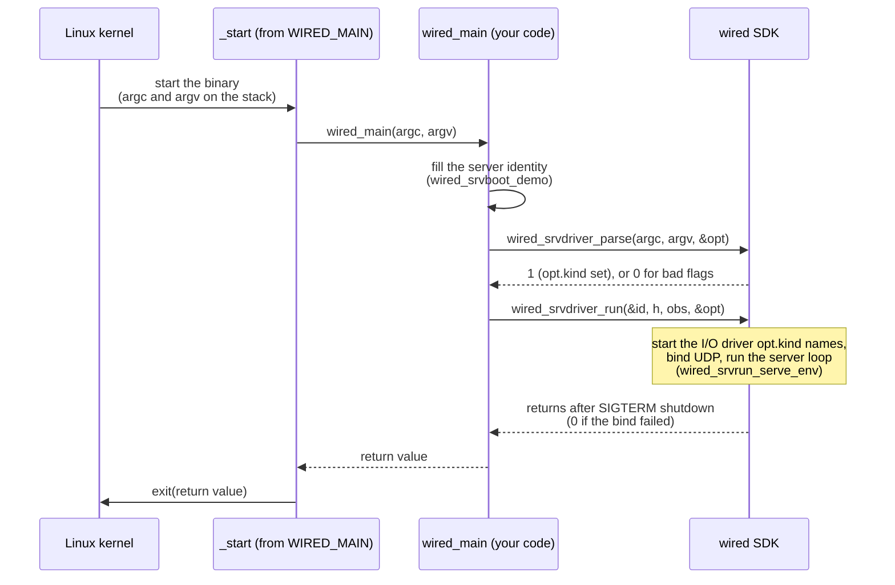
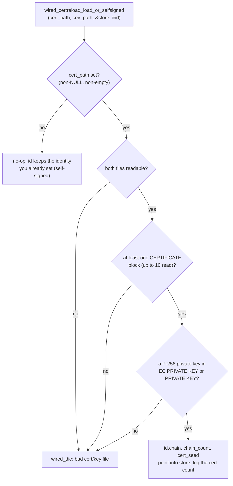

# はじめに

[ドキュメント](README.md) › はじめに

このページではリポジトリをチェックアウトした直後の状態から HTTP/3 サーバーを動かし、さらに自分のサーバーバイナリを作るところまで案内します。
想定する読み手は Web 側から HTTP と TLS を知っているものの、QUIC や libc を使わない C プログラムには触れたことがない開発者です。

HTTP/3 は QUIC の上で HTTP を運ぶプロトコルです。QUIC は TCP ではなく UDP の上で動くトランスポートで、TLS 1.3 を組み込んでいます。
QUIC の仕組みは SDK が扱うので、このページを読み進めるのに QUIC の知識は要りません。

ページは 3 部に分かれています。どの部のあとで読むのをやめてもかまいません。

| 部 | 得られるもの | 所要時間 |
|---|---|---|
| [1. 最初の 5 分](#第-1-部-最初の-5-分) | サンプルサーバーが動き、実際の HTTP/3 リクエストに応答する | 約 5 分 |
| [2. 自分のサーバー](#第-2-部-自分のサーバー) | SDK をリンクした自分のバイナリ | 約 15 分 |
| [3. さらに進む](#第-3-部-さらに進む) | I/O ドライバー、WebTransport、証明書、可観測性への案内 | 必要に応じて |

## 第 1 部: 最初の 5 分

### ツールチェーンのインストール

`wired` が対象とするのは **x86_64-linux のみ** です。
必要なのは clang、`just`(コマンドランナー。このリポジトリのビルド手順はすべて `just` のレシピです)、`ninja`(レシピが呼ぶビルドツール)、`lizard`(複雑度チェッカー)です。
入手方法は次の 2 つから選びます。

**方法 A(推奨): Nix ですべてのバージョンを固定する。** Nix はパッケージマネージャーで、システムのほかの部分に手を触れずに、正確なバージョンのツールを一時的なシェルへインストールできます。
このシェルを *devShell* と呼びます。このリポジトリの devShell には、CI と同じバージョンの clang、just、ninja、lizard、doxygen が入っています。

```sh
just setup     # one-time: installs Nix (Determinate Systems installer) if absent
nix develop    # enter the pinned devShell
```

**方法 B: 手持ちのパッケージマネージャーを使う。** `clang`、`just`、`ninja`、`lizard` をインストールします(たとえば `apt install clang just ninja-build` と `pip install lizard`)。
この方法でもビルドとテストは問題なく通ります。

方法 B で一つだけ気をつけたいのが、フォーマットと lint です。
ホストにある別バージョンの `clang-format` や `clang-tidy` は、CI とわずかに違うフォーマットや lint の結果を出すことがあります。
フォーマットのチェックで思わぬ結果が出たら、そのレシピだけを `just nix <recipe>` で固定したツールチェーンを通して実行してください。

### ビルドとテスト

```sh
just build     # format + compile + lint
just test      # run the whole test suite
```

どちらも成功で終わるはずです。`just check` はコミット前に実行する組み合わせで、複雑度のチェックとテストを合わせたものです。

### サンプルサーバーの実行

```sh
cd examples/word_list
just run       # builds the SDK + the sample, binds 0.0.0.0:4433
```

次に、UDP ポート 4433 に届くマシンから次を実行します。

```sh
curl --http3-only --insecure https://<host>:4433/
```

`--insecure` が要るのは、サンプルが自己署名証明書、つまりどの認証局(CA)も保証していない証明書を提示するためです。
手元の curl が HTTP/3 に対応していなければ、Docker 版を使います。

```sh
docker run --rm ymuski/curl-http3 \
    curl --http3-only --insecure -v https://<host>:4433/
```

**チェックポイント**: 動く HTTP/3 サーバーができました。

[examples/](../examples/) のサンプルはどれも同じ方法で動かせます。

- [word_list](../examples/word_list/): いま動かした、HTTP/3 のメッセージログと静的ファイルのサーバー。
- [webtransport_interop](../examples/webtransport_interop/): [quic-interop-runner](https://github.com/quic-interop/quic-interop-runner) テストハーネス用の WebTransport サーバーエンドポイント。
- [moqt_chat](../examples/moqt_chat/): MOQT(Media over QUIC Transport。ライブメディア向けのパブリッシュ/サブスクライブ型プロトコル)で作ったブラウザーのチャットと音声通話のルーム。
- [moqt_interop](../examples/moqt_interop/): moq-interop-runner テストハーネス用の MOQT リレー。

実際に動かしながら学べる解説は、[インタラクティブガイド](https://hakkadaikon.github.io/wired/guide/ja/)を見てください。

第 1 部で使うレシピはこの 4 つ(`setup`、`build`、`test`、`run`)だけです。第 2 部では `lib` が加わります。
レシピの全一覧は [開発](development.md#ビルドシステム) にあります。

## 第 2 部: 自分のサーバー

### ビルドが変わって見える理由

通常の C プログラムは libc にリンクします。libc は C の標準ライブラリで、`printf` や `malloc`、`main` を呼び出す起動コードを提供します。
wired は libc をまったく使わないので、サーバーは Linux カーネルだけに依存する 1 つの静的バイナリになります(理由は [wired の特長](../README.md#wired-の特長) で説明しています)。
そのため、あなたのプログラムは *freestanding* でコンパイルします。標準ライブラリがないことをコンパイラーに伝えるということです。

すると、ふだんは libc が提供している次の 2 つを、ほかから用意しなければなりません。

- **`_start`**: カーネルが最初に飛び込む本当のエントリポイント。libc を使うプログラムでは、libc の `_start` が `argc`/`argv` を準備して `main` を呼びます。wired では SDK が同じことをする `_start` を提供し、あなたの `wired_main` を呼びます。
- **`memcpy` と `memset`**: コード中で呼んでいなくても、コンパイラーはこの 2 つの名前の呼び出しを自分で出力します(たとえば構造体をコピーしたとき)。SDK は小さな *shim* を提供します。この 2 つの名前を持ち、SDK 自身のバイト操作ヘルパーに処理を渡す 2 つの関数です。

### SDK とのリンク

静的ライブラリをビルドしてから、`src/` をインクルードのルートにしてアプリケーションを freestanding でコンパイルし、`build/libwired.a` をリンクします。

```sh
just lib
clang -target x86_64-linux-gnu -ffreestanding -fno-stack-protector \
      -fno-builtin -nostdlib -static \
      -Isrc -o my_server my_server.c build/libwired.a
```

ガイドのページはどれもこのコマンドでビルドします。
このコマンドを使う最小のプログラムはサーバーをまったく含まないもので、ガイドの [はじめての wired](https://hakkadaikon.github.io/wired/guide/ja/getting-started/hello/) にあります。

`wired.h` をインクルードする前に `WIRED_MAIN` を定義する翻訳単位(単独でコンパイルする 1 つの `.c` ファイル)は、ちょうど 1 つでなければなりません。
`WIRED_MAIN` を定義すると、`wired.h` が `memcpy`/`memset` の shim と `_start` のスタブを出力します。2 つのファイルで定義すると 2 回出力され、リンクに失敗します。
公開 API はすべて `wired.h` にあるので、インクルードはこれだけで足ります。

```c
#define WIRED_MAIN
#include "wired.h"
```

次の図は、カーネルがバイナリを起動してからサーバーが動き出すまでに何が起きるかを示しています。
あなたが書くのは `wired_main` だけです。`wired_srvdriver_run` を 1 回呼ぶと制御が SDK に移り、SDK はコマンドラインのフラグで選んだ I/O ドライバーを起動します([第 3 部](#io-ドライバーの選択)を参照)。
どのドライバーも最後は同じサーバーループに入り、SIGTERM を受けるまで動き続けます。



各ドライバーがどのようにこのループへたどり着くかは、[アーキテクチャ](arch/overview.md) で説明しています。

### 最小のサーバー

サーバーに必要なのは、リクエストハンドラー、サーバーの識別情報、それを動かす呼び出しの 3 つです。
次のコードはガイドの [はじめての HTTP/3](https://hakkadaikon.github.io/wired/guide/ja/h3/hello/) のハンドラーと、[TLS 1.3 ハンドシェイク](https://hakkadaikon.github.io/wired/guide/ja/tls/handshake/) のページにある `wired_main` を組み合わせたものです。
完全な実例は [`examples/word_list/wired_server.c`](../examples/word_list/wired_server.c) です。

**1. リクエストハンドラー** はデコード済みの HTTP/3 リクエストそれぞれに、ボディのバッファーを埋めて応答します。

```c
/* Called once per request (and again while *more is set). Fill body_out and
 * return 1 to send it as a 200 (0 sends a 200 with no body). */
static int on_request(
    void*                       ctx,
    const wired_h3reqdrive_req* req,
    u64                         offset,
    wired_obuf*                 body_out,
    const char**                content_type,
    int*                        more,
    u64*                        total_size) {
  (void)ctx;
  (void)req;
  (void)offset;
  (void)more;
  (void)total_size;
  wired_log_str("request /\n");
  *content_type = "text/plain";
  wired_obuf_printf(body_out, "hello");
  return 1;
}
```

`req` にはメソッド、パス、ボディが入っています。中身が有効なのは呼び出しの間だけです。
ボディ全体が `body_out` に収まるなら、ハンドラーは `offset`、`more`、`total_size` を無視してかまいません。

この 3 つは大きなボディのためにあります。SDK はハンドラーを *ラウンド* に分けて呼びます。
`offset` は、それまでのラウンドで送り終えたボディのバイト数です。
ハンドラーは次のチャンクを書き、もう一度呼んでほしければ `*more = 1` を設定します。最初のラウンドでは `*total_size` に全体の長さを設定できます。
word_list の `app_on_request` はこの仕組みで静的ファイルをストリーム配信しています。手順はガイドの [大きなボディのストリーミング](https://hakkadaikon.github.io/wired/guide/ja/h3/streaming/) のページで一つずつ説明しています。

**2. サーバーの識別情報**(`wired_srvboot_id`)は、サーバーの TLS の鍵と証明書を保持します。
`wired_srvboot_demo` はこれを固定のデモ用の値で埋めるので、毎回同じ自己署名証明書を提示します。
デモならそれで問題ありませんが、本番では絶対に使わないでください。本物の証明書を読み込む方法は、下の[証明書](#証明書)で説明します。

**3. CLI を解析して実行する。** `wired_srvdriver_parse` は `--port` と I/O ドライバーのフラグを読んで `wired_srvdriver_opt` に格納し、不正な組み合わせや矛盾する組み合わせなら 0 を返します。
`wired_srvdriver_run` は選んだドライバーを起動し、プロセスが SIGTERM を受けるまでリクエストを処理し続けます。

```c
int wired_main(int argc, char** argv) {
  /* Fixed demo identity (self-signed certificate; never for production). */
  static wired_srvboot_demo_keys keys;
  wired_srvboot_id               id;
  wired_srvboot_demo(&id, &keys, 0x50, "guide-tl");

  /* --port and the driver flags (--workers, --cores, ...) come from argv. */
  wired_srvdriver_opt opt;
  if (!wired_srvdriver_parse(argc, argv, &opt)) return 1;
  wired_srvrun_handler h   = {.cb = on_request};
  wired_srvrun_obs     obs = {0};
  return wired_srvdriver_run(&id, h, obs, &opt) ? 0 : 1;
}
```

`wired_srvboot_demo` の最後の 2 つの引数はデモ用の鍵パターンの先頭バイト(`0x50`)と、サーバーのコネクション ID(サーバー側でコネクションを指す短いラベル。ここでは `"guide-tl"`)です。
デモならどんな値でもかまいません。
`id` は実行中ずっと `keys` の中を指すポインターを持つので、`keys` は `static` にしています。
`obs = {0}` は、任意の出力をオフにし、設定を既定値のままにします。

CLI の解析が要らないプログラムは、`wired_srvdriver_parse` を省き、`wired_server_run(port, &id, h, obs)` を直接呼べます。
これは既定のオプションで動く単一プロセスのドライバーで、ガイドの [はじめての HTTP/3](https://hakkadaikon.github.io/wired/guide/ja/h3/hello/) のページはこの方法を使っています。

**チェックポイント**: 自分の HTTP/3 サーバーバイナリができました。ここから先はすべて任意です。

## 第 3 部: さらに進む

互いに独立した 4 つのトピックです。
それぞれ、どんなものか、なぜ使いたくなるかを説明し、コードとその出力を示すガイドのページへ案内します。

### I/O ドライバーの選択

I/O ドライバーはネットワークとサーバーループの間でパケットを運ぶ部分です。
4 つのドライバーはどれも同じハンドラーを呼ぶので、切り替えはコードの変更ではなく、コマンドラインのフラグで済みます。

| ドライバー | 選び方 | 選ぶ理由 |
|---|---|---|
| 単一プロセス | フラグなし | 最も単純。開発と軽い負荷ならこれで十分 |
| フォークしたワーカー | `--workers N` | 別々のプロセスで複数の CPU コアを使う |
| スレッド | `--cores a,b,c` | 1 つのプロセスの中で複数の CPU コアを使う |
| AF_XDP | `--ifindex N --ip a.b.c.d` | スループットが最も高い。root 権限と対応した NIC が必要 |

フォークしたワーカーは、どれも `SO_REUSEPORT` で同じ UDP ポートをバインドします。
`SO_REUSEPORT` は、複数のソケットで 1 つのポートを共有し、届いたパケットをカーネルがそれらに振り分けるソケットオプションです。
AF_XDP は、カーネルのネットワークスタックの大半を通さずに、ネットワークカードからプログラムへ共有メモリ経由でパケットを渡す Linux の機能です。

パーサーは、`--workers` と `--cores` の併用のような意味をなさない組み合わせを拒否します。
フラグの全一覧、ピン留めのフラグ、拒否の規則は [サーバーのフラグ](https://hakkadaikon.github.io/wired/guide/ja/quic/server-flags/) にあります。
ドライバー内部の動きは [アーキテクチャ](arch/overview.md) で説明しています。

### WebTransport

WebTransport を使うと、ブラウザーは HTTP/3 コネクション上でサーバーとの間にストリームを開いたり、データグラムを送ったりできます。
データグラムは再送されない小さなメッセージで、届く順序が入れ替わることもあります。
チャット、ゲーム、ライブメディアのように、ブラウザーでリアルタイム性が要るものには WebTransport が向いています。こうした用途では、WebSocket の順序付きの TCP ストリーム 1 本が遅延を生むためです。

ブラウザーは Extended CONNECT リクエストで WebTransport のセッションを始めます。
SDK はそれを受け入れて WebTransport のコールバックを呼び、各ストリームやデータグラムがどのセッションに属するかを渡します。
まず [WebTransport のデータグラム](https://hakkadaikon.github.io/wired/guide/ja/wt/datagram/)(データグラムを 1 つエコーで返す)から始め、次に [データグラムを全セッションへ配る](https://hakkadaikon.github.io/wired/guide/ja/wt/broadcast/)(1 つのデータグラムを全セッションへ送る。チャットのリレーの中核)へ進んでください。
2 つのどちらを選ぶかは [ストリームとデータグラム](https://hakkadaikon.github.io/wired/guide/ja/concepts/streams-vs-datagrams/) が参考になります。

### 証明書

ブラウザーは、自分が知っている CA までチェーンがつながる証明書を持つサーバーしか信頼しません。
そのため公開サーバーには、自己署名のデモ用証明書ではなく、CA が発行した証明書が必要です。
`wired_certreload_load_or_selfsigned(cert_path, key_path, &store, &id)` は、`cert.pem` と `key.pem` の組を識別情報に読み込みます。

この関数は `wired_main` の中で、`wired_srvboot_demo` のあと、`wired_srvdriver_run` の前に呼びます。こうすると、読み込んだ証明書がデモ用の証明書を置き換えます。
ストアは `keys` と同じ理由で `static` にしなければなりません。`id` がその中を指すポインターを持つためです。
次のコードは第 2 部のサーバーにこの呼び出しを加え、word_list の `--cert` / `--key` フラグを読むようにしたものです。

```c
/* id points into it until wired_server_run copies it at start. */
static wired_certreload_store cert_store;

int wired_main(int argc, char** argv) {
  /* ... */
  wired_srvboot_demo(&id, &keys, 0x50, "guide-tl");
  wired_certreload_load_or_selfsigned(
      wired_cliargs_str(argc, argv, "--cert", 0),
      wired_cliargs_str(argc, argv, "--key", "key.pem"), &cert_store, &id);
  /* ... wired_srvdriver_parse, wired_srvdriver_run as before */
}
```

`wired_cliargs_str` はフラグの次の値を返し、フラグがなければ最後の引数を返します。
`--cert` がなければパスは `0` になり、デモ用の識別情報がそのまま残ります。`--key` の既定値は `key.pem` です。

この関数の規則は「指定したものを読み込むか、止まるか」です。
パスを指定しなければ自己署名の識別情報を保ちます。指定したパスを読み込めなければ、何も知らせずにデモ用の証明書で動き続けるのではなく、起動時にプロセスを止めます。
次のフローチャートは、各チェックを順に示しています。



`cert.pem` はリーフ証明書を先頭にした完全なチェーンです。
`key.pem` は ECDSA P-256 の秘密鍵でなければなりません。RSA と Ed25519 のサーバー鍵には対応していません。
デコードの手順は [証明書の読み込み](https://hakkadaikon.github.io/wired/guide/ja/tls/certificates/) で一つずつ説明しています。

再起動せずに証明書を入れ替えることもできます。同じパスを `obs.cert_path` / `obs.key_path` に設定しておくと、サーバーは SIGHUP を受けたときにこの組を読み直します。
すでにハンドシェイクを終えたコネクションには影響しません。
詳しくは [証明書のホットリロード](https://hakkadaikon.github.io/wired/guide/ja/ops/cert-reload/) を見てください。

### 可観測性

QUIC は通信路上のほぼすべてを暗号化するので、パケットキャプチャーだけでは何が悪かったのかが分かりません。
`wired_srvrun_obs` には、上で触れた再読み込み用のパスのほかに、任意のデバッグ出力が 2 つ(`0` でオフ)と、チューニング用の設定が 1 つあります。

- `qlog_path`: qlog ファイル。送受信したすべてのパケットを記録する JSON のログです(qlog は IETF がドラフトとして定めている QUIC のログ形式です)。
- `keylog_path`: NSS のキーログ(`SSLKEYLOGFILE` の形式)。同じ実行で取ったキャプチャーを Wireshark で復号できます。
- `cc_algo`: 輻輳制御のアルゴリズム。サーバーの送信速度を決めます。`0` はビルドの既定値(CUBIC)のまま、`1` は CUBIC、`2` は BBR です。

フォークしたワーカーのドライバー(`--workers`)は、2 つのデバッグ出力を無視します。これらが必要なときは、ほかのドライバーを使ってください。

word_list と webtransport_interop では、2 つの出力を `--qlog-file` / `--keylog-file` に対応させています。MOQT のサンプルでは `--qlog` / `--keylog` を使います。
[ハンドシェイクと可観測性のつまみ](https://hakkadaikon.github.io/wired/guide/ja/ops/handshake-knobs/) では、セッション再開や Retry と合わせて紹介しています。

---

**次へ:** [アーキテクチャとデータの流れ](arch/overview.md)。スタック内部の動きを説明しています。([全ドキュメント](README.md))
