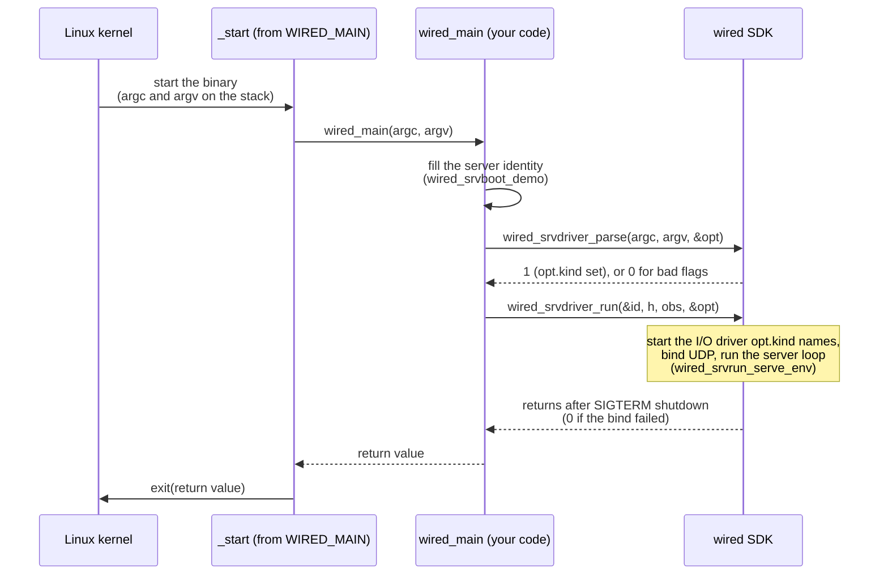
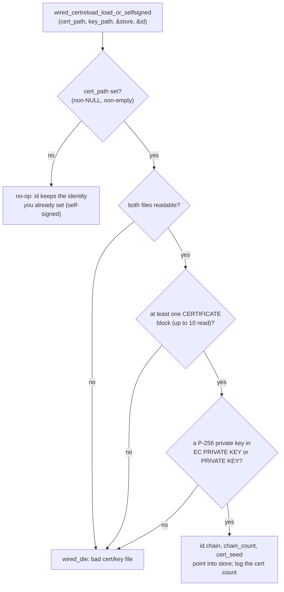

# Getting Started

[Docs](README.md) › Getting Started

This page takes you from a fresh checkout to a running HTTP/3 server, and then
to a server binary of your own. It is for a developer who knows HTTP and TLS
from the web side but has not used QUIC or a C program without libc before.

HTTP/3 is HTTP carried over QUIC, a transport that runs over UDP instead of
TCP and has TLS 1.3 built in. You do not need to know how QUIC works to follow
this page; the SDK handles it.

The page is in three parts. You can stop after any of them:

| Part | What you get | Time |
|---|---|---|
| [1. First five minutes](#part-1-first-five-minutes) | The example server running, answering real HTTP/3 requests | ~5 min |
| [2. A server of your own](#part-2-a-server-of-your-own) | Your own binary linked against the SDK | ~15 min |
| [3. Going further](#part-3-going-further) | Pointers to I/O drivers, WebTransport, certificates, observability | as needed |

## Part 1: First five minutes

### Install the toolchain

`wired` targets **x86_64-linux only**. You need clang, `just` (a command
runner; every build step in this repo is a `just` recipe), `ninja` (the build
tool the recipes call), and `lizard` (a complexity checker). Pick one of two
ways to get them.

**Option A (recommended): let Nix pin everything.** Nix is a package manager
that can install exact tool versions into a temporary shell without touching
the rest of your system. That shell is called a *devShell*, and this repo's
devShell holds the same clang, just, ninja, lizard, and doxygen versions that
CI uses:

```sh
just setup     # one-time: installs Nix (Determinate Systems installer) if absent
nix develop    # enter the pinned devShell
```

**Option B: your own package manager.** Install `clang`, `just`, `ninja`, and
`lizard` (for example `apt install clang just ninja-build` plus
`pip install lizard`). Everything builds and tests fine this way.

The one caveat with Option B is formatting and linting. A host `clang-format`
or `clang-tidy` of a different version can format or lint slightly
differently from CI. If a formatting check surprises you, run that one recipe
through the pinned toolchain with `just nix <recipe>`.

### Build and test

```sh
just build     # format + compile + lint
just test      # run the whole test suite
```

Both should end green. `just check` is the pre-commit combination: the
complexity gate plus the tests.

### Run the example server

```sh
cd examples/word_list
just run       # builds the SDK + the sample, binds 0.0.0.0:4433
```

Then, from a machine that can reach UDP port 4433:

```sh
curl --http3-only --insecure https://<host>:4433/
```

`--insecure` is needed because the example presents a self-signed
certificate, one that no certificate authority (CA) vouches for. If your
local curl lacks HTTP/3 support, use the Docker one:

```sh
docker run --rm ymuski/curl-http3 \
    curl --http3-only --insecure -v https://<host>:4433/
```

**Checkpoint**: you have a working HTTP/3 server.

Every sample in [examples/](../examples/) runs the same way:

- [word_list](../examples/word_list/): the HTTP/3 message-log and
  static-file server you just ran.
- [webtransport_interop](../examples/webtransport_interop/): a WebTransport
  server endpoint for the
  [quic-interop-runner](https://github.com/quic-interop/quic-interop-runner)
  test harness.
- [moqt_chat](../examples/moqt_chat/): a browser chat and voice-call room
  built on MOQT (Media over QUIC Transport, a publish/subscribe protocol for
  live media).
- [moqt_interop](../examples/moqt_interop/): a MOQT relay for the
  moq-interop-runner test harness.

For guided, runnable walkthroughs, see the
[interactive guide](https://hakkadaikon.github.io/wired/guide/en/).

These four recipes (`setup`, `build`, `test`, `run`) are all Part 1 needs;
Part 2 adds `lib`. The full recipe list lives in
[Development](development.md#build-system).

## Part 2: A server of your own

### Why the build looks unusual

A normal C program links against libc, the C standard library that provides
`printf`, `malloc`, and the startup code that calls `main`. wired does not
use libc at all, so the server is one static binary that depends only on the
Linux kernel ([Why wired](../README.md#why-wired) explains the reasons). Your
program is therefore compiled *freestanding*: the compiler is told there is
no standard library.

Two things libc normally supplies must then come from somewhere else:

- **`_start`**: the real entry point the kernel jumps to. In a libc program,
  libc's `_start` sets up `argc`/`argv` and calls `main`. Here the SDK
  provides a `_start` that does the same and calls your `wired_main`.
- **`memcpy` and `memset`**: the compiler emits calls to these two names on
  its own (for example when you copy a struct), even if your code never
  calls them. The SDK provides a small *shim*, two functions with those
  names that forward to its own byte helpers.

### Link against the SDK

Build the static library, then compile your application freestanding with
`src/` as the include root and link `build/libwired.a`:

```sh
just lib
clang -target x86_64-linux-gnu -ffreestanding -fno-stack-protector \
      -fno-builtin -nostdlib -static \
      -Isrc -o my_server my_server.c build/libwired.a
```

Every guide page builds with this same command. The smallest program that
uses it, with no server at all, is the guide's
[Hello, wired](https://hakkadaikon.github.io/wired/guide/en/getting-started/hello/).

Exactly one translation unit (one `.c` file, compiled on its own) must
define `WIRED_MAIN` before including `wired.h`. That makes `wired.h` emit the
`memcpy`/`memset` shim and the `_start` stub; defining it in two files would
emit them twice and fail to link. `wired.h` is the only include you need, as
it carries the whole public API:

```c
#define WIRED_MAIN
#include "wired.h"
```

The diagram below shows what happens between the kernel starting your binary
and the server running. You write only `wired_main`. One call to
`wired_srvdriver_run` hands control to the SDK, which starts the I/O driver
the command-line flags chose (see [Part 3](#choosing-an-io-driver)). Every
driver ends in the same server loop, which runs until SIGTERM.



How each driver reaches that loop is in
[Architecture](arch/overview.md).

### A minimal server

A server needs three pieces: a request handler, a server identity, and the
call that runs it. The code below is the guide's
[hello](https://hakkadaikon.github.io/wired/guide/en/h3/hello/) handler joined
with the `wired_main` of its
[TLS handshake](https://hakkadaikon.github.io/wired/guide/en/tls/handshake/) page.
[`examples/word_list/wired_server.c`](../examples/word_list/wired_server.c)
is the full worked version.

**1. The request handler** answers each decoded HTTP/3 request by filling a
body buffer:

```c
/* Called once per request (and again while *more is set). Fill body_out and
 * return 1 to send it as a 200 (0 sends a 200 with no body). */
static int on_request(
    void*                       ctx,
    const wired_h3reqdrive_req* req,
    u64                         offset,
    wired_obuf*                 body_out,
    const char**                content_type,
    int*                        more,
    u64*                        total_size) {
  (void)ctx;
  (void)req;
  (void)offset;
  (void)more;
  (void)total_size;
  wired_log_str("request /\n");
  *content_type = "text/plain";
  wired_obuf_printf(body_out, "hello");
  return 1;
}
```

`req` holds the method, path, and body; its contents are valid only during
the call. If the whole body fits in `body_out`, the handler can ignore
`offset`, `more`, and `total_size`.

Those three exist for large bodies. The SDK calls the handler in *rounds*.
`offset` is how many body bytes earlier rounds already sent. The handler
writes the next chunk, sets `*more = 1` to be called again, and on the first
round may set `*total_size` to the full length. word_list's `app_on_request`
uses this to stream static files; the guide's
[streaming](https://hakkadaikon.github.io/wired/guide/en/h3/streaming/) page shows
it step by step.

**2. The server identity** (`wired_srvboot_id`) holds the server's TLS keys
and certificate. `wired_srvboot_demo` fills it with fixed demo values, so
every run presents the same self-signed certificate. That is fine for a demo,
but never use it in production; [Certificates](#certificates) below shows how
to load a real one.

**3. Parse the CLI and run.** `wired_srvdriver_parse` reads `--port` and the
I/O-driver flags into a `wired_srvdriver_opt` and returns 0 for a bad or
conflicting combination. `wired_srvdriver_run` starts the selected driver
and serves until the process receives SIGTERM:

```c
int wired_main(int argc, char** argv) {
  /* Fixed demo identity (self-signed certificate; never for production). */
  static wired_srvboot_demo_keys keys;
  wired_srvboot_id               id;
  wired_srvboot_demo(&id, &keys, 0x50, "guide-tl");

  /* --port and the driver flags (--workers, --cores, ...) come from argv. */
  wired_srvdriver_opt opt;
  if (!wired_srvdriver_parse(argc, argv, &opt)) return 1;
  wired_srvrun_handler h   = {.cb = on_request};
  wired_srvrun_obs     obs = {0};
  return wired_srvdriver_run(&id, h, obs, &opt) ? 0 : 1;
}
```

`wired_srvboot_demo`'s last two arguments are the first byte of the demo
key pattern (`0x50`) and the server's connection ID, a short label that
names the connection on the server side (`"guide-tl"`). Any values work for a
demo. `keys` is `static` because `id` keeps pointers into it for the whole
run. `obs = {0}` turns the optional outputs off and keeps the default
settings.

A program that does not want CLI parsing can skip `wired_srvdriver_parse`
and call `wired_server_run(port, &id, h, obs)` directly. That is the
single-process driver with default options; the guide's
[hello](https://hakkadaikon.github.io/wired/guide/en/h3/hello/) page does this.

**Checkpoint**: you have your own HTTP/3 server binary. Everything below is
opt-in.

## Part 3: Going further

Four independent topics. Each says what it is and why you would want it, then
points to the guide page that shows the code and its output.

### Choosing an I/O driver

An I/O driver is the part that moves packets between the network and the
server loop. All four drivers call the same handler, so switching is a
command-line flag, not a code change:

| Driver | Select with | Why you'd pick it |
|---|---|---|
| Single process | no flag | Simplest; enough for development and light load |
| Forked workers | `--workers N` | Use several CPU cores with separate processes |
| Threads | `--cores a,b,c` | Use several CPU cores within one process |
| AF_XDP | `--ifindex N --ip a.b.c.d` | Highest throughput; needs root and a capable NIC |

The forked workers all bind the same UDP port with `SO_REUSEPORT`, a socket
option that lets several sockets share one port while the kernel spreads
incoming packets among them. AF_XDP is a Linux feature that hands packets
from the network card to the program through shared memory, skipping most of
the kernel's network stack.

The parser rejects combinations that make no sense, such as `--workers` with
`--cores`. The full flag list, the pinning flags, and the rejection rules are
on [Server flags](https://hakkadaikon.github.io/wired/guide/en/quic/server-flags/).
How the drivers work inside is in
[Architecture](arch/overview.md).

### WebTransport

WebTransport lets a browser open streams and send datagrams to a server over
an HTTP/3 connection. A datagram is a small message that is never
retransmitted and may arrive out of order. You want WebTransport for
anything real-time in the browser, such as chat, games, or live media, where
WebSocket's single ordered TCP stream adds delay.

The browser starts a WebTransport session with an Extended CONNECT request;
the SDK accepts it and calls your WebTransport callbacks, passing the
session that each stream or datagram belongs to. Start with
[WebTransport datagrams](https://hakkadaikon.github.io/wired/guide/en/wt/datagram/)
(echo one datagram back), then
[Fanning a datagram out](https://hakkadaikon.github.io/wired/guide/en/wt/broadcast/)
(send one datagram to every session, the core of a chat relay).
[Streams vs datagrams](https://hakkadaikon.github.io/wired/guide/en/concepts/streams-vs-datagrams/)
helps you pick between the two.

### Certificates

A browser only trusts a server whose certificate chains to a CA it knows, so
a public server needs a CA-issued certificate instead of the self-signed
demo one. `wired_certreload_load_or_selfsigned(cert_path, key_path, &store,
&id)` loads a `cert.pem` / `key.pem` pair into the identity.

Call it in `wired_main` after `wired_srvboot_demo` and before
`wired_srvdriver_run`, so a loaded certificate replaces the demo one. The
store must be `static` for the same reason as `keys`: `id` keeps pointers
into it. Here is the call added to the Part 2 server, reading word_list's
`--cert` / `--key` flags:

```c
/* id points into it for the whole run, so it must outlive the server. */
static wired_certreload_store cert_store;

int wired_main(int argc, char** argv) {
  /* ... */
  wired_srvboot_demo(&id, &keys, 0x50, "guide-tl");
  wired_certreload_load_or_selfsigned(
      wired_cliargs_str(argc, argv, "--cert", 0),
      wired_cliargs_str(argc, argv, "--key", "key.pem"), &cert_store, &id);
  /* ... wired_srvdriver_parse, wired_srvdriver_run as before */
}
```

`wired_cliargs_str` returns the value after a flag, or its last argument
when the flag is absent. With no `--cert` the path is `0`, so the demo
identity stays; `--key` defaults to `key.pem`.

The function's rule is "load what you asked for, or stop": an unset path keeps the
self-signed identity, while a set path that cannot be loaded stops the
process at startup instead of silently serving the demo certificate. The
flowchart shows each check in order:



`cert.pem` is a full chain, leaf certificate first. `key.pem` must be an
ECDSA P-256 private key; RSA and Ed25519 server keys are not supported.
[Loading certificates](https://hakkadaikon.github.io/wired/guide/en/tls/certificates/)
walks through the decoding step by step.

You can also replace a certificate without restarting: put the same paths in
`obs.cert_path` / `obs.key_path`, and on SIGHUP the server re-reads the pair.
Connections that already finished their handshake are not disturbed. See
[Certificate hot reload](https://hakkadaikon.github.io/wired/guide/en/ops/cert-reload/).

### Observability

QUIC encrypts almost everything on the wire, so a packet capture alone does
not tell you what went wrong. Besides the reload paths above,
`wired_srvrun_obs` carries two optional debug outputs (`0` = off) and one
tuning setting:

- `qlog_path`: a qlog file, a JSON log of every packet sent and received
  (qlog is the IETF's draft log format for QUIC).
- `keylog_path`: an NSS key log (the `SSLKEYLOGFILE` format), which lets
  Wireshark decrypt a capture of the same run.
- `cc_algo`: the congestion-control algorithm, which decides how fast the
  server sends. `0` keeps the build's default (CUBIC), `1` is CUBIC, `2` is
  BBR.

The forked-workers driver (`--workers`) ignores the two debug outputs; use
any other driver when you need them.

word_list and webtransport_interop map the two outputs to `--qlog-file` /
`--keylog-file`; the MOQT examples use `--qlog` / `--keylog`.
[Handshake and observability knobs](https://hakkadaikon.github.io/wired/guide/en/ops/handshake-knobs/)
shows them together with session resumption and Retry.

---

**Next:** [Architecture and Data Flow](arch/overview.md) — how the stack
works inside. ([all docs](README.md))
