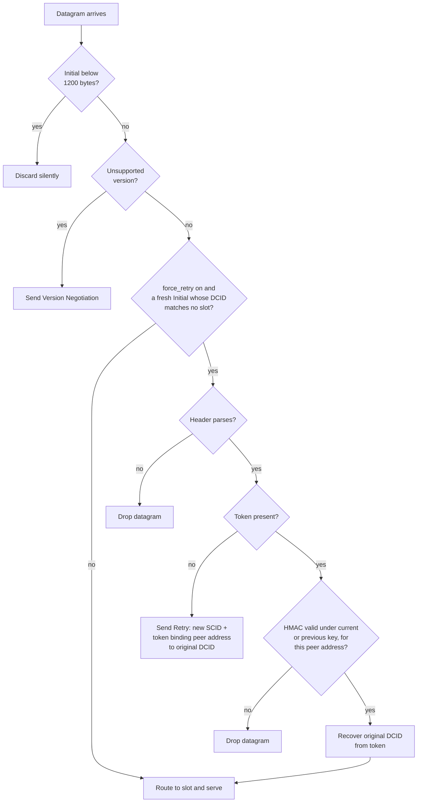
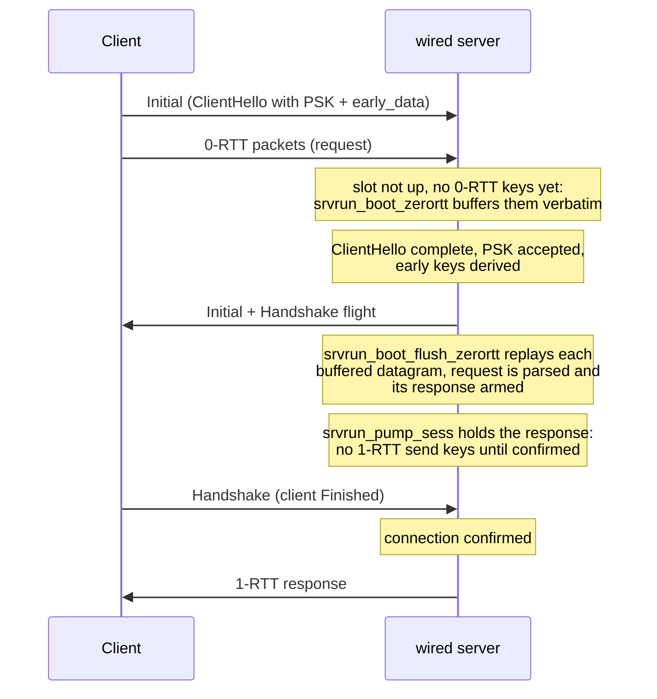
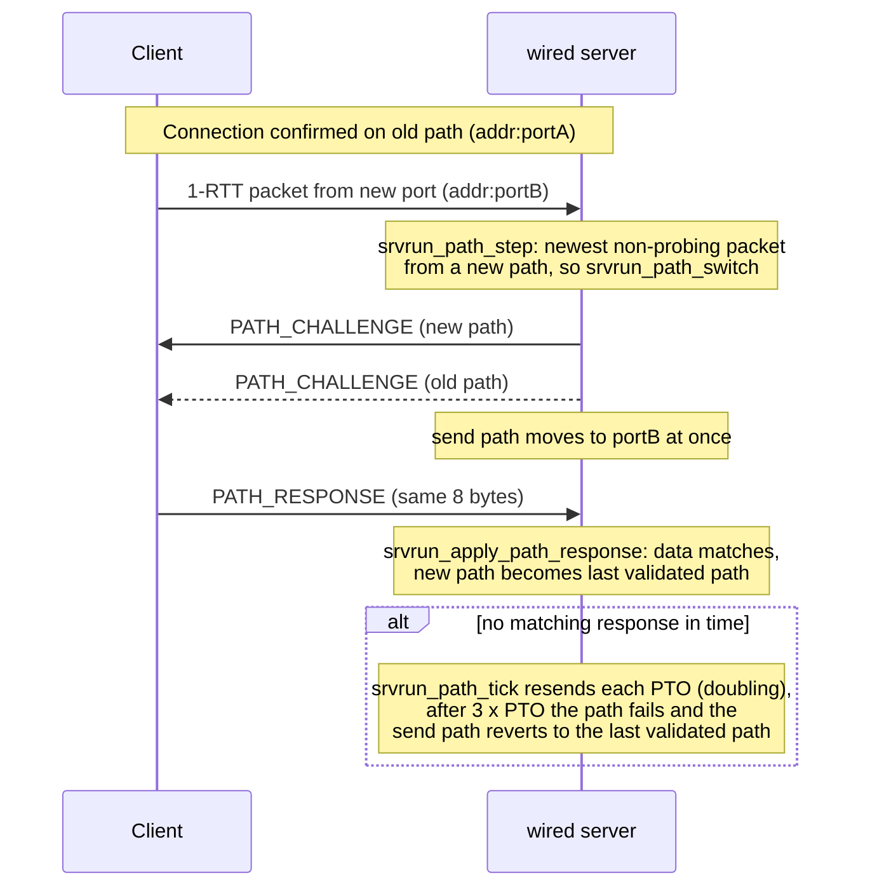

# 相互接続性の検証結果

[ドキュメント](README.md) › 相互接続性の検証結果

このページが答える問いは一つです。独立したクライアント実装が wired サーバーと通信したとき、wired サーバーはどの QUIC、WebTransport、MoQT のテストケースに合格し、その証拠は何か。wired がほかのスタックとどこまで動くと証明されているかを知りたいときや、ある機能についてワイヤー互換を主張する前に読んでください。

## 相互接続性テストとは何か、なぜ重要か

相互接続性（interop）テストでは、同じ仕様から他者が書いたクライアントを相手に wired サーバーを動かします。単体テストとセルフループバックテスト（wired のクライアントが wired のサーバーと通信するテスト）は、コードが意図どおりに動くかを確かめます。しかし、その意図が RFC の内容と一致しているかは確かめられません。両端が仕様を同じように読み違えていると、誤りが打ち消し合い、ループバックテストは合格してしまいます。実際に、そうしたワイヤー上のバグが 3 件、ループバックでは合格しながら実際のピアとの通信を壊しました。そのため、仕様への準拠を示す方法は二つしかありません。RFC 自身のテストベクターと照らし合わせるか、独立した実装と照らし合わせるかです。このページは後者にあたり、ワイヤー互換を証明できる唯一の証拠の段階です。要件ごとの単体テストとテストベクターによる網羅は [Features](features/README.md) にあります。

実行には [quic-interop-runner](https://github.com/quic-interop/quic-interop-runner) を使います。これは公開のテストハーネスで、サーバーとクライアントを 1 つずつ Docker コンテナに入れ、模擬ネットワークリンクの両側に置きます。名前の付いたテストケース（たとえば `handshake`、`retry`、`zerortt`）ごとにクライアントを動かしてトラフィックをキャプチャし、キャプチャとダウンロードされたファイルを調べて合否を判定します。結果の表はセルごとに記号を 1 つ表示し、その後ろの括弧に短いテストケースの略号が付きます。

- `✓` は合格、`✕` は不合格、`?` は未対応です。未対応とは、片方がそのテストケースを実装していないと宣言したため、ランナーが判定を出さなかったことを指します。
- 文字はテストケースを表します。`(E)` は `ecn`、`(V2)` は `v2`、`(CM)` は `connectionmigration` です。したがって `✓(E)` は `ecn` の合格ですが、`?(E)` は合格ではなく「未対応」にすぎません。

このページで合格として記録するのは、セルが `✓` を示し、かつその実行のログディレクトリが存在するものだけです。

## 表の読み方

概要: スナップショットは 2026-10-27 の CI 実行で、wired は `d32fccff5` です（[QUIC と WebTransport の実行](https://github.com/Hakkadaikon/quic-interop-runner/actions/runs/40475049893)、[MoQT の実行](https://github.com/Hakkadaikon/moq-interop-runner/actions/runs/40475054806)）。

- QUIC、クライアント 15 種: 合格 249、不合格 28、未対応 53（テストケースのセルのみ。二つの計測は別に数えています）。quic-go に対しては 22 テストケースのうち 19 が合格し、計測のテストケースも両方合格しています。`ecn` と `v2` は quic-go クライアントが未対応で、`connectionmigration` は不合格です。
- WebTransport、クライアント 5 種: 合格 26、不合格 9。
- MoQT リレー、クライアント 14 種: WebTransport 経由で 11、raw QUIC 経由で 13 が合格。

損失と破損のテストケースのうち 3 つ（`handshakeloss` L1、`transferloss` L2、`handshakecorruption` C1）は、実行ごとに不合格になるクライアントが変わります。シミュレーターのランダムな損失パターンのもとで不安定（flaky）なので、1 回の実行でそこに出た `✕` はどちらの判断にも弱い証拠にしかなりません。2026-10-27 の 2 回の CI 実行がそれを示しています。`handshakeloss` は、[先の実行](https://github.com/Hakkadaikon/quic-interop-runner/actions/runs/40448020712)では ngtcp2、mvfst、quiche、picoquic、msquic、xquic、quinn で不合格になり、後の実行では ngtcp2、mvfst、quiche、kwik、msquic、quinn で不合格になりました。`handshakecorruption` は ngtcp2、mvfst、quiche、xquic、quinn で不合格になり、次は ngtcp2、mvfst、quinn、s2n-quic で不合格になりました。`transferloss` は後の実行でだけ、xquic で不合格になりました。例外は `transfercorruption` で、2 回とも xquic で不合格になったため、下では再現する不合格として載せています。未解決の不合格とその issue は [未解決の相互接続の失敗](#未解決の相互接続の失敗) にまとめています。

以下の表は各テストケースを quic-go（QUIC）と webtransport-go（WebTransport）に対して並べ、ほかのクライアントで結果が違う場合はその場で書き添えています。

凡例: `✅` 合格 · `❌` このスナップショットで不合格 · `🟡` 実装済みだが判定できない（ピアやツールの制約、またはプロトコル以外の未達） · `—` まだ実証していない。

各備考は 1 行です。根本原因やピアの制約など、長い経緯があるテストケースは、表のあとの補足に同じ名前で載せています。

## QUIC のテストケース（サーバー: wired・クライアント: quic-go）

| テストケース | 実装 | 備考 |
|---|---|---|
| `handshake` | ✅ | コネクションの確立 |
| `transfer` | ✅ | ストリーム上のファイルダウンロード。2026-08 にリグレッションが起き、再修正（補足を参照） |
| `http3` | ✅ | 並列の HTTP/3 GET（3 ストリーム、500 KB のボディ） |
| `longrtt` | ✅ | 高遅延のリンク |
| `chacha20` | ✅ | TLS_CHACHA20_POLY1305_SHA256 のエンドツーエンドのネゴシエーション。そのスイートでの転送途中の Key Update を含む |
| `keyupdate` | ✅ | RFC 9001 §6 の鍵更新、両方向 |
| `transferloss` | ✅ | パケット損失のもとでのファイル転送 |
| `transfercorruption` | ✅ | パケット破損のもとでのファイル転送 |
| `amplificationlimit` | ✅ | 膨らませた（証明書 9 枚の）サーバーフライトで RFC 9000 §8.1 の増幅攻撃対策を適用。2026-10-27 に msquic で不合格（[#178](https://github.com/Hakkadaikon/wired/issues/178)）。サーバー側で修正済み（予算がすべての再送を阻むときは Handshake PING を送る）。ローカルで 5 回中 5 回合格、次の CI 実行待ち |
| `goodput`（計測） | ✅ | ランナーの模擬 10 Mbps リンクで 10 MB を 9418±14 kbps（2026-10-27）。これを実行するクライアント 14 種で 9169〜9418 kbps |
| `blackhole` | ✅ | 2 秒間の模擬リンク断のあと正しく再開 |
| `multiplexing` | ✅ | 2026-08-05 時点で完全に合格（補足を参照） |
| `handshakeloss` | ✅ | 30% のバースト損失のもとで 50 回のハンドシェイクがすべて完了（補足を参照） |
| `handshakecorruption` | ✅ | 同じシナリオを破損のもとで実行。同じ修正で合格 |
| `retry` | ✅ | `--force-retry` による RFC 9000 §8.1.2 の強制アドレス検証（補足を参照） |
| `resumption` | ✅ | 実際の 2 回目のハンドシェイクでの PSK によるセッション再開（補足を参照） |
| `zerortt` | ✅ | 0-RTT データを受け取って処理。エンドツーエンドで組み込み済み（補足を参照）。msquic では不合格（[#177](https://github.com/Hakkadaikon/wired/issues/177)）。mvfst と quiche は未調査 |
| `ecn` | 🟡 | quic-go クライアントが `unsupported test case: ecn` を宣言。ngtcp2、picoquic、neqo、lsquic、quinn、s2n-quic では合格（2026-10-27） |
| `ipv6` | ✅ | ネイティブ IPv6 での転送（補足を参照） |
| `v2` | 🟡 | quic-go クライアントが `unsupported test case: v2` を宣言。ngtcp2、kwik、picoquic、aioquic、neqo、lsquic では合格、msquic と quinn では不合格（2026-10-27） |
| `rebind-port` / `rebind-addr` | ✅ | これらを実行するクライアント 14 種すべてで合格（2026-10-27）。補足を参照 |
| `connectionmigration` | ❌ | quic-go とほか 8 種のクライアントで不合格。ngtcp2、picoquic、aioquic、neqo、lsquic では合格（2026-10-27、補足を参照） |
| `crosstraffic`（計測） | ✅ | 競合する TCP cubic フローと並べて 25 MB。quic-go に対して 1453（± 111）kbps（2026-10-27）。msquic と xquic では不合格 |

### QUIC テストケースの補足

#### `transfer`

要点: 経路 MTU 探索で大きくなったパケットが、データを送信キューから取り出したあとでバッファーをあふれさせ、失われたバイトは二度と再送されませんでした。PMTU はネットワーク経路が運べる最大のパケットサイズで、DPLPMTUD はそれを見つけるための探索です。

このテストケースは 2026-08-05（DPLPMTUD を組み込んだ日）から 2026-08-09 までのあいだにリグレッションで ✕ になりました。PMTU で引き上げたチャンクサイズで切り出したフルサイズの断片が、送信キューからバイトを取り出した *あとで* 固定長の平文バッファーをあふれさせたため、そのバイトは損失検出から見えない場所で失われました。修正後、このテストケースは 5 回連続で合格し、Cubic（輻輳制御アルゴリズムの一つ）を既定にしたビルドでも 3 回中 3 回合格しました（経緯の全体は [Comparison](performance/comparison.md) にあります）。

#### `multiplexing`

要点: すでに終わったリクエストの遅れて届いたコピーがテーブルを埋め、新しいリクエストが気づかないうちに失われていました。2026-08-05 時点で完全に合格しています。

以前の 🟡（1999 ファイルの 98%、60 秒のタイムアウトに間に合わず）は、思われていたようなスループット不足ではありませんでした。すでに応答済みのリクエストストリームの遅れた再送が、再組み立てスロット（ストリームのバイトを順に集めるテーブルの項目。「ゾンビ」）を再び占有し、テーブルがいっぱいになっていました。すると本当に新しいストリームのフレームは何の知らせもなく捨てられ、それでもそのパケットには ACK が返っていたため、クライアントは再送せず、そのリクエストは終わりませんでした。

修正では、応答して解放したストリーム ID をコネクションごとに記録し、その遅れた重複を捨てるようにしました（RFC 9000 §3.2）。あわせて、通知するストリーム上限をテーブルの容量に合わせて抑え、上限とテーブルが常にそろうようにしました。

#### `handshakeloss` と `handshakecorruption`

要点: ハンドシェイクのパケットが失われたとき、サーバーがそれらをすべて再送していませんでした。現在は 30% のバースト損失のもとで 50 回のハンドシェイクがすべて完了します。サーバー側で 3 つの穴をふさぐ必要がありました。

- サーバーの最初のハンドシェイクフライト（ブートフライト）の再送が、まだ送っていない末尾だけを再生していたため、Handshake データグラムが 1 つ失われるとハンドシェイクが行き詰まった。
- 一度きりの確認パケット（SETTINGS + チケット + HANDSHAKE_DONE）が、失われても再送されなかった。
- 複数のパケットに分かれた、まだ揃っていない ClientHello に ACK を返していなかったため、クライアントの 5 秒のハンドシェイクアイドルタイマー（何も届かないと諦めるタイマー）が切れた。

`handshakecorruption` は同じシナリオを破損のもとで実行し、同じ修正で合格します。

#### `retry`

Retry は、クライアントのためにメモリを使う前に、そのクライアントが本当に送信元アドレスを持っているかをサーバーが確かめる方法です。サーバーは最初の Initial パケット（クライアントが最初に送るパケット）にトークン付きの Retry で応え、クライアントはそのトークンを送り返さなければなりません。QUIC のパケットはどれも、IP アドレスとポートではなくコネクション ID でコネクションを示します。DCID（宛先コネクション ID）は受信側がコネクションを引くための ID で、SCID（送信元コネクション ID）は送信側自身の ID です。Retry を有効にする方法は、ガイドの [ハンドシェイクと可観測性のつまみ](https://hakkadaikon.github.io/wired/guide/ja/ops/handshake-knobs/) のページにあります。

RFC 9000 §8.1.2 の強制アドレス検証: `--force-retry` のサーバーモードはトークンのない Initial パケットすべてに Retry を送ります。受け入れる前に、提示されたトークンの HMAC（サーバーだけが作れる鍵付きのチェックサム。RFC 9000 §8.1.1）とアドレスの結び付きを検証し、無効なトークンを持つデータグラムは捨てます。Retry Integrity Tag は RFC 9001 Appendix A.4 のベクターに固定しています。

トークン自体はクライアントの元の DCID を平文で持っています（`odcid_len || odcid || HMAC-SHA256`）。そのため、サーバーはハンドシェイクを終えるのにクライアントごとのメモリを必要としません。`original_destination_connection_id` トランスポートパラメーター（サーバーがハンドシェイク中に通知する設定）に入れる DCID は、トークンから取り出します。サーバーは処理の最初から最後まで二つのフィールドを分けて持ちます。Initial の鍵導出に使う Retry 自身の SCID と、そのトランスポートパラメーターに入れる、取り出した元の DCID です。この二つの値が混ざることはありません。

下のフローチャートは `srvrun_serve`（サイズの下限）と `srvrun_serve_sized`（それ以降すべて）でのデータグラムごとの判定です。図のスロットはサーバーのコネクションごとの状態の項目で、「どのスロットにも一致しない」とは、その ID のコネクションをサーバーがまだ持っていないことを指します。`srvrun_retry_gate` の判定の三つの結果に注目してください。トークンがなければ Retry を送り、有効なトークンなら元の DCID を取り出して通常のルーティングへ進み、無効なトークンなら捨てます。トークンが有効なのは、このピアのアドレスについて、その HMAC が現在または一つ前の鍵で一致するとき（`srvrun_retry_token_ok`）です。

#### `resumption`

実際の 2 回目のハンドシェイクでの PSK によるセッション再開で、ClientHello の受信経路とサーバーフライトの組み立てにエンドツーエンドで組み込んでいます。ここでの PSK（事前共有鍵）は以前のコネクションから得た秘密で、クライアントはこれを使って証明書の段階を省けます。セッション再開を有効にする方法は、ガイドの [ハンドシェイクと可観測性のつまみ](https://hakkadaikon.github.io/wired/guide/ja/ops/handshake-knobs/) のページにあります。

3 つの細部を RFC 8446 に正確に合わせる必要がありました。合っていないと、実際のクライアントは再開したハンドシェイクを拒否します。以下の「Finished」は各側が最後に送るハンドシェイクメッセージで、トランスクリプトは鍵の導出元になる、ハンドシェイクメッセージの累積記録です。

- `resumption_master_secret` は、サーバーの Finished だけでなく *クライアントの* Finished までのトランスクリプトを対象にする（RFC 8446 §7.1: 鍵スケジュールが導出する 4 つの秘密のうち、トランスクリプトがサーバーの Finished より先まで続くのはこれだけで、残りの 3 つはそこで止まる）。
- PSK を受け入れたときは、ServerHello が必ず `pre_shared_key`（`selected_identity`）を返す（RFC 8446 §4.1.3/§4.2.11）。
- PSK ハンドシェイクでは Certificate/CertificateVerify をまったく送らない（RFC 8446 §4.4）。

2 回連続で相互接続性テストの実行に合格し、`handshake`/`transfer`/`retry`/`http3` も引き続き合格しています（リグレッションなし）。

#### `zerortt`

0-RTT を使うと、セッションを再開するクライアントは、ハンドシェイクが終わる前の最初のフライトでリクエストを送れます（1-RTT は、ハンドシェイクが終わってから送る通常の暗号化トラフィックです）。0-RTT にはセッション再開が必要なので、[ハンドシェイクと可観測性のつまみ](https://hakkadaikon.github.io/wired/guide/ja/ops/handshake-knobs/) のページがここでも当てはまります。wired はセッション再開で用意した PSK と鍵スケジュールの仕組みの上に、0-RTT データをエンドツーエンドで受け取って処理します。

- パケット保護の鍵が導出される前（鍵は ClientHello を処理して PSK を受け入れたあとにだけ導出される）に届いた 0-RTT データグラムは、ブートアキュムレーター層（ハンドシェイク中に使うコネクションごとのバッファー）にそのまま溜め、鍵を導出したら再生する（RFC 9001 §4.6.1）。
- QUIC のヘッダーには二つの形がある。ハンドシェイク中に使い、コネクション ID の長さを持つロングヘッダーと、そのあとに使う簡潔なショートヘッダーである。0-RTT は 1-RTT とアプリケーションデータのパケット番号空間（アプリケーションパケットに番号を振る通し番号。RFC 9000 §12.3）を共有するが、ロングヘッダーを使う。そのため、パケット番号の復元は、その暗号化レベルのパケットがすべてショートヘッダーだと決めつけず、ヘッダーの形で分岐する。
- 0-RTT で運ばれたリクエストへの応答は、サーバー自身の 1-RTT 送信鍵ができるまで遅らせる（この鍵は Finished を含むトランスクリプトから導出される）。
- 同時ストリームのテーブルは相互接続性ランナーの zerortt で一度に来る 40 ファイルに合わせた大きさにした（数項目から引き上げた。WebTransport のストリーム上限もすでに同じトレードオフを選んでいる）。

2 回連続で相互接続性テストの実行に合格し、`handshake`/`transfer`/`retry`/`resumption`/`http3` も引き続き合格しています。

下のシーケンス図は溜めてから再生する順序を示します（「スロット未準備」は、サーバーのコネクションごとの状態の項目がまだ準備を終えていないことを指します）。応答がどこで待つかに注目してください。リクエストは再生中（`srvrun_boot_flush_zerortt`）に解析されますが、クライアントの Finished がハンドシェイクを確定させるまで、`srvrun_pump_sess` は何も送りません。

#### `ecn`

ECN（Explicit Congestion Notification）を使うと、ルーターはパケットを捨てる代わりに印を付けられます。RFC 9000 §13.4 の、送信時の ECT(0) の印（「ECN 対応」を示すビット）、受信時に IP ヘッダーからルーターの印を読むこと（IP_TOS 制御メッセージ）、1-RTT の ACK で報告する累積 ECN カウントは、どれも実装して単体テストしています。それでもランナーはこのケースを `?` にします。quic-go の相互接続性クライアント自身が `unsupported test case: ecn` を宣言するので、このピアではエンドツーエンドの判定ができません。

ngtcp2 をクライアントにすると、ある修正のあとエンドツーエンドで合格します（`✓(E)`、2026-08-21）。修正前は、サーバーの Initial 空間の ACK が ECN カウントを持っていなかったため、クライアントは経路が ECN に対応していないと判断していました。

#### `ipv6`

ネイティブ IPv6 での転送です。ソケット層はデュアルスタック（AF_INET6 ソケット 1 つ、IPV6_V6ONLY はオフ、IPv4 のピアは v4-mapped）なので、ほかのケースはすべて変わらず IPv4 で動きます。

#### `v2`

QUIC バージョン 2（RFC 9369）は、同じプロトコルに新しいバージョン番号を付けたものです。エンドツーエンドで実装し、単体テストしています。鍵導出、ロングヘッダーの型ビット、Version Negotiation の受け入れリストはどれもバージョンを引数に取り、実際の ClientHello を持つ v2 の Initial パケットを受け入れて v2 で応答します。quic-go の相互接続性クライアントは `ecn` と同様に `unsupported test case: v2`（exit 127）を宣言するので、quic-go ではエンドツーエンドの判定ができません。

サーバーが自分からコネクションのバージョンを切り替えることはありません。クライアントの Initial パケットが使ったバージョンで応答します（RFC 9368 §2）。一方、ランナーの TestCaseV2 のチェックは、v1 で始まったコネクションを v2 へ移すサーバーを想定しています。この違いが問題になるかは、それを試すクライアントが現れるまで確かめられていません。

v2 を入れたあとのリグレッション確認の実行（handshake/transfer/http3/retry/ipv6）はすべて緑のままで、v1 の経路に影響がないことを確かめました。ngtcp2 と picoquic をクライアントにすると、RFC 9368/9369 に沿ったバージョンネゴシエーションにより、エンドツーエンドで合格します（`✓(V2)`、2026-08-21）。

#### `rebind-port` / `rebind-addr`

これらのケースは、NAT がコネクションの途中でクライアントのポートやアドレスを変えることを模擬します。QUIC はアドレスとポートではなく DCID でコネクションを見つける（`retry` を参照）ので、コネクションはこの変化を乗り越えられます。サーバーは確定したコネクションのピアアドレスを再バインドに合わせて追い、新しい経路に PATH_CHALLENGE を送って、一致する PATH_RESPONSE を検証します（RFC 9000 §8.2/§9.3）。PATH_CHALLENGE は 8 バイトの乱数を運ぶフレームで、ピアはそれを PATH_RESPONSE でそのまま返し、その経路で到達できることを示します。

2026-10-27 の CI 実行では、両テストケースとも、これらを実行するすべてのクライアントで合格しました。以前の実行で不合格になったのは、ランナーの解析ツール（pyshark/tshark）が新しい経路の最初のパケットを復号できなかったからにすぎません。ショートヘッダーのパケットは DCID の長さを持たない（`zerortt` を参照）ため、デコーダーは同じ UDP の会話で先に届いたロングヘッダーのパケットからその長さを知っている必要があります。ところが再バインドで新しくなった送信元ポートでは、そのパケットが届きません。

下のシーケンス図は確定したコネクションのパケットが新しいポートから届き始めたときにサーバーがすることを示します。注目する点は二つです。サーバーは新旧両方の経路にチャレンジを送り、送信先をすぐに新しい経路へ移します。そして、一致する PATH_RESPONSE が届かなければ、`srvrun_path_tick` は 3 PTO（probe timeout。計測した往復時間から QUIC が導く再送タイマー）のあとで諦め、最後に検証済みの経路へ戻ります。

#### `connectionmigration`

サーバー側は動作し（ファイル転送は完了します）、`rebind-*` と同じ PATH_CHALLENGE/PATH_RESPONSE の仕組みを使います。2026-10-27 の実行では quic-go とほか 8 種のクライアントで不合格、ngtcp2、picoquic、aioquic、neqo、lsquic で合格でした。以前の実行では、quic-go での不合格はクライアントが経路の変更を起こさなかったことが原因だと突き止めています（ランナーのログ: "Server saw only a single path in use"）。ほかの不合格はまだ調査していません。ngtcp2 をクライアントにするとエンドツーエンドで合格し（`✓(CM)`、2026-08-21）、実際にマイグレーションしたことを確かめています（ランナーのログ: "DCID changed during active migration"）。

## WebTransport のテストケース（サーバー: wired・クライアント: webtransport-go）

WebTransport はブラウザー形式のセッションを HTTP/3 の上で動かします。セッションは Extended CONNECT リクエストで始まります（ガイドの [WebTransport のセッション](https://hakkadaikon.github.io/wired/guide/ja/wt/session/) を参照）。

| テストケース | 実装 | 備考 |
|---|---|---|
| `handshake` | ✅ | Extended CONNECT によるセッション確立 |
| `transfer-unidirectional-receive` | ✅ | サーバーが単方向ストリームでファイルを送る |
| `transfer-bidirectional-receive` | ✅ | サーバーが双方向ストリームで応答する |
| `transfer-datagram-receive` | ✅ | サーバーが DATAGRAM で送る |
| `transfer-unidirectional-send` | ✅ | 2xx とストリームの順序を 2026-08-23 に修正（`ee13cc7`）。ngtcp2 と webtransport-go で合格（補足を参照） |
| `transfer-bidirectional-send` | ❌ | 2026-10-27 に webtransport-go でファイルが途中で切れて不合格（[#180](https://github.com/Hakkadaikon/wired/issues/180)）。根本原因は修正済み（受信したバイトをビットマップで記録）。ローカルで 5 回中 5 回合格、次の CI 実行待ち |
| `transfer-datagram-send` | ✅ | 同じ修正。2026-08-23 のローカルでの逐次再実行で webtransport-go に合格 |

2026-10-27 の CI 実行はクライアント 5 種を対象にしました。flupke-webtransport と ngtcp2 は 7 テストケースすべてに合格、webtransport-go は 6 つ（`transfer-bidirectional-send` 以外）に合格、Firefox は 6 つ（`handshake` 以外）に合格し、Chrome は 7 つすべてで不合格でした。Chrome と Firefox の不合格はまだ調査していません。

### WebTransport テストケースの補足

#### `transfer-bidirectional-send`

2026-10-27 の不合格は停止で、ワイヤー上でデータが失われたわけではありません。シミュレーターの損失のもとで quic-go の再送が多数の小さな断片に分かれ、サーバーの WebTransport 受信ウィンドウは、受信したバイトを最大 8 個の互いに離れた範囲として記録していました。9 個目が届くと、いちばん遠い範囲を忘れていました。そのバイトはすでに確認応答済みだったので、クライアントは二度と送らず、ウィンドウは穴の先へ進めず、ストリームのクレジットが止まりました（CI 実行はテストごとのログを残していませんでした。ローカルで再現したところ、クライアントの qlog では、すべてのバイトが確認応答済みで、クライアントはストリームの上限で止まったまま、"no recent network activity" で諦めていました）。現在、ウィンドウはリクエストのウィンドウと同じく受信したバイトをすべてビットマップに記録するので、受信したバイトを忘れることはありません。

#### `transfer-unidirectional-send`

根本原因: サーバーのラウンドロビンのポンプが、セッションの 2xx 応答がワイヤーに出る前に、WebTransport の印を付けたストリームを送っていました。しかし draft-ietf-webtrans-http3-15 §3.2 は 2xx を先に送ることを求めています。実際の ngtcp2-webtransport クライアントは、順序の狂ったストリームを何の知らせもなく捨てていました。このバグは 2026-08-23 に修正しました（`ee13cc7`）。その後、ngtcp2 で、また同じ日のローカルでの逐次再実行で webtransport-go でも、改めて確認しています。

### これらの実行で見つかったバグ

WebTransport の実行で、実際の相互接続性のバグが 2 件見つかり、修正しました（QPACK のリテラルフィールド行のバッファー分割と、WebTransport のストリームシグナルの長さのバグ）。これこそがこの段階の存在理由です。3 件目は上の 2xx とストリームの順序のバグで、ngtcp2 自身のサーバーと比べて見つけました。そこでは ngtcp2 クライアントが 2xx とそのストリームを同じパケットで、2xx を先に受け取っていましたが、wired は 2xx より前にストリームを送っていました。QUIC の根本原因は上の補足にあります。

## MoQT リレー（サーバー: wired・クライアント 14 種）

[moq-interop-runner](https://github.com/englishm/moq-interop-runner) は、各クライアントのテストスイートを、リレーとして動かした `examples/moqt_interop` に対して、WebTransport 経由と raw QUIC 経由で 1 回ずつ実行します（[2026-10-27 の実行](https://github.com/Hakkadaikon/moq-interop-runner/actions/runs/40475054806)）。

| トランスポート | 合格 | 不合格のクライアント |
|---|---|---|
| WebTransport | 14 中 11 | moq-dev-js。xquic-draft-18 と moqtopus は raw QUIC でのみ動く |
| raw QUIC | 14 中 13 | moq-dev-js |

moq-dev-js は WebTransport 経由で `subscribe-namespace-lifecycle` に不合格でした（[#179](https://github.com/Hakkadaikon/wired/issues/179)）。このクライアントが使う @moq/net 0.4.4 は PUBLISH_NAMESPACE を FIN だけで取り下げていましたが、draft-ietf-moq-transport-22 §6.4.2.2 はこれをキャンセルではないとしています。そのため、リレーが名前空間を保持し、NAMESPACE_DONE を送らなかったのは正しい動作です。@moq/net 0.4.7 は代わりにリクエストをキャンセルし、ローカルの実行では同じリレーに対して 8 テストすべてに合格します。raw QUIC 経由では、moq-dev-js は `setup-only` を含むすべてのテストで不合格です。このクライアントは raw QUIC のトランスポートを持たず、URL スキームにかかわらず常に WebTransport のセッションを開くためです。xquic-draft-18 と moqtopus が WebTransport 経由で不合格なのは、raw QUIC のリレー URL にしか対応していないためで（それぞれのログにそう書かれています）、どちらも raw QUIC 経由では合格します。合格したクライアントのうち、moq-dev-rs と stitcher-moq はそれぞれ 2 テストをスキップします（`ok # SKIP`）。

## 未解決の相互接続の失敗

2026-10-27 の実行から、それぞれを追う issue とあわせて挙げます。

- msquic での `zerortt`、"client sent too much data in 1-RTT": [#177](https://github.com/Hakkadaikon/wired/issues/177)。作り直した msquic のイメージは最初の 0-RTT パケット（約 600 バイト）だけを送り、残りを 1-RTT で送ります。これは quic-go のサーバーに対しても同じで、2026-10-04 に合格した wired のコミット（`4f38861a7`）もローカルの実行で同じように不合格になります。wired は PSK と early data を受け入れています。
- msquic での `amplificationlimit`、ファイルの欠落: [#178](https://github.com/Hakkadaikon/wired/issues/178)。サーバー側の停止です。PTO のとき wired はキャッシュしたデータグラムを丸ごと再生するだけで、そのどれもが残りの増幅攻撃対策の予算より大きかったため、テストケースが msquic の再送を落としているあいだ何も送らなくなっていました。現在は収まるときに小さな Handshake PING を送ります。ローカルで 5 回中 5 回合格、次の CI 実行待ちです。
- webtransport-go での WebTransport の `transfer-bidirectional-send`: [#180](https://github.com/Hakkadaikon/wired/issues/180)。修正済み（受信したバイトをビットマップで記録）、次の CI 実行待ちです。
- moq-dev-js での MoQT の `subscribe-namespace-lifecycle`: [#179](https://github.com/Hakkadaikon/wired/issues/179)。クライアントの動作で、@moq/net 0.4.7 で修正されています。
- 未調査で issue なし: mvfst と quiche での `zerortt`、9 種のクライアントでの `connectionmigration`、xquic での `multiplexing` と `transfercorruption`（2 回とも）、msquic と quinn での `v2`、msquic と xquic での `crosstraffic`、WebTransport 経由の Chrome（7 つすべて）と Firefox（`handshake`）。
- シミュレーターの損失のもとで不安定（[表の読み方](#表の読み方) を参照）: ngtcp2、mvfst、quiche、kwik、msquic、quinn での `handshakeloss`、ngtcp2、mvfst、quinn、s2n-quic での `handshakecorruption`、xquic での `transferloss`。

## 未達の点の正直なまとめ

- QUIC の 22 テストケースのうち 3 つは quic-go に対して合格がありません。`ecn` と `v2`（quic-go クライアントがどちらも拒否。どちらも ngtcp2 とほかのいくつかのクライアントでは合格）と、`connectionmigration`（ほかのクライアント 5 種では合格）です。計測のテストケースは両方とも合格しています。
- issue のある未解決の失敗と、まだ調査していない失敗は [未解決の相互接続の失敗](#未解決の相互接続の失敗) にあります。
- Ed25519 と RSA の証明書の経路、HTTP/3 のリクエスト優先度（[RFC 9218](features/rfc9218.md)）、QUIC ビットのグリース（固定のヘッダービットをランダムに反転させ、ミドルボックスがそれに頼らないようにすること。[RFC 9287](features/rfc9287.md)）は、単体テストでは網羅していますが、実際のピアに対して試したことはありません。
- AF_XDP の経路（wired が IPv4/UDP ヘッダーを自分で組み立てる、オプションのカーネルバイパスのネットワーク経路）は、相互接続性テストを実行していません。

---

**次へ:** [Features](features/README.md)（仕様ごとの EARS 要件台帳）（[すべてのドキュメント](README.md)）
