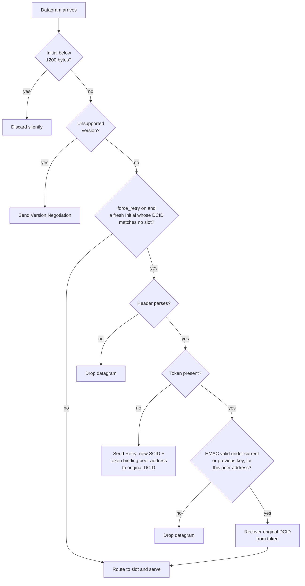
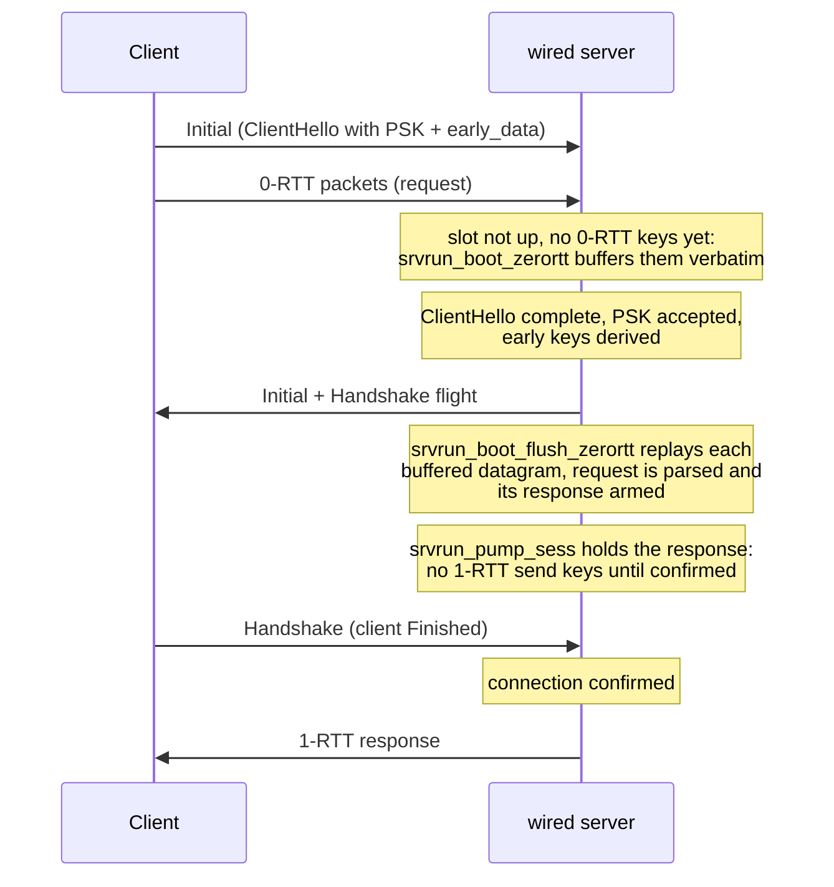
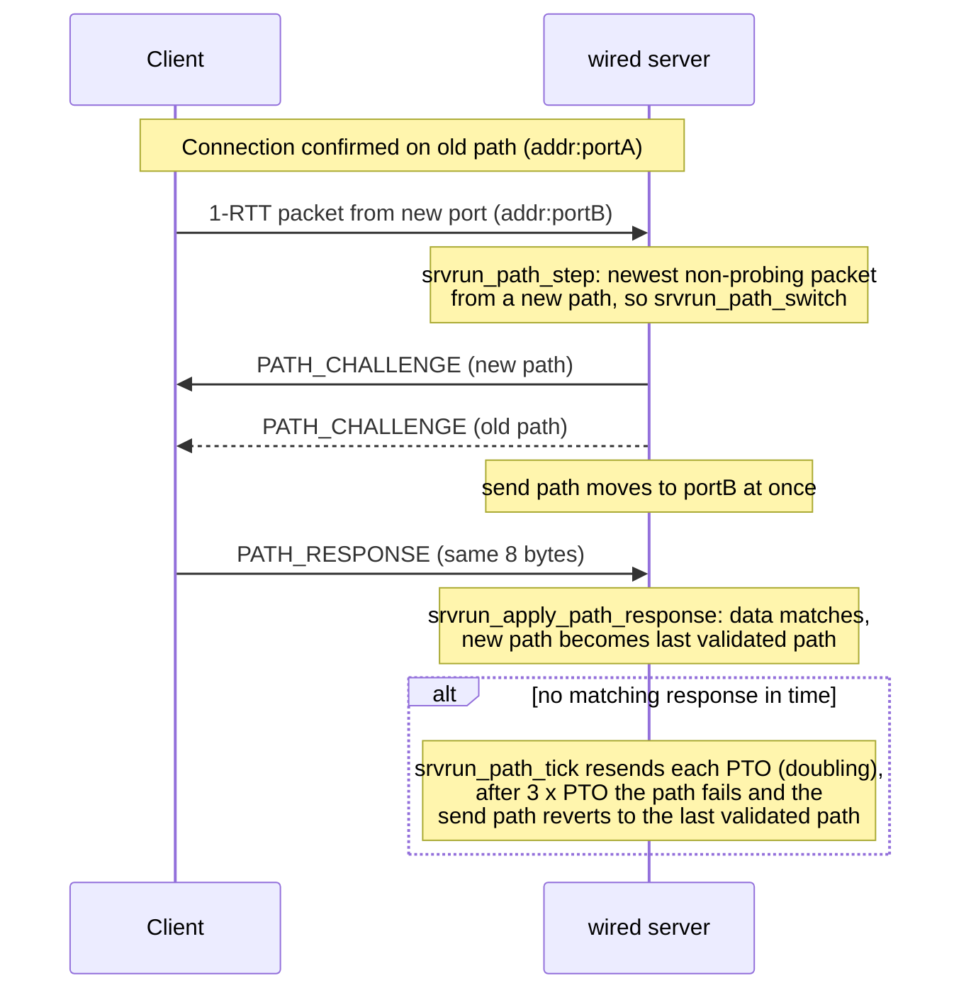

# Interop Results

[Docs](README.md) › Interop Results

This page answers one question: which QUIC and WebTransport testcases does
the wired server pass when an independent client implementation talks to
it, and what is the evidence? Read it when you need to know how far wired
is proven to work with other stacks, or before you claim wire
compatibility for a feature.

## What interop testing is, and why it matters

Interoperability ("interop") testing runs the wired server against a
client written by someone else, from the same specification. Unit tests
and self-loopback tests (wired's client talking to wired's server) check
that the code does what we meant. They cannot check that what we meant is
what the RFC says: when both ends share the same misreading of the spec,
the mistake cancels out and the loopback test still passes. Three such wire
bugs once passed loopback and broke a real peer. So spec compliance can be
shown in only two ways: against the RFC's own test vectors, or against an
independent implementation. This page is the second kind, and it is the
only evidence tier that proves wire compatibility. Per-requirement
unit/vector coverage lives in [Features](features/README.md).

The runs use the
[quic-interop-runner](https://github.com/quic-interop/quic-interop-runner),
a public harness that puts one server and one client in Docker containers
behind a simulated network link. For each named testcase (for example
`handshake`, `retry`, `zerortt`) it drives the client, captures the
traffic, and decides pass or fail by inspecting the capture and the
downloaded files. Its result matrix prints one symbol per cell, followed by
a short testcase code in parentheses:

- `✓` passed, `✕` failed, `?` unsupported: one side declared it does not
  implement this testcase, so the runner gave no verdict.
- The letters name the testcase: `(E)` is `ecn`, `(V2)` is `v2`, `(CM)` is
  `connectionmigration`. So `✓(E)` is a pass of `ecn`, while `?(E)` is NOT a
  pass, only "unsupported".

A result is recorded here as passed only when the cell shows `✓` and the
run's log directory exists.

## How to read the tables

At a glance: against quic-go, 17 of the 22 QUIC testcases pass and both
measurement testcases pass. Of the other 5, `ecn`, `v2` and
`connectionmigration` pass against ngtcp2 (and `v2` against picoquic too);
`rebind-port` and `rebind-addr` still fail in the runner, because its
tooling cannot decrypt the new path's first packet (see notes). All 7 WebTransport
testcases pass.

The QUIC table shows results as of 2026-07 against quic-go. Where quic-go
itself cannot give a verdict (`ecn`, `v2`, `connectionmigration`), the
ngtcp2/picoquic results are noted inline.

The WebTransport table reflects the `transfer-unidirectional-send` fix that
landed on 2026-08-23 (commit `ee13cc7`) and the local serial re-run on the
same day against three WebTransport clients: webtransport-go, ngtcp2 and
flupke-webtransport.

Legend: `✅` passed · `🟡` implemented but no verdict possible (peer/tooling
limitation, or a non-protocol gap) · `—` not demonstrated yet.

Each Remark is one line. Where a testcase has a longer story (a root cause,
a peer limitation), it is under the same name in the notes after the
table.

## QUIC testcases (server: wired · client: quic-go)

| Testcase | Implemented | Remark |
|---|---|---|
| `handshake` | ✅ | connection establishment |
| `transfer` | ✅ | file download over streams; regressed and re-fixed 2026-08 (see notes) |
| `http3` | ✅ | parallel HTTP/3 GETs (3 streams, 500 KB bodies) |
| `longrtt` | ✅ | high-latency link |
| `chacha20` | ✅ | TLS_CHACHA20_POLY1305_SHA256 negotiation end to end, including a mid-transfer Key Update under that suite |
| `keyupdate` | ✅ | RFC 9001 §6 key update, both directions |
| `transferloss` | ✅ | file transfer under packet loss |
| `transfercorruption` | ✅ | file transfer under packet corruption |
| `amplificationlimit` | ✅ | RFC 9000 §8.1 anti-amplification enforced on an inflated (9-certificate) server flight |
| `goodput` (measurement) | ✅ | 10 MB at 9372±14 kbps over the runner's simulated 10 Mbps link (5-run pooled at `72914d2`; re-measured 9394±50 at `3d84412`) — on par with ngtcp2 (9381) and picoquic (9328) |
| `blackhole` | ✅ | resumes correctly after a simulated 2 s link outage |
| `multiplexing` | ✅ | passes fully as of 2026-08-05 (see notes) |
| `handshakeloss` | ✅ | all 50 handshakes complete under a 30% bursty loss rate (see notes) |
| `handshakecorruption` | ✅ | same scenario under corruption; passes with the same fixes |
| `retry` | ✅ | RFC 9000 §8.1.2 forced address validation via `--force-retry` (see notes) |
| `resumption` | ✅ | PSK-based session resumption over a real second handshake (see notes) |
| `zerortt` | ✅ | 0-RTT data received and acted on, wired end to end (see notes) |
| `ecn` | 🟡 | quic-go client declares `unsupported test case: ecn`; passes against ngtcp2 (`✓(E)`, 2026-08-21) |
| `ipv6` | ✅ | transfer over native IPv6 (see notes) |
| `v2` | 🟡 | quic-go client declares `unsupported test case: v2`; passes against ngtcp2 and picoquic (`✓(V2)`, 2026-08-21) |
| `rebind-port` / `rebind-addr` | — | runner's tooling cannot decrypt the new path's first packet (see notes) |
| `connectionmigration` | 🟡 | quic-go client never triggers a path change; passes against ngtcp2 (`✓(CM)`, 2026-08-21) |
| `crosstraffic` (measurement) | ✅ | 25 MB alongside a competing TCP cubic flow, 3269 (± 157) kbps across 5 runs, well above the 180 s completion bar |

### Notes on the QUIC testcases

#### `transfer`

In short: larger packets, enabled by path-MTU discovery, overflowed a
buffer after their data had already left the send queue, so the lost bytes
were never resent. PMTU is the largest packet size the network path
carries, and DPLPMTUD is the probing that finds it.

The testcase regressed to ✕ between 2026-08-05 (when DPLPMTUD was wired
in) and 2026-08-09. Full-size slices at the PMTU-raised chunk size
overflowed a fixed plaintext buffer *after* their bytes had been taken from
the send queue, so the bytes were lost where loss detection could not see
them. After the fix, the testcase passed 5 of 5 consecutive runs, plus 3 of
3 at the build that uses Cubic (a congestion-control algorithm) by default
([Comparison](performance/comparison.md) has the full story).

#### `multiplexing`

In short: late copies of already-finished requests filled a table, so a
new request was silently lost. Passes fully as of 2026-08-05.

The earlier 🟡 (98% of 1999 files, 60 s timeout missed) was NOT the
throughput gap it was believed to be. Late retransmissions of request
streams that had already been answered reclaimed reassembly slots (the
table entries that collect a stream's bytes in order; "zombies") until the
table was full. A genuinely new stream's frames were then dropped silently,
but their packet was still ACKed, so the client never retransmitted and
that request never finished.

Fixed by tracking answered-and-released stream IDs per connection and
discarding their late duplicates (RFC 9000 §3.2), plus clamping the
advertised stream limit to the table capacity so the limit and the table
stay in lockstep.

#### `handshakeloss` and `handshakecorruption`

In short: when handshake packets were lost, the server did not resend all
of them. All 50 handshakes complete under a 30% bursty loss rate. Three
server-side gaps had to close:

- a resend of the server's first handshake flight (the boot flight) only
  replayed the still-unsent tail, so one lost Handshake datagram
  deadlocked the handshake;
- the one-time confirmation packet (SETTINGS + ticket + HANDSHAKE_DONE) was
  never retransmitted when lost;
- a still-incomplete ClientHello split across several packets was never
  acknowledged, so the client's 5 s handshake idle timer (it gives up when
  it hears nothing) ran out.

`handshakecorruption` runs the same scenario under corruption and passes
with the same fixes.

#### `retry`

A Retry is the server's way to check that a client really owns its source
address before spending memory on it: the server answers the first
Initial (the client's opening packet) with a Retry carrying a token, and
the client must send the token back. Every QUIC packet names its
connection by connection IDs rather than by IP address and port: the DCID
(destination connection ID) is the ID the receiver looks the connection up
by, and the SCID (source connection ID) is the sender's own. The guide's
[handshake knobs](https://hakkadaikon.github.io/wired/guide/en/ops/handshake-knobs/)
page shows how to turn Retry on.

RFC 9000 §8.1.2 forced address validation: a `--force-retry` server mode
sends a Retry for every token-less Initial, verifies the presented token's
HMAC (a keyed checksum only the server can produce; RFC 9000 §8.1.1) and
address binding before accepting, and drops datagrams carrying an invalid
one. The Retry Integrity Tag is pinned to the RFC 9001 Appendix A.4
vector.

The token itself carries the client's original DCID in the clear
(`odcid_len || odcid || HMAC-SHA256`), so the server needs no per-client
memory to finish the handshake: it recovers that DCID from the token for
the `original_destination_connection_id` transport parameter (a setting
the server announces during the handshake). The server keeps two separate
fields end to end: the Retry's own SCID, which feeds Initial-key
derivation, and the recovered original DCID, which goes into that
transport parameter. The two values are never mixed up.

The flowchart below is the per-datagram decision in `srvrun_serve` (size
floor) and `srvrun_serve_sized` (everything after it). In the diagram, a
slot is the server's per-connection state entry, so "matches no slot" means
the server has no connection for this ID yet. Look at the three outcomes of
the gate in `srvrun_retry_gate`: no token sends a Retry, a valid token
continues to the normal routing with the original DCID recovered, and an
invalid token is dropped. A token is valid when its HMAC
matches under the current or the previous key (`srvrun_retry_token_ok`) for
this peer's address.

#### `resumption`

PSK-based session resumption over a real second handshake, wired end to
end into the ClientHello receive path and the server flight builder. A PSK
(pre-shared key) here is a secret from an earlier connection that lets the
client skip the certificate step. The guide's
[handshake knobs](https://hakkadaikon.github.io/wired/guide/en/ops/handshake-knobs/)
page shows how to turn resumption on.

Three details had to match RFC 8446 exactly, or a real client would reject
the resumed handshake. "Finished" below is the last handshake message each side
sends, and the transcript is the running record of handshake messages that
keys are derived from.

- `resumption_master_secret` spans the transcript through the *client's*
  Finished, not just the server's (RFC 8446 §7.1: of the four secrets the
  key schedule derives, this is the only one whose transcript runs past the
  server's Finished; the other three stop there).
- The ServerHello echoes `pre_shared_key` (`selected_identity`) whenever a
  PSK is accepted (RFC 8446 §4.1.3/§4.2.11).
- A PSK handshake omits Certificate/CertificateVerify entirely
  (RFC 8446 §4.4).

Two consecutive interop runs passed, and
`handshake`/`transfer`/`retry`/`http3` still pass (no regression).

#### `zerortt`

0-RTT lets a resuming client send its request in its very first flight,
before the handshake finishes. (1-RTT is the normal encrypted traffic sent
once the handshake is done.) It needs resumption, so the
[handshake knobs](https://hakkadaikon.github.io/wired/guide/en/ops/handshake-knobs/)
page applies here too. wired receives and acts on 0-RTT data end to end,
building on the PSK and key-schedule plumbing from resumption:

- 0-RTT datagrams that arrive before their packet-protection keys are
  derived (which happens only after the ClientHello is processed and the
  PSK accepted) are buffered verbatim at the boot-accumulator layer (the
  per-connection buffer used during the handshake) and replayed once keys
  are derived (RFC 9001 §4.6.1).
- QUIC has two header forms: long headers, used during the handshake,
  which carry the connection-ID lengths, and short headers, used
  afterwards, which are compact. 0-RTT shares 1-RTT's application-data
  packet-number space (the sequence that numbers application packets;
  RFC 9000 §12.3) but uses the long form, so packet-number recovery
  branches on the header form instead of assuming every packet at that
  level is short-header.
- A response to a 0-RTT-carried request is deferred until the server's own
  1-RTT send keys exist (they are derived from the transcript that
  includes Finished).
- The concurrent-stream table is sized for the interop runner's 40-file
  zerortt burst (raised from a handful of entries; the WebTransport stream cap
  already makes the same tradeoff).

Two consecutive interop runs passed, and
`handshake`/`transfer`/`retry`/`resumption`/`http3` still pass.

The sequence below shows the buffer-then-replay order ("slot not up"
means the server's per-connection state entry has not finished setting
up). Look at where the response waits: the request is parsed during the replay
(`srvrun_boot_flush_zerortt`), but `srvrun_pump_sess` sends nothing until
the client's Finished confirms the handshake.

#### `ecn`

ECN (Explicit Congestion Notification) lets routers mark packets instead of
dropping them. RFC 9000 §13.4 ECT(0) marking (the "ECN-capable" bit) on
send, reading the router's marks from the IP header (the IP_TOS control
message) on receive, and cumulative ECN counts reported in 1-RTT ACKs are
all implemented and unit-tested. The runner still marks the case `?`: the
quic-go interop client itself declares `unsupported test case: ecn`, so no
end-to-end verdict is possible with this peer.

Against ngtcp2 as the client it does pass end to end (`✓(E)`, 2026-08-21)
after a fix: the server's Initial-space ACK carried no ECN counts, so the
client concluded the path was not ECN-capable.

#### `ipv6`

Transfer over native IPv6; the socket layer is dual-stack (one AF_INET6
socket, IPV6_V6ONLY off, IPv4 peers v4-mapped), so every other case still
runs over IPv4 unchanged.

#### `v2`

QUIC version 2 (RFC 9369) is the same protocol under a new version number.
It is implemented and unit-tested end to end. Key derivation, the
long-header type bits and the Version Negotiation accept list are all
version-parameterized, and a v2 Initial carrying a real ClientHello is
accepted and answered in v2. No end-to-end verdict is possible with
quic-go, because its interop client declares `unsupported test case: v2`
(exit 127), as with `ecn`.

The server never switches a connection's version on its own initiative. It
replies in whichever version the client's Initial used (RFC 9368 §2). The
runner's TestCaseV2 check instead describes a server that moves a
v1-started connection to v2. Whether that difference matters is unverified
until a client exercises it.

A post-v2 regression run (handshake/transfer/http3/retry/ipv6) stayed all
green, confirming no impact on the v1 path. Against ngtcp2 and picoquic as
clients it does pass end to end (`✓(V2)`, 2026-08-21) via RFC
9368/9369-compatible version negotiation.

#### `rebind-port` / `rebind-addr`

These cases simulate a NAT changing the client's port or address
mid-connection. Because QUIC finds the connection by its DCID (see
`retry`), not by address and port, the connection can survive the change.
The server follows a confirmed connection's peer address across a rebind
and sends a PATH_CHALLENGE on the new path, validating a matching
PATH_RESPONSE (RFC 9000 §8.2/§9.3). A PATH_CHALLENGE is a frame carrying 8
random bytes; the peer proves it is reachable on that path by echoing them
in a PATH_RESPONSE.

Manually decrypting the capture confirms that the new path's first packet
is the PATH_CHALLENGE, as required. The runner's own analysis tooling
(pyshark/tshark) cannot decrypt that same packet: short-header packets omit
the DCID's length (see `zerortt`), so a decoder must already know it from
an earlier long-header packet (Initial/Handshake) on the same UDP
conversation, and a
rebind's fresh source port never provides one. We believe this is a
limitation of the tooling, not a protocol bug in this server.

The sequence below is what the server does when a confirmed connection's
packets start arriving from a new port. Look at two things: the server
challenges both the new and the old path and moves its sending to the new
one at once, and if no matching PATH_RESPONSE arrives, `srvrun_path_tick`
gives up after three PTOs (probe timeouts, the retransmission timer QUIC
derives from the measured round-trip time) and returns to the last
validated path.

#### `connectionmigration`

This testcase runs but cannot get a verdict, while
`rebind-port`/`rebind-addr` fail for a different reason. The server side
works (the file transfer completes) and reuses the same
PATH_CHALLENGE/PATH_RESPONSE machinery, but
the quic-go client never actually triggers a path change for this testcase
(runner log: "Server saw only a single path in use"). That is a client
limitation, not the tooling decryption issue above. Against ngtcp2 as the
client it does pass end to end (`✓(CM)`, 2026-08-21), confirming a real
migration (runner log: "DCID changed during active migration").

## WebTransport testcases (server: wired · client: webtransport-go)

WebTransport runs browser-style sessions over HTTP/3; a session starts with
an Extended CONNECT request (see the guide's
[session page](https://hakkadaikon.github.io/wired/guide/en/wt/session/)).

| Testcase | Implemented | Remark |
|---|---|---|
| `handshake` | ✅ | Extended CONNECT session establishment |
| `transfer-unidirectional-receive` | ✅ | server pushes files on uni streams |
| `transfer-bidirectional-receive` | ✅ | server replies on bidi streams |
| `transfer-datagram-receive` | ✅ | server pushes over DATAGRAMs |
| `transfer-unidirectional-send` | ✅ | 2xx/stream ordering fixed 2026-08-23 (`ee13cc7`); passed against ngtcp2 and webtransport-go (see notes) |
| `transfer-bidirectional-send` | ✅ | same fix; passed against webtransport-go in the 2026-08-23 local serial re-run |
| `transfer-datagram-send` | ✅ | same fix; passed against webtransport-go in the 2026-08-23 local serial re-run |

### Notes on the WebTransport testcases

#### `transfer-unidirectional-send`

The root cause: the server's round-robin pump sent a
WebTransport-signalled stream before the session's 2xx response reached
the wire, but draft-ietf-webtrans-http3-15 §3.2 requires the 2xx to come
first. A real ngtcp2-webtransport client silently discarded the misordered
stream. The bug was fixed on 2026-08-23 (`ee13cc7`). The fix was then
re-verified against ngtcp2, and against webtransport-go in the local
serial re-run on the same day.

### Bugs these runs found

Two real interop bugs were found and fixed by the WebTransport runs (a
QPACK literal field-line buffer split and a WebTransport stream-signal
length bug), which is exactly what this tier exists for. A third, the
2xx/stream ordering bug above, was found by comparing against ngtcp2's own
server: there the ngtcp2 client receives the 2xx and its streams in the
same packet, 2xx first, while wired sent the streams before the 2xx. The
QUIC root causes are in the notes above.

## Honest summary of the gaps

- Five of the 22 QUIC testcases have no pass against quic-go: `ecn`, `v2`,
  `rebind-port`, `rebind-addr`, `connectionmigration`. Both measurement
  testcases pass.
- `ecn` and `v2`: the quic-go client refuses both; both pass against
  ngtcp2, and `v2` against picoquic too (see notes).
- `rebind-port` / `rebind-addr`: implemented; both fail in the runner because
  of its decryption tooling (see notes).
- `connectionmigration`: the quic-go client never changes path; passes
  against ngtcp2 (see notes).
- The three WebTransport `*-send` cases now pass against webtransport-go
  (2026-08-23 local serial re-run, see notes).
- Ed25519 and RSA certificate paths, HTTP/3 request priorities
  ([RFC 9218](features/rfc9218.md)), and QUIC-bit greasing (randomly
  flipping a fixed header bit so middleboxes don't come to rely on it;
  [RFC 9287](features/rfc9287.md)) are fully unit-tested but have never
  been exercised against a real peer.
- The AF_XDP path (an optional kernel-bypass network path where wired
  builds the IPv4/UDP headers itself) has no interop run.

---

**Next:** [Features](features/README.md) — per-spec EARS requirement
ledgers. ([all docs](README.md))
