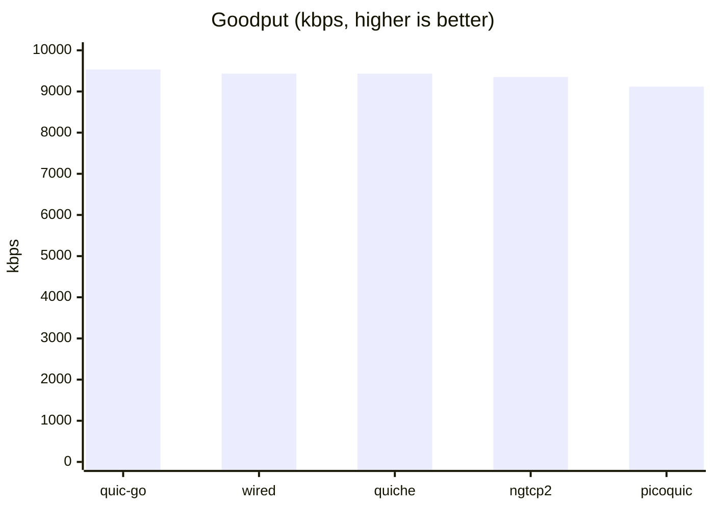
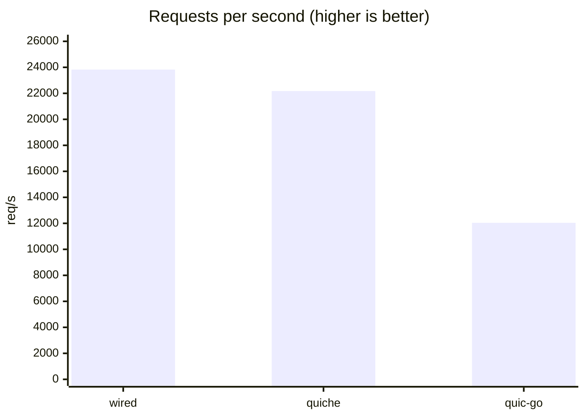
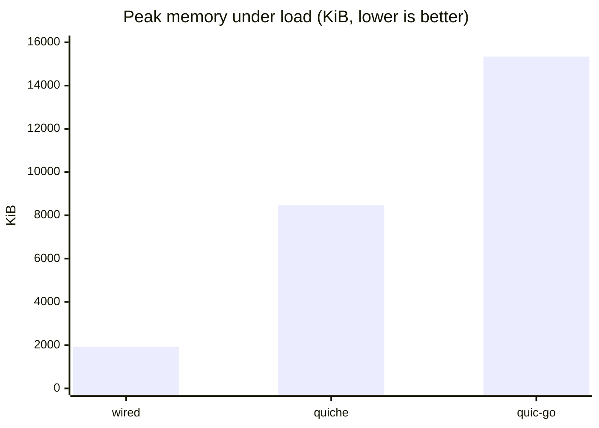

# 実装の比較

[ドキュメント](../README.md) › [性能](./) › 比較

wired を広く使われている 4 つの QUIC サーバー、quic-go(Go)、quiche(Rust)、ngtcp2(C)、picoquic(C)と並べて比べます。このページの数値はすべて、1 台のマシンで同じ日に取った 1 回分の計測によるものです(2026-11-02、wired は `efd61452e`)。生データは[ベンチマークの実行結果](comparison-runs.md)にあります。

## 概要

| | wired | quiche 0.29.3 | quic-go v0.61.0 |
|---|---|---|---|
| 毎秒リクエスト数(ループバック) | **23,825** | 22,175 | 12,042 |
| 負荷時のレイテンシー、p50 | **0.71 ms** | 0.81 ms | 1.45 ms |
| 1 リクエストあたりのサーバー CPU | **35.4 µs** | 37.2 µs | 79.6 µs |
| アイドル時のメモリ | **512 KiB** | 7,804 KiB | 8,424 KiB |
| 負荷時のピークメモリ | **1,932 KiB** | 8,468 KiB | 15,340 KiB |
| サーバーのバイナリ(strip 後) | **525 KB**(静的リンク、libc なし) | 6.2 MB | 7.3 MB |
| グッドプット、10 Mbps の模擬リンク | 9,434 kbps | 9,434 kbps | **9,535 kbps** |

wired が劣る点もあります。新しいコネクションで最初の応答が返るまでの時間は 3 つの中で最も遅く(TTFB p50 2.73 ms。quiche は 1.97 ms、quic-go は 2.64 ms)、負荷時の p99 レイテンシーは quiche に及ばず(3.05 ms 対 2.57 ms)、グッドプットでは quic-go が上回ります。WebTransport と MOQT の速さは測っていません。

## 機能の比較表

| | wired | quic-go | quiche | ngtcp2 (+nghttp3) | picoquic |
|---|---|---|---|---|---|
| 言語 | C、freestanding [^w-libc] | Go [^qg-readme] | Rust + BoringSSL [^qc-readme] | C11 [^ng-readme] | C [^pq-readme] |
| TLS | 組み込みの TLS 1.3 [^w-tls] | Go の crypto/tls [^qg-readme] | BoringSSL [^qc-readme] | 差し替え可能(GnuTLS、BoringSSL、OpenSSL など) [^ng-readme] | picotls [^pq-readme] |
| libc が必要か | 不要 [^w-libc] | 不要。ただし Go ランタイムが必要 [^qg-nocgo] | 必要 [^qc-readme] | 必要 [^ng-readme] | 必要 [^pq-readme] |
| HTTP/3 | ✅ [^w-h3] | ✅ [^qg-readme] | ✅ [^qc-h3] | ✅ nghttp3 経由 [^ng-h3] | ✅ 最小限 [^pq-readme] |
| QPACK の動的テーブル | 一部: デコードはするが、エンコードは静的テーブルのみ [^w-qpack] | — [^qg-qpack] | — [^qc-qpack] | ✅ [^ng-qpack] | — [^pq-qpack] |
| WebTransport | ✅ [^w-wt] | 一部: 別ライブラリの webtransport-go [^qg-readme] | 一部: Extended CONNECT のみ [^qc-wt] | 一部: 前提となる部分のみ [^ng-wt] | ✅ [^pq-wt] |
| QUIC DATAGRAM | ✅ [^w-dgram] | ✅ [^qg-readme] | ✅ [^qc-dgram] | ✅ [^ng-readme] | ✅ [^pq-readme] |
| 0-RTT | ✅ [^w-interop] | ✅ [^qg-0rtt] | ✅ [^qc-0rtt] | ✅ [^ng-0rtt] | ✅ [^pq-0rtt] |
| Key Update | ✅ [^w-interop] | ✅ [^qg-ku] | 一部: 応答のみ [^qc-ku] | ✅ [^ng-ku] | ✅ [^pq-ku] |
| ECN | ✅ [^w-interop] | ✅ [^qg-ecn] | — [^qc-ecn] | ✅ [^ng-ecn] | ✅ [^pq-ecn] |
| コネクションマイグレーション | ✅ [^w-interop] | ✅ [^qg-mig] | ✅ [^qc-mig] | ✅ [^ng-mig] | ✅ [^pq-mig] |
| QUIC v2 | ✅ [^w-interop] | ✅ [^qg-readme] | — [^qc-v2] | ✅ [^ng-readme] | ✅ [^pq-v2] |
| MOQT | ✅ draft 18/19/22 [^w-moqt] | — [^qg-nomoqt] | — [^qc-nomoqt] | — [^ng-nomoqt] | — [^pq-nomoqt] |

QUIC の機能に付けた wired の ✅ は、wired 自身のテストだけでなく、独立したクライアントとの通信でも確かめています。[相互接続性の検証結果](../interop.md)を参照してください。

## 模擬リンクでのグッドプット

[quic-interop-runner](https://github.com/quic-interop/quic-interop-runner) の 10 Mbps の模擬リンクで 10 MB をダウンロードし、5 回繰り返しました。どのサーバーに対してもクライアントは quic-go です。5 つのサーバーはすべて runner の Docker イメージとして動かしました(wired のイメージは 64 コネクションのテーブルでビルドしています)。

| サーバー | グッドプット(kbps) |
|---|---|
| quic-go | 9,535 ± 15 |
| wired | 9,434 ± 15 |
| quiche | 9,434 ± 5 |
| ngtcp2 | 9,352 ± 43 |
| picoquic | 9,118 ± 22 |

ここではリンクがボトルネックなので、5 つともほぼ同じようにリンクの帯域を使い切っています。

## ループバック: 1 リクエストあたりのコスト

クライアントとサーバーを 1 台のマシン(`127.0.0.1`)で動かすので、測っているのはサーバー自身のコストです。1 ラウンドでは、まず新しいコネクションで 100 リクエストを送り(TTFB)、次に 20 本の並列ストリームで小さなリクエストを 10,000 件送ります(負荷)。サーバーごとに 5 ラウンド行い、サーバーは 1 コアに固定し、各サーバーはデフォルト設定のままです(wired は固定サイズのバッファーに合わせて、ほかの実装より小さいストリームごとのウィンドウを通知します)。ngtcp2 と picoquic はネイティブにビルドしていないため、グッドプットの計測にだけ登場します。

| サーバー | 負荷 req/s | 負荷 p50 (ms) | 負荷 p99 (ms) | TTFB p50 (ms) |
|---|---|---|---|---|
| wired | 23,825 ± 1,076 | 0.71 ± 0.03 | 3.05 ± 0.25 | 2.73 ± 0.15 |
| quiche | 22,175 ± 1,457 | 0.81 ± 0.05 | 2.57 ± 0.34 | 1.97 ± 0.18 |
| quic-go | 12,042 ± 657 | 1.45 ± 0.09 | 3.68 ± 0.26 | 2.64 ± 0.21 |

どの実行でも、失敗したリクエストはありませんでした。

## メモリ、CPU、バイナリサイズ

同じループバックの実行で測りました。アイドル時のメモリは起動の 1.5 秒後に読み取った値、ピークメモリは負荷のラウンド中にプロセスが達した最大値です。CPU は、1 リクエストあたりのサーバー自身の CPU 時間です。

| サーバー | アイドル (KiB) | ピーク (KiB) | 1 リクエストあたりの CPU (µs) | strip 後のバイナリ (B) |
|---|---|---|---|---|
| wired | 512 | 1,932 | 35.4 ± 1.5 | 525,040(静的リンク、libc なし) |
| quiche | 7,804 | 8,468 | 37.2 ± 4.4 | 6,237,840(glibc に動的リンク) |
| quic-go | 8,424 | 15,340 | 79.6 ± 3.9 | 7,311,104(静的リンクの Go) |

wired はテーブルを最初にまとめて確保します(`bss` で約 29 MB)。ただし実メモリに載るのは書き込んだページだけで、閉じたコネクションのページはカーネルに返します。[メモリ配置とサイズの見積もり](../arch/memory.md)を参照してください。

## 環境と再現方法

- KVM の VM、Intel Xeon Gold 6230 @ 2.10 GHz、4 vCPU、3.8 GiB RAM、Ubuntu 24.04、カーネル 6.8。ループバックではサーバーをコア 3、クライアントをコア 0–1 で動かした。`net.core.rmem_max` は 208 KiB(どのサーバーでも同じ)。
- バージョン: quic-go v0.61.0(Go 1.25.0)、quiche 0.29.3(`55886df`)。グッドプットの計測には runner の interop イメージを使った(ダイジェストは[ベンチマークの実行結果](comparison-runs.md)にある)。
- スクリプト: [`bench/`](../../bench/)(`run-lane.sh`、`report.mjs`、負荷をかけるクライアント、quic-go のサーバー)。手順ごとのコマンドは [`bench/README.md`](../../bench/README.md) にある。グッドプットは quic-interop-runner で `python run.py -s <server> -c quic-go -t goodput` を実行して測った。wired は [interop/README.md](../../interop/README.md) のとおりに登録する。
- 証明書の SAN には `127.0.0.1` が入っていなければならない。wired は証明書が対象にしていない名前へのリクエストに 421 を返すため。

## 脚注

[^w-libc]: `src/**/*.c` はすべて `-ffreestanding -nostdlib` でビルドできます。[システムコール](../syscalls.md)を参照。
[^w-tls]: [機能 › RFC 8446](../features/rfc8446.md)。
[^w-h3]: [機能 › RFC 9114](../features/rfc9114.md)。
[^w-qpack]: [機能 › RFC 9204](../features/rfc9204.md)。サーバーは動的テーブルの容量を 0 と通知し、エンコーダーは静的テーブルだけを使います。
[^w-wt]: [機能 › RFC 9220](../features/rfc9220.md)、[draft-webtrans-http3](../features/draft-webtrans-http3.md)。
[^w-dgram]: [機能 › RFC 9221](../features/rfc9221.md)、[RFC 9297](../features/rfc9297.md)。
[^w-interop]: 独立したクライアントとの相互接続テストに合格。[相互接続性の検証結果](../interop.md)を参照。
[^w-moqt]: WebTransport と素の QUIC の上でサーバー/リレーとして動作し、draft はセッションごとに選びます。`src/app/moqt/`。
[^qg-readme]: <https://github.com/quic-go/quic-go/blob/v0.61.0/README.md>。
[^qg-nocgo]: v0.61.0 に `import "C"` はない。
[^qg-qpack]: <https://github.com/quic-go/qpack/blob/v0.6.0/README.md> に "does not support the dynamic table" とある。
[^qg-0rtt]: v0.61.0 の `interface.go`(`Allow0RTT`)。
[^qg-ku]: v0.61.0 の `internal/handshake/updatable_aead.go`。
[^qg-ecn]: v0.61.0 の `internal/ackhandler/ecn.go`。
[^qg-mig]: v0.61.0 の `path_manager.go`、`connection.go`(`Conn.AddPath`)。
[^qg-nomoqt]: v0.61.0 で `moq` を検索しても該当なし。
[^qc-readme]: <https://github.com/cloudflare/quiche/blob/0.29.3/README.md>。
[^qc-h3]: 0.29.3 の `quiche/src/h3/mod.rs`。
[^qc-qpack]: 0.29.3 の `quiche/src/h3/qpack/decoder.rs` に "TODO: implement dynamic table" とある。
[^qc-wt]: 0.29.3 の `quiche/src/h3/mod.rs`(`enable_extended_connect`)。WebTransport のセッション層はない。
[^qc-dgram]: 0.29.3 の `quiche/src/lib.rs`(`enable_dgram`)。
[^qc-0rtt]: 0.29.3 の `quiche/src/lib.rs`(`enable_early_data`)。
[^qc-ku]: 0.29.3 の `quiche/src/lib.rs`。鍵の更新を始める API がない。
[^qc-ecn]: 0.29.3 の `quiche/src/lib.rs` に "sending ECN is not supported" とある。
[^qc-mig]: 0.29.3 の `quiche/src/path.rs`、`lib.rs`(`migrate`)。
[^qc-v2]: 0.29.3 の `quiche/src/lib.rs`。v1 のみ。
[^qc-nomoqt]: 0.29.3 で `moq` を検索しても該当なし。
[^ng-readme]: <https://github.com/ngtcp2/ngtcp2/blob/v1.25.0/README.rst>。
[^ng-h3]: <https://github.com/ngtcp2/nghttp3/blob/v1.18.0/README.rst>。
[^ng-qpack]: nghttp3 の README に "It supports dynamic table." とある。
[^ng-wt]: nghttp3 にあるのは RFC 9220/9297 の設定だけで、WebTransport の API はない。
[^ng-0rtt]: ngtcp2 の README の "Resumption and 0-RTT"。
[^ng-ku]: ngtcp2 の `ngtcp2.h` の `ngtcp2_conn_initiate_key_update`。
[^ng-ecn]: ngtcp2 の `ngtcp2_conn.c` にある ECN 検証の状態。
[^ng-mig]: ngtcp2 の `ngtcp2.h` の `ngtcp2_conn_initiate_migration`。
[^ng-nomoqt]: ngtcp2 にも nghttp3 にも MOQT の該当なし。
[^pq-readme]: <https://github.com/private-octopus/picoquic/blob/master/README.md>。
[^pq-qpack]: picoquic の `picohttp/h3zero.c`。静的テーブルのみ。
[^pq-wt]: picoquic の `picohttp/webtransport.c`。
[^pq-0rtt]: picoquic の `picoquic.h` の `picoquic_is_0rtt_available`。
[^pq-ku]: picoquic の `picoquic.h` の `picoquic_start_key_rotation`。
[^pq-ecn]: picoquic の `picoquic_internal.h` の ACK_ECN カウンター。
[^pq-mig]: picoquic の `picoquic_internal.h`、`quicctx.c`。
[^pq-v2]: picoquic の `picoquic_internal.h` の `PICOQUIC_V2_VERSION`。
[^pq-nomoqt]: picoquic のテストに `"moqt-16"` という例の文字列が 1 つあるだけ。
