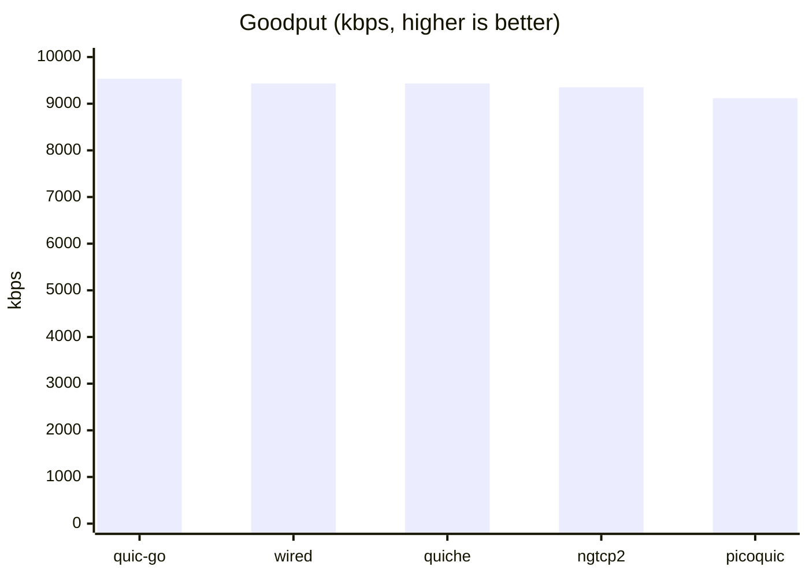
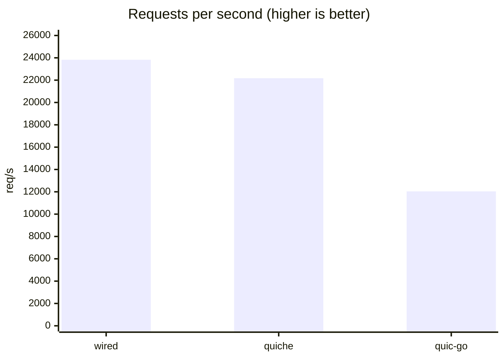
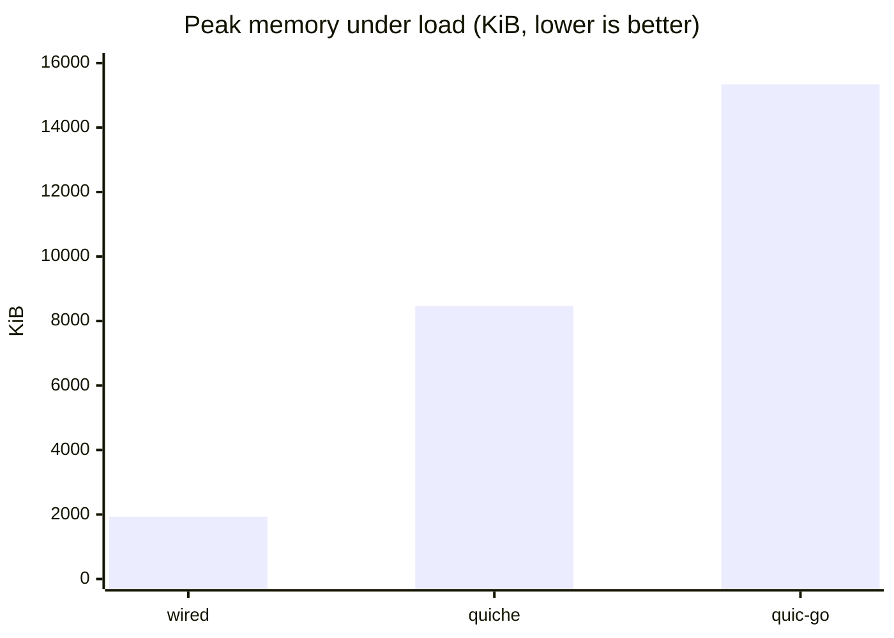

# Implementation Comparison

[Docs](../README.md) › [Performance](./) › Comparison

wired next to four widely used QUIC servers: quic-go (Go), quiche (Rust),
ngtcp2 (C) and picoquic (C). Every number on this page comes from one
same-day run on one machine (2026-11-02, wired at `efd61452e`); the raw data
is in [Benchmark runs](comparison-runs.md).

## At a glance

| | wired | quiche 0.29.3 | quic-go v0.61.0 |
|---|---|---|---|
| Requests per second (loopback) | **23,825** | 22,175 | 12,042 |
| Latency under load, p50 | **0.71 ms** | 0.81 ms | 1.45 ms |
| Server CPU per request | **35.4 µs** | 37.2 µs | 79.6 µs |
| Memory when idle | **512 KiB** | 7,804 KiB | 8,424 KiB |
| Peak memory under load | **1,932 KiB** | 8,468 KiB | 15,340 KiB |
| Server binary (stripped) | **525 KB** (static, no libc) | 6.2 MB | 7.3 MB |
| Goodput, simulated 10 Mbps link | 9,434 kbps | 9,434 kbps | **9,535 kbps** |

Where wired is behind: a fresh connection's first response is the slowest
of the three (TTFB p50 2.73 ms; quiche 1.97 ms, quic-go 2.64 ms), its p99
latency under load trails quiche's (3.05 ms against 2.57 ms), and quic-go
leads on goodput. WebTransport and MOQT speed are not measured.

## Feature matrix

| | wired | quic-go | quiche | ngtcp2 (+nghttp3) | picoquic |
|---|---|---|---|---|---|
| Language | C, freestanding [^w-libc] | Go [^qg-readme] | Rust + BoringSSL [^qc-readme] | C11 [^ng-readme] | C [^pq-readme] |
| TLS | built-in TLS 1.3 [^w-tls] | Go crypto/tls [^qg-readme] | BoringSSL [^qc-readme] | pluggable (GnuTLS, BoringSSL, OpenSSL, …) [^ng-readme] | picotls [^pq-readme] |
| Needs libc | No [^w-libc] | No, but needs the Go runtime [^qg-nocgo] | Yes [^qc-readme] | Yes [^ng-readme] | Yes [^pq-readme] |
| HTTP/3 | ✅ [^w-h3] | ✅ [^qg-readme] | ✅ [^qc-h3] | ✅ via nghttp3 [^ng-h3] | ✅ minimal [^pq-readme] |
| QPACK dynamic table | Partial: decodes it, encodes static-only [^w-qpack] | — [^qg-qpack] | — [^qc-qpack] | ✅ [^ng-qpack] | — [^pq-qpack] |
| WebTransport | ✅ [^w-wt] | Partial: separate webtransport-go [^qg-readme] | Partial: Extended CONNECT only [^qc-wt] | Partial: prerequisites only [^ng-wt] | ✅ [^pq-wt] |
| QUIC DATAGRAM | ✅ [^w-dgram] | ✅ [^qg-readme] | ✅ [^qc-dgram] | ✅ [^ng-readme] | ✅ [^pq-readme] |
| 0-RTT | ✅ [^w-interop] | ✅ [^qg-0rtt] | ✅ [^qc-0rtt] | ✅ [^ng-0rtt] | ✅ [^pq-0rtt] |
| Key Update | ✅ [^w-interop] | ✅ [^qg-ku] | Partial: responds only [^qc-ku] | ✅ [^ng-ku] | ✅ [^pq-ku] |
| ECN | ✅ [^w-interop] | ✅ [^qg-ecn] | — [^qc-ecn] | ✅ [^ng-ecn] | ✅ [^pq-ecn] |
| Connection migration | ✅ [^w-interop] | ✅ [^qg-mig] | ✅ [^qc-mig] | ✅ [^ng-mig] | ✅ [^pq-mig] |
| QUIC v2 | ✅ [^w-interop] | ✅ [^qg-readme] | — [^qc-v2] | ✅ [^ng-readme] | ✅ [^pq-v2] |
| MOQT | ✅ drafts 18/19/22 [^w-moqt] | — [^qg-nomoqt] | — [^qc-nomoqt] | — [^ng-nomoqt] | — [^pq-nomoqt] |

wired's ✅ marks for QUIC features were checked against independent
clients, not only by wired's own tests; see [Interop Results](../interop.md).

## Goodput over a simulated link

A 10 MB download over the
[quic-interop-runner](https://github.com/quic-interop/quic-interop-runner)'s
simulated 10 Mbps link, 5 repetitions, quic-go as the client for every
server. All five run as the runner's Docker images (wired's built with a
64-connection table).

| Server | Goodput (kbps) |
|---|---|
| quic-go | 9,535 ± 15 |
| wired | 9,434 ± 15 |
| quiche | 9,434 ± 5 |
| ngtcp2 | 9,352 ± 43 |
| picoquic | 9,118 ± 22 |

The link is the bottleneck here, so all five fill it about equally.

## Loopback: cost per request

Client and server on one machine (`127.0.0.1`), so what is measured is the
server's own cost. Each round: 100 requests on fresh connections (TTFB), then
10,000 small requests over 20 parallel streams (load). 5 rounds per server,
server pinned to one core, each server at its defaults (wired advertises
smaller per-stream windows than the others, sized to its fixed buffers).
ngtcp2 and picoquic were not built natively and appear only in the goodput
lane.

| Server | load req/s | load p50 (ms) | load p99 (ms) | TTFB p50 (ms) |
|---|---|---|---|---|
| wired | 23,825 ± 1,076 | 0.71 ± 0.03 | 3.05 ± 0.25 | 2.73 ± 0.15 |
| quiche | 22,175 ± 1,457 | 0.81 ± 0.05 | 2.57 ± 0.34 | 1.97 ± 0.18 |
| quic-go | 12,042 ± 657 | 1.45 ± 0.09 | 3.68 ± 0.26 | 2.64 ± 0.21 |

No request failed in any run.

## Memory, CPU and binary size

Measured in the same loopback runs. Idle memory is read 1.5 s after
start; peak memory is the highest the process reached during the load
rounds. CPU is the server's own CPU time per request.

| Server | idle (KiB) | peak (KiB) | CPU per request (µs) | stripped binary (B) |
|---|---|---|---|---|
| wired | 512 | 1,932 | 35.4 ± 1.5 | 525,040 (static, no libc) |
| quiche | 7,804 | 8,468 | 37.2 ± 4.4 | 6,237,840 (glibc dynamic) |
| quic-go | 8,424 | 15,340 | 79.6 ± 3.9 | 7,311,104 (static Go) |

wired reserves its tables up front (about 29 MB of `bss`), but only pages
it writes become resident, and a closed connection's pages are handed back
to the kernel. See [Memory layout](../arch/memory.md).

## Environment and reproduction

- KVM VM, Intel Xeon Gold 6230 @ 2.10 GHz, 4 vCPUs, 3.8 GiB RAM, Ubuntu
  24.04, kernel 6.8. Loopback: server on core 3, client on cores 0–1.
  `net.core.rmem_max` was 208 KiB (same for every server).
- Versions: quic-go v0.61.0 (Go 1.25.0), quiche 0.29.3 (`55886df`), the
  runner's interop images for the goodput lane (digests in
  [Benchmark runs](comparison-runs.md)).
- Scripts: [`bench/`](../../bench/) (`run-lane.sh`, `report.mjs`, the load
  client and the quic-go server), with the step-by-step commands in
  [`bench/README.md`](../../bench/README.md). Goodput:
  `python run.py -s <server> -c quic-go -t goodput` in quic-interop-runner,
  with wired registered per [interop/README.md](../../interop/README.md).
- The certificate must name `127.0.0.1` in its SANs: wired answers a request
  for a name its certificate does not cover with 421.

## Footnotes

[^w-libc]: Every `src/**/*.c` builds with `-ffreestanding -nostdlib`;
    [Syscalls](../syscalls.md).
[^w-tls]: [Features › RFC 8446](../features/rfc8446.md).
[^w-h3]: [Features › RFC 9114](../features/rfc9114.md).
[^w-qpack]: [Features › RFC 9204](../features/rfc9204.md). The server
    advertises a dynamic-table capacity of 0, and its encoder uses only the
    static table.
[^w-wt]: [Features › RFC 9220](../features/rfc9220.md),
    [draft-webtrans-http3](../features/draft-webtrans-http3.md).
[^w-dgram]: [Features › RFC 9221](../features/rfc9221.md),
    [RFC 9297](../features/rfc9297.md).
[^w-interop]: Passed against independent clients;
    [Interop Results](../interop.md).
[^w-moqt]: Server/relay role over WebTransport and raw QUIC, the draft
    chosen per session; `src/app/moqt/`.
[^qg-readme]: <https://github.com/quic-go/quic-go/blob/v0.61.0/README.md>.
[^qg-nocgo]: No `import "C"` in v0.61.0.
[^qg-qpack]: <https://github.com/quic-go/qpack/blob/v0.6.0/README.md> — "does
    not support the dynamic table".
[^qg-0rtt]: v0.61.0 `interface.go` (`Allow0RTT`).
[^qg-ku]: v0.61.0 `internal/handshake/updatable_aead.go`.
[^qg-ecn]: v0.61.0 `internal/ackhandler/ecn.go`.
[^qg-mig]: v0.61.0 `path_manager.go`, `connection.go` (`Conn.AddPath`).
[^qg-nomoqt]: No `moq` hits in v0.61.0.
[^qc-readme]: <https://github.com/cloudflare/quiche/blob/0.29.3/README.md>.
[^qc-h3]: 0.29.3 `quiche/src/h3/mod.rs`.
[^qc-qpack]: 0.29.3 `quiche/src/h3/qpack/decoder.rs` — "TODO: implement
    dynamic table".
[^qc-wt]: 0.29.3 `quiche/src/h3/mod.rs` (`enable_extended_connect`); no
    WebTransport session layer.
[^qc-dgram]: 0.29.3 `quiche/src/lib.rs` (`enable_dgram`).
[^qc-0rtt]: 0.29.3 `quiche/src/lib.rs` (`enable_early_data`).
[^qc-ku]: 0.29.3 `quiche/src/lib.rs` — no API to start a key update.
[^qc-ecn]: 0.29.3 `quiche/src/lib.rs`: "sending ECN is not supported".
[^qc-mig]: 0.29.3 `quiche/src/path.rs`, `lib.rs` (`migrate`).
[^qc-v2]: 0.29.3 `quiche/src/lib.rs`: v1 only.
[^qc-nomoqt]: No `moq` hits in 0.29.3.
[^ng-readme]: <https://github.com/ngtcp2/ngtcp2/blob/v1.25.0/README.rst>.
[^ng-h3]: <https://github.com/ngtcp2/nghttp3/blob/v1.18.0/README.rst>.
[^ng-qpack]: nghttp3 README: "It supports dynamic table."
[^ng-wt]: nghttp3 has the RFC 9220/9297 settings only; no WebTransport API.
[^ng-0rtt]: ngtcp2 README, "Resumption and 0-RTT".
[^ng-ku]: ngtcp2 `ngtcp2.h`: `ngtcp2_conn_initiate_key_update`.
[^ng-ecn]: ngtcp2 `ngtcp2_conn.c` ECN validation states.
[^ng-mig]: ngtcp2 `ngtcp2.h`: `ngtcp2_conn_initiate_migration`.
[^ng-nomoqt]: No MOQT hits in ngtcp2 or nghttp3.
[^pq-readme]: <https://github.com/private-octopus/picoquic/blob/master/README.md>.
[^pq-qpack]: picoquic `picohttp/h3zero.c`: static-only.
[^pq-wt]: picoquic `picohttp/webtransport.c`.
[^pq-0rtt]: picoquic `picoquic.h`: `picoquic_is_0rtt_available`.
[^pq-ku]: picoquic `picoquic.h`: `picoquic_start_key_rotation`.
[^pq-ecn]: picoquic `picoquic_internal.h`: ACK_ECN counters.
[^pq-mig]: picoquic `picoquic_internal.h`, `quicctx.c`.
[^pq-v2]: picoquic `picoquic_internal.h`: `PICOQUIC_V2_VERSION`.
[^pq-nomoqt]: Only a `"moqt-16"` example string in a picoquic test.
