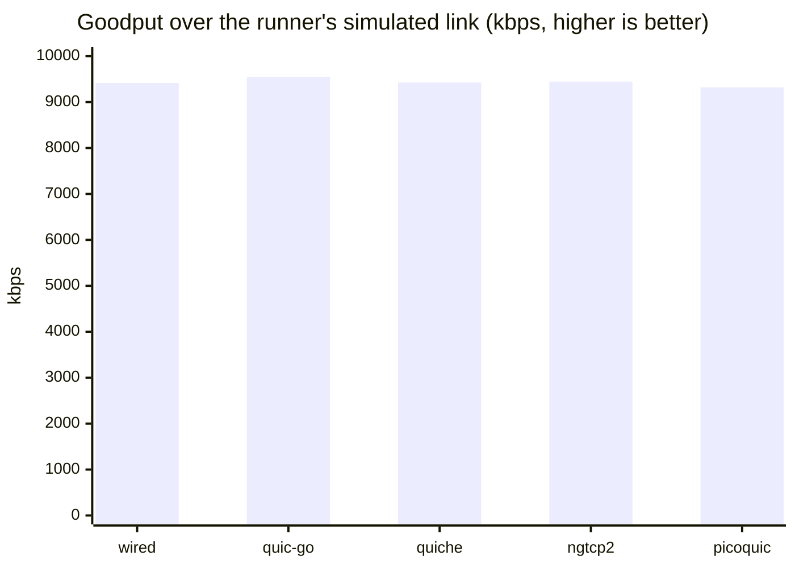
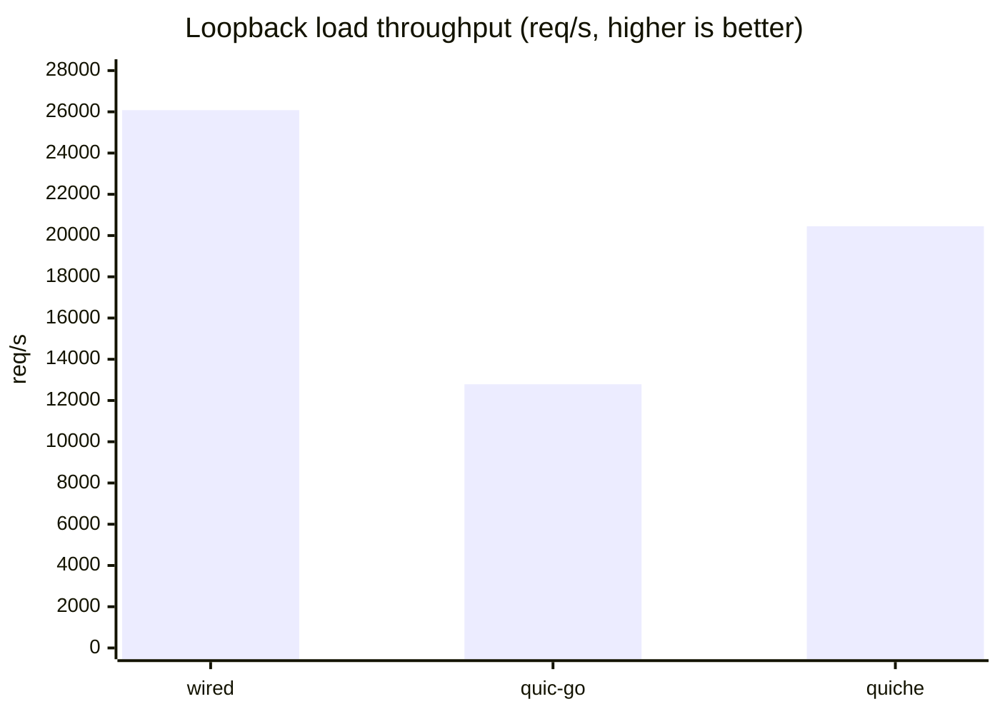
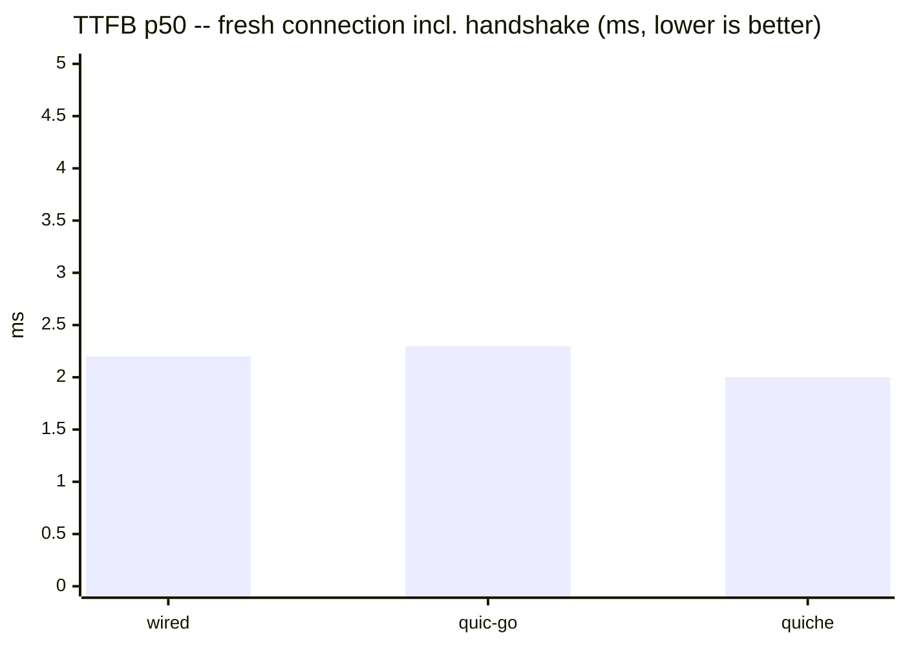
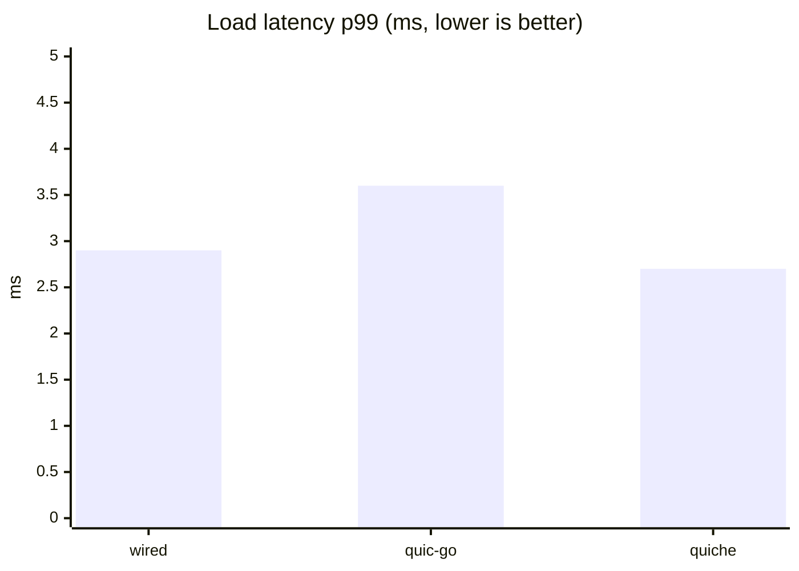
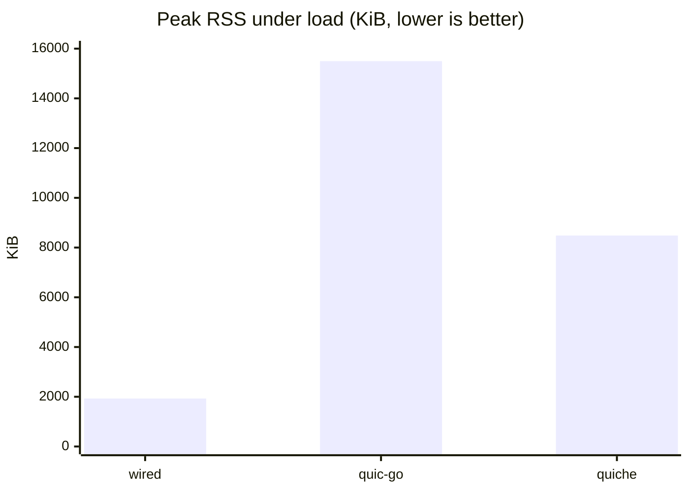
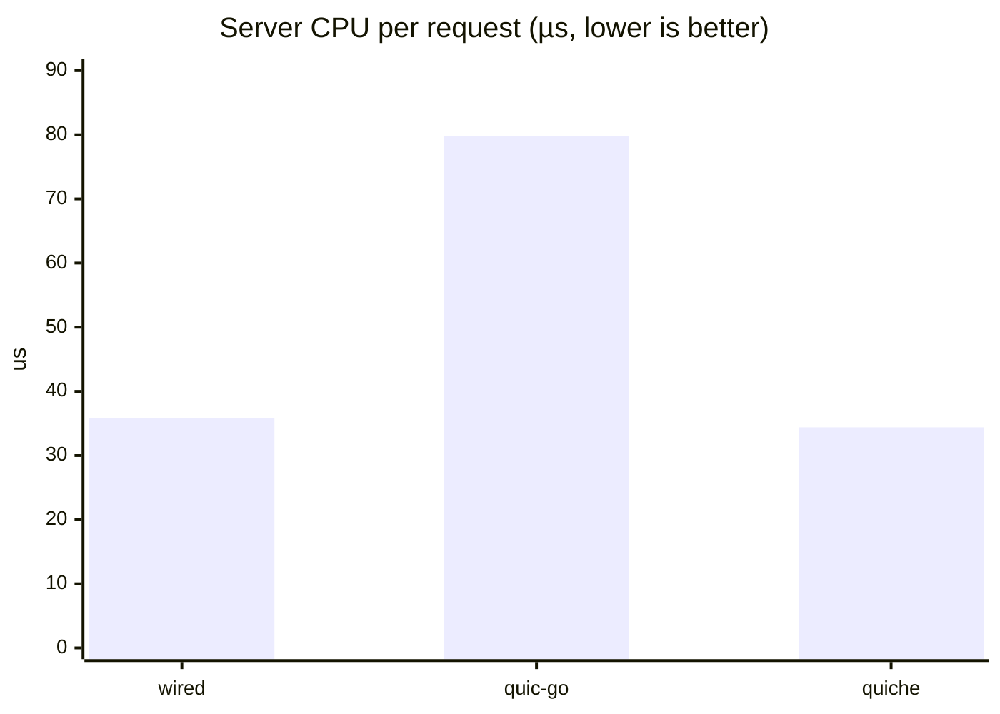

# Implementation Comparison

[Docs](../README.md) › [Performance](./) › Comparison

This page answers "how does wired stand next to other QUIC servers?" in two
ways: which features each project supports, and how fast and how small each
server is when measured under the same conditions. Read it when you are
choosing a QUIC / HTTP/3 / WebTransport / MOQT server, or when you want to
know what wired's numbers look like before you run your own.

wired is compared against four widely used open-source QUIC
implementations: quic-go (Go), quiche (Rust, by Cloudflare), ngtcp2 (C,
with nghttp3 for HTTP/3), and picoquic (C). The feature matrix covers all
five. The speed lanes cover all five on the simulated link, but only wired,
quic-go, and quiche on loopback and footprint, because only those three were
built as native binaries.

> **Scope disclaimer.** Every number below is a measurement from one specific
> day (2026-08-16 local; the runner's log directories carry UTC stamps of
> 2026-08-15T16:xx onward) on one specific machine (a 4-vCPU KVM VM, see the
> [environment appendix](#environment)), against pinned versions. wired is
> pinned at one commit (`9d21db9`) for every lane. It is not a claim of
> general superiority or inferiority of any implementation. Bad numbers are
> published along with good ones. wired's own `9d21db9` pin is now more than
> 2,500 commits behind `HEAD` as of 2026-10-15 (685 of them touching
> `src/app/webtransport/`, `src/app/http3/`, or
> `examples/webtransport_interop/`); the feature-matrix prose below has been
> updated for the webtransport/http3 path where it was stale, but the
> benchmark numbers have not been re-measured at a newer commit.

## How to read this page

**Why the snapshot is stale, and what that means.** The benchmarks are a
dated photo, not a live dashboard. Re-measuring every lane takes a quiet
machine and a full day, so it is done rarely. Since the pin, wired's server
loop, flow-control windows, and WebTransport path have all changed, and the
other projects' `:latest` images have moved too. So treat each number as
"what wired at `9d21db9` did on that day". It is a fair baseline for the
order of magnitude and for the gaps between servers. It is not a promise
about the current `HEAD`. To get fresh numbers, run the scripts described in
[Reproduction](#reproduction) and [Bench client and server
source](#bench-client-and-server-source).

**The lanes.** Each "Speed" or "Footprint" section is one *lane*: one fixed
setup (link, client, file size, CPU pinning) that every server in it went
through. Numbers are comparable inside a lane, never across lanes.

**Terms used in the tables.**

- **Goodput**: useful data delivered per second, in kilobits per second
  (kbps). The runner divides the file size by the time the transfer took, so
  retransmissions and protocol overhead lower it. It measures what the
  application actually receives.
- **TTFB** ("time to first byte"): the time from starting a new connection to
  having the response. It includes the QUIC + TLS handshake, so it shows the
  cost of a fresh connection ([TLS handshake in the
  guide](https://hakkadaikon.github.io/wired/guide/en/tls/handshake/)). This
  page's exact definition is in a footnote [^ttfb-def].
- **p50 / p99**: percentiles of per-request latency. p50 is the median (half
  the requests were faster). p99 is the slow tail: 1 request in 100 was
  slower than this.
- **req/s**: completed requests per second.
- **`a ± b`**: mean over the repeated runs, plus or minus the standard
  deviation (how much the runs disagreed). Two servers whose gap is smaller
  than their `±` spread are effectively tied.
- **RSS / VmHWM**: RSS (resident set size) is the memory the process is
  really using in RAM right now. VmHWM ("high-water mark") is the largest RSS
  the process ever reached. Linux reports both in `/proc/<pid>/status`.
- **text / data / bss**: the sections of the executable. `text` is machine
  code, `data` is initialized global variables, and `bss` is zero-initialized
  global variables. `bss` takes no space in the file and costs RAM only for
  the pages the program actually touches.

**Reading the bar charts.** Each chart repeats one column of the table just
above it (the mean where the table shows `a ± b`), one bar per server. Its
title says whether higher or lower is better. Every y-axis starts at 0, so bar
heights are proportional to the values. The table's `±` spread is not drawn, so
read the table before calling a small difference a win.

Legend: `✅` supported · `Partial` supported with a stated limitation ·
`—` not supported / not measured, with the reason in the cell or footnote.

## Feature matrix

The matrix lists, for each project, what it supports out of the box. Rows
run from the build itself (language, TLS library, libc) up the protocol
layers: HTTP/3, its header compression (QPACK), WebTransport, and finally
MOQT. The short terms used in the rows are explained right after the table.

Sources: each cell cites the project's own README/source at the pinned
version — wired at commit `9d21db9`, quic-go `v0.61.0`, quiche `0.29.3`,
ngtcp2 (interop image, untagged) [^ng-img], picoquic (interop image,
untagged) [^pq-img].

| Axis | wired | quic-go | quiche | ngtcp2 (+nghttp3) | picoquic |
|---|---|---|---|---|---|
| Language | C, freestanding [^w-libc] | Go (pure Go) [^qg-readme] | Rust (+ BoringSSL C/C++) [^qc-readme] | C11 (examples C++23) [^ng-readme] | C [^pq-readme] |
| TLS stack | Own built-in TLS 1.3 (no external TLS library) [^w-tls] | Go standard library crypto/TLS [^qg-readme] | BoringSSL [^qc-readme] | Pluggable: GnuTLS, BoringSSL/aws-lc, Picotls, wolfSSL, LibreSSL, OpenSSL ≥ 3.5 [^ng-readme] | picotls (optional MbedTLS) [^pq-readme] |
| libc dependency | None — every `src/**/*.c` compiles `-ffreestanding -nostdlib`; direct syscalls [^w-libc] | None (no cgo), but requires the Go runtime [^qg-nocgo] | Yes (Rust std + linked BoringSSL) [^qc-readme] | Yes (hosted C11) [^ng-readme] | Yes (hosted C) [^pq-readme] |
| Server binary size (see definition [^binsize]) | 369,312 B (static, no libc) [^binsize] | 7,310,976 B (static Go binary incl. runtime) [^binsize] | 6,126,288 B (BoringSSL static, glibc dynamic) [^binsize] | — (no native build in this comparison [^binsize]) | — (no native build in this comparison [^binsize]) |
| HTTP/3 (RFC 9114) | ✅ server side [^w-h3] | ✅ [^qg-readme] | ✅ (`h3` module) [^qc-h3] | ✅ via nghttp3 [^ng-h3] | ✅ minimal ("h3zero", demo grade) [^pq-readme] |
| QPACK dynamic table (RFC 9204) | Partial — decoder has a live dynamic table; server advertises capacity 0 and its encoder is static-only [^w-qpack] | — (qpack v0.6.0 is static-table only) [^qg-qpack] | — ("TODO: implement dynamic table") [^qc-qpack] | ✅ (nghttp3 "supports dynamic table") [^ng-qpack] | — (static-only, zero-length dynamic dictionary) [^pq-qpack] |
| WebTransport (RFC 9220 + draft-webtrans-http3) | ✅ server side [^w-wt] | Partial — separate companion module webtransport-go [^qg-readme] | Partial — Extended CONNECT only, no WT session layer [^qc-wt] | Partial — nghttp3 ships RFC 9220/9297 prerequisites only [^ng-wt] | ✅ (`picohttp/webtransport.c`) [^pq-wt] |
| QUIC DATAGRAM (RFC 9221) | ✅ [^w-dgram] | ✅ [^qg-readme] | ✅ [^qc-dgram] | ✅ [^ng-readme] | ✅ [^pq-readme] |
| 0-RTT | ✅ interop-proven (`zerortt` PASS vs quic-go) [^w-interop] | ✅ [^qg-0rtt] | ✅ (`enable_early_data`) [^qc-0rtt] | ✅ [^ng-0rtt] | ✅ [^pq-0rtt] |
| Key Update (RFC 9001 §6) | ✅ interop-proven both directions [^w-interop] | ✅ initiates + responds [^qg-ku] | Partial — responds to peer-initiated only, no local-initiate API [^qc-ku] | ✅ (`ngtcp2_conn_initiate_key_update`) [^ng-ku] | ✅ (`picoquic_start_key_rotation`) [^pq-ku] |
| ECN | Partial — ECT(0) sent, ACK ECN counts validated per RFC 9000 13.4.2 and fed to congestion control (unit-tested); no third-party E2E verdict (peer limitation) [^w-interop] | ✅ on by default [^qg-ecn] | — (sending ECN not supported) [^qc-ecn] | ✅ (validation state machine) [^ng-ecn] | ✅ (ACK_ECN + counters) [^pq-ecn] |
| Connection migration (server-side path validation) | Partial — implemented; E2E unverdictable (tooling/peer limitations) [^w-interop] | ✅ [^qg-mig] | ✅ [^qc-mig] | ✅ [^ng-mig] | ✅ [^pq-mig] |
| QUIC v2 (RFC 9369) | Partial — implemented + unit-proven; no third-party E2E (peer limitation) [^w-interop] | ✅ [^qg-readme] | — (v1 only) [^qc-v2] | ✅ [^ng-readme] | ✅ [^pq-v2] |
| MOQT | ✅ draft-ietf-moq-transport-18/19/22, server/relay role over WebTransport; the draft is chosen per session from the WT subprotocol (`moqt-18`/`moqt-19`/`moqt-22`, offered via `wired_moqt_wt_protocols`), draft-19 when none is negotiated [^w-moqt] | — [^qg-nomoqt] | — [^qc-nomoqt] | — [^ng-nomoqt] | — (only a `moqt-16` header string in a test) [^pq-nomoqt] |

What the row names mean:

- **libc dependency**: whether the server needs the C standard library
  (glibc and the like). wired does not: it calls the Linux kernel directly
  ("freestanding" C), which is why its binary is small and fully static.
- **QPACK dynamic table**: QPACK compresses HTTP/3 headers. The static table
  is a fixed list of common headers. The dynamic table lets both sides
  remember headers they have already sent, which compresses repeated headers
  better but needs extra state.
- **WebTransport**: browser API for streams and datagrams over one HTTP/3
  connection, opened with an Extended CONNECT request ([WebTransport session
  in the guide](https://hakkadaikon.github.io/wired/guide/en/wt/session/)).
- **QUIC DATAGRAM**: unreliable, unordered messages inside an encrypted QUIC
  connection, useful for real-time data that is worthless when late
  ([datagrams in the
  guide](https://hakkadaikon.github.io/wired/guide/en/wt/datagram/)).
- **0-RTT**: a returning client sends its first request together with the
  handshake, saving one round trip ([handshake knobs in the
  guide](https://hakkadaikon.github.io/wired/guide/en/ops/handshake-knobs/)).
- **Key Update**: switching to fresh encryption keys in the middle of a
  long-lived connection. "Initiates" means the server can start the switch;
  "responds" means it only follows the peer.
- **ECN** (Explicit Congestion Notification): routers mark packets instead
  of dropping them when a queue fills, so the sender can slow down before it
  loses data.
- **Connection migration**: the connection survives the client changing its
  IP address or port (for example Wi-Fi to mobile). The server first checks
  the new address really belongs to the client ("path validation").
- **QUIC v2**: a second QUIC version number with the same features, meant to
  keep middleboxes from assuming everything looks like version 1.
- **MOQT** (Media over QUIC Transport): an IETF draft for publishing and
  subscribing to live media through relays, carried over WebTransport.
- **interop-proven**: the feature passed a test against an independent
  implementation (see [Interop Results](../interop.md)), not just wired's own
  unit tests.

For MOQT specifically, the third-party landscape (surveyed 2026-08-04):
imquic supports draft versions 16–19; moxygen 14/15/16/18; libquicr and
moqtail 16; aiomoqt 14/16/18(beta); moq-lite is a diverged fork, not
draft-ietf-moq-transport [^moqt-survey].

## Speed: standardized simulated link (goodput)

This lane asks: on the same network link, how fast does each server push a
large file? It is the one lane where all five servers ran, because the
standard QUIC interop test harness already ships every one of them as a
Docker image.

Method: [quic-interop-runner](https://github.com/quic-interop/quic-interop-runner)
`goodput` measurement (10 MB transfer over the runner's simulated link,
5 repetitions), runner commit `1d6f655`. The client is pinned to the same
quic-go interop image for every server (`martenseemann/quic-go-interop:latest`),
so every server faces identical client behavior and an identical link. All
endpoints run as Docker containers — one execution form across the row. All
five rows were measured back-to-back on the same day, on an otherwise idle
machine.

| Server | Goodput (5 runs) | Server image |
|---|---|---|
| wired | 9417 (± 43) kbps | `wired-interop` built from commit `9d21db9` |
| quic-go | 9549 (± 15) kbps | `martenseemann/quic-go-interop:latest` |
| quiche | 9425 (± 24) kbps | `cloudflare/quiche-qns:latest` |
| ngtcp2 | 9446 (± 56) kbps | `ghcr.io/ngtcp2/ngtcp2-interop:latest` |
| picoquic | 9320 (± 19) kbps | `privateoctopus/picoquic:latest` |



wired (9417) sits between quiche (9425) and ngtcp2 (9446) on one side and
picoquic (9320) on the other, with the gaps to both neighbors inside or
near the run-to-run spread; quic-go (9549) leads the field on this link.
In short, all five servers fill this link almost equally well.

wired's defaults for this lane: Cubic congestion control, DPLPMTUD raising
the datagram size to the link's full 1440 bytes, a token-bucket pacer
(see the [defaults table](#server-defaults-loopback-lane)). Congestion
control decides how fast to send without overloading the network, and Cubic
is the common default algorithm. DPLPMTUD probes for the largest packet the
path will carry, so fewer packets are needed. A pacer spreads packets out in
time instead of sending them in bursts.

## Speed: loopback per-request overhead

The goodput lane is limited by the link, not the server. This lane removes
the network (client and server on the same machine, `127.0.0.1`) so what is
left is the server's own cost per request: how quickly it answers a new
connection, and how many small requests it can serve per second.

Method: one pinned load client (a small quic-go v0.61.0 HTTP/3 client, see
the [appendix](#bench-client-and-server-source)) against each server on
`127.0.0.1`, plain loopback (netem unavailable in this environment). All
servers run as native binaries pinned to CPU core 3; the client uses cores
0–1. Same ECDSA P-256 certificate, same 1 KiB file, each server at its own
defaults (recorded [below](#server-defaults-loopback-lane)). Per round: 100
fresh-connection requests ("TTFB" [^ttfb-def]) plus 10,000 requests over 20
concurrent streams on a warmed connection ("load"). 5 rounds per server. A
request unanswered for 10 s counts as a failure and the worker moves on.

| Server (native) | TTFB p50 (ms) | load req/s | load p50 (ms) | load p99 (ms) | failures |
|---|---|---|---|---|---|
| wired `9d21db9` | 2.2 ± 0.1 | 26,079 ± 1,075 | 0.64 ± 0.02 | 2.9 ± 0.3 | 0 / 50,500 |
| quic-go v0.61.0 | 2.3 ± 0.1 | 12,788 ± 502 | 1.35 ± 0.04 | 3.6 ± 0.3 | 0 / 50,500 |
| quiche 0.29.3 (`55886df`) | 2.0 ± 0.1 | 20,453 ± 1,622 | 0.90 ± 0.06 | 2.7 ± 0.4 | 0 / 50,500 |
| ngtcp2 | — (no native build attempted: multi-stage autotools chain; measured in the goodput lane only) | — | — | — | — |
| picoquic | — (no native build attempted: multi-stage cmake chain incl. picotls; measured in the goodput lane only) | — | — | — | — |







(Bars plot the table means.) The first chart is throughput (higher is
better); the other two are latency (lower is better). The load client
itself has a CPU limit, which matters for the fastest rows: while loading
wired the client peaked at 132% of its 200% two-core budget, and at 118% for
quiche, against 68–80% for quic-go. So read the ratios between the fastest
servers as indicative, not exact; those rows are at least partly
client-bound. The lane showed no stalls or failures
across 50,500 requests on any server.

## Speed: AF_XDP driver over a real NIC (informational)

AF_XDP is a Linux feature that lets a program receive and send network
packets while skipping most of the kernel's network stack, which cuts the
per-packet cost. wired can run on it as an alternative I/O driver (the guide's
[server flags](https://hakkadaikon.github.io/wired/guide/en/quic/server-flags/)
page shows how the driver is chosen).

**Not part of the pinned-conditions comparison above** — this is a
same-day, exploratory measurement of wired's own AF_XDP driver
(`src/transport/io/xdp/`) against wired's own default single-process UDP
path, both served from one VM over its real (virtual) NIC to a client on a
separate machine across the public internet. No other implementation in
this document has an AF_XDP driver, so there is nothing to compare against
except wired's two own driver modes. The absolute numbers are not
reproducible (they depend on the internet path between two specific
machines on the day of the run) — only the relative gap between the two
rows, measured back-to-back on the same path, is informative.

Method: `bench/client/benchclient -mode load -n 50 -c 4` against a 1 MiB
file, client on a separate machine reached over the public internet, server
on a KVM VM (`virtio_net`, single queue, generic/SKB-mode XDP — no native
driver support, no zero-copy). Three back-to-back runs per driver mode.

| Driver | reqps (run 1 / 2 / 3) | p50 ms (run 1 / 2 / 3) | fails |
|---|---|---|---|
| Single-process UDP (default) | 4.3 / 4.0 | 787 / 827 | 0 / 100 |
| AF_XDP (generic mode) | 6.6 / 6.9 | 359 / 332 | 0 / 100 (one separate `warmup failed` retry not counted) |

Each row shows two of the three runs: the first UDP run ran against older
server code, and the first AF_XDP attempt failed its warmup. Both are listed
in the [run manifest](#run-manifest).

AF_XDP's kernel-bypass receive path (`wired_srvxdp_rx_burst`,
`wired_srvxdp_send`) outperformed the default single-process UDP path by
roughly +60% reqps / -55% p50 even in generic mode, which does not get the
zero-copy benefit native-driver AF_XDP would.

The AF_XDP driver is newer and less exercised than the default path; it is
not yet recommended for production. Three implementation bugs were found and
fixed while producing this measurement:

- Packets for some connections were handed back to the normal kernel path
  instead of to wired: a connection-ID byte read straight from the wire could
  fall outside the range of the table that maps packets to the AF_XDP socket.
- The first fix for that bug was rejected by the kernel's safety checker for
  the in-kernel filter program, because it looked like an unbounded loop.
- The pool of send buffers, sized for small responses, ran out under a 1 MiB
  transfer and dropped packets without retrying.

One intermittent failure (a single `warmup failed` timeout, not reflected in
the table) surfaced during measurement and did not reproduce on retry. See
the AF_XDP source (`src/transport/io/xdp/`, `src/app/http3/server/srvxdp/`)
and its git history for the fixes.

## Footprint: binary sections, memory, CPU (loopback lane)

Speed is not the only cost of a server. This lane asks how big each server
binary is, how much memory it really uses, and how much CPU time it spends
per request. Small numbers matter when you run many instances or run on
small machines.

Measured 2026-08-16 on the same machine as the speed lanes, one day after
them, with the loopback lane's own driver (`bench/run-lane.sh`) on the
three native servers. Definitions:

- **sections**: Berkeley `size(1)` over the lane's binaries (stripping does
  not change these).
- **idle RSS**: `/proc/<pid>/status` VmRSS ~1.5 s after startup, before any
  request.
- **peak RSS**: VmHWM after 5 load rounds of 10,000 requests.
- **server CPU**: the utime+stime delta (all threads) across each load round,
  normalized per request. utime+stime is the CPU time the kernel charged to
  the server, in user code plus in the kernel on its behalf.

The per-request normalization keeps CPU comparable even though this round's
absolute throughput drifted below the published speed lane (~22–23k req/s
for wired/quiche on this day); the raw counter lines are in the
[run manifest](#run-manifest).

| Binary | text (B) | data (B) | bss (B) |
|---|---|---|---|
| wired_server `9d21db9` | 356,383 | 4,640 | 10,070,944 |
| qgserver (quic-go v0.61.0) | 6,944,061 | 353,747 | 267,888 |
| quiche-server 0.29.3 | 5,745,509 | 375,456 | 4,512 |

wired's ~10.1 MB `bss` is the freestanding static-allocation design: every
connection table, reassembly buffer, and send-staging area is reserved up
front, with no heap and no allocator. `bss` is address space, not memory —
only pages actually touched become resident, which is why the resident
numbers below stay far under it.

| Server | idle RSS (KiB) | peak RSS under load (KiB) | server CPU (µs/req) | server CPU (%) | rounds |
|---|---|---|---|---|---|
| wired `9d21db9` | 380 | 1,928 | 35.8 ± 1.9 | 76.5 ± 4.2 | 5 |
| quic-go v0.61.0 | 8,508 | 15,496 | 79.8 ± 3.8 | 92.0 ± 1.0 | 5 |
| quiche 0.29.3 | 7,712 | 8,484 | 34.4 ± 0.9 | 76.0 ± 1.5 | 5 |





wired serves the whole 5-round load within a 1.9 MiB peak resident set —
about 1/8 of quic-go's and 1/4 of quiche's — and its per-request CPU sits
level with quiche (34–36 µs) at roughly half of quic-go's. CPU% is the
share of the server's single pinned core busy during the load rounds.

## Interop test cases (current run)

A benchmark only counts if the server also behaves correctly toward a
client it did not write. These are the interop test cases the speed lanes
above rely on: the connection setup (`handshake`), HTTP/3 requests
(`http3`), many parallel streams (`multiplexing`), a plain file download
(`transfer`), and recovery after the link drops every packet for a while
(`blackhole`).

Re-run against commit `9d21db9` alongside the benchmarks above (client:
quic-go, runner commit `1d6f655`):

| Test case | Result | Note |
|---|---|---|
| `handshake` | ✅ | |
| `http3` | ✅ | |
| `multiplexing` | ✅ | |
| `transfer` | ✅ | |
| `blackhole` | ✅ | |

Full per-testcase status (broader set, including WebTransport) is
maintained separately in [Interop Results](../interop.md); the five rows above
are the ones this comparison's benchmarks depend on and were independently
re-verified for this document.

## WebTransport and MOQT

The two upper layers have no speed numbers on this page. The reasons
differ, so each gets its own paragraph.

**WebTransport (speed):** not measured. The interop runner's WebTransport
suite contains functional test cases only (fixed-size transfers, no
goodput-style measurement), and a custom benchmark would require writing a
per-implementation application layer, which breaks the equal-conditions
premise. Functional WebTransport interop results against webtransport-go are
in [Interop Results](../interop.md).

**MOQT (interop):** at the 2026-08-04 survey wired spoke
draft-ietf-moq-transport-19, and the only other implementation surveyed that
speaks draft-19 is imquic [^moqt-survey]. A live
session between imquic 0.0.2 (`1f4cbf8`, WebTransport, subprotocol `moqt-19`)
and the wired MOQT server demonstrated certificate acceptance, SETUP
negotiation, SUBSCRIBE → SUBSCRIBE_OK, PUBLISH acceptance (the publisher
reports 11 objects sent) and clean close — a first control-plane interop
against an independent implementation. Object delivery through the relay to
an imquic subscriber (data plane) did **not** complete and is unverified; 2
of 7 sessions also ended in a `Protocol Violation` close. No speed comparison
is published for MOQT. This section is carried forward unchanged from the
2026-08-04 survey; it was not re-run for this update. (At that time wired
spoke draft-19 only; it now also negotiates draft-18 and draft-22 per
session, and `examples/moqt_interop` is run as a relay against the
[moq-interop-runner](https://github.com/englishm/moq-interop-runner)
clients — see [`interop/README.md`](../../interop/README.md).)

## Environment

The machine and settings behind the numbers. They matter because the same
server can post very different numbers on other hardware. The AF_XDP lane
ran on a different machine, described after the list.

- Host: KVM full-virtualization VM, Intel Xeon Gold 6230 @ 2.10 GHz, 4 vCPUs,
  3.8 GiB RAM, Ubuntu 24.04.4 LTS, kernel 6.8.0-110-generic.
- CPU frequency governor: unknown — the VM does not expose cpufreq sysfs.
- `net.core.rmem_max` fixed at 208 KiB (no privilege to raise it); the
  quic-go client logs a receive-buffer warning in every loopback run. Same
  condition for every server.
- `tc`/netem: unavailable (no CAP_NET_ADMIN); the loopback lane therefore
  runs on an unshaped loopback.
- Loopback lane pinning: server on core 3 (`taskset`), client on cores 0–1.
- Version pins per lane: the goodput lane uses the `:latest` Docker images
  registered in the runner's `implementations_quic.json` (image digests in
  the [run manifest](#run-manifest)); the loopback lane uses native builds
  at the commits in its table (wired `9d21db9`, quic-go client library
  `v0.61.0`, quiche `55886df` / crate version `0.29.3`).

**AF_XDP lane environment** (different machine and day from the two lanes
above; see [Speed: AF_XDP driver over a real NIC](#speed-af_xdp-driver-over-a-real-nic-informational)):
KVM full-virtualization VM, `virtio_net` NIC (single queue, no native XDP
driver support — generic/SKB-mode XDP only, no zero-copy), Ubuntu, kernel
6.8. Client on a separate machine over the public internet; no shared
hardware or link shaping. Exact host identity intentionally omitted.

### Server defaults (loopback lane)

No tuning was applied; each server ran at its defaults. The knobs that most
directly shape these metrics are listed below.

The `initial_max_*` rows are QUIC transport parameters: how much data (per
connection, per stream) and how many streams the client may send before the
server grants more. UDP GSO lets the kernel split one large send into many
UDP packets, cutting per-packet syscall cost.

| Knob | wired | quic-go | quiche |
|---|---|---|---|
| Congestion control | Cubic (NewReno/BBR selectable: `--cc-algo` at runtime, `-DWIRED_CC_ALGO_DEFAULT` at build) | Cubic | Cubic |
| `initial_max_data` | 10 MB | 768 KiB, auto-tuned up to 15 MiB | 10 MB |
| `initial_max_stream_data` | 48 KiB local / 256 KiB remote / 48 KiB uni | 512 KiB, auto-tuned up to 6 MiB | 1 MB |
| `initial_max_streams_bidi` | 100 configured, initial advertisement clamped to 40 (the reassembly-table capacity); slots re-granted as requests complete | 100 | 100 |
| UDP GSO | used | used (with fallback) | used (auto-detected) |
| qlog / debug logging | off | off | off |

wired's congestion controller and every advertised transport-parameter
default are build-time tunable (`#ifndef`-guarded macros, overridden with
plain `-D` flags: `STP_DEFAULT_*` in `server_tp.h`,
`WIRED_CC_ALGO_DEFAULT` in `srvrun.c`, `WIRED_SRVLOOP_WT_BUF_CAP` in
`srvloop.h`), and the out-of-the-box values for congestion control and the
connection-wide window match quiche's defaults. The per-stream windows
deliberately stay at their buffer-backed values: they advertise exactly the
fixed reassembly capacity behind them, and a build that raises them must
raise the buffer with them (a unit test pins the pair; the freestanding
static-allocation design makes bigger windows a real memory decision —
6 bidi + 6 uni slots per connection — rather than a free config flip).

### Reproduction

Goodput lane: register `wired` in the runner's `implementations_quic.json`
per [interop/README.md](../../interop/README.md), then
`python run.py -s <server> -c quic-go -t goodput` at runner commit `1d6f655`.

Loopback lane servers (each behind `taskset -c 3`):

```sh
wired_server --port 14433 --root <docroot> --cert cert.pem --key key.pem
qgserver -addr 127.0.0.1:14434 -root <docroot> -cert cert.pem -key key.pem   # source below
quiche-server --listen 127.0.0.1:14435 --cert cert.pem --key key.pem --root <docroot>
```

Client (`taskset -c 0,1`): `benchclient -mode ttfb -n 100` and
`benchclient -mode load -n 10000 -c 20` against `https://127.0.0.1:<port>/1k.bin`.

### Bench client and server source

The load client and the quic-go static-file server are ~180 and ~20 lines of
Go on quic-go v0.61.0 (`go.mod` pins `github.com/quic-go/quic-go v0.61.0`).
The client measures per-request latency (dial start → 1 KiB response fully
read, handshake included, for TTFB mode [^ttfb-def]), applies a 10 s
per-request timeout, aborts a run after 500 failures, and reports its own CPU
time so client-saturated runs can be judged. The client used for this
document's run is a reimplementation of the earlier rounds' client to the
same specification (the original sources were not retained), so this lane is
internally consistent — every server measured by the same binary on the same
day — but not directly comparable against numbers published from other days.
The sources now live in this repository under [`bench/`](../../bench/), together
with the lane driver (`run-lane.sh`), the aggregation library and its test
suite, and a manually-dispatched GitHub Actions workflow
(`.github/workflows/comparison.yml`) that runs both lanes on a hosted runner
(indicative numbers only — shared hardware). Every run's numbers are
published in the manifest below.

## Run manifest

The raw per-run data behind every summary table above, so anyone can
recompute the means or spot an outlier run. Nothing here is new
information; it is the evidence for the earlier sections.

Goodput lane (each value = the runner's 5-repetition mean ± sd for that
single invocation; one invocation per server, run back-to-back on an idle
machine):

| Server | Result | Image digest |
|---|---|---|
| wired (`9d21db9`) | 9417 (± 43) kbps | local build (`wired-interop`, no registry digest) |
| quic-go | 9549 (± 15) kbps | `martenseemann/quic-go-interop@sha256:8b8e8541…` |
| quiche | 9425 (± 24) kbps | `cloudflare/quiche-qns@sha256:63963aba…` |
| ngtcp2 | 9446 (± 56) kbps | `ghcr.io/ngtcp2/ngtcp2-interop@sha256:a04ad1bc…` |
| picoquic | 9320 (± 19) kbps | `privateoctopus/picoquic@sha256:7e4110e3…` |

Loopback lane, all 30 runs (no runs excluded, no failures in any run):

| server | run | mode | n | fails | req/s | p50 ms | p99 ms | client CPU % |
|---|---|---|---|---|---|---|---|---|
| wired `9d21db9` | r1 | ttfb | 100 | 0 | 426.3 | 2.17 | 4.92 | 73 |
| wired `9d21db9` | r2 | ttfb | 100 | 0 | 443.1 | 2.11 | 2.79 | 73 |
| wired `9d21db9` | r3 | ttfb | 100 | 0 | 436.4 | 2.15 | 3.26 | 74 |
| wired `9d21db9` | r4 | ttfb | 100 | 0 | 399.7 | 2.29 | 3.24 | 76 |
| wired `9d21db9` | r5 | ttfb | 100 | 0 | 413.3 | 2.26 | 3.38 | 73 |
| wired `9d21db9` | r1 | load | 10000 | 0 | 27067.0 | 0.61 | 3.26 | 117 |
| wired `9d21db9` | r2 | load | 10000 | 0 | 27125.7 | 0.62 | 2.82 | 124 |
| wired `9d21db9` | r3 | load | 10000 | 0 | 25174.4 | 0.66 | 3.16 | 132 |
| wired `9d21db9` | r4 | load | 10000 | 0 | 24773.7 | 0.66 | 2.75 | 117 |
| wired `9d21db9` | r5 | load | 10000 | 0 | 26252.3 | 0.65 | 2.65 | 123 |
| quic-go | r1 | ttfb | 100 | 0 | 376.0 | 2.36 | 4.51 | 72 |
| quic-go | r2 | ttfb | 100 | 0 | 307.8 | 2.51 | 9.11 | 60 |
| quic-go | r3 | ttfb | 100 | 0 | 403.5 | 2.25 | 3.68 | 70 |
| quic-go | r4 | ttfb | 100 | 0 | 394.2 | 2.27 | 4.29 | 76 |
| quic-go | r5 | ttfb | 100 | 0 | 393.0 | 2.24 | 4.79 | 71 |
| quic-go | r1 | load | 10000 | 0 | 13299.6 | 1.30 | 3.61 | 78 |
| quic-go | r2 | load | 10000 | 0 | 12086.5 | 1.42 | 4.11 | 68 |
| quic-go | r3 | load | 10000 | 0 | 13005.6 | 1.33 | 3.48 | 78 |
| quic-go | r4 | load | 10000 | 0 | 12451.9 | 1.36 | 3.64 | 73 |
| quic-go | r5 | load | 10000 | 0 | 13096.8 | 1.35 | 3.17 | 80 |
| quiche | r1 | ttfb | 100 | 0 | 492.0 | 1.80 | 3.86 | 92 |
| quiche | r2 | ttfb | 100 | 0 | 469.6 | 1.92 | 3.65 | 92 |
| quiche | r3 | ttfb | 100 | 0 | 414.8 | 2.03 | 5.05 | 89 |
| quiche | r4 | ttfb | 100 | 0 | 427.2 | 2.03 | 4.68 | 91 |
| quiche | r5 | ttfb | 100 | 0 | 414.1 | 2.08 | 4.48 | 90 |
| quiche | r1 | load | 10000 | 0 | 22767.1 | 0.81 | 2.13 | 118 |
| quiche | r2 | load | 10000 | 0 | 21529.7 | 0.86 | 2.44 | 117 |
| quiche | r3 | load | 10000 | 0 | 19238.2 | 0.94 | 2.96 | 118 |
| quiche | r4 | load | 10000 | 0 | 19081.9 | 0.94 | 3.11 | 115 |
| quiche | r5 | load | 10000 | 0 | 19647.5 | 0.94 | 2.76 | 115 |

Footprint lane (2026-08-16, raw counter lines as emitted by
`bench/run-lane.sh`; `dticks` at `hz=100`, RSS in KiB — the derived table is
in the [footprint section](#footprint-binary-sections-memory-cpu-loopback-lane)):

```text
wired r0 usage kind=idle reqs=0 dticks=0 wall_ms=0 hz=100 vmhwm_kb=380 vmrss_kb=380
wired r1 usage kind=load reqs=10000 dticks=36 wall_ms=485 hz=100 vmhwm_kb=1928 vmrss_kb=1928
wired r2 usage kind=load reqs=10000 dticks=37 wall_ms=473 hz=100 vmhwm_kb=1928 vmrss_kb=1928
wired r3 usage kind=load reqs=10000 dticks=38 wall_ms=483 hz=100 vmhwm_kb=1928 vmrss_kb=1928
wired r4 usage kind=load reqs=10000 dticks=35 wall_ms=432 hz=100 vmhwm_kb=1928 vmrss_kb=1928
wired r5 usage kind=load reqs=10000 dticks=33 wall_ms=468 hz=100 vmhwm_kb=1928 vmrss_kb=1928
quic-go r0 usage kind=idle reqs=0 dticks=0 wall_ms=0 hz=100 vmhwm_kb=8508 vmrss_kb=8508
quic-go r1 usage kind=load reqs=10000 dticks=78 wall_ms=859 hz=100 vmhwm_kb=15456 vmrss_kb=15456
quic-go r2 usage kind=load reqs=10000 dticks=76 wall_ms=816 hz=100 vmhwm_kb=15464 vmrss_kb=15464
quic-go r3 usage kind=load reqs=10000 dticks=86 wall_ms=935 hz=100 vmhwm_kb=15476 vmrss_kb=15476
quic-go r4 usage kind=load reqs=10000 dticks=79 wall_ms=851 hz=100 vmhwm_kb=15488 vmrss_kb=15488
quic-go r5 usage kind=load reqs=10000 dticks=80 wall_ms=879 hz=100 vmhwm_kb=15496 vmrss_kb=15496
quiche r0 usage kind=idle reqs=0 dticks=0 wall_ms=0 hz=100 vmhwm_kb=7712 vmrss_kb=7712
quiche r1 usage kind=load reqs=10000 dticks=35 wall_ms=450 hz=100 vmhwm_kb=8440 vmrss_kb=8440
quiche r2 usage kind=load reqs=10000 dticks=35 wall_ms=455 hz=100 vmhwm_kb=8468 vmrss_kb=8468
quiche r3 usage kind=load reqs=10000 dticks=34 wall_ms=448 hz=100 vmhwm_kb=8468 vmrss_kb=8468
quiche r4 usage kind=load reqs=10000 dticks=35 wall_ms=462 hz=100 vmhwm_kb=8484 vmrss_kb=8484
quiche r5 usage kind=load reqs=10000 dticks=33 wall_ms=447 hz=100 vmhwm_kb=8484 vmrss_kb=8484
```

AF_XDP lane: no log files were captured — this was a manual, interactive
measurement (`benchclient` run by hand against a manually started server on
a remote VM), unlike the other two lanes' scripted `bench/` drivers. The raw
`benchclient` output lines, in run order:

```text
# single-process UDP (default driver)
mode=load n=50 fails=0 reqps=4.8 p50=673.32 p99=1125.54 cpu%=64
mode=load n=50 fails=0 reqps=4.3 p50=786.94 p99=1404.71 cpu%=37
mode=load n=50 fails=0 reqps=4.0 p50=827.48 p99=1492.71 cpu%=34

# AF_XDP driver (--ifindex, --skb-mode i.e. generic/SKB mode)
warmup failed: Get "https://<host>:4433/1m.bin": timeout: no recent network activity
mode=load n=50 fails=0 reqps=6.6 p50=358.66 p99=1941.58 cpu%=47
mode=load n=50 fails=0 reqps=6.9 p50=331.88 p99=1654.54 cpu%=60
```

The first single-process run (reqps 4.8) predates the fix commits below and
is reported for completeness but excluded from the summary table's
two-value range, since it ran against different server code. The single
`warmup failed` line is the intermittent failure noted in the AF_XDP speed
section; it did not reproduce on immediate retry.

Reproduction: `bench/client/benchclient -mode load -n 50 -c 4 -url
"https://<server-host>:4433/1m.bin"` from a separate machine, against
`examples/word_list/wired_server --port 4433 --root <docroot> --cert
cert.pem --key key.pem` (single-process) or `--ifindex <n> --ip <server-ip>
--port 4433 --skb-mode --root <docroot> --cert cert.pem --key key.pem`
(AF_XDP) on the server.

## Footnotes

[^ng-img]: The ngtcp2 interop image (`ghcr.io/ngtcp2/ngtcp2-interop:latest`)
    does not expose a version label; identified by image digest only (see
    the [run manifest](#run-manifest)).
[^pq-img]: The picoquic interop image (`privateoctopus/picoquic:latest`)
    does not expose a version label; identified by image digest only.
[^binsize]: Size of the server executable actually measured in the loopback
    lane, after `strip`, including each language's runtime and any statically
    linked TLS. Link forms differ (wired fully static without libc; Go static
    with runtime; quiche dynamic against glibc with static BoringSSL), so
    treat cross-column comparison as indicative only. ngtcp2/picoquic were
    not built natively in this comparison, so no comparable number exists.
[^ttfb-def]: "TTFB" here is measured as dial start → the full 1 KiB response
    body read, including the QUIC+TLS handshake — for a 1 KiB body this is
    indistinguishable from first-byte time, but the definition is the
    implemented one.
[^moqt-survey]: Survey of 7 implementations (2026-08-04): imquic
    (<https://github.com/meetecho/imquic>, version enum v16–v19), moxygen
    (Meta), moq-rs/moq-lite (kixelated, diverged fork), libquicr (Cisco),
    moqtail, aiomoqt, mengelbart/moqtransport.
[^w-libc]: `justfile` (`ninja` recipe compiles every `src/**/*.c` with
    `-ffreestanding -nostdlib -static`); [Syscalls](../syscalls.md).
[^w-tls]: [Features › RFC 8446](../features/rfc8446.md) — server side of
    TLS 1.3 embedded in QUIC.
[^w-h3]: [Features › RFC 9114](../features/rfc9114.md); `http3` interop PASS
    in [Interop Results](../interop.md). Server implementation under
    `src/app/http3/server/` (`srvloop.c`, `srvrun.c`, `srvboot.c`).
[^w-qpack]: [Features › RFC 9204](../features/rfc9204.md) — decoder applies Set
    Dynamic Table Capacity and resolves dynamic/post-Base references
    (`src/app/qpack/qpack/dyntable.c`). The server advertises
    `SETTINGS_QPACK_MAX_TABLE_CAPACITY 0` to the peer
    (`src/app/http3/core/h3settings/settings_build.c`), and its own response
    encoder (`src/app/http3/request/h3resp/field_encode.c`) uses only the
    static table and literals, never the dynamic-table encode path.
[^w-wt]: [Features › RFC 9220](../features/rfc9220.md),
    [draft-webtrans-http3](../features/draft-webtrans-http3.md);
    WebTransport interop table in [Interop Results](../interop.md) (receive
    directions PASS; `*-send` cases against webtransport-go still stall.
    `transfer-unidirectional-send`'s root cause -- a WT-signalled stream
    reaching the wire before its session's own 2xx -- was found and fixed
    2026-08-23 (`ee13cc7`) via a comparison run against ngtcp2, not
    webtransport-go; not yet re-verified against this table's peer).
    Implementation under `src/app/webtransport/` (`session/session/session.c`,
    `capsule/wtcapsule/wtcapsule.c`, Extended CONNECT in
    `src/app/http3/core/h3/connect.c`).
[^w-dgram]: [Features › RFC 9221](../features/rfc9221.md),
    [RFC 9297](../features/rfc9297.md); `transfer-datagram-receive`
    interop PASS.
[^w-interop]: [Interop Results](../interop.md) — `zerortt`, `keyupdate`,
    `chacha20` PASS vs quic-go; `ecn`, `v2`, `connectionmigration` are
    implemented but carry no third-party verdict (peer/tooling limitations,
    detailed there).
[^w-moqt]: `src/app/moqt/` (fourteen modules at `HEAD`: `cache`, `ctl`,
    `data`, `dgram`, `fetch`, `kvp`, `ns`, `qraw`, `run`, `sess`, `ssts`,
    `tstat`, `ver`, `vi`) +
    `examples/moqt_chat` (draft-22 when the browser offers `moqt-22`
    through WebTransport `protocols`, draft-19 fallback otherwise) and
    `examples/moqt_interop` (draft-18/19/22). Hub/relay role;
    SETUP/SUBSCRIBE/PUBLISH/FETCH/namespace subset, SUBGROUP_HEADER and
    OBJECT_DATAGRAM data plane. The version table is
    `src/app/moqt/ver/moqver.c`: `wired_moqt_wt_protocols` writes the
    `moqt-NN` list for `wired_srvrun_opt.wt_protocols`, and a session with
    no (or an unlisted) subprotocol falls back to draft-19. Interop
    evidence: 2026-08-04 imquic session (see the MOQT section above).
    MOQT headers are not yet part of the public `wired.h` API surface.
[^qg-readme]: <https://github.com/quic-go/quic-go/blob/v0.61.0/README.md>
    (features list: HTTP/3 incl. RFC 9297, RFC 9221, RFC 9369; pure-Go TLS;
    WebTransport via the companion module webtransport-go).
[^qg-nocgo]: Repo-wide grep at v0.61.0: no `import "C"`; pure Go build.
[^qg-qpack]: <https://github.com/quic-go/qpack/blob/v0.6.0/README.md> — "does
    not support the dynamic table"; pinned as qpack v0.6.0 in quic-go
    v0.61.0's go.mod.
[^qg-0rtt]: v0.61.0 `interface.go` (`Allow0RTT`), `client.go`
    (`DialEarly`/`DialAddrEarly`).
[^qg-ku]: v0.61.0 `internal/handshake/updatable_aead.go`
    (`SetKeyUpdateInterval`, initiates and responds).
[^qg-ecn]: v0.61.0 `sys_conn_oob.go` (`QUIC_GO_DISABLE_ECN` opt-out),
    `internal/ackhandler/ecn.go` (RFC 9002 ECN validation, on by default).
[^qg-mig]: v0.61.0 `path_manager.go` (PATH_CHALLENGE, `validated`, max 3
    tracked paths), `connection.go` (`Conn.AddPath`).
[^qg-nomoqt]: Repo-wide grep at v0.61.0: no `moq`/`moqt` hits.
[^qc-readme]: <https://github.com/cloudflare/quiche/blob/0.29.3/README.md>
    (Rust ≥ 1.88, BoringSSL, optional C FFI).
[^qc-h3]: 0.29.3 `quiche/src/h3/mod.rs` (RFC 9114).
[^qc-qpack]: 0.29.3 `quiche/src/h3/qpack/decoder.rs` — "TODO: implement
    dynamic table"; dynamic-table references rejected.
[^qc-wt]: 0.29.3 `quiche/src/h3/mod.rs` (`enable_extended_connect`,
    RFC 9220); no WebTransport session layer.
[^qc-dgram]: 0.29.3 `quiche/src/lib.rs` (`enable_dgram`,
    `max_datagram_frame_size`).
[^qc-0rtt]: 0.29.3 `quiche/src/lib.rs` (`enable_early_data`).
[^qc-ku]: 0.29.3 `quiche/src/lib.rs` — peer-initiated key-update handling
    only; no public API to initiate one.
[^qc-ecn]: 0.29.3 `quiche/src/lib.rs`: `ecn_counts: None, // sending ECN is
    not supported at this time`.
[^qc-mig]: 0.29.3 `quiche/src/path.rs` (validation states),
    `lib.rs` (`on_peer_migrated`, `probe_path`, `migrate`).
[^qc-v2]: 0.29.3 `quiche/src/lib.rs`: `version_is_supported` accepts v1 only.
[^qc-nomoqt]: Repo-wide grep at 0.29.3: no `moq`/`moqt` hits.
[^ng-readme]: <https://github.com/ngtcp2/ngtcp2/blob/v1.25.0/README.rst>
    (C11 core with no external deps; crypto backend list; RFC 9221 / 9287 /
    9368 / 9369 extensions).
[^ng-h3]: <https://github.com/ngtcp2/nghttp3/blob/v1.18.0/README.rst>
    (RFC 9114 + RFC 9204 in C).
[^ng-qpack]: nghttp3 README: "It supports dynamic table."
[^ng-wt]: nghttp3 `nghttp3.h`: `enable_connect_protocol` (RFC 9220)
    and `h3_datagram` (RFC 9297) settings only; no WebTransport API.
[^ng-0rtt]: ngtcp2 README "Resumption and 0-RTT"; accepted 0-RTT
    data auto-retransmitted by the library.
[^ng-ku]: ngtcp2 `ngtcp2.h`: `ngtcp2_conn_initiate_key_update`.
[^ng-ecn]: ngtcp2 `ngtcp2.h` ECN codepoints; `ngtcp2_conn.c`
    `NGTCP2_ECN_STATE_*` validation states.
[^ng-mig]: ngtcp2 `ngtcp2_conn.c`
    (`conn_recv_non_probing_pkt_on_new_path`), `ngtcp2.h`
    (`ngtcp2_conn_initiate_migration`).
[^ng-nomoqt]: Grep over ngtcp2 + nghttp3 trees: no MOQT hits.
[^pq-readme]: <https://github.com/private-octopus/picoquic/blob/master/README.md>
    (C core; picotls; h3zero minimal HTTP/3; WebTransport draft; RFC 9221 /
    9368 / 9369 / 9287).
[^pq-qpack]: picoquic `picohttp/h3zero.c`: "zero-length dynamic dictionary
    for QPACK" (static-only).
[^pq-wt]: picoquic `picohttp/webtransport.c`, `pico_webtransport.h`.
[^pq-0rtt]: picoquic `picoquic.h`: `picoquic_is_0rtt_available`,
    0-RTT packet/epoch support.
[^pq-ku]: picoquic `picoquic.h`: `picoquic_start_key_rotation`.
[^pq-ecn]: picoquic `picoquic_internal.h`: `picoquic_frame_type_ack_ecn`,
    ECT(0)/ECT(1)/CE counters.
[^pq-mig]: picoquic `picoquic_internal.h` (`challenge_verified`,
    path-challenge frames), `quicctx.c` (`disable_migration` handling).
[^pq-v2]: picoquic `picoquic_internal.h`: `PICOQUIC_V2_VERSION 0x6b3343cf`.
[^pq-nomoqt]: Grep over picoquic master: only `"moqt-16"` as a WT-Protocol
    header example string in `picoquictest/h3zerotest.c`.
