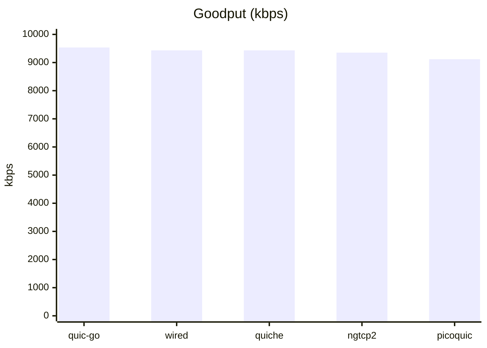
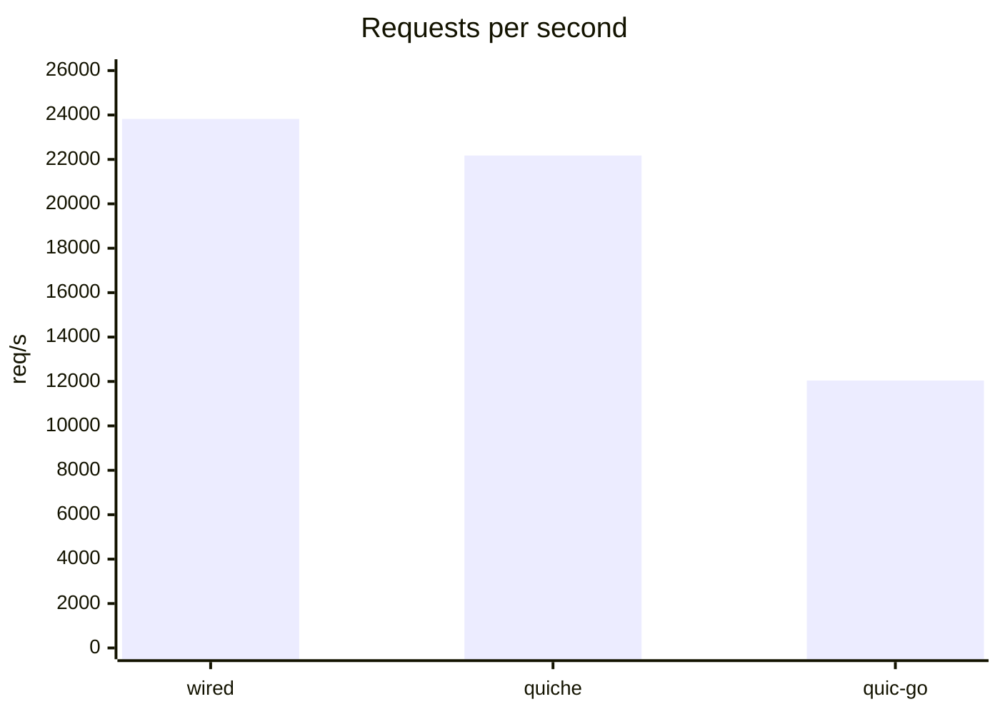
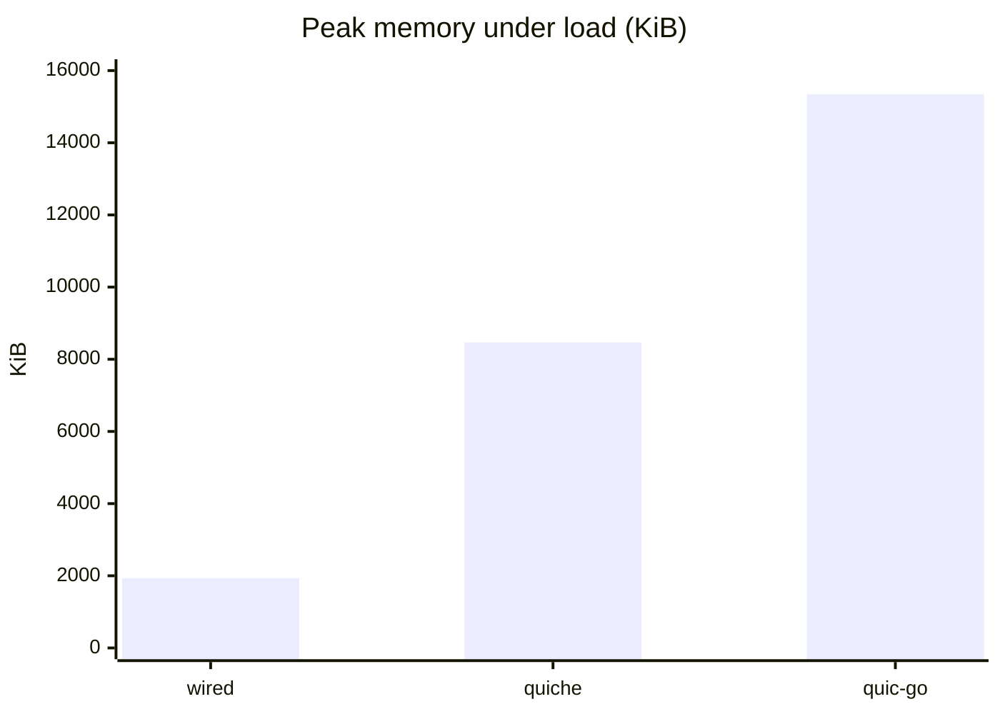

# 実装の比較

[ドキュメント](../README.md) › [試験と品質](../verification/README.md) › 実装の比較

| 項目 | 内容 |
|---|---|
| 目的 | wired と quic-go(Go)、quiche(Rust)、ngtcp2(C)、picoquic(C)の性能と機能を数値で比べる |
| 読む人 | 性能の数値や機能の対応を確かめるコントリビューター |
| 前提文書 | なし |
| 関連文書 | [ベンチマークの実行結果](comparison-runs.md)(生データ)、[相互運用性テストの結果](../verification/interop.md) |

数値はすべて、1 台のマシンで同じ日に取った 1 回分の計測である(2026-11-02、wired は `efd61452e`)。

## 1. 概要

| | wired | quiche 0.29.3 | quic-go v0.61.0 |
|---|---|---|---|
| 毎秒リクエスト数(ループバック) | 23,825 | 22,175 | 12,042 |
| 負荷時のレイテンシー、p50 | 0.71 ms | 0.81 ms | 1.45 ms |
| 負荷時のレイテンシー、p99 | 3.05 ms | 2.57 ms | 3.68 ms |
| 新しい接続の TTFB、p50 | 2.73 ms | 1.97 ms | 2.64 ms |
| 1 リクエストあたりのサーバー CPU | 35.4 µs | 37.2 µs | 79.6 µs |
| アイドル時のメモリ | 512 KiB | 7,804 KiB | 8,424 KiB |
| 負荷時のピークメモリ | 1,932 KiB | 8,468 KiB | 15,340 KiB |
| サーバーのバイナリ(strip 後) | 525 KB(静的リンク、libc なし) | 6.2 MB | 7.3 MB |
| グッドプット、10 Mbps の模擬リンク | 9,434 kbps | 9,434 kbps | 9,535 kbps |

WebTransport と MoQT の性能は計測していない。

## 2. 機能の比較表

| | wired | quic-go | quiche | ngtcp2 (+nghttp3) | picoquic |
|---|---|---|---|---|---|
| 言語 | C、freestanding [^w-libc] | Go [^qg-readme] | Rust + BoringSSL [^qc-readme] | C11 [^ng-readme] | C [^pq-readme] |
| TLS | 組み込みの TLS 1.3 [^w-tls] | Go の crypto/tls [^qg-readme] | BoringSSL [^qc-readme] | 差し替え可能(GnuTLS、BoringSSL、OpenSSL など) [^ng-readme] | picotls [^pq-readme] |
| libc | 不要 [^w-libc] | 不要。Go ランタイムが必要 [^qg-nocgo] | 必要 [^qc-readme] | 必要 [^ng-readme] | 必要 [^pq-readme] |
| HTTP/3 | あり [^w-h3] | あり [^qg-readme] | あり [^qc-h3] | あり(nghttp3 経由) [^ng-h3] | あり(最小限) [^pq-readme] |
| QPACK の動的テーブル | 一部: デコードはする。エンコードは静的テーブルのみ [^w-qpack] | なし [^qg-qpack] | なし [^qc-qpack] | あり [^ng-qpack] | なし [^pq-qpack] |
| WebTransport | あり [^w-wt] | 一部: 別ライブラリの webtransport-go [^qg-readme] | 一部: Extended CONNECT のみ [^qc-wt] | 一部: 前提となる部分のみ [^ng-wt] | あり [^pq-wt] |
| QUIC DATAGRAM | あり [^w-dgram] | あり [^qg-readme] | あり [^qc-dgram] | あり [^ng-readme] | あり [^pq-readme] |
| 0-RTT | あり [^w-interop] | あり [^qg-0rtt] | あり [^qc-0rtt] | あり [^ng-0rtt] | あり [^pq-0rtt] |
| Key Update | あり [^w-interop] | あり [^qg-ku] | 一部: 応答のみ [^qc-ku] | あり [^ng-ku] | あり [^pq-ku] |
| ECN | あり [^w-interop] | あり [^qg-ecn] | なし [^qc-ecn] | あり [^ng-ecn] | あり [^pq-ecn] |
| 接続の移行 | あり [^w-interop] | あり [^qg-mig] | あり [^qc-mig] | あり [^ng-mig] | あり [^pq-mig] |
| QUIC v2 | あり [^w-interop] | あり [^qg-readme] | なし [^qc-v2] | あり [^ng-readme] | あり [^pq-v2] |
| MoQT | あり(draft 18/19/22/23) [^w-moqt] | なし [^qg-nomoqt] | なし [^qc-nomoqt] | なし [^ng-nomoqt] | なし [^pq-nomoqt] |

wired の QUIC の機能の「あり」は、wired 自身のテストに加え、独立したクライアントとの相互運用性テストでも確かめている。

## 3. 模擬リンクでのグッドプット

| 条件 | 値 |
|---|---|
| ツール | [quic-interop-runner](https://github.com/quic-interop/quic-interop-runner) |
| リンク | 10 Mbps の模擬リンク |
| 転送 | 10 MB のダウンロード |
| 回数 | サーバーごとに 5 回 |
| クライアント | すべて quic-go |
| サーバー | 5 つすべて runner の Docker イメージ。wired のイメージは 64 接続のテーブルでビルド |

| サーバー | グッドプット(kbps) |
|---|---|
| quic-go | 9,535 ± 15 |
| wired | 9,434 ± 15 |
| quiche | 9,434 ± 5 |
| ngtcp2 | 9,352 ± 43 |
| picoquic | 9,118 ± 22 |

この計測では 10 Mbps のリンクが上限になる。

## 4. ループバックでの 1 リクエストあたりのコスト

クライアントとサーバーを 1 台のマシン(`127.0.0.1`)で動かし、サーバー自身のコストを測る。

| 条件 | 値 |
|---|---|
| 1 ラウンド | 新しい接続で 100 リクエスト(TTFB)、次に 20 本の並列ストリームで小さなリクエスト 10,000 件(負荷) |
| ラウンド数 | サーバーごとに 5 |
| CPU | サーバーを 1 コアに固定 |
| 設定 | 各サーバーのデフォルト。wired は固定サイズのバッファーに合わせ、ほかの実装より小さいストリームごとのウィンドウを通知する |
| 対象外 | ngtcp2 と picoquic(ネイティブにビルドしていないので、グッドプットの計測だけに入る) |

| サーバー | 負荷 req/s | 負荷 p50 (ms) | 負荷 p99 (ms) | TTFB p50 (ms) |
|---|---|---|---|---|
| wired | 23,825 ± 1,076 | 0.71 ± 0.03 | 3.05 ± 0.25 | 2.73 ± 0.15 |
| quiche | 22,175 ± 1,457 | 0.81 ± 0.05 | 2.57 ± 0.34 | 1.97 ± 0.18 |
| quic-go | 12,042 ± 657 | 1.45 ± 0.09 | 3.68 ± 0.26 | 2.64 ± 0.21 |

どの実行でも、失敗したリクエストは 0 件である。

## 5. メモリ、CPU、バイナリサイズ

4 章と同じループバックの実行で測った。

| 指標 | 測り方 |
|---|---|
| アイドル時のメモリ | 起動の 1.5 秒後に読み取った値 |
| ピークメモリ | 負荷のラウンド中にプロセスが達した最大値 |
| CPU | 1 リクエストあたりのサーバー自身の CPU 時間 |

| サーバー | アイドル (KiB) | ピーク (KiB) | 1 リクエストあたりの CPU (µs) | strip 後のバイナリ (B) |
|---|---|---|---|---|
| wired | 512 | 1,932 | 35.4 ± 1.5 | 525,040(静的リンク、libc なし) |
| quiche | 7,804 | 8,468 | 37.2 ± 4.4 | 6,237,840(glibc に動的リンク) |
| quic-go | 8,424 | 15,340 | 79.6 ± 3.9 | 7,311,104(静的リンクの Go) |

wired はテーブルを起動時にまとめて確保する(`bss` で約 29 MB)。実メモリに載るのは書き込んだページだけで、閉じた接続のページはカーネルに返す。詳細は [メモリ配置とサイズ](../architecture/memory.md) にある。

## 6. 環境と再現方法

| 項目 | 内容 |
|---|---|
| マシン | KVM の VM、Intel Xeon Gold 6230 @ 2.10 GHz、4 vCPU、3.8 GiB RAM、Ubuntu 24.04、カーネル 6.8 |
| CPU の割り当て(ループバック) | サーバーはコア 3、クライアントはコア 0–1 |
| `net.core.rmem_max` | 208 KiB(どのサーバーでも同じ) |
| バージョン | quic-go v0.61.0(Go 1.25.0)、quiche 0.29.3(`55886df`) |
| グッドプットのイメージ | runner の interop イメージ。ダイジェストは [ベンチマークの実行結果](comparison-runs.md) にある |
| スクリプト | [`bench/`](../../bench/)(`run-lane.sh`、`report.mjs`、負荷をかけるクライアント、quic-go のサーバー)。手順ごとのコマンドは [`bench/README.md`](../../bench/README.md) にある |
| グッドプットの実行 | quic-interop-runner で `python run.py -s <server> -c quic-go -t goodput`。wired は [interop/README.md](../../interop/README.md) のとおりに登録する |
| 証明書 | SAN に `127.0.0.1` を入れる。wired は証明書が対象にしていない名前へのリクエストに 421 を返す |

## 7. 脚注

[^w-libc]: `src/**/*.c` はすべて `-ffreestanding -nostdlib` でビルドできる。[システムコール](../syscalls.md)を参照。
[^w-tls]: [要件台帳 › RFC 8446](../features/rfc8446.md)。
[^w-h3]: [要件台帳 › RFC 9114](../features/rfc9114.md)。
[^w-qpack]: [要件台帳 › RFC 9204](../features/rfc9204.md)。サーバーは動的テーブルの容量を 0 と通知し、エンコーダーは静的テーブルだけを使う。
[^w-wt]: [要件台帳 › RFC 9220](../features/rfc9220.md)、[draft-webtrans-http3](../features/draft-webtrans-http3.md)。
[^w-dgram]: [要件台帳 › RFC 9221](../features/rfc9221.md)、[RFC 9297](../features/rfc9297.md)。
[^w-interop]: 独立したクライアントとの相互運用性テストに合格。[相互運用性テストの結果](../verification/interop.md)を参照。
[^w-moqt]: WebTransport と raw QUIC の上でサーバー/リレーとして動作し、draft はセッションごとに選ぶ。`src/app/moqt/`。
[^qg-readme]: <https://github.com/quic-go/quic-go/blob/v0.61.0/README.md>。
[^qg-nocgo]: v0.61.0 に `import "C"` はない。
[^qg-qpack]: <https://github.com/quic-go/qpack/blob/v0.6.0/README.md> に "does not support the dynamic table" とある。
[^qg-0rtt]: v0.61.0 の `interface.go`(`Allow0RTT`)。
[^qg-ku]: v0.61.0 の `internal/handshake/updatable_aead.go`。
[^qg-ecn]: v0.61.0 の `internal/ackhandler/ecn.go`。
[^qg-mig]: v0.61.0 の `path_manager.go`、`connection.go`(`Conn.AddPath`)。
[^qg-nomoqt]: v0.61.0 で `moq` を検索しても該当なし。
[^qc-readme]: <https://github.com/cloudflare/quiche/blob/0.29.3/README.md>。
[^qc-h3]: 0.29.3 の `quiche/src/h3/mod.rs`。
[^qc-qpack]: 0.29.3 の `quiche/src/h3/qpack/decoder.rs` に "TODO: implement dynamic table" とある。
[^qc-wt]: 0.29.3 の `quiche/src/h3/mod.rs`(`enable_extended_connect`)。WebTransport のセッション層はない。
[^qc-dgram]: 0.29.3 の `quiche/src/lib.rs`(`enable_dgram`)。
[^qc-0rtt]: 0.29.3 の `quiche/src/lib.rs`(`enable_early_data`)。
[^qc-ku]: 0.29.3 の `quiche/src/lib.rs`。鍵更新を始める API がない。
[^qc-ecn]: 0.29.3 の `quiche/src/lib.rs` に "sending ECN is not supported" とある。
[^qc-mig]: 0.29.3 の `quiche/src/path.rs`、`lib.rs`(`migrate`)。
[^qc-v2]: 0.29.3 の `quiche/src/lib.rs`。v1 のみ。
[^qc-nomoqt]: 0.29.3 で `moq` を検索しても該当なし。
[^ng-readme]: <https://github.com/ngtcp2/ngtcp2/blob/v1.25.0/README.rst>。
[^ng-h3]: <https://github.com/ngtcp2/nghttp3/blob/v1.18.0/README.rst>。
[^ng-qpack]: nghttp3 の README に "It supports dynamic table." とある。
[^ng-wt]: nghttp3 にあるのは RFC 9220/9297 の設定だけで、WebTransport の API はない。
[^ng-0rtt]: ngtcp2 の README の "Resumption and 0-RTT"。
[^ng-ku]: ngtcp2 の `ngtcp2.h` の `ngtcp2_conn_initiate_key_update`。
[^ng-ecn]: ngtcp2 の `ngtcp2_conn.c` にある ECN 検証の状態。
[^ng-mig]: ngtcp2 の `ngtcp2.h` の `ngtcp2_conn_initiate_migration`。
[^ng-nomoqt]: ngtcp2 にも nghttp3 にも MoQT の該当なし。
[^pq-readme]: <https://github.com/private-octopus/picoquic/blob/master/README.md>。
[^pq-qpack]: picoquic の `picohttp/h3zero.c`。静的テーブルのみ。
[^pq-wt]: picoquic の `picohttp/webtransport.c`。
[^pq-0rtt]: picoquic の `picoquic.h` の `picoquic_is_0rtt_available`。
[^pq-ku]: picoquic の `picoquic.h` の `picoquic_start_key_rotation`。
[^pq-ecn]: picoquic の `picoquic_internal.h` の ACK_ECN カウンター。
[^pq-mig]: picoquic の `picoquic_internal.h`、`quicctx.c`。
[^pq-v2]: picoquic の `picoquic_internal.h` の `PICOQUIC_V2_VERSION`。
[^pq-nomoqt]: picoquic のテストに `"moqt-16"` という例の文字列が 1 つあるだけ。
