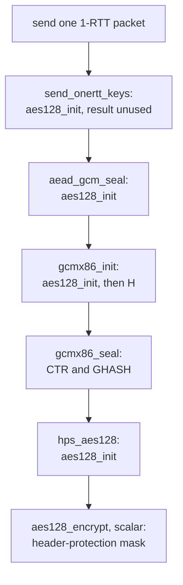
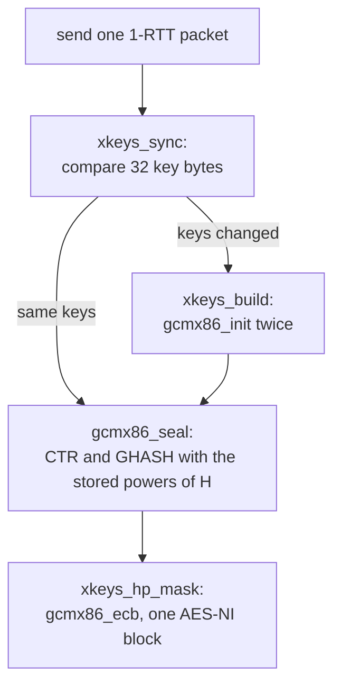
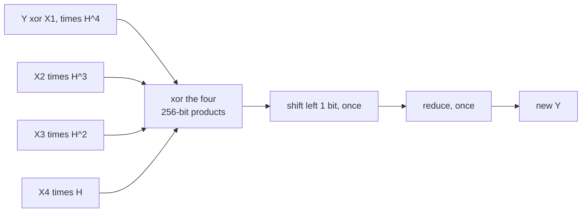

# moqt_chat 向けの高速化: パケットの保護

[ドキュメント](../../README.md) › [試験と品質](../../verification/README.md) › [moqt_chat 向けの高速化](README.md) › パケットの保護

| 項目 | 内容 |
|---|---|
| 目的 | 1-RTT パケットの AEAD とヘッダー保護について、今の処理の流れと、変更の前後の値を示す |
| 読む人 | `src/tls/keys/xkeys/` と `src/crypto/symmetric/aead/gcmx86/` を変更するコントリビューター |
| 前提文書 | [moqt_chat 向けの高速化: 全体像](README.md)(計測の条件と指標)、[暗号化レベルと鍵](../../architecture/keys.md)(鍵の世代と、鍵を捨てる時点) |
| 関連文書 | [毎周の走査](idle-scans.md)、[受信パケットの処理](receive.md)、[送信とシステムコール](send.md)、[ハブの中継](hub.md)、[moqt_chat のリソース監視](../monitoring.md) |

## 1. 結果

サーバーが TLS_AES_128_GCM_SHA256 の 1-RTT パケットを、AES-NI、PCLMULQDQ、SSSE3 がある x86-64 で処理するときの値である。それ以外の場合は 6 章に書く。

| 項目 | 前 | 後 |
|---|---|---|
| AES の鍵の展開 | 送信 1 パケットで 4 回、受信 1 パケットで 5 回 | 鍵の世代ごとに 1 回。パケットごとには 0 回 |
| ヘッダー保護のマスク | バイト単位のスカラーの AES(`aes128_encrypt`) | AES-NI の 1 ブロック(`gcmx86_ecb`) |
| GHASH | 1 ブロックごとに積、シフト、還元 | 最大 4 ブロックの積を足してから、シフトと還元を 1 回 |
| バイトの反転 | 約 10 命令のシャッフル | pshufb の 1 命令 |
| CTR のカウンター | `u8` 16 個の上で 1 バイトずつ進め、ブロックごとにメモリから読む | `u32` をレジスタに置く |
| 展開済みの鍵の消去 | 展開済みの鍵を持たない | 生の鍵と同じ時点で消す |

1 パケットの処理時間は次のとおりである。

| 計測したもの | 前 | 後 | 差 |
|---|---|---|---|
| 送信 150 バイト | 1,093 ns | 321 ns | −71% |
| 送信 1,400 バイト | 2,519 ns | 953 ns | −62% |
| 受信 150 バイト | 1,453 ns | 307 ns | −79% |
| 受信 1,400 バイト | 3,019 ns | 936 ns | −69% |

- 「後」の値は 2〜4 章の変更をすべて含み、パケットごとの `xkeys_sync` の時間も含む。
- 時間は `build/libwired.a` をリンクしたマイクロベンチマークの値である。回数とマシンは[全体像](README.md)の 2 章と 4 章にある。
- 送信 1 パケットは送信の経路(`srvloop/send.c`)と同じ手順で測る。
- 呼び出しの回数は[全体像](README.md)の 2 章の音声の負荷を callgrind で数えた値である。

## 2. 鍵の展開の使い回し

### 2.1 1 パケットの流れ

変更前の送信では、1 パケットのあいだに `aes128_init` が 4 回走った。

今の送信では展開済みの鍵と生の鍵を見比べたあと、AEAD とマスクに進む。

生の鍵が同じあいだ、`xkeys_build` は走らない。

### 2.2 回数の比較

変更前に 1 パケットで走った鍵の展開(`aes128_init`)の内訳は、次のとおりである。

| 呼ぶ箇所 | 送信 | 受信 |
|---|---|---|
| 結果を使わない展開(送信は `send_onertt_keys`、受信は `kurx_open`) | 1 回 | 1 回 |
| AEAD(`aead_gcm_seal` / `aead_gcm_open` と `gcmx86_init`) | 2 回 | 2 回 |
| ヘッダー保護のマスク(`hps_aes128`) | 1 回 | 2 回 |
| 合計 | 4 回 | 5 回 |

1 パケットあたりの回数は次のように変わった。

| 項目 | 前 | 後 |
|---|---|---|
| 送信 1 パケットの鍵の展開 | 4 回 | 0 回 |
| 受信 1 パケットの鍵の展開 | 5 回 | 0 回 |
| `aes128_init` の呼び出し | 347,567 回(送受信の 78,120 パケット、1 パケットあたり約 4.4 回) | 0 回 |
| ヘッダー保護のマスク(送信) | スカラーの AES を 1 回 | AES-NI の 1 ブロックを 1 回 |
| ヘッダー保護のマスク(受信) | スカラーの AES を 2 回 | AES-NI の 1 ブロックを 2 回 |
| 鍵の比較 | なし | 送信は 32 バイト、受信は 32 バイト × 3 世代 |

変更前の処理の時間は単体で次の値だった。

| 処理 | 時間 |
|---|---|
| `aes128_init` | 92 ns |
| `gcmx86_init`(`aes128_init` を含む) | 120 ns |
| スカラーの `aes128_encrypt` | 263 ns |
| `hp_suite_mask`(`aes128_init` と `aes128_encrypt` を含む) | 381 ns |

### 2.3 展開済みの鍵

`xkeys` は 1 つの鍵の世代について、AES-NI 用に展開した鍵を持つ。

| メンバー | 内容 |
|---|---|
| `aead` | パケット鍵を展開したもの(ラウンド鍵 11 個、H、H〜H⁴) |
| `hp` | ヘッダー保護の鍵を展開したもの(H は使わない) |
| `key`、`hpkey` | 展開のもとにした生の鍵の写し |
| `on` | 1 のとき `aead` と `hp` が使える |

サーバーは接続ごとに 4 つ持つ(`wired_server` の `kx_send`、`kx_recv[3]`)。

| `xkeys` | 対応する生の鍵 |
|---|---|
| `kx_send` | 送信の現在の鍵(`ku_send.cur`) |
| `kx_recv[0]` | 受信の現在の鍵(`ku.cur`) |
| `kx_recv[1]` | 受信の旧の鍵(`ku.old`) |
| `kx_recv[2]` | 受信の次の鍵(`ku_next`) |

### 2.4 xkeys_sync

`xkeys_sync` は展開済みの鍵を使う前に毎回呼ぶ。

1. 暗号スイートか CPU が対象外(6 章)なら `on` を 0 にして戻る。
2. 生の鍵の写しと今の生の鍵を `ct_diff16` で見比べる。
3. `on` が 0 か、鍵が違えば、`gcmx86_init` を 2 回呼んで作り直し、写しを更新する。

| 呼ぶ場所 | 関数 |
|---|---|
| 送信の直前 | `send_onertt_sync_keys`(`srvloop/send.c`) |
| 受信の直前(3 世代) | `kurx_sync_keys`(`srvloop/recv_onertt.c`) |

- 使う直前に生の鍵と見比べるので、鍵を回す箇所が `xkeys` を更新しなくても、古い鍵では暗号化しない。
- 鍵を回した直後にも合わせ直す(5 章)。これは、古い展開済みの鍵を次のパケットより前に消すためである。

## 3. ヘッダー保護のマスク

マスクは AES-ECB(ヘッダー保護の鍵, サンプル) の先頭 5 バイトである(RFC 9001 5.4.3)。

| 項目 | 前 | 後 |
|---|---|---|
| 鍵の展開 | マスクのたびに `aes128_init` | なし(`xkeys.hp` を使う) |
| ブロックの暗号化 | スカラーの `aes128_encrypt` | `gcmx86_ecb`(aesenc 9 回と aesenclast 1 回) |
| 入口 | `hp_suite_mask` | `hp_suite_mask_keys` が `xkeys_hp_mask` を呼ぶ |

- `hp_suite_mask_keys` は、展開済みの鍵がないときに `hp_suite_mask` へ進む。
- 受信では、鍵の世代を選ぶために Key Phase とパケット番号を読むとき(`kurx_peek`)と、保護を外すときに、マスクを 1 回ずつ計算する。この 2 回を 1 回にする変更は入れていない。

## 4. AES-GCM の本体

### 4.1 GHASH の 4 ブロック集約

`gcmx86_init` は H、H²、H³、H⁴ を GHASH のオペランドの形で `gcmx86.hp` に入れる。GHASH は 4 ブロックを次の式で一度に畳む。

Y' = (Y ⊕ X1)·H⁴ ⊕ X2·H³ ⊕ X3·H² ⊕ X4·H

- この式は Y = (Y ⊕ X)·H を 4 回くり返した式を展開したものである。
- シフトと還元は GF(2) 上で線形である。4 つの積を足してから 1 回行った値は、積ごとに行ってから足した値と同じになる。
- 4 つの積は互いの結果を待たない。

畳む経路は 2 つある。

| 関数 | 使う場面 |
|---|---|
| `gcmx86_gh_fold4` | 待っているブロックがないとき。入力の 64 バイトをそのまま畳む |
| `gcmx86_gh_fold` | 待たせた 1〜4 ブロックを畳む。先頭のブロックは Hⁿ と掛ける(n は待たせた個数) |

AAD、暗号文、長さのブロックは同じ畳み込みを共有する。AAD が 13 バイト(1 ブロック)のときの還元の回数は、次のとおりである。

| 平文 | GHASH のブロック | 前の還元 | 後の還元 | 後の畳み込みの内訳 |
|---|---|---|---|---|
| 150 バイト | 12 個(AAD 1、暗号文 10、長さ 1) | 12 回 | 3 回 | 4 個 × 3 回 |
| 1,400 バイト | 90 個(AAD 1、暗号文 88、長さ 1) | 90 回 | 23 回 | 4 個 × 22 回と 2 個 × 1 回 |

- AAD のブロックは暗号文の先頭の 3 ブロックと一緒に畳まれる。
- 64 バイトずつ畳んだあとに残る暗号文のブロック(3 個以下)は、長さのブロックと一緒に畳まれる。

### 4.2 そのほかの変更

| 項目 | 今の実装 | 関数 |
|---|---|---|
| バイトの反転 | pshufb の 1 命令 | `gcmx86_rev`、`wired_arch_pshufb` |
| CTR のカウンター | `u32` で持ち、ブロックごとに J0 の最後の 32 ビットへ入れる。`u32` の加算で進めるので、2³² を法に折り返す | `gcmx86_ctr_at` |
| 長さのブロック | `u64` 2 個から直接作る | `gcmx86_gh_lens` |
| CPU の判定 | AES-NI、PCLMULQDQ に加えて SSSE3 も見る | `gcmx86_supported` |

### 4.3 計測値

`gcmx86_seal` 単体の値である。鍵は展開済みで、AAD は 13 バイトである。`gcmx86_open` も同じ比率で変わった。

| 平文 | 前 | 後 | 差 |
|---|---|---|---|
| 32 バイト | 176 ns | 153 ns | −13% |
| 150 バイト | 353 ns | 245 ns | −31% |
| 1,200 バイト | 1,430 ns | 720 ns | −50% |
| 1,400 バイト | 1,700 ns | 850 ns | −50% |

- `gcmx86_init` は 122 ns から 159 ns に増えた。増えた分は H の累乗 3 個の計算で、鍵の世代ごとに 1 回だけかかる。
- 122 ns は 2.2 の 120 ns とは別の回の計測である。

## 5. 鍵の消去

古い受信鍵は捨てる(RFC 9001 6.5)。サーバーは捨てる鍵を 0 で埋め、展開済みの鍵と生の鍵の写しも同じ時点で消す。

| 時点 | 処理 | 関数 |
|---|---|---|
| 古い受信鍵の破棄 | 生の鍵と `kx_recv[1]` を 0 で埋める | `srvloop_ku_discard_old`、`xkeys_wipe` |
| 受信鍵を回した直後 | `kx_recv` の 3 つを今の鍵に合わせ直す | `kurx_sync_keys` |
| 送信鍵を回した直後 | `kx_send` を今の鍵に合わせ直す | `srvloop_ku_rotate_send` |
| 接続の初期化 | `kx_send` と `kx_recv` の 3 つを 0 で埋める | `server_reset_xkeys`(`wired_server_init` から呼ぶ) |

- 回した直後に合わせ直すので、受信の 2 世代前の鍵と、送信の 1 世代前の鍵を展開したものは、次のパケットを待たずに上書きされる。
- 古い受信鍵を破棄する時点は[暗号化レベルと鍵](../../architecture/keys.md)の 3 章にある。
- 接続を閉じた時点では生の鍵も展開済みの鍵も消さない。

## 6. 対象外

次の場合は `xkeys.on` が 0 になるか、`xkeys` を渡さず、生の鍵の経路を使う。

| 場合 | 理由 |
|---|---|
| TLS_AES_256_GCM_SHA384、TLS_CHACHA20_POLY1305_SHA256 | `xkeys` は TLS_AES_128_GCM_SHA256 だけを扱う |
| AES-NI、PCLMULQDQ、SSSE3 のどれかがない CPU | `gcmx86_supported` が 0 を返す |
| Initial と Handshake のパケット | `xkeys` は 1-RTT の鍵だけに持つ |
| `ku_seeded` が 0 のあいだに送る 1-RTT パケット | `send_onertt_sync_keys` が `kx_send` を合わせない |
| 平文が空のパケットの復号 | `gcmx86_open` の戻り値では、空の平文とタグの不一致を区別できない |

## 7. 変えていない性質とテスト

| 性質 | 実装 |
|---|---|
| タグの比較は定数時間 | `gcmx86_open` は `ct_diff16` で比べる |
| 鍵の比較は定数時間 | `xkeys_sync` は `ct_diff16` で比べる |
| 分岐は長さだけに依存する | GHASH の取り込み(`gcmx86_gh_absorb`)は、バイトの値で分岐しない |
| 命令セットに依存するコードの置き場所 | `src/common/arch/` だけ。`gcmx86` は `wired_arch_*` を呼ぶ |

| テスト | 確かめること |
|---|---|
| `tests/tls/xkeys_test.c` の `test_xkeys_hp_mask_matches_scalar` | ヘッダー保護のマスクとスカラー版の一致(1,000 件) |
| 同 `test_xkeys_aead_matches_raw_key` | 生の鍵の経路との暗号文の一致(10 通りの長さ)と、タグを変えたパケットの拒否 |
| 同 `test_xkeys_empty_plaintext_opens` | 平文が空のパケットで、タグを変えたものの拒否 |
| 同 `test_xkeys_resync_follows_the_keys` | 鍵が変わったあとの作り直し |
| 同 `test_xkeys_on_only_for_aes128_with_aesni` | 対象外の暗号スイートで `on` が 0 になること |
| `tests/crypto/gcmx86_test.c` の `test_gcmx86_diff` | スカラー版との一致(長さ 19 通り × AAD 5 通り) |
| 同 `test_gcmx86_diff_sweep` | 0〜200 バイトの全部の長さでの一致 |
| 同 `test_gcmx86_ctr_wraps` | カウンターの 32 ビットの折り返し(スカラーの AES とブロックごとに照合) |
| 同 `test_gcmx86_h_powers` | H の累乗 |
| 同 `test_gcmx86_nist` | NIST のベクター |
| `tests/crypto/bssl_aes128gcm_test.c` | BoringSSL のベクター |
| `tests/crypto/wyc_aesgcm_test.c` | Wycheproof のベクター |
| `tests/app/srvloop_test.c` の `test_srvloop_ku_expanded_keys_follow_discard` | 鍵を回した直後と破棄のあとの展開済みの鍵 |
| 同 `test_srvloop_init_clears_expanded_keys` | `wired_server_init` のあとに展開済みの鍵が残らないこと |
