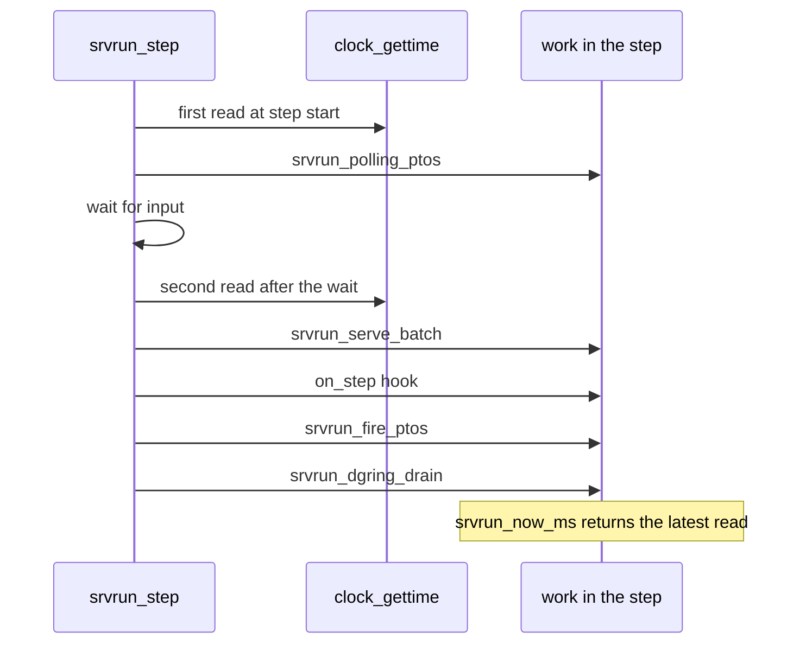
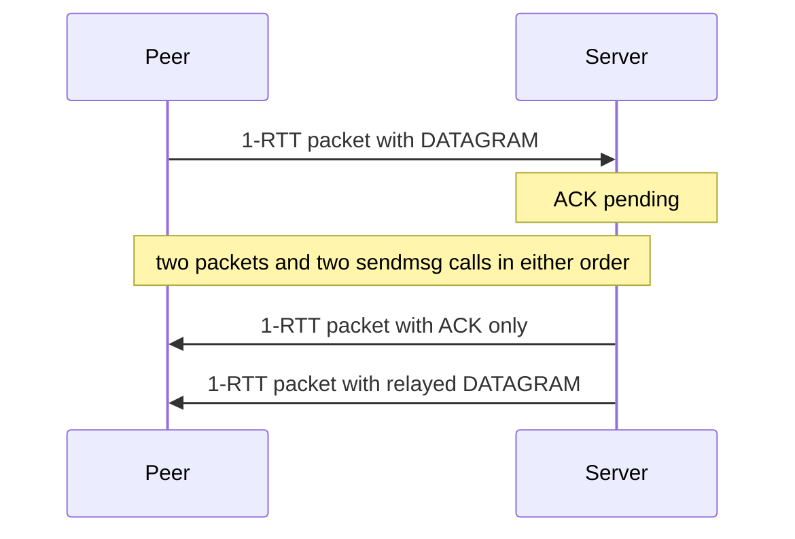
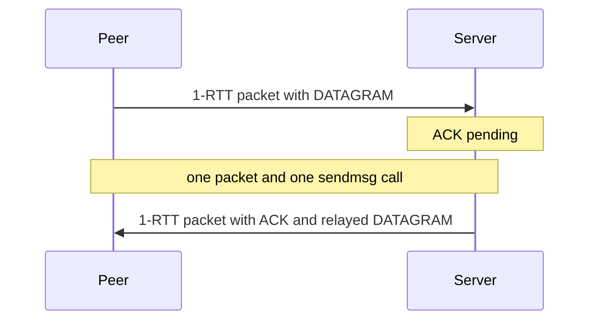
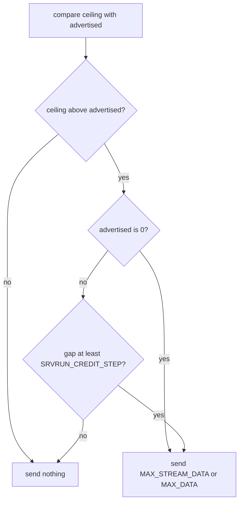

# moqt_chat 向けの高速化: 送信とシステムコール

[ドキュメント](../../README.md) › [試験と品質](../../verification/README.md) › [moqt_chat 向けの高速化](README.md) › 送信とシステムコール

| 項目 | 内容 |
|---|---|
| 目的 | サーバーが送るパケットの数と、発行するシステムコールの回数を減らした変更について、今の動作と変更の前後の値を示す |
| 読む人 | `src/app/http3/server/srvrun/` の送信経路と `src/transport/packet/frame/` を変更するコントリビューター |
| 前提文書 | [moqt_chat 向けの高速化: 全体像](README.md)(計測の条件と指標) |
| 関連文書 | [毎周の走査](idle-scans.md)、[受信パケットの処理](receive.md)、[パケットの保護](crypto.md)、[ハブの中継](hub.md)、[システムコール](../../syscalls.md)、[moqt_chat のリソース監視](../monitoring.md) |

## 1. 結果

2 章と 3 章は 4 人の音声中継の値、4 章と 5 章は画面共有 4 人の値である。

| 章 | 数えたもの | 前 | 後 | 負荷 |
|---|---|---|---|---|
| 2 | `clock_gettime` | 145,803 回 | 61,625 回 | 音声 |
| 2 | `gettid` | 36,156 回 | 0 回 | 音声 |
| 3 | ACK だけのパケット | 6,489 個 | 273 個 | 音声 |
| 3 | `sendmsg` | 42,360 回 | 36,535 回 | 音声 |
| 4 | 受信した STREAM フレーム 1 個あたりのフロー制御の通知 | 2.0 個 | 0.21 個 | 画面共有 |
| 5 | `frame_put_stream` 1 回あたりの命令数 | 1,490 | 319 | 画面共有 |
| 6 | 送るデータグラムを選ぶ探索の範囲 | 全エントリ | 緊急度 0 の送れるエントリまで | 計測なし。テストで照合 |

- 画面共有は流れる量が実行ごとに違う。そのため、受信フレーム 1 個あたりと呼び出し 1 回あたりの値で比べる。
- 音声中継では、4 章と 5 章の変更の前後で命令数は変わらない。

## 2. 時計とスレッド ID のシステムコール

`clock_gettime` と `gettid` は vDSO を使わない生のシステムコールである。呼ぶ回数がそのままカーネルへの出入りの回数になる。

### 2.1 時計

`srvrun_step` は 1 周の中で時計を 2 回読む(`srvrun_step_clock`)。その周の各処理は `srvrun_now_ms` で同じ値を受け取る。

- 2 回目を読むのは、入力待ちの間に時間が進むためである。上限付きの待ちは最大 `SRVRUN_PTO_MS`(25 ms)続く。
- `srvrun_step` の外では共有が切れていて、`srvrun_now_ms` は呼ばれるたびに時計を読む。

| 項目 | 前 | 後 |
|---|---|---|
| 時計を読む箇所 | 時刻を使う 5 か所がそれぞれ読む | 周の始めと、入力待ちから戻った直後 |
| `clock_gettime` の回数 | 145,803 回 | 61,625 回 |
| 1 周あたり | 約 5 回 | 2.0 回 |

変更前に時計を読んでいた 5 か所は、受信した束の処理、PTO の周期の判定、`on_step` のフック、`srvrun_fire_ptos`、`srvrun_dgring_drain` である。

### 2.2 スレッド ID

`srvrun_bcast_self` は、呼び出したスレッドがワーカーの登録表のどこにあるかを返す。セッションあての送信とブロードキャストのたびに呼ばれる。

| 項目 | 前 | 後 |
|---|---|---|
| ワーカーの登録がないとき | `gettid` を呼んで登録表を引く | 登録数が 0 なら `gettid` を呼ばずに「登録なし」を返す |
| ワーカーの登録があるとき | `gettid` を呼んで登録表を引く | 同じ |
| `gettid` の回数 | 36,156 回(中継 1 個あたり 1 回) | 0 回 |

ワーカーが 1 つも登録されていないプロセスでは、どの tid も登録表に一致しない。そのため `gettid` を呼ばなくても結果は変わらない。

## 3. ACK のデータグラムへの同乗

サーバーがデータグラムを送るとき、その接続に保留中の ACK があれば、同じパケットの DATAGRAM フレームの前に載せる(RFC 9000 13.2.1)。送信は `srvrun_send_datagram_now` が行い、載せるかどうかを `srvrun_dg_ack_peek` が決める。

変更前は、ACK とデータグラムを別のパケットで送る。2 つのパケットの順序は決まっていない。

変更後は、1 つのパケットで送る。

| 項目 | 動作 |
|---|---|
| 載せる条件 | ACK、データグラムの中身、DATAGRAM フレームの型と Length の分の 9 バイトの合計が、パケットの平文の空きに収まる |
| 収まらないとき | データグラムだけを送り、ACK は保留のまま残す |
| 保留を消す時点 | ACK を載せたパケットを送ったあと |

| 数えたもの | 前 | 後 |
|---|---|---|
| ACK だけのパケット | 6,489 個 | 273 個 |
| `sendmsg` | 42,360 回 | 36,535 回 |

`tests/app/srvrun_rec_test.c` の `test_srvrun_datagram_carries_pending_ack` が、載せたときに保留が消え、収まらないときに保留が残ることを確かめる。

## 4. フロー制御の通知

サーバーは受信の上限を、MAX_STREAM_DATA(ストリームごと)と MAX_DATA(接続全体)でピアに知らせる。

| 通知 | 上限 `ceiling` | 知らせ済みの値 `advertised` |
|---|---|---|
| MAX_STREAM_DATA | 配送済みのバイト数 + 受信バッファー 1 つ分(49,152 バイト) | 前回送った MAX_STREAM_DATA。送る前は 0 |
| MAX_DATA | 各ストリームの上限などを接続全体で合計した値(`srvrun_grant_conn_credit`) | トランスポートパラメーター `initial_max_data` と、最後に送った MAX_DATA の大きい方 |

送るかどうかは、どちらも `srvrun_wt_credit_stream_due` が決める。

- `SRVRUN_CREDIT_STEP` は受信バッファーの 1/8(6,144 バイト、約 5 パケット分)である。
- 通知は 1 個ずつ単独の 1-RTT パケットで送り、保留中の ACK は同乗させない。
- ピアの上限が尽きるには、通知が 7 回続けて失われる必要がある。

| 項目 | 前 | 後 |
|---|---|---|
| MAX_STREAM_DATA を送る条件 | 上限が前回の通知より大きい(1 バイトの配送でも送る) | 最初の通知はすぐ送る。そのあとは、上限が前回の通知から `SRVRUN_CREDIT_STEP` 以上進んだとき |
| MAX_DATA を送る条件 | 上限が、最後に送った MAX_DATA より大きい。送る前の値は 0 で、`initial_max_data` とは比べない | 上限が、ピアがすでに持っている上限を `SRVRUN_CREDIT_STEP` 以上超えたとき |
| ピアに残る上限の余り | 常にバッファー 1 つ分 | バッファーの 7/8 以上 |

画面共有 4 人の callgrind で数えた値を示す。

| 数えたもの | 前 | 後 |
|---|---|---|
| 受信した STREAM フレーム | 369 個 | 610 個 |
| MAX_STREAM_DATA | 370 個 | 127 個 |
| MAX_DATA | 358 個 | 0 個 |
| 受信フレーム 1 個あたりの通知 | 2.0 個 | 0.21 個 |

- 変更前は、サーバーが送った 1,549 パケットの 47% がこの 2 種類の通知だった。
- ピアは、上限を増やさない MAX_DATA を無視する(RFC 9000 4.1)。変更前の MAX_DATA は、`initial_max_data`(既定は 10,000,000 バイト)以下の値でも送っていた。
- 変更後は、接続全体の上限が `initial_max_data` を `SRVRUN_CREDIT_STEP` 以上超えるまで MAX_DATA を送らない。この計測では 1 個も送らなかった。

## 5. STREAM フレームへの書き込み

`frame_put_stream` はヘッダーを書いたあと、`frame_write_bytes` でペイロードを書き込む。

| 項目 | 前 | 後 |
|---|---|---|
| ペイロードの書き込み | 1 バイトずつ代入するループ | `bytes_memcpy` の 1 回の呼び出しで写す |
| `frame_put_stream` 1 回あたりの命令数 | 1,490 | 319 |

1 バイトずつのループでは、書き込み先が `out->p` と `out->len` に重なりうる。コンパイラーは代入のたびにこの 2 つを読み直すので、ループがベクトル化されなかった。

## 6. データグラムのリングの探索

`srvrun_dgring_best` は、リングの中で今送れるエントリのうち、緊急度が最も高いものを選ぶ。緊急度が同じなら古いエントリを選ぶ。探索を続けるかどうかは `srvrun_dgring_open` が決める。

| 項目 | 前 | 後 |
|---|---|---|
| 探索の範囲 | 1 個送るごとに全エントリを見る | 緊急度 0 の送れるエントリを選んだ時点で止める |
| 選ぶエントリ | 緊急度が最も高く、その中で最も古いもの | 同じ |

- 緊急度 0 は最も高い緊急度で(RFC 9218 4.1)、あとのエントリがこれを上回ることはない。
- ハブがすべてのデータグラムを緊急度 0 で中継するとき、探索は最初の送れるエントリで終わる。
- `tests/app/srvrun_wtflow_test.c` の `test_srvrun_dgring_best_matches_full_walk` が、選ぶエントリが全走査と一致することを確かめる。
