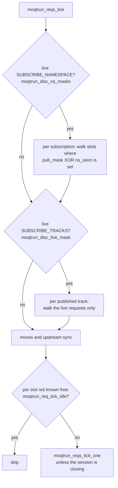
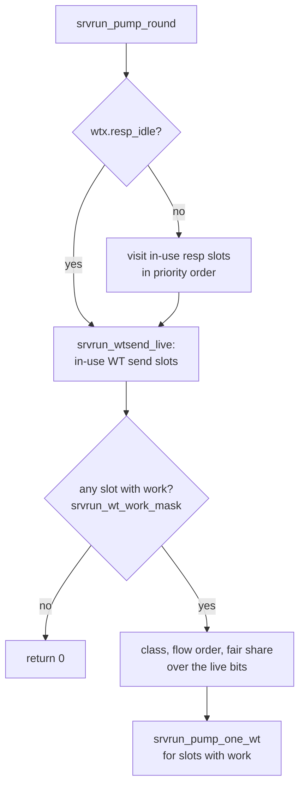
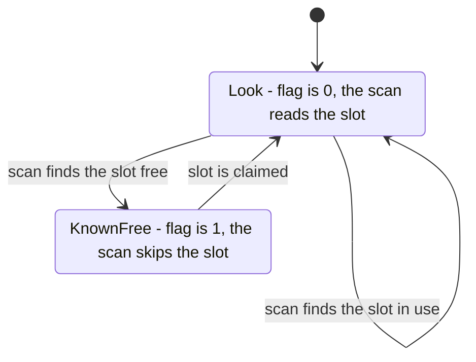

# moqt_chat 向けの高速化: 毎周の走査

[ドキュメント](../README.md) › [試験と品質](../verification/README.md) › [moqt_chat 向けの高速化](speedup.md) › 毎周の走査

| 項目 | 内容 |
|---|---|
| 目的 | サーバーのループが 1 周ごとに調べる表を、調べる必要があるスロットだけに絞った方法と、その前後の命令数を示す |
| 読む人 | `src/app/moqt/run/` と `src/app/http3/server/srvrun/` の毎周の処理を変更するコントリビューター |
| 前提文書 | [moqt_chat 向けの高速化: 全体像](speedup.md)(計測の条件と指標) |
| 関連文書 | [受信パケットの処理](speedup-receive.md)、[ハブの中継](speedup-hub.md)、[moqt_chat のリソース監視](monitoring.md) |

## 1. 結果

ループは 1 周ごとに次の 3 つを呼ぶ。変更前は、通信がない周でも 3 つとも固定長の表をすべて調べた。

| 呼ぶもの | 調べる表 | 章 |
|---|---|---|
| MoQT ハブの tick | リクエストの表 `reqs[]`(128 個) | 2 |
| 送信ポンプ(接続ごとに、送れるストリームを 1 巡する処理) | 応答 `resp[]`(40 個)、WT 送信 `wtsend[]`(41 個) | 3 |
| タイマー | 送信記録、再送待ちの制御パケット `rst[]`、経路検証 | 5 |

ループ 1 周あたりの命令数は 216,743 から 28,714 になった。この値は[全体像](speedup.md)が扱うすべての変更を合わせたものである。変更前の計測でループは 8,702 周した。

### 1.1 変更ごとの命令数

毎周の走査を減らした変更の分は次のとおり。行の間にほかの分野の変更が入るので、値は連続しない。

| 変更 | 1 周あたりの命令数(前 → 後) | 差 |
|---|---|---|
| ハブの同期を、生きているリクエストのビットマップで回す | 199,996 → 108,906 | −45.5% |
| 送信ポンプを、使用中で送る物があるスロットだけに回す | 108,906 → 64,117 | −41.1% |
| 空きスロットへの関数呼び出しをループ側の判定で省く。`moqtrun_disc_live_mask` の判定をインラインにする | 55,445 → 53,437 | −3.6% |
| `moqtrun_disc_live_mask` が使用中のスロットだけを見る | 53,437 → 50,775 | −5.0% |
| `srvrun_acct_resync` の走査を 4 回から 2 回にする | 50,775 → 49,388 | −2.7% |
| `wtx.send_free` と `wtx.resp_idle` を持つ | 49,388 → 45,075 | −8.7% |
| ハブが `req_free` を持つ | 45,075 → 44,025 | −2.3% |
| PTO の期限を先に比べる(`srvrun_pto_fire_due`)。`rst[]` が空の間は走査しない(`wtx.rst_none`) | 44,025 → 37,856 | −14.0% |
| 何も変えないリクエストの tick を飛ばす(`moqtrun_req_tick_idle`)。名前空間の 2 つのマスクを 1 回の走査で作る(`moqtrun_disc_ns_masks`) | 37,856 → 33,842 | −10.6% |
| 購読ごとの走査を食い違うスロットだけにする(`moqtrun_disc_sync_sub`)。集計と並べ直しを省く | 33,842 → 32,155 | −5.0% |

最後の行の計測には、フレームの走査の変更([受信パケットの処理](speedup-receive.md))が 1 件含まれる。

### 1.2 関数ごとの変化

割合は、その時点の命令数の合計に対する値である。合計が減っていくので、行どうしは比べられない。

| 関数 | 前 | 後 |
|---|---|---|
| `wired_moqt_tick` | 24.5% | 3.9% |
| `moqtrun_reqs_tick` | 12.3% | 8.5% |
| `moqtrun_req_settle` の呼び出し | 870,441 回 | 28 回 |
| `srvrun_pump_sess` | 35.8% | 約 10%(集計と並べ直しの省略のあとは約 7.5%) |
| `srvrun_pump_round` | 7.95% | 3.38% |
| `srvrun_pump_one_wt` の呼び出し | 1 巡あたり 41 回 | 送る物があるスロットの数 |
| `srvrun_pto_slot` | 3.48% | 0.52% |
| `srvrun_rst_retry` | 3.1% | 0.2% |
| `srvrun_rst_ack` | 0.69% | 0.02% |

## 2. MoQT ハブの tick

`moqtrun_reqs_tick` は 1 周に 1 回呼ばれ、リクエストの表 `reqs[]`(128 個)を扱う。

どの走査も、使用中のスロットを `moqtrun_req_used_word` から受け取る。この関数は `req_free` が立っていないスロットだけ `in_use` を読む(4 章)。

| 処理 | 前 | 後 |
|---|---|---|
| SUBSCRIBE_TRACKS の同期(`moqtrun_subtracks_sync`) | 使用中のピア × トラック 5 個 × リクエスト 128 個を毎周調べる | 生きている SUBSCRIBE_TRACKS のビットマップが空なら戻る。空でなければ立っているビットだけをトラックごとに回す |
| 名前空間の同期(`moqtrun_disc_sync`) | SUBSCRIBE_NAMESPACE の数 × 128 個を毎周調べる | 購読と公開の 2 つのマスクを 1 回の走査で作る。購読がなければ戻る |
| 購読ごとの走査(`moqtrun_disc_sync_sub`) | 128 個すべて | 公開中の集合(`pub_mask`)と知らせた集合(`ns_seen`)が食い違うスロットだけ |
| リクエストごとの tick(`moqtrun_reqs_tick_one`) | 128 個のうち、セッションが閉じる途中でないものすべてに呼ぶ | 空きと分かっていないスロットのうち、`moqtrun_req_tick_idle` が偽で、セッションが閉じる途中でないものだけに呼ぶ |

- 食い違うスロットは、まだ知らせていない公開と、知らせたあとに取り下げられた公開の 2 種類である。それ以外のスロットでは `moqtrun_disc_sync_one` は何もしない。
- `moqtrun_req_tick_idle` はリクエスト自身のフィールドだけを読む。送信待ちがなく、PUBLISH の返事を待っているか、終わらせるものがないときに真を返す。
- `moqtrun_reqs_tick_word` はスロットごとに `req_free` を読み直す。前のリクエストの処理中に開いたリクエストにも、同じ周で届く。

## 3. 送信ポンプ

`srvrun_pump_round` は応答(`resp[]`、40 個)と WT 送信(`wtsend[]`、41 個)を 1 巡する。変更前の計測では `srvrun_pump_sess` が 76,422 回、`srvrun_pump_one_wt` が約 313 万回呼ばれた。

| 処理 | 前 | 後 |
|---|---|---|
| WT 送信の 1 巡 | 41 個すべてを見る | `srvrun_wtsend_live` のビットだけで、クラスの決定、フローの順序、セッションごとの配分、送信を回す |
| 送る物がないスロット | 訪ねる | 接続のクレジットに空きがある間は訪ねない(`srvrun_wt_work_mask`) |
| 送る物があるスロットが 1 つもない巡 | クラスを決め、配分する。セッション間の持ち回りの位置(`fair_next`)が進む | クラスを決める前に戻る。`fair_next` は進まない |
| 応答の 1 巡 | 40 個を毎回見る | `wtx.resp_idle` が 1 の間は飛ばす |
| 集計(`srvrun_acct_resync`) | スロット表を 4 回たどる | 表ごとに 1 回。WT 送信は `srvrun_wtsend_maybe` のビットだけ、応答は `wtx.resp_idle` の間は見ない |
| 優先度の並び(`srvrun_prio_refresh`) | 毎回並べ直す | 応答がなければ順番どおりの並びを書く。前回も応答がなかったなら書き直さない |

- 送信、再送、FIN のどれもないスロットを訪ねて起こりうるのは DATA_BLOCKED の送信だけである。そのためクレジットに空きがなくなると、すべてのスロットを訪ねる。
- 空きスロットは送信せず、送信可能にもならず、配分にも数えられない。使用中のビットだけを回しても送信の結果は変わらない。
- ポンプそのものは、送る物がない接続でも毎周走る。ペーサーの補充、PMTU の探索、アプリ制限の判定(RFC 9002 7.8)、STREAMS_BLOCKED の通知が、送る物がなくても要るためである。

## 4. 空きを覚えるフラグ

4 つのフラグが「調べなくてよい」ことを覚える。どれも 0 が「調べる」を意味する。

| フラグ | 持ち主 | 1 の意味 | 立てる箇所 | 落とす箇所 |
|---|---|---|---|---|
| `req_free`(スロットごとに 1 ビット) | `wired_moqt_hub` | その `reqs[]` のスロットは空き | `moqtrun_req_used_word` | `moqtrun_req_free_slot` |
| `wtx.send_free`(スロットごとに 1 ビット) | `srvrun_conn` | その `wtsend[]` のスロットは空き | `srvrun_wtsend_live` | `srvrun_wtsend_claim` |
| `wtx.resp_idle` | `srvrun_conn` | 使用中の `resp[]` がない | `srvrun_prio_refresh` | `srvrun_resp_claim`、`srvrun_prio_refresh` |
| `wtx.rst_none` | `srvrun_conn` | ACK を待つ `rst[]` がない | `srvrun_rst_retry` の走査 | `srvrun_rst_keep` |

- 立てるのは走査自身である。空きを実際に見たときにだけ立つ。
- 落とすのはスロットを取る関数である。`wtx.resp_idle` は、`srvrun_prio_refresh` が使用中の応答を見つけたときにも落ちる。
- スロットを解放する側はフラグに触れない。次の走査が空きを見つけて立てる。
- 初期化やリセットでフラグが 0 に戻ると、次の走査がすべてのスロットを読む。命令数は増えるが、結果は変わらない。
- `in_use` を直接書き換えるテストは、フラグを 0 に戻してから走査を呼ぶ。

## 5. タイマー

| タイマー | 前 | 後 |
|---|---|---|
| PTO(`srvrun_pto_slot`) | 毎周、送信記録をたどって PTO が有効かを調べ、そのあと期限を比べる | `srvrun_pto_fire_due` が期限の比較を先にする。期限が来た周だけ送信記録をたどる |
| 再送待ちの制御パケット(`srvrun_rst_retry`、`srvrun_rst_ack`) | 毎周と ACK のレンジごとに `rst[]` をたどる | `wtx.rst_none` が 1 の間は両方とも飛ばす |
| 経路検証(`srvrun_path_tick`) | 毎周、期限切れと再送を調べる | `pathsel_probing` が真の間だけ調べる。接続 ID の retire の処理は毎周行う |

- PTO の 2 つの判定は副作用がないので、順序を入れ替えても結果は変わらない。
- `pathsel_probing` は、応答を待つ PATH_CHALLENGE がある間だけ真を返す。偽の間は、2 つのタイマーの基準になる PTO を計算しない。
- `srvrun_path_tick` は変更前に 3.57% を占めた。変更後の割合は計測していない。

## 6. 照合のテスト

絞った走査の結果を、元の全走査か、スロットごとの判定の結果と比べる。

| テスト | ファイル | 比べるもの |
|---|---|---|
| `test_moqtrun_disc_live_mask_matches_scan` | `tests/app/moqtrun_ns_test.c` | ビットマップと、128 個それぞれの `moqtrun_disc_is`。`moqtrun_disc_ns_masks` と種類ごとのマスク。渡し直したスロットで `req_free` が落ちること |
| `test_moqtrun_req_tick_idle_matches_tick` | `tests/app/moqtrun_ns_test.c` | tick が読むフィールドの 512 通りすべてで、`moqtrun_req_tick_idle` と「`moqtrun_reqs_tick_one` が何も変えず io も呼ばない」こと |
| `test_srvrun_wtsend_live_matches_in_use` | `tests/app/srvrun_wtflow_test.c` | `srvrun_wtsend_live` と、全走査の `srvrun_wtsend_live_scan`。スロットを取ったあとと解放したあとを含む |
| `test_srvrun_resp_idle_tracks_claims` | `tests/app/srvrun_wtflow_test.c` | `wtx.resp_idle` の上げ下げ。集計と、全走査の `srvrun_conn_consumed_bytes`、`srvrun_inflight_bytes_all`。並びが保たれること |
| `test_srvrun_rst_none_tracks_kept` | `tests/app/srvrun_wtflow_test.c` | `wtx.rst_none` が、表が空の走査で立ち、`srvrun_rst_keep` で落ちること |

`srvrun_wtsend_live_scan` は照合のために残してある全走査である。送信の順序は、公平性、優先度、フローの順序の既存のテストが確かめる。
