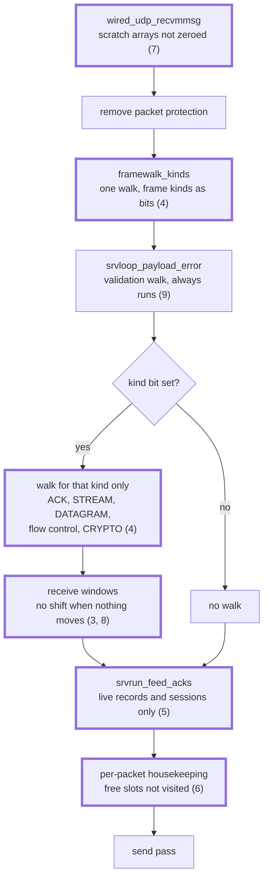
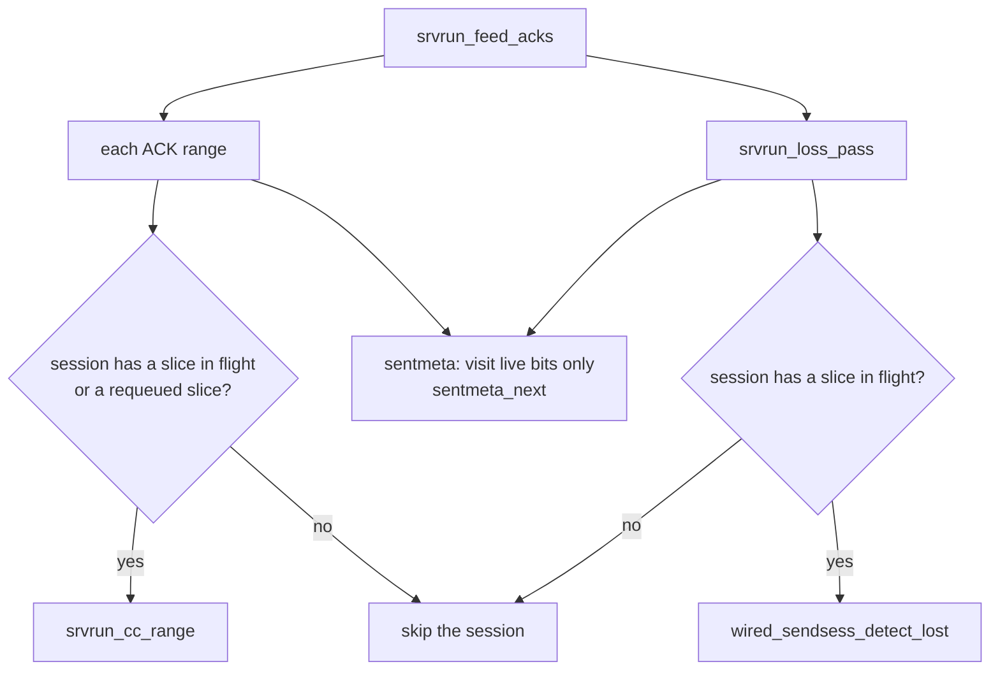

# moqt_chat 向けの高速化: 受信パケットの処理

[ドキュメント](../README.md) › [試験と品質](../verification/README.md) › [moqt_chat 向けの高速化](speedup.md) › 受信パケットの処理

| 項目 | 内容 |
|---|---|
| 目的 | サーバーが受信パケット 1 個を処理する道筋と、その命令数を減らした変更の前後の値を示す |
| 読む人 | `src/app/http3/server/srvloop/` と `src/app/http3/server/srvrun/` の受信経路を変更するコントリビューター |
| 前提文書 | [moqt_chat 向けの高速化: 全体像](speedup.md)(計測の条件と指標) |
| 関連文書 | [毎周の走査](speedup-idle-scans.md)、[パケットの保護](speedup-crypto.md)、[送信とシステムコール](speedup-send.md)、[ハブの中継](speedup-hub.md)、[moqt_chat のリソース監視](monitoring.md) |

## 1. 結果

4 人の音声中継(受信パケット約 35,000 個)の値である。8 章だけは画面共有 4 人の値を使う。

| 指標 | 前 | 後 |
|---|---|---|
| 受信パケット 1 個あたりの命令数 | 88,418 | 19,666 |
| `bodywin_consume` | 15.9% | 0.01% |
| `dispatch_gather_side_channels` | 11.1% | 1.2% |
| `srvrun_feed_acks` | 10.3% | 3.0% |
| `wired_udp_recvmmsg` | 2.94% | 0.67% |
| `memset` | 2.26% | 0.14% |
| `framewalk_next` を呼ぶ走査の回数(受信パケット 1 個) | 20 回以上 | 約 7 回(ACK だけのパケット) |
| 中継で捨てたデータグラム | 0 個 | 0 個 |

- 1 行目の 88,418 → 19,666 は、[全体像](speedup.md)が扱うすべての変更を合わせた値である。送信と暗号の変更による減少も含む。
- 2 行目から下が、この文書が扱う変更の値である。
- 割合は、その変更の直前と直後の計測で命令数の合計に占める値で、子の呼び出しを含む。計測ごとに合計が違うので、別の行の割合どうしは足し引きできない。

## 2. 受信パケットの道筋

太枠のノードが、命令数を減らした箇所である。括弧の数字は説明する章を示す。

- 種類のビットは `srvloop_step_opened` がパケットごとに作り、その場で下流へ渡す。接続の状態には置かない。
- ACK だけのパケットでは ACK のビットだけが立つ。残る走査は、検証の走査と ACK の読み取りである。

## 3. CONNECT ストリームの受信窓

`bodywin_pump` は CONNECT ストリームの本文を読み進めたあとに `bodywin_consume` を呼ぶ。`bodywin_consume` は読み終えた n バイトを窓から取り除き、残りを前へ詰める。

| 項目 | 前 | 後 |
|---|---|---|
| n が 0 のときの動作 | 10,240 バイトを同じ位置へ写し、1,280 バイトのビットマップをずらす | 先頭で戻る |
| 命令数に占める割合 | 15.9% | 0.01% |
| 受信パケット 1 個あたりの命令数 | 88,418 | 65,691(−25.7%) |

- 変更前の計測では受信パケットごとに 1 回、合わせて 35,025 回呼ばれ、1 回に約 22,700 命令を使っていた。
- 判定は `bodywin_consume` の中にあるので、3 か所の呼び出しのすべてに適用される。
- `test_bodywin_consume_zero_is_noop` が、n が 0 の呼び出しの前後で窓の状態が変わらないことを確かめる。

## 4. フレームの走査

### 4.1 種類のビット

`framewalk_kinds` はペイロードを 1 回たどり、含まれるフレームの種類を 32 ビットの値にまとめる。種類 k のフレームがあれば、ビット k が立つ。下流の処理は、自分が扱う種類のビットが立っているときだけペイロードをたどる。

| 処理 | 走査する条件 |
|---|---|
| `srvloop_rxacct_kinds`(ストリームの受信量の集計) | STREAM か RESET_STREAM がある |
| `step_note_close`(ピアの CONNECTION_CLOSE の記録) | CONNECTION_CLOSE がある |
| `srvloop_collect_acks`(ACK のレンジの収集) | 1-RTT のパケットで、ACK がある |
| `wired_server_crypto_level_ok`(CRYPTO を運べる暗号レベルかの検査) | 1-RTT のパケットでは、CRYPTO がある |
| `srvloop_past_stream_limit`(ストリーム数の上限の検査) | STREAM、RESET_STREAM、STOP_SENDING、MAX_STREAM_DATA、STREAM_DATA_BLOCKED、RESET_STREAM_AT のどれかがある |
| `dispatch_gather_side_channels` のストリーム系の収集 5 つ | STREAM、RESET_STREAM、STOP_SENDING、RESET_STREAM_AT のどれかがある |
| 同じ関数の DATAGRAM の収集 | DATAGRAM がある |
| 同じ関数のフロー制御系の収集(中で 8 回たどる) | 下の 8 種類のどれかがある |
| リクエストの組み立て | STREAM がある |
| リクエストのストリームのリセット | RESET_STREAM か RESET_STREAM_AT がある |
| `dispatch_non_request_kinds` から呼ぶ `wired_server_feed` | STREAM がなく、CRYPTO がある |

フロー制御系の 8 種類は、MAX_DATA、MAX_STREAM_DATA、MAX_STREAMS、STREAMS_BLOCKED、PATH_RESPONSE、PATH_CHALLENGE、NEW_CONNECTION_ID、RETIRE_CONNECTION_ID である。

- 非プローブのパケットかと、ack-eliciting なパケットかの判定は、ペイロードをたどらずにビットから求める。
- ビットによるこの判定は HTTP/3 と hq-interop の経路(`dispatch_h3`)にある。生の QUIC の経路(`dispatch_raw`)は、収集を毎回すべて呼ぶ。

### 4.2 種類の判定

`frame_classify` は、フレームの種類の値を添字にして表を引く。

| 項目 | 前 | 後 |
|---|---|---|
| `frame_classify` | 34 行の表を先頭から探す | 種類の値を添字にして 1 回で引く |
| `dispatch_gather_side_channels` | 11.1% | 1.2% |
| `framewalk_next` を呼ぶ走査(受信パケット 1 個) | 20 回以上 | 約 7 回(ACK だけのパケット) |
| ACK フレームの長さの計算(`ack_len`、受信パケット 1 個) | 10.7 回 | 4.8 回 |

受信パケット 1 個あたりの命令数は、変更ごとに次のように変わった。

| 変更 | 前 | 後 |
|---|---|---|
| `dispatch_gather_side_channels` のビットによる判定と `frame_classify` の表 | 46,235 | 37,759(−18.3%) |
| `srvloop_step_opened` のビットによる判定 | 33,913 | 30,544(−9.9%) |

## 5. ACK の処理

`srvrun_feed_acks` は受信パケットごとに走り、ACK のレンジの反映と損失判定を行う。対象は、送信記録(`sentmeta`、256 スロット)と、ストリームごとの送信セッションの 2 つである。

| 項目 | 前 | 後 |
|---|---|---|
| 送信中のスライスがないセッションの損失判定 | 毎回呼ぶ | `srvrun_reap_losses` の先頭で戻る |
| 送信記録の走査 | 256 スロットをすべて見る | `live` のビットが立つスロットだけを `sentmeta_next` でたどる |
| 送信記録が空のときの損失判定 | 256 スロットをすべて見る | `srvrun_rec_detect` が走査を呼ばない |
| ACK のレンジを渡すセッション | 使用中のセッションすべて | 送信中のスライスか再送待ちがあるセッションだけ(`srvrun_sess_ackable`) |
| `srvrun_loss_pass` | 6.3% | 2.7% |
| `srvrun_feed_acks` | 10.3% | 3.0% |

- `live` は 64 ビットの語 4 個で、送信で立て、回収で落とす。スロットの割り当ての順序は変わらない。
- `srvrun_ack_range_wt` は空きと分かっているスロットを飛ばしたうえで `srvrun_sess_ackable` を調べる。
- 損失判定そのものは ACK を含まないパケットでも受信のたびに走る。ストリームのスライスの分の、時間による損失判定(RFC 9002 6.1.2)が、受信のたびの判定に頼っているためである。
- 損失を見つける時刻と条件は変わらない。

受信パケット 1 個あたりの命令数は、次のように変わった。

| 変更 | 前 | 後 |
|---|---|---|
| 送信中のスライスがないセッションと、空の送信記録を飛ばす | 37,759 | 35,530(−5.9%) |
| `live` のビットマップと `srvrun_sess_ackable` | 23,511 | 20,309(−13.6%) |

2 行目の計測は、展開済みの鍵の消去に関する変更も含む。

## 6. 受信ごとの回収

受信パケットごとに走る処理のうち、次の 3 つを変えた。上の 2 つは、`srvrun_sess_on_step` が ACK の処理のあとに呼ぶ。

| 処理 | 前 | 後 |
|---|---|---|
| `srvrun_reap_wtsends`(終わった WT の送信スロットの回収) | すべてのスロットを見る | 空きと分かっているスロットを見ない(`srvrun_wtsend_maybe`) |
| `srvrun_start_held_resps`(SETTINGS を待たせた CONNECT の処理) | SETTINGS が届いたあとは、リクエストのスロット 40 個を毎回見る | 保留中の CONNECT がなければ先頭で戻る(`srvrun_held_due`) |
| `srvrun_req_credit_live`(リクエストのクレジットの判定) | 別のオブジェクトの関数を呼ぶ。178 万回、1 回 8 命令、0.89% | ヘッダーの `static inline` |

- このビルドは LTO を使わず、別の `.c` の関数は必ず実際の呼び出しになる。ヘッダーへ移す対象は、計測で呼び出しが 100 万回を超えた関数だけである。
- 回収の変更を含む計測で、受信パケット 1 個あたりの命令数は 20,309 から 20,149 になった。この計測は、経路のタイマーの変更と、送るデータグラムを選ぶ探索の変更も含む。

## 7. recvmmsg の前のゼロ埋め

`wired_udp_recvmmsg` と `wired_udp_recvmmsg_nowait` は、次の 3 つの配列をスタックに置く。

| 配列 | 要素の大きさ | 個数 | 合計 |
|---|---|---|---|
| `mmsghdr` | 64 バイト | 64 | 4,096 バイト |
| `iovec` | 16 バイト | 64 | 1,024 バイト |
| cmsg のバッファー | 56 バイト | 64 | 3,584 バイト |

| 項目 | 前 | 後 |
|---|---|---|
| 呼び出しごとのゼロ埋め | 3 つの配列の全体(8,704 バイト、約 8.7 KB) | なし |
| `wired_udp_recvmmsg` | 2.94% | 0.67% |
| `memset` | 2.26% | 0.14% |

ゼロ埋めをしなくても未初期化の値を読まない理由は、次の 3 つである。

1. `recvmmsg_fill_all` が、システムコールに渡す n 個の `mmsghdr` と `iovec` の全フィールドを書く。
2. cmsg のバッファーは、カーネルが書いた `msg_controllen` バイトだけを読む。
3. `recvmmsg_capped` が、カーネルの戻り値を用意した個数 n で頭打ちにする。読み取りは用意したスロットの外へ出ない。

変更前の `memset` 3,630 万命令のうち、3,420 万命令(71,289 回)が `wired_udp_recvmmsg` からの呼び出しだった。

## 8. WT の受信ストリームの窓

`wired_srvloop_wt_window_slide` はアプリケーションへ配送した分を窓から取り除き、残りを前へ詰める。窓は 49,152 バイトのバッファーと 6,144 バイトのビットマップを持つ。

| 項目 | 前 | 後 |
|---|---|---|
| 詰める範囲 | バッファーとビットマップの全体 | 受信済みの最大のオフセットの次 `hi` まで(`wt_window_reclaim`) |
| 順番どおりに届いたとき | 全体を動かす | 1 バイトも動かさない |
| 1 回あたりの命令数 | 2,531 | 23 |
| 画面共有の命令数に占める割合 | 19.0% | 0.26% |

- `hi` は `wt_window_mark` が受信のたびに更新する。順番どおりに届くと、`hi` は配送済みの長さと同じになる。
- 順番どおりの場合と入れ替わった場合を、同じ式で扱う。場合分けは足していない。
- この表の値は画面共有 4 人の計測である。画面共有は流れる量が実行ごとに違うので、1 回の呼び出しあたりの命令数で比べた。音声中継の値は変わらない。

## 9. 変えていないことと照合のテスト

ピアからの入力を検証する走査 `srvloop_payload_error` は、受け入れたパケットのすべてで走る。種類のビットで飛ばすのは、検証を通ったペイロードを読む側の走査だけである。

走査を飛ばす変更には、飛ばさない元の走査と結果を比べるテストがある。

| テスト | 確かめること |
|---|---|
| `test_srvloop_rxacct_kinds_matches_full_walk` | 種類のビットを使う集計のエラーとバイト数が、全走査の集計と一致する。走査を飛ばしても接続の上限を検査する |
| `test_dispatch_kind_gate_keeps_every_gathered_kind` | 収集する種類ごとに、そのフレーム 1 個だけのペイロードが収集される |
| `test_dispatch_non_request_kinds_matches` | 7 種類のペイロードで、戻り値とサーバーの状態が `dispatch_non_request` と一致する |
| `test_sentmeta_next_matches_used` | `live` のビットマップが `used` と一致する。解放しながらの走査と、空きスロットの渡し順も確かめる |
| `test_srvrun_ack_walk_reaches_live_sessions` | 送信中のスライスだけのセッションと、再送待ちだけのセッションに、ACK と損失判定が届く |
| `test_srvloop_wt_window_slide_matches_full_shift` | 乱数で作った到着 1,000 回で、窓の状態とバッファーの中身が全体をずらす実装と一致する |
