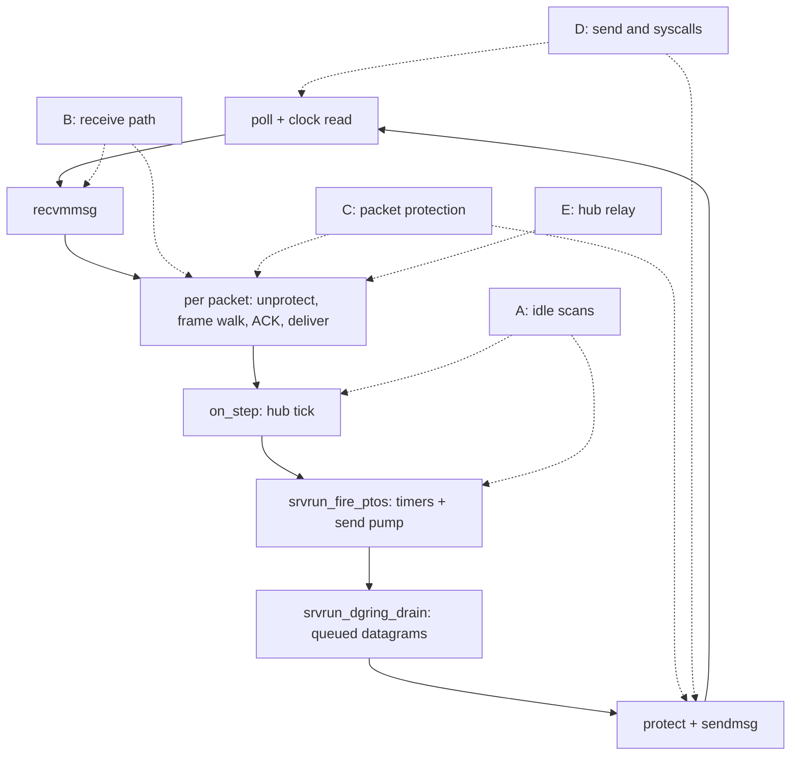

# moqt_chat 向けの高速化: 全体像

[ドキュメント](../README.md) › [試験と品質](../verification/README.md) › moqt_chat 向けの高速化

| 項目 | 内容 |
|---|---|
| 目的 | `examples/moqt_chat` が使う経路(QUIC、HTTP/3、WebTransport、MoQT のハブ)の高速化について、効果と、サーバーのループのどこに効いたかを示す |
| 読む人 | サーバーのループ、パケットの保護、ハブを変更するコントリビューター |
| 前提文書 | [データの流れ](../architecture/dataflow.md) |
| 関連文書 | [毎周の走査](speedup-idle-scans.md)、[受信パケットの処理](speedup-receive.md)、[パケットの保護](speedup-crypto.md)、[送信とシステムコール](speedup-send.md)、[ハブの中継](speedup-hub.md)、[moqt_chat のリソース監視](monitoring.md) |

## 1. 結果

4 人の音声中継で、変更の前後を比べた値である。指標の意味は 2 章に書く。

| 指標 | 変更前 | 変更後 | 変化 |
|---|---|---|---|
| 受信パケット 1 個あたりの命令数(per_pkt) | 88,418 | 19,666 | −77.8% |
| ループ 1 周あたりの命令数(per_step) | 216,743 | 28,714 | −86.8% |
| 素の実行のユーザー CPU(tick) | 344〜395 | 183〜187 | 参考値(2.2) |
| 素の実行のカーネル CPU(tick) | 140〜149 | 121〜133 | 参考値(2.2) |
| 中継したデータグラム | 約 35,000 個 | 約 35,000 個 | 取りこぼし 0 のまま |

変更前のプロファイルでは、中継そのもの以外の処理が命令数の大半を使っていた。

| 処理 | 命令数に占める割合(変更前) |
|---|---|
| 送信ポンプ(`srvrun_pump_sess`。送る物がなくても走る) | 21.4% |
| ハブの毎周の走査(`wired_moqt_tick`) | 16.1% |
| CONNECT ストリームの窓の詰め直し(`bodywin_consume`) | 15.9% |
| ヘッダー保護と鍵の展開 | 10.0% |
| フレームの走査 | 7.2% |
| ACK の処理(`srvrun_feed_acks`) | 5.1% |
| ハブの中継の本体(`wired_moqt_on_datagram`) | 1.2% |

## 2. 計測の条件と指標

### 2.1 条件

| 項目 | 内容 |
|---|---|
| 負荷 | `examples/moqt_chat` の音声負荷テスト。ヘッドレス Chrome 4 つが参加し、全員が音声を送る |
| 中継の経路 | WebTransport のデータグラム |
| サーバー | `--port 4433` だけを付けた既定の設定。1 プロセス 1 スレッド |
| マシン | 開発機(4 コア) |
| 命令数 | callgrind で数える |
| システムコールの回数 | `strace -c` で数える |
| 画面共有の値 | 画面共有 4 人の負荷を callgrind で測る。流れる量が実行ごとに違うので、呼び出し 1 回あたりか Object 1 個あたりで比べる |

### 2.2 指標

| 指標 | 数えるもの | 読み方 |
|---|---|---|
| per_pkt | `srvrun_serve_batch` の中の命令数を、受信パケットの数で割った値 | 受信パケット 1 個を処理する費用 |
| per_step | アプリの tick、タイマー、データグラムの送出の命令数を、ループの周回数で割った値 | 受信がなくても 1 周ごとにかかる費用 |
| 素の実行の CPU tick | callgrind なしで同じ負荷を流したときの CPU 時間。1 tick は 10 ms | 参考値。同じバイナリでも 2 回の差が約 15% ある |

- 命令数の合計どうしは比べない。サーバーの処理が軽くなると 1 周で受け取るパケットが減り、周回数が増えて合計も増える。
- 素の実行では周回数が受信パケット数に近い。そのため、素の CPU 時間には per_step の減少が per_pkt の減少より大きく効く。
- 効果は per_pkt と per_step で判定し、素の CPU 時間は判定に使わない。

## 3. ループ 1 周と高速化の位置

`srvrun_step` の 1 周の順序と、各分野の高速化が効く段階を示す。A〜E は 4 章の表の行に対応する。

- 受信したパケットがない周でも、`on_step` から `srvrun_dgring_drain` までは走る。A はこの部分の費用を減らす。
- ハブは、受信したパケットの処理の中でデータを受け取り、その周のうちに中継する。E はその受け取りの費用を減らす。

## 4. 分野ごとの効果

割合は、各変更の直前と直後の計測で命令数全体に占める値である。計測の時点が違うので、行どうしでは比べられない。

| 分野 | 変えたこと | 代表的な効果 | 詳細 |
|---|---|---|---|
| A | ハブの毎周の走査を生きているリクエストだけにする | `wired_moqt_tick` 24.5% → 3.9% | [毎周の走査](speedup-idle-scans.md) |
| A | 送信ポンプを使用中で送る物があるスロットだけに回す | `srvrun_pump_sess` 35.8% → 約 10% | 同上 |
| A | タイマーは期限の比較を先に行い、期限が来ていない周では送信記録を走査しない | `srvrun_pto_slot` 3.48% → 0.52% | 同上 |
| B | 進みが 0 のときは CONNECT ストリームの窓を詰めない | `bodywin_consume` 15.9% → 0.01% | [受信パケットの処理](speedup-receive.md) |
| B | パケットに含まれるフレームの種類を 1 回の走査で集め、該当する処理だけを呼ぶ | `dispatch_gather_side_channels` 11.1% → 1.2% | 同上 |
| B | ACK と損失判定は使用中の送信記録だけをたどる | `srvrun_feed_acks` 10.3% → 3.0% | 同上 |
| B | 受信ストリームの窓は、順番どおりに届いたデータを詰め直さない(画面共有) | `wired_srvloop_wt_window_slide` 1 回あたり 2,531 命令 → 23 命令 | 同上 |
| B | `recvmmsg` の前に受信用の配列を 0 で埋めない | `wired_udp_recvmmsg` 2.94% → 0.67% | 同上 |
| C | 鍵の世代ごとに 1 回だけ鍵を展開し、ヘッダー保護に AES-NI を使う | 鍵の展開はパケットあたり約 4.4 回 → 0 回 | [パケットの保護](speedup-crypto.md) |
| C | GHASH を 4 ブロックまとめて還元する | `gcmx86_seal` 1,400 バイト 1,700 ns → 850 ns、150 バイト 353 ns → 245 ns | 同上 |
| D | 時計は 1 周に 2 回だけ読み、その周の処理で共有する | `clock_gettime` 145,803 回 → 61,625 回 | [送信とシステムコール](speedup-send.md) |
| D | ワーカーの登録がないときは `gettid` を呼ばない | `gettid` 36,156 回 → 0 回 | 同上 |
| D | データグラムのパケットに保留中の ACK を載せる | ACK だけのパケット 6,489 個 → 273 個、`sendmsg` 42,360 回 → 36,535 回 | 同上 |
| D | フロー制御の通知は上限が一定量進んでから送る(画面共有) | 受信した STREAM フレーム 1 個あたりの通知 2.0 個 → 0.21 個 | 同上 |
| D | STREAM フレームへの書き込みをまとめたコピーにする(画面共有) | `frame_put_stream` 1 回あたり 1,490 命令 → 319 命令 | 同上 |
| E | キャッシュは同じ Group への追記で全レコードをたどらない(画面共有) | `moqcache_append_exp` 6.8% → 1.7% | [ハブの中継](speedup-hub.md) |
| E | データのストリームの続きは中継の表を先に引く(画面共有) | Object 1 個あたりの表引き 12.6k 命令 → 5.7k 命令 | 同上 |
| E | PUBLISH_DONE の走査は対象になりうるトラックだけを見る(画面共有) | `moqtrun_pubdone_sweep` がプロファイルの一覧から消えた | 同上 |

パケット 1 個の保護にかかる時間は、マイクロベンチマークで次のとおりである。20 万回 × 7 ラウンドの最小値で、変更後は毎回の鍵の比較(`xkeys_sync`)を含む。

| 計測したもの | 150 バイト | 1,400 バイト |
|---|---|---|
| 送信 1 パケット | 1,093 ns → 321 ns | 2,519 ns → 953 ns |
| 受信 1 パケット | 1,453 ns → 307 ns | 3,019 ns → 936 ns |

## 5. 見送ったもの

入れていない変更と、その理由である。

| 項目 | 理由 |
|---|---|
| `sendmmsg` で宛先をまたいで 1 回に送る | `sendmsg` は 1 周あたり 1.32 回で、まとめても減る量が少ない |
| 同じ宛先のデータグラムを 1 パケットに詰める | `recvmmsg` 1 回あたりの受信は約 1.5 個で、同じ周に同じ宛先の分が 2 個以上並ぶことが少ない |
| 1 つのパケットに複数のストリームのフレームを載せる | 同じ周に並ぶ小さい STREAM のパケットは、全体の 0.14%(音声)〜1.1%(画面共有)である |
| ペーサーに止められた送信を、次のトークンの時刻に起こす | 送る物があるのに止められたのは、送信の周回の 0.25% 以下である |
| データグラムをストリームのポンプより先に送る | 画面共有と音声を同時に流しても、ハブでデータグラムが止められた回数は 0 である |
| 送る物がない接続では、ポンプそのものを飛ばす | 飛ばせるのは約 1.5% である。ペーサーの補充、PMTU の探索、アプリ制限の判定(RFC 9002 7.8)は送る物がなくても要る |
| ACK がないパケットでは損失判定を飛ばす | 時間による損失判定(RFC 9002 6.1.2)は ACK がなくても成立する。ストリームのスライスの分は、受信のたびの判定に頼っている |
| MAX_STREAM_DATA のパケットに保留中の ACK を載せる | 損失 1% の e2e で、既知の制限([HTTP/3 と WebTransport](../security/limitations/http3.md) の 1.8)に当たり、チャットが届かない結果が出た |
| SHA-NI、VAES、VPCLMULQDQ | 本番機と開発機の CPU(Xeon Gold 6230)にない |
| CTR の 8 ブロック化 | 同じ CPU では AESENC の実行ポートが 4 本で埋まる |
| `-O3`、`-march=x86-64-v2` / `v3`、LTO | パケットの保護のマイクロベンチマークで、`-O2` との差が ±10% の揺れの中に収まる |
| プロファイルに基づく最適化(PGO) | 計測の実行時ライブラリが libc を前提にする |
| コンパイラが足す hardening(`zerocallusedregs`)を外す | セキュリティの設定を弱める変更である |

## 6. 変えなかった制約

どの変更も[コミットゲート](../standards/commit-gate.md)の上限と設計上の制約を変えていない。

| 制約 | 内容 |
|---|---|
| 複雑度 | 関数ごとに CCN 3 以下、ネスト 2 以下、認知的複雑度 4 以下。Halstead の上限も同じ |
| libc | `src/` は libc を使わない。命令セットに依存するコード(`wired_arch_pshufb` など)は `src/common/arch/` だけに置く |
| 入力の検証 | ピアからの入力の検証は削っていない。フレームの検証の走査(`srvloop_payload_error`)は毎回走る |
| 定数時間の暗号 | タグの比較は `ct_diff16` のままである。展開済みの鍵と元の鍵の比較(`xkeys_sync`)も定数時間で行う |
| 固定バッファー | 固定容量のバッファーのままで、動的な確保を足していない |

走査を飛ばす変更の多くは、元の全走査を照合用としてテストに残し、新しい経路と結果が一致することを確かめている。変更後の確認の結果は次のとおりである。

| 確認 | 結果 |
|---|---|
| e2e(音声 4 人、チャット 4 人、画面共有 4 人) | 通過 |
| 相互接続(quic-interop-runner、クライアントは quic-go) | transfer、http3、transferloss、blackhole、multiplexing が通過 |
| 損失 1% の e2e | 既知の制限([HTTP/3 と WebTransport](../security/limitations/http3.md) の 1.8)で失敗する |
