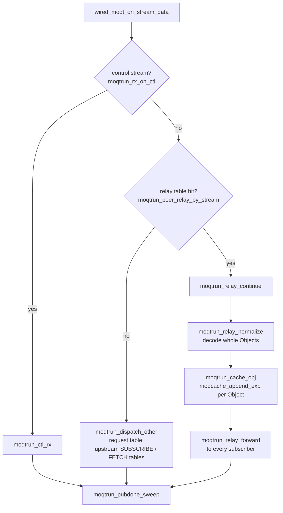
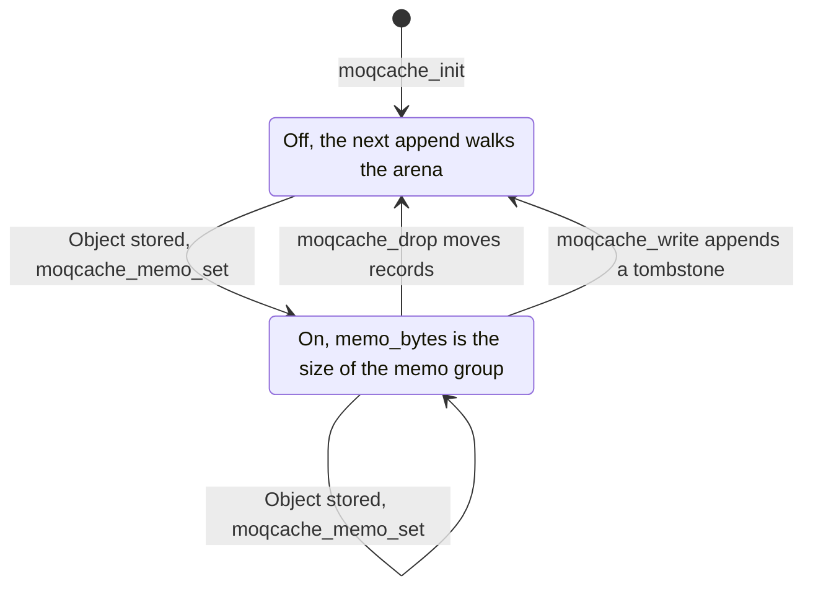

# サーバーの高速化: MoQT ハブの中継

[ドキュメント](../../README.md) › [試験と品質](../../verification/README.md) › [サーバーの高速化](README.md) › MoQT ハブの中継

| 項目 | 内容 |
|---|---|
| 目的 | ストリームで届いた Object(映像、画面共有、チャット)をハブが購読者へ中継する経路について、命令数を減らした 3 か所の今の動作と変更の前後の値を示す |
| 読む人 | `src/app/moqt/cache/` と `src/app/moqt/run/` の中継の経路を変更するコントリビューター |
| 前提文書 | [サーバーの高速化: 全体像](README.md)(計測の条件と指標) |
| 関連文書 | [毎周の走査](idle-scans.md)、[受信パケットの処理](receive.md)、[パケットの保護](crypto.md)、[送信とシステムコール](send.md)、[moqt_chat のリソース監視](../monitoring.md)、[examples/moqt_chat/README.md](../../../examples/moqt_chat/README.md) |

## 1. 結果

画面共有 4 人の値である。計測の条件は[全体像](README.md)の 2.1 に書く。

| 指標 | 前 | 後 |
|---|---|---|
| `moqcache_append_exp` の命令数 | 1,000 万(6.8%) | 200 万(1.7%) |
| `moqtrun_rx_route` の表引き(中継した Object 1 個あたり) | 12.6k 命令 | 5.7k 命令(−55%) |
| `moqtrun_pubdone_sweep` | プロファイルの一覧に出る | 一覧に出ない |

- 割合はその計測の命令数の合計に占める値である。
- 表引きの値は `moqtrun_rx_route` の命令数から中継の本体(`moqtrun_relay_continue`)を除いたものである。
- 音声はデータグラムで届くので、音声の計測ではどの値も変わらない。

変更は次の 3 か所にある。

| 箇所 | ファイル | 今の動作 | 章 |
|---|---|---|---|
| FETCH 用のキャッシュ | `src/app/moqt/cache/` | 同じ Group への続きの追記では全レコードをたどらない | 3 |
| ストリームの振り分け | `src/app/moqt/run/moqtrun_rx.c` | 中継の表を先に引く | 4 |
| PUBLISH_DONE の走査 | `src/app/moqt/run/moqtrun_malformed.c` | 対象でない Track を飛ばす | 5 |

データグラムで届く Object は、キャッシュにも中継の表にも入らない。ハブの毎周の tick は[毎周の走査](idle-scans.md)が扱う。

## 2. 中継の経路

- 中継の表は、ピアの各 Track が持つ `relays[]` である。Track 5 個に 4 件ずつで、1 ピアあたり最大 20 件になる。
- データのストリームの最初の配送は `moqtrun_dispatch_other` を通る。その先の `moqtrun_dispatch_pub_stream` から中継の表に登録される。
- 2 回目からの配送は表に当たり、`moqtrun_relay_continue` へ直行する。

## 3. FETCH 用のキャッシュ

FETCH 用のキャッシュ(`moqcache`)は、ストリームで届いた Object を 1 つのアリーナに到着順のレコードとして並べる。`moqt_chat` のサーバーではアリーナは 1 MiB である。

`moqcache_append_exp` は Group を丸ごと持てるかを判定するために、Object を入れる前にその Group がすでに持つバイト数を求める。

### 3.1 Group の大きさの求め方

| 項目 | 前 | 後 |
|---|---|---|
| 求め方 | 挿入のたびに `moqcache_group_bytes` がアリーナの全レコードをたどる | `moqcache_group_held` がメモを見て、当たれば `memo_bytes` を返す。外れたときだけ全レコードをたどる |
| 覚えるもの | なし | 最後に Object を格納した Track と Group(`memo_tag`、`memo_group`)、そのバイト数(`memo_bytes`)、有効かどうか(`memo_on`) |
| 同じ Group への続きの追記 | 全レコードをたどる | たどらない |
| 別の Group への追記 | 全レコードをたどる | 全レコードをたどる。格納できればメモがその Group に移る |
| 挿入 1 回あたりにたどるレコード | 平均 1,742(40 秒の実行、挿入 6,516 回) | 未計測 |

### 3.2 メモが立つ・消える流れ

- レコードを動かす `moqcache_drop` と、レコードを書く `moqcache_write` は、必ず `memo_on` を 0 にする。追い出し、Track の解放、Group の破棄はどれも `moqcache_drop` を通る。
- `moqcache_append_exp` は格納に成功したときだけ `moqcache_memo_set` でメモを立て直す。値は「格納前のバイト数 + ヘッダー + ペイロード」である。
- 格納の途中の追い出しが消すのはほかの Group だけなので、先に求めたバイト数は格納後も正しい。

メモが指す Group は、格納された Object だけを持つ。tombstone(持ちきれずに捨てた Group の印)になっている Group をメモが指すことはない。

### 3.3 変えていない規則

Group は丸ごと残るか、丸ごと消えるかのどちらかである。この規則と、追い出しの順(最も古い Group から)は変えていない。変えたのは Group の大きさを求める手段だけである。

## 4. ストリームの振り分け

`moqtrun_rx_route` は届いたストリームのデータを、処理する関数へ振り分ける。中継中のデータのストリームの続きが届いたときの表引きの順は、次のとおりである。

| 順 | 前 | 後 |
|---|---|---|
| 1 | 制御ストリームかを判定する | 制御ストリームかを判定する |
| 2 | ハブが開いた PUBLISH のリクエストの表を引く(外れる) | 中継の表を引く(当たる)。`moqtrun_relay_continue` へ進む |
| 3 | 上流の SUBSCRIBE の表を引く(外れる) | |
| 4 | 上流の FETCH の表を引く(外れる) | |
| 5 | 終わった上流の SUBSCRIBE と FETCH を引く(外れる) | |
| 6 | 上流の FETCH のデータのストリームかを調べる(外れる) | |
| 7 | 中継の表を引く(当たる)。`moqtrun_relay_continue` へ進む | |

- リクエストの表は 128 スロットである(`WIRED_MOQTRUN_MAX_REQS`)。
- 中継の表に入るのは、`moqtrun_dispatch_pub_stream` がデータのストリームとして扱ったものだけである。リクエストの表や上流の表とは重ならないので、先に引いても振り分け先は変わらない。
- 中継の表に外れたストリームは `moqtrun_dispatch_other` へ進み、「前」の 2 から 7 と同じ順で表を引く。

## 5. PUBLISH_DONE の走査

`moqtrun_pubdone_sweep` は送れるようになった PUBLISH_DONE を送る。呼ばれるのは次の 3 か所である。

- ストリームのデータの配送のたび(`wired_moqt_on_stream_data` の最後)
- 毎周(`wired_moqt_tick`)
- データグラムが Track を不正(`malformed`)にしたとき

| 項目 | 前 | 後 |
|---|---|---|
| 見る Track | 使用中のピア(最大 32)× Track 5 の全部 | 同じ |
| Track ごとの処理 | 全部に `moqtrun_pubdone_try` を呼ぶ | `moqtrun_pubdone_track` が `pubdone_pending` と `malformed` を見て、どちらも 0 なら飛ばす |
| 送る PUBLISH_DONE | | 同じ |

送る PUBLISH_DONE が変わらないのは、`moqtrun_pubdone_ready` が真になる条件が次の 2 つだけだからである。どちらのフラグも 0 の Track では真にならない。

- 使用中の Track で `malformed` が立っている。
- 使用中の Track で `pubdone_pending` が立っていて、中継が追いついたか期限が過ぎた。

## 6. 計測して手を入れなかったもの

| 候補 | 計測値 | 入れなかった理由 | 見直す条件 |
|---|---|---|---|
| キャッシュの追い出しの詰め直しを 1 回にまとめる | `moqcache_drop` は毎秒 4〜5 回(40 秒で 210 回)、1 回あたり約 1 MB を動かす。1 MiB の詰め直しは実測 35 µs で、CPU の 0.02% に満たない | Group を丸ごと残すか消すかの規則に触る変更に見合わない | キャッシュを数 MiB 以上に広げたとき |
| 持ち越しがないとき、届いたデータを作業用バッファーへ写さずに読む | 写すのは 1 回の配送につき 1 パケット分。`moqtrun_relay_normalize` 全体でも画面共有の 2% 弱 | `moqtrun_gone_round` が作業用バッファーの中で Object を詰め直すので、写さない経路を別に持つ必要がある | 1 回の配送が数十 KB になる用途で、プロファイルにコピーが出たとき |
| 購読者のループを使用中のビットだけ回す | `moqtrun_relay_append_all` と `moqtrun_cut_settle` は画面共有で合計 0.2% 未満。音声では一覧に出ない | `active` を書く箇所が 7 か所あり、ビットマスクとずれる危険に見合わない | 購読者の上限(31)を増やしたとき |

## 7. テスト

| 対象 | テスト | 確かめること |
|---|---|---|
| キャッシュのメモ | `tests/app/moqcache_test.c` の `test_moqcache_memo_matches_walk` | メモを毎回消した参照のキャッシュと、アリーナの中身が一致する |
| 振り分け、PUBLISH_DONE の走査 | 既存の moqtrun のテスト | 変更なしで通る。照合のテストは足していない |

`test_moqcache_memo_matches_walk` の内容は次のとおりである。

- 6,000 バイトのアリーナ 2 つに、3 つの Track の Object を乱数で 4,000 回入れる。追い出しと、大きすぎる Group の破棄が起きる。
- 片方は挿入のたびに `memo_on` を 0 にし、常に全レコードをたどらせる。
- 挿入のたびに 2 つの `used` が等しいことを確かめ、最後にアリーナを 1 バイトずつ比べる。
- メモが立っている間は、`memo_bytes` が `moqcache_group_bytes` の値と等しいことを確かめる。
- メモに当たった回数が 1,000 回を超えることを確かめる。
