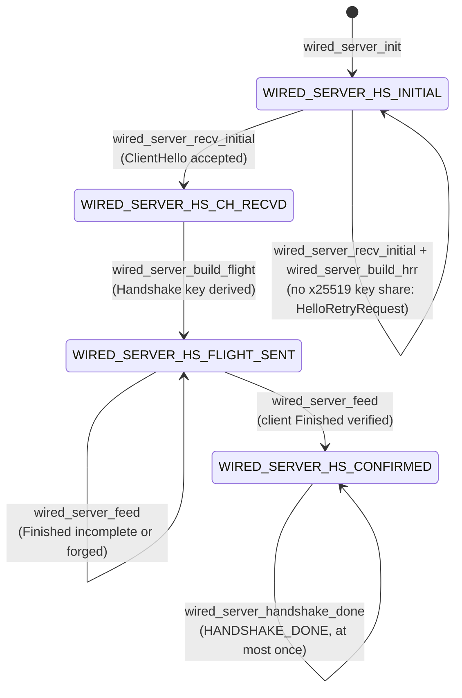
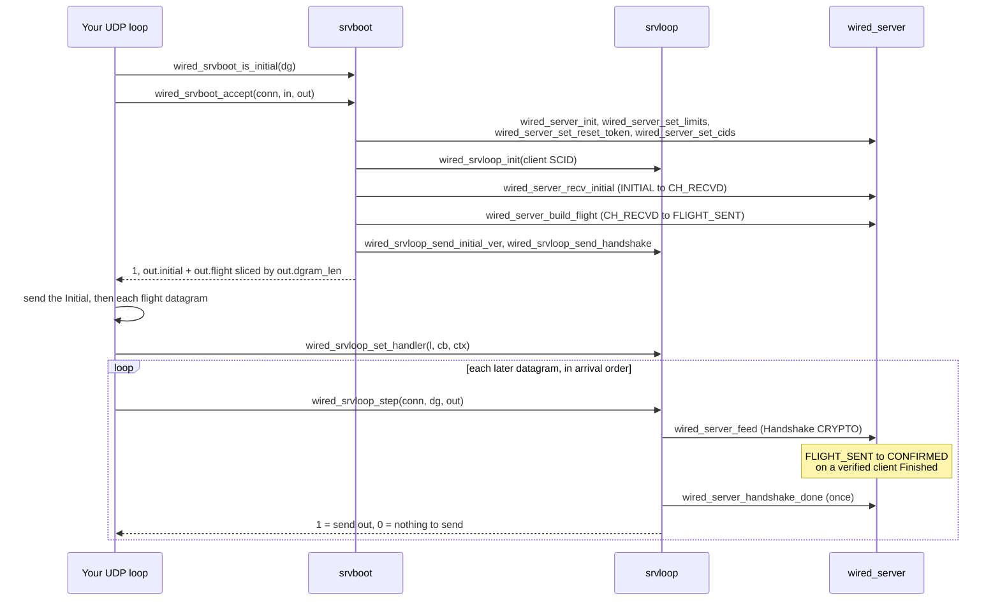

# Low-level / internal API

[ドキュメント](../README.md) › [参照資料](README.md) › Low-level / internal API

| 項目 | 内容 |
|---|---|
| 目的 | 呼び出し順か寿命の前提条件を持つ関数と、その前提条件を一覧にする |
| 読む人 | サーバーの run とドライバーを変更するコントリビューター |
| 前提文書 | [参照資料](README.md)、[鍵とハンドシェイク](../architecture/keys.md) |
| 関連文書 | [Stable API](api-stable.md)、[バージョニングの方針](api-versioning.md) |

この文書の関数が公開ヘッダーから呼べるのは、アプリケーション向けの層がこれらで組み立てられているからである。`wired_server_run` とドライバーはこれらを正しい順序で呼んでいる。前提条件の詳細はヘッダーのコメントにあり、使う前に読む。間違った暗号化レベルで暗号化したパケットは、ピアには読めない。

## 1. サーバーのハンドシェイクのフェーズ

`wired_server` は TLS 1.3 のハンドシェイクのサーバー側である。`phase` フィールドは次の 4 つの値を順に進む。

| フェーズ | 状態 |
|---|---|
| INITIAL | クライアントの ClientHello を待っている |
| CH_RECVD | ClientHello を受け入れた |
| FLIGHT_SENT | サーバーの flight を組み立てた |
| CONFIRMED | クライアントの Finished を検証した |

| 呼び出し | 前提条件 |
|---|---|
| `wired_server_recv_initial`、`wired_server_build_hrr`、`wired_server_build_flight`、`wired_server_feed`、`wired_server_handshake_done` | 間違ったフェーズでは 0 を返し、フェーズを進めない。この 0 は失敗として処理し、そのまま再試行しない |
| `wired_server_feed` | フェーズを確認する前に、バイト列を再構成バッファーに追加する |
| `wired_server_set_cids`、`wired_server_set_limits`、`wired_server_set_reset_token` | フェーズを確認しない。設定する接続 ID、制限値、トークンは flight に載るので、`wired_server_build_flight` より前に呼ぶ。あとで呼ぶと、エラーにならずに反映されない |

ClientHello が x25519 の鍵共有を提示しない場合、フェーズは INITIAL のままである。`wired_server_build_hrr` が HelloRetryRequest を出し、クライアントの 2 回目の ClientHello はもう一度 `wired_server_recv_initial` を通る。偽造されたクライアントの Finished ではフェーズは進まない。

## 2. 1 本の接続を手で動かす

`srvboot` はクライアントの最初のデータグラムから接続をコールドスタートし、`srvloop` はそれ以降のすべてのデータグラムを扱う。図は `wired_server_run` がたどる順序である。ただし run のループはアキュムレーター形式の `wired_srvboot_accept_acc` を使う(2.1 節)。accept の呼び出しはハンドシェイクの準備の呼び出しを内部で済ませる。

SCID はクライアントが自分用に選んだ接続 ID で、srvloop は送り返すすべてのパケットにこれを付ける。

### 2.1 accept の出力と前提条件

| 項目 | 内容 |
|---|---|
| 出力の送信 | まず `out.initial` を送る。次に `out.flight` を `out.dgram_len` のサイズ(`out.dgram_count` 個)ごとにデータグラムへ切り分けて、1 つずつ送る |
| HelloRetryRequest | `wired_srvboot_accept` と `wired_srvboot_accept_acc` は、flight の代わりに HelloRetryRequest を `out.initial` に暗号化して書き込んだときに `WIRED_SRVBOOT_HRR`(2)を返す。このとき `out.dgram_count` は 0 である。0 以外の戻り値がすべて flight を意味するわけではない |
| 分割された ClientHello | `wired_srvboot_accept` が扱うのは、1 つのデータグラムに収まる ClientHello である。run のループは `wired_srvboot_acc_*` のアキュムレーターで複数のデータグラムに分かれた ClientHello を集め、`wired_srvboot_accept_acc` を呼ぶ |
| 受け入れる QUIC のバージョン | `wired_srvboot_id.versions` は `WIRED_VERSIONS_V1` / `WIRED_VERSIONS_V2` のビットを持つ。デフォルトの 0 は両方を受け入れる(RFC 9308 13)。この集合にないバージョンの Initial パケットには Version Negotiation を返し、互換バージョンネゴシエーション(RFC 9368)もこの集合からしか選ばない。`wired_srvboot_vneg` も同じビットを受け取る |

### 2.2 `wired_srvboot_id` の寿命と順序

- `wired_srvboot_id` のフィールドはビューなので、呼び出しの間は生きている必要がある。
- `wired_server_run` とその派生は起動時に id、そのチェーンと `raw_alpns`、obs のパス、`wt_protocols` をコピーし、以後は読まない。これらは呼び出し側のスタックにあってよい。
- 例外は `client_ca` である。コピーするのはポインターだけなので、ストア、そのルートの配列、CA の DER は run より長く生きていなければならない。
- 構造体はゼロ初期化した状態(`= {0}` か `wired_srvboot_demo`)から始める。末尾に追加されたメンバーはオフがデフォルトになる。
- `reset_seed` はステートレスリセットの秘密値である。0 なら `cert_seed` を使う。`wired_srvrun_serve_env` は、証明書のリロードで発行済みのトークンが変わらないよう、これを起動時の `cert_seed` のコピーに固定する。
- 最後のメンバーの `early_data` は 0-RTT のオプトインである([Stable API](api-stable.md) の「セッション再開と 0-RTT」)。
- `wired_srvloop_step` には到着順にデータグラムを渡す。`wired_srvloop` へデコードしたリクエストは次のステップまでしか有効ではない。

## 3. 低レベル関数の一覧

| Function | Why it needs care |
|---|---|
| `wired_srvboot_is_initial`, `wired_srvboot_accept`, `wired_srvboot_accept_acc`, `wired_srvboot_acc_*` | 1 本の接続をコールドスタートする。どのステップよりも前に実行する |
| `wired_srvloop_init`, `wired_srvloop_set_handler`, `wired_srvloop_step`, `wired_srvloop_wt_refuse` | 1 本の接続のデータグラムごとのループ。順序が厳密 |
| `wired_srvloop_send_initial`, `wired_srvloop_send_initial_ver`, `wired_srvloop_send_handshake`, `wired_srvloop_send_onertt` | 1 種類のパケットを 1 つの暗号化レベルで暗号化する |
| `wired_server_init`, `wired_server_set_cids`, `wired_server_set_limits`, `wired_server_set_reset_token`, `wired_server_recv_initial`, `wired_server_build_hrr`, `wired_server_build_flight`, `wired_server_feed`, `wired_server_handshake_done`, `wired_server_is_confirmed` | ハンドシェイクのフェーズのステップ。それぞれ一部のフェーズでだけ有効 |
| `wired_server_peer_cert` | 手で動かす `wired_server` の検証済みクライアントのリーフ。確定後に使える。トランスクリプトの中を指すビュー |
| `wired_server_listen`, `wired_server_pump`, `wired_server_run_handshake`, `wired_server_close` | 同じ `wired_server` に対する、ソケットを所有するハンドシェイクのヘルパー |
| `wired_srvrun_env_size`, `wired_srvrun_env_init`, `wired_srvrun_serve_env` | 呼び出し側が確保する追加のループインスタンス |
| `wired_srvrun_shutdown_word` | プロセス全体で共有するグレースフルシャットダウンのフラグへのポインター |
| `wired_srvrun_broadcast_register`, `wired_srvrun_broadcast_unregister` | スレッド間のブロードキャストのメッシュに参加する、または抜ける |
| `wired_srvworkers_run` | ワーカープロセスを fork して監視する |
| `wired_srvthreads_run`, `wired_srvthreads_parse_cores` | 1 つの制御スレッドの下でワーカースレッドを動かす |
| `wired_srvxdp_open`, `wired_srvxdp_open_shared`, `wired_srvxdp_rx_burst`, `wired_srvxdp_send`, `wired_srvxdp_close`, `wired_srvxdp_print_stats` | AF_XDP ドライバーの 1 インスタンス |
| `wired_srvxdpbpf_open`, `wired_srvxdpbpf_register`, `wired_srvxdpbpf_close` | インターフェースごとに共有する BPF プログラムとマップ |
| `wired_wt_session_init`, `wired_wt_session_establish`, `wired_wt_session_drain`, `wired_wt_session_close`, `wired_wt_session_offer_stream`, `wired_wt_session_offer_datagram` | WebTransport セッションの状態機械 |
| `wired_h3reqdrive_send_get`, `wired_h3reqdrive_send_method`, `wired_h3reqdrive_recv_get` | ビューを返す HTTP/3 のリクエストのコーデック |
| `wired_x25519`, `wired_x25519_base` | 生の Curve25519 のスカラー倍算 |
| `bytes_put`, `bytes_take` | コーデック内部向けの、カーソルを使うバイトコピー |
| `bytes_memcpy`, `bytes_memset` | アプリケーションのコードからは使わない |

### 3.1 各行の前提条件

| 対象 | 前提条件 |
|---|---|
| srvboot と srvloop | 2 章を参照。`wired_srvloop_init` は `wired_srvboot_accept` が呼ぶので、自分で呼ぶのは srvboot を使わずにループを組むときだけである。`wired_srvloop_wt_refuse` は、スロットの表が受け取れなかった WebTransport のストリームをキューに積み、run のループがそれを H3_REQUEST_REJECTED でリセットする |
| 送信関数 | 現在のフェーズに合わないもの(Handshake の鍵がまだないうちの `wired_srvloop_send_handshake` など)を呼ぶと、失敗するか、ピアが読めないパケットができる |
| ハンドシェイクのステップ | 1 章を参照。`wired_server_listen`、`wired_server_pump`、`wired_server_run_handshake` は自前の UDP ソケットを開いて読む。`wired_server_close` はそれを閉じ、保持している秘密値を消去する |
| 追加のループインスタンス | `wired_srvrun_env_size()` バイトを確保し、最初の `wired_srvrun_serve_env` の前に `wired_srvrun_env_init` を実行する。SIGTERM と SIGHUP のハンドラーはプロセス全体で共有なので、1 つを除くすべてのインスタンスで `no_signal_handlers=1` を設定する |
| シャットダウンのワード | シャットダウンが始まるまでは 0 で、始まると 1 のままになる。プロセス内のすべてのループが同じワードをポーリングするので、これを設定するとすべてのループが止まる |
| ブロードキャストのメッシュ | 固定の 16 スロットを持つ。渡す `inbox_row` と `env` は、`wired_srvrun_broadcast_unregister` まで生きていて、動かしてはならない。`wired_srvrun_broadcast_unregister` はスレッドの終了前に実行する |
| ワーカープロセス | クラッシュしたワーカーは再起動し、ステータス 0 で終了したワーカーは再起動しない。SIGTERM はすべてのワーカーへ一度だけ転送する。すべてのワーカーを回収し終えたら 0 を、最初の `fork` が失敗したら負の値を返す |
| ワーカースレッド | シグナルハンドラーと、XDP モードでの共有 BPF オブジェクトを所有するのは制御スレッドだけである。制御スレッドは共有資源を解放する前にすべてのワーカーを join する。`wired_srvthreads_parse_cores` は空のリストや空のフィールドを拒否する(ワーカー 0 個では動かさない) |
| AF_XDP | カーネルはインターフェースごとに XDP プログラムのリンクを 1 つしか許さない。マルチキューの構成では、2 つ目の `wired_srvxdp_open` ではなく、呼び出し側が所有する `wired_srvxdpbpf` に対して `wired_srvxdp_open_shared` を呼ぶ。`wired_srvxdp_send` は、受信したパケットからピアの MAC アドレスを学習するまではパケットを捨てる(0 を返し、QUIC の再送に任せる) |
| 共有 BPF オブジェクト | インターフェースごとに一度だけ開き、各キューのソケットをそこへ登録し、登録したソケットのどれかが使われている間は開いたままにする。早く閉じると、それらのソケットが宙に浮く |
| WebTransport セッション | 状態は unestablished、established、draining、closed で、closed は終端である。順序外の遷移は拒否し、何も起きない。`wired_wt_session_offer_stream` が 0 を返したら、そのストリームを WT_BUFFERED_STREAM_REJECTED(`WTERR_BUFFERED_STREAM_REJECTED`)でリセットする義務がある。`wired_wt_session_offer_datagram` の 0 は許された破棄で、対処は要らない。アプリケーションから見た状態は [セッションのライフサイクル](https://hakkadaikon.github.io/wired/guide/ja/wt/session-lifecycle/) にある |
| リクエストのコーデック | `wired_h3reqdrive_recv_get` が取り出す擬似ヘッダーは、作業用バッファーとストリームのデータを指すビューである。解析したリクエストを使う間は、どちらも生きている必要がある |
| X25519 | `wired_x25519` は全ゼロの結果を検出して 0 を返す。この 0 は失敗として扱う(RFC 7748 6.1)。無視すると、低位数の点による鍵交換(ピアが秘密を何も提供していない鍵交換)を受け入れる |
| カーソルによるコピー | `bytes_put` と `bytes_take` が正しく動くのは、呼び出し側がカーソル(`*off`)を呼び出しをまたいで一貫させているときだけである。境界は渡された値に対してしか確認しない |
| メモリのヘルパー | freestanding(`-nostdlib`)のバイナリには libc がないが、コンパイラーは `memcpy` と `memset` の呼び出しを出力する。`WIRED_MAIN` を定義すると、`wired.h` はこの 2 つを `bytes_memcpy` と `bytes_memset` へ転送する薄い関数として定義する。この 2 つは `src/` 全体で使う SDK のコピーと埋めのヘルパーである |
