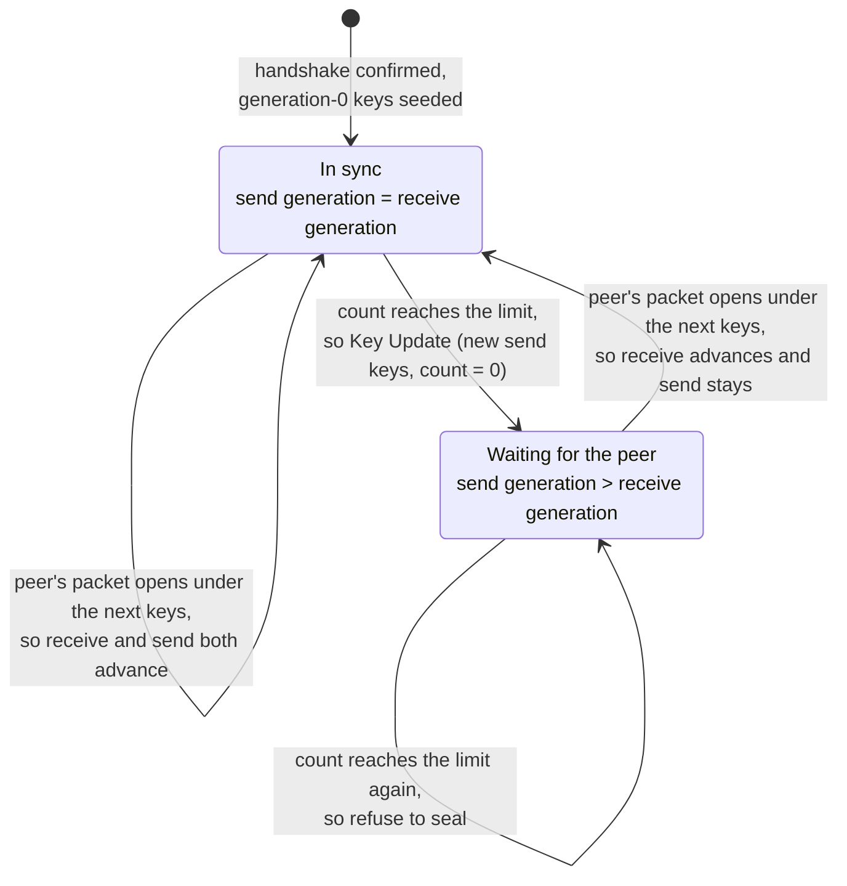
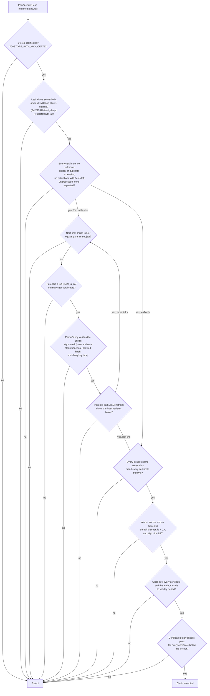
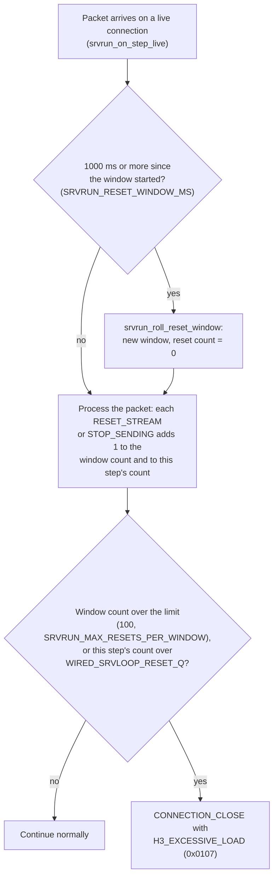
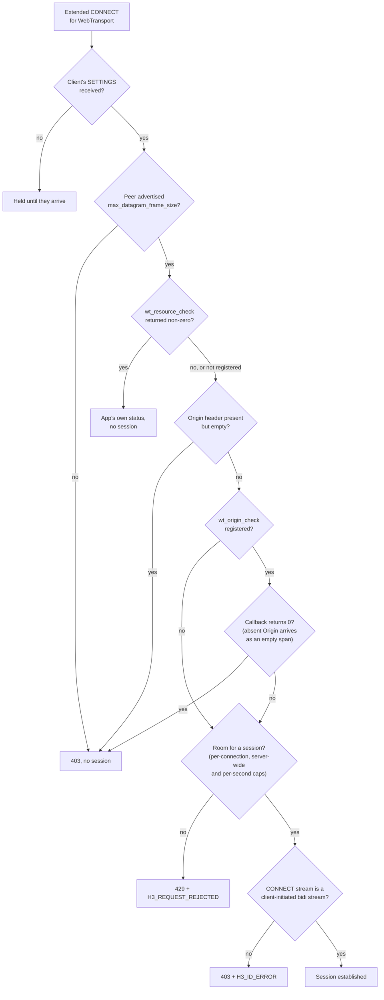

# セキュリティ

[ドキュメント](README.md) › セキュリティ

このページは、`wired` が自分で検査するセキュリティ上の性質はどれで、アプリケーションに任せるものはどれか、という 1 つの問いに答えます。`wired` を実際のトラフィックの前に置くかどうかを決める人や、ある変更が何を弱めうるかをレビューする人に向けたページです。ほとんどの項目に、保証する内容と、該当する場合はその RFC の条項、それを固定しているテスト(またはファズハーネス)を書いています。

これはコードが何を検査するかの説明であり、脅威モデルではありません。ここで触れるフックの使い方はガイドのリンク先を見てください。このページでは、それらのフックが何を守るかを説明します。

> **概要**: タグとトークンの比較は定数時間です。ECDSA、Ed25519、X25519 の入力は既知の攻撃クラス(ゼロのスカラー、低位数の点、非正規のエンコーディング)に対して検査します。証明書チェーンはトラストアンカーにつながっているか、CA ビット、名前制約を検査し、DER のパースは境界を検査します。QUIC の増幅攻撃対策、ECN の検証、AEAD の使用上限はイベントループで強制します。MoQT のサブスクライバーの認可はオプトインです。`malloc` も `printf` も libc も、どこにもありません。意図してアプリケーションに任せているものは 2 つあります。サーバー側での証明書の有効期間とホスト名の検査と、リクエストのレート制限です。

## 範囲

- **対象:** 暗号プリミティブの正しさ、証明書チェーンと署名の検証、鍵共有の入力検証、そして QUIC、HTTP/3、WebTransport、MoQT のコアにおけるリソースとパーサーの安全性。
- **対象外(呼び出し側が用意する):** 証明書の有効期間とホスト名の検査、HTTP/3 のリクエストのレート制限、Retry トークンの有効期間(TTL)、失効確認、MoQT の購読を認可するポリシー。

ガイドの
[SDK とアプリの役割分担](https://hakkadaikon.github.io/wired/guide/ja/concepts/responsibilities/)
は、同じ線引きをアプリケーションの側から説明し、対象外の項目ごとに何を作ればよいかを書いています。

### 監査台帳

このページの記述は機能の一覧からではなく、体系的な監査から来ています。`docs/security/vuln-ledger.md` は 839 行の台帳で、CVE データベース、ほかの QUIC/TLS 実装のセキュリティアドバイザリ、RFC の "Security Considerations" の節をもとに作りました。各行は既知の攻撃 1 つを、それが当てはまる(または当てはまらない) `wired` のコードパスに対応づけています。

行が閉じる(`done`)のは、判定が付いたときだけです。`fixed` か `already-safe` の行にはたいてい実在するテスト関数の名前も書きます(構造上 `already-safe` になる一部の行では、代わりにそのコードが攻撃されえない理由を説明します)。`n/a` の行には、その攻撃クラスがここに当てはまらない理由を 1 行で書きます(ヒープがない、ハッシュテーブルがない、ネットワーククライアントがない)。

`python3 scripts/vulnaudit/ledger_check.py docs/security/vuln-ledger.md` は行の書式を機械的に検査し、節ごとの行数を出力します。すべての行が閉じています。

| 節                         | 行数 |
|----------------------------|-----:|
| QUIC トランスポート        |  234 |
| TLS 1.3                    |  186 |
| 共通鍵暗号                 |   31 |
| 署名と鍵共有               |  108 |
| X.509 / DER / PKI          |  131 |
| HTTP/3 + QPACK + Datagrams |   69 |
| WebTransport               |   21 |
| MoQT                       |   22 |
| IP / UDP / AF_XDP          |    3 |
| メディア (mp4frag)         |   25 |
| サンプルと依存関係         |   10 |
| **合計**                   |  840 |

`docs/security/feature-gaps.md` には、その機能がここに存在しないという理由だけで閉じている行(失効確認、ECH、DSA など)を挙げています。そうした機能を追加すると、該当する行は開き直します。

多くの行は、攻撃される仕組みがここに存在しないために `n/a` で閉じています。ヒープアロケーターがないので、use-after-free や double free のクラスはありません。`conntable` はハッシュテーブルではなく固定サイズの線形探索なので、ハッシュ衝突による DoS のクラスもありません。

3 行は **運用者またはデプロイの側の問題** です。この SDK がプロセスの中では閉じられない穴です。

- **失効確認** (V-0324、RFC 8446 App. C.2、SHOULD)。libc を使わないこの SDK はネットワーククライアントを持たないので、CRL の取得や OCSP ステープリングを動かす場所がありません。
- **Selfie / 外部 PSK のリフレクション** (V-0300)。この攻撃には、1 つのエンドポイントが外部の事前共有鍵をクライアントとサーバーの両方の役割で共有していることが必要です。この SDK には外部 PSK の仕組みがなく、クライアントの役割では ClientHello を受け付けません。
- **自分で ECN-CE を付ける抑制検出のプローブ** (V-0223、RFC 9002 8.3、任意)。このプローブはピアを試すために個々のパケットに CE を付けます。そのためには送信ごとの TOS の `cmsg` が必要ですが、ソケット層はそれを公開していないので、運用者は有効にできません。プローブが狙う攻撃自体は RFC 9000 13.4.2.1 の下限チェック(`test_ecn_suppressed_counts_fail_validation`)で検出するので、この行は `already-safe` で閉じています。

## 共通鍵暗号と AEAD

QUIC はすべてのパケットを **AEAD** (関連データ付き認証暗号)で暗号化します。ペイロードの暗号化とタグの付加を 1 つの操作で行う方式で、1 バイトでも書き換えられると復号が失敗します。`wired` は AES-128-GCM、AES-256-GCM、ChaCha20-Poly1305 に対応しています。

- AEAD のタグ比較は定数時間です(早期 return のない XOR-OR の累積)。そのため、タグの何バイトが一致したかが応答時間から漏れません。共通のヘルパーは `common/bytes/util/ct.h` にあり、GCM と ChaCha20-Poly1305 が使います。テスト: `test_gcm_tamper_rejects`、`test_aead_tamper_rejects`。
- GCM と ChaCha20-Poly1305 は、RFC と NIST のベクターでラウンドトリップを確かめています。テスト: `test_gcm_nist`、`test_chapoly_rfc`。
- MAC は HMAC (ipad/opad)を通すので、長さ拡張攻撃は成り立ちません(`test_hmac` スイート)。Poly1305 は `r` をクランプし、ワンタイム鍵をカウンター 0 で導出します(RFC 8439。`test_poly1305` スイート)。
- `fuzz/fuzz_tlsmsg.c` と `fuzz/fuzz_frames.c` は AEAD まわりのフレーミングとハンドシェイクメッセージのパースをファジングします(push ごとに `just fuzz-smoke`、夜間に `just fuzz-ci`)。

### AEAD の使用上限と Key Update

1 つの AEAD 鍵で安全に暗号化できるパケット数(**機密性の上限**)と、耐えられる偽造パケットの数(**完全性の上限**)には限りがあり、それを超えると攻撃者が測定できるほどの優位を得ます。そのため RFC 9001 6.6 は前者の上限に達する前に鍵を更新し、後者の上限でコネクションを閉じることを求めています。送信側の上限は AES-GCM で 2^23 パケット(`AEAD_LIMIT_AESGCM`)、ChaCha20-Poly1305 で 2^62 パケット(`AEAD_LIMIT_CHACHA`)です。

新しい鍵は **Key Update** (RFC 9001 6)で得ます。送信側が次の世代の鍵を導出し、パケットヘッダーの Key Phase ビットを反転させます。RFC 9001 6.1 は、新しい鍵で送ったパケットが確認応答されるまで次の更新を禁じています。`wired` は、ピア自身が新しい鍵で送ってくるまで待ちます。これはその条件を満たしたことを意味します。

- 機密性の上限に達すると、本番の送信経路 `wired_srvloop_send_onertt` が、古い鍵で次のパケットを暗号化する前に自動で Key Update を始めます。テスト: `test_srvloop_send_at_aead_limit_initiates_key_update`。
- ピアが最初の更新に追いつくまで、2 回目の更新は拒否します。テスト: `test_srvloop_no_second_update_before_peer_follows`。
- 完全性の上限(復号に失敗したパケットの数)に達すると、`AEAD_LIMIT_REACHED` (0x0f)でコネクションを閉じます。テスト: `test_srvrun_closes_with_aead_limit_reached_on_step`、`test_srvloop_recv_auth_failure_counts_toward_integrity_limit`。

図は送信側の状態を示しています。`Ahead` の状態に注目してください。ピアが追いついていない間に再び上限に達すると、送信側は新たな更新を始めず、暗号化を拒否します。

更新できるのは、ハンドシェイクが確定していて、送信の世代と受信の世代が等しいときだけです(`ku_can_initiate`)。上限は鍵ごとに適用されるので、Key Update のたびにパケット数を 0 に戻します。

**既知の制限:** 更新がまだ確定していないときに上限に達すると、暗号化を止めます(RFC 9001 6.2 / 6.6)。そのコネクションを終わらせるのは専用のクローズではなく、アイドルタイムアウトです。

## 署名と楕円曲線

TLS サーバーは証明書の鍵でハンドシェイクに署名して身元を証明します。不正な形の署名を受け入れる検証器があると、誰でもサーバーになりすませます。そのため、以下の検査は既知の不正な入力をすべて拒否します。

- ECDSA は `r = 0` や `s = 0` を拒否し、両方のスカラーが `[1, n)` にあることを求めます。これで "Psychic Signature" のクラス(CVE-2022-21449。すべてゼロの署名がどの鍵に対しても検証を通った)を防ぎます(`test_ecdsa_verify` スイート)。
- ECDSA-Sig-Value の DER デコーダーは、末尾の余分なバイト、余分な要素、大きすぎる・負の・空の整数、最小でない長さや整数のエンコーディングを拒否します(CVE-2018-1000180 のクラスの展性)。テスト: `test_sig_decode_rejects_trailing_data`、`test_sig_decode_rejects_oversized_integer`、`test_sig_decode_rejects_nonminimal_length`、`test_sig_decode_integer_padding`、`test_sig_decode_golden`。
- SDK が作る ECDSA 署名は low-S に正規化します(RFC 6979 の慣行)。検証では標準的な high-S の署名も引き続き受け入れます。
- Ed25519 は非正規のスカラーと、小さい位数または非正規の `A` 点・`R` 点を拒否します。テスト: `test_ed25519_verify_rejects_small_order_key`、`test_ed25519_verify_rejects_small_order_r`、`test_ed25519_verify_rejects_noncanonical_key`、`test_ed25519_verify_rejects_noncanonical_r`。
- 検証に使う公開鍵は曲線上にあり、無限遠点でないことが必要です。
- 汎用の体の剰余計算で、limb の境界での繰り上がりのバグ(`fe_reduce_wide` / `fe6_reduce_wide` が `m<<256` / `m<<384` の境界で剰余を取りきれない)が見つかり、修正しました。テスト: `test_modexp_limb_boundary_square`、`test_p256_field_mul_all_ones_limbs`、`test_p384_field_mul_all_ones_limbs`。
- P-256 の高速な検証経路(固定ベースのテーブルとモンゴメリ剰余)は、低速な参照実装との差分テストで正しさを確かめています。テスト: `test_ecdsadiff_valid`、`test_ecdsadiff_tampered`、`test_ecdsadiff_edges`。
- ECDSA のノンスは HMAC-DRBG (RFC 6979)で決定的に作るので、乱数源が弱くても秘密鍵は漏れません。
- `fuzz/fuzz_x509.c` は、署名と DER のデコードを push ごとと夜間にファジングします。

**既知の制限:** P-256/P-384 の limb 境界のバグは「契約上のバグ」でした。それを引き起こす広い入力を渡す呼び出し元が今はなかったので、到達できる検証の迂回ではありませんでしたが、それでも修正しました。P-256 の公開鍵の読み込みでは、曲線上の検査の前に `x` や `y` が `>= p` であることをまだ拒否していません。そうした点も曲線上の検査で拒否されるので、迂回にはなりません。

## X25519 鍵共有

X25519 は TLS ハンドシェイクで共有の秘密を決める方式です。各側が自分の秘密のスカラーとピアの公開点を組み合わせます。**低位数の点** は悪意のある公開値で、秘密のスカラーが何であっても結果をごく小さな集合(ここではすべてゼロ)に押し込みます。そのため、攻撃者はその「秘密」を知ることができてしまいます。

- 共有の秘密がすべてゼロのときは拒否します。低位数のピアの点はこの値を生みます(RFC 7748 6.1)。テスト: `test_x25519_low_order_rejected`。
- この拒否は ECDHE を呼ぶすべての箇所に伝わるので、ハンドシェイクはゼロの秘密から鍵を導出せずに中断します。テスト: `test_x25519_ecdhe`。
- スカラーは RFC 7748 のとおりにクランプします。テスト: `test_x25519_clamp_rfc7748`、`test_x25519_clamp_does_not_mutate_input`。
- 体の元は、値が `p` に等しい境界を含めて、`p = 2^255 - 19` で完全に剰余を取ります(`p` は 19 ではなく 0 になります)。これがあるので、低位数の点が本当にすべてゼロの秘密を生み、上の検査がそれを見つけられます。テスト: `test_x25519_noncanonical_u_reduced`。
- 結果は RFC 7748 のベクター(1 回と 1000 回の反復、Alice/Bob の交換)とのラウンドトリップで確かめています。テスト: `test_x25519_rfc_v1`、`test_x25519_rfc_iterate_1000`、`test_x25519_rfc_dh_alice_bob`。

## 証明書チェーンと X.509

サーバーは証明書チェーンを送ります。自分の **リーフ** 証明書と、それに署名した中間 CA の証明書です。検証器は各証明書を発行者につなぎ、すでに信頼している CA (**トラストアンカー**)で終わることを確かめなければなりません。読み込み方はガイドの
[証明書の読み込み](https://hakkadaikon.github.io/wired/guide/ja/tls/certificates/)
にあります。

図は `castore_validate_chain` の検査の順序を示しています。どこかで "no" になるとチェーン全体を拒否します。リンクごとの検査はリーフから末尾まで隣り合う組ごとに繰り返します。

- 各リンクを検証します。子の issuer が親の subject と等しいこと(RFC 4518 の caseIgnoreMatch で比べます。アンカーの検索も同じです)、親の鍵が子に署名していること、末尾が信頼のルートにつながっていることです(`castore_validate_chain`、`castore_verify_signed_by`)。
- すべての発行者は `basicConstraints cA = TRUE` を持つ必要があり(RFC 5280 6.1.4)、`x509_is_ca` が検査します。リーフは CA でなくてかまいません。
- 内側の `tbsCertificate.signatureAlgorithm` は外側の署名アルゴリズムの OID と等しくなければなりません(RFC 5280 4.1.1.2)。一致しなければ拒否します。
- 名前制約(RFC 5280 4.2.1.10)を使うと、CA は配下の証明書が持てる名前を制限できます。名前制約はチェーン全体で積み重なります。対象は dNSName、iPAddress (アドレス/マスク。アドレスファミリーの不一致と長さが不正なサブツリーは、どちらも拒否します(fail closed))、DirectoryName (大文字小文字を区別しない前方一致)です。テスト: `test_ncsan_excluded_dns_wildcard_rejects`、`test_ncsan_permitted_ip4_outside_rejects`、`test_nc_excluded_dn_case_mismatch_rejects`、`test_ncx_excluded_in_a_survives_permitted_in_b`、`test_ncx_permitted_in_b_after_excluded_only_a_rejects`。
- subject の CN は、dNSName の SAN がないときの代わりとしてだけ使います。テスト: `test_ncsan_cn_fallback_outside_rejects`、`test_ncsan_san_present_cn_ignored`。ホスト名の照合でも、SAN に URI-ID か SRV-ID があれば CN を使いません。また、`xn--` の A ラベルの中の `*` はワイルドカードとして扱いません。テスト: `test_san_uri_srv_suppress_cn_fallback`、`test_san_alabel_wildcard_no_match`。
- チェーンの長さと名前制約のサブツリーの数には上限があるので、悪意のあるチェーンで CPU を使い果たすことはできません(CVE-2018-16875 / CVE-2024-34702 のクラス)。テスト: `test_chain_over_cap_rejects`、`test_ncsan_subtree_count_over_cap_rejects`。
- X.509 の拡張の重複は拒否します(RFC 5280 4.2)。テスト: `test_x509_duplicate_extension_rejected`。
- PEM の base64 デコードは秘密のバイトで引くテーブルではなく、分岐のないバイト分類器を使います。テスト: `test_pem_every_byte_classified`。
- DER はすべての長さを境界で検査します。長形式は `0x81` / `0x82` だけを受け付け、最小でない長形式の長さは X.690 10.1 に従って拒否します。テスト: `test_sig_decode_rejects_nonminimal_length`。
- `fuzz/fuzz_x509.c` は、証明書と DER のデコードを push ごとと夜間にファジングします。

有効期間の検査(`x509_validity_ok`。リーフに対して行い、`castore_validate_chain` の中ではすべての証明書とアンカーに対して行います)と、ホスト名/SAN の照合(`x509_san_matches`)には、アプリケーションの時計と、接続しようとしたホスト名が必要です。そのため、誰がこれらを実行するかは役割によって変わります。

- **クライアントの役割:** デフォルトで強制し、無効にする手段はありません。クライアントはピアを認証する前に `fullhs_set_policy()` を呼びます。
- **サーバーの役割、または `fullhs` のコアを単体で使う場合:** どちらの検査も行いません。呼び出し側が用意します。

**既知の制限:** 失効確認は実装していません([監査台帳](#監査台帳)を参照)。URI SAN の名前制約は URI のパターン照合をせず、一律に拒否します(fail closed)。テスト: `test_ncsan_uri_excluded_with_uri_san_rejects`。

## QUIC

QUIC は送信元アドレスを偽装しやすい UDP の上で動きます。そのため、ここでの検査のほとんどは、ピアがサーバーを第三者への攻撃に使うことや、サーバーの固定サイズのテーブルを使い果たすことを防ぐためのものです。

**増幅攻撃対策** (anti-amplification、RFC 9000 8.1): クライアントが自分のアドレスの持ち主だと証明するまで、サーバーが送れるのは受け取ったバイト数の 3 倍までです。この上限がないと、攻撃者は被害者のアドレスを偽装し、サーバーに被害者へ大量のデータを送らせることができます。

- 増幅攻撃対策の上限により、アドレスの検証前にサーバーが送るバイト数を抑えます。0-RTT の受け入れと、ハンドシェイク中の応答量も、同じ検査で制限します。テスト: `test_srvrun_default_config_gates_response_volume_pre_validation`、`test_srvrun_0rtt_accept_requires_or_limits_unvalidated_address`。
- Initial パケットは 1200 バイトまでパディングします(RFC 9001 9.3)。そのため、クライアントの最初のパケットで、サーバーは応答に足りる送信枠を必ず得られます。テスト: `test_initpad`、`test_client_initial_padded`。
- セッションチケットと Retry トークンの鍵は、起動時に CSPRNG から取ったシードから導出し、バイナリの中のバイトからは決して導出しません。テスト: `test_srvkeys_random_and_distinct`。stateless reset のシークレットは起動時の署名鍵に固定しているので、証明書を再読み込みしても、すでに配ったトークンは変わりません。テスト: `test_srvrun_stateless_reset_survives_cert_reload`。
- Retry トークンと stateless reset のトークンは HMAC で導出し、定数時間で比較し、不正な入力に対して長さを検査します。テスト: `test_retrytoken_wire_verify_rejects_short_token`、`test_newtoken_wire_verify_rejects_long_token`、`test_retry_second_discarded`。

ECN (Explicit Congestion Notification)は、ルーターがパケットを捨てる代わりに印を付けられるようにする仕組みで、ピアはその印の数を ACK で報告してきます。この数を偽るピアは輻輳を隠せるので、数を信用する前に検証します。

- ECN の数は RFC 9000 13.4.2.1 に従います。ECT(0)+CE の増加が新たに確認応答されたパケット数より少ない報告は、抑制されたものとして拒否します。数は決して減ってはなりません。また、確認応答された最大のパケットを進めない順序の入れ替わった ACK は、ECN の検証に使いません。テスト: `test_ecn_suppressed_counts_fail_validation`、`test_ecn_counts_valid_rejects_decrease_wired`、`test_srvloop_note_ecn_keeps_largest_ack`。
- 検証済みの CE の増加は最小ウィンドウを下限として輻輳制御に渡します。テスト: `test_ecn_inflated_ce_floors_at_min_window`、`test_srvrun_feed_acks_ecn_ce_shrinks_cwnd`。

ストリームとコネクションの上限は次のとおりです。

- フロー制御は MAX_DATA、MAX_STREAM_DATA、MAX_STREAMS を超えるデータを拒否します。
- STREAM の final size のオーバーフローと、向きを間違えて送られた STREAM フレームや STOP_SENDING フレームは拒否します(RFC 9000 19.5 / 19.8 / 4.5)。テスト: `test_frame_stream_final_size_overflow_rejected`、`test_dispatch_stop_sending_receive_only_rejected`。
- パスの移行には、新しいパスでの新しい PATH_CHALLENGE が必要です(RFC 9000 8.2.1 / 9.3)。テスト: `test_migrate_new_path_requires_fresh_validation`。
- バージョンのダウングレードを検出し、コネクション ID は乱数生成器から作ります。
- サーバーの起動では認証前に少しずつデータを送ってくる「トリクル」コネクション(Slowloris 型)に対して起動の期限を強制します。また、再利用するコネクションのスロットでは、前の利用者のバッファーを完全に消去します。テスト: `test_srvrun_slow_trickle_preauth_evicted`、`test_srvrun_slot_reuse_clears_prior_connection_buffer`。
- `fuzz/fuzz_header.c`、`fuzz/fuzz_onertt.c`、`fuzz/fuzz_tlsmsg.c`、`fuzz/fuzz_frames.c` は、varint、フレーム、0-RTT、ハンドシェイクメッセージのデコードをファジングします。push ごとに 1 回(`just fuzz-smoke`)、夜間は決まった実時間の範囲で(`just fuzz-ci`)実行します。

### Rapid Reset

**Rapid Reset** (CVE-2023-44487)は、クライアントがリクエストを開いてはすぐに取り消すことを繰り返す攻撃です。リクエストのたびにサーバーには処理の負担がかかる一方、取り消しによってクライアントは同時ストリーム数の上限に引っかかりません。`wired` は、ピアの RESET_STREAM フレームと STOP_SENDING フレームを、コネクションごとに 1 秒の固定ウィンドウで数え、上限を超えると `H3_EXCESSIVE_LOAD` (0x0107)でコネクションを閉じます。デフォルトの上限はウィンドウあたり 100 です。普通のクライアントが取り消すリクエストは 1 秒に数個ですが、攻撃者には数千が必要です。

図は確立済みのコネクションでの 1 ステップを示しています。ウィンドウの切り替えはパケットを処理する前に行うので、このパケットのリセットは本来属するウィンドウで数えられます。

2 つ目の条件は 1 ステップでキューに入れられる数(`WIRED_SRVLOOP_RESET_Q`。追跡するストリームのスロット 1 つにつき 2 つ)より多いリセットを 1 つのパケットで送ってくる場合を捕まえます。テスト: `test_srvrun_reset_flood_over_threshold_closes_excessive_load`。

**呼び出し側の責任:** この組み込みのリセットカウンターを超えるリクエストのレート制限と、Retry トークンの TTL です。リセットの上限は `wired_srvrun_env` を通してだけ変更できます。まだ公開の `wired_srvrun_opt` のフィールドにはなっていません。

## HTTP/3 / QPACK

QPACK はハフマン符号と、最近のヘッダーを共有するテーブルを使って HTTP/3 のヘッダーを圧縮します。圧縮爆弾(decompression bomb)は、小さな入力が巨大な出力に展開されるか、デコードに多くの CPU を使わせる入力です。以下の検査は出力の大きさとデコードの処理量の両方を抑えます。

- QPACK のデコードは出力のあふれを拒否し、ハフマンと整数のデコードは読み過ぎを防いでいます。テスト: `test_huffman_overflow`。動的テーブルの大きさには上限があります。テスト: `test_qpack_dyntable_bounded_by_max_entries`。
- ハフマンのデコードの処理量はフィールドセクションの固定の上限と、テーブル自身の符号長の最大値 30 ビットで抑えられます(RFC 9114 10.5.5 / QPACK 7、圧縮の処理量による DoS)。テスト: `test_qpack_huffman_decode_cost_bounded`。
- varint とフレームのパーサーは、すべての読み込みを残りのバッファーの範囲内に収めます。
- アプリが自分の `wired_srvrun_handler.on_body` でストリーミングしないリクエストボディは、1 つの固定のウィンドウ(`BODYWIN_CAP`、10240 バイト。8000 オクテットのリクエストターゲットが収まる大きさ。RFC 9110 4.1)にバッファリングします。あふれたときは `413` で応答します(RFC 9110 15.5.14)。これは、アプリの `on_body` が大きすぎると判断したボディを止めるために 0 を返したときと同じ応答です。先頭の HEADERS フレーム(リクエストのボディではなくヘッダー)が大きすぎるときは、代わりに `431` で応答します(RFC 6585 5)。テスト: `test_srvrun_full_window_body_gets_413`、`test_srvrun_full_window_headers_get_431`、`test_srvrun_on_body_reject_answers_413`、`test_srvrun_early_413_also_stops_sending`。
- `fuzz/fuzz_qpack.c` は QPACK のデコードをファジングします(push ごとに `just fuzz-smoke`、夜間に `just fuzz-ci`)。

**既知の制限:** `test_qpack_huffman_decode_cost_bounded` は通りますが、`HUFF_MAXLEN` のガードを書き換えるミューテーションを入れても失敗しません。正準ハフマンテーブルの最長の符号は、そのガードに届く前に終わるからです。そのため、このテストは本来の主張(悪意のある入力に対してもデコード時間が抑えられること)を証明しますが、そのガード自体は実行しません(V-0448)。

## WebTransport

WebTransport のセッションは、HTTP/3 の Extended CONNECT リクエストの中で動きます。CONNECT ストリームは **カプセル** も運びます。フロー制御の更新やセッションの終了といった、型の付いた小さなメッセージです。節番号は -16 と書いたものを除き draft-ietf-webtrans-http3-15 のものです。引用している規則は両者の間で変わっていません。

- カプセルのデコードはフロー制御につながっているので、複数のセッションが 1 つの QUIC コネクションを共有するときは、WebTransport のセッションが必ずフロー制御を強制します(draft-ietf-webtrans-http3-15 5.1 MUST)。テスト: `test_srvrun_wt_session_sharing_enables_flow_control`、`test_srvrun_wt_rx_max_data_capsule_via_dispatch_unblocks_send`。
- 未知のカプセルは読み飛ばし(RFC 9297 3.2)、不正な形か途中で切れたカプセルのボディはセッションを閉じます(3.3)。上限を増やさないフロー制御のカプセルは、WT_FLOW_CONTROL_ERROR でセッションを閉じます(draft-ietf-webtrans-http3-16 5.6.2 / 5.6.4)。テスト: `test_srvrun_wt_rx_unknown_capsule_via_dispatch_skipped`、`test_srvrun_wt_rx_truncated_capsule_via_dispatch_closes_session`、`test_srvrun_wt_nonincreasing_flow_control_capsule_closes_session`。
- `WT_CLOSE_SESSION` はセッションを終わらせます。セッションの作成はコネクションごとにレート制限し(1 秒のウィンドウあたり 10 セッション)、セッション、ストリーム、データグラムの使用量のカウンターを公開しています。これとは別に、サーバー全体の上限がすべてのコネクションにわたる同時セッション数を抑えます。テスト: `test_srvrun_wt_close_session_capsule_received`、`test_srvrun_connect_concurrency_limit_enforced`、`test_srvrun_wt_session_creation_rate_limited`、`test_srvrun_wt_usage_counters_exposed`。
- 一度きりの制御フレーム(`WT_CLOSE_SESSION`、GOAWAY、アプリが求めた RESET_STREAM、早期応答の STOP_SENDING)は、確認応答されるまで保持し、失われたら再送します。そのため、パケットを落とすピアが、これらのフレームを落とすことでセッションやリクエストを開いたままにすることはできません。再送の予算の範囲で確認応答しないピアは、コネクションごと切断します。テスト: `test_srvrun_wt_close_capsule_retransmitted_after_loss`、`test_srvrun_control_packets_kept_until_acked`、`test_srvrun_rst_budget_exhausted_tears_down`。
- `fuzz/fuzz_capsule.c` は、WebTransport のカプセルを push ごとと夜間にファジングします。

### Origin の検査

ブラウザーは WebTransport の CONNECT のたびに、ページの `Origin` ヘッダーを送ります。これを検査すると、別のサイトのページが訪問者のブラウザーを使ってあなたのサーバーにセッションを開くことを防げます。図は CONNECT を拒否するほかの理由の中で、`Origin` の判定がどこにあるかを示しています。位置はクライアントの SETTINGS とトランスポートパラメーターの検査のあとです。

- `Origin` があるなら、空であってはなりません(draft-ietf-webtrans-http3-15 3.6)。空の `Origin` には、アプリのコールバックが動く前に、SDK 自身が `wt_origin_ok` で `403` を返します。テスト: `test_srvrun_wt_connect_origin_ok_establishes`、`test_srvrun_wt_connect_origin_malformed_403`。
- `Origin` がないこと自体は拒否の理由になりません。ブラウザー以外のクライアントは送らないからです。
- アプリケーションの許可リストは `wired_srvrun_opt.wt_origin_check` で組み込みます(draft-ietf-webtrans-http3-15 3.1)。0 を返すと、セッションを作らずに `403` で応答します。設定していないときは、正しい形の `Origin` をすべて受け入れます。テスト: `test_srvrun_wt_origin_check_allowed_establishes`、`test_srvrun_wt_origin_check_disallowed_403`、`test_srvrun_wt_origin_check_absent_empty_span`、`test_srvrun_wt_origin_check_unset_unchanged`。コールバックの書き方はガイドの
  [Origin ヘッダーの検査](https://hakkadaikon.github.io/wired/guide/ja/wt/origin/)
  にあります。

### Drain

ピアの `WT_DRAIN_SESSION` カプセルはセッションを畳むよう求めるものです。これは `wired_srvrun_opt.wt_on_session_draining` を通して、セッションごとに 1 回アプリに届きます(draft-ietf-webtrans-http3-15 4.7)。値を持つ drain カプセルは不正な形(Length は 0 でなければならない)で、セッションを閉じます。テスト: `test_srvrun_wt_drain_rx_notifies_app`、`test_srvrun_wt_drain_rx_with_value_closes`。

**既知の制限:** `WT_DRAIN_SESSION` は勧告にすぎません。SDK はアプリに知らせますが、自分でセッションを閉じることはしません。アプリが `wt_origin_check` を登録しない限り、`Origin` の検証は正しい形の空でない値をすべて受け入れます。デフォルトで付いてくる許可リストはありません。

## MoQT

`src/app/moqt/` は、WebTransport のセッションの上で MoQT (draft-ietf-moq-transport-18、-19、-22。セッションごとに WebTransport のサブプロトコルから選びます。以下の節番号は draft-19 のもの)を実装しています。MoQT はそのセッションの TLS 1.3 による機密性、完全性、エンドポイントの認証を引き継ぎます。MoQT の層に独自の暗号はありません。

- Object とプロパティの長さのパースで、varint の長さのオーバーフローが `fuzz/fuzz_moqt.c` によって見つかりました。`*at + len > buf.n` という検査が 2^64 で一周してしまい、範囲外の読み込みや無限ループを許すおそれがありました。この検査をオーバーフローしない引き算に書き直して修正しました。テスト: `test_moqdata_obj_take_len_wrap`、`test_moqdata_obj_take_payload_len_boundary`、`test_moqvi_put_at_capacity_edge`。
- `AUTHORIZATION_TOKEN` (0x03)は SUBSCRIBE と PUBLISH のパラメーターでデコードされ(draft-19 10.2.2)、認可フックがルーティングの前にすべての SUBSCRIBE を通すかどうかを決めます(draft-19 13.3: "Relays will verify the token")。テスト: `test_moqctl_params_auth_token_use_value_decode`、`test_moqctl_params_auth_token_scope_violation`、`test_moqtrun_subscribe_requires_authorization`、`test_moqtrun_subscribe_alias_token_rejected`。フックの登録方法はガイドの
  [購読者の認可](https://hakkadaikon.github.io/wired/guide/ja/moqt/authorize/)
  にあります。
- `fuzz/fuzz_moqt.c` は、MoQT のデコードを push ごと(`just fuzz-smoke`)と夜間(`just fuzz-ci`)にファジングします。そのシードコーパスには上の長さのオーバーフローを見つけた入力を回帰用のシードとして残しています。

認可フックはどれもオプトインで、デフォルトのハブは完全に開いています。

| リクエスト                              | フック                |
|-----------------------------------------|-----------------------|
| SUBSCRIBE, TRACK_STATUS                 | `authorize_subscribe` |
| PUBLISH                                 | `authorize_publish`   |
| PUBLISH_NAMESPACE, SUBSCRIBE_NAMESPACE  | `authorize_namespace` |

`authorize_publish` は draft-22 16.3.4 "Preventing Impersonation" に従います。テスト: `test_moqtrun_publish_requires_authorization`。

**呼び出し側の責任:** `AUTHORIZATION_TOKEN` の値が実際に何を認可するかと、購読リクエストのレート制限(draft-19 13.1、Subscription Amplification)は、アプリケーション層で決めることです。SDK が提供するのはワイヤーフォーマットとフックであり、ポリシーではありません。

**既知の制限:** サンプルのハブは `authorize_subscribe == 0` のまま出荷しているので、完全に開いています。1 つのメッセージの中で重複した `AUTHORIZATION_TOKEN` は仕様の "MAY be repeated" という許容に従わず、一般的なパラメーター重複の違反として拒否します。

## freestanding による攻撃面

`wired` は freestanding です。`src/` は C 標準ライブラリをまったく使いません。悪用される関数がそもそもないので、バグのクラスがまるごとなくなります。

- `src/` は libc をリンクしません。`-ffreestanding -nostdlib` のビルド(`just ninja`)がその証明です。`malloc`/`free` (固定サイズのバッファーだけ)、`printf`/`scanf`、`getenv`/`system`/`exec`、`signal` ハンドラー、libc の文字列関数はどれもなく、本番のソースにないことをそれぞれ確かめています。
- 台帳のクラス(use-after-free、double free、ヒープアロケーターの混乱、ハッシュテーブルの衝突による DoS)がまるごと `n/a` で閉じるのもこのためです。攻撃される仕組みがここにはありません。
- 最悪のピアに対するコネクションの状態の増加と、WebTransport のストリームの頻繁な開閉は、アロケーターではなく固定容量のテーブルで抑えています。テスト: `test_srvrun_conn_state_growth_bounded_under_worst_case_peer`、`test_srvrun_wt_stream_churn_bounded_by_slot_table`。

---

**次へ:** [システムコール](syscalls.md)。SDK が行うカーネル呼び出しをすべて載せています。
([ドキュメント一覧](README.md))
