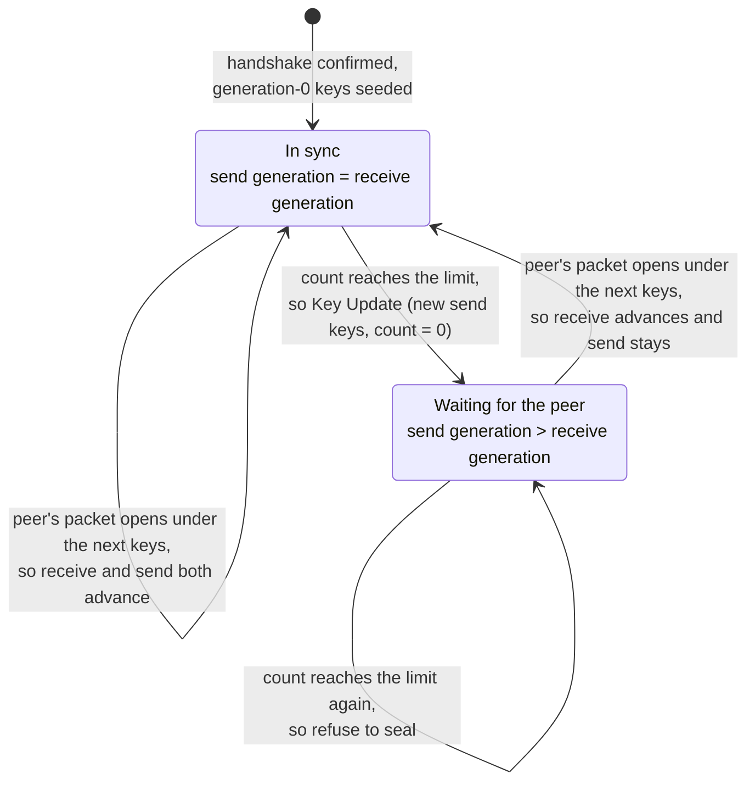
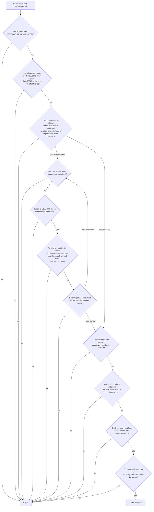
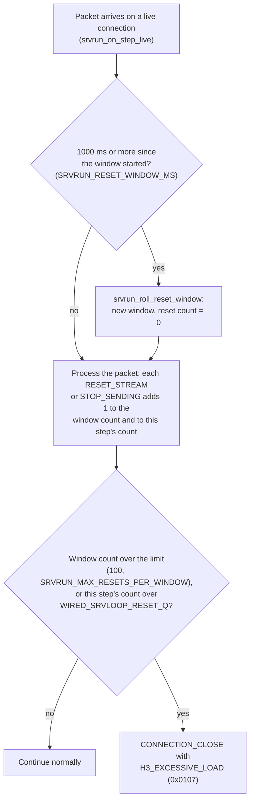
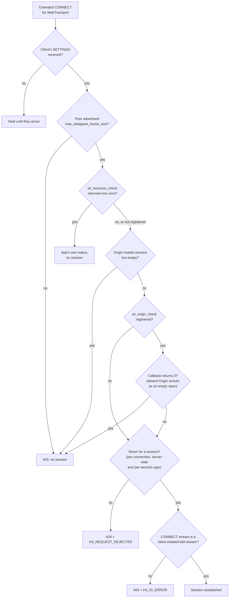

# Security

[Docs](README.md) › Security

This page answers one question: which security properties does `wired`
check by itself, and which ones does it leave to your application? It is
for anyone deciding whether to put `wired` in front of real traffic, or
reviewing what a change might weaken. Most items state the guarantee, the
RFC clause where one applies, and the test (or fuzz harness) that pins it.

This is a description of what the code checks, not a threat model. For how
to use the hooks mentioned here, follow the guide links; this page explains
what the hooks protect.

> **At a glance** — tag and token comparisons are constant-time; ECDSA,
> Ed25519 and X25519 inputs are checked against known attack classes (zero
> scalars, low-order points, non-canonical encodings); certificate chains
> are anchored, CA-bit checked and name-constrained, and DER parsing is
> bounds-checked; QUIC anti-amplification, ECN validation and AEAD limits
> are enforced in the event loop; MoQT subscriber authorization is opt-in;
> there is no `malloc`, no `printf` and no libc anywhere. Two things are
> deliberately left to you: certificate time/hostname checks on the server
> side, and request-rate limiting.

## Scope

- **In scope:** cryptographic primitive correctness, certificate chain and
  signature validation, key agreement input validation, and the resource
  and parser safety of the QUIC, HTTP/3, WebTransport and MoQT cores.
- **Out of scope (supplied by the caller):** certificate validity-time and
  hostname checks, HTTP/3 request-rate limiting, Retry-token time-to-live,
  revocation checking, and MoQT subscription authorization policy.

The guide page
[What the SDK does and what the app does](https://hakkadaikon.github.io/wired/guide/en/concepts/responsibilities/)
draws the same line from the application's side and says what to build for
each out-of-scope item.

### Audit ledger

The claims on this page come from a systematic audit, not from a list of
features. `docs/security/vuln-ledger.md` is an 839-row ledger built from CVE
databases, security advisories of other QUIC/TLS implementations, and the
"Security Considerations" sections of the RFCs. Each row maps one known
attack to the `wired` code path it does or does not apply to.

A row closes (`done`) only with a verdict. A `fixed` or `already-safe` row
usually also names a real test function (a few structural `already-safe`
rows explain instead why the code cannot be attacked); an `n/a` row carries
a one-line reason why the attack class does not apply here (no heap, no
hash table, no network client).

`python3 scripts/vulnaudit/ledger_check.py docs/security/vuln-ledger.md`
machine-checks the row grammar and prints the count per section. All rows
are closed:

| Section                    | Rows |
|----------------------------|-----:|
| QUIC transport             |  234 |
| TLS 1.3                    |  186 |
| Symmetric crypto           |   31 |
| Signatures & key agreement |  108 |
| X.509 / DER / PKI          |  131 |
| HTTP/3 + QPACK + Datagrams |   69 |
| WebTransport               |   21 |
| MoQT                       |   22 |
| IP / UDP / AF_XDP          |    3 |
| Media (mp4frag)            |   25 |
| Samples & dependencies     |   10 |
| **Total**                  |  840 |

`docs/security/feature-gaps.md` lists the rows that are closed only because
the feature does not exist here (revocation checking, client certificates,
ECH, DSA, and so on). Adding such a feature re-opens its rows.

Many rows close `n/a` because the attacked mechanism does not exist here.
There is no heap allocator, so there is no use-after-free or double-free
class. `conntable` is a fixed-size linear scan, not a hash table, so there
is no hash-collision DoS class.

Three rows are **operator or deployment concerns**: gaps this SDK cannot
close inside the process.

- **Revocation checking** (V-0324, RFC 8446 App. C.2, SHOULD). This
  libc-free SDK ships no network client, so a CRL fetch or OCSP stapling
  has nowhere to run.
- **Selfie / external-PSK reflection** (V-0300). The attack needs one
  endpoint that shares an external pre-shared key across both client and
  server roles. This SDK has no external-PSK mechanism, and the client role
  never accepts a ClientHello.
- **Self-marked ECN-CE suppression probe** (V-0223, RFC 9002 8.3,
  optional). The probe marks single packets CE to test the peer, which
  needs a per-send TOS `cmsg` the socket layer does not expose, so an
  operator cannot enable it. The attack it targets is still caught by the
  RFC 9000 13.4.2.1 count-floor check
  (`test_ecn_suppressed_counts_fail_validation`), so the row closes
  `already-safe`.

## Symmetric crypto & AEAD

QUIC encrypts every packet with an **AEAD** (authenticated encryption with
associated data): one operation that both encrypts the payload and attaches
a tag, so any modified byte makes decryption fail. `wired` supports
AES-128-GCM, AES-256-GCM and ChaCha20-Poly1305.

- AEAD tag comparison is constant-time (XOR-OR accumulation with no early
  return), so response timing does not leak how many tag bytes matched.
  The shared helper lives in `common/bytes/util/ct.h` and is used by GCM and
  ChaCha20-Poly1305 — `test_gcm_tamper_rejects`,
  `test_aead_tamper_rejects`.
- GCM and ChaCha20-Poly1305 round-trip against RFC and NIST vectors —
  `test_gcm_nist`, `test_chapoly_rfc`.
- MACs go through HMAC (ipad/opad), which closes length-extension attacks —
  the `test_hmac` suite. Poly1305 clamps `r` and derives its one-time key
  at counter 0 (RFC 8439) — the `test_poly1305` suite.
- `fuzz/fuzz_tlsmsg.c` and `fuzz/fuzz_frames.c` fuzz AEAD-adjacent framing
  and handshake-message parsing (`just fuzz-smoke` on every push,
  `just fuzz-ci` nightly).

### AEAD usage limits and Key Update

An AEAD key can safely seal only a limited number of packets (its
**confidentiality limit**) and survive only a limited number of forged
packets (its **integrity limit**) before an attacker gains a measurable
advantage. RFC 9001 6.6 therefore requires new keys before the first limit
and a connection close at the second. The send-side limit is 2^23 packets
for AES-GCM (`AEAD_LIMIT_AESGCM`) and 2^62 for ChaCha20-Poly1305
(`AEAD_LIMIT_CHACHA`).

New keys come from a **Key Update** (RFC 9001 6): the sender derives the
next key generation and flips the Key Phase bit in the packet header.
RFC 9001 6.1 forbids a second update until a packet sent with the new keys
has been acknowledged; `wired` waits until the peer itself sends under the
new keys, which implies that.

- Reaching the confidentiality limit triggers an automatic Key Update on
  the production send path, `wired_srvloop_send_onertt`, before the old key
  seals another packet —
  `test_srvloop_send_at_aead_limit_initiates_key_update`.
- A second update is refused until the peer follows the first —
  `test_srvloop_no_second_update_before_peer_follows`.
- Reaching the integrity limit (the count of packets that failed to
  decrypt) closes the connection with `AEAD_LIMIT_REACHED` (0x0f) —
  `test_srvrun_closes_with_aead_limit_reached_on_step`,
  `test_srvloop_recv_auth_failure_counts_toward_integrity_limit`.

The diagram shows the send-side states. Look at the `Ahead` state: while
the peer has not caught up, hitting the limit again makes the sender refuse
to seal instead of starting another update.

The update is allowed only when the handshake is confirmed and the send
generation equals the receive generation (`ku_can_initiate`). Each Key
Update resets the packet count to 0, because the limit applies per key.

**Known limits:** the older `connrunner_maybe_initiate_ku` helper is not
used by the server loop. When the limit is hit while an update is still
unconfirmed, sealing stops (RFC 9001 6.2 / 6.6), and the idle timeout, not
a dedicated close, ends the connection.

## Signatures & elliptic curves

A TLS server proves its identity by signing the handshake with the key in
its certificate. A verifier that accepts a malformed signature lets anyone
impersonate the server, so the checks below reject every malformed input
they know of.

- ECDSA rejects `r = 0` or `s = 0` and requires both scalars in `[1, n)`.
  This closes the "Psychic Signature" class (CVE-2022-21449), where an
  all-zero signature verified against any key — the `test_ecdsa_verify`
  suite.
- The ECDSA-Sig-Value DER decoder rejects trailing bytes, extra elements,
  oversized, negative or empty integers, and non-minimal length or integer
  encodings (CVE-2018-1000180-class malleability) —
  `test_sig_decode_rejects_trailing_data`,
  `test_sig_decode_rejects_oversized_integer`,
  `test_sig_decode_rejects_nonminimal_length`,
  `test_sig_decode_integer_padding`, `test_sig_decode_golden`.
- ECDSA signatures that the SDK produces are low-S normalized (RFC 6979
  practice); verification still accepts standard high-S signatures.
- Ed25519 rejects non-canonical scalars and small-order or non-canonical
  `A` and `R` points —
  `test_ed25519_verify_rejects_small_order_key`,
  `test_ed25519_verify_rejects_small_order_r`,
  `test_ed25519_verify_rejects_noncanonical_key`,
  `test_ed25519_verify_rejects_noncanonical_r`.
- Public keys used in verification must lie on the curve and must not be
  the point at infinity.
- A limb-boundary carry bug in the generic field reduction
  (`fe_reduce_wide` / `fe6_reduce_wide` under-reducing at the
  `m<<256` / `m<<384` boundary) was found and fixed —
  `test_modexp_limb_boundary_square`,
  `test_p256_field_mul_all_ones_limbs`,
  `test_p384_field_mul_all_ones_limbs`.
- The fast P-256 verify path (fixed-base table plus Montgomery reduction)
  is checked against a slow reference implementation for differential
  correctness — `test_ecdsadiff_valid`, `test_ecdsadiff_tampered`,
  `test_ecdsadiff_edges`.
- ECDSA nonces are deterministic through HMAC-DRBG (RFC 6979), so a weak
  random source cannot leak the private key.
- `fuzz/fuzz_x509.c` fuzzes signature and DER decoding on every push and
  nightly.

**Known limits:** the P-256/P-384 limb-boundary bug was a "contract bug":
no current caller passed the wide input that triggers it, so it was not a
reachable verify bypass; it was fixed regardless. P-256 public-key loading
does not yet reject `x` or `y` `>= p` before the on-curve check. The
on-curve check still rejects such a point, so this is not a bypass.

## X25519 key agreement

X25519 is how the TLS handshake agrees on a shared secret: each side
combines its private scalar with the peer's public point. A **low-order
point** is a malicious public value that forces the result into a tiny set
(here, all zeros) whatever the private scalar is, so an attacker would know
the "secret".

- The shared secret is rejected when it is all zero, which a low-order peer
  point produces (RFC 7748 6.1) — `test_x25519_low_order_rejected`.
- The rejection propagates through every ECDHE call site, so the handshake
  aborts instead of deriving keys from a zero secret — `test_x25519_ecdhe`.
- The scalar is clamped per RFC 7748 — `test_x25519_clamp_rfc7748`,
  `test_x25519_clamp_does_not_mutate_input`.
- Field elements reduce fully mod `p = 2^255 - 19`, including the boundary
  where the value equals `p` (it reduces to 0, not 19). This is what lets a
  low-order point produce a true all-zero secret that the check above can
  see — `test_x25519_noncanonical_u_reduced`.
- Results round-trip against RFC 7748 vectors (1 and 1000 iterations, and
  the Alice/Bob exchange) — `test_x25519_rfc_v1`,
  `test_x25519_rfc_iterate_1000`, `test_x25519_rfc_dh_alice_bob`.

## Certificate chain & X.509

A server sends a certificate chain: its own **leaf** certificate, then the
intermediate CAs that signed it. The verifier must link every certificate
to its issuer and end at a CA it already trusts (a **trust anchor**). The
guide page
[Certificates](https://hakkadaikon.github.io/wired/guide/en/tls/certificates/)
shows how to load them.

The diagram shows the order of checks in `castore_validate_chain`. Any
"no" rejects the whole chain; the per-link checks repeat for each adjacent
pair from the leaf up to the tail.

- Each link is verified: the child's issuer equals the parent's subject
  (compared with RFC 4518 caseIgnoreMatch, as is the anchor lookup),
  the parent's key signs the child, and the tail is anchored to a trust
  root (`castore_validate_chain`, `castore_verify_signed_by`).
- Every issuer must assert `basicConstraints cA = TRUE` (RFC 5280 6.1.4),
  checked by `x509_is_ca`; the leaf is not required to be a CA.
- The inner `tbsCertificate.signatureAlgorithm` must equal the outer
  signature algorithm OID (RFC 5280 4.1.1.2); a mismatch is rejected.
- Name constraints (RFC 5280 4.2.1.10) let a CA limit which names the
  certificates below it may carry. They accumulate across the whole chain:
  dNSName, iPAddress (address/mask, family mismatch, and a malformed-length
  subtree all fail closed), and DirectoryName (case-insensitive prefix) —
  `test_ncsan_excluded_dns_wildcard_rejects`,
  `test_ncsan_permitted_ip4_outside_rejects`,
  `test_nc_excluded_dn_case_mismatch_rejects`,
  `test_ncx_excluded_in_a_survives_permitted_in_b`,
  `test_ncx_permitted_in_b_after_excluded_only_a_rejects`.
- The subject CN is used only as a fallback when no dNSName SAN exists —
  `test_ncsan_cn_fallback_outside_rejects`,
  `test_ncsan_san_present_cn_ignored`. Host-name matching also skips the
  CN when the SAN carries a URI-ID or SRV-ID, and a `*` inside an `xn--`
  A-label is not a wildcard — `test_san_uri_srv_suppress_cn_fallback`,
  `test_san_alabel_wildcard_no_match`.
- Chain length and the name-constraint subtree count are capped, so a
  hostile chain cannot exhaust CPU (CVE-2018-16875 / CVE-2024-34702 class)
  — `test_chain_over_cap_rejects`,
  `test_ncsan_subtree_count_over_cap_rejects`.
- Duplicate X.509 extensions are rejected (RFC 5280 4.2) —
  `test_x509_duplicate_extension_rejected`.
- PEM base64 decoding uses a branch-free byte classifier, not a table
  indexed by secret bytes — `test_pem_every_byte_classified`.
- DER bounds every length: only the `0x81` / `0x82` long forms are
  accepted, and non-minimal long-form lengths are rejected per X.690 10.1 —
  `test_sig_decode_rejects_nonminimal_length`.
- `fuzz/fuzz_x509.c` fuzzes certificate and DER decoding on every push and
  nightly.

Validity-time (`x509_validity_ok`, on the leaf and, inside
`castore_validate_chain`, on every certificate and the anchor) and
hostname/SAN matching (`x509_san_matches`) need the application's clock and the hostname it
meant to reach, so who runs them depends on the role:

- **Client role:** enforced by default, with no opt-out. The client calls
  `fullhs_set_policy()` before it authenticates the peer.
- **Server role, or the `fullhs` core used standalone:** both checks are
  skipped; the caller supplies them.

**Known limits:** revocation checking is not implemented (see
[Audit ledger](#audit-ledger)). URI SAN name constraints fail closed instead of pattern-matching the URI —
`test_ncsan_uri_excluded_with_uri_san_rejects`.

## QUIC

QUIC runs over UDP, where the source address is easy to forge, so most
checks here stop a peer from using the server against a third party or
from exhausting its fixed tables.

**Anti-amplification** (RFC 9000 8.1): until the client proves it owns its
address, the server may send at most three times the bytes it received.
Without this limit, an attacker could forge a victim's address and make the
server flood the victim.

- The anti-amplification limit bounds server bytes sent before address
  validation. 0-RTT acceptance and the response volume during the
  handshake are gated on the same check —
  `test_srvrun_default_config_gates_response_volume_pre_validation`,
  `test_srvrun_0rtt_accept_requires_or_limits_unvalidated_address`.
- Initial packets are padded to 1200 bytes (RFC 9001 9.3), so a client's
  first packet always earns the server enough budget for its reply —
  `test_initpad`, `test_client_initial_padded`.
- Session-ticket and Retry-token keys derive from seeds drawn from the
  CSPRNG at startup, never from bytes in the binary —
  `test_srvkeys_random_and_distinct`. The stateless-reset secret is pinned
  to the start-time signing key, so a certificate reload does not change
  tokens already given out —
  `test_srvrun_stateless_reset_survives_cert_reload`.
- Retry and stateless-reset tokens are HMAC-derived, compared in constant
  time, and length-checked against malformed input —
  `test_retrytoken_wire_verify_rejects_short_token`,
  `test_newtoken_wire_verify_rejects_long_token`,
  `test_retry_second_discarded`.

ECN (Explicit Congestion Notification) lets routers mark packets instead of
dropping them, and the peer reports the mark counts back in ACKs. A peer
that lies about those counts can hide congestion, so the counts are
validated before they are trusted.

- ECN counts follow RFC 9000 13.4.2.1. A report whose ECT(0)+CE increase is
  smaller than the newly acknowledged packets is rejected as suppressed;
  counts must never decrease; and a reordered ACK that does not advance the
  largest acknowledged packet is never used for ECN validation —
  `test_ecn_suppressed_counts_fail_validation`,
  `test_ecn_counts_valid_rejects_decrease_wired`,
  `test_srvloop_note_ecn_keeps_largest_ack`.
- Validated CE increases feed the congestion controller, floored at the
  minimum window — `test_ecn_inflated_ce_floors_at_min_window`,
  `test_srvrun_feed_acks_ecn_ce_shrinks_cwnd`.

Stream and connection limits:

- Flow control rejects data past MAX_DATA, MAX_STREAM_DATA and MAX_STREAMS.
- A STREAM final-size overflow, and a STREAM or STOP_SENDING frame sent in
  the wrong direction, are rejected (RFC 9000 19.5 / 19.8 / 4.5) —
  `test_frame_stream_final_size_overflow_rejected`,
  `test_dispatch_stop_sending_receive_only_rejected`.
- Path migration requires a fresh PATH_CHALLENGE on the new path (RFC 9000
  8.2.1 / 9.3) — `test_migrate_new_path_requires_fresh_validation`.
- Version downgrade is detected, and connection IDs come from the RNG.
- Server startup enforces a boot deadline against slow
  pre-authentication "trickle" connections (Slowloris-style), and a reused
  connection slot's earlier buffer is fully cleared —
  `test_srvrun_slow_trickle_preauth_evicted`,
  `test_srvrun_slot_reuse_clears_prior_connection_buffer`.
- `fuzz/fuzz_header.c`, `fuzz/fuzz_onertt.c`, `fuzz/fuzz_tlsmsg.c` and
  `fuzz/fuzz_frames.c` fuzz varint, frame, 0-RTT and handshake-message
  decoding: one iteration per push (`just fuzz-smoke`) and a bounded
  wall-clock budget nightly (`just fuzz-ci`).

### Rapid Reset

**Rapid Reset** (CVE-2023-44487) is a flood in which a client opens a
request and cancels it at once, over and over. Each request costs the
server work, while the cancel keeps the client under any concurrent-stream
limit. `wired` counts the peer's RESET_STREAM and STOP_SENDING frames per
connection in a fixed 1-second window and closes the connection with
`H3_EXCESSIVE_LOAD` (0x0107) past the limit. The default limit is 100 per
window: a real client cancels a handful of requests per second, while an
attacker needs thousands.

The diagram shows one step of a live connection. The window rolls over
before the packet is processed, so this packet's resets count in the window
they belong to.

The second condition catches a single packet that carries more resets
than one step can queue (`WIRED_SRVLOOP_RESET_Q`, two per tracked stream
slot) — `test_srvrun_reset_flood_over_threshold_closes_excessive_load`.

**Caller responsibility:** request-rate limiting beyond this built-in reset
counter, and the Retry-token TTL. The reset limit can be overridden only
through `wired_srvrun_env`; it is not yet a public `wired_srvrun_opt`
field.

## HTTP/3 / QPACK

QPACK compresses HTTP/3 headers with Huffman coding and a shared table of
recent headers. A "decompression bomb" is a small input that expands into a
huge output, or that costs a lot of CPU to decode. The checks below bound
both the output size and the decode work.

- QPACK decoding rejects output overflow, and Huffman and integer decoding
  are guarded against overrun — `test_huffman_overflow`. The dynamic table
  is bounded — `test_qpack_dyntable_bounded_by_max_entries`.
- Huffman decode cost is bounded by the fixed field-section cap and by the
  table's own 30-bit maximum code length (RFC 9114 10.5.5 / QPACK 7,
  compression-cost DoS) — `test_qpack_huffman_decode_cost_bounded`.
- varint and frame parsers bound every read against the remaining buffer.
- A request body that the app does not stream through its own
  `wired_srvrun_handler.on_body` is buffered in one fixed window
  (`BODYWIN_CAP`, 2048 bytes). An overflow answers `413` (RFC 9110
  15.5.14), the same answer as when an app's `on_body` returns 0 to stop a
  body it judged too large. An oversized leading HEADERS frame (the
  request's headers, not its body) answers `431` instead (RFC 6585 5) —
  `test_srvrun_full_window_body_gets_413`,
  `test_srvrun_full_window_headers_get_431`,
  `test_srvrun_on_body_reject_answers_413`,
  `test_srvrun_early_413_also_stops_sending`.
- `fuzz/fuzz_qpack.c` fuzzes QPACK decoding (`just fuzz-smoke` on every
  push, `just fuzz-ci` nightly).

**Known limits:** `test_qpack_huffman_decode_cost_bounded` passes, but a
mutation of the `HUFF_MAXLEN` guard does not make it fail. The canonical
Huffman table's longest code ends before that guard is reached, so the test
proves the real claim (bounded decode time on adversarial input) without
exercising that guard (V-0448).

## WebTransport

WebTransport sessions run inside an HTTP/3 Extended CONNECT request. The
CONNECT stream also carries **capsules**: small typed messages such as
flow-control updates and session close. Section numbers cite
draft-ietf-webtrans-http3-15 unless marked -16; the rules cited did not
change between them.

- Capsule decoding is connected to flow control, so a WebTransport session
  enforces it whenever several sessions share one QUIC connection
  (draft-ietf-webtrans-http3-15 5.1 MUST) —
  `test_srvrun_wt_session_sharing_enables_flow_control`,
  `test_srvrun_wt_rx_max_data_capsule_via_dispatch_unblocks_send`.
- Unknown capsules are skipped (RFC 9297 3.2), and a malformed or truncated
  capsule body closes the session (3.3). A flow-control capsule that does
  not increase the limit closes the session with WT_FLOW_CONTROL_ERROR
  (draft-ietf-webtrans-http3-16 5.6.2 / 5.6.4) —
  `test_srvrun_wt_rx_unknown_capsule_via_dispatch_skipped`,
  `test_srvrun_wt_rx_truncated_capsule_via_dispatch_closes_session`,
  `test_srvrun_wt_nonincreasing_flow_control_capsule_closes_session`.
- `WT_CLOSE_SESSION` ends the session. Session creation is rate-limited
  per connection (10 sessions per 1-second window); usage counters for
  sessions, streams and datagrams are exposed. A separate server-wide cap
  bounds concurrent sessions across all connections —
  `test_srvrun_wt_close_session_capsule_received`,
  `test_srvrun_connect_concurrency_limit_enforced`,
  `test_srvrun_wt_session_creation_rate_limited`,
  `test_srvrun_wt_usage_counters_exposed`.
- One-shot control frames (`WT_CLOSE_SESSION`, GOAWAY, an app-requested
  RESET_STREAM, the early-response STOP_SENDING) are kept until
  acknowledged and resent on loss. A lossy peer therefore cannot keep a
  session or request open by dropping them, and a peer that never
  acknowledges within the resend budget has its connection torn down —
  `test_srvrun_wt_close_capsule_retransmitted_after_loss`,
  `test_srvrun_control_packets_kept_until_acked`,
  `test_srvrun_rst_budget_exhausted_tears_down`.
- `fuzz/fuzz_capsule.c` fuzzes WebTransport capsules on every push and
  nightly.

### Origin check

A browser sends its page's `Origin` header with every WebTransport
CONNECT. Checking it stops a page on another site from opening sessions to
your server with the visitor's browser. The diagram shows where the
`Origin` decision sits among the other reasons a CONNECT can be refused,
after the gates on the client's SETTINGS and transport parameters.

- A present `Origin` must be non-empty (draft-ietf-webtrans-http3-15 3.6).
  The SDK answers an empty one with `403` itself, in `wt_origin_ok`, before
  any app callback runs — `test_srvrun_wt_connect_origin_ok_establishes`,
  `test_srvrun_wt_connect_origin_malformed_403`.
- An absent `Origin` is not itself a reason to reject, because a
  non-browser client sends none.
- An application allowlist hooks in through
  `wired_srvrun_opt.wt_origin_check` (draft-ietf-webtrans-http3-15 3.1).
  Returning 0 answers `403` with no session; when it is unset, every
  well-formed `Origin` is accepted —
  `test_srvrun_wt_origin_check_allowed_establishes`,
  `test_srvrun_wt_origin_check_disallowed_403`,
  `test_srvrun_wt_origin_check_absent_empty_span`,
  `test_srvrun_wt_origin_check_unset_unchanged`. The guide page
  [Checking the Origin header](https://hakkadaikon.github.io/wired/guide/en/wt/origin/)
  shows how to write the callback.

### Drain

A peer's `WT_DRAIN_SESSION` capsule asks for the session to wind down. It
reaches the app once per session through
`wired_srvrun_opt.wt_on_session_draining` (draft-ietf-webtrans-http3-15
4.7). A drain capsule that carries a value is malformed (its Length must be
0) and closes the session — `test_srvrun_wt_drain_rx_notifies_app`,
`test_srvrun_wt_drain_rx_with_value_closes`.

**Known limits:** `WT_DRAIN_SESSION` is advisory only: the SDK notifies the
app but does not close the session itself. `Origin` verification accepts
any well-formed, non-empty value unless the app registers
`wt_origin_check`; no allowlist ships by default.

## MoQT

`src/app/moqt/` implements MoQT (draft-ietf-moq-transport-18, -19 or -22,
chosen per session from the WebTransport subprotocol; section numbers below
cite draft-19) over a WebTransport session. It inherits that session's TLS
1.3 confidentiality, integrity and endpoint authentication; there is no
separate MoQT-layer crypto.

- A varint length overflow in Object and property length parsing was found
  by `fuzz/fuzz_moqt.c`: the check `*at + len > buf.n` could wrap around
  2^64 and allow an out-of-bounds read or an infinite loop. It was fixed by
  rewriting the check as a subtraction that cannot overflow —
  `test_moqdata_obj_take_len_wrap`,
  `test_moqdata_obj_take_payload_len_boundary`,
  `test_moqvi_put_at_capacity_edge`.
- `AUTHORIZATION_TOKEN` (0x03) decodes on SUBSCRIBE and PUBLISH parameters
  (draft-19 10.2.2), and an authorization hook gates every SUBSCRIBE before
  routing (draft-19 13.3: "Relays will verify the token") —
  `test_moqctl_params_auth_token_use_value_decode`,
  `test_moqctl_params_auth_token_scope_violation`,
  `test_moqtrun_subscribe_requires_authorization`,
  `test_moqtrun_subscribe_alias_token_rejected`. The guide page
  [Authorize subscribers](https://hakkadaikon.github.io/wired/guide/en/moqt/authorize/)
  shows how to register the hook.
- `fuzz/fuzz_moqt.c` fuzzes MoQT decoding on every push (`just fuzz-smoke`)
  and nightly (`just fuzz-ci`). Its seed corpus keeps the input that found
  the length overflow above as a regression seed.

Every authorization hook is opt-in, and the hub is fully open by default:

| Request                                 | Hook                  |
|-----------------------------------------|-----------------------|
| SUBSCRIBE, TRACK_STATUS                 | `authorize_subscribe` |
| PUBLISH                                 | `authorize_publish`   |
| PUBLISH_NAMESPACE, SUBSCRIBE_NAMESPACE  | `authorize_namespace` |

`authorize_publish` follows draft-22 16.3.4 "Preventing Impersonation" —
`test_moqtrun_publish_requires_authorization`.

**Caller responsibility:** what an `AUTHORIZATION_TOKEN` value actually
authorizes, and rate-limiting subscription requests (draft-19 13.1,
Subscription Amplification), are application-layer decisions. The SDK
provides the wire format and the hooks, not the policy.

**Known limits:** the sample hub ships with `authorize_subscribe == 0`, so
it is fully open. A duplicate `AUTHORIZATION_TOKEN` in one message is
rejected as a generic duplicate-parameter violation, instead of honoring
the spec's "MAY be repeated" allowance.

## Freestanding attack surface

`wired` is freestanding: `src/` uses no C standard library at all. That
removes whole classes of bugs, because the functions they abuse are not
there.

- `src/` links no libc; the `-ffreestanding -nostdlib` build (`just ninja`)
  is the proof. There is no `malloc`/`free` (only fixed-size buffers), no
  `printf`/`scanf`, no `getenv`/`system`/`exec`, no `signal` handlers and
  no libc string functions, and each is verified absent from production
  sources.
- This is also why whole ledger classes (use-after-free, double-free,
  heap-allocator confusion, hash-table collision DoS) close `n/a`: the
  attacked mechanism does not exist here.
- Connection-state growth under a worst-case peer, and WebTransport stream
  churn, are bounded by fixed-capacity tables instead of an allocator —
  `test_srvrun_conn_state_growth_bounded_under_worst_case_peer`,
  `test_srvrun_wt_stream_churn_bounded_by_slot_table`.

---

**Next:** [Syscalls](syscalls.md) — every kernel call the SDK makes.
([all docs](README.md))
